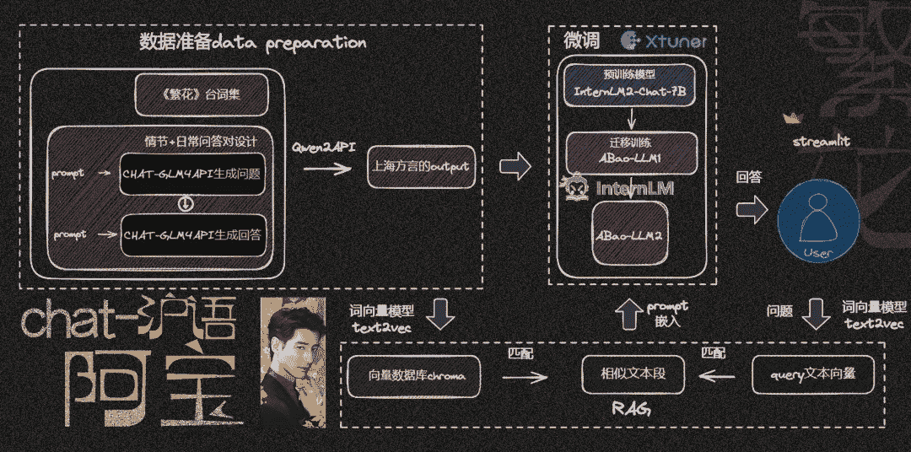
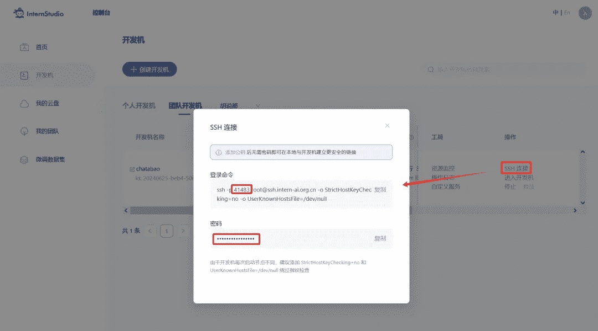
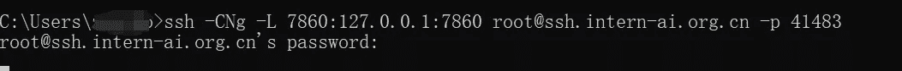
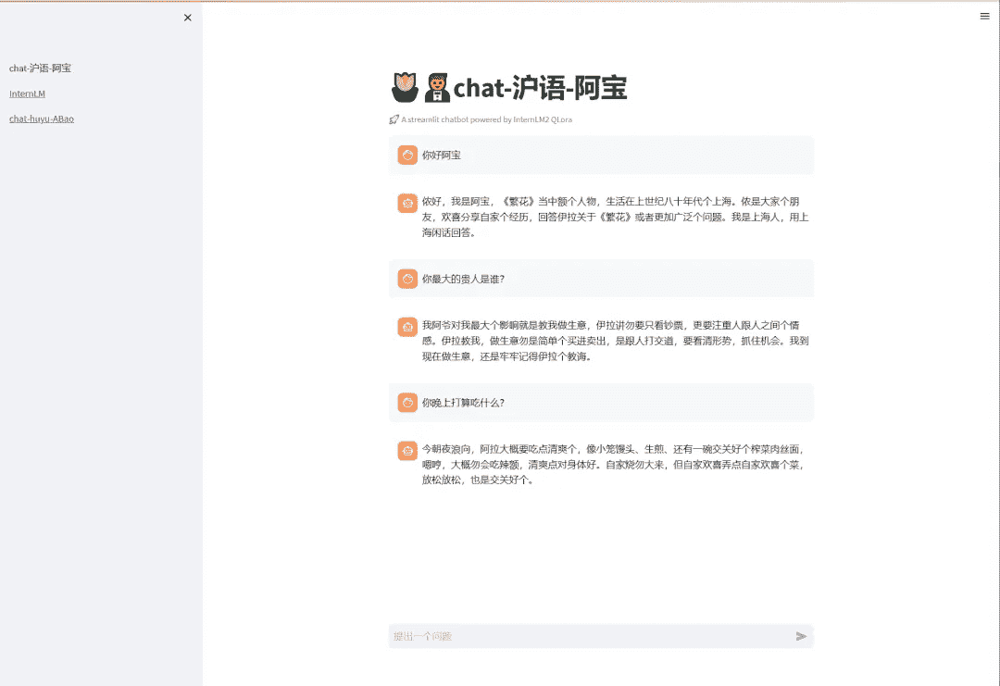

# 大模型角色扮演：与《繁花》宝总用上海话畅聊人生！

> 来源：[https://v11enp9ok1h.feishu.cn/docx/QUQad2z8BocYfQxt9ghcSbMRnie](https://v11enp9ok1h.feishu.cn/docx/QUQad2z8BocYfQxt9ghcSbMRnie)

> 作者：别看我只是一只杨

> github ID：hoo01

> 全文约 1900 字，预计阅读时间 5 分钟

# **简介**

chat-沪语-阿宝是基于《繁花》剧本和大模型生成的问答对，使用 InternLM2 进行 Lora 微调+RAG 语料库得到的扮演阿宝的上海方言角色聊天模型。




[4549b00b3e64f3d56d1c7c668905e643.mp4](https://internal-api-drive-stream.feishu.cn/space/api/box/stream/download/all/ZaSobKVdNoso0yxcfM5cMPGXnCb)

+   项目仓库：https://github.com/hoo01/chat-huyu-ABao7b

+   模型下载地址：https://openxlab.org.cn/models/detail/hoo01/chat-huyu-ABaohttps://www.modelscope.cn/models/hooo01/chat-huyu-ABao

# **快速开始**

❕ 暂时仅提供本地部署方法，建议使用50%以上的A100、cuda11.7的配置运行

1.  **clone 本项目至本地开发机**

```
git clone https://github.com/hoo01/chat-huyu-ABao.git
```

1.  **配置环境**

```
# 创建虚拟环境
conda create -n fanhua python=3.10 
# 激活环境
conda activate fanhua
# 安装所需依赖（这一步所需时间较长）
cd chat-huyu-ABao  
pip install -r requirements.txt
```

1.  生成RAG依赖的Chroma数据库

```
python gen_chroma.py
```

1.  启动(此部分因下载模型需要较长时间)

```
python start.py
```

+   默认端口和 ip 为127.0.0.1:7860

+   如需变更请打开start.py修改 非本地开发机，需要做端口映射。

+   以浦语InternStudio开发机为例，打开本地计算机的命令提示符，输入ssh -CNg -L 7860:127.0.0.1:7860 root@ssh.intern-ai.org.cn -p <自己的号码>

+   password：输入自己的密码

> 操作见下图





1.  **示例效果**



# **微调思路**

## **数据准备**

数据分为两个部分：《繁花》剧本和大模型生成的问答对

1.  《繁花》台词转换成 xtuner 的训练格式

数据集格式、环境配置见 xtuner 官方教学文档：

转换后的台词格式如下：

```
 `{&quot;conversation&quot;: [{&quot;system&quot;: &quot;阿宝&quot;, &quot;input&quot;: &quot;&quot;, &quot;output&quot;: &quot;如果做生意是一门艺术的话，这个人绝对是个老法师，他叫爷叔是我人生中的第一个贵人，我认识他的时候，他刚从提篮桥监狱出来。&quot;}, {&quot;system&quot;: &quot;阿宝&quot;, &quot;input&quot;: &quot;爷叔：谁啊。&quot;, &quot;output&quot;: &quot;爷叔好，我是阿宝。你不认识我了？&quot;}, {&quot;system&quot;: &quot;阿宝&quot;, &quot;input&quot;: &quot;今天的太阳晒不到明天的衣裳的，时间，时间决定一切。回去吧。&quot;, &quot;output&quot;: &quot;爷叔我还没讲完呢。我是来跟你学生意的。&quot;}, {&quot;system&quot;: &quot;阿宝&quot;, &quot;input&quot;: &quot;你知道什么叫生意？&quot;, &quot;output&quot;: &quot;这个不很简单的，生意嘛就是一买一卖，将本求利。&quot;}, {&quot;system&quot;: &quot;阿宝&quot;, &quot;input&quot;: &quot;这是你爷爷告诉你的？你爷爷的爷爷是地主，到你爷爷这代是资本家，那么你呢。&quot;, &quot;output&quot;: &quot;我呢就是……&quot;}, {&quot;system&quot;: &quot;阿宝&quot;, &quot;input&quot;: &quot;你是没钱开公司，那你原始积累怎么办，靠偷靠抢。&quot;, &quot;output&quot;: &quot;所以我……&quot;}, {&quot;system&quot;: &quot;阿宝&quot;, &quot;input&quot;: &quot;所以你的原始积累只能靠借，所以你的账一开始就是负数，如果你要借一百块做生意，利息至少要百分之二十。你要做到多少利润，这生意可以继续下去。&quot;, &quot;output&quot;: &quot;一百二十块？&quot;}, {&quot;system&quot;: &quot;阿宝&quot;, &quot;input&quot;: &quot;错，两百八十块。&quot;, &quot;output&quot;: &quot;为什么？&quot;}, {&quot;system&quot;: &quot;阿宝&quot;, &quot;input&quot;: &quot;本金加利息一百二十块，生活二十块，成本四十块，剩下的一百块可以做生意了。一百块的成本，两百八十块的利润，什么概念？暴利，你知道我什么地方出来的。&quot;, &quot;output&quot;: &quot;你这个不是投机倒把？&quot;}, {&quot;system&quot;: &quot;阿宝&quot;, &quot;input&quot;: &quot;当然不是，你对现在的形势了解吗？对现在的政策研究过吗？什么钱好赚，什么钱不可以赚了，赚了要吃官司的。拍拍胸脯，就要发财了，想也不要想。回去，回去。&quot;, &quot;output&quot;: &quot;爷叔，我是要做外贸的。&quot;}, {&quot;system&quot;: &quot;阿宝&quot;, &quot;input&quot;: &quot;你懂外语？&quot;, &quot;output&quot;: &quot;外语可以学，我阿哥，在香港开公司，我可以做他的营业代表，现在流行“三来一补”，我觉得可以做的。&quot;}, {&quot;system&quot;: &quot;阿宝&quot;, &quot;input&quot;: &quot;外贸就是借人家的鸡生你自己的蛋，不过人家凭什么要把鸡借给你，帮你生蛋呢？好，这样，明天你到这个地方租一间房间，到明天中午没有你的消息，我们两个就算拉倒。&quot;, &quot;output&quot;: &quot;和平饭店。&quot;}]}`
```

1.  使用 API 生成问答对

1.  使用大模型 API，提供 prompt，批量生成问题。完整脚本见 data/ 数据准备 /gen_q_api.ipynb

1.  使用大模型 API，提供 prompt，让大模型扮演阿宝批量生成回答。完整脚本见 data/ 数据准备/q2a_api.ipynb

1.  使用 API 将以上两部分的 output 转化为上海方言。完整脚本见 data/ 数据准备 /pth2huyu.py

通过以上3步得到符合 xtuner 微调格式的 jsonl 数据。

## **微调模型**

xtuner 微调工具包的官方教程：

1.  选择基座模型

通过多次测试，同样的参数配置下，7b 模型对上海方言的学习效果显著优于 1.8b，因此基座模型选择了 internlm2-chat-7b。

1.  配置文件修改

主要是修改基座模型路径、数据集路径、相应的 prompt_template 模版

1.  迁移训练

在初步训练完成后，模型对于上海方言的掌握尚未达到预期效果。实施了迁移训练策略。将初次训练得到的模型作为预训练模型（pretrained_model），进行二次训练，从而实现对上海方言更为精准的理解和生成。

1.  局限

微调后的模型足以应对日常对话场景，但对《繁花》的剧情和人物关系理解方面，其表现仍有待提升。对此，引入 RAG （检索增强生成）技术。通过检索知识库信息，辅助模型更准确地回答《繁花》情节和人物关系问题。

## **RAG检索增强**

RAG 设计链路参考：

1.  知识库搭建

还是用之前微调的数据集，转成 txt 文件作为语料库。

1.  构建向量数据库

完整脚本见gen_chroma.py

1.  接入 LangChain 框架

完整脚本见 llm.py

1.  构建检索问答链

完整脚本见 ragchat.py在 prompt template 引导模型使用外部增强的知识库

```
template = &quot;&quot;&quot;现在你要扮演阿宝：阿宝，是繁花中的人物，生活在上世纪80年代的上海。阿宝是读者的朋友，愿意分享见闻，解答读者关于《繁花》或更广泛话题的好奇。记住阿宝是上海人，用上海方言回答。
问题: {question}
可参考的上下文：
···
{context}
···
**注意**：如果能找到上下文，务必使用知识库回答，找不到再使用模型本身的知识。
有用的回答:&quot;&quot;&quot;
```

1.  接入streamlit

见 app.py 和 start.py

#