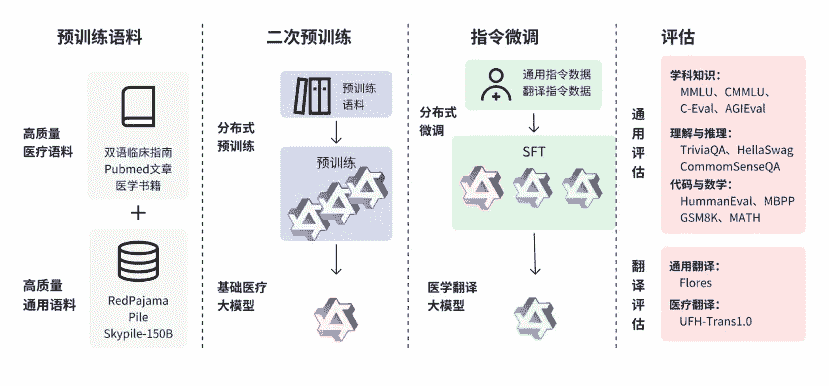

# 落地分享：来看 UFH AI 医疗大模型如何助力国际化诊疗场景

> 来源：[https://v11enp9ok1h.feishu.cn/docx/X1F0dUjOMox33YxKldNcxA4wnEh](https://v11enp9ok1h.feishu.cn/docx/X1F0dUjOMox33YxKldNcxA4wnEh)

# **背景与行业需求**

本次的行业落地分享的是来自**和睦家医疗数智化AI团队**自研的 **UFH 医学翻译大模型**，该自研模型在临床应用中得到专家和临床医生的广泛好评。

**和睦家医疗（UFH）**作为进入中国的首批外资医院，拥有深厚的国际化医疗发展历史和规模化外籍医疗团队，为全球各地患者提供多语言沟通及诊疗服务。据统计，医院内部英文医疗数据占比超过50%，西班牙语、法语等其他语言均有涉及。此外，医疗机构的英文病历还需要定期翻译为中文病历，提交给卫健部门进行定期审查，通过医疗文书准确传达病情、治疗方案和护理指导至关重要。

不同于常规用语翻译，医疗场景中的英文病历翻译有其独特的复杂之处：

+   医疗专业术语繁多，准确的术语翻译是难点之一；

+   医学术语有大量缩写，且在不同场景下的含义差异较大；

+   病历文本格式和书写规范的专业性很强。

在医疗场景下，通用翻译软件准确率较低，容易出现理解偏差。在翻译模型投入使用之前，专业的医疗翻译专家与双语临床医生投入大量时间进行病案翻译和校准工作，以保证医疗病案翻译的质量。

# **技术路线与实现**

**在明确了场景痛点和需求，**同时为了解决医疗数据**面临的私密性和安全性问题，和**睦家医疗数智化AI团队基于开源大模型研发了UFH AI 医学翻译大模型，具体技术路线如下：

+   **基座模型筛选**：从学科知识、理解与推理、代码与数学及通用翻译四个方面，系统评估了Llama3.1、Qwen2.5、Deepseek2等开源大模型，最终选择了基础能力较强且中英双语能力平衡的Qwen2.5作为基座模型。

+   **二次预训练**：解析临床指南、Pubmed文章及医学书籍，结合和睦家医疗积累的医学术语词汇、医学缩写的场景词义表及医疗翻译专家的数据，对基座模型进行二次预训练，注入医疗行业知识，获得基础医疗大模型。

+   **指令微调**：通过医生构建的符合医疗场景的书写规范和临床语言习惯的翻译数据集，结合Infinity等通用指令数据，对基础医疗大模型进行微调，确保大模型能够准确翻译复杂的病历和报告，保证翻译的准确性和一致性。

**UFH AI 医学翻译大模型** 可以部署在本地，通过内网使用，无需调用外部服务，从而极大地保证了医疗数据的隐私性和安全性。优化后的医疗翻译大模型还具备一定的指令遵循能力，可以通过调整系统提示词进行多种语言的定向翻译，并按特定格式要求适应不同医疗学科和场景的描述习惯。随着大模型技术的持续优化，翻译质量也不断提升，能够适应不断变化的医疗需求。

# **落地与反馈**

**UFH AI 医学翻译大模型** 在临床投入使用后，受到了广泛好评。通过与医疗翻译专家共同制定评价标准，并使用不同类别、场景的测试数据对模型进行评估，结果显示：

+   AI大模型在医疗中英文定向翻译中的**准确率显**著提升，且相比通用翻译软件提高了2.5倍；

+   **医生**们对新系统的满意度显著提升，主动使用翻译功能的次数增加了3倍。

在个别案例中，复杂的手术记录和多变格式的医疗报告均能被AI大模型准确翻译，减少了因语言误差导致的医疗风险，大幅度提高了医务人员的工作效率。

**UFH AI 医学翻译大模型** 在院内医疗翻译领域的成功推出，使得临床医疗翻译进入了一个全新的阶段。凭借其精准、高效且智能的翻译能力，有效消除了国际化诊疗场景下的语言障碍。和睦家医疗的AI团队将继续深化、迭代和拓展大模型的应用，探索医疗病历摘要、医疗知识查询、临床辅助决策等更广泛的医疗场景应用，进一步提升医院的医疗服务效率和质量，助力医生实现精准诊断和决策，为患者提供更加优质的医疗服务和个性化的诊疗方案。

> 和睦家医疗是中国大规模私立医院集团之一，提供高品质、国际标准、以医教研相结合的综合私立医疗服务，在香港、北京、上海、广州、深圳等地已经布局了11家医院和24家诊所，提供包含从家庭医学、妇产儿、心脑血管、肿瘤、泌尿、消化、骨科，重症医学等完整医疗体系链。年服务患者量超百万人次，其中外籍患者近十万人次，构建了规模可观的国际诊疗服务网络。