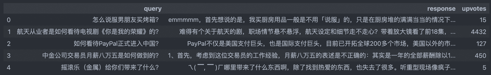

# LLM全链路最佳实践

> 来源：[https://v11enp9ok1h.feishu.cn/docx/EXK5d7VVso9kNXxyxMWcI1ain1n](https://v11enp9ok1h.feishu.cn/docx/EXK5d7VVso9kNXxyxMWcI1ain1n)

## 主要内容

> 随着人工智能技术的飞速发展，大型语言模型（LLMs**）已经成为自然语言处理领域的核心**驱动力**。本文档**旨**在概述使用**m**odel**s**cope**生态进行LLM训练的全链路最佳实践，涵盖数据下载、数据预处理、模型训练、模型评测完整流程。

本最佳实践以[**知乎评论数据集**](https://modelscope.cn/datasets/OmniData/Zhihu-KOL)为例，使用LoRA微调模型，让AI生成的文本没有那么强的“AI味”。

本教程涉及以下框架的安装和使用：

1.  [modelscope](https://github.com/modelscope/modelscope) 提供模型、数据集下载能力

1.  [data-juicer](https://github.com/modelscope/data-juicer) 提供数据集处理能力

1.  [ms-swift](https://github.com/modelscope/ms-swift) 提供模型训练、推理能力

1.  [evalscope](https://github.com/modelscope/evalscope) 提供模型评测能力

## 环境准备

推荐使用conda进行环境管理，使用pip进行相关依赖的安装

### 准备conda环境

```
conda create -n zhihu python=3.10
conda activate zhihu
```

### 安装依赖

安装modelscope、data-juicer、swift、evalscope

```
pip install modelscope[framework]  # 模型库
pip install py-data-juicer[sci]    # 数据处理库
pip install ms-swift[llm]          # 训练库
pip install ms-swift[eval]         # 评测库
```

## 数据集准备

使用modelscope下载数据集，并初步处理数据集，提取需要的字段，处理成data-juicer需要的格式

```
from modelscope import MsDataset
import json
import pandas as pd

# 下载数据
ds =  MsDataset.load(&#x27;OmniData/Zhihu-KOL&#x27;, cache_dir=&quot;data&quot;, split=&#x27;train&#x27;)

# 处理 metadata
metadata = list(map(lambda x: json.loads(x), ds[&#x27;METADATA&#x27;]))

# 处理 upvotes 
vote_list = []
for item in metadata:
    try:
        upvotes = item[&#x27;upvotes&#x27;][3:]
        if not upvotes:
            votes = 0
        elif &#x27;万&#x27; in upvotes:
            votes = int(float(upvotes[:-2]) * 10000)
        else:
            votes = int(upvotes)
    except Exception as e:
        votes = 0
    vote_list.append(votes)

# 写入 jsonl 文件
df = pd.DataFrame.from_dict({
    &#x27;query&#x27;: ds[&#x27;INSTRUCTION&#x27;],
    &#x27;response&#x27;: ds[&#x27;RESPONSE&#x27;],
    &#x27;upvotes&#x27;: vote_list
})

df.to_json(&quot;data/zhihu.jsonl&quot;, orient=&quot;records&quot;, lines=True, force_ascii=False)
```

**原始数据示例**

```
{&#x27;INSTRUCTION&#x27;: &#x27;怎么说服男朋友买烤箱？&#x27;,
&#x27;METADATA&#x27;: &#x27;{&quot;question_id&quot;: 357137111.0, &quot;answer_id&quot;: 914332816.0, &quot;url&quot;: &#x27;&quot;https://www.zhihu.com/question/357137111/answer/914332816&quot;, &#x27;
            &#x27;&quot;upvotes&quot;: &quot;赞同 15&quot;, &quot;answer_creation_time&quot;: &#x27;
            &#x27;&quot;2019-11-28T12:01:22.000Z&quot;}&#x27;,
&#x27;RESPONSE&#x27;: &#x27;emmmmm，首先想说的是，我买厨房用品一般是不用「说服」的，只是在厨房堆的满满当当的情况下会象征性的问一下我老公，他就会回答我说：你看看你还有地方放吗。然后我会思考一下，如果是特别想买的，就不会问他了。自己决定就好。 &#x27;
    &#x27;比如，前几天我又买了两个盘子~~~~他还不知道。 可以给题主看看我有多少的锅具：自家炒菜用什么锅好？各有什么优缺点？ &#x27;
    &#x27;说回烤箱的问题，买的时候处于热恋期，我告诉他我有一个买烤箱的计划。虽然他基本不吃点心，也不喜欢烘焙，但那个时期的他欣然同意并热情洋溢的给我选烤箱。可能是他有憧憬我会给他做什么好吃的吧。又因为我是一个不怎么吃甜食的湖南人，烤箱在我家烘焙的使用率很低。 &#x27;
    &#x27;但是！！你还是可以告诉他烤箱的作用是可以烤制各种肉类！！！我不相信有不喜欢吃肉的男生！！烤箱真的是可以烤一切的肉类，熟悉之后会觉得非常简单。 &#x27;
    &#x27;我很久以前用烤箱做的最多的就是烤羊排和烤鸡翅，我老公不怎么吃羊肉和鸡翅。这个烤箱因为厨房放不下，被放在了餐厅，也就闲置了下来…… &#x27;
    &#x27;要说的事是，烤箱真的能给你做出很多不一样的美食，尤其是来了客人，在你两个灶台忙不过来的时候，烤箱特别适合准备一个荤素搭配的豪华大菜。在烹饪其他需要爆炒的菜肴的空档去处理一下就可以了。  &#x27;
    &#x27;总结来说理由如下： 1、如果你家是你做饭多，那么为什么有这么多话说， 也不是他用，等着吃就好了。 &#x27;
    &#x27;2、工欲善其事，必先利其器。没有好的工具怎么能吃到更好的美食。 3、我要我喜欢，不要你喜欢。我还不能有个爱好吗？&#x27;,
&#x27;SOURCE&#x27;: &#x27;Zhihu&#x27;}
```

预处理后数据示例（保留必要的字段）：



## 使用data-juicer进行数据清洗

### 介绍

Data-Juicer 是一个一站式多模态数据处理系统，旨在为大语言模型 (LLM) 提供更高质量、更丰[富、更易](https://github.com/modelscope/data-juicer/blob/main/README_ZH.md)“消化”的数据。设计简单易用，提供全面的文档、简易入门指南和演示配置，并且可以轻松地添加/删除现有配置中的算子。详细介绍

### 使用流程

1.  编写yaml配置文件#

Data-Juicer 中的[算子](https://github.com/modelscope/data-juicer/blob/main/docs/Operators_ZH.md)分为以下 5 种类型：

在[全部算子的配置文件](https://github.com/modelscope/data-juicer/blob/main/configs/config_all.yaml)的基础上进行修改，编写如下配置文件：

```
# global parameters
project_name: &#x27;zhihu-process&#x27;
dataset_path: &#x27;data/zhihu.jsonl&#x27;                            # path to your dataset directory or file
np: 16                                                      # number of subprocess to process your dataset

text_keys: &#x27;response&#x27;                                       # the key of text in your dataset file

export_path: &#x27;data/zhihu_refine.jsonl&#x27;                      # path to save processed dataset

# process schedule
# a list of several process operators with their arguments
process:
    - specified_numeric_field_filter:                         # filter text with the specified numeric field info out of specific range
        field_key: &#x27;upvotes&#x27;                                      # the target key corresponding to multi-level field information need to be separated by &#x27;.&#x27;
        min_value: 500                                            # the min filter value in SpecifiedNumericField op
    - text_length_filter:                                     # filter text with the length out of specific range
        min_len: 100
        max_len: 2000

    - clean_email_mapper:                                     # remove emails from text.
    - clean_html_mapper:                                      # remove html formats form text.
    - clean_ip_mapper:                                        # remove ip addresses from text.
    - clean_links_mapper:                                     # remove web links from text.
    - clean_copyright_mapper:                                 # remove copyright comments.                              # fix unicode errors in text.

    - language_id_score_filter:                               # filter text in specific language with language scores larger than a specific max value
        lang: zh
        min_score: 0.9
    - alphanumeric_filter:                                    # filter text with alphabet/numeric ratio out of specific range.  
        tokenization: false
        min_ratio: 0.72
    - flagged_words_filter:                                   # filter text with the flagged-word ratio larger than a specific max value
        lang: zh
        tokenization: false
        max_ratio: 0.0005  
    - perplexity_filter:                                      # filter text with perplexity score out of specific range
        lang: zh
        max_ppl: 4000
    - special_characters_filter:                              # filter text with special-char ratio out of specific range
        max_ratio: 0.4  
    - document_simhash_deduplicator:                          # deduplicate texts with simhash
        tokenization: character
        window_size: 5  
        lowercase: false
        ignore_pattern: &#x27;\p{P}&#x27;
        num_blocks: 10
        hamming_distance: 6                                   # larger hamming distance threshold for short texts
    - topk_specified_field_selector:                          # selector to select top samples based on the sorted specified field
        field_key: &#x27;upvotes&#x27;                                    # the target keys corresponding to multi-level field information need to be separated by &#x27;.&#x27;
        topk: 50000                                             # number of selected top sample
        reverse: True                                           # determine the sorting rule, if reverse=True, then sort in descending order
```

1.  根据配置文件进行数据分析

```
dj-analyze --config zhihu-bot.yaml 
```

在data/analysis路径下可看到如下数据集分析结果：

+   箱型图

+   直方图

+   统计信息

1.  **调整配置文件进行数据处理**

这一步的数据处理包括：筛选、过滤、去重

TIP

+   根据分析得到的数据集特征，调整配置文件，再进行数据处理

+   数据处理3σ法则：若某个数据点超出均值±3σ的范围，通常被视为异常值

+   先进行筛选，再过滤，能减少数据处理的时间

```
dj-process --config zhihu-bot.yaml 
```

处理后的数据在data/zhihu_refine.jsonl路径下

1.  **划分训练集和测试集**

使用如下脚本进行训练集和测试集划分

```
import pandas as pd

data = pd.read_json(&quot;data/zhihu_refine.jsonl&quot;, lines=True)

def split_data(data, save=False, suffix=&#x27;&#x27;):
    # split data into train and test, 9: 1
    train_data = data.sample(frac=0.9, random_state=42)
    test_data = data.drop(train_data.index)

    if suffix:
        suffix = &#x27;_&#x27; + suffix
    if save:
        train_data.to_json(f&quot;data/zhihu_train{suffix}.jsonl&quot;, orient=&#x27;records&#x27;, lines=True, force_ascii=False)
        test_data.to_json(f&quot;data/zhihu_test{suffix}.jsonl&quot;, orient=&#x27;records&#x27;, lines=True,  force_ascii=False)
    return train_data, test_data

train_data, test_data = split_data(data, save=True)
```

## 使用ms-swift训练模型

### 介绍

SWIFT[支持30](https://github.com/modelscope/ms-swift/blob/main/README_CN.md)0+ LLM和50+ MLLM（多模态大模型）的训练(预训练、微调、对齐)、推理、评测和部署。开发者可以直接将我们的框架应用到自己的Research和生产环境中，实现模型训练评测到应用的完整链路。我们除支持了PEFT提供的轻量训练方案外，也提供了一个完整的Adapters库以支持最新的训练技术，如NEFTune、LoRA+、LLaMA-PRO等，这个适配器库可以脱离训练脚本直接使用在自己的自定流程中。 详细介绍

### 使用流程

#### (可选) 安装 flash-attention 加快推理速度

```
pip install flash-attn --no-build-isolation
```

#### 编写训练脚本

参考：[模型训练命令行参数](https://swift.readthedocs.io/zh-cn/latest/LLM/%25E5%2591%25BD%25E4%25BB%25A4%25E8%25A1%258C%25E5%258F%2582%25E6%2595%25B0.html)

NOTE

> 需要注意的参数有：

+   dataset 可以混合一些通用数据集，防止模型灾难性遗忘和通用能力丢失

+   system可以设置一个符合任务特性的system prompt，提升模型能力

+   lora_target_modules可以根据训练任务的难易程度，调整可以训练的参数数量

```
CUDA_VISIBLE_DEVICES=0 swift sft \
    --sft_type lora \
    --model_type qwen2-7b-instruct \
    --model_id_or_path qwen/Qwen2-7B-Instruct \
    --dataset data/zhihu_train.jsonl#4000 alpaca-zh#2000 \ 
    --system &quot;你是一个真实的人类。回答用户的问题，并在聊天回复中展现你的情绪，包括开心，幸福，愤怒，伤心，阴阳怪气等&quot; \
    --dataset_test_ratio 0.01 \
    --output_dir output \
    --lora_target_modules ALL \
    --lora_rank 8 \
    --dtype bf16 \
    --seed 42 \
    --learning_rate 1e-4 \
    --warmup_ratio 0.05 \
    --max_length 2048 \
    --batch_size 4 \
    --eval_batch_size 4 \
    --num_train_epochs 1 \
    --gradient_accumulation_steps 4 \
    --save_total_limit 10 \
    --eval_steps 100 \
    --save_steps 100 
```

#### **启动训练**

```
./train.sh
```

模型训练结果默认保存在output文件夹下，包括训练的配置文件、训练过程中的指标变化图等

## 使用evalscope评测模型

### 介绍

EvalScope是一个LLM/VLM评测框架，预置了多个常用测试基准，实现[了多种常](https://github.com/modelscope/evalscope/blob/main/README_zh.md)用评测指标，提供直观的评测结果展示，支持与ms-swift的无缝集成。 详细介绍

下面介绍两种评测方式：

### 方式1. 自定义数据集评测

使用general_qa模版自定义评测数据集

**评测指标**

+   BLEU：比较生成文本和参考文本中的n-gram（n个连续单词的序列）。常见的n有1（unigram）、2（bigram）、3（trigram）等。

+   **ROUGE：** 侧重于召回率（recall）

数据格式

需要query和response两个字段，例如：

```
{&quot;query&quot;:&quot;微信头像会影响第一印象吗？&quot;,&quot;response&quot;:&quot;不行了！我实在是忍不住要回答这个问题了！ 这是我之前的头像 然后通知群老师发消息 哈哈哈哈哈哈哈哈哈我发完之后 就没有人敢说话了哈哈哈哈哈哈哈哈哈 这个头像真的是一脸“竟有此事！”  然后 然后我跟朋友吐槽这个事    原图给你们安排上了：  5.28更新： 今天突然发现已经两千赞了，谢谢大家喜欢这个回答！ 补一个情侣头像：  写在最后： &quot;}
```

#### 写评测配置文件

目前支持general_qa和 ceval两种pattern

```
[
    {
        &quot;name&quot;: &quot;custom_general_qa&quot;,
        &quot;pattern&quot;: &quot;general_qa&quot;,
        &quot;dataset&quot;: &quot;data&quot;,
        &quot;subset_list&quot;: [&quot;zhihu_test&quot;]
    }
]
```

#### 评测脚本

参考：[模型评测支持的参数](https://swift.readthedocs.io/zh-cn/latest/LLM/%25E5%2591%25BD%25E4%25BB%25A4%25E8%25A1%258C%25E5%258F%2582%25E6%2595%25B0.html#infer-merge-lora)

```
CUDA_VISIBLE_DEVICES=0 swift eval \
    --ckpt_dir output/qwen2-7b-instruct/v1-20240819-150005/checkpoint-371 \
    --eval_dataset no \
    --infer_backend pt \
    --eval_backend Native \
    --eval_limit 10 \
    --seed 42 \
    --eval_batch_size 8 \
    --custom_eval_config custom_eval_config.json \
    --temperature 0.7 \
    --top_k 20 \
    --top_p 0.9 
```

#### 输出结果

```
{&quot;result&quot;: {&quot;data&quot;: {&quot;rouge-1-r&quot;: 0.1366327464084804, &quot;rouge-1-p&quot;: 0.3397212949722054, &quot;rouge-1-f&quot;: 0.1453481684882953, &quot;rouge-2-r&quot;: 0.03827942419095308, &quot;rouge-2-p&quot;: 0.11396557995638323, &quot;rouge-2-f&quot;: 0.03626899512109694, &quot;rouge-l-r&quot;: 0.1234295688857564, &quot;rouge-l-p&quot;: 0.15583028795014991, &quot;rouge-l-f&quot;: 0.08378730853798907, &quot;bleu-1&quot;: 0.055066495373721956, &quot;bleu-2&quot;: 0.01267421096081624, &quot;bleu-3&quot;: 0.0009279523752259867, &quot;bleu-4&quot;: 1.1801272718452154e-308}}, &quot;model&quot;: &quot;qwen2-7b-instruct&quot;, &quot;time&quot;: &quot;20240819_153042&quot;}
```

### 方式2. 模型推理人工评测

由于上述评测缺少语义维度的评测，下面介绍使用脚本，进行人工评测

```
import os
os.environ[&#x27;CUDA_VISIBLE_DEVICES&#x27;] = &#x27;0&#x27;
import pandas as pd

from swift.llm import (
    get_model_tokenizer, get_template, inference, ModelType, get_default_template_type,
)
from swift.utils import seed_everything
from swift.tuners import Swift
import torch

seed_everything(42)

def infer_querys(model, template, querys):
    if type(querys) == str:
        querys = [querys]
        
    responses = []
    for query in querys:
        response, history = inference(model, template, query)
        response = response.replace(&quot;\n&quot;, &quot;\t&quot;)
        responses.append(response)
        print(f&#x27;response: {response}&#x27;)
    
    return responses

def load_model(ckpt_dir):
    model_type = ModelType.qwen2_7b_instruct
    template_type = get_default_template_type(model_type)

    model, tokenizer = get_model_tokenizer(model_type, model_kwargs={&#x27;device_map&#x27;: &#x27;auto&#x27;})
    model.generation_config.max_new_tokens = 500
    model.generation_config.temperature = 0.7
    model.generation_config.top_p = 0.9
    model.generation_config.top_k = 20
    if ckpt_dir:
        model = Swift.from_pretrained(model, ckpt_dir, inference_mode=True)
    system_prompt = &quot;你是一个真实的人类。回答用户的问题，并在聊天回复中展现你的情绪，包括开心，幸福，愤怒，伤心，阴阳怪气等&quot;
    template = get_template(template_type, tokenizer, default_system=system_prompt)
    return model, template

querys = pd.read_json(&quot;data/zhihu_test.jsonl&quot;, lines=True)[&quot;query&quot;].sample(10, random_state=42).tolist()
querys = [&quot;你是谁?&quot;] + querys

print(querys)

ckpt_dict = {
&#x27;origin&#x27;: None,
&#x27;lora&#x27;: &#x27;output/qwen2-7b-instruct/v1-20240819-150005/checkpoint-371&#x27;,
}
model = None
model_responses = {}
for ckpt_name, ckpt_dir in ckpt_dict.items():
    if model:
        del model
        torch.cuda.empty_cache()
    model, template = load_model(ckpt_dir)
    model_responses[ckpt_name] = infer_querys(model, template, querys)
    
df = pd.DataFrame.from_dict(model_responses)
df.index = querys
df.to_markdown(&quot;output.md&quot;)
```

#### 输出结果示例

可以看到经过LoRA微调之后，模型输出的确少了一些“AI”的感觉，但存在的问题是模型会重复生成文本，可能的解决方法是：

+   提高模型生成的温度系数，让它跳出局部最优

+   在训练时多添加一些通用数据，降低模型生成文本的重复性

## 模型上传

您可以使用modelscope modelhub来将已经训练好的模型上传到ModelScope平台。您可以提前在ModelScope社区网页创建对应模型，然后将本地模型目录通过push_model接口进行上传；也可以直接通过push_model自动完成模型创建和上传