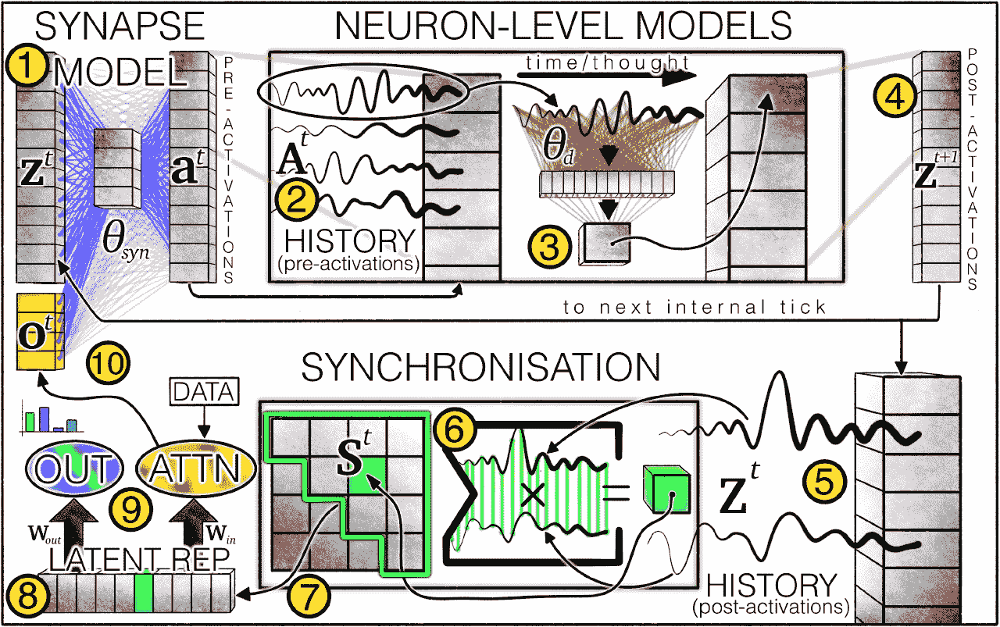
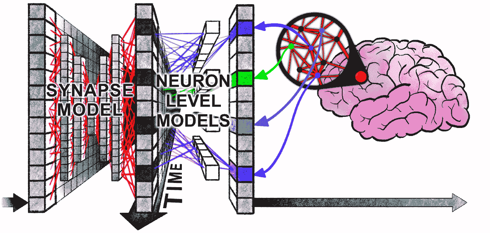

# CTM读文笔记

> 来源：[https://v11enp9ok1h.feishu.cn/docx/XO64dDqygosTrex3vq6cVr7WnwR](https://v11enp9ok1h.feishu.cn/docx/XO64dDqygosTrex3vq6cVr7WnwR)

> 一个新型的人脑启发式架构，在现有时序无关的神经元模型的基础上引入了"时序"概念，涌现出一系列类似人脑的现象

## CTM架构概述：



## CTM架构概述：

> ①突触模型（权重以蓝线表示）通过模拟神经元间相互作用生成预激活值。每个神经元会保留

> ②预激活历史记录，其中最新数据被

> ③神经元级模型（权重以红线表示）用于产生

> ④后激活值。系统同时维护

> ⑤后激活历史记录，并据此计算

> ⑥同步矩阵。基于该矩阵

> ⑦筛选神经元对，由此产生的

> ⑧潜表征被CTM用于 ⑨生成输出并通过交叉注意力机制调节数据。

> 经调节的数据（如注意力输出）会 ⑩与后激活值拼接，作为下一内部时钟步的输入

如果只是单纯的引入时间维度的话，传统的 RNN 架构也能够实现，但 CTM 的创新之处在于：

1.  使用神经元级模型取代了传统的激活函数

1.  使用神经同步作为潜在表征来调制数据并生成输出

### 连续思考：内部序列维度

论文定义了一个内部的时间维度：

图中参数右上角的角标就指代的是某一个特定的时间步，而每一个时间步中都会进行一次图中完整的计算流程(从①到⑩)

这种内部维度并非全新的概念，RNN 和 Transformer 中都有使用。但是传统的架构按照数据输入的顺序来逐步处理，这隐含地将内部的时间维度与数据的输入顺序挂钩了。

举个例子，**RNN**** 中也有内****部时间维度**的概念，只是每一个时间步模型**都会接受一个**新的 token 输入，然后根据内部隐状态去产生下一个  token并更新内部隐状态。如果只看 token 的输入就会发现我们其实是默认将数据内在的顺序作为模型的内部时间维度

> **Transformer** 本身是"无序"的：每一个时间步注意力机制都会并行处理原来所有的 token 或许这也是其强大所在🤔真正和输入数据顺序相关的步骤在于"位置嵌入"

而** CTM **则完全解耦了这种关联，让内部的处理与输入数据无关。不只是顺序无关，还与输入序列的长度无关，这也可能是作者更想强调的🤔

> 这种"解耦"使得模型内部的"思考"可以有任意长度，可以迭代地构建和完善内部表征，并且可以扩展到"非序列化"的任务上，例如求解迷宫问题。

>

> 其实目前 CoT 那一系列的技术可以理解为在做"解耦"的工作：数据输入已经摆在那里了，直接生成答案效果不太行，那就多产生一些长度不受数据序列影响的中间 token 也就是所谓的思考过程。但发现在非常简单的问题中模型想太多结果也不太好，怎么办呢？

>

> Anthropic 就把"思考多少合适"这个问题丢给了模型使用者，这从工程上也不失为一个明智之举。但 CTM 貌似有望解决这个问题😃其貌似从底层架构上解耦了数据序列与内部时间维度的关系🤔

如果你想对当前的 CoT 技术有一个更加深入而全面的了解，可以去看看 Why we think - Lil’log 里面有更加学术化的严谨表达，但又非常容易理解。

### 循环权重：突触模型

这一部分主要讲解突触模型，对应图中的番号①部分。形式化来讲突触模型进行的工作如下：

+   其中  表示$t$时间步的后激活向量，  是上一个时间步计算得出的调制数据，与原来的  进行拼接后整体送入突触模型进行计算，然后就得出  也就是预激活向量

+   突触模型本质上就是一个函数  可以用多种方式表达，经过实验，原论文中使用了 MLP 来表示这个函数，更具体的就是 U-NET-esque MLP

+   然后将最近的   个预激活向量用一个矩阵   存储起来：

> 历史序列中的前  个元素及初始时刻  的  值需要进行初始化，实验表明将其设置为可学习参数能获得最佳效果。

---

### 参数私有化的神经元级模型

> 在突触模型中介绍了单个神经元(突触)是如何处理输入，并产生一个历史记录矩阵。现在假设有  个同样的神经元，每一个神经元都有各自的  我们将其中编号为  的神经元的历史记录向量写作

然后每一个神经元都会进行如下计算：

+    表示编号为  的神经元私有的计算参数；  如其角标所示，就是下

+   一个时间步  号神经元的后激活值，也就是说：

而  就是一个单隐层的 MLP,接受一个$M$维的向量  输出

用大白话描述这一步操作就是：每一个神经元都根据自己前  次的预激活值产生下一个后激活值。

---

### 神经元同步：输入与输出的调制

+   这一步是让数据与模型的交互不再依赖某一个时刻的模型状态，而是持续的动态的神经活动。具体而言就是将后激活向量收集起来，形成一个矩阵：

+   然后将神经元同步描述为  的内积：

+   然后对这个神经元同步矩阵进行下采样：从中随机选取  个元素值，分别形成两个神经元同步的表征向量，即  和

被投影到输出空间：

而   则用于在世界中产生行为(尊重原论文表述，但其实有些迷惑 😰):

和  都是可学习的矩阵参数

计算得出的  会再经过额外的计算产生  并在第一步中与 进行拼接，在作者的实验中这个额外的计算一般就是注意力层：

> 其中   也是一个神经网络模型，例如 ResNet由于   聚合了当前所有时间步的信息，较晚的时间步可能对结果的影响更大。为了让模型的灵活性更强，引入了一个可学习的衰减系数:

+   其中  也是一个神经网络模型，例如ResNet

+

+   由于  聚合了当前所有时间步的信息，较晚的时间步可能对结果的影响更大。为了

+   **让模型的**灵活性更强，引入了一个可学习的衰减系数：

然后用这个衰减系数去放缩原本的神经元同步矩阵的元素值：

### 损失函数：在不同时间步中优化

这里用分类任务举例子，假设某一个分类任务有 C 个类别，某一个时间步上的损失就是：

+   作者还给出了一个置信度向量

+   然后在所有时间步上收集这些损失就形成了两个矩阵：    和

> 一个自然产生的问题是：应如何将L降维为标量损失函数以用于学习？本研究的损失函数旨在优化 CTM 在内部时间维度上的性能表现。相较于让模型在某一个特定的时间步输出结果(典型的就是最后一步)，作者采用了动态聚合的策略，整合两个内部时刻的信息：损失最小点和确定性最高点。该方法优势如下：

1.  促使CTM在多个内部时刻建立有意义的表征与计算

1.  自然形成课程学习效应，模型可先利用后期内部时刻处理复杂计算，再逐步过渡至早期步骤处理简单任务

1.  使CTM能够根据数据集中各样本点的固有难度自适应调整计算强度

具体操作如下公式所示：

然后使用随机梯度下降算法优化模型参数。整个算法流程到这里就结束了。

然后作者又强调了一下这模型架构的优越性：

> “将时序作为 CTM 的基本功能要素引入，具有诸多有益特性。其中尤为关键的是，我们能够在不限制内部时钟周期使用数量的情况下训练 CTM。这种看似微妙的自由度实则意义深远，它使得 CTM 能够为不同数据点分配可变的计算量。这种自适应/动态计算理念与现代测试时计算范式(Test time Scaling)相契合，其区别在于：这一备受推崇的建模特性是 CTM 的自然衍生结果，而非事后施加的约束或学习过程中的限制条件。”

### 突触模型和神经元级模型



上面这幅图非常直观地解释了突触模型部分和神经元级模型部分进行的操作：前者让同一时刻在不同神经元之间的信息进行交互；后者让不同时刻同一神经元的历史信息进行交互。如图中所示，一个纵向的信息融合之后紧跟一个横向的信息融合🤔

模型如何与外界数据进行交互呢？通过对神经元同步矩阵进行下采样然后进行线性投影得到。这么说非常抽象，但换一个视角就能发现其中的逻辑所在：如果我们把 CTM 想象成一个大脑，那么对神经同步矩阵的采样就是从中截取某部分信息，然后通过一个矩阵映射去驱动行为。

一个非常合理的想法就是：把这个矩阵换成一个 MLP 网络会不会效果更好？🤔下采样的策略对于 CTM 模型的能力是否有影响？能不能使用某种注意力机制来构建某种"智能"的下采样策略？

## 代码分析

Q：prediction_reshaper 参数是什么？

A：可以理解为输出的参数的形状，每个任务都有不同的配置。

在迷宫问题中这个参数被设置为 [args.maze_route_length, 5]，其中数字 5 表示每次模型都从"上、下左、右、停止"这五个动作中产生预测，给出这五个动作的归一化后的概率分布；maze_route_length 表示进行预测的步数，网页端设置的是 75 步

Q：下面这一段代码是在干什么？

```
try:
        # Determine pseudo input shape based on dataset
        h_w = 39 if args.dataset in [&#x27;mazes-small&#x27;, &#x27;mazes-medium&#x27;] else 99 # Example dimensions
        pseudo_inputs = torch.zeros((1, 3, h_w, h_w), device=device).float()
        model(pseudo_inputs)
except Exception as e:
         print(f&quot;Warning: Pseudo forward pass failed: {e}&quot;)
print(f&#x27;Total params: {sum(p.numel() for p in model.parameters())}&#x27;)
```

A：构造一个"伪输入"，验证算法正确性