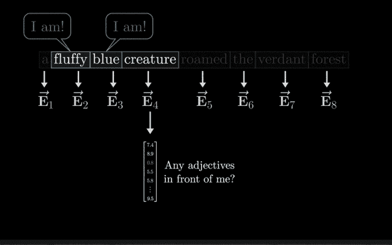
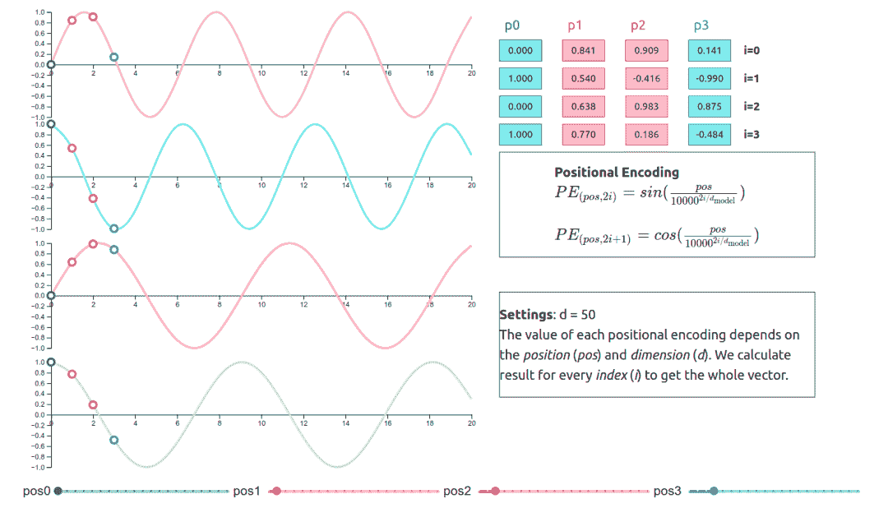
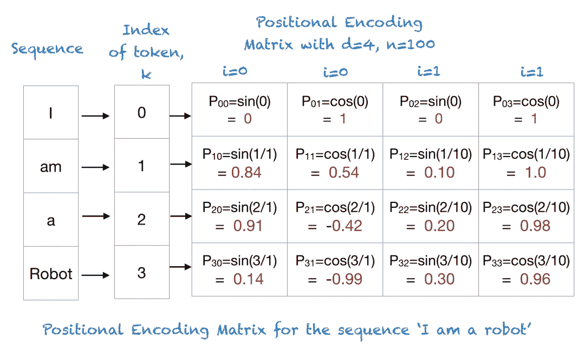
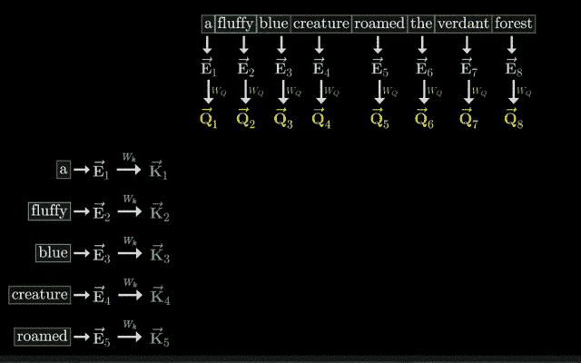
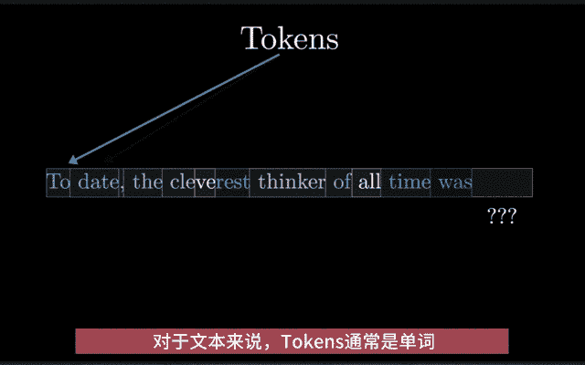
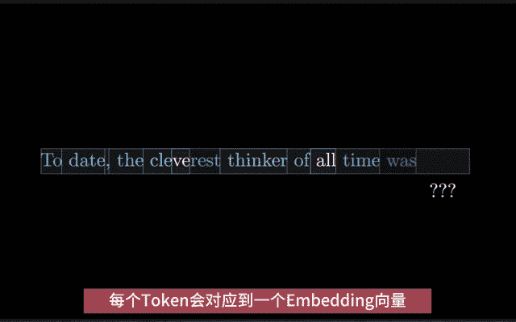
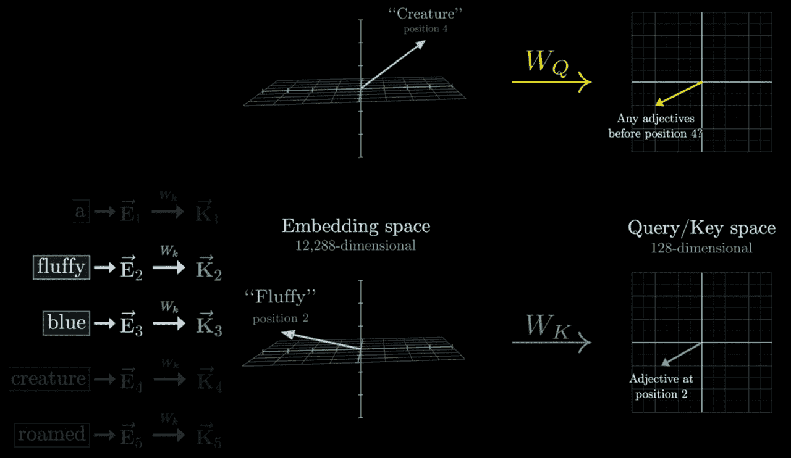
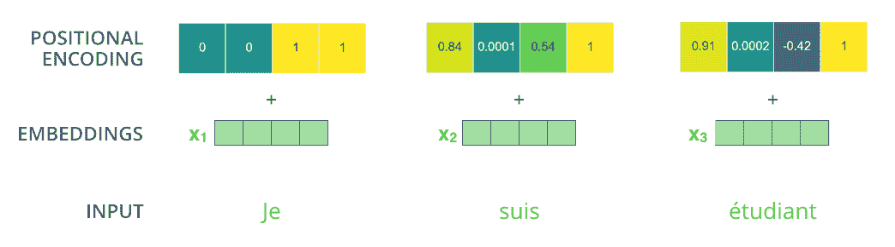

# Transformer - Input（输入）

> 来源：[https://v11enp9ok1h.feishu.cn/docx/Xd3odubqto9eg0xsnVOcz2d3nrI](https://v11enp9ok1h.feishu.cn/docx/Xd3odubqto9eg0xsnVOcz2d3nrI)

## 一、输入嵌入（Input Embedding）

词嵌入（Word Embedding）：词嵌入是最基本的嵌入形式，它将词汇表中的每个单词映射到一个固定大小的向量上。这个向量通常是通过训练得到的，能够捕捉单词之间的语义关系。

在Transformer中，词嵌入层通常是一个可学习的参数矩阵，其中每一行对应词汇表中的一个单词的嵌入向量。

假设词汇表大小为12288，嵌入向量的维度为128，则嵌入层会将输入文本中的每个单词映射到一个128维的向量上。

## 二、位置编码（Positional Encoding）

位置编码（Positional Encoding）：Transformer模型完全基于注意力机制，它本身并不包含循环或卷积结构，无法直接理解输入序列中单词的顺序信息。为了弥补这一缺陷，Transformer引入了位置编码来为模型提供单词在序列中的位置信息。

位置编码通过一组正弦和余弦函数来实现，这些函数的频率和相位随着位置的不同而变化。位置编码的维度与嵌入向量的维度相同，可以将它们直接相加到嵌入向量上。

**假设嵌入向**量的维度为128，输入序列的最大长度为12288，则可以生成一个形状为(12888, 128)的位置编码矩阵。对于序列中的每个位置，都会有一个对应的128维向量来表示其位置信息。

## 三、Transformer输入处理流程

Transformer输入处理流程：将预处理后的文本通过分词转换为Token，再将这些Token通过词嵌入转换为高维向量，并添加位置编码以保留顺序信息，最后作为输入传递给Transformer编码器。

+   **文本预处理：**将输入的文本数据进行预处理，包括分词（将文本拆分成单词或子词单元）、转换为小写、去除停用词等。这一步通常由分词器（Tokenizer）完成。

+   构建嵌入向量：将预处理后的文本数据通过词嵌入层转换为嵌入向量。这一步是将文本数据转换为模型可以处理的数值形式的关键步骤。

+   **添加位置编码：**为每个嵌入向量添加位置编码，以提供单词在序列中的位置信息。这通常是通过将位置编码向量与嵌入向量相加来实现的。

+   输入到Transformer模型：将添加了位置编码的嵌入向量作为输入传递给Transformer模型的编码器部分。编码器会利用自注意力机制和其他组件对输入序列进行处理，并生成输出序列的表示。

