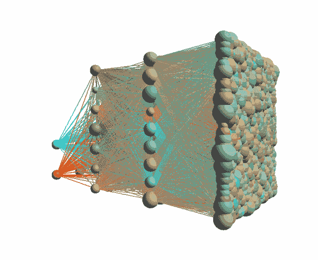
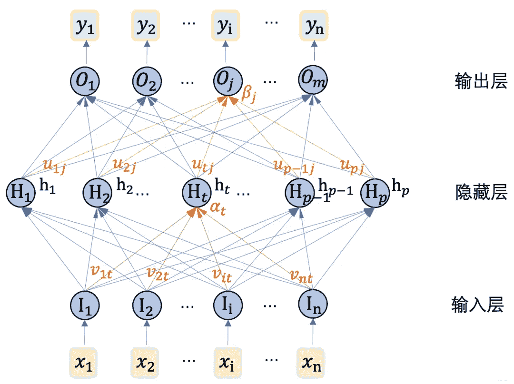
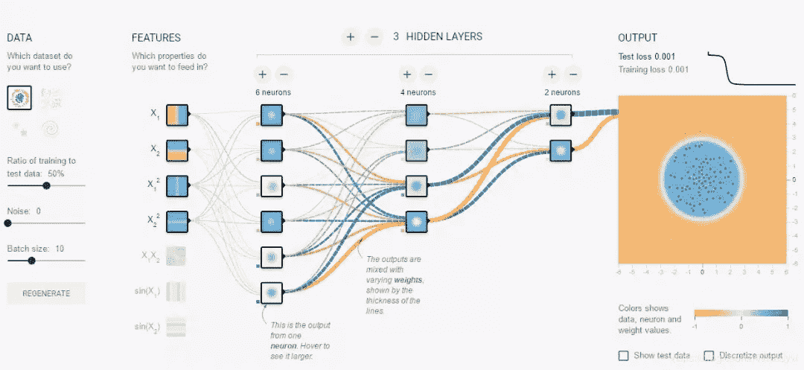
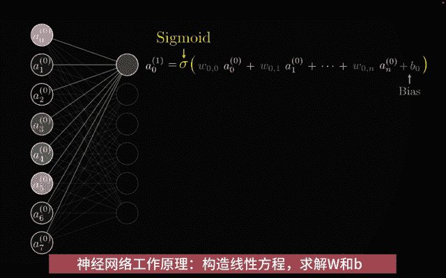
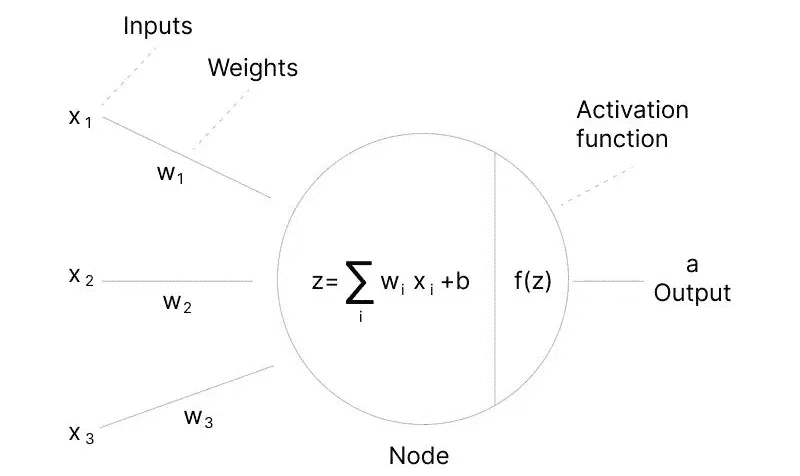
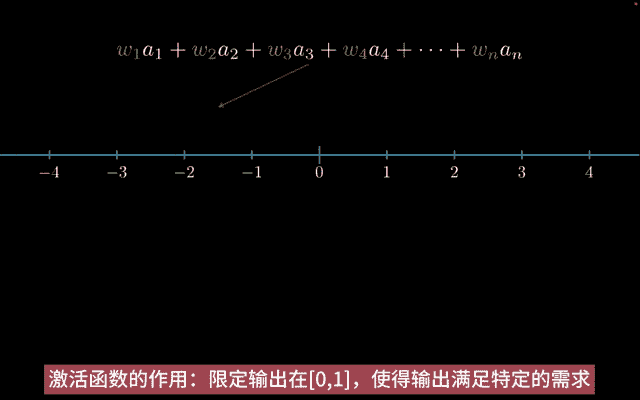
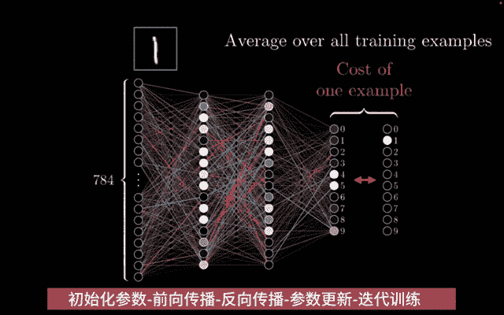
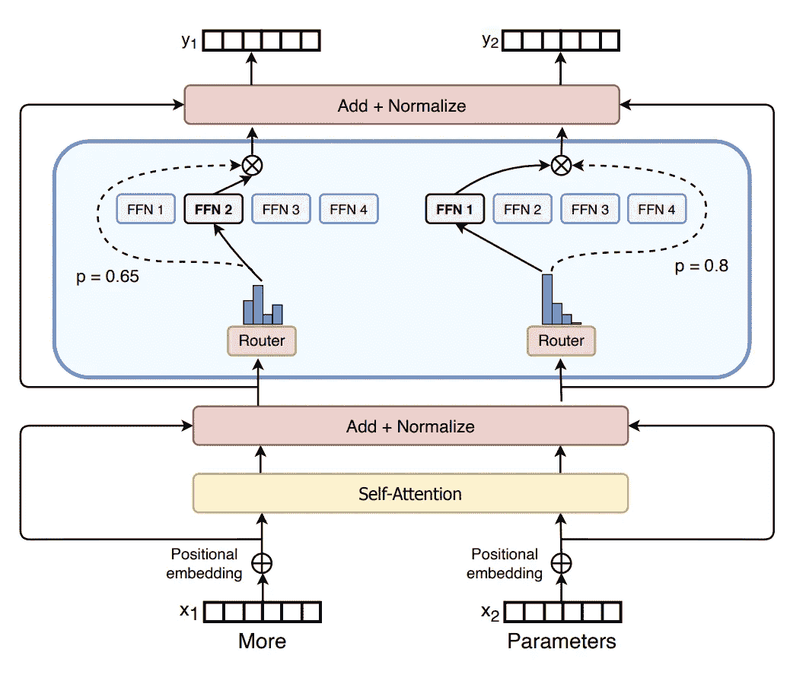
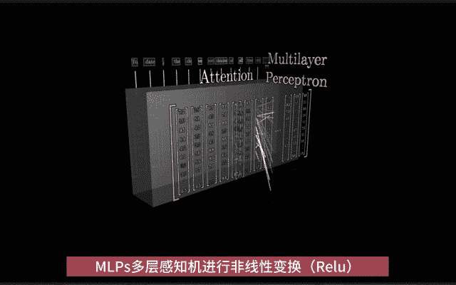

# Transformer - FFNN（前馈神经网络）

> 来源：[https://v11enp9ok1h.feishu.cn/docx/RS9Rd1XbQooyH9xHEDqcD0qCnwc](https://v11enp9ok1h.feishu.cn/docx/RS9Rd1XbQooyH9xHEDqcD0qCnwc)

## 一、神经网络（N**eural Network**）

**神经网络：**神经网络（Neural Networks）是一种模仿生物神经网络的结构和功能的数学或计算模型。它由大量的人工神经元（也称为节点或处理单元）相互连接而成，这些神经元之间通过带有权重的连接进行信息的传递和处理。

神经网络的设计灵感来源于对生物神经系统（特别是大脑）的研究，尽管它们并不完全等同于生物神经网络，但已经成功地应用于各种复杂的计算问题，包括模式识别、预测、数据分类、聚类等。

**神经网络结构：**由多个层（包括输入层、隐藏层和输出层）构成，层内包含多个神经元，神经元之间通过带权重的连接相互传递信息，并通过激活函数进行非线性转换。

1.  层（Layers）：神经网络通常由多个层组成，包括输入层、隐藏层（可以有多个）和输出层。输入层接收外部数据，隐藏层对数据进行处理，输出层产生网络的最终输出。

1.  神经元（Neurons）：神经网络的基本处理单元，模拟生物神经元的功能。每个神经元接收来自其他神经元的输入信号，对这些信号进行加权求和，并应用一个激活函数来决定是否将信号传递给其他神经元。

1.  连接（Connections）：神经元之间的连接，每条连接都有一个权重（Weight），这个权重决定了该连接在信号传递中的重要性。权重的值在学习过程中被调整，以优化神经网络的整体性能。

1.  激活函数（Activation Functions）：神经元在接收到加权求和的输入后，会通过一个非线性函数（即激活函数）来决定其输出。常见的激活函数包括Sigmoid、ReLU（Rectified Linear Unit）等，它们为神经网络引入了非线性特性，使得网络能够学习复杂的数据表示。

## 二、多层感知机（MLP）

**多层感知机：**多层感知机（Multilayer Perceptron，简称MLP）是机器学习中的一种基本且重要的神经网络模型。多层感知机由多个神经元层组成，每一层的神经元与相邻层的所有神经元相连，即全连接。

**输入层：**接收外部输入数据，并将其传递给下一层。

**隐藏层：**MLP中的中间层，其神经元数量可以根据需要进行调整。隐藏层通过线性变换和激活函数引入非线性，从而能够处理复杂的非线性关系。

**输出层：**负责输出模型的预测结果。输出层的神经元数量取决于问题的类型，例如二分类问题通常使用一个神经元，多分类问题则使用多个神经元。

**前馈神经网络：**MLP属于前馈神经网络（Feedforward Neural Network）的范畴。前馈神经网络的主要特性在于数据的单向流动，即从输入层开始，经过隐藏层，最终到达输出层，每一层的神经元只接收来自前一层的输出作为输入，并不涉及层内或层间的反馈连接。

**FFNN模型表达式：**FFNN(x) = max(0, xW1 + b1)W2 + b2 (2)

**在**前馈神经网络中，权重（W）和偏置（b）是两个非常重要的参数，它们决定了神经元之间的连接强度和神经元的输出。

+   权重（W）：权重是神经网络中的连接参数，用于描述不同神经元之间的连接强度。在神经网络的前向传播过程中，输入数据会与权重进行加权求和，从而影响神经元的输出。权重的大小和正负决定了输入数据对输出数据的影响程度。

+   偏置（b）：偏置是神经网络中的一个附加参数，用于调整神经元的输出。偏置的作用类似于线性方程中的截距项，它使得神经元的输出可以偏离原点。偏置的存在使得神经网络能够学习更加复杂的函数关系。

**激活函数：**激活函数（Activation Function） 是在前馈神经网络中用于将神经元的输入映射到输出端的函数。它决定了节点是否应该被激活（即，是否让信息通过该节点继续在网络中向后传播）。

**在神经网络中，输入通过加权求和（权重（W）和偏置（b）），然**后被一个函数作用，这个函数就是激活函数。

激活函数的主要作用如下：

1.  **增加非线性：**神经网络中，如果只有线性变换，那么无论神经网络有多少层，输出都**是输入的线性组合，与没有隐藏层效果相当。引入非线性激活函**数，使得神经网络逼近任何非线性函数，这样神经网络就可以应用到众多的非线性模型中。

1.  **特征转换：**把当前特征空间通过一定的线性映射转换到另一个空间，让数据能够更好地被分类。

**前馈神经网络模型训练：**前馈神经网络训练通过随机初始化参数，利用反向传播算法计算梯度，并采用优化算法如随机梯度下降来迭代更新参数，以最小化损失函数并提升模型性能。

模型训练的本质，通过不断训练、验证和调优，让模型达到最优的一个过程。

1.  **参数初始化**：神经网络的参数（包括权重和偏置）在训练开始前会被随机初始化。

1.  **前向传播**：在训练过程中，输入数据通过神经网络进行前向传播，计算出模型的输出。这个过程涉及将输入数据与每一层的权重和偏置进行线性组合，然后应用激活函数来引入非线性。

1.  **反向传播**：利用反向传播算法来计算损失函数相对于模型参数的梯度。这个过程涉及从输出层开始，逐层计算损失对参数的偏导数，并将这些梯度信息从输出层传播回输入层。

1.  **参数更新**：得到梯度后，使用优化算法（如随机梯度下降SGD、Adam、RMSprop等）来更新模型的参数。优化算法根据计算出的梯度来调整模型参数，以最小化损失函数。

1.  **迭代训练**：上述步骤（从前向传播到参数更新）会反复进行，直到模型在验证集上的性能达到满意的水平，或者达到预设的训练轮数（epochs）。

## 三、Transformer前馈神经网络

Transformer前馈神经网络：在Transformer的编码器和解码器中，自注意力层之后紧跟着的是前馈神经网络（FFNN）。FFNN的主要作用是接收自注意力层的输出，并对其进行进一步的非线性变换，以捕获更复杂的特征和表示。

Transformer前馈神经网络两层结构：包括两个线性变换，并在它们之间使用ReLU激活函数。两个线性层的差异主要体现在它们的作用和维度变化上。

第一层线性变换负责将输入映射到更高维度的空间，并引入非线性；而第二层线性变换则负责将输出映射回与输入相同的维度（或兼容的维度），通常不引入额外的非线性。

1.  第一层线性变换：这是一个全连接层，它接收自注意力层的输出作为输入，并将其映射到一个更高维度的空间。这个步骤有助于模型学习更复杂的特征表示。

1.  激活函数：在第一层全连接层之后，通常会应用一个非线性激活函数，如ReLU（Rectified Linear Unit）。ReLU函数帮助模型捕获非线性关系，提高模型的表达能力。

1.  第二层线性变换：这也是一个全连接层，它将前一层的输出映射回与输入相同的维度（或与模型其他部分兼容的维度）。这一层通常没有非线性激活函数。

