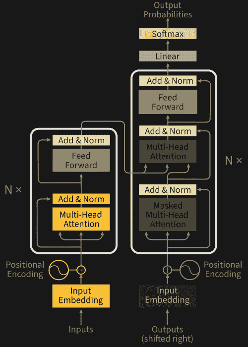
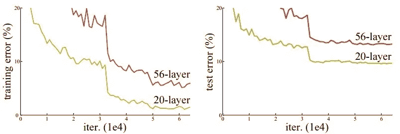
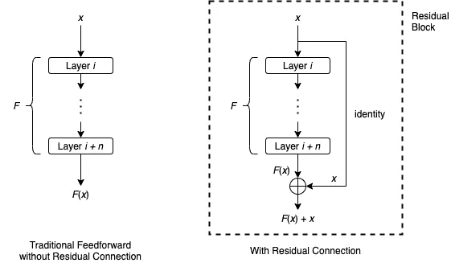
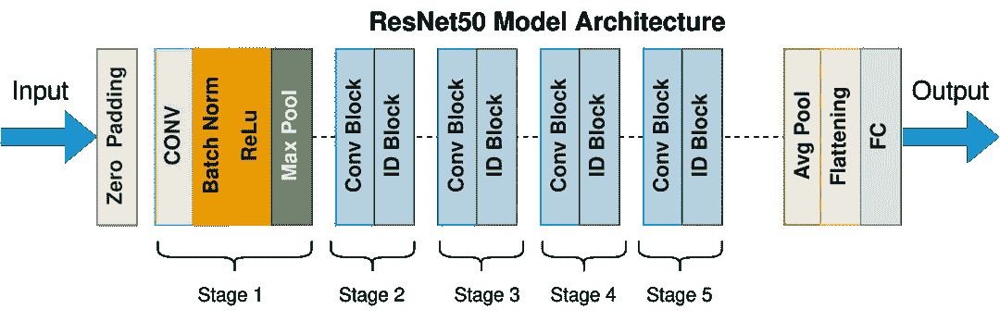
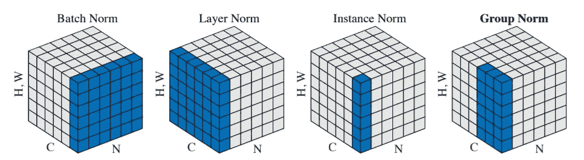
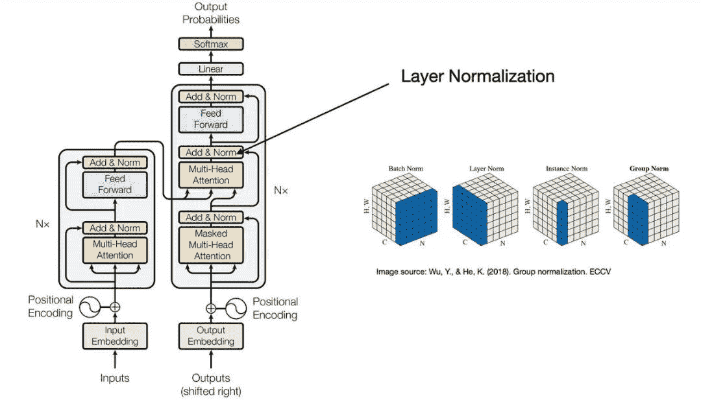
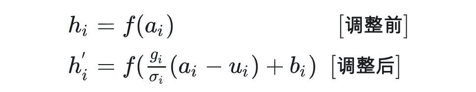
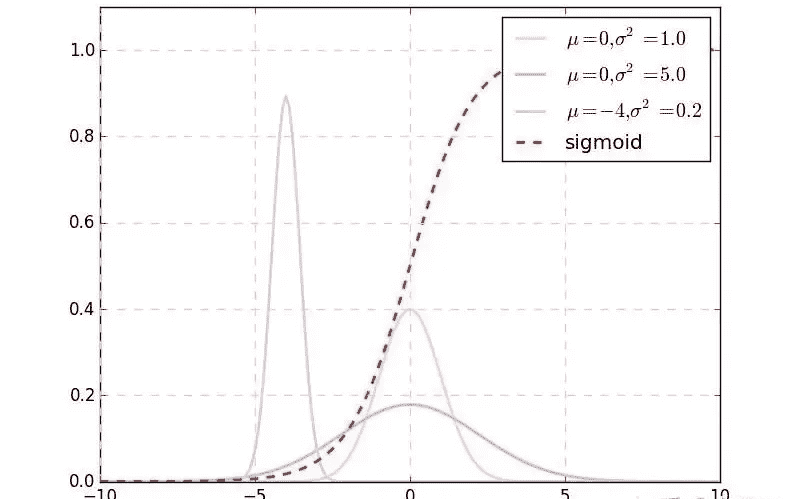
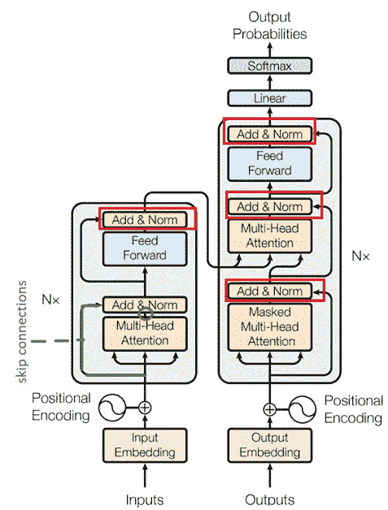
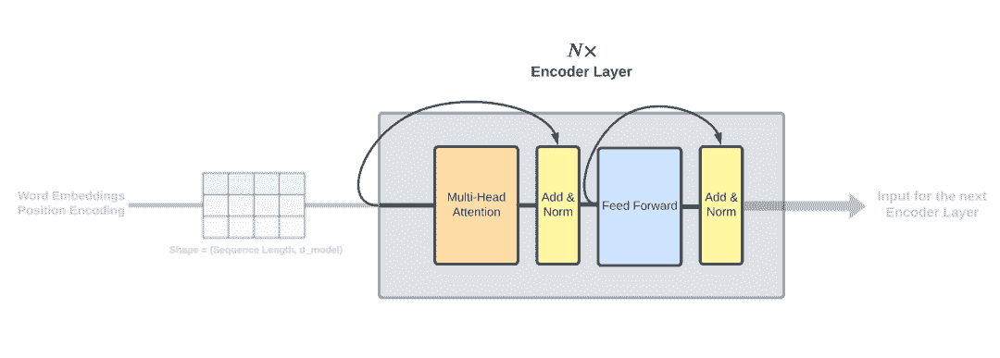

# Transformer - Add & Norm（残差连接和层归一化）

> 来源：[https://v11enp9ok1h.feishu.cn/docx/Yjp9d3LwMoaPG9xJZrFc7RrInPe](https://v11enp9ok1h.feishu.cn/docx/Yjp9d3LwMoaPG9xJZrFc7RrInPe)

在Transformer模型中，Add & Norm（残差连接和层归一化）是两个重要的组成部分，它们共同作用于模型的各个层中，以提高模型的训练效率和性能。

## 一、Add（残差连接）

**网络退化：**网络退化（Degradation）是深度学习中一个常见的现象，特别是在构建深层神经网络时更为显著。它指的是在网络模型可以收敛的情况下，随着网络层数的增加，网络性能先增加后迅速下降的现象。

这种现象并不符合常理，因为更深的网络结构通常被认为应该表现得更好。

例如，一个56层的深层网络在测试集上的错误率有时会高于一个20层的浅层网络，且这并非数据问题导致。即使在训练集上，深层网络的表现也不如浅层网络，这种现象称为“网络退化”。

**Add（残差连接）：**残差连接（Residual Connection）或跳跃连接（Skip Connection）最早由何凯明等人在2015年提出的ResNet（Residual Network）中引入，成为了解决深层网络网格退化的一种有效方法。

残差连接在构建深层神经网络时，被视为一种有效的兜底策略。当网络已经达到或接近其性能的最优解时，如果继续增加网络深度（即添加更多的层），这些新增的层（被视为冗余层）不应该对网络的性能产生负面影响。

S**kip connections的实现方式通常是将某一层的输出（通常经过一个恒等映射或**简单的线性变换）直接加到下一层（或更深层）的输出上。这样，网络的输出就可以表示为输入的非线性变换与输入的线性叠加，即y = F(x) + x，其中F(x)表示输入x经过一系列非线性变换后的输出，x表示直接传递的输入。

例如：模型一共56层，若第20层时模型已经充分学习达到测试集最佳效果，则让从21层开始到第56层学习一种恒等变换，在最后一层将第20层的输出恒等映射出来。

**残差网络**：残差网络（ResNet）通过残差连接，使得输入信息可以直接跨越一层或多层，与后续层的输出相加，从而缓解了深层网络中的梯度消失和梯度爆炸问题，使得网络可以扩展到更深的层数。

+   梯度消失：在深层网络中，梯度需要通过多个层次进行反向传播。根据链式法则，梯度在传播过程中会不断相乘，当层数较多时，梯度值可能会以指数形式衰减并趋近于零，导致梯度消失。

+   梯度爆炸：深层网络中的梯度在传播过程中也可能因链式法则的连乘效应而迅速增长，甚至呈指数级增长，导致网络参数更新过大，网络不稳定。

**R**esNet-50模型在当年的ImageNet比赛中获得了第一名，其准确率相比前一年的获胜者提高了3.6%。

ResNet-50的网络架构如下：

+   **输入处理：**输入数据首先经过一个卷积层和一个最大池化层进行预处理，以提取初步的特征并降低空间维度。

+   **残差阶段：**经过预处理后，数据进入多个阶段（stage），每个阶段包含多个残差块。

+   **输出层：**经过多个stage的残差学习后，网络通过一个全局平均池化层来减少空间维度并提取全局特征。这些特征被送入一个全连接层，用于输出最终的预测结果。

## 二、Norm（层归一化）

归一化（Normalization）：一种数据预处理技术，旨在通过线性或非线性变换，将输入数据或神经网络层的输出数据映射到一个特定的数值范围或分布之中。这一处理过程对于提升神经网络训练过程的稳定性、加速收敛速度以及最终提高模型性能至关重要。

在神经网络中，常见的归一化方法包括：

**N**orm（层归一化）：Transformer使用的是层归一化，通过对层内所有神经元的输出进行归一化处理，使得输出的分布具有稳定的均值和方差。

在Transformer中，层归一化通常是在残差连接之后进行，主要用于解决内部协变量偏移问题，即减少层与层之间数据分布的差异，从而加速训练过程。

层归一化会对残差连接后的输出进行归一化处理，然后使用可学习的参数（如beta和gamma）对归一化后的输出进行缩放和平移。这样既可以保持数据的分布稳定性，又可以保留一定的灵活性

1.  beta参数：

+   作用：beta参数在层归一化中起到平移的作用。它允许模型对归一化后的输出进行上下平移，以调整数据的均值。

+   影响：通过调整beta的值，可以改变归一化后数据的分布中心，使得模型能够更好地适应数据的特性，提高模型的表达能力和泛化能力。

1.  gamma参数：

+   作用：gamma参数在层归一化中起到缩放的作用。它允许模型对归一化后的输出进行缩放，以调整数据的方差或幅度。

+   影响：通过调整gamma的值，可以控制归一化后数据的尺度，使得模型能够学习到更加抽象和复杂的特征表示。

基本上所有的归一化技术，都可以概括为如下的公式：

对于隐层中某个节点的输出，即激活值a，进行非线性变换（如ReLU、tanh等）后得到h。

**层归一化的过程就是先计算这一层所有激活值的均值μ和方差σ**²，然后使用这些统计量对h进行分布调整。这种调整就是把“高瘦”和“矮胖”的都调整回正常体型（深粉色），把偏离x=0的拉回中间来（淡紫色）。

## 三、Transformer残差连接和层归一化

**Add & Norm：**在Transformer中，Add & Norm（残差连接和层归一化）通常作为一个整体单元出现在Encoder和Decoder的每一层中。

在Transformer架构中，残差连接是每个编码器和解码器层的重要组成部分。每个子层（如自注意力层和前馈神经网络层）的输出都会与其输入相加，形成残差连接。

**每个层都会先进行自注意力机制或交叉注意力机制的处理（对于Decoder来说），然后进行残**差连接和层归一化。接着，再进行前馈神经网络的处理，并再次进行残差连接和层归一化。这样的设计使得Transformer模型同时利用残差连接和层归一化的优点，能够有效地处理长序列数据，并在自然语言处理任务中取得了显著的成功

