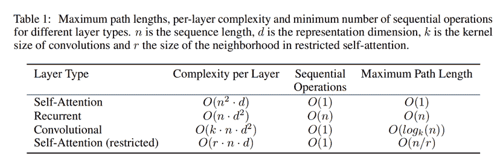
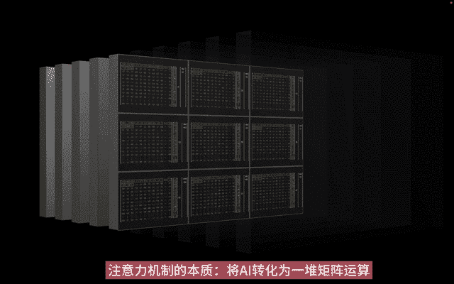
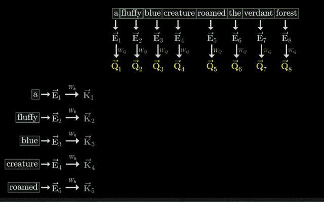
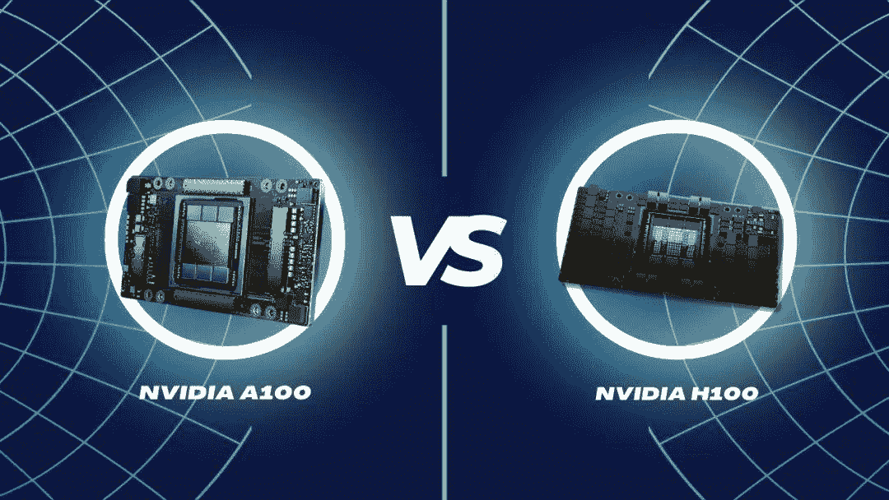
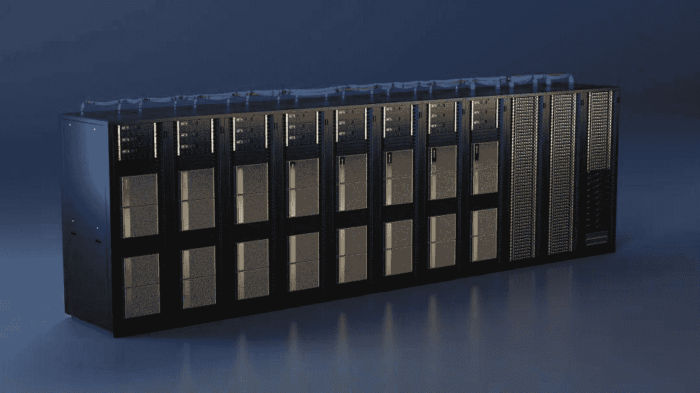

# Transformer - Why Self-Attention

> 来源：[https://v11enp9ok1h.feishu.cn/docx/CgYidXpmUooZvuxwjgZcSqKKnyB](https://v11enp9ok1h.feishu.cn/docx/CgYidXpmUooZvuxwjgZcSqKKnyB)

**使****用自注意力（Self-Attention）机制在序列**处理任务中，特别是自然语言处理（NLP）领域，变得越来越流行，主要是因为它在计算复杂度、并行化能力、长距离依赖的建模能力等多个关键方面相较于传统的循环神经网络（RNNs）和卷积神经网络（CNNs）具有显著的优势。

## 一、**计算复杂度**

**计算复杂度：**自注意力机制尽管计算复杂度为O(n^2)，但通过高度优化的矩阵运算库和并行计算能力，在现代硬件上能高效处理序列中任意元素间的关系。

+   自注意力层在单个序列处理步骤中的计算复杂度与序列长度呈平方关系（O(n^2)），其中n是序列中的元素数量。尽管这看似比RNNs（通常也是O(n)或更高，取决于其变体）和CNNs（通常为O(k*n)，k是卷积核大小）更高，但在实际应用中，自注意力通过高度优化的矩阵运算库（如TensorFlow、PyTorch）可以高效地实现。

+   自注意力机制允许模型在处理整个序列时并行地计算序列中任意两个元素之间的关系，这在现代GPU和TPU等硬件上非常有效。

**自**注意力机制在处理序列数据时，通过计算序列中任意两个元素之间的注意力分数来建立它们之间的关系。这个计算过程背后实质上是一系列复杂的矩阵运算。

具体来说，自注意力层会利用查询（Query）、键（Key）和值（Value）三个矩阵的线性变换，以及缩放点积注意力（Scaled Dot-Product Attention）等机制，来计算得到每个元素对其他元素的注意力权重，进而加权求和得到每个元素的最终表示。

## 二、**并行化能力**

**并行化能力：**自注意力层通过并行计算序列中任意元素间的注意力分数，克服了RNNs的顺序限制和CNNs的感受野限制，显著提升了序列处理的速度和效率。

+   RNNs由于其顺序性质，在处理序列时难以并行化，因为每个时间步的输出都依赖于前一个时间步的输出。这限制了它们在处理长序列时的速度和效率。

+   CNNs虽然在一定程度上可以并行处理序列，但它们的感受野（即一个元素能“看到”的序列长度）受限于卷积核的大小和层数，且学习长距离依赖关系通常需要堆叠多层网络。

+   自注意力层则完全摆脱了这些限制，可以在单个层内并行地计算序列中任意两个元素之间的注意力分数，极大地提高了处理速度和效率。

**G**PU的并行处理能力使得原本因高计算复杂度（如O(n^2)）而成为瓶颈的问题得以缓解，自注意力机制因此能够高效地实现计算，展现出卓越的性能。

**A100 & H100：**GPU的算力能力也遵循摩尔定律的增长趋势，即每隔一段时间，GPU的算力就会显著提升。A100是英伟达面向数据中心和科学计算的高性能GPU，以其强大的计算能力和深度学习加速器著称；而H100作为A100的继任者，采用更先进的Hopper架构，算力大幅提升，尤其是FP8性能惊人，专为高性能计算和AI推理优化。

**万卡集群：**万卡集群是指由一万张及以上的计算加速卡（如GPU）组成的高性能计算系统，它作为人工智能大模型训练的强大算力底座，能够支持千亿级甚至万亿级参数规模的大模型训练，有助于大幅压缩训练时间，实现模型能力的快速迭代，是大模型竞赛中的重要基础设施。

万卡集群让AI正式进入拼算力的大模型时代。

## 三、**长距离依赖的建模能力**

**长距离依赖的建模能力：**自**注**意力机制通过直接计算元素间注意力分数和位置编码，有效捕获长距离依赖关系，克服了RNNs和CNNs在处理长序列时的局限性。

+   RNNs在理论上可以捕获长距离依赖关系，但在实践中，由于梯度消失或梯度爆炸的问题，它们往往难以有效地学习到这些依赖。

+   CNNs通过堆叠多层网络来扩大感受野，但这种方法在处理非常长的序列时效率不高，且仍然受限于卷积核的大小。

+   自注意力机制通过计算序列中任意两个元素之间的直接连接（即注意力分数），使得模型能够更容易地学习到长距离依赖关系。

+   自注意力机制中的位置编码（Position Encoding）还允许模型了解序列中元素的相对或绝对位置，从而进一步增强了其建模能力。

**为什么是自注意力？核心原因，自注意力机制解决了RNN、CNN无法**克服的长序列依赖问题。2024年，大模型更是疯狂卷长文本（Long-Text）。

