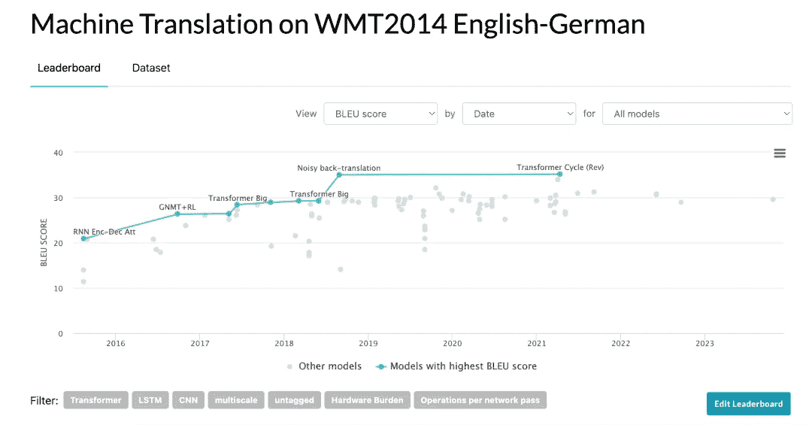
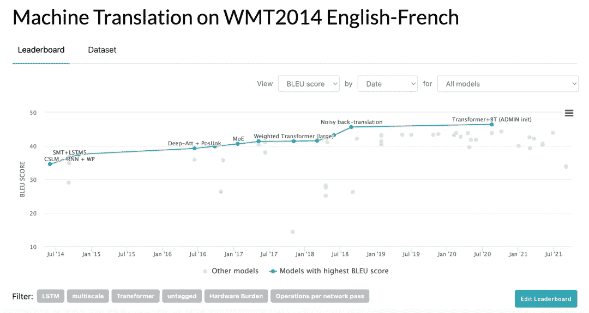
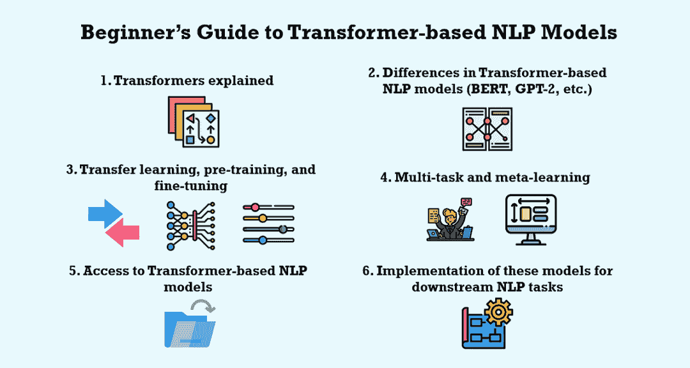
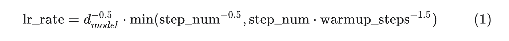
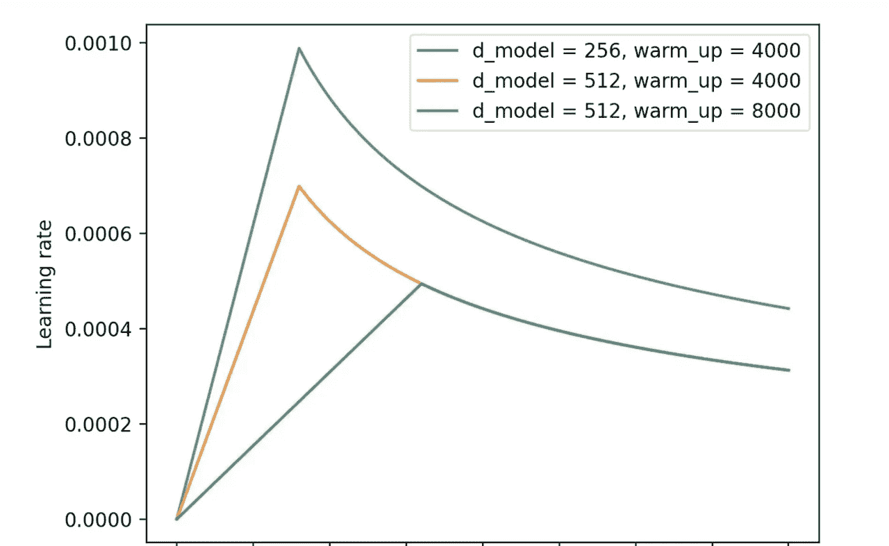

# Transformer - Training（模型训练）

> 来源：[https://v11enp9ok1h.feishu.cn/docx/GRqcdVWyUoN8QXxMHrfcUK9GnA2](https://v11enp9ok1h.feishu.cn/docx/GRqcdVWyUoN8QXxMHrfcUK9GnA2)

**Transformer模型的训练****过程是一个复杂但高度优**化的流程，旨在通过合理的数据选择、硬件配置、训练计划、优化器使用和正则化策略来训练出高性能的模型。

## 一、合理的数据选择

**训练数据集：**训练数据作为Transformer模型训练的基础，扮演着至关重要的角色。这些数据集通常包含大量的、经过精心标注的样本，这些样本覆盖了模型在特定任务中需要学习和识别的各种语言现象、结构和模式。

**在自然语言处理（NLP）领域，常用的数据集包括WMT（Workshop on Machin**eTranslation）系列的翻译数据集，如WMT 2014英德和英法数据集。

+   MT 2014英德数据集：在标准的WMT 2014英德数据集上进行了训练，该数据集包含约450万个句子对。句子使用字节对编码（Byte-Pair Encoding，BPE）进行编码，这样源语言和目标语言共享一个约37000个标记的词汇表。

+   WMT 2014英法数据集：对于英法数据集，使用了更大的WMT 2014英法数据集，包含3600万个句子，并将标记分为一个32000个词片段的词汇表。句子对根据序列长度的近似值进行批处理。每个训练批次包含一组句子对，这些句子对大约包含25000个源语言标记和25000个目标语言标记。

W**MT 2014英德和英法数据集在用于训练Transform**er模型之前，需要进行一系列的数据预处理步骤。这些步骤包括文本清洗、分词与标记化、构建词汇表、子词单元生成（如BPE）、数值化以及添加特殊标记。

**一、数据下载与解压**

1.  下载数据集：首先，从WMT官方网站或相关资源中下载WMT 2014英德和英法数据集。这些数据集通常包括训练集、验证集和测试集。

1.  解压数据集：将下载的数据集文件（如.tgz或.tar格式）解压到指定的目录中，以便进行后续处理。

**二、文本清洗**

1.  去除无关信息：从文本中去除HTML标签、特殊字符、URL链接等与翻译任务无关的信息。

1.  纠正拼写和语法错误：虽然这不是预处理的主要任务，但在某些情况下，可能需要纠正文本中的拼写和语法错误，以提高数据质量。

**三、分词与标记化**

1.  分词：将文本分割成更小的单元，如单词或子词。对于英语和德语，由于单词之间有空格分隔，分词相对简单。但对于其他语言，可能需要使用专门的分词工具。

1.  标记化：将分词后的文本转换为模型可以处理的标记（tokens）。这通常涉及将单词或子词转换为唯一的标识符（如整数ID）。

**四、构建词汇表**

1.  提取唯一标记：从训练数据中提取所有唯一的标记（如单词或子词）。

1.  构建词汇表：将提取的标记组织成一个词汇表，并为其分配唯一的索引（ID）。词汇表的大小和构成对模型的性能有一定影响。

**五、子词单元生成（如BPE）**

1.  使用子词单元技术：如Byte Pair Encoding（BPE），将单词分割成更小的子词单元。这有助于处理未登录词（OOV）问题，并提高模型的泛化能力。

1.  生成BPE词汇表：使用BPE算法对训练数据进行处理，生成包含子词单元的词汇表。

**六、数值化**

1.  文本转ID：将文本数据中的每个标记（或子词单元）替换为其在词汇表中的索引（ID）。

**七、添加特殊标记**

1.  开始和结束标记：在序列的开始和结束处添加特殊的标记，如<s>和</s>，以指示句子的边界。

1.  其他特殊标记：根据需要添加其他特殊标记，如填充标记（<pad>）或分隔标记（<sep>）。

## 二、**硬件配置**

在配备高性能NVIDIA P100 GPU的机器上训练Transformer模型的效率是非常高的。无论是基础模型还是大型模型，都能够在合理的时间内完成训练，这得益于P100 GPU的强大计算能力和高带宽内存。

**基础模型训练：**

+   **硬件环境：**8个NVIDIA P100 GPU，每个GPU具有强大的并行计算能力和高带宽内存。

+   **训练时间：**每步训练大约需要0.4秒，总共训练100,000步，因此总体训练时间约为12小时（0.4秒/步 * 100,000步 = 40,000秒 ≈ 11.11小时，四舍五入为12小时）。

+   **性能特点：**基础模型由于参数较少，计算量相对较低，因此能够在相对较短的时间内完成训练。

**大型模型训练：**

+   **硬件环境：**同样使用8个NVIDIA P100 GPU，但由于模型规模增大，每步训练的计算量显著增加。

+   **训练时间：**每步训练需要1.0秒，总共训练300,000步，因此总体训练时间约为3.5天（1.0秒/步 * 300,000步 = 300,000秒 ≈ 3.47天，四舍五入为3.5天）。

+   **性能特点：**大型模型由于参数众多，计算复杂度高，需要更长的训练时间。然而，得益于P100 GPU的强大计算能力，这种训练仍然可以在合理的时间内完成。

## 三、**训练计划**

模型构建与训练使用深度学习框架根据预设超参数建立模型并训练以提取数据特征，而模型评估与优化则是通过测试集验证模型性能并据此调整模型以提高其泛化能力。

**模型构建与训练：**

**模型构建：**

+   根据论文或实验需求选择合适的模型架构，如Transformer。

+   设置超参数，如学习率、批次大小、优化器（Adam、SGD等）、训练轮次等。

+   使用深度学习框架提供的API构建模型。

**训练过程：**

+   加载训练数据，并进行批次处理。

+   使用训练数据对模型进行迭代训练，每个批次计算损失函数并更新模型权重。

+   在每个训练周期（epoch）结束时，使用验证集评估模型性能，并记录关键指标（如准确率、损失值）。

**模型保存：**

+   在训练过程中定期保存模型权重和参数，以便在需要时恢复训练或进行模型评估。

+   保存最佳模型（即验证集上性能最好的模型）。

### 模型评估与优化：

1.  模型评估：

+   使用测试集对训练好的模型进行评估，确保评估过程与训练过程完全独立。

+   计算并记录关键性能指标，如准确率、召回率、F1分数等。

1.  模型优化：

+   根据评估结果调整超参数，如学习率、批次大小等。

+   尝试不同的模型架构或改进现有架构。

+   使用正则化、dropout等技术防止过拟合。

+   应用集成学习方法（如模型平均、模型融合）提高整体性能。

1.  结果分析：

+   分析模型在不同数据集上的表现，识别潜在的偏差或不足。

+   根据业务需求调整评估指标或评估方法。

## 四、**优化器使用**

Transformer使用了Adam优化器，并设置其超参数为β1=0.9，β2=0.98，以及ϵ=10−9。在学习过程中，根据以下公式调整学习率：

**这种动态调整的方法通常基于训练过程中的一些指标或条件，如训练轮数、验证集性能等，来实时调**整学习率的大小。根据公式（1）的计算方式，模型在训练过程中学习率的变化如图所示：

**Adam优化器：**Adam（Adaptive Moment Estimation）优化器是一种结合了AdaGrad和RMSProp优点的高效优化算法，它广泛应用于深度学习模型的训练中。

**A**dam基于随机梯度下降算法，通过计算梯度的一阶矩估计（即梯度的均值）和二阶矩估计（即梯度的未中心化的方差）来综合考虑，从而计算出更新步长。

+   **自适应性：**能够自适应地调整每个参数的学习率，从而更好地适应不同参数之间的差异。

+   **有效性：**使用了动量和二阶动量信息来更新参数，使模型训练更加平稳和快速。

+   **鲁棒性：**对于噪声较多或稀疏数据集也具有很好的鲁棒性。

+   **参数范围不变性：**能够保持对参数范围变化的不敏感性，在实际应用中比其他优化算法更为稳定。

## 五、**正则化策略**

Transformer模型使用了多种正则化方法来减少过拟合现象，提高模型的泛化能力。三种正则化方法如下：

+   Layer Normalization：对每个子层的输出进行归一化处理，使得每个神经元输入的分布更加稳定，这有利于模型的训练和泛化性能。

+   **Dropout：**在训练过程中随机地将一部分神经元的输出设置为0，从而减少不同神经元之间的依赖关系，避免模型过拟合。这种方法可以防止模型过分依赖于某些特定输入，从而提高模型的泛化能力。

+   注意力机制中的随机Drop Key：在注意力计算阶段，通过随机drop部分Key来鼓励网络捕获目标对象的全局信息，从而避免了由过于聚焦局部信息所引发的模型偏置问题，进而提升了模型的精度。这种方法通常被用于基于Transformer的视觉类算法中。