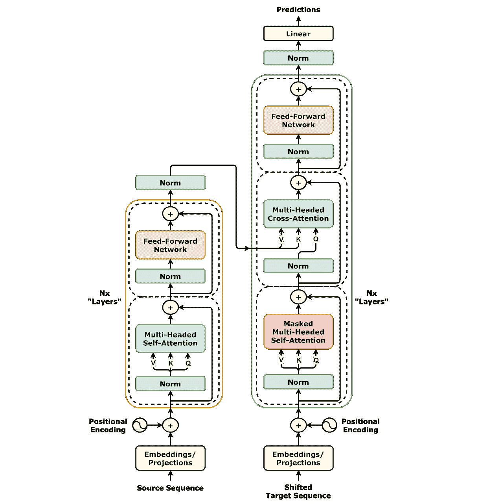
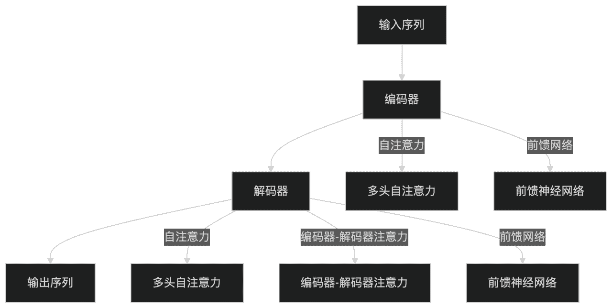
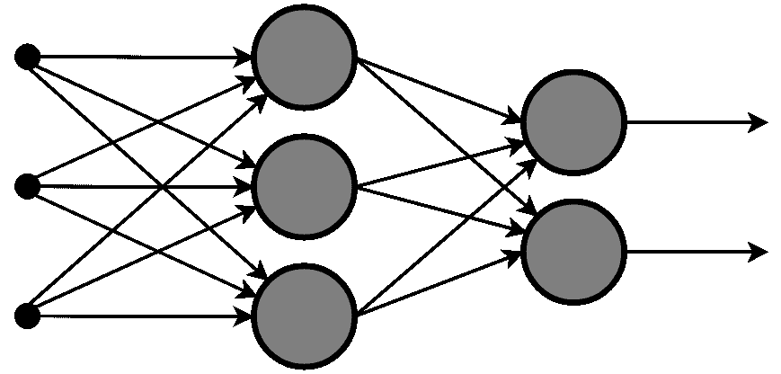
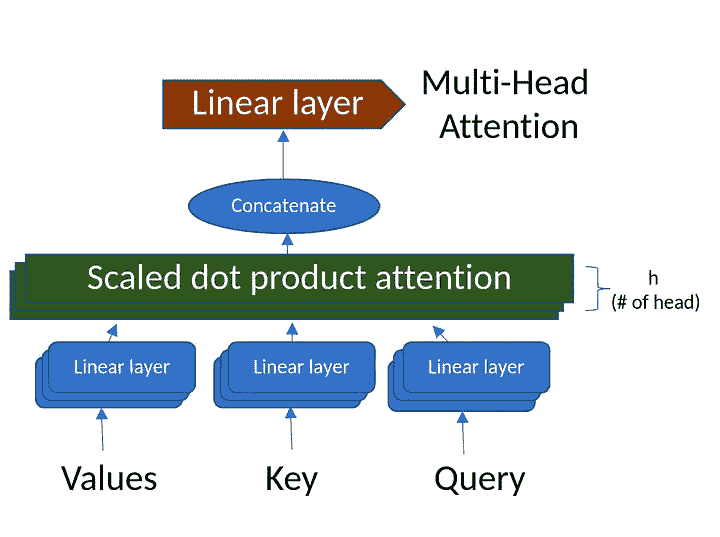
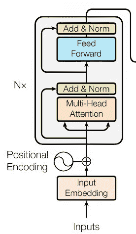
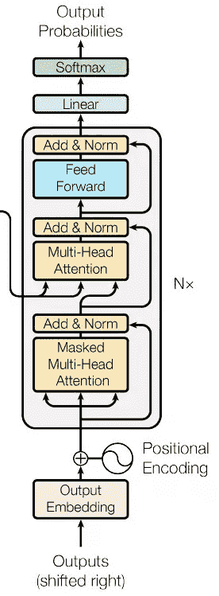
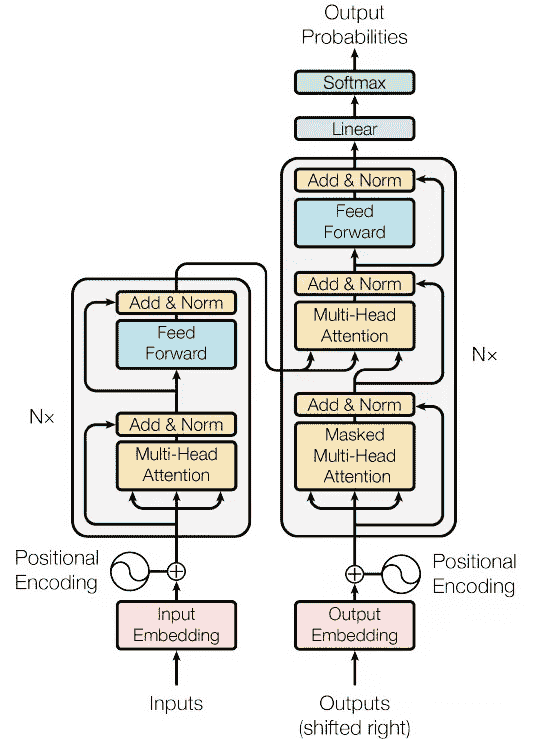

# Transformer 模型

> 来源：[https://v11enp9ok1h.feishu.cn/docx/IKu6dUOnEo7VaCx67N2cfqY7nld](https://v11enp9ok1h.feishu.cn/docx/IKu6dUOnEo7VaCx67N2cfqY7nld)

> **Transformer** 的核心思想是完全摒弃传统的循环神经网络（RNN）结构，仅依赖注意力机制来处理序列数据，从而实现更高的并行性和更快的训练速度。

以下是 **Transformer** 架构图，左边为**编码器**，右边为**解码器**。



> **Transformer**模型由 **编码器**（Encoder） 和 **解码器**（Decoder） 两部分组成，每部分都由多层堆叠的相同模块构成。



---

### 编码器（Encoder）

编码器由 NN 层相同的模块堆叠而成，每层包含两个子层：

+   **多**头自注意力机制（Multi-Head Self-Attention）：计算输入序列中每个词与其他词的相关性。

+   **前**馈神经网络（Feed-Forward Neural Network）：对每个词进行独立的非线性变换。

每个子层后面都接有 **残差连接****（Res**idual Connection） 和 层归一化（Layer Normalization）。

---

### 解码器（Decoder）

解码器也由 **NN** 层相同的模块堆叠而成，每层包含三个子层：

+   **掩码多头自注意力机制****（**Masked Multi-Head Self-Attention）：计算输出序列中每个词与前面词的相关性（使用掩码防止未来信息泄露）。

+   **编码器-解码器注意力机制****（**Encoder-Decoder Attention）：计算输出序列与输入序列的相关性。

+   **前馈神经网络****（**Feed-Forward Neural Network）：对每个词进行独立的非线性变换。

---

同样，每个子层后面都接有残差连接和层归一化。

在 **Transformer** 模型出现之前，**NLP** 领域的主流模型是基于** RNN **的架构，如长短期记忆网络（LSTM）和门控循环单元（GRU）。这些模型通过顺序处理输入数据来捕捉序列中的依赖关系，但存在以下问题：

1.  **梯度消失问题**：长距离依赖关系难以捕捉。

1.  **顺序计算的局限性**：无法充分利用现代硬件的并行计算能力，训练效率低下。



> **Transformer** 通过引入自注意力机制解决了这些问题，允许模型同时处理整个输入序列，并动态地为序列中的每个位置分配不同的权重。

---

## Transformer 的核心思想

### 自注意力机制（Self-Attention）

自注意力机制是**Transformer** 的核心组件。

自注意力机制允许模型在处理序列时，动态地为每个位置分配不同的权重，从而捕捉序列中任意两个位置之间的依赖关系。

+   **输入表示**：输入序列中的每个词（或标记）通过词嵌入（Embedding）转换为向量表示。

+   **注意力权重计算**：通过计算查询（Query）、键（Key）和值（Value）之间的点积，得到每个词与其他词的相关性权重。

+   **加权求和**：使用注意力权重对值（Value）进行加权求和，得到每个词的上下文表示。

**公式如下：**

**其中：**

+   Q 是查询矩阵，K是键矩阵，V是值矩阵。

+    是向量的维度，用于缩放点积，防止梯度爆炸。

---

### 多头注意力（Multi-Head Attention）

为了捕捉更丰富的特征，**Transformer** 使用多头注意力机制。它将输入分成多个子空间，每个子空间独立计算注意力，最后将结果拼接起来。

+   **多头注意力的优势**：允许模型关注序列中不同的部分，例如语法结构、语义关系等。

+   **并行计算**：多个注意力头可以并行计算，提高效率。

---

### 位置编码（Positional Encoding）

由于 **Transformer**没有显式的序列信息（如 RNN 中的时间步），位置编码被用来为输入序列中的每个词添加位置信息。通常使用正弦和余弦函数生成位置编码：

**其中：**

是词的位置， 是维度索引。

### 编码器-解码器架构

**Transformer** 模型由编码器和解码器两部分组成：

+   **编码器****：**将输入序列转换为一系列隐藏表示。每个编码器层包含一个自注意力机制和一个前馈神经网络。

+   **解码器****：**根据编码器的输出生成目标序列。每个解码器层包含两个注意力机制（自注意力和编码器-解码器注意力）和一个前馈神经网络。

---

### 前馈神经网络（Feed-Forward Neural Network）

每个编码器和解码器层都包含一个前馈神经网络，通常由两个全连接层组成，中间使用 ReLU 激活函数。

---

### 残差连接和层归一化

为了稳定训练过程，每个子层（如自注意力层和前馈神经网络）后面都会接一个残差连接和层归一化（Layer Normalization）。

---

## Transformer 的优势

1.  **并行计算**：**Transformer**可以同时处理整个输入序列，充分利用现代硬件的并行计算能力。

1.  **长距离依赖**：自注意力机制能够捕捉序列中任意两个位置之间的依赖关系，解决了 RNN 的梯度消失问题。

1.  **可扩展性**：**Transformer** 模型可以通过堆叠更多的层来提升性能，例如 BERT 和 GPT 等模型。

---

## Transformer 的应用

1.  **自然语言处理（NLP）**：

+   机器翻译（如 Google Translate）

+   文本生成（如 GPT 系列模型）

+   文本分类、问答系统等。

1.  **计算机视觉（CV）**：

+   图像分类（如 Vision Transformer）

+   目标检测、图像生成等。

1.  **多模态任务**：

+   结合文本和图像的任务（如 CLIP、DALL-E）。

---

## PyTorch 实现 Transformer

**以下是一个简单的 Py**Torch 实现 Transformer 的示例：

```
import torch
import torch.nn as nn
import torch.optim as optim

class TransformerModel(nn.Module):
    def __init__(self, input_dim, model_dim, num_heads, num_layers, output_dim):
        super(TransformerModel, self).__init__()
        self.embedding = nn.Embedding(input_dim, model_dim)
        self.positional_encoding = nn.Parameter(torch.zeros(1, 1000, model_dim))  # 假设序列长度最大为1000
        self.transformer = nn.Transformer(d_model=model_dim, nhead=num_heads, num_encoder_layers=num_layers)
        self.fc = nn.Linear(model_dim, output_dim)

    def forward(self, src, tgt):
        src_seq_length, tgt_seq_length = src.size(1), tgt.size(1)
        src = self.embedding(src) + self.positional_encoding[:, :src_seq_length, :]
        tgt = self.embedding(tgt) + self.positional_encoding[:, :tgt_seq_length, :]
        transformer_output = self.transformer(src, tgt)
        output = self.fc(transformer_output)
        return output

# 超参数
input_dim = 10000  # 词汇表大小
model_dim = 512    # 模型维度
num_heads = 8      # 多头注意力头数
num_layers = 6     # 编码器和解码器层数
output_dim = 10000 # 输出维度（通常与词汇表大小相同）

# 初始化模型、损失函数和优化器
model = TransformerModel(input_dim, model_dim, num_heads, num_layers, output_dim)
criterion = nn.CrossEntropyLoss()
optimizer = optim.Adam(model.parameters(), lr=0.001)

# 假设输入数据
src = torch.randint(0, input_dim, (10, 32))  # (序列长度, 批量大小)
tgt = torch.randint(0, input_dim, (20, 32))  # (序列长度, 批量大小)

# 前向传播
output = model(src, tgt)

# 计算损失
loss = criterion(output.view(-1, output_dim), tgt.view(-1))

# 反向传播和优化
optimizer.zero_grad()
loss.backward()
optimizer.step()

print(&quot;Loss:&quot;, loss.item())
```

# 使用PyTorch 构建 Transformer 模型

**构建 ****Transformer****模型的步骤如下：**

### 1、导入必要的库和模块

导入 **PyTorch** 核心库、**神经网络模块**、**优化器模块**、**数据处理工具**，以及数学和对象复制模块，为定义模型架构、管理数据和训练过程提供支持。

```
import torch
import torch.nn as nn
import torch.optim as optim
import torch.utils.data as data
import math
import copy
```

**说明：**

+   torch：PyTorch 的核心库，用于张量操作和自动求导。

+   torch.nn：PyTorch 的神经网络模块，包含各种层和损失函数。

+   torch.optim：优化算法模块，如 Adam、SGD 等。

+   math：数学函数库，用于计算平方根等。

+   copy：用于深度复制对象。

### 定义基本构建块：多头注意力、位置前馈网络、位置编码

**多头注意力**通过多个"注意力头"计算序列中每对位置之间的关系，能够捕捉输入序列的不同特征和模式。



> MultiH**eadAttentio**n** 类封装了 Transforme**r 模型中常用的多头注意力机制，负责将输入拆分成多个注意力头，对每个注意力头施加注意力，然后将结果组合起来，这样模型就可以在不同尺度上捕捉输入数据中的各种关系，提高模型的表达能力。

```
class MultiHeadAttention(nn.Module):
    def __init__(self, d_model, num_heads):
        super(MultiHeadAttention, self).__init__()
        assert d_model % num_heads == 0, &quot;d_model必须能被num_heads整除&quot;
        
        self.d_model = d_model    # 模型维度（如512）
        self.num_heads = num_heads # 注意力头数（如8）
        self.d_k = d_model // num_heads # 每个头的维度（如64）
        
        # 定义线性变换层（无需偏置）
        self.W_q = nn.Linear(d_model, d_model) # 查询变换
        self.W_k = nn.Linear(d_model, d_model) # 键变换
        self.W_v = nn.Linear(d_model, d_model) # 值变换
        self.W_o = nn.Linear(d_model, d_model) # 输出变换
        
    def scaled_dot_product_attention(self, Q, K, V, mask=None):
        &quot;&quot;&quot;
        计算缩放点积注意力
        输入形状：
            Q: (batch_size, num_heads, seq_length, d_k)
            K, V: 同Q
        输出形状： (batch_size, num_heads, seq_length, d_k)
        &quot;&quot;&quot;
        # 计算注意力分数（Q和K的点积）
        attn_scores = torch.matmul(Q, K.transpose(-2, -1)) / math.sqrt(self.d_k)
        
        # 应用掩码（如填充掩码或未来信息掩码）
        if mask is not None:
            attn_scores = attn_scores.masked_fill(mask == 0, -1e9)
        
        # 计算注意力权重（softmax归一化）
        attn_probs = torch.softmax(attn_scores, dim=-1)
        
        # 对值向量加权求和
        output = torch.matmul(attn_probs, V)
        return output
        
    def split_heads(self, x):
        &quot;&quot;&quot;
        将输入张量分割为多个头
        输入形状: (batch_size, seq_length, d_model)
        输出形状: (batch_size, num_heads, seq_length, d_k)
        &quot;&quot;&quot;
        batch_size, seq_length, d_model = x.size()
        return x.view(batch_size, seq_length, self.num_heads, self.d_k).transpose(1, 2)
        
    def combine_heads(self, x):
        &quot;&quot;&quot;
        将多个头的输出合并回原始形状
        输入形状: (batch_size, num_heads, seq_length, d_k)
        输出形状: (batch_size, seq_length, d_model)
        &quot;&quot;&quot;
        batch_size, _, seq_length, d_k = x.size()
        return x.transpose(1, 2).contiguous().view(batch_size, seq_length, self.d_model)
        
    def forward(self, Q, K, V, mask=None):
        &quot;&quot;&quot;
        前向传播
        输入形状: Q/K/V: (batch_size, seq_length, d_model)
        输出形状: (batch_size, seq_length, d_model)
        &quot;&quot;&quot;
        # 线性变换并分割多头
        Q = self.split_heads(self.W_q(Q)) # (batch, heads, seq_len, d_k)
        K = self.split_heads(self.W_k(K))
        V = self.split_heads(self.W_v(V))
        
        # 计算注意力
        attn_output = self.scaled_dot_product_attention(Q, K, V, mask)
        
        # 合并多头并输出变换
        output = self.W_o(self.combine_heads(attn_output))
        return output
```

**说明：**

+   **多头注意力机制**：将输入分割成多个头，每个头独立计算注意力，最后将结果合并。

+   **缩放点积注意力**：计算查询和键的点积，缩放后使用 softmax 计算注意力权重，最后对值进行加权求和。

+   **掩码**：用于屏蔽无效位置（如填充部分）。

### 位置前馈网络（Position-wise Feed-Forward Network）

```
class PositionWiseFeedForward(nn.Module):
    def __init__(self, d_model, d_ff):
        super(PositionWiseFeedForward, self).__init__()
        self.fc1 = nn.Linear(d_model, d_ff)  # 第一层全连接
        self.fc2 = nn.Linear(d_ff, d_model)  # 第二层全连接
        self.relu = nn.ReLU()  # 激活函数

    def forward(self, x):
        # 前馈网络的计算
        return self.fc2(self.relu(self.fc1(x)))
```

**前馈网络****：**由两个全连接层和一个 ReLU 激活函数组成，用于进一步处理注意力机制的输出。

---

### 位置编码

位置编码用于注入输入序列中每个** token **的位置信息。

使用不同频率的正弦和余弦函数来生成位置编码。

```
class PositionalEncoding(nn.Module):
    def __init__(self, d_model, max_seq_length):
        super(PositionalEncoding, self).__init__()
        pe = torch.zeros(max_seq_length, d_model)  # 初始化位置编码矩阵
        position = torch.arange(0, max_seq_length, dtype=torch.float).unsqueeze(1)
        div_term = torch.exp(torch.arange(0, d_model, 2).float() * -(math.log(10000.0) / d_model))
        pe[:, 0::2] = torch.sin(position * div_term)  # 偶数位置使用正弦函数
        pe[:, 1::2] = torch.cos(position * div_term)  # 奇数位置使用余弦函数
        self.register_buffer(&#x27;pe&#x27;, pe.unsqueeze(0))  # 注册为缓冲区
        
    def forward(self, x):
        # 将位置编码添加到输入中
        return x + self.pe[:, :x.size(1)]
```

### 构建编码器块（Encoder Layer）



```
class EncoderLayer(nn.Module):
    def __init__(self, d_model, num_heads, d_ff, dropout):
        super(EncoderLayer, self).__init__()
        self.self_attn = MultiHeadAttention(d_model, num_heads)  # 自注意力机制
        self.feed_forward = PositionWiseFeedForward(d_model, d_ff)  # 前馈网络
        self.norm1 = nn.LayerNorm(d_model)  # 层归一化
        self.norm2 = nn.LayerNorm(d_model)
        self.dropout = nn.Dropout(dropout)  # Dropout
        
    def forward(self, x, mask):
        # 自注意力机制
        attn_output = self.self_attn(x, x, x, mask)
        x = self.norm1(x + self.dropout(attn_output))  # 残差连接和层归一化
        
        # 前馈网络
        ff_output = self.feed_forward(x)
        x = self.norm2(x + self.dropout(ff_output))  # 残差连接和层归一化
        return x
```

> **编码器层****：**包含一个自注意力机制和一个前馈网络，每个子层后接残差连接和层归一化。

---

### 构建解码器模块



```
class DecoderLayer(nn.Module):
    def __init__(self, d_model, num_heads, d_ff, dropout):
        super(DecoderLayer, self).__init__()
        self.self_attn = MultiHeadAttention(d_model, num_heads)  # 自注意力机制
        self.cross_attn = MultiHeadAttention(d_model, num_heads)  # 交叉注意力机制
        self.feed_forward = PositionWiseFeedForward(d_model, d_ff)  # 前馈网络
        self.norm1 = nn.LayerNorm(d_model)  # 层归一化
        self.norm2 = nn.LayerNorm(d_model)
        self.norm3 = nn.LayerNorm(d_model)
        self.dropout = nn.Dropout(dropout)  # Dropout
        
    def forward(self, x, enc_output, src_mask, tgt_mask):
        # 自注意力机制
        attn_output = self.self_attn(x, x, x, tgt_mask)
        x = self.norm1(x + self.dropout(attn_output))  # 残差连接和层归一化
        
        # 交叉注意力机制
        attn_output = self.cross_attn(x, enc_output, enc_output, src_mask)
        x = self.norm2(x + self.dropout(attn_output))  # 残差连接和层归一化
        
        # 前馈网络
        ff_output = self.feed_forward(x)
        x = self.norm3(x + self.dropout(ff_output))  # 残差连接和层归一化
        return x
```

> **解码器层****：**包含一个自注意力机制、一个交叉注意力机制和一个前馈网络，每个子层后接残差连接和层归一化。

### 构建完整的 Transformer 模型



```
class Transformer(nn.Module):
    def __init__(self, src_vocab_size, tgt_vocab_size, d_model, num_heads, num_layers, d_ff, max_seq_length, dropout):
        super(Transformer, self).__init__()
        self.encoder_embedding = nn.Embedding(src_vocab_size, d_model)  # 编码器词嵌入
        self.decoder_embedding = nn.Embedding(tgt_vocab_size, d_model)  # 解码器词嵌入
        self.positional_encoding = PositionalEncoding(d_model, max_seq_length)  # 位置编码

        # 编码器和解码器层
        self.encoder_layers = nn.ModuleList([EncoderLayer(d_model, num_heads, d_ff, dropout) for _ in range(num_layers)])
        self.decoder_layers = nn.ModuleList([DecoderLayer(d_model, num_heads, d_ff, dropout) for _ in range(num_layers)])

        self.fc = nn.Linear(d_model, tgt_vocab_size)  # 最终的全连接层
        self.dropout = nn.Dropout(dropout)  # Dropout

    def generate_mask(self, src, tgt):
        # 源掩码：屏蔽填充符（假设填充符索引为0）
        # 形状：(batch_size, 1, 1, seq_length)
        src_mask = (src != 0).unsqueeze(1).unsqueeze(2)
    
        # 目标掩码：屏蔽填充符和未来信息
        # 形状：(batch_size, 1, seq_length, 1)
        tgt_mask = (tgt != 0).unsqueeze(1).unsqueeze(3)
        seq_length = tgt.size(1)
        # 生成上三角矩阵掩码，防止解码时看到未来信息
        nopeak_mask = (1 - torch.triu(torch.ones(1, seq_length, seq_length), diagonal=1)).bool()
        tgt_mask = tgt_mask &amp; nopeak_mask  # 合并填充掩码和未来信息掩码
        return src_mask, tgt_mask

    def forward(self, src, tgt):
        # 生成掩码
        src_mask, tgt_mask = self.generate_mask(src, tgt)
        
        # 编码器部分
        src_embedded = self.dropout(self.positional_encoding(self.encoder_embedding(src)))
        enc_output = src_embedded
        for enc_layer in self.encoder_layers:
            enc_output = enc_layer(enc_output, src_mask)
        
        # 解码器部分
        tgt_embedded = self.dropout(self.positional_encoding(self.decoder_embedding(tgt)))
        dec_output = tgt_embedded
        for dec_layer in self.decoder_layers:
            dec_output = dec_layer(dec_output, enc_output, src_mask, tgt_mask)
        
        # 最终输出
        output = self.fc(dec_output)
        return output
```

**说明：**

+   **Transformer**** 模型**：包含编码器和解码器部分，每个部分由多个层堆叠而成。

+   **掩码生成**：用于屏蔽无效位置和未来信息。

+   **前向传播**：依次通过编码器和解码器，最后通过全连接层输出。

模型初始化参数说明：

```
class Transformer(nn.Module):
    def __init__(
        self, 
        src_vocab_size,  # 源语言词汇表大小（如英文单词数）
        tgt_vocab_size,  # 目标语言词汇表大小（如中文单词数）
        d_model=512,     # 模型维度（每个词向量的长度）
        num_heads=8,     # 多头注意力的头数
        num_layers=6,    # 编码器/解码器的堆叠层数
        d_ff=2048,       # 前馈网络隐藏层维度
        max_seq_length=100, # 最大序列长度（用于位置编码）
        dropout=0.1      # Dropout概率
    ):
```

### 训练 PyTorch Transformer 模型

使用随机数据训练模型，计算损失并更新参数。

```
# 超参数
src_vocab_size = 5000  # 源词汇表大小
tgt_vocab_size = 5000  # 目标词汇表大小
d_model = 512  # 模型维度
num_heads = 8  # 注意力头数量
num_layers = 6  # 编码器和解码器层数
d_ff = 2048  # 前馈网络内层维度
max_seq_length = 100  # 最大序列长度
dropout = 0.1  # Dropout 概率

# 初始化模型
transformer = Transformer(src_vocab_size, tgt_vocab_size, d_model, num_heads, num_layers, d_ff, max_seq_length, dropout)

# 生成随机数据
src_data = torch.randint(1, src_vocab_size, (64, max_seq_length))  # 源序列
tgt_data = torch.randint(1, tgt_vocab_size, (64, max_seq_length))  # 目标序列

# 定义损失函数和优化器
criterion = nn.CrossEntropyLoss(ignore_index=0)  # 忽略填充部分的损失
optimizer = optim.Adam(transformer.parameters(), lr=0.0001, betas=(0.9, 0.98), eps=1e-9)

# 训练循环
transformer.train()
for epoch in range(100):
    optimizer.zero_grad()  # 清空梯度，防止累积
    
    # 输入目标序列时去掉最后一个词（用于预测下一个词）
    output = transformer(src_data, tgt_data[:, :-1])  
    
    # 计算损失时，目标序列从第二个词开始（即预测下一个词）
    # output形状: (batch_size, seq_length-1, tgt_vocab_size)
    # 目标形状: (batch_size, seq_length-1)
    loss = criterion(
        output.contiguous().view(-1, tgt_vocab_size), 
        tgt_data[:, 1:].contiguous().view(-1)
    )
    
    loss.backward()        # 反向传播
    optimizer.step()       # 更新参数
    print(f&quot;Epoch: {epoch+1}, Loss: {loss.item()}&quot;)
```

### 模型评估

**评估过程：**在验证数据上计算损失，评估模型性能。

```
transformer.eval()
# 生成验证数据
val_src_data = torch.randint(1, src_vocab_size, (64, max_seq_length))
val_tgt_data = torch.randint(1, tgt_vocab_size, (64, max_seq_length))
# 假设输入为一批英文和对应的中文翻译（已转换为索引）
# 示例数据：
# src_data: [[3, 14, 25, ..., 0, 0], ...]  # 英文句子（0为填充符）
# tgt_data: [[5, 20, 36, ..., 0, 0], ...]  # 中文翻译（0为填充符）
# 注意：实际应用中需对文本进行分词、编码、填充等预处理
with torch.no_grad():
    val_output = transformer(val_src_data, val_tgt_data[:, :-1])
    val_loss = criterion(val_output.contiguous().view(-1, tgt_vocab_size), val_tgt_data[:, 1:].contiguous().view(-1))
    print(f&quot;Validation Loss: {val_loss.item()}&quot;)
```