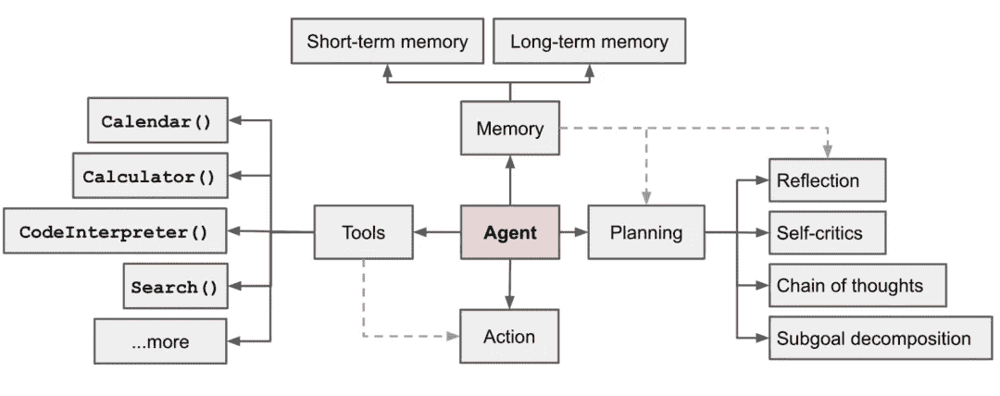
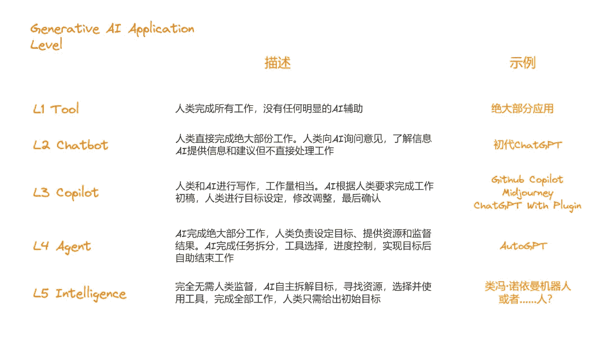
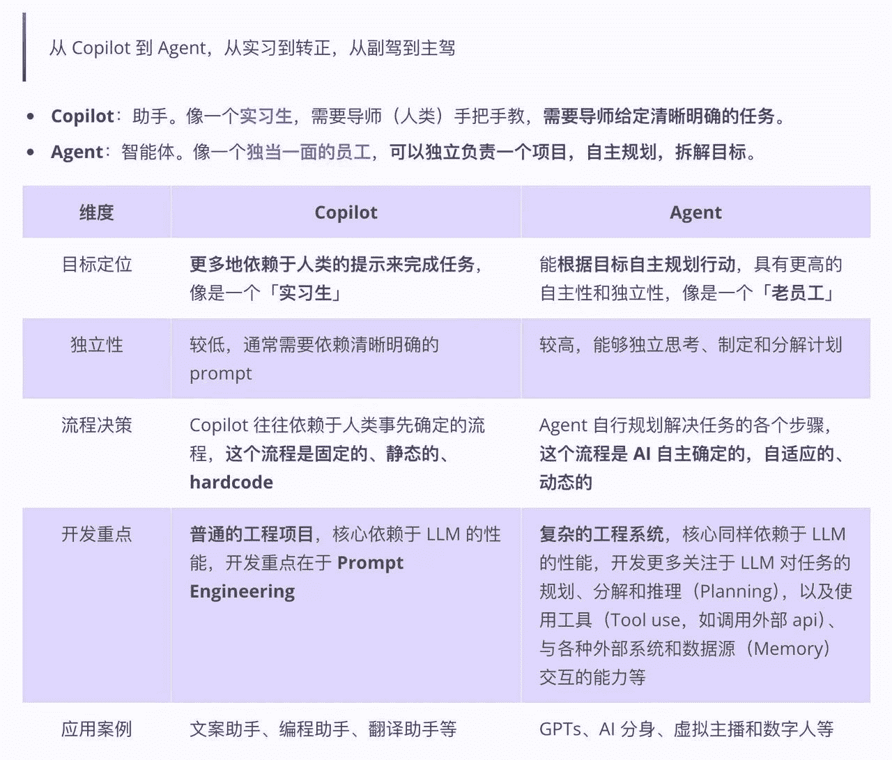

# 0. 学习路径: 成为基于Agent的创造者

> 来源：[https://v11enp9ok1h.feishu.cn/docx/VjKQdSm4so2ok7xtnNAcA5jsnDe](https://v11enp9ok1h.feishu.cn/docx/VjKQdSm4so2ok7xtnNAcA5jsnDe)

## Agent工程 (基础版)

> 如同传统的软件工程学, Agent工程也有一个迭代的范式:

1.  **梳理流程: **梳理工作流程SOP, 并拆解成多个单一「任务」和多个「任务执行流程」.

1.  **「任务」工具化: **自动化每一个「任务」, 形成一系列的小工具, 让机器能完成每一个单一任务.

1.  **建立规划: **串联工具, 基于agent框架让bot来规划「任务执行流程」.

1.  **迭代优化:** 不停迭代优化「任务」工具和「任务执行流程」规划, 造就能应对实际场景的Agent.

## 数字员工“进化论”

> 《从copilot 到 Agent, 从实习到转正, 从副驾到主驾》

> -- 到底是固化流程, 还是让AI自主思考, 需要在对AI能力基础上作出妥协和平衡.

