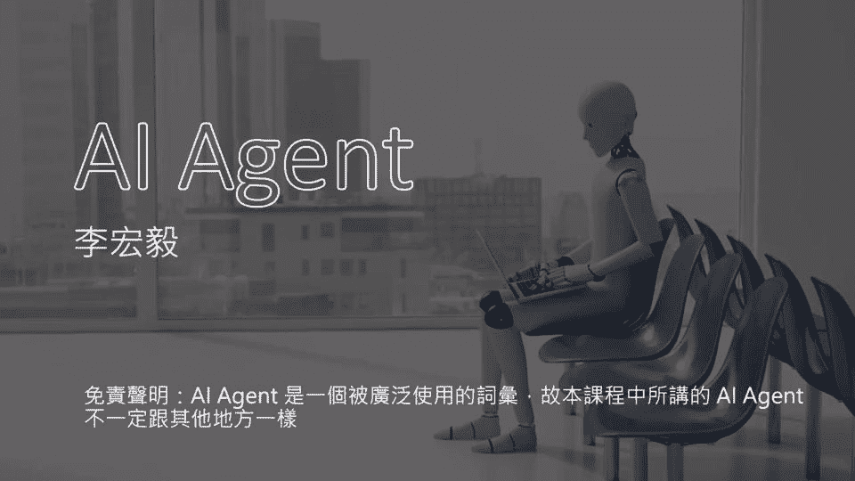
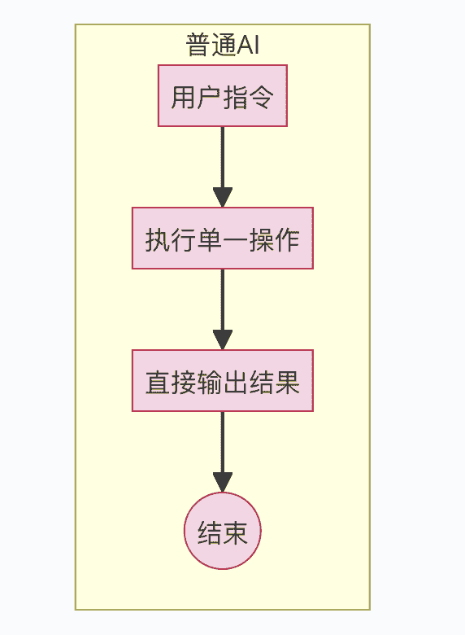
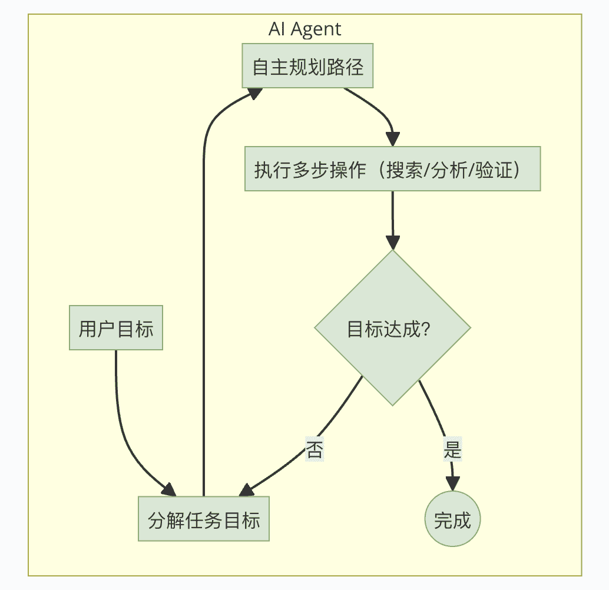
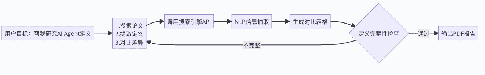
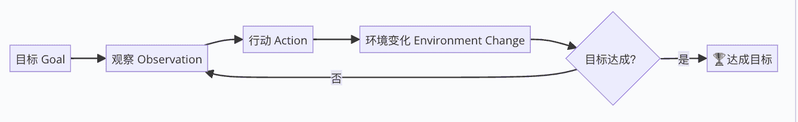
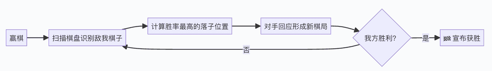
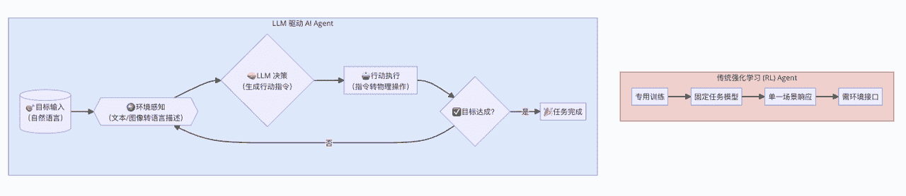
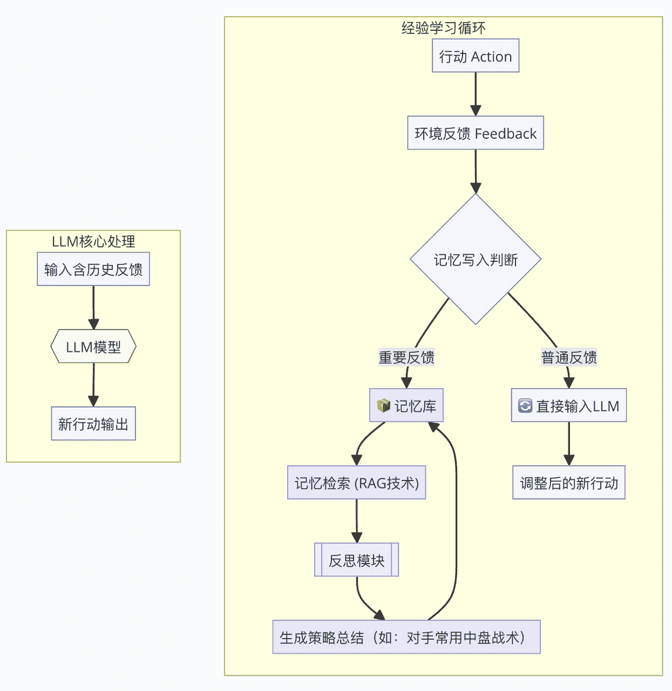
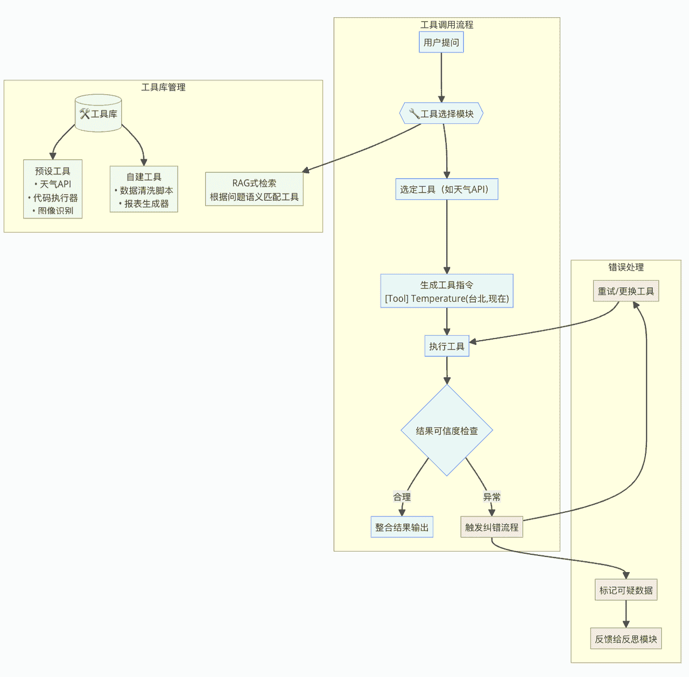
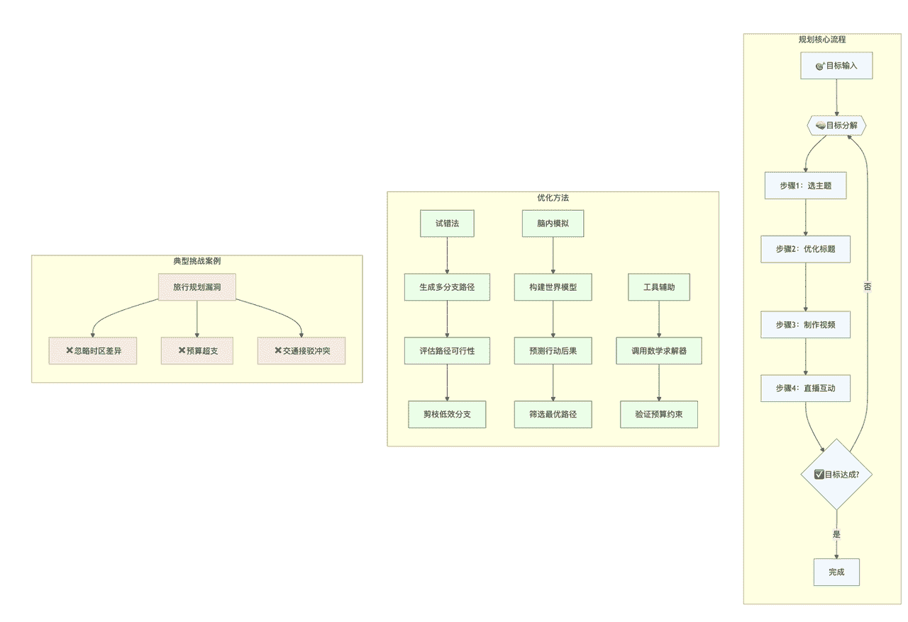

# 从零开始搞懂 AI Agent

> 来源：[https://v11enp9ok1h.feishu.cn/docx/L9YEdsAI3oAldRxdWwlciWCnnPF](https://v11enp9ok1h.feishu.cn/docx/L9YEdsAI3oAldRxdWwlciWCnnPF)

## ** 视频：**** **一堂课搞懂 AI Agent 的原理

[13389265973740984.mp4](https://internal-api-drive-stream.feishu.cn/space/api/box/stream/download/all/NcYCbBzGfoInNSxlwTlcKh3fnKg)

## 一、AI Agent 的本质——从「听话」到「主动」

### 1.1 AI Agent 和普通 AI 的区别

### 简单来说：

+   **普通 AI：**像个听话的工具，你说「跳」，它就跳一下。

+   **AI Agent：**像个有主动性的助手，你给个目标，它自己规划怎么跳、跳多高。

---

用课程里的比喻，普通 AI 是「一个口令一个动作」，而 AI Agent 是「人类只给目标，AI 自己找路」。

以一个「研究任务」为例，展示AI Agent如何工作：

### 1.2 AI Agent 的定义和工作循环

那 AI Agent 具体是怎么工作的呢？课程里给了个清晰的框架，可以用一张图来概括：

+   **目标：**人类给的终点，比如「赢一盘围棋」。

+   **观察：**AI 感知到的当前情况，比如「棋盘上黑白子的位置」。

+   **行动：**AI 根据观察决定做啥，比如「在第 5 行第 7 列落子」。

+   **环境变化：**行动引发的结果，比如「对手回了一步」。

+   **循环：**不断观察、行动，直到目标达成。

> 举个例子，AlphaGo 就是个经典的 AI Agent。它的目标是「赢棋」，观察是「当前棋盘状态」，行动是「落子」，然后对手回应，它再观察、再行动。这个循环听起来是不是很像我们人类解决问题的方式？先看情况，想办法，试一下，再调整。

这个工作循环体现了 AI Agent 的自主性和反应式架构——像人类一样通过试错逼近目标，而非单纯执行预设指令。

### 1.3 为啥 AI Agent 跟强化学习（RL）有关？

如果你学过机器学习，可能会觉得这个循环很眼熟。它跟强化学习（Reinforcement Learning, RL）的思路很像。RL 的核心是让 AI 通过试错学会最大化「奖励」（Reward）。比如 AlphaGo，赢棋 Reward 是 +1，输棋是 -1，它通过无数次模拟对局，学会怎么下才能赢。

---

**但传统的 AI A**gent 多靠 RL 打造，比如 AlphaGo 得专门为**围棋训练一个模型。**[可问题来了：](https://zhida.zhihu.com/search?content_id=254847154&content_type=Article&match_order=1&q=%E5%A4%A7%E5%9E%8B%E8%AF%AD%E8%A8%80%E6%A8%A1%E5%9E%8B&zhida_source=entity)换个任务，比如**下象棋，它**还得重头练。这就有点笨拙了。而现在，AI Agent 之所以又火起来，是因为我们有了新玩法——直接用大型语言模型（LLM）当 Agent，不用每次都重新训练。这是个大转折，后面会细讲。

---

## 二、AI Agent 的「新灵魂」——大型语言模型（LLM）

### 2.1 LLM 如何变身 AI Agent？

过去，RL 打造的 AI Agent 虽然强，但局限明显：一个模型只能干一件事。现在有了 LLM（像 ChatGPT、Grok 这样的语言模型），情况变了。LLM 的超能力在于通用性——它能理解文字、回答问题、写代码，甚至看图说话。那能不能直接让它当 AI Agent 呢？

---

答案是可以的！LLM 驱动的 AI Agent 是这样工作的：

1.  目标用文字输入：比如「帮我下赢围棋」。

1.  环境转成文字或图片：棋盘状态可以用文字描述（「黑子在 A1，白子在 B2」），或者直接给图片。

1.  行动用文字输出：LLM 说「我要在 C3 落子」，然后有人或系统把这文字转成实际操作。

1.  循环直到成功：环境变了，LLM 再观察、再输出新行动。

---

这跟 RL 的区别是：LLM 不用专门训练，它靠已有的语言理解能力，直接「猜」下一步该干啥。是不是很省事？

### 2.2 LLM 做 Agent 的优缺点

### 优点

+   **灵活性：**不像 AlphaGo 只能下围棋，LLM 能处理各种任务，只要你能用文字描述目标。

+   **无需定义 Reward：**RL 得手工设计奖励函数（比如「赢棋 +1」），但这很难调。LLM 直接读懂目标和反馈，比如给它个错误日志，它自己就能改代码，不用你说「错一次 -1」。

+   **无限可能：**LLM 能输出任何文字，行动空间几乎无限制，而 AlphaGo 只能在 19×19 的棋盘里挑一个点。

---

### 缺点

+   **不靠谱：**LLM 本质是「文字接龙机」，它可能瞎猜一步，而不是深思熟虑。

+   **依赖描述：**环境得转成文字或图片，如果描述不清楚，它就懵了。

---

前一段有一个新闻，有人让 ChatGPT 和 DeepSeek 下象棋，结果它们把「兵」当「马」跳，还凭空变出棋子，最后 DeepSeek 吃了自己一子宣布胜利，ChatGPT 还认输了……这说明，LLM 做 Agent 还得磨练。

---

## 三、AI Agent 的三大关键能力

课程里把 AI Agent 的能力拆成三块：根据经验调整行为、使用工具、做计划。这三点决定了它能不能从「听话工具」进化成「聪明助手」。

---

### 3.1 根据经验调整行为

这个能力为什么重要？

人类做事靠经验，AI Agent 也一样。比如你写代码报错，编译器告诉你「缺个分号」，下次你就记得加分号。AI Agent 得有类似能力，看到反馈后调整下一步。

---

#### LLM 怎么做到？

LLM 不用调参数，直接把反馈塞进输入，它就变聪明了。比如：

+   输入：「写个加法函数。」

+   输出：「def add(a, b): return a + b」

+   反馈：「有错，b 没定义类型。」

+   新输入：「写个加法函数，反馈说 b 没定义类型。」

+   新输出：「def add(a: int, b: int) -> int: return a + b」

---

这靠的是LLM 的**「上下文学习」**（In-Context Learning），不用训练，输入变了，输出就变。

---

#### 挑战：记忆爆炸

如果每次行动都把历史全塞给 LLM，步数一多（比如 1 万步），输入就太长，算力撑不住。怎么办？课程提了三个模块：

+   **Write（写入）**：决定啥值得记。比如「桌子在那儿」不重要，「对手下了关键一步」才记。

+   **Read（读取）**：从记忆里挑相关经验，像 RAG（检索增强生成）技术，从海量数据里找有用的。

+   **Reflection（反思）**：总结经验，比如「对手老爱走中间，我得防着点」。

---

实验发现，正面反馈（「这步对了」）比负面反馈（「这步错了」）更有效，因为 LLM 更擅长照着「好例子」学。

### 3.2 使用工具

**为什么需要工具？**

LLM 再强，也有短板。比如它不会直接查天气，得靠外部工具。工具就像 AI Agent 的「外挂」，让它能干更多事。

---

**怎么用？**

**一个通用方法：**

+   **告诉它工具咋用**：比如用 Temperature(地点, 时间) 查温度。

+   **输入问题**：今天台北多热？

+   **输出指令**：[Tool] Temperature(台北, 现在) [Tool]

+   **执行并反馈**：[Output] 28°C [Output]

+   **最终回答**：台北现在 28°C。

---

**常用工具包括：**

+   **搜索引擎**：查资料（RAG）。

+   **代码执行器**：写程序并运行。

+   **其他 AI**：比如让语音 AI 帮它听音频。

**挑战：工具多了咋办？**

工具一多（比如上千个），LLM 不可能全记住。解决办法是用「工具选择模块」，像 RAG 一样，从工具库里挑合适的。更有趣的是，LLM 还能自己写代码造工具，存起来复用。

---

**小心工具出错**

工具可能给错信息，比如搜索引擎搜到恶搞贴说「披萨起司用胶水粘」。LLM 有一定判断力（比如「1 万度太离谱」），但有时也会被忽悠，得教它别太信工具。

### 3.3 做计划

**什么是计划？**

计划就是先想好步骤再行动。比如刷牙：找牙刷 → 挤牙膏 → 刷 → 漱口。AI Agent 也得会规划，不然每步都随机试，太笨了。

---

**LLM 能规划吗？**

能，但不完美。给它说「做百万订阅 YouTuber」，它能列个计划：选主题 → 优化标题 → 做直播……听起来不错，但细节常出错。比如安排旅行，它可能忘了预算限制，或者行程撞车。

---

**怎么提升？**

有几个思路：

1.  试错法（[Tree Search](https://zhida.zhihu.com/search?content_id=254847154&content_type=Article&match_order=1&q=Tree+Search&zhida_source=entity)）：每步都试试，挑最好的。但算力成本高，得剪掉没希望的路。

1.  脑内模拟（[World Model](https://zhida.zhihu.com/search?content_id=254847154&content_type=Article&match_order=1&q=World+Model&zhida_source=entity)）：让 LLM 自己猜下一步会咋样，像做梦一样规划。比如网页买东西，它先想象「点这个会跳到哪」。

1.  用工具帮忙：复杂限制（像预算）交给专门的求解器，LLM 只管写代码调用。

---

实验显示，新模型（如 o1）在「神秘方块世界」这种怪题上表现更好，说明推理能力帮了大忙。但有时它们也「想太多」，光模拟不行动。

