# 《MetaGPT智能体开发入门》教程

> 来源：[https://v11enp9ok1h.feishu.cn/docx/CVTpdvMzsoZ5GsxbE3tcuOHJnFg](https://v11enp9ok1h.feishu.cn/docx/CVTpdvMzsoZ5GsxbE3tcuOHJnFg)

## 教程内容

📘【课程内容】 你是否曾梦想拥有一个专属的AI助手，为你解决日常琐事，提供实时资讯？课程将深入浅出地教授如何使用`MetaGPT`开发爬取trending内容的智能体，并将其部署到🛰️、`Discord`等平台。通过这门课程，你将学会：

1.  `MetaGPT`框架的基本使用方法，

1.  设计和实现智能体的完整流程；

1.  如何将智能体部署到🛰️、`Discord`等平台；

1.  掌握智能体开发的相关技能，为进一步个性化开发奠定基础。

课程基础：接触过`python`编程，有能力获得大模型（`GPT`）API的人群

## 学习规划

按照课程表完成`打卡`并用一个公开可访问的文档作为本次学习的学习笔记（csdn/知乎/GitHub/飞书/简书等） 每一个task的心得/笔记/作业可以放到文档中 作业完成了丢链接到群里面一起学习

+   task1：第一章：前期准备

+   task2：第二章：AI Agent知识体系结构

+   task3：第三章：`MetaGPT`框架组件教程

+   task4：第四章：OSS - 订阅智能体

+   task5：第五章：`ActionNode`

+   task6：第六章：进阶订阅智能体开发

# 目录

## 第一章：前期准备

`GPTs` 上传了本教程PDF的课程助教 如果有不明白的问题可以在群内交流也可以请教课程助教，注意将回答丢到群中，这样你可能可以得到一个更多角度的判断

> Q:为什么对话`chatbot-agent`智能体框架要用`python`异步编程的架构实现

> A:首先，我们需要了解异步编程的概念。在传统的同步编程中，代码按照顺序执行，一个任务的完成必须等待前一个任务完成。这种方式在处理I/O密集型操作（如网络请求）时效率较低，因为CPU在等待I/O操作完成时，会处于闲置状态。

> 异步编程允许程序在等待一个任务完成时继续执行其他任务，这对于I/O密集型的应用特别有用。在聊天机器人的场景中，异步编程使得系统能够同时处理多个聊天会话，而不需要为每个会话独立等待响应。

> 使用`Python`实现异步编程的一个重要原因是`Python`的异步支持已经相当成熟。`Python`的`asyncio`库提供了一套易于理解和使用的API，用于编写单线程的并发代码。这使得`Python`成为开发异步聊天机器人的理想选择。

> 现在，我们将这个概念简化一下：

> 想象一个服务员（程序）在一个忙碌的餐厅（服务器）里工作。在同步编程模式下，服务员每次只能服务一个顾客，即使顾客只是在等待他们的饮料。服务员必须站在那里，等待饮料准备好，然后才能去服务下一个顾客。这很低效，因为服务员在等待时无事可做。

> 在异步模式下，服务员点完一个顾客的饮料后，可以去服务其他顾客，而不是等待。当饮料准备好时，服务员会得到通知，然后再继续服务那个顾客。这样，服务员可以同时处理多个任务，提高效率。

> 这就是为什么使用`Python`异步编程架构来构建对话`chatbot-agent`智能体是有益的：它允许聊天机器人同时处理多个对话，而不是一次一个，从而提高效率和响应速度。

### 获取`MetaGPT`

本章节内我们将详细介绍如何获取`MetaGPT`

`MetaGPT`提供了几种安装的方式，我们可以根据自己的需求来选择安装的方式

请确保你的系统已安装`Python 3.9+`。你可以通过以下命令进行检查：

```
python3 --version
```

+   使用`pip`获取`MetaGPT`

`metagpt`可以直接用 `pip` 来获取至本地环境中，这样我们就可以在像使用任何`python`包一样导入`MetaGPT`

通过在终端内运行下面的代码来获取稳定版`metagpt`

```
pip install metagpt
```

> `pip install -i https://pypi.tuna.tsinghua.edu.cn/simple metagpt==0.5.2`（推荐）

通过在终端内运行下面的代码来获取最新版`metagpt`来体验最新功能

```
pip install git+https://github.com/geekan/MetaGPT
```

+   通过`github`仓库获取`MetaGPT`

通过仓库直接拉取`MetaGPT`的好处是你可以更加灵活的使用`MetaGPT`框架，根据`MetaGPT`提供的基础组件来做出更符合自己需求的`Agent`

通过在终端内运行下面的代码从`MetaGPT`仓库获取`MetaGPT`

```
git clone https://github.com/geekan/MetaGPT.git
cd /your/path/to/MetaGPT
pip install -e .
```

获取`MetaGPT`的内容就到这里为止，但`MetaGPT`官方还提供了更多的获取方式，包括使用`Docker`，以及获取可生成图表的更完整的版本，更多内容你都可以在`MetaGPT`的官方文档中获取

### 配置`MetaGPT`

完成`MetaGPT`后，我们还需要完成一些配置才能开始使用这个强力的框架，包括配置你自己的`API key`等等，下面我们我们将以配置`ChatGPT`为例来快速帮助大家上手配置

#### 调用 `ChatGPT` API 服务

与我们在 `chatgpt` 官网使用的所见即所得的 `chat` 功能不同，在使用`metagpt`时我们需要确保自己能够使用 `openai`的 api 服务，`OpenAI API` 服务是付费的，每一个开发者都需要首先获取并配置 `OpenAI API Key`，才能在自己构建的应用中访问 `ChatGPT`。我们将在这部分讲述如何获取并配置 `OpenAI API Key`。

##### 获取 `OpenAI API Key`

[在获取OpenAI API Key](https://openai.com/)之前我们需要`openai`官网中注册一个账号。这里假设我们已经有了`openai`账号，先在`openai`官网登录，登录后如下图所示：

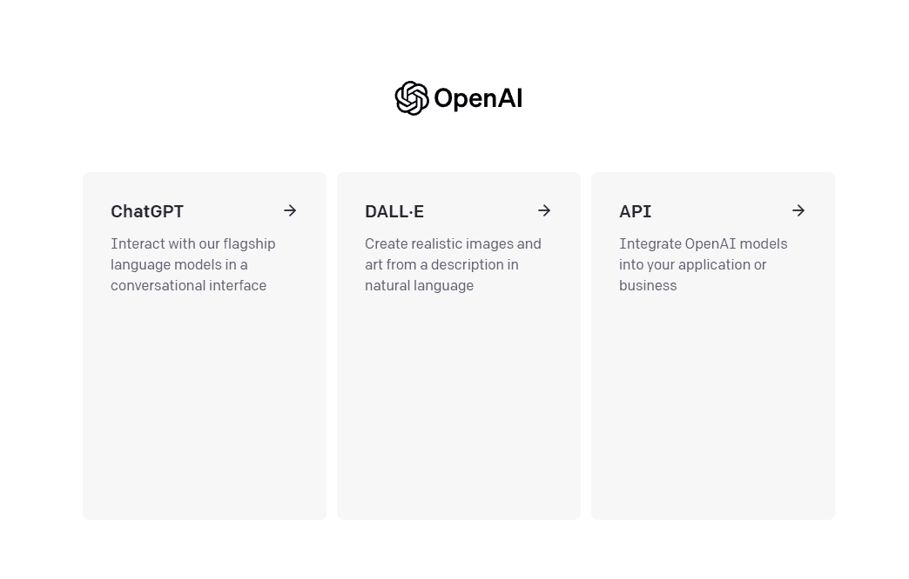

我们选择API，然后点击右上角的头像，选择View API keys，如下图所示：

点击Create new secret key按钮创建`OpenAI API Key`，我们将创建好的`OpenAI API Key`复制下来。

##### 配置 `OpenAI API Key`

##### 首次尝试

我们在前面的内容中已经解释了为什么对话 `chatbot-agent` 智能体框架要用 `python` 异步编程的架构实现，如果你对 `python` 中实现异步的内容不熟悉，那么你可以参考下面的学习文档

> 注意：

> 下面为 `software startup example` 的节选。如果你使用`git clone`方法进行安装，在当前目录下有已经实现好的脚本文件，只需简单执行

```
python startup.py --idea "write a cli blackjack game"
```

现在，让我们开始吧！我们将创建一个多智能体团队，根据我们的一句话需求编写软件。

首先，导入已实现的角色

```
import asyncio
from metagpt.roles import (
    Architect,
    Engineer,
    ProductManager,
    ProjectManager,
)
from metagpt.team import Team
```

然后，初始化公司团队，配置对应的智能体，设置对应的预算以及提供一个写一个小游戏的需求。

```
async def startup(idea: str):
    company = Team()
    company.hire(
        [
            ProductManager(),
            Architect(),
            ProjectManager(),
            Engineer(),
        ]
    )
    company.invest(investment=3.0)
    company.start_project(idea=idea)

    await company.run(n_round=5)
```

最后，运行并得到生成的游戏代码！

在`notebook`中执行下面命令，运行并得到生成的游戏代码

```
await startup(idea="write a cli blackjack game") # blackjack: 二十一点
```

如果你通过`python`文件启动，执行下面的命令

```
asyncio.run(startup(idea="write a cli blackjack game")) # blackjack: 二十一点
```

运行结束后在当前目录下的 `workspace\cli_blackjack_game` 路径下就能查看你生成的项目咯

## 第二章：AI Agent知识体系结构

### 智能体的定义

#### 什么是智能体?

> `智能体` = LLM+观察+思考+行动+记忆

> `多智能体` = 智能体+环境+SOP+评审+路由+订阅+经济（详见相关资料）

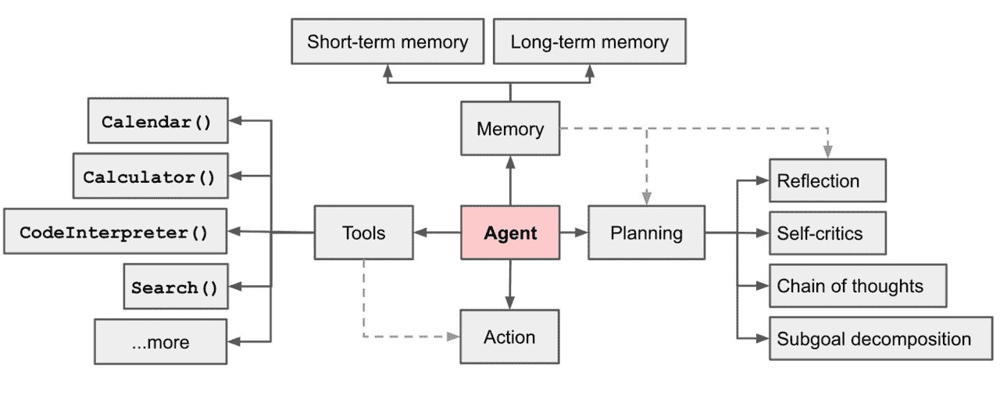

1.  `记忆`分为五种类型：工作记忆、工具记忆、语义记忆、情节记忆和动作记忆。人类的记忆会经历过滤、压缩、遗忘和重组等环节，实际机制非常复杂，99%的记忆会被删除。

+   工作记忆是指保持与当前任务相关的临时信息的能力，受到赫布理论效应的调节。

+   工具学习是指通过奖惩来改变行为的能力，由以基底核为中心的脑区网络实现。

+   语义记忆是指学习事实和关系的能力，可能主要储存在大脑皮质中，通过改变神经元连接来存储特定类型的记忆。

+   情节记忆是指回忆特定事件细节的能力，可以终身保持。许多证据表明，海马体在其中起着关键作用，许多有海马体损伤的人会表现出失忆症，无法获得新的长期情节记忆。

+   动作学习是指通过练习或重复来改善身体运动模式的能力。许多脑区与之相关，包括前运动区、基底核，尤其是小脑，它包含了许多关于运动参数微小调节的信息。

1.   `规划` ：规划基本与写代码等价 。目前`LLM`规划能力较弱， 以 `Codeforces Rating` 为例，`GPT - 4` 排名 后10%

1.  `神经`：人脑有大量如视神经、听觉神经等小网络；智能体大概率也需要大量的小模型（如在视觉、决策、路由等工作上），不能由一个大模型来主导，一不经济，二不实际

1.  小鼠的嗅觉系统是由 1500 个小神经组成的，相当于是一堆小的分类器，只在小鼠闻到特定气味触发特定神经，平时低功耗运行，不会做全脑推理，这意味着`Agent`上实现对应模块大概率也需要大量小模型

1.  `工具`：实际就是`API`，分为`build something`及`use something`，支撑了智能体通往现实世界。假如实现现实世界完整表达的`API`需要`k`个，而这`k`个已经被实现，那么`Agent`理论上就可以达到全能。当然，前提是它要能够无错、娴熙的基于这些`API`写出完整的代码，而这代码自动撰写的missing piece就是`MetaGPT`

1.  `直觉`：如呼吸、吞咽、心跳等不需要在脑内有任何显性思考的部分，如你要喝水，会从手边拿起一个矿泉水，然后拧开它的盖子，之后开始喝水；全流程无需特意思考。现实世界的大部分任务都需要直觉，通过直觉系统，能将任务完成度从之前最优的30%多提升到接近90%

1.  `运控`：黑色部分主要指运动控制，对应具身智能相关特性

如果你看了介绍还是不明白，用一个具体的`GPTs`的案例向你说明什么是`agent`智能体代理

#### 智能体举例：

https://chat.openai.com/g/g-O8Y8pE85i-findgpts

这是作者制作的一个`GPTs`导航，帮助用户用`LLM`的模糊语义搜索找到全网公开的`GPTS`以及其体验链接


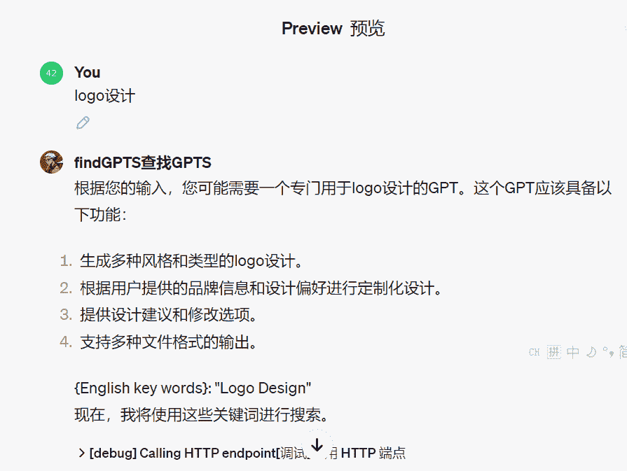


这里的记忆可以分为`chatgpt`训练过程中的语料库的语义记忆，我强调进行 [GPTs导航站收录](https://zw73xyquvv.feishu.cn/wiki/TPxXwK3XaiuzMvkDeoYcYNU9n5c) [设计时匹配出的工作记忆](https://github.com/h4r5h1t/webcopilot)/情节记忆，用户主动上传的`knowledge`（比如爬取 ）文档中所有的`GPTs`和对应的`describe`的长期记忆

目前`LLM`的自主规划能力很弱，所以我用一套`sop` 工作步骤让他能够有更多的思考空间（时间换准确率）

这里`findGPTs` 会先解构用户的描述，用`LLM`的基础能力去泛化找到其他语义相似的`keywords`进行检索，检索这一步采用了`webcopilot` 开源的`action` 进行浏览器访问（这个是强于`openai` 提供的`bing search`的效率的）

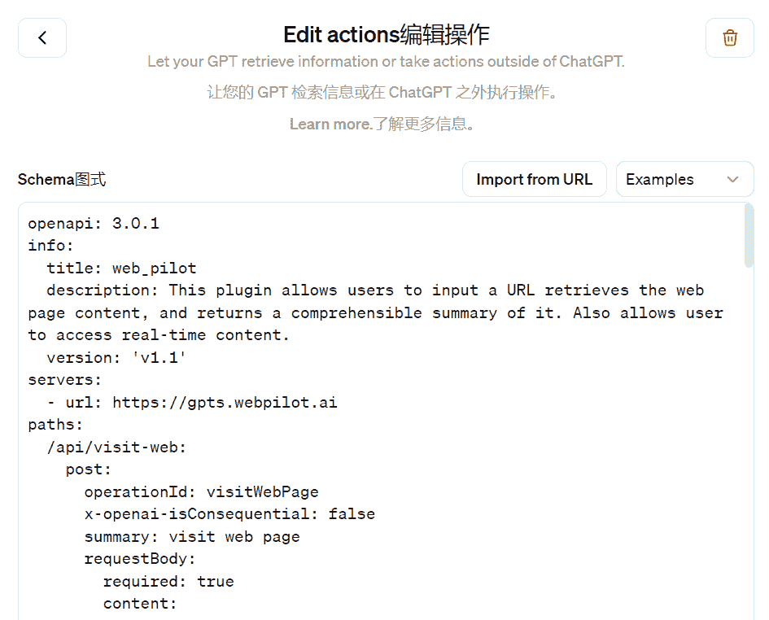

这一步也是`openai api` 插件开发者和普通`GPTs`开发者拉开差距的地方，这里就体现了`LLM tools`工具调用的能力，

拿到了搜索引擎返回的 `GP[Ts list`，`llm`就开始观察和思考哪个是最高匹配度的`GPTs`，如果将来`openai`支持访问`gpts`的`API`那么这个`agent`就可以自动的提炼`describe` 直接去询问对应的`GPTs`并调用`API`返回搜索结果即为`agent action`行动的结果。

比较类似的超级入口可以参考`HuggingGPT`火了：一个`ChatGPT`控制所有`AI`模型，自动帮人完成`AI`任务

> `prompt`开源：

> step1:根据用户的输入（描述的功能以及需求）进一步补全用户所需的`gpts description` 并提炼{`English key words`}

> step2:利用`webcopilot` 对{`English key words`}进行使用`site:chat.openai.com/g+{English key words}`检索，例如以`"game"`触发`webcopilot action`搜索<`site:chat.openai.com/g Game`>

> step3:把搜索结构根据<`Open AI gpts+description+link`>格式 返回一个`list`

> rule：高匹配度以及使用人数的`gpts`排序优先，多个关键词为或的关系

> step4：访问搜索结果排名最高的网址例如：`https://chat.openai.com/g/g-Sug6mXozT-game-time`并返回用户的输入（描述的功能以及需求）对应的结果

#### 相关资料

[基于大语言模型的AI Agents—Part 1 | Breezedeus.com](https://www.breezedeus.com/article/ai-agent-part1)

[【直播回放】MetaGPT作者深度解析直播回放_哔哩哔哩_bilibili](https://www.bilibili.com/video/BV1Ru411V7XL/?spm_id_from=333.337.search-card.all.click)

### 热门智能体案例

#### 流行的`GPTs`：

[GitHub - AgentOps-AI/BestGPTs: Top ranked OpenAI GPTs](https://github.com/AgentOps-AI/BestGPTs)

#### Openai time line 案例迅速体验：

1.  [`AgentGPT`](https://agentgpt.reworkd.ai/zh):基于浏览器的 `AutoGPT` 实现，可通过无代码平台访问

帮我写一个`openai`近期新闻的时间线

1.  https://app.tavily.com/chat 基于浏览器的`GPT Research`实现，可通过无代码平台访问

[`Tavily AI --- 塔维利人工智能.pdf`](https://internal-api-drive-stream.feishu.cn/space/api/box/stream/download/all/WDHJbTXbeov9x1xEpdTcYbtRn1d)

1.  https://www.perplexity.ai/  `LLM`驱动的`agent`搜索引擎

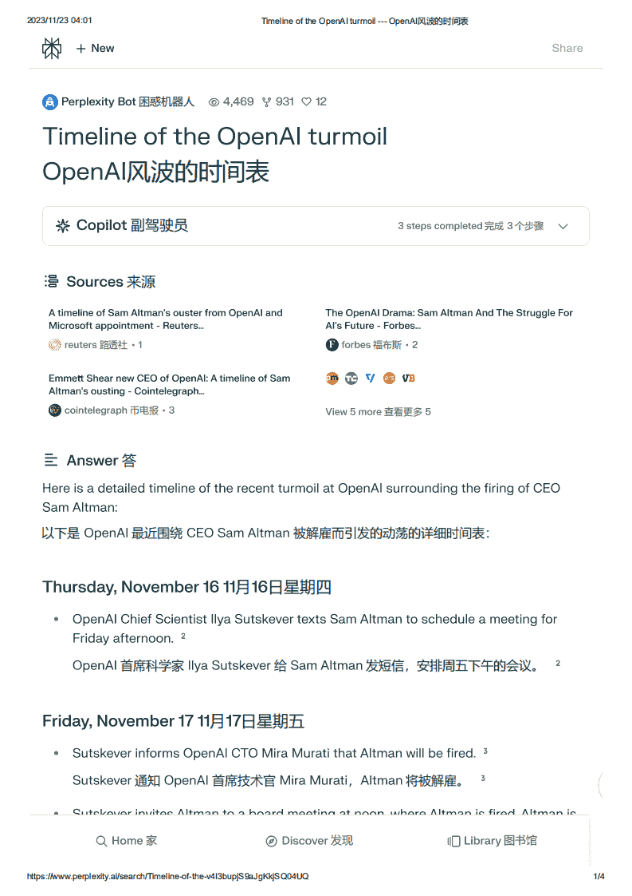

[`Timeline of the OpenAI turmoil --- OpenAI风波的时间表.pdf`](https://internal-api-drive-stream.feishu.cn/space/api/box/stream/download/all/EJEhbip6toT5FIxt4P9cHvp5nqe)

#### 代码产品：

1.  `Cursor` - The `AI-first` Code Editor：`AI`优先的代码编辑器。在专为与人工智能进行配对编程而设计的编辑器中更快地构建软件。

1.  `Chatgpt Code Interpreter` ：代码解释器（`Code Interpreter`）可以让普通用户（非程序员）用自然语言完成以前需要写代码来完成的复杂工作。

#### 更多仓库以及产品：

https://github.com/e2b-dev/awesome-ai-agents


## 智能体的宏观机会


# 99%的互联网入口将由App变为智能体：人类感知的字节数降低到极限


# 社会协作变革：虚拟员工进入企业，红杉预计智能体数量五年后和人类1比1

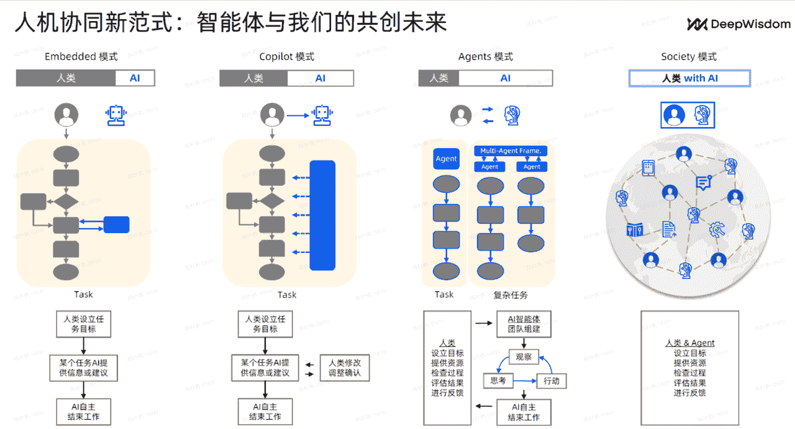

## AI Agent 与 Sy1 & Sy2

### Agent：`LLM`时代的新软件

1. `Agent`是新的高级物种，为了实现类人智能，大语言模型实现了人脑的20%，我们需要构建`AgentStack`补齐剩余的80%

1. 补齐之后，`Agent`就可以直接供给生产力，并且同类问题的平均解决成本在人类的1%以内，效率平均在100倍以上

1. 99%的互联网入口将由`App`变为`Agent`：人类感知的字节数降低到极限

1. 信息技术革命沿着，门户->搜索->推荐->`Agent`演变；本质是人类需要操作的字节数在迅速变少。比如一个调研需求，人类需要搜索、阅读100个页面再做总结，但`Agent`可以自己做完这个流程，人类阅读结果就可以。以此类推，订票、购物、搜索、`IM`等大部分流程都可以交给`Agent`做

1. 软件的需求依然会持续存在，但入口将被`Agent`接管。软件仅做为数字世界的一部分被感知、做为部分`API`被使用

### Sy1 & Sy2 给 `Agent` 的启发

@Andrej Karpathy：

> 第一件事是关于系统 1 与系统 2 类型思维的概念，这个概念是由《思考，快与慢》这本书所普及的，所以这个区别是什么？这个想法是你的大脑可以以两种不同的模式运行。系统 1 思维是你的大脑的快速、本能和自动化的部分，所以例如，如果我问你 2+2 等于多少，你实际上并没有做数学计算。

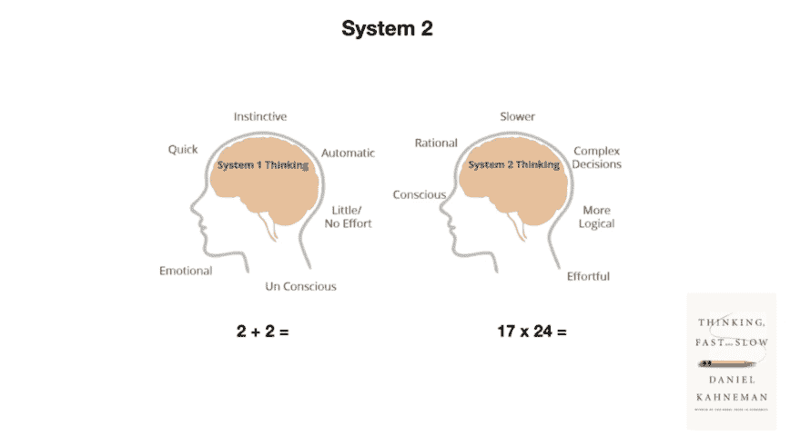

> 你只是告诉我它等于四，因为这是可用的，已经存在于你的大脑中，是本能的。但是当我告诉你 17*24 等于多少时，你并没有准备好这个答案，所以你会启动你的大脑的另一部分，这部分更加理性，更加缓慢，进行复杂的决策，感觉更有意识。你不得不在脑海中解决这个问题，然后给出答案。

> 另一个例子是，如果你们中的一些人可能下象棋，当你进行快速象棋比赛时，你没有时间思考，所以你只是根据直觉移动棋子。这时大部分由你的系统 1 来处理。但如果你在比赛中，有更多时间来思考，那么你会更多地参与到决策中，你会感到自己在建立可能性的树，这是一个更有意识、更费力的过程。你必须在脑海中解决问题并给出答案。

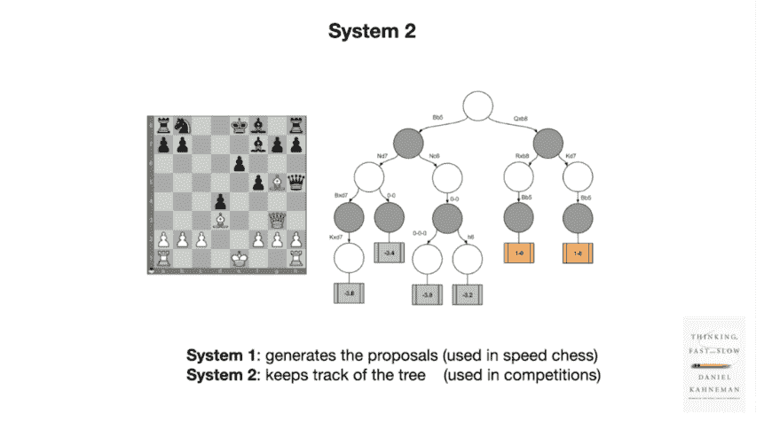

> 现在事实证明，`LLM` 目前只有系统 1。它们只有这个本能部分。它们不能思考并推理出各种可能性。它们只是按顺序输入单词，并且基本上这些语言模型有一个神经网络，可以给出下一个单词，所以它就像右边的漫画一样，你只是在跟踪轨迹，这些语言模型基本上只是不断发出声音，这就是它们按照序列采样单词的方式。每个这样的块大致需要相同的时间，所以这基本上是 `LLM` 在系统 1 设置中的工作方式，所以很多人认为，赋予 `LLM` 系统 2 的能力会给人们带来灵活的时间，让它们更深入地思考问题，反思和重新表述，然后以更有信心的答案回来，所以你可以想象将时间表示为 x 轴，某种响应的准确度表示为 y 轴，当你绘制它时，你希望它是一个单调递增的函数。

### 相关资料

[OpenAI官宣第一笔收购！开源「我](https://mp.weixin.qq.com/s/8STgkzD4hxtTUeUSoh6xEQ)的世界」8人顶级团队加盟，押注AI智能体

`GPT` 是否会带来失业潮？解读 `OpenAI` 爆火论文

### 第二章课程任务

根据时间轴感兴趣的部分观看教程视频，并输出一篇文字笔记（知乎/📕/即刻/csdn/GitHub）分享你的学习感想

[【直播回放】`MetaGPT`作者深度](https://www.bilibili.com/video/BV1Ru411V7XL/?spm_id_from=333.337.search-card.all.click&vd_source=199360a57d436da9caa4d615e469c770)解析直播回放_哔哩哔哩_bilibili

这个视频讲述了`MetaGPT`作者关于模型训练和优化的深入解析。作者分享了关于大语言模型发展路径的实际路径，以及`ZeroShot`的逻辑和效果应用，还涉及了智能体和环境的认知互动等。视频内容包括智能体架构、代码结构、环境配置等方面的讲解。

+ 0:01 🌍大语言模型的发展路径
+ 9:09 💡`BERT`的有效性和训练成本
+ 18:23 🎮强化学习在模型推理中的应用
+ 27:33 🗣️直觉、语音交互和多智能体协作
+ 36:46 🔍智能体的需求和发展前景
+ 45:55 🤖`MetaGPT`：AI智能体框架
+ 55:11 📊`MMLU`榜单、`GPT-4`性能和商业机会
+ 64:24 🌟多智能体框架的愿景和影响
+ 73:34 💼创业公司和`MetaGPT`软件公司实例
+ 82:47 🔧智能体的功能和设计理念
+ 91:59 🔬`Hugging GPT`的工作原理和开源竞争

## 第三章：`MetaGPT`框架组件介绍

### `Agent`组件介绍

#### `Agent`概念概述

在`MetaGPT`看来，我们把`Agent`想象成环境中的数字人，其中

`Agent = 大语言模型（LLM）` + 观察 + 思考 + 行动 + 记忆

这个公式概括了智能体的功能本质。为了理解每个组成部分，让我们将其与人类进行类比：

1. `大语言模型（LLM）`：`LLM`作为智能体的“大脑”部分，使其能够处理信息，从交互中学习，做出决策并执行行动。

1. `观察`：这是智能体的感知机制，使其能够感知其环境。智能体可能会接收来自另一个智能体的文本消息、来自监视摄像头的视觉数据或来自客户服务录音的音频等一系列信号。这些观察构成了所有后续行动的基础。

1. `思考`：思考过程涉及分析观察结果和记忆内容并考虑可能的行动。这是智能体内部的决策过程，其可能由`LLM`进行驱动。

1. `行动`：这些是智能体对其思考和观察的显式响应。行动可以是利用 `LLM` 生成代码，或是手动预定义的操作，如阅读本地文件。此外，智能体还可以执行使用工具的操作，包括在互联网上搜索天气，使用计算器进行数学计算等。

1. `记忆`：智能体的记忆存储过去的经验。这对学习至关重要，因为它允许智能体参考先前的结果并据此调整未来的行动。

在`MetaGPT`中定义的一个`agent`运行示例如下：

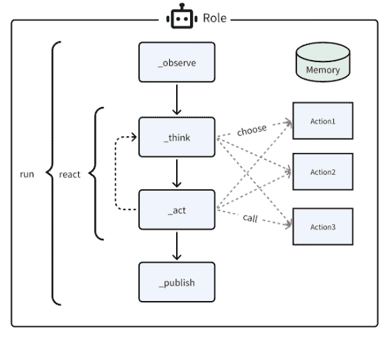

+ 一个`agent`在启动后他会观察自己能获取到的信息，加入自己的记忆中

+ 下一步进行思考，决定下一步的行动，也就是从`Action1`，`Action2`，`Action3`中选择执行的`Action`

+ 决定行动后，紧接着就执行对应行动，得到这个环节的结果

而在`MetaGPT`内 `Role` 类是智能体的逻辑抽象。一个 `Role` 能执行特定的 `Action`，拥有记忆、思考并采用各种策略行动。基本上，它充当一个将所有这些组件联系在一起的凝聚实体。目前，让我们只关注一个执行动作的智能体，并看看如何实现一个最简单的 `Agent`

#### 实现一个单动作`Agent`

下面将带领大家利用 `MetaGPT` 框架实现一个生成代码的 `Agent` `SimpleCoder` 我们希望这个 `Agent` 能够根据我们的需求来生成代码

要自己实现一个最简单的`Role`，只需要重写`Role`基类的 `_init_` 与 `_act` 方法

在 `_init_` 方法中，我们需要声明 `Agent` 的 `name`（名称）`profile`（类型）

我们使用 `self._init_action` 函数为其配备期望的动作 `SimpleWriteCode` 这个 `Action` 应该能根据我们的需求生成我们期望的代码

在 `_act` 方法中，我们需要编写智能体具体的行动逻辑，智能体将从最新的记忆中获取人类指令，运行配备的动作，`MetaGPT`将其作为待办事项 (`self.rc.todo`) 在幕后处理，最后返回一个完整的消息。

##### 需求分析

要实现一个 `SimpleCoder` 我们需要分析这个 `Agent` 它需要哪些能力

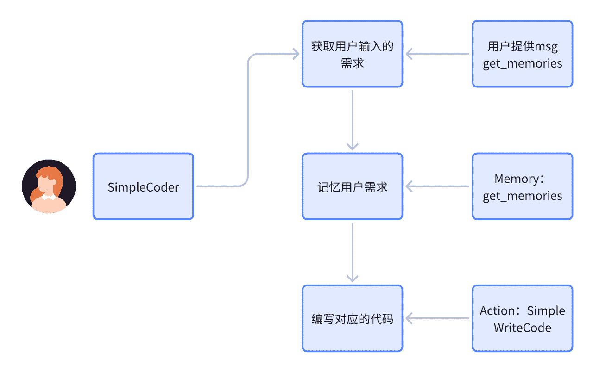

首先我们需要让他接受用户的输入的需求，并记忆我们的需求，接着这个 `Agent` 它需要根据自己已知的信息和需求来编写我们需要的代码。

##### 编写`SimpleWriteCode`动作

在 `MetaGPT` 中，类 `Action` 是动作的逻辑抽象。用户可以通过简单地调用 `self._aask` 函数 来获取 `LLM` 的回复。

`self._aask` 函数如下：

```
async def _aask(self, prompt: str, system_msgs: Optional[list[str]] = None) -> str:
    """Append default prefix"""
    if not system_msgs:
        system_msgs = []
    system_msgs.append(self.prefix)
    return await self.llm.aask(prompt, system_msgs)
```

它将调用你预设好的 `LLM` 来根据输出的提示词生成回答。

下面是实现`SimpleWriteCode`的具体代码：

```
import re
import asyncio
from metagpt.actions import Action

class SimpleWriteCode(Action):

    PROMPT_TEMPLATE = """
    Write a python function that can {instruction} and provide two runnnable test cases.
    Return ```python your_code_here ``` with NO other texts,

    your code:

    """

    def __init__(self, name="SimpleWriteCode", context=None, llm=None):

        super().__init__(name, context, llm)

    async def run(self, instruction: str):

        prompt = self.PROMPT_TEMPLATE.format(instruction=instruction)

        rsp = await self._aask(prompt)

        code_text = SimpleWriteCode.parse_code(rsp)

        return code_text

    @staticmethod

    def parse_code(rsp):

        pattern = r'```python(.*)```'
        match = re.search(pattern, rsp, re.DOTALL)
        code_text = match.group(1) if match else rsp
        return code_text
```

在我们的场景中，我们定义了一个 `SimpleWriteCode` 类，它继承自 `Action` 类，我们重写了 `__init__` 方法与 `run` 方法

`__init__` 方法用来初始化这个 `Action`，而 `run` 方法决定了我们对传入的内容到底要做什么样的处理

在 `__init__` 方法中，我们声明了这个类要使用的 `llm`，这个动作的名称，以及行动前的一些前置知识（`context`），这里 `context` 为空

```
def __init__(self, name="SimpleWriteCode", context=None, llm=None):
        super().__init__(name, context, llm)
```

在 `run` 方法中，我们需要声明当采取这个行动时，我们要对传入的内容做什么样的处理，在 `SimpleWriteCode` 类中，我们应该传入：“请你帮我写一个XXX的代码” 这样的字符串，也就是用户的输入，`run` 方法需要对它进行处理，把他交给 `llm`，等到 `llm` 返回生成结果后，我们再取出其中的代码部分返回。

我们写好了一个提示词模板，将用户输入嵌入模板中

```
PROMPT_TEMPLATE = """
    Write a python function that can {instruction} and provide two runnnable test cases.
    Return ```python your_code_here ``` with NO other texts,

    your code:

    """

prompt = self.PROMPT_TEMPLATE.format(instruction=instruction)
```

接着我们让大模型为我们生成回答

```
rsp = await self._aask(prompt)
```

生成回答后，我们利用正则表达式提取其中的 `code` 部分，`llm` 在返回给我们代码时通常用下面的形式返回

```python
code内容
```

对应的正则提取内容如下：

```
@staticmethod

def parse_code(rsp):

    pattern = r'```python(.*)```'
    match = re.search(pattern, rsp, re.DOTALL)
    code_text = match.group(1) if match else rsp
    return code_text
```

`parse_code` 方法使用正则表达式来匹配用户输入的代码文本。它会查找 Markdown 形式的 `python` 代码块，并提取其中的代码内容。如果找到匹配的代码块，则返回提取的代码内容；否则，返回 `llm` 输出的原始内容。

最后将代码内容返回

至此我们就完成了这样一个编写代码的动作。

##### 设计`SimpleCoder`角色

在此之前我们需要简单介绍一下 `Message`，在 `MetaGPT` 中，`Message` 类是最基本的信息类型，`Message` 的基本组成如下

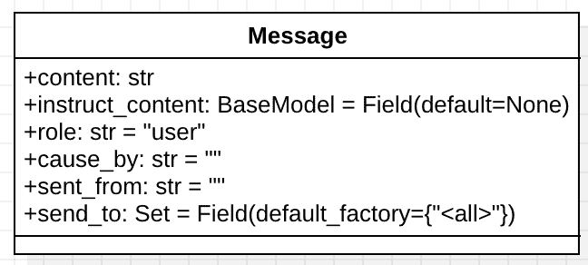

在本章节的学习中我们只涉及 `content` `role` `cause_by` ，除了 `content` 外，其他内容都是可选的

他们分别代表信息内容，发出信息的角色，以及是哪个动作导致产生的 `message`

在编写完 `SimpleWriteCode` 动作后，我相信大家还有很多疑惑，比如如何调用这个动作？怎样把用户输入的内容传递给这个动作？

这部分内容我们都会在设计 `SimpleCoder` 角色的时候解决

```
from metagpt.roles import Role
from metagpt.schema import Message
from metagpt.logs import logger

class SimpleCoder(Role):
    def __init__(
        self,
        name: str = "Alice",
        profile: str = "SimpleCoder",
        **kwargs,
    ):
        super().__init__(name, profile, **kwargs)
        self.set_actions([SimpleWriteCode])

    async def _act(self) -> Message:
        logger.info(f"{self._setting}: ready to {self.rc.todo}")
        todo = self.rc.todo # todo will be SimpleWriteCode()

        msg = self.get_memories(k=1)[0] # find the most recent messages

        code_text = await todo.run(msg.content)
        msg = Message(content=code_text, role=self.profile, cause_by=type(todo))

        return msg
```

前面我们已经提到过实现一个最简单的 `Role`，只需要重写 `Role` 基类的 `_init_` 与 `_act` 方法

`__init__` 方法用来初始化这个 `Action`，而 `_act` 方法决定了当这个角色行动时它的具体行动逻辑

我们在 `__init__` 方法中声明了这个 `Role` 的 `name`（昵称），`profile`（人设），以及我们为他配备了我们之前写好的动作 `SimpleWriteCode`

```
def __init__(
        self,
        name: str = "Alice",
        profile: str = "SimpleCoder",
        **kwargs,
    ):
        super().__init__(name, profile, **kwargs)
        self.set_actions([SimpleWriteCode])
```


# MetaGPT 智能体开发实践

配备好之后，我们定义的行动`SimpleWriteCode`就会被加入到代办`self.rc.todo`中。

在`_act`方法中，我们就会要求我们的智能体来执行这个动作，也就是我们需要调用`todo.run()`方法。

```
async def _act(self) -> Message:
    logger.info(f"{self._setting}: ready to {self.rc.todo}")
    todo = self.rc.todo  # todo will be SimpleWriteCode()
```

另外我们在前面的`action`中提到了，当`action`调用时，我们需要获取用户的输入来作为`instruction`传递给`action`，这里就涉及到我们该如何获取用户之前传递给`agent`的信息，在MetaGPT中，当用户与`Agent`交互时，所有的内容都会被存储在其自有的`Memory`中。

在MetaGPT中，`Memory`类是智能体的记忆的抽象。当初始化时，`Role`初始化一个`Memory`对象作为`self.rc.memory`属性，它将在之后的`_observe`中存储每个`Message`，以便后续的检索。简而言之，`Role`的记忆是一个含有`Message`的列表。

当需要获取记忆时（获取LLM输入的上下文），我们可以使用`self.get_memories`。函数定义如下：

```
def get_memories(self, k=0) -> list[Message]:
    """A wrapper to return the most recent k memories of this role, return all when k=0"""
    return self.rc.memory.get(k=k)
```

在`SimpleCoder`中，我们只需要获取最近的一条记忆，也就是用户下达的需求，将它传递给`action`即可。

```
msg = self.get_memories(k=1)[0]  # find the most recent messages
code_text = await todo.run(msg.content)
```

然后我们就将拿到大模型给我们的输出啦，最后我们将拿到的信息封装为MetaGPT中通信的基本格式`Message`返回。

这样，我们就实现了一个简单的单动作`Agent`。

## 运行SimpleCoder角色

接下来你只需要初始化它并使用一个起始消息运行它。

```
import asyncio

async def main():
    msg = "write a function that calculates the sum of a list"
    role = SimpleCoder()
    logger.info(msg)
    result = await role.run(msg)
    logger.info(result)

asyncio.run(main())
```

## 完整代码（SimpleCoder）

```
import re
import asyncio
from metagpt.actions import Action
from metagpt.roles import Role
from metagpt.schema import Message
from metagpt.logs import logger

class SimpleWriteCode(Action):

    PROMPT_TEMPLATE = """
    Write a python function that can {instruction} and provide two runable test cases.
    Return ```python your_code_here ``` with NO other texts,

    your code:

    """

    def __init__(self, name="SimpleWriteCode", context=None, llm=None):

        super().__init__(name, context, llm)

    async def run(self, instruction: str):

        prompt = self.PROMPT_TEMPLATE.format(instruction=instruction)

        rsp = await self._aask(prompt)

        code_text = SimpleWriteCode.parse_code(rsp)

        return code_text

    @staticmethod
    def parse_code(rsp):

        pattern = r'```python(.*)```'
        match = re.search(pattern, rsp, re.DOTALL)
        code_text = match.group(1) if match else rsp
        return code_text

class SimpleCoder(Role):
    def __init__(
        self,
        name: str = "Alice",
        profile: str = "SimpleCoder",
        **kwargs,
    ):
        super().__init__(name, profile, **kwargs)
        self.set_actions([SimpleWriteCode])

    async def _act(self) -> Message:
        logger.info(f"{self._setting}: ready to {self.rc.todo}")
        todo = self.rc.todo  # todo will be SimpleWriteCode()

        msg = self.get_memories(k=1)[0]  # find the most recent messages

        code_text = await todo.run(msg.content)
        msg = Message(content=code_text, role=self.profile,
                      cause_by=type(todo))

        return msg

async def main():
    msg = "write a function that calculates the sum of a list"
    role = SimpleCoder()
    logger.info(msg)
    result = await role.run(msg)
    logger.info(result)

asyncio.run(main())
```

## 实现多动作Agent

我们注意到一个智能体能够执行一个动作，但如果只有这些，实际上我们并不需要一个智能体。通过直接运行动作本身，我们可以得到相同的结果。智能体的力量，或者说`Role`抽象的惊人之处，在于动作的组合（以及其他组件，比如记忆，但我们将把它们留到后面的部分）。通过连接动作，我们可以构建一个工作流程，使智能体能够完成更复杂的任务。

### 需求分析

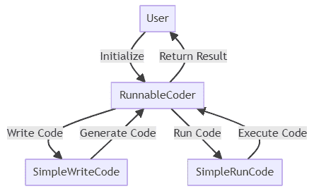

假设现在我们不仅希望用自然语言编写代码，而且还希望生成的代码立即执行。一个拥有多个动作的智能体可以满足我们的需求。让我们称之为`RunnableCoder`，一个既写代码又立即运行的`Role`。我们需要两个`Action`：`SimpleWriteCode` 和 `SimpleRunCode`。

### 编写SimpleWriteCode动作

这部分与我们在前文中讲到的基本一致。

```
class SimpleWriteCode(Action):

    PROMPT_TEMPLATE = """
    Write a python function that can {instruction} and provide two runnnable test cases.
    Return ```python your_code_here ``` with NO other texts,

    your code:

    """

    def __init__(self, name="SimpleWriteCode", context=None, llm=None):

        super().__init__(name, context, llm)

    async def run(self, instruction: str):

        prompt = self.PROMPT_TEMPLATE.format(instruction=instruction)

        rsp = await self._aask(prompt)

        code_text = SimpleWriteCode.parse_code(rsp)

        return code_text

    @staticmethod
    def parse_code(rsp):

        pattern = r'```python(.*)```'
        match = re.search(pattern, rsp, re.DOTALL)
        code_text = match.group(1) if match else rsp
        return code_text
```

### 编写SimpleRunCode动作

从概念上讲，一个动作可以利用LLM，也可以在没有LLM的情况下运行。在`SimpleRunCode`的情况下，LLM不涉及其中。我们只需启动一个子进程来运行代码并获取结果。

在Python中，我们通过标准库中的`subprocess`包来fork一个子进程，并运行一个外部的程序。

`subprocess`包中定义有数个创建子进程的函数，这些函数分别以不同的方式创建子进程，所以我们可以根据需要来从中选取一个使用。

第一个进程是你的Python程序本身，它执行了包含`SimpleRunCode`类定义的代码。第二个进程是由`subprocess.run`创建的，它执行了`python3 -c`命令，用于运行`code_text`中包含的Python代码。这两个进程相互独立，通过`subprocess.run`你的Python程序可以启动并与第二个进程进行交互，获取其输出结果。

```
class SimpleRunCode(Action):
    def __init__(self, name="SimpleRunCode", context=None, llm=None):
        super().__init__(name, context, llm)

    async def run(self, code_text: str):
        # 在Windows环境下，result可能无法正确返回生成结果，在windows中在终端中输入python3可能会导致打开微软商店
        result = subprocess.run(["python3", "-c", code_text], capture_output=True, text=True)
        # 采用下面的可选代码来替换上面的代码
        # result = subprocess.run(["python", "-c", code_text], capture_output=True, text=True)
        # import sys
        # result = subprocess.run([sys.executable, "-c", code_text], capture_output=True, text=True)
        code_result = result.stdout
        logger.info(f"{code_result=}")
        return code_result
```

### 定义RunnableCoder角色

与定义单一动作的智能体没有太大不同！让我们来映射一下：

1. 用`self.set_actions`初始化所有`Action`。
1. 指定每次`Role`会选择哪个`Action`。我们将`react_mode`设置为`"by_order"`，这意味着`Role`将按照`self.set_actions`中指定的顺序执行其能够执行的`Action`。在这种情况下，当`Role`执行`_act`时，`self.rc.todo`将首先是`SimpleWriteCode`，然后是`SimpleRunCode`。
1. 覆盖`_act`函数。`Role`从上一轮的人类输入或动作输出中检索消息，用适当的`Message`内容提供当前的`Action`（`self.rc.todo`），最后返回由当前`Action`输出组成的`Message`。

这里我们用`Role`类的`_set_react_mode`方法来设定我们`action`执行的先后顺序，事实上`Role`基类中还包含了很多有用的方法，你可以自己查看它的定义，在后面的章节内容中，我们也将一步一步揭开他们的面纱。

```
class RunnableCoder(Role):
    def __init__(
        self,
        name: str = "Alice",
        profile: str = "RunnableCoder",
        **kwargs,
    ):
        super().__init__(name, profile, **kwargs)
        self.set_actions([SimpleWriteCode, SimpleRunCode])
        self._set_react_mode(react_mode="by_order")

    async def _act(self) -> Message:
        logger.info(f"{self._setting}: 准备 {self.rc.todo}")
        # 通过在底层按顺序选择动作
        # todo 首先是 SimpleWriteCode() 然后是 SimpleRunCode()
        todo = self.rc.todo

        msg = self.get_memories(k=1)[0] # 得到最近的 k 条消息
        result = await todo.run(msg.content)

        msg = Message(content=result, role=self.profile, cause_by=type(todo))
        self.rc.memory.add(msg)
        return msg
```

### 运行RunnableCoder角色

这部分与`SimpleCoder`基本一致，只需要修改我们使用的`role`为`RunnableCoder`。

```
import asyncio

async def main():
    msg = "write a function that calculates the sum of a list"
    role = RunnableCoder()
    logger.info(msg)
    result = await role.run(msg)
    logger.info(result)

asyncio.run(main())
```

## 完整代码（RunnableCoder）

```
import os
import re
import subprocess
import asyncio

import fire
import sys
from metagpt.llm import LLM
from metagpt.actions import Action
from metagpt.roles import Role
from metagpt.schema import Message
from metagpt.logs import logger

class SimpleWriteCode(Action):

    PROMPT_TEMPLATE = """
    Write a python function that can {instruction} and provide two runnnable test cases.
    Return ```python your_code_here ``` with NO other texts,

    your code:

    """
```


```python
def __init__(self, name: str = "SimpleWriteCode", context=None, llm: LLM = None):

    super().__init__(name, context, llm)

async def run(self, instruction: str):

    prompt = self.PROMPT_TEMPLATE.format(instruction=instruction)

    rsp = await self._aask(prompt)

    code_text = SimpleWriteCode.parse_code(rsp)

    return code_text

@staticmethod

def parse_code(rsp):

    pattern = r'```python(.*)```'
    match = re.search(pattern, rsp, re.DOTALL)
    code_text = match.group(1) if match else rsp
    return code_text

class SimpleRunCode(Action):
    def __init__(self, name: str = "SimpleRunCode", context=None, llm: LLM = None):
        super().__init__(name, context, llm)

    async def run(self, code_text: str):
        result = subprocess.run([sys.executable, "-c", code_text], capture_output=True, text=True)
        code_result = result.stdout
        logger.info(f"{code_result=}")
        return code_result

class RunnableCoder(Role):
    def __init__(
        self,
        name: str = "Alice",
        profile: str = "RunnableCoder",
        **kwargs,
    ):
        super().__init__(name, profile, **kwargs)
        self.set_actions([SimpleWriteCode, SimpleRunCode])
        self._set_react_mode(react_mode="by_order")

    async def _act(self) -> Message:
        logger.info(f"{self._setting}: ready to {self.rc.todo}")
        # By choosing the Action by order under the hood
        # todo will be first SimpleWriteCode() then SimpleRunCode()
        todo = self.rc.todo

        msg = self.get_memories(k=1)[0] # find the most k recent messagesA
        result = await todo.run(msg.content)

        msg = Message(content=result, role=self.profile, cause_by=type(todo))
        self.rc.memory.add(msg)
        return msg

async def main():
    msg = "write a function that calculates the sum of a list"
    role = RunnableCoder()
    logger.info(msg)
    result = await role.run(msg)
    logger.info(result)

asyncio.run(main())
```

## 实现一个更复杂的Agent：技术文档助手

在前文中我们已经介绍了如何实现一个简单的`agent`帮我们生成代码并执行代码，下面我们将带领大家实现更复杂的`agent`，并向大家展示`MetaGPT`中关于`agent`的更多设计细节

现在试着想想怎么让大模型为我们写一篇技术文档？

可能想到的是，我们告诉大模型：“请帮我生成关于Mysql的技术文档”，他可能很快地就能帮你完成这项任务，但是受限于大模型自身的`token`限制，我们无法实现让他一次性就输出我们希望的一个完整的技术文档。

当然我们可以将我们的技术文档拆解成一个一个很小的需求，然后一个一个的提问，但是这样来说不仅费时，而且还需要人工一直去跟他交互，非常的麻烦，下面我们就将利用`MetaGPT`框架来解决这个问题

我们利用上文中提到的`agent`框架来拆解我们的需求

### 需求分析

因为`token`限制的原因，我们先通过 `LLM` 大模型生成教程的目录，再对目录按照二级标题进行分块，对于每块目录按照标题生成详细内容，最后再将标题和内容进行拼接，解决 `LLM` 大模型长文本的限制问题。

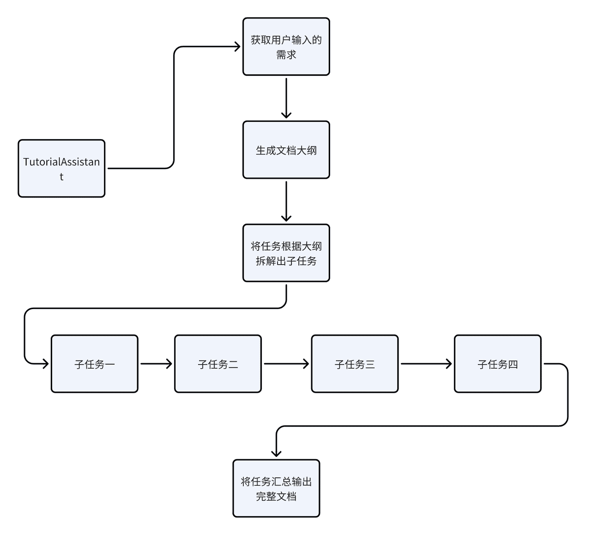

### 编写 `WriteDirectory` 动作

我们先来实现根据用户需求生成文章大纲的代码

```python
class WriteDirectory(Action):
    """
    Action class for writing tutorial directories.

    Args:
        name: The name of the action.
        language: The language to output, default is "Chinese".
        
        用于编写教程目录的动作类。
        参数：
        name：动作的名称。
        language：输出的语言，默认为"Chinese"。
    """

    def __init__(self, name: str = "", language: str = "Chinese", *args, **kwargs):
        super().__init__(name, *args, **kwargs)
        self.language = language

    async def run(self, topic: str, *args, **kwargs) -> Dict:
        """
        Execute the action to generate a tutorial directory according to the topic.

        Args:
            topic: The tutorial topic.

        Returns:
            the tutorial directory information, including {"title": "xxx", "directory": [{"dir 1": ["sub dir 1", "sub dir 2"]}]}.
        根据主题执行生成教程目录的操作。
            参数：
            topic：教程主题。
            返回：
            教程目录信息，包括{"title": "xxx", "directory": [{"dir 1": ["sub dir 1", "sub dir 2"]}]}.
        """
        COMMON_PROMPT = """
        You are now a seasoned technical professional in the field of the internet. 
        We need you to write a technical tutorial with the topic "{topic}".
        您现在是互联网领域的经验丰富的技术专业人员。
        我们需要您撰写一个关于"{topic}"的技术教程。
        """

        DIRECTORY_PROMPT = COMMON_PROMPT + """
        Please provide the specific table of contents for this tutorial, strictly following the following requirements:
        1. The output must be strictly in the specified language, {language}.
        2. Answer strictly in the dictionary format like {{"title": "xxx", "directory": [{"dir 1": ["sub dir 1", "sub dir 2"]}, {"dir 2": ["sub dir 3", "sub dir 4"]}]}}.
        3. The directory should be as specific and sufficient as possible, with a primary and secondary directory.The secondary directory is in the array.
        4. Do not have extra spaces or line breaks.
        5. Each directory title has practical significance.
        请按照以下要求提供本教程的具体目录：
        1. 输出必须严格符合指定语言，{language}。
        2. 回答必须严格按照字典格式，如{{"title": "xxx", "directory": [{"dir 1": ["sub dir 1", "sub dir 2"]}, {"dir 2": ["sub dir 3", "sub dir 4"]}]}}。
        3. 目录应尽可能具体和充分，包括一级和二级目录。二级目录在数组中。
        4. 不要有额外的空格或换行符。
        5. 每个目录标题都具有实际意义。
        """
        prompt = DIRECTORY_PROMPT.format(topic=topic, language=self.language)
        resp = await self._aask(prompt=prompt)
        return OutputParser.extract_struct(resp, dict)
```

基本就是我们把自己的需求放入我们准备好的提示词模板里，询问大模型得到结果，然后我们对得到的内容做一个解析。（数据格式化）


## 提取结构体内容

```python
def extract_struct(cls, text: str, data_type: Union[type(list), type(dict)]) -> Union[list, dict]:
    """Extracts and parses a specified type of structure (dictionary or list) from the given text.
    The text only contains a list or dictionary, which may have nested structures.

    Args:
        text: The text containing the structure (dictionary or list).
        data_type: The data type to extract, can be "list" or "dict".

    Returns:
        - If extraction and parsing are successful, it returns the corresponding data structure (list or dictionary).
        - If extraction fails or parsing encounters an error, it throw an exception.
    返回：
    - 如果提取和解析成功，它将返回相应的数据结构（列表或字典）。
    - 如果提取失败或解析遇到错误，则抛出异常。
    Examples:
        >>> text = 'xxx [1, 2, ["a", "b", [3, 4]], {"x": 5, "y": [6, 7]}] xxx'
        >>> result_list = OutputParser.extract_struct(text, "list")
        >>> print(result_list)
        >>> # Output: [1, 2, ["a", "b", [3, 4]], {"x": 5, "y": [6, 7]}]

        >>> text = 'xxx {"x": 1, "y": {"a": 2, "b": {"c": 3}}} xxx'
        >>> result_dict = OutputParser.extract_struct(text, "dict")
        >>> print(result_dict)
        >>> # Output: {"x": 1, "y": {"a": 2, "b": {"c": 3}}}
    """
    # Find the first "[" or "{" and the last "]" or "}"
    start_index = text.find("[" if data_type is list else "{")
    end_index = text.rfind("]" if data_type is list else "}")

    if start_index != -1 and end_index != -1:
        # Extract the structure part
        structure_text = text[start_index : end_index + 1]

        try:
            # Attempt to convert the text to a Python data type using ast.literal_eval
            result = ast.literal_eval(structure_text)

            # Ensure the result matches the specified data type
            if isinstance(result, list) or isinstance(result, dict):
                return result

            raise ValueError(f"The extracted structure is not a {data_type}.")

        except (ValueError, SyntaxError) as e:
            raise Exception(f"Error while extracting and parsing the {data_type}: {e}")
    else:
        logger.error(f"No {data_type} found in the text.")
        return [] if data_type is list else {}
```

注释里给了解析的example，这里再提一下

```
>>> text = 'xxx [1, 2, ["a", "b", [3, 4]], {"x": 5, "y": [6, 7]}] xxx'
>>> result_list = OutputParser.extract_struct(text, "list")
>>> print(result_list)
>>> # Output: [1, 2, ["a", "b", [3, 4]], {"x": 5, "y": [6, 7]}]

>>> text = 'xxx {"x": 1, "y": {"a": 2, "b": {"c": 3}}} xxx'
>>> result_dict = OutputParser.extract_struct(text, "dict")
>>> print(result_dict)
>>> # Output: {"x": 1, "y": {"a": 2, "b": {"c": 3}}}
```

这样我们就将大模型输出的目录结构转为了可解析的字典对象，这里以写一篇Mysql教程文档为例，它的输出就如下：

```
{'title': 'MySQL 教程', 'directory': [{'MySQL 简介': []}, {'安装与配置': ['安装MySQL', '配置MySQL']}, {'基本操作': ['创建数据库', '创建表', '插入数据', '查询数据', '更新数据', '删除数据']}, {'高级操作': ['索引', '约束', '连接查询', '子查询', '事务', '视图']}, {'备份与恢复': ['备份数据库', '恢复数据库']}, {'性能优化': ['优化查询语句', '优化表结构', '缓存配置']}, {'常见问题': ['连接问题', '权限问题', '性能问题']}]}
```

拿到目录后我们就需要根据每个章节的内容生成章节内容了

## 编写 `WriteContent` 动作

接下来我们需要根据传入的子标题来生成内容

```python
class WriteContent(Action):
    """Action class for writing tutorial content.

    Args:
        name: The name of the action.
        directory: The content to write.
        language: The language to output, default is "Chinese".
    """

    def __init__(self, name: str = "", directory: str = "", language: str = "Chinese", *args, **kwargs):
        super().__init__(name, *args, **kwargs)
        self.language = language
        self.directory = directory

    async def run(self, topic: str, *args, **kwargs) -> str:
        """Execute the action to write document content according to the directory and topic.

        Args:
            topic: The tutorial topic.

        Returns:
            The written tutorial content.
        """
        COMMON_PROMPT = """
        You are now a seasoned technical professional in the field of the internet. 
        We need you to write a technical tutorial with the topic "{topic}".
        """
        CONTENT_PROMPT = COMMON_PROMPT + """
        Now I will give you the module directory titles for the topic. 
        Please output the detailed principle content of this title in detail. 
        If there are code examples, please provide them according to standard code specifications. 
        Without a code example, it is not necessary.

        The module directory titles for the topic is as follows:
        {directory}

        Strictly limit output according to the following requirements:
        1. Follow the Markdown syntax format for layout.
        2. If there are code examples, they must follow standard syntax specifications, have document annotations, and be displayed in code blocks.
        3. The output must be strictly in the specified language, {language}.
        4. Do not have redundant output, including concluding remarks.
        5. Strict requirement not to output the topic "{topic}".
        现在我将为您提供该主题的模块目录标题。
        请详细输出此标题的详细原理内容。
        如果有代码示例，请按照标准代码规范提供。
        没有代码示例则不需要提供。
        
        该主题的模块目录标题如下：
        {directory}
        
        严格按照以下要求限制输出：
        1. 遵循Markdown语法格式进行布局。
        2. 如果有代码示例，必须遵循标准语法规范，具备文档注释，并以代码块形式显示。
        3. 输出必须严格使用指定语言{language}。
        4. 不得有冗余输出，包括总结性陈述。
        5. 严禁输出主题"{topic}"。
        """
        prompt = CONTENT_PROMPT.format(
            topic=topic, language=self.language, directory=self.directory)
        return await self._aask(prompt=prompt)
```

这里我们直接根据传入的子标题内容调用大模型生成回答即可

## 编写 `TutorialAssistant` 角色

编写完动作后，还有一个问题需要我们解决，按照我们的设计，大模型应该先调用`WriteDirectory`动作去生成大纲，然后根据大纲的内容去生成对应的内容，我们很难把这整个流程都设计为固定流程，因为当我们需要生成的内容变化时，大纲的结构也会随之变化，当然你也可以在提示词中限制大纲的结构，但是这种解决方法无疑不够优雅而且灵活欠佳，这一章节内，我们将为你展示`MetaGPT`是如何组织`Action`的行动路线的

我们依然先重写`_init_`方法来初始化我们的角色


# TutorialAssistant 角色类实现

## 类初始化 (__init__)

```
class TutorialAssistant(Role):
    """Tutorial assistant, input one sentence to generate a tutorial document in markup format.

    Args:
        name: The name of the role.
        profile: The role profile description.
        goal: The goal of the role.
        constraints: Constraints or requirements for the role.
        language: The language in which the tutorial documents will be generated.
    """

    def __init__(
        self,
        name: str = "Stitch",
        profile: str = "Tutorial Assistant",
        goal: str = "Generate tutorial documents",
        constraints: str = "Strictly follow Markdown's syntax, with neat and standardized layout",
        language: str = "Chinese",
    ):
        super().__init__(name, profile, goal, constraints)
        self.set_actions([WriteDirectory(language=language)])
        self.topic = ""
        self.main_title = ""
        self.total_content = ""
        self.language = language
```

在 `__init__` 方法中我们声明了角色名称，角色类型，角色人物目的，以及 `constraints` 则是我们期望对输出内容的约束，我们希望内容最终以 Markdown 格式输出方便我们导入到网页或者其他内容中。

这里需要注意的是我们在这里只初始化了 `WriteDirectory` 动作而没有初始化 `WriteContent` 动作，为什么呢？

## 动作设置 (set_actions)

```
def set_actions(self, actions):
    self._reset()
    for idx, action in enumerate(actions):
        if not isinstance(action, Action):
            i = action("", llm=self._llm)
        else:
            if self._setting.is_human and not isinstance(action.llm, HumanProvider):
                logger.warning(f"is_human attribute does not take effect,"
                    f"as Role's {str(action)} was initialized using LLM, try passing in Action classes instead of initialized instances")
            i = action
        i.set_prefix(self._get_prefix(), self.profile)
        self._actions.append(i)
        self.states.append(f"{idx}. {action}")
        # 最后输出的样例 ['0. WriteContent', '1. WriteContent', '2. WriteContent', '3. WriteContent', '4. WriteContent', '5. WriteContent', '6. WriteContent', '7. WriteContent', '8. WriteContent']
```

首先我们根据 `Role` 基类中定义的 `set_actions` 方法来看，当我们初始化一个动作时，这个动作将被加入到 `self._actions` 中，而 `self._actions` 为一个列表，其中存储了我们所有的动作。

1. 首先，使用 `enumerate` 函数来同时获取操作列表中的索引 `idx` 和对应的操作 `action`。
2. 然后，检查每个 `action` 是否是 `Action` 类的实例。如果不是，则创建一个新的 `Action` 实例并赋值给变量 `i`。
3. 如果 `action` 是 `Action` 类的实例，会检查是否设置为人工操作（`is_human`）。如果是，则会发出警告，并创建一个新的 `Action` 实例并将其赋值给变量 `i`。
4. 调用 `i` 的 `set_prefix` 方法，该方法用于设置操作的前缀。
5. 将 `i` 添加到 `_actions` 列表中。
6. 将表示操作的字符串添加到 `states` 列表中。

## 角色运行流程 (run)

接着我们来查看 `Role` 基类中 `run` 方法的实现，当我们启动一个角色使他 `run` 时他会如何工作。

如果有入参 `message` 就将 `message` 添加到 `role` 的记忆中，如果没有入参就观察环境中的新消息。

```
async def run(self, message=None):
    """Observe, and think and act based on the results of the observation
        观察，并根据观察结果进行思考和行动。"""
    if message:
        if isinstance(message, str):
            message = Message(message)
        if isinstance(message, Message):
            self.recv(message)
        if isinstance(message, list):
            self.recv(Message("\n".join(message)))
        '''如果message存在，它会检查message的类型，
            如果是字符串，则将其转换为Message对象；
            如果是Message对象，则直接调用recv方法；
            如果是列表，则将列表中的消息合并成一个新的消息，然后再调用recv方法。
            相当于预处理将入参转化为Message对象并添加到role的记忆中'''
    elif not await self._observe():
        # If there is no new information, suspend and wait
        logger.debug(f"{self._setting}: no news. waiting.")
        return

    rsp = await self.react()
    # Publish the reply to the environment, waiting for the next subscriber to process
    self._publish_message(rsp)
    return rsp
```

## 消息接收 (recv)

`recv` 方法的实现：

```
def recv(self, message: Message) -> None:
    """add message to history."""
    # self._history += f"\n{message}"
    # self._context = self._history
    if message in self.rc.memory.get():
        return
    self.rc.memory.add(message)
```

首先它将接受用户的输入（`message`），然后观察环境信息（目前我们还不涉及这部分内容），接着我们将调用 `react` 方法来获取输出。

```
async def react(self) -> Message:
    """Entry to one of three strategies by which Role reacts to the observed Message
        通过观察到的消息，角色对其中一种策略进行反应。"""
    if self.rc.react_mode == RoleReactMode.REACT:
        rsp = await self._react()
    elif self.rc.react_mode == RoleReactMode.BY_ORDER:
        rsp = await self._act_by_order()
    elif self.rc.react_mode == RoleReactMode.PLAN_AND_ACT:
        rsp = await self._plan_and_act()
    self._setstate(state=-1) # current reaction is complete, reset state to -1 and todo back to None
    return rsp
```

当我们不指定 `react_mode` 时将会执行 `self._react()` 方法，同时执行 `self._setstate()` 方法将初始化此时状态为 `-1`。

这里的 `state` 就代表当前 `agent` 需要执行动作的下标，当 `state` 为 `-1` 时，此时没有需要执行的 `action`，`self.rc.todo` 此时就为空。

```
def _setstate(self, state: int):
    """Update the current state."""
    self.rc.state = state
    logger.debug(self._actions)
    self.rc.todo = self._actions[self.rc.state] if state >= 0 else None
```

## 反应策略 (_react)

再来看 `self._react()` 方法。

- 先思考，然后行动，直到角色认为是时候停止并且不需要再做任何事情。
- 这是 ReAct 论文中的标准思考-行动循环，在任务解决中交替进行思考和行动，即 `_think` -> `_act` -> `_think` -> `_act` -> ...
- 使用 `llm` 在 `_think` 过程中动态选择行动。

函数中的 `actions_taken` 变量用于跟踪已经执行的动作次数。在 `while` 循环中，函数会不断进行思考和行动，直到达到最大循环次数为止。在每次循环中，首先会调用 `_think` 方法，然后检查是否有待办事项。如果没有待办事项，循环将会终止。如果有待办事项，则会记录当前状态并执行相应的动作，然后增加 `actions_taken` 的计数。

最后，函数会返回最后一个动作的输出作为结果。

```
async def _react(self) -> Message:
    """Think first, then act, until the Role _think it is time to stop and requires no more todo.
    This is the standard think-act loop in the ReAct paper, which alternates thinking and acting in task solving, i.e. _think -> _act -> _think -> _act -> ... 
    Use llm to select actions in _think dynamically
    """
    actions_taken = 0
    rsp = Message("No actions taken yet") # will be overwritten after Role _act
    while actions_taken < self.rc.max_react_loop:
        # think
        await self._think()
        if self.rc.todo is None:
            break
        # act
        logger.debug(f"{self._setting}: {self.rc.state=}, will do {self.rc.todo}")
        rsp = await self._act()
        actions_taken += 1
    return rsp # return output from the last action
```

`self._react()` 方法基本决定了 `agent` 的行动路线，这里需要思考的是要实现我们期望的 `agent`，他应该怎样行动？

我们重写 `_react` 方法如下。

我们让 `agent` 先执行 `self._think()` 方法，在一个循环中思考目前需要做什么，思考完成后执行我们的动作，当没有需要采取的行动后我们就退出循环，把最后我们得到的最终结果写入至本地。

```
async def _react(self) -> Message:
    """Execute the assistant's think and actions.

    Returns:
        A message containing the final result of the assistant's actions.
    执行助手的思考和行动。
    返回：
    包含助手行动最终结果的消息。
    """
    while True:
        await self._think()
        if self.rc.todo is None:
            break
        msg = await self._act()
    root_path = TUTORIAL_PATH / datetime.now().strftime("%Y-%m-%d_%H-%M-%S")
    await File.write(root_path, f"{self.main_title}.md", self.total_content.encode('utf-8'))
    return msg
```

## 思考方法 (_think)

`_think` 方法负责更新当前需要触发的行为。

我们重写 `_think` 方法如下。

当目前没有需要执行的动作，也就是之前分配的动作执行结束后 `self.rc.todo` 为 `None` 时，让他执行目前 `action` 列表中初始的 `action`，如果当前还没有执行到目前 `action` 列表的末尾，那么就执行下一个动作，否则将目前的 `self.rc.todo` 置为 `None`。

```
async def _think(self) -> None:
    """Determine the next action to be taken by the role."""
    if self.rc.todo is None:
        self._setstate(0)
        return

    if self.rc.state + 1 < len(self.states):
        self._setstate(self.rc.state + 1)
    else:
        self.rc.todo = None
```

## 行动方法 (_act)

思考结束后，这个角色就该行动起来了。

我们重写 `_act` 方法如下。

`_act` 方法中我们将目前的 `todo` 内容按照 `action` 的类型分开处理，当目前需要生成目录时我们就获取用户的输入，传入 `WriteDirectory` `action` 内 生成对应的目录，最后，在 `_handle_directory` 方法中根据目录内容，我们生成子任务，也就是根据标题题目来生成内容，子任务生成结束后，我们使用 `self.set_actions` 更新目前的任务列表。

当下次运行 `_act` 方法时，我们就将执行 `WriteContent` 动作，来生成指定目录中的内容。


```python
async def _act(self) -> Message:
    """Perform an action as determined by the role.

    Returns:
        A message containing the result of the action.
    """
    todo = self.rc.todo
    if type(todo) is WriteDirectory:
        msg = self.rc.memory.get(k=1)[0]
        self.topic = msg.content
        resp = await todo.run(topic=self.topic)
        logger.info(resp)
        return await self._handle_directory(resp)#将writedirector生成的目录一级标题actions添加到actions列表中。
    resp = await todo.run(topic=self.topic)
    logger.info(resp)
    if self.total_content != "":
        self.total_content += "\n\n\n"
    self.total_content += resp
    return Message(content=resp, role=self.profile)

async def _handle_directory(self, titles: Dict) -> Message:
    """Handle the directories for the tutorial document.

    Args:
        titles: A dictionary containing the titles and directory structure,
                such as {"title": "xxx", "directory": [{"dir 1": ["sub dir 1", "sub dir 2"]}]}

    Returns:
        A message containing information about the directory.
        处理教程文档的目录。
        参数：
        titles：包含标题和目录结构的字典，
        例如{"title": "xxx", "directory": [{"dir 1": ["sub dir 1", "sub dir 2"]}]}。
        返回值：
        包含目录信息的消息。
    """
    # 当生成目录后记录目录标题（因为最后要输出完整文档）
    self.main_title = titles.get("title")
    directory = f"{self.main_title}\n"
    # self.total_content用来存储最好要输出的所有内容
    self.total_content += f"# {self.main_title}"
    actions = list()
    for first_dir in titles.get("directory"):
        # 根据目录结构来生成新的需要行动的action（目前只设计了两级目录）
        actions.append(WriteContent(language=self.language, directory=first_dir))
        key = list(first_dir.keys())[0]
        directory += f"- {key}\n"
        for second_dir in first_dir[key]:
            directory += f"  - {second_dir}\n"
    self.set_actions(actions)
    self.rc.todo = None
    return Message(content=directory)
```

## `_handle_directory(self, titles: Dict)` 的 GPT 分析

### 输入：`{"title": "xxx", "directory": [{"dir 1": ["sub dir 1", "sub dir 2"]}]}`

`titles` 字典：包含教程的标题和目录结构。在这个例子中，标题是 `"xxx"`，而目录结构是一个列表，其中包含一个字典，该字典定义了一个名为 `"dir 1"` 的目录，它又包含两个子目录 `"sub dir 1"` 和 `"sub dir 2"`。

### 函数处理流程

1. 记录教程标题：首先，函数从 `titles` 字典中提取 `"title"` 键的值，并将其赋值给 `self.main_title`。这里，`self.main_title` 将被设置为 `"xxx"`。

2. 初始化目录字符串：接着，函数创建一个名为 `directory` 的字符串，其初始内容是主标题（`self.main_title`），后面跟着一个换行符。

3. 更新总内容：将主标题添加到 `self.total_content` 字符串中，这是一个类的成员变量，用于存储最终要输出的所有教程内容。标题前面加上 Markdown 格式的一级标题标记。

4. 遍历目录项：接着，函数遍历 `titles["directory"]` 中的每个元素（这里只有一个元素，即 `{"dir 1": ["sub dir 1", "sub dir 2"]}`）：

   - 对于每个一级目录（如 `"dir 1"`），函数会：
     - 创建一个 `WriteContent` 动作，将当前一级目录传入，并将其添加到 `actions` 列表中。
     - 将一级目录标题添加到 `directory` 字符串中，前面加上 Markdown 格式的列表项标记 `-`。
     - 接着，对于每个二级目录（如 `"sub dir 1"` 和 `"sub dir 2"`），函数会将它们也添加到 `directory` 字符串中，但作为子列表项，前面加上 `" - "`。

5. 初始化后续动作：使用 `self.set_actions(actions)`，初始化 `TutorialAssistant` 对象的后续动作。这些动作基于刚刚创建的 `actions` 列表，即为每个目录项创建教程内容。

6. 清除待办事项：将 `self.rc.todo` 设置为 `None`，表示当前没有更多待处理的事项。

7. 返回目录信息：最后，函数返回一个 `Message` 对象，其内容是经过格式化的目录字符串 `directory`。

### 例子输出

> 以输入 `{"title": "xxx", "directory": [{"dir 1": ["sub dir 1", "sub dir 2"]}]}` 为例，函数输出的 `Message` 对象的内容将会是：
>
> ```
> xxx
>
> - dir 1
>   - sub dir 1
>   - sub dir 2
> ```
>
> 这个输出以 Markdown 格式展示了教程的主标题和目录结构，为后续创建教程内容提供了结构框架。

如果你还没有理解，这里我制作了一个简单的思维导图来帮助你梳理这个过程

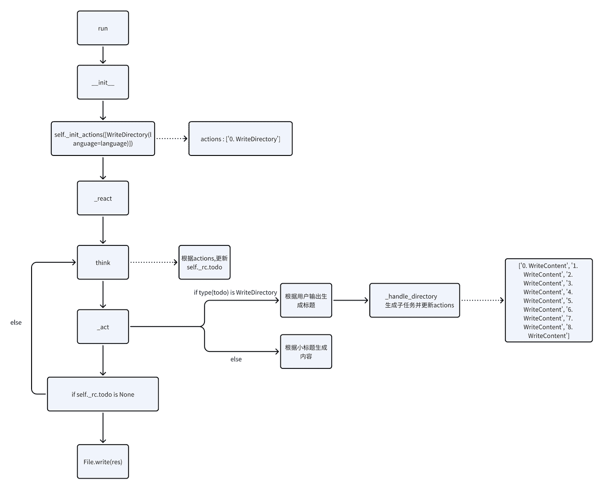

## 运行 `TutorialAssistant` 角色

接下来你只需要初始化它并使用一个起始消息运行它。

```python
import asyncio

async def main():
    msg = "Git 教程"
    role = TutorialAssistant()
    logger.info(msg)
    result = await role.run(msg)
    logger.info(result)

asyncio.run(main())
```

完整代码如下：


```python
from datetime import datetime
from typing import Dict
import asyncio
from metagpt.actions.write_tutorial import WriteDirectory, WriteContent
from metagpt.const import TUTORIAL_PATH
from metagpt.logs import logger
from metagpt.roles import Role
from metagpt.schema import Message
from metagpt.utils.file import File

from typing import Dict

from metagpt.actions import Action
from metagpt.prompts.tutorial_assistant import DIRECTORY_PROMPT, CONTENT_PROMPT
from metagpt.utils.common import OutputParser

class WriteDirectory(Action):
    """Action class for writing tutorial directories.

    Args:
        name: The name of the action.
        language: The language to output, default is "Chinese".
    """

    def __init__(self, name: str = "", language: str = "Chinese", *args, **kwargs):
        super().__init__(name, *args, **kwargs)
        self.language = language

    async def run(self, topic: str, *args, **kwargs) -> Dict:
        """Execute the action to generate a tutorial directory according to the topic.

        Args:
            topic: The tutorial topic.

        Returns:
            the tutorial directory information, including {"title": "xxx", "directory": [{"dir 1": ["sub dir 1", "sub dir 2"]}]}.
        """
        COMMON_PROMPT = """
        You are now a seasoned technical professional in the field of the internet. 
        We need you to write a technical tutorial with the topic "{topic}".
        """

        DIRECTORY_PROMPT = COMMON_PROMPT + """
        Please provide the specific table of contents for this tutorial, strictly following the following requirements:
        1. The output must be strictly in the specified language, {language}.
        2. Answer strictly in the dictionary format like {"title": "xxx", "directory": [{"dir 1": ["sub dir 1", "sub dir 2"]}, {"dir 2": ["sub dir 3", "sub dir 4"]}]}.
        3. The directory should be as specific and sufficient as possible, with a primary and secondary directory.The secondary directory is in the array.
        4. Do not have extra spaces or line breaks.
        5. Each directory title has practical significance.
        """
        prompt = DIRECTORY_PROMPT.format(topic=topic, language=self.language)
        resp = await self._aask(prompt=prompt)
        return OutputParser.extract_struct(resp, dict)

class WriteContent(Action):
    """Action class for writing tutorial content.

    Args:
        name: The name of the action.
        directory: The content to write.
        language: The language to output, default is "Chinese".
    """

    def __init__(self, name: str = "", directory: str = "", language: str = "Chinese", *args, **kwargs):
        super().__init__(name, *args, **kwargs)
        self.language = language
        self.directory = directory

    async def run(self, topic: str, *args, **kwargs) -> str:
        """Execute the action to write document content according to the directory and topic.

        Args:
            topic: The tutorial topic.

        Returns:
            The written tutorial content.
        """
        COMMON_PROMPT = """
        You are now a seasoned technical professional in the field of the internet. 
        We need you to write a technical tutorial with the topic "{topic}".
        """
        CONTENT_PROMPT = COMMON_PROMPT + """
        Now I will give you the module directory titles for the topic. 
        Please output the detailed principle content of this title in detail. 
        If there are code examples, please provide them according to standard code specifications. 
        Without a code example, it is not necessary.

        The module directory titles for the topic is as follows:
        {directory}

        Strictly limit output according to the following requirements:
        1. Follow the Markdown syntax format for layout.
        2. If there are code examples, they must follow standard syntax specifications, have document annotations, and be displayed in code blocks.
        3. The output must be strictly in the specified language, {language}.
        4. Do not have redundant output, including concluding remarks.
        5. Strict requirement not to output the topic "{topic}".
        """
        prompt = CONTENT_PROMPT.format(
            topic=topic, language=self.language, directory=self.directory)
        return await self._aask(prompt=prompt)

class TutorialAssistant(Role):
    """Tutorial assistant, input one sentence to generate a tutorial document in markup format.

    Args:
        name: The name of the role.
        profile: The role profile description.
        goal: The goal of the role.
        constraints: Constraints or requirements for the role.
        language: The language in which the tutorial documents will be generated.
    """

    def __init__(
        self,
        name: str = "Stitch",
        profile: str = "Tutorial Assistant",
        goal: str = "Generate tutorial documents",
        constraints: str = "Strictly follow Markdown's syntax, with neat and standardized layout",
        language: str = "Chinese",
    ):
        super().__init__(name, profile, goal, constraints)
        self.set_actions([WriteDirectory(language=language)])
        self.topic = ""
        self.main_title = ""
        self.total_content = ""
        self.language = language

    async def _think(self) -> None:
        """Determine the next action to be taken by the role."""
        logger.info(self.rc.state)
        logger.info(self,)
        if self.rc.todo is None:
            self._setstate(0)
            return

        if self.rc.state + 1 < len(self.states):
            self._setstate(self.rc.state + 1)
        else:
            self.rc.todo = None

    async def _handle_directory(self, titles: Dict) -> Message:
        """Handle the directories for the tutorial document.

        Args:
            titles: A dictionary containing the titles and directory structure,
                    such as {"title": "xxx", "directory": [{"dir 1": ["sub dir 1", "sub dir 2"]}]}

        Returns:
            A message containing information about the directory.
        """
        self.main_title = titles.get("title")
        directory = f"{self.main_title}\n"
        self.total_content += f"# {self.main_title}"
        actions = list()
        for first_dir in titles.get("directory"):
            actions.append(WriteContent(
                language=self.language, directory=first_dir))
            key = list(first_dir.keys())[0]
            directory += f"- {key}\n"
            for second_dir in first_dir[key]:
                directory += f"  - {second_dir}\n"
        self.set_actions(actions)
        self.rc.todo = None
        return Message(content=directory)

    async def _act(self) -> Message:
        """Perform an action as determined by the role.

        Returns:
            A message containing the result of the action.
        """
        todo = self.rc.todo
        if type(todo) is WriteDirectory:
            msg = self.rc.memory.get(k=1)[0]
            self.topic = msg.content
            resp = await todo.run(topic=self.topic)
            logger.info(resp)
            return await self._handle_directory(resp)
        resp = await todo.run(topic=self.topic)
        logger.info(resp)
        if self.total_content != "":
            self.total_content += "\n\n\n"
        self.total_content += resp
        return Message(content=resp, role=self.profile)

    async def _react(self) -> Message:
        """Execute the assistant's think and actions.

        Returns:
            A message containing the final result of the assistant's actions.
        """
        while True:
            await self._think()
            if self.rc.todo is None:
                break
            msg = await self._act()
        root_path = TUTORIAL_PATH / datetime.now().strftime("%Y-%m-%d_%H-%M-%S")
        await File.write(root_path, f"{self.main_title}.md", self.total_content.encode('utf-8'))
        return msg

async def main():
    msg = "Git 教程"
    role = TutorialAssistant()
    logger.info(msg)
    result = await role.run(msg)
    logger.info(result)

asyncio.run(main())
```


## 第三章 课程任务：

经过上面的学习，我想你已经对 MetaGPT 的框架有了基本了解，现在我希望你能够自己编写这样一个 agent

- 这个 Agent 拥有三个动作 打印1 打印2 打印3（初始化时 `init_action([print,print,print])`）
- 重写有关方法（请不要使用`act_by_order`，我希望你能独立实现）使得 Agent 顺序执行上面三个动作
- 当上述三个动作执行完毕后，为 Agent 生成新的动作 打印4 打印5 打印6 并顺序执行，（之前我们初始化了三个 `print` 动作，执行完毕后，重新 `init_action([...,...,...])`，然后顺序执行这个新生成的动作列表)

如果完成上面的任务，那这次作业已经可以算完成了，这个作业可以用多种思路去解决，比如我可以直接写死一整套的逻辑，甚至都不需要引入llm来完成这个工作，我希望大家通过这个作业来感受 MetaGPT 中 Agent 的行动逻辑, `run->react->think->act` 的这样一个过程，但你也可以试着在中间的某个环节中加入llm的交互，来尝试减少硬编码的工作，就像1.4中，我们实际上是让llm帮我们设计了 action 列表的内容，你也可以在此基础上做出更多的尝试，关于这个 Agent 我们还有更多可以思考的地方

- 目前为止我们设计的所有思考模式都可以总结为是链式的思考（chain of thought），能否利用 MetaGPT 框架实现树结构的思考（tree of thought）图结构的思考（graph of thought）？试着实现让 ai 生成树结构的动作列表，并按照树的遍历方式执行他们，如果你实现，这将是加分项

## 第四章：OSS - 订阅智能体

### 基本介绍

#### 什么是订阅智能体

MetaGPT提供了Agent的开发能力，Agent可以协助我们解决日常的一些问题，其中一个应用场景就是我们可以让Agent为我们关注某些想关注的信息，当有我们关注的事件发生时，Agent获取信息并进行处理，然后通过一些如邮件、🛰️、discord等通知渠道将处理后的信息发送给我们，我们将这类Agent称为订阅智能体

在这里，Agent的`Role`是以一个“资讯订阅员”的身份为你服务，而Agent中包含的`Action`则主要有两种：从外界信息源中搜集信息和对搜集得到的信息进行总结；完成上述任务后，我们可以为这个Agent开发更多额外功能：定时运行的功能和发送到通知渠道的功能

#### 如何用MetaGPT实现订阅智能体

在MetaGPT中，`metagpt.subscription`模块提供了`SubscriptionRunner`类，与`metagpt.team.Team`类似，`SubscriptionRunner`类是提供了一个`Role`的运行方式，基于`SubscriptionRunner`类，我们可以定时触发运行一个`Role`，然后将`Role`的执行输出通知给用户，例如，以下的示例：

```
>>> import asyncio
>>> from metagpt.subscription import SubscriptionRunner
>>> from metagpt.team import Team
>>> from metagpt.roles import Searcher
>>> from metagpt.schema import Message

>>> async def trigger():
...     while True:
...         yield Message("the latest news about OpenAI")
...         await asyncio.sleep(3600 * 24)

>>> async def callback(msg: Message):
...     print(msg.content)

>>> async def main():
...     pb = SubscriptionRunner()
...     await pb.subscribe(Searcher(), trigger(), callback)
...     await pb.run()

>>> asyncio.run(main())
```

从例子可以知道订阅智能体的实现主要有3个要素，分别是`Role`、`Trigger`、`Callback`，即智能体本身、触发器、数据回调。如果之前已经学过了Agent的开发，那么对`Role`的实现肯定非常熟悉了，这边的`Role`就是我们的Agent的实际代码实现，所以订阅智能体在代码实现上并没有什么特别的地方，可以看到上面的例子实际运行的就是MetaGPT中的`Searcher` Role，它早就存在了我们的MetaGPT仓库中

不过需要注意的是，我们虽然不对订阅智能体的`Role`做限制，但是不是所有的`Role`都适合用来做订阅智能体，比如MetaGPT软件公司中的几个角色，例如产品经理、架构师、工程师等，因为当给这些`Role`一个需求输入时，它们的产出往往是类似的，并没有定时执行然后发送给我们能的必要。所以从应用的角度出发，订阅智能体的输出应该具有实时性，相同的一个需求描述输入，输出的内容一般是会随着时间的推移而不同，例如新闻资讯、技术前沿进展、热门的开源项目等。

所以，接下来我们本文档通过一个OSS（Open Source Software）订阅智能体实现示例教大家如何使用MetaGPT实现订阅智能体

### 教程信息

#### 前置准备

为了让大家在实操过程中有良好体验，在正式进入到本章节的实操环节之前，我们准备了以下的前置知识检查清单，这些都是在接下来实操时会用到的，如果以下清单所列内容都很熟悉，直接跳过即可；如果有不太清楚的点，可以根据建议先补齐一下前置知识

- 普通智能体的开发：参考前面的教程
- 网络爬虫
- 基础的概念：
  - HTML：了解 HTML 的基本结构、标签和常见元素
  - CSS：了解 CSS 在 HTML 中的作用
  - 工具：使用浏览器开发者模式能定位网页元素
- Python 工具
  - `aiohttp`：熟悉 [aiohttp](https://docs.aiohttp.org/en/stable/) 库的基本用法，会用`aiohttp`发起网络请求
  - `beautifulsoup`：了解HTML解析库 [BeautifulSoup](https://beautiful-soup-4.readthedocs.io/en/latest/)，掌握如何使用它从HTML中提取信息
- MetaGPT 订阅模块
  - `Role`、`Trigger`、`Callback`的概念
  - `Trigger`是个异步生成器，参考 https://peps.python.org/pep-0525/，知道如何实现即可

> 如果对爬虫不了解也不要紧，不要你精通爬虫，有基本了解即可，我们可以让ChatGPT帮忙生成爬虫代码

另外教程涉中需要访问到一些国外的网站，可能会遇到网络问题，因为 `aiohttp` 默认不走系统代理，所以需要做下代理配置。MetaGPT中已经提供了`GLOBAL_PROXY`参数用来表示全局代理配置，教程中遇到使用`aiohttp`进行请求的地方，都会将代理设置为`GLOBAL_PROXY`的值，所以可以通过在`config/key.yaml`配置文件中，添加自己代理服务器的配置，以解决网络问题：

```
GLOBAL_PROXY: http://127.0.0.1:8118  # 改成自己的代理服务器地址
```

最后，[运行示例](https://deepwisdom.feishu.cn/docx/RJmTdvZuPozAxFxEpFxcbiPwnQf#ALhZdWRzzoDYy5xQXW6cCAZXnZf)章节提供了完整的代码，如果想先看下整体的运行效果，可以运行示例的`main.py`文件

#### 教程目标

通过本教程你可以：

1. 学习 MetaGPT 订阅模块的使用
2. 实现一个属于自己的订阅智能体

### OSS订阅智能体实现

订阅智能体的实现主要有3个要素，分别是`Role`、`Trigger`、`Callback`，即智能体本身、触发器、数据回调。我们先拆解一下这个工作：

1. 实现一个 `OSSWatcher` 的 Role：OSS 即 Open source software，我们对OSS 智能体定位是，帮我们关注并分析热门的开源项目，当有相关信息时将信息推送给我们，这里需要确定让 OSS 从哪个网页获取信息
1. 触发`Trigger`：指这个`OSSWatcher`角色运行的触发条件，可以是定时触发或者是某个网站有更新时触发
1. 结果`Callback`：处理`OSSWatcher`角色运行生成的信息，我们可以将数据发送到🛰️或者discord

接下来，我们一个一个地进行实现

### OSSWatcher Role实现

#### 基本分析

实现`OSSWatcher`的`Role`前，需要先确定我们要 `OSSWatcher` 做哪些事情，即需要实现哪些 `Action`，要分析热门开源项目，需要先获取热门开源项目信息，所以`OSSWatcher`可以拆分出两个`Action`，爬取热门开源项目和分析热门开源项目。

[我们先确定从哪个网页获取信息，](https://github.com/trending)说到热门开源项目，我们首先想到的就是GitHub Trending，Github Trending是Github主要板块子页面之一，主要展示指定时间段内Github上最受关注、热度上升的最快的资源库和开发者。它实际上是一个Github的一个资源库和开发者「热搜榜」，资源库按照时间段（每天、每周、每月）内获得的星星数量、fork数等指标排行。我们先打开 Github Trending 的网页，观察网页内容，以下是一些基本信息：

- 访问链接：`https://github.com/trending`
- 有筛选条件，主要有
  - spoken language：en/zh/...
  - language：html/javascript/python/go/java/...
  - since：daily/weekly/monthly

这是个静态网页，要爬取非常简单，如果有需要还可以根据条件进行筛选。网页爬取后，就可以对网页内容进行分析，例如以下的分析角度

1. 编程语言趋势：观察Trending列表中使用的编程语言，了解当前哪些编程语言在开发者社区中更受欢迎
1. 项目类型和用途：分析Trending列表中的项目，看看它们是属于哪些类别，以及它们的具体用途是什么
1. 社区活跃度：查看项目的星标数量、贡献者数量
1. 新兴技术和工具：注意新项目和涌现的技术，以便了解当前的技术趋势

以上是一些比较通用的角度，我们也可以根据自己的偏好进行分析，例如，主要关注AI领域的一些热门项目。基于以上，我们要做的事情就是，抓取Github Trending网页的信息，然后让LLM根据我们关注的角度进行分析，那么我们的`OSSWatcher`角色就完成了

#### GitHub Trending爬取

我们先来完成网页爬取的功能，我们教程直接爬取当天不分国家语言和编程语言的热门仓库进行分析，如果有特殊要求，爬取加上筛选条件条件后网页即可。我们先打开 `https://github.com/trending` 网页，观察网页内容，找到我们需要的内容对应的html元素，

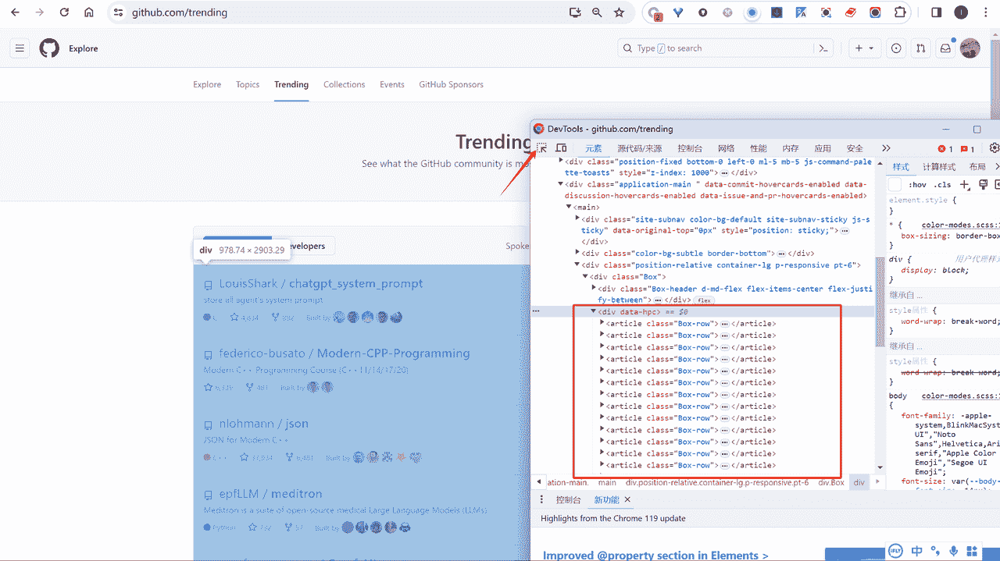

如果熟悉爬虫的就可以直接写爬取和解析脚本了，如果不熟悉的也没关系，我们可以用ChatGPT辅助开发：

首先我们将图片所示的html复制出来，保存到`github-trending-raw.html`，格式化后发现内容非常多，大概600多k，还有一些svg源码，因为一般用CSS足以定位html里的元素，所以我们可以对html内容进行瘦身，可以使用以下的脚本：

```
from bs4 import BeautifulSoup

with open("github-trending-raw.html") as f:
    html = f.read()

soup = BeautifulSoup(html, "html.parser")
for i in soup.find_all(True):
    for name in list(i.attrs):
        if i[name] and name not in ["class"]:
            del i[name]

for i in soup.find_all(["svg", "img", "video", "audio"]):
    i.decompose()

with open("github-trending-slim.html", "w") as f:
    f.write(str(soup))
```

经过以上的脚本处理之后，大概还有100多k。对于爬虫来说，重要的是Html的结构，处理后的Html文件其实有大量的信息是重复的，如果我们要让GPT协助我们写爬虫脚本，只需要截取部分信息就可以了，榜单上有20个repo，我们只需要保留前两个

删减前：

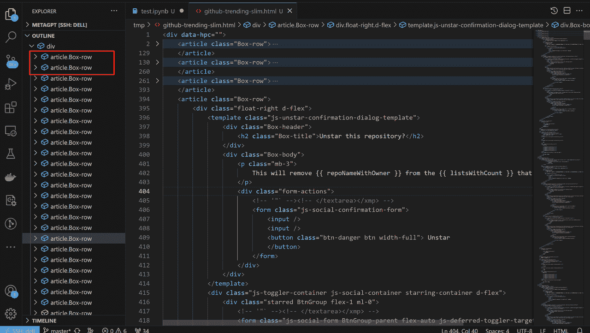

删减后

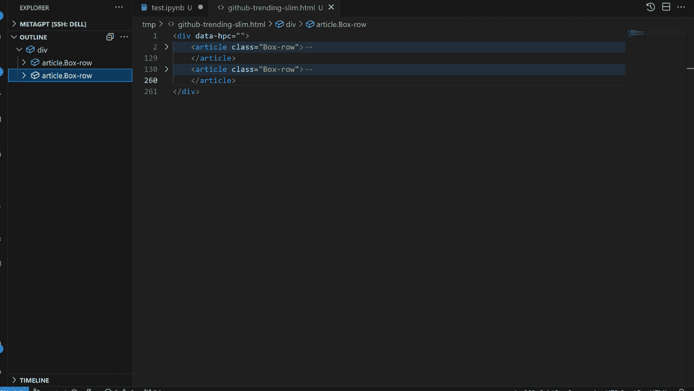

此时大小仅12k，这时候我们就可以用ChatGPT帮我们写爬取分析Github Trending的代码了，可以参考以下的对话：

https://chat.openai.com/share/6c8046d3-e363-40bd-9412-8d859e7b3854

最初给出的代码有报错，以及输出的Language为空，通过两次的对话让ChatGPT进行修复，最终得到以下代码：


# GitHub Trending Action 实现

## 原始代码

```python
import aiohttp
import asyncio
from bs4 import BeautifulSoup

async def fetch_html(url):
    async with aiohttp.ClientSession() as session:
        async with session.get(url) as response:
            return await response.text()

async def parse_github_trending(html):
    soup = BeautifulSoup(html, 'html.parser')

    repositories = []

    for article in soup.select('article.Box-row'):
        repo_info = {}
        
        repo_info['name'] = article.select_one('h2 a').text.strip()
        repo_info['url'] = article.select_one('h2 a')['href'].strip()

        # Description
        description_element = article.select_one('p')
        repo_info['description'] = description_element.text.strip() if description_element else None

        # Language
        language_element = article.select_one('span[itemprop="programmingLanguage"]')
        repo_info['language'] = language_element.text.strip() if language_element else None

        # Stars and Forks
        stars_element = article.select('a.Link--muted')[0]
        forks_element = article.select('a.Link--muted')[1]
        repo_info['stars'] = stars_element.text.strip()
        repo_info['forks'] = forks_element.text.strip()

        # Today's Stars
        today_stars_element = article.select_one('span.d-inline-block.float-sm-right')
        repo_info['today_stars'] = today_stars_element.text.strip() if today_stars_element else None

        repositories.append(repo_info)

    return repositories

async def main():
    url = 'https://github.com/trending'
    html = await fetch_html(url)
    repositories = await parse_github_trending(html)

    for repo in repositories:
        print(f"Name: {repo['name']}")
        print(f"URL: https://github.com{repo['url']}")
        print(f"Description: {repo['description']}")
        print(f"Language: {repo['language']}")
        print(f"Stars: {repo['stars']}")
        print(f"Forks: {repo['forks']}")
        print(f"Today's Stars: {repo['today_stars']}")
        print()
```

## 稍微修改一下，把它作为一个 `Action` 类

1. 导入

```python
from metagpt.actions.action import Action
from metagpt.config import CONFIG
```

1. 参考第三章1.2.2设计 action 的异步 `run()` 方法

1. 创建 `aiohttp.ClientSession` 对象：使用 `async with` 语句创建 `aiohttp.ClientSession` 对象，用于发送 HTTP 请求。

1. 发送 `GET` 请求：使用 `client.get()` 方法发送 `GET` 请求，并指定要访问的 URL。

1. 设置代理：通过 `proxy=CONFIG.global_proxy` 参数设置全局代理服务器。

1. 检查响应状态：使用 `response.raise_for_status()` 方法检查响应状态，如果状态码不为 200，则会抛出异常。

1. 读取响应内容：使用 `await response.text()` 方法读取响应内容并将其存储在 `html` 变量中。

1. 返回 HTML 内容：将获取到的 HTML 内容返回给调用者。

```python
async def run(self, url: str = "https://github.com/trending"):
    async with aiohttp.ClientSession() as client:
        async with client.get(url, proxy=CONFIG.global_proxy) as response:
            response.raise_for_status()
            html = await response.text()
```

1. 在方法中将先前的 `parse_github_trending(html)` 方法搬运到 `Action` 中，用 `repositories` 做返回值。

## 完整代码如下

```python
import aiohttp
from bs4 import BeautifulSoup
from metagpt.actions.action import Action
from metagpt.config import CONFIG

class CrawlOSSTrending(Action):

    async def run(self, url: str = "https://github.com/trending"):
        async with aiohttp.ClientSession() as client:
            async with client.get(url, proxy=CONFIG.global_proxy) as response:
                response.raise_for_status()
                html = await response.text()
 
        soup = BeautifulSoup(html, 'html.parser')
    
        repositories = []
    
        for article in soup.select('article.Box-row'):
            repo_info = {}
            
            repo_info['name'] = article.select_one('h2 a').text.strip().replace("\n", "").replace(" ", "")
            repo_info['url'] = "https://github.com" + article.select_one('h2 a')['href'].strip()
    
            # Description
            description_element = article.select_one('p')
            repo_info['description'] = description_element.text.strip() if description_element else None
    
            # Language
            language_element = article.select_one('span[itemprop="programmingLanguage"]')
            repo_info['language'] = language_element.text.strip() if language_element else None
    
            # Stars and Forks
            stars_element = article.select('a.Link--muted')[0]
            forks_element = article.select('a.Link--muted')[1]
            repo_info['stars'] = stars_element.text.strip()
            repo_info['forks'] = forks_element.text.strip()
    
            # Today's Stars
            today_stars_element = article.select_one('span.d-inline-block.float-sm-right')
            repo_info['today_stars'] = today_stars_element.text.strip() if today_stars_element else None
    
            repositories.append(repo_info)
    
        return repositories
```

## GitHub Trending 总结

网页爬取的 `Action` 实现后，我们就可以让 LLM 基于爬取的网页内容进行分析了，这个 `Action` 实现比较简单，主要是写提示词，在提示词中我们可以要求 LLM 从几个角度进行分析，并按照一定的格式进行输出，例如

1. 今天榜单的整体趋势，例如哪几个编程语言比较热门、最热门的项目是哪些、主要集中在哪些领域

1. 榜单的仓库分类

1. 推荐进一步关注哪些仓库，推荐原因是什么

```python
from typing import Any
from metagpt.actions.action import Action

TRENDING_ANALYSIS_PROMPT = """# Requirements
You are a GitHub Trending Analyst, aiming to provide users with insightful and personalized recommendations based on the latest
GitHub Trends. Based on the context, fill in the following missing information, generate engaging and informative titles, 
ensuring users discover repositories aligned with their interests.

# The title about Today's GitHub Trending
## Today's Trends: Uncover the Hottest GitHub Projects Today! Explore the trending programming languages and discover key domains capturing developers' attention. From ** to **, witness the top projects like never before.
## The Trends Categories: Dive into Today's GitHub Trending Domains! Explore featured projects in domains such as  and . Get a quick overview of each project, including programming languages, stars, and more.
## Highlights of the List: Spotlight noteworthy projects on GitHub Trending, including new tools, innovative projects, and rapidly gaining popularity, focusing on delivering distinctive and attention-grabbing content for users.
---
# Format Example

```

# [Title]

## Today's Trends

Today,  and  continue to dominate as the most popular programming languages. Key areas of interest include ,  and .

The top popular projects are Project1 and Project2.

## The Trends Categories

1. Generative AI

    - [Project1](https://github/xx/project1): [detail of the project, such as star total and today, language, ...]

    - [Project2](https://github/xx/project2): ...

...

## Highlights of the List

1. [Project1](https://github/xx/project1): [provide specific reasons why this project is recommended].

...

```

---
# Github Trending
{trending}
"""

class AnalysisOSSTrending(Action):

    async def run(
        self,
        trending: Any
    ):
        return await self._aask(TRENDING_ANALYSIS_PROMPT.format(trending=trending))
```

## OSSWatcher Role 实现

以上 `Action` 都实现了，把它们都写到 `metagpt/actions/oss_trending.py` 文件中，然后新建文件 `metagpt/roles/oss_watcher.py`，就可以写 `Role` 的代码了：


# Trigger实现

Trigger即触发器，代表了`OssWatcher`角色的执行时机，最简单的触发方式即定时触发。Github Trending不是实时更新的，参考`https://github.com/orgs/community/discussions/64295`，大约是在10:00 AM UTC，实测更新时间不是很准时，所以我们可以一天触发一次，选取一个比较适合自己的推送时间即可，比如每天早上9点

```python
from metagpt.actions.oss_trending import CrawlOSSTrending, AnalysisOSSTrending
from metagpt.roles import Role

class OssWatcher(Role):
    def __init__(
        self,
        name="Codey",
        profile="OssWatcher",
        goal="Generate an insightful GitHub Trending analysis report.",
        constraints="Only analyze based on the provided GitHub Trending data.",
    ):
        super().__init__(name, profile, goal, constraints)
        self.set_actions([CrawlOSSTrending, AnalysisOSSTrending])
        self._set_react_mode(react_mode="by_order")

    async def _act(self) -> Message:
        logger.info(f"{self._setting}: ready to {self.rc.todo}")
        # By choosing the Action by order under the hood
        # todo will be first SimpleWriteCode() then SimpleRunCode()
        todo = self.rc.todo

        msg = self.get_memories(k=1)[0] # find the most k recent messages
        result = await todo.run(msg.content)

        msg = Message(content=str(result), role=self.profile, cause_by=type(todo))
        self.rc.memory.add(msg)
        return msg
```

`yield` 语句被用于异步函数`oss_trigger`中，用于生成消息。每当调用这个异步函数时，它会在指定的时间间隔内生成一个消息，并在下一次调用时继续执行。此处我们预定义了`OssInfo`的结构，加入了时间戳的信息，并将其实例作为trigger生成的`Message`的`instruct_content`属性，作用是在早期的版本中，角色在接收`Message`会有一个去重操作，如果我们每次生成的`Message`只有`url`信息，那么第2次运行时，角色将不会接收新的`Message`，但是加入时间戳后，trigger生成的每个`Message`就不再相等，角色也会接收对应的`Message`

上述的简单例子，可以实现简单的按天定时触发的能力，不过如果需要更精细的控制，这个函数还需要继续优化。但我们可以借助一些第三方包实现这个功能，使用`crontab`实现定时触发是非常常见的一个做法，而且python也有一个异步的cron工具，即`aiocron`，使用`aiocron`我们可以直接使用`cron`的语法制定定时任务。上面我们使用了函数的方式来实现了定时Trigger异步生成器，接下来我们结合`aiocron`使用类的方式，来实现定时Trigger

```python
import time
from aiocron import crontab
from typing import Optional
from pytz import BaseTzInfo
from pydantic import BaseModel, Field
from metagpt.schema import Message


class OssInfo(BaseModel):
    url: str
    timestamp: float = Field(default_factory=time.time)


class GithubTrendingCronTrigger():

    def __init__(self, spec: str, tz: Optional[BaseTzInfo] = None, url: str = "https://github.com/trending") -> None:
        self.crontab = crontab(spec, tz=tz)
        self.url = url

    def __aiter__(self):
        return self

    async def __anext__(self):
        await self.crontab.next()
        return Message(content=self.url, instruct_content=OssInfo(url=self.url))
```

基于`aiocron`我们可以少写很多代码，功能也更加强大，可以用`cron`语法非常灵活地配置定时规则

如果您想指定UTC 时间 10:00 AM 触发

```python
# 创建 GithubTrendingCronTrigger 实例，指定每天 UTC 时间 10:00 AM 触发
cron_trigger = GithubTrendingCronTrigger("0 10 * * *")
```

如果您想指定北京时间上午8:00来触发这个任务，您需要做两件事：

1. 设置正确的 `cron` 表达式。
2. 确保时区设置正确。

北京时间是东八区（UTC+8），所以您应该在 `tz` 参数中设置相应的时区。而 `cron` 表达式遵循特定的格式，通常是：分钟、小时、日、月、星期几。

对于每天上午8:00，`cron` 表达式应该是 `"0 8 * * *"`，这表示每天的第8小时的第0分钟触发。

因此，您的 `GithubTrendingCronTrigger` 类的初始化代码应该类似于以下形式：

```python
from pytz import timezone
beijing_tz = timezone('Asia/Shanghai')  # 获取北京时间的时区
cron_trigger = GithubTrendingCronTrigger("0 8 * * *", tz=beijing_tz)
```

> 思考1：如果需要榜单更新再推送，可以如何实现？
>
> 思考2：`Crontab`的定时方式可能不是很方便进行调试，有什么方便调试的方法吗？

# Callback设计

## 基础介绍

`Callback`就是定义了如何处理智能体生成的信息，它本身没有过多难点，但是如果想将信息发送到我们日常使用的一些应用，可能会有一些成本。因此，本文档提供将智能体产生的数据发送到`discord`/🛰️的示例供大家参考，其中`Discord`是一款免费的通讯软件，让你可以与你的好友，社群以及开发者们进行语音，视频及文字聊天。目前，MetaGPT的海外社区就是在`Discord`上维护的，在国内，MetaGPT也有庞大的🛰️社区，所以本文档选取目前MetaGPT比较活跃的两个社区工具作为示例，其他工具同理

## Discord

前置要求：注册账号、在[discord的开发者面板](https://discord.com/developers/applications)添加BOT，并将BOT添加到某个服务器中，参考https://discordpy.readthedocs.io/en/stable/discord.html

使用`discord`发送消息的示例如下：

```python
import asyncio
import discord


async def send_discord_msg(channel_id: int, msg: str, token: str):
    intents = discord.Intents.default()
    intents.message_content = True
    client = discord.Client(intents=intents)
    async with client:
        await client.login(token)
        channel = await client.fetch_channel(channel_id)
        await channel.send(msg)
```

不过`discord`单条消息有大小限制，过长的内容会导致发送不成功，我们可以按章节分多条`msg`发送，最终实现的`discord_callback`函数如下：

```python
import asyncio
import discord

from metagpt.config import CONFIG


async def discord_callback(msg: Message):
    intents = discord.Intents.default()
    intents.message_content = True
    client = discord.Client(intents=intents, proxy=CONFIG.global_proxy)
    token = os.environ["DISCORD_TOKEN"]
    channel_id = int(os.environ["DISCORD_CHANNEL_ID"])
    async with client:
        await client.login(token)
        channel = await client.fetch_channel(channel_id)
        lines = []
        for i in msg.content.splitlines():
            if i.startswith(("# ", "## ", "### ")):
                if lines:
                    await channel.send("\n".join(lines))
                    lines = []
            lines.append(i)

        if lines:
            await channel.send("\n".join(lines))
```

`DISCORD_TOKEN`参考官方文档`discord` readthedocs，"Creating a Bot Account"章节的第7步：

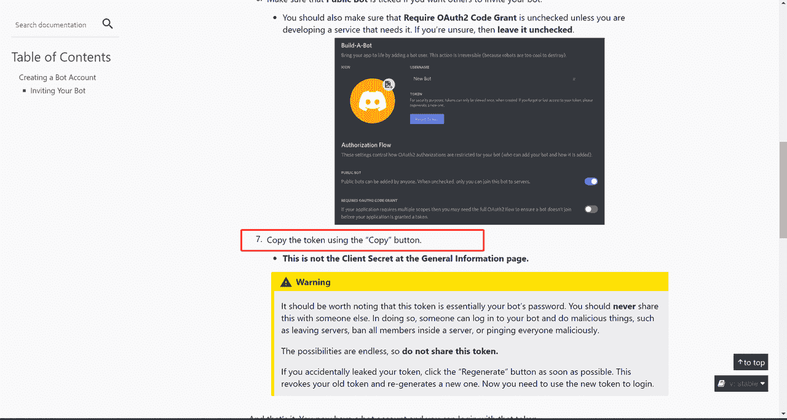

`DISCORD_CHANNEL_ID`即希望Bot发送消息的频道，如下：

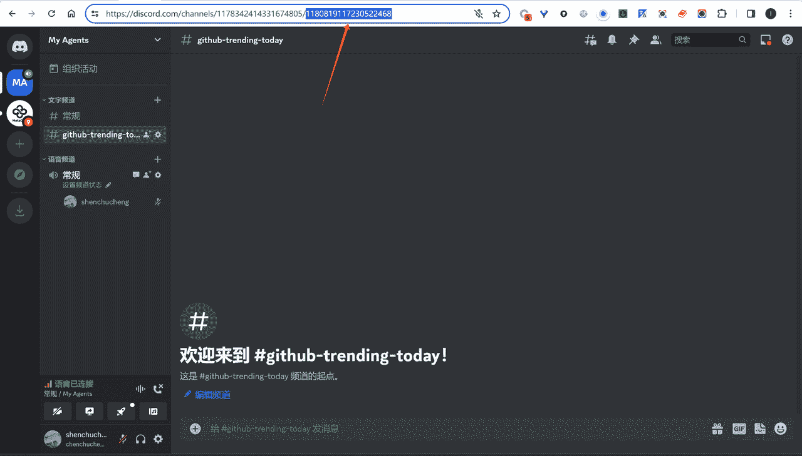

## Wechat

之前MetaGPT有尝试通过🛰️机器人同步不同社区群的消息，不过由于引起了过大的讨论，最终关闭了该功能，当时是使用`wechaty`实现的，但是使用该方式较为繁琐，而且由于我们的内容是`markdown`格式的，直接发送🛰️消息阅读体验较差，所以我们需要寻找合适的🛰️消息发送方式。👸号可以发送富本文消息，比较符合我们的场景，但是为了个推送的功能，开发个👸号的成本也是比较大，但是如果可以通过已有的一个👸号给我们发送消息，那实现将会非常简单。虽然🛰️官方没有提供类似的功能，但是已有许多的第三方👸号提供了消息推送的功能，例如`server酱`、`wxpusher`、`Pushplus`等，我们可以选择其中之一，例如`wxpusher`，它的代码是开源的，也有详细的文档，开发文档见：https://wxpusher.zjiecode.com/docs/#/

`wxpusher`虽然有python客户端，但是是同步的，但我们根据API文档，可以快速简单地实现一个异步的客户端：

```python
import os
from typing import Optional
import aiohttp


class WxPusherClient:
    def __init__(self, token: Optional[str] = None, base_url: str = "http://wxpusher.zjiecode.com"):
        self.base_url = base_url
        self.token = token or os.environ["WXPUSHER_TOKEN"]

    async def send_message(
        self,
        content,
        summary: Optional[str] = None,
        content_type: int = 1,
        topic_ids: Optional[list[int]] = None,
        uids: Optional[list[int]] = None,
        verify: bool = False,
        url: Optional[str] = None,
    ):
        payload = {
            "appToken": self.token,
            "content": content,
            "summary": summary,
            "contentType": content_type,
            "topicIds": topic_ids or [],
            "uids": uids or os.environ["WXPUSHER_UIDS"].split(","),
            "verifyPay": verify,
            "url": url,
        }
        url = f"{self.base_url}/api/send/message"
        return await self._request("POST", url, json=payload)

    async def _request(self, method, url, **kwargs):
        async with aiohttp.ClientSession() as session:
            async with session.request(method, url, **kwargs) as response:
                response.raise_for_status()
                return await response.json()
```

然后实现`callback`：


```
async def wxpusher_callback(msg: Message):
    client = WxPusherClient()
    await client.send_message(msg.content, content_type=3)
```

`WXPUSHER_TOKEN`[即wxpush的APP_TO](https://wxpusher.zjiecode.com/docs/#/?id=%e8%8e%b7%e5%8f%96apptoken)KEN，参考官方文档获取appToken

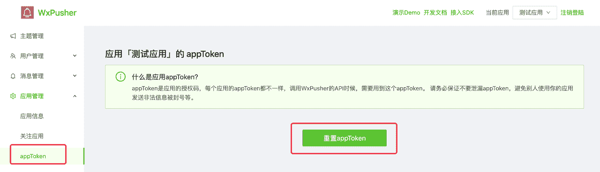

`WXPUSHER_UIDS`可以从应用管理页的”用户管理->用户列表“获取用户的UID，如果要发送给多个用户，可以用逗号将不同用户UID隔开

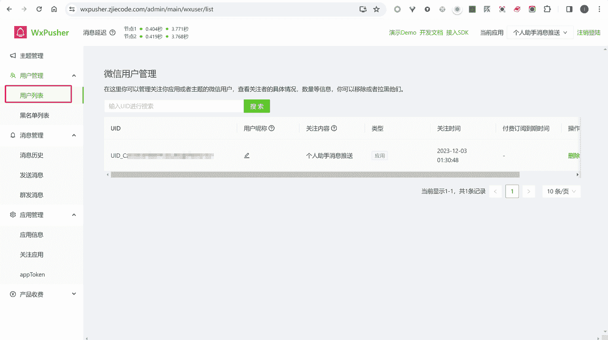

### 运行示例

以上基础的代码都开发完成了，接下来就是要运行了，考虑到为了能够在让上面的代码内容能够连贯，我们将它们写在一个`main.py`文件里，并进行回顾：

（完整代码下载：python版 |notebook版 ）


[`main.py`](https://internal-api-drive-stream.feishu.cn/space/api/box/stream/download/all/QtjobTmm8oLLizxKsCycqTvJnPc)


[`main.ipynb`](https://internal-api-drive-stream.feishu.cn/space/api/box/stream/download/all/P7DgbrV4eoGRQCx12jbccvJ8nbg)

```
import asyncio
import os
import time
from typing import Any, AsyncGenerator, Awaitable, Callable, Optional

import aiohttp
import discord
from aiocron import crontab
from bs4 import BeautifulSoup
from pydantic import BaseModel, Field
from pytz import BaseTzInfo

from metagpt.actions.action import Action
from metagpt.config import CONFIG
from metagpt.logs import logger
from metagpt.roles import Role
from metagpt.schema import Message


# 订阅模块，可以from metagpt.subscription import SubscriptionRunner导入，这里贴上代码供参考
class SubscriptionRunner(BaseModel):
    """A simple wrapper to manage subscription tasks for different roles using asyncio.
    Example:
        >>> import asyncio
        >>> from metagpt.subscription import SubscriptionRunner
        >>> from metagpt.roles import Searcher
        >>> from metagpt.schema import Message
        >>> async def trigger():
        ...     while True:
        ...         yield Message("the latest news about OpenAI")
        ...         await asyncio.sleep(3600 * 24)
        >>> async def callback(msg: Message):
        ...     print(msg.content)
        >>> async def main():
        ...     pb = SubscriptionRunner()
        ...     await pb.subscribe(Searcher(), trigger(), callback)
        ...     await pb.run()
        >>> asyncio.run(main())
    """

    tasks: dict[Role, asyncio.Task] = Field(default_factory=dict)

    class Config:
        arbitrary_types_allowed = True

    async def subscribe(
        self,
        role: Role,
        trigger: AsyncGenerator[Message, None],
        callback: Callable[
            [
                Message,
            ],
            Awaitable[None],
        ],
    ):
        """Subscribes a role to a trigger and sets up a callback to be called with the role's response.
        Args:
            role: The role to subscribe.
            trigger: An asynchronous generator that yields Messages to be processed by the role.
            callback: An asynchronous function to be called with the response from the role.
        """
        loop = asyncio.get_running_loop()

        async def _start_role():
            async for msg in trigger:
                resp = await role.run(msg)
                await callback(resp)

        self.tasks[role] = loop.create_task(_start_role(), name=f"Subscription-{role}")

    async def unsubscribe(self, role: Role):
        """Unsubscribes a role from its trigger and cancels the associated task.
        Args:
            role: The role to unsubscribe.
        """
        task = self.tasks.pop(role)
        task.cancel()

    async def run(self, raise_exception: bool = True):
        """Runs all subscribed tasks and handles their completion or exception.
        Args:
            raise_exception: _description_. Defaults to True.
        Raises:
            task.exception: _description_
        """
        while True:
            for role, task in self.tasks.items():
                if task.done():
                    if task.exception():
                        if raise_exception:
                            raise task.exception()
                        logger.opt(exception=task.exception()).error(f"Task {task.get_name()} run error")
                    else:
                        logger.warning(
                            f"Task {task.get_name()} has completed. "
                            "If this is unexpected behavior, please check the trigger function."
                        )
                    self.tasks.pop(role)
                    break
            else:
                await asyncio.sleep(1)

# Actions 的实现
TRENDING_ANALYSIS_PROMPT = """# Requirements
You are a GitHub Trending Analyst, aiming to provide users with insightful and personalized recommendations based on the latest
GitHub Trends. Based on the context, fill in the following missing information, generate engaging and informative titles, 
ensuring users discover repositories aligned with their interests.

# The title about Today's GitHub Trending
## Today's Trends: Uncover the Hottest GitHub Projects Today! Explore the trending programming languages and discover key domains capturing developers' attention. From ** to **, witness the top projects like never before.
## The Trends Categories: Dive into Today's GitHub Trending Domains! Explore featured projects in domains such as ** and **. Get a quick overview of each project, including programming languages, stars, and more.
## Highlights of the List: Spotlight noteworthy projects on GitHub Trending, including new tools, innovative projects, and rapidly gaining popularity, focusing on delivering distinctive and attention-grabbing content for users.
---
# Format Example

```

# [Title]

## Today's Trends

Today, ** and ** continue to dominate as the most popular programming languages. Key areas of interest include **, ** and **.

The top popular projects are Project1 and Project2.

## The Trends Categories

1. Generative AI

    - [Project1](https://github/xx/project1): [detail of the project, such as star total and today, language, ...]

    - [Project2](https://github/xx/project2): ...

...

## Highlights of the List

1. [Project1](https://github/xx/project1): [provide specific reasons why this project is recommended].

...
```


---
# Github Trending

{trending}
"""

```python
class CrawlOSSTrending(Action):

    async def run(self, url: str = "https://github.com/trending"):
        async with aiohttp.ClientSession() as client:
            async with client.get(url, proxy=CONFIG.global_proxy) as response:
                response.raise_for_status()
                html = await response.text()

        soup = BeautifulSoup(html, 'html.parser')

        repositories = []

        for article in soup.select('article.Box-row'):
            repo_info = {}

            repo_info['name'] = article.select_one('h2 a').text.strip().replace("\n", "").replace(" ", "")
            repo_info['url'] = "https://github.com" + article.select_one('h2 a')['href'].strip()

            # Description
            description_element = article.select_one('p')
            repo_info['description'] = description_element.text.strip() if description_element else None

            # Language
            language_element = article.select_one('span[itemprop="programmingLanguage"]')
            repo_info['language'] = language_element.text.strip() if language_element else None

            # Stars and Forks
            stars_element = article.select('a.Link--muted')[0]
            forks_element = article.select('a.Link--muted')[1]
            repo_info['stars'] = stars_element.text.strip()
            repo_info['forks'] = forks_element.text.strip()

            # Today's Stars
            today_stars_element = article.select_one('span.d-inline-block.float-sm-right')
            repo_info['today_stars'] = today_stars_element.text.strip() if today_stars_element else None

            repositories.append(repo_info)

        return repositories


class AnalysisOSSTrending(Action):

    async def run(
        self,
        trending: Any
    ):
        return await self._aask(TRENDING_ANALYSIS_PROMPT.format(trending=trending))


# Role实现
class OssWatcher(Role):
    def __init__(
        self,
        name="Codey",
        profile="OssWatcher",
        goal="Generate an insightful GitHub Trending analysis report.",
        constraints="Only analyze based on the provided GitHub Trending data.",
    ):
        super().__init__(name, profile, goal, constraints)
        self.set_actions([CrawlOSSTrending, AnalysisOSSTrending])
        self._set_react_mode(react_mode="by_order")

    async def _act(self) -> Message:
        logger.info(f"{self._setting}: ready to {self.rc.todo}")
        # By choosing the Action by order under the hood
        # todo will be first SimpleWriteCode() then SimpleRunCode()
        todo = self.rc.todo

        msg = self.get_memories(k=1)[0] # find the most k recent messages
        result = await todo.run(msg.content)

        msg = Message(content=str(result), role=self.profile, cause_by=type(todo))
        self.rc.memory.add(msg)
        return msg


# Trigger
class OssInfo(BaseModel):
    url: str
    timestamp: float = Field(default_factory=time.time)


class GithubTrendingCronTrigger():

    def __init__(self, spec: str, tz: Optional[BaseTzInfo] = None, url: str = "https://github.com/trending") -> None:
        self.crontab = crontab(spec, tz=tz)
        self.url = url

    def __aiter__(self):
        return self

    async def __anext__(self):
        await self.crontab.next()
        return Message(self.url, OssInfo(url=self.url))


# callback
async def discord_callback(msg: Message):
    intents = discord.Intents.default()
    intents.message_content = True
    client = discord.Client(intents=intents, proxy=CONFIG.global_proxy)
    token = os.environ["DISCORD_TOKEN"]
    channel_id = int(os.environ["DISCORD_CHANNEL_ID"])
    async with client:
        await client.login(token)
        channel = await client.fetch_channel(channel_id)
        lines = []
        for i in msg.content.splitlines():
            if i.startswith(("# ", "## ", "### ")):
                if lines:
                    await channel.send("\n".join(lines))
                    lines = []
            lines.append(i)

        if lines:
            await channel.send("\n".join(lines))


class WxPusherClient:
    def __init__(self, token: Optional[str] = None, base_url: str = "http://wxpusher.zjiecode.com"):
        self.base_url = base_url
        self.token = token or os.environ["WXPUSHER_TOKEN"]

    async def send_message(
        self,
        content,
        summary: Optional[str] = None,
        content_type: int = 1,
        topic_ids: Optional[list[int]] = None,
        uids: Optional[list[int]] = None,
        verify: bool = False,
        url: Optional[str] = None,
    ):
        payload = {
            "appToken": self.token,
            "content": content,
            "summary": summary,
            "contentType": content_type,
            "topicIds": topic_ids or [],
            "uids": uids or os.environ["WXPUSHER_UIDS"].split(","),
            "verifyPay": verify,
            "url": url,
        }
        url = f"{self.base_url}/api/send/message"
        return await self._request("POST", url, json=payload)

    async def _request(self, method, url, **kwargs):
        async with aiohttp.ClientSession() as session:
            async with session.request(method, url, **kwargs) as response:
                response.raise_for_status()
                return await response.json()


async def wxpusher_callback(msg: Message):
    client = WxPusherClient()
    await client.send_message(msg.content, content_type=3)


# 运行入口，
async def main(spec: str = "0 9 * * *", discord: bool = True, wxpusher: bool = True):
    callbacks = []
    if discord:
        callbacks.append(discord_callback)

    if wxpusher:
        callbacks.append(wxpusher_callback)

    if not callbacks:
        async def _print(msg: Message):
            print(msg.content)
        callbacks.append(_print)

    async def callback(msg):
        await asyncio.gather(*(call(msg) for call in callbacks))

    runner = SubscriptionRunner()
    await runner.subscribe(OssWatcher(), GithubTrendingCronTrigger(spec), callback)
    await runner.run()

if __name__ == "__main__":
    import fire
    fire.Fire(main)
```

运行前，记得配置回调需要的环境变量：

```bash
export DISCORD_TOKEN=MTE3ODM0NzQ5NzA4MTU0NDg0NA.GqWXK2.xxxxxxxxxxxxxxxxxxxxxxxxxxxxxxx
export DISCORD_CHANNEL_ID=11783424143316xxxxxx
export WXPUSHER_TOKEN=AT_xxxxxxxxxxxxxxxxxxxxxx
export WXPUSHER_UIDS=UID_xxxxxxxxxxxxxxxxxxxxxxxxx
python main.py
```

效果如下：

+   Discord

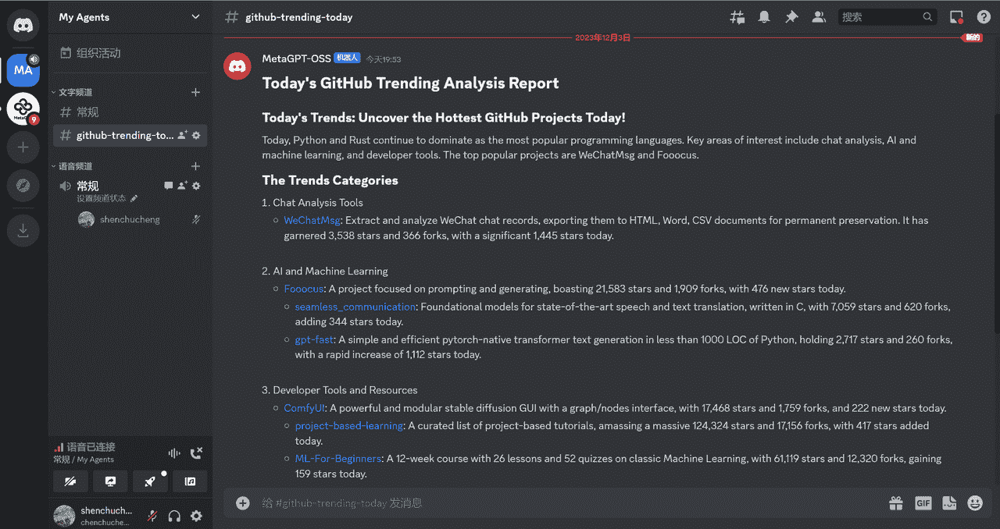

+   WXPusher

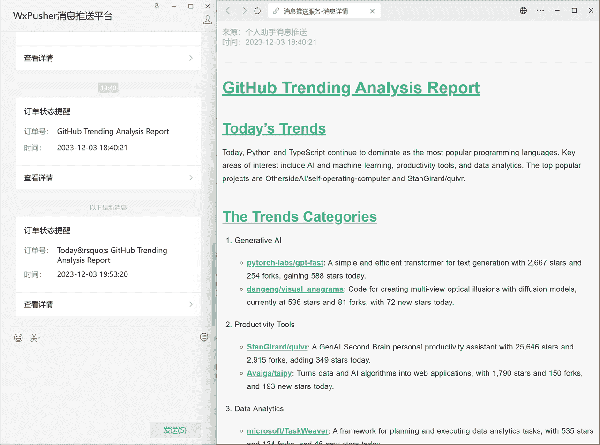

## 第四章 课程任务

根据上面教程的介绍，你已经学会了如何针对具体场景开发一个实用的资讯收集助手；现在，你可以试着完成一个能订阅自己感兴趣的资讯的Agent：

+   根据前面你所学习的爬虫基本知识（如果你对写爬虫代码感到不熟练，使用GPT帮助你），为你的Agent自定义两个获取资讯的`Action`类

+   Action 1：根据第四章 3.2.1和3.2.2的指引，独立实现对Github Trending(`https://github.com/trending`)页面的爬取，并获取每一个项目的 名称、URL链接、描述

+   Action 2：独立完成对Huggingface Papers（`https://huggingface.co/papers`）页面的爬取，先获取到每一篇Paper的链接（提示：标题元素中的`href`标签），并通过链接访问标题的描述页面（例如：`https://huggingface.co/papers/2312.03818`），在页面中获取一篇Paper的 标题、摘要

+   参考第三章 1.4 的内容，重写有关方法，使你的Agent能自动生成总结内容的目录，然后根据二级标题进行分块，每块内容做出对应的总结，形成一篇资讯文档；

+   自定义Agent的`SubscriptionRunner`类，独立实现`Trigger`、`Callback`的功能，让你的Agent定时为通知渠道发送以上总结的资讯文档（尝试实现邮箱发送的功能，这是加分项）

## 第五章：ActionNode

### 为什么要采用`ActionNode`的数据结构

[为什么要采用`ActionNode`的数据结构](https://deepwisdom.feishu.cn/wiki/JUF0wc5rti9qRrkyiI2cyNCDnUd)

### `ActionNode`基础知识

在`MG`框架0.5版本中，新增加了`ActionNode`类，为Agent的动作执行提供更强的能力


# ActionNode

`ActionNode`可以被视为一组动作树，根据类内定义，一个动作树的父节点可以访问所有的子动作节点；也就是说，定义了一个完整的动作树之后，可以从父节点按树的结构顺序执行每一个子动作节点。因此，动作的执行也可以突破0.4版本框架中，需要在`Role`的`_react`内循环执行的限制，达到更好的CoT效果。

`ActionNode`仍然需要基于`Action`类进行构建，在定义一个`ActionNode`动作树之后，需要将该动作树作为参数赋予一个`Action`子类，在并将其输入到`Role`中作为其动作。在这个意义上，一个`ActionNode`动作树可以被视为一个内置CoT思考的`Action`。

同时，在`ActionNode`基类中，也配置了更多格式检查和格式规范工具，让CoT执行过程中，内容的传递更加结构化。这也服务于让MetaGPT框架生成更好、更长、更少Bug的代码这一目的。

## 如何使用 `ActionNode`

定义一个包含一系列`ActionNode`的`Action`，首先需要定义一个动作树的父节点和一系列子节点，将子节点与父节点建立联系；

```
# 定义单个子节点ActionNode
UI_DESIGN_DESC = ActionNode(
    key="UI Design Desc",
    expected_type=str,
    instruction="place the design objective here",
    example="Snake games are classic and addictive games with simple yet engaging elements. Here are the main elements"
    " commonly found in snake games",
)

# 定义完所有ActionNode之后，将其存放在一个List里面
NODES = [
    UI_DESIGN_DESC,
    SELECTED_ELEMENTS,
    HTML_LAYOUT,
    CSS_STYLES,
    ANYTHING_UNCLEAR,
]

# 将上述List的所有子节点传入父节点UI_DESIGN_NODE中
UI_DESIGN_NODE = ActionNode.from_children("UI_DESIGN", NODES)
```

之后，在`Action.run`方法中，调用父节点的执行方法，获取所有子节点按顺序执行之后的结果

```
ui_describe = await UI_DESIGN_NODE.fill(prompt)
```

## ActionNode 支持的基础功能

`ActionNode`中定义了一系列强大的基础功能，可以实现丰富的效果。以下的代码均截取于`ActionNode`类，方便大家更加深入地了解这一个类所支持的基础功能。

```
def add_child(self, node: "ActionNode"):
    """增加子ActionNode"""
    self.children[node.key] = node

def add_children(self, nodes: List["ActionNode"]):
    """批量增加子ActionNode"""
    for node in nodes:
        self.add_child(node)

@classmethod
def from_children(cls, key, nodes: List["ActionNode"]):
    """直接从一系列的子nodes初始化"""
    obj = cls(key, str, "", "")
    obj.add_children(nodes)
    return obj
```

`ActionNode.fill`是其执行动作的方法，通过这个方法，实现执行传入的`prompt`并获取结果返回，并将结果存储在自身中

```
# 获取自身的context信息（保存着所有与动作执行有关的上下文）作为prompt
# 执行prompt，并获取返回，保存到自身的content中
async def simple_fill(self, schema, mode):
    prompt = self.compile(context=self.context, schema=schema, mode=mode)

    if schema != "raw":
        mapping = self.get_mapping(mode)
        class_name = f"{self.key}_AN"
        
        # 这里获取的content是llm返回的源文本，scontent则是结构化处理的文本；
        # _aask_v1 函数会检查llm返回的内容的结构，如果不符合用户期望的格式，则会调用llm重新生成内容
        content, scontent = await self._aask_v1(prompt, class_name, mapping, schema=schema)
        self.content = content
        self.instruct_content = scontent
    else:
        self.content = await self.llm.aask(prompt)
        self.instruct_content = None

    return self

# 根据执行模式的输入，选择只执行当前节点的simple_fill或者执行所有子节点的simple_fill
async def fill(self, context, llm, schema="json", mode="auto", strgy="simple"):
    self.set_llm(llm)
    self.set_context(context)
    if self.schema:
        schema = self.schema

    if strgy == "simple":
        return await self.simple_fill(schema=schema, mode=mode)
    elif strgy == "complex":
        # 这里隐式假设了拥有children
        tmp = {}
        for _, i in self.children.items():
            child = await i.simple_fill(schema=schema, mode=mode)
            tmp.update(child.instruct_content.dict())
        cls = self.create_children_class()
        self.instruct_content = cls(**tmp)
        return self
```

`ActionNode`执行动作的基础是以下函数，向`llm`发送消息获取返回内容，同时对特定的格式需要做特定`prompt`输入和格式约束。

```
@retry(
    wait=wait_random_exponential(min=1, max=20),
    stop=stop_after_attempt(6),
    after=general_after_log(logger),
)
async def _aask_v1(
    self,
    prompt: str,
    output_class_name: str,
    output_data_mapping: dict,
    system_msgs: Optional[list[str]] = None,
    schema="markdown",  # compatible to original format
) -> (str, BaseModel):
    """Use ActionOutput to wrap the output of aask"""
    content = await self.llm.aask(prompt, system_msgs)
    logger.debug(f"llm raw output:\n{content}")
    output_class = self.create_model_class(output_class_name, output_data_mapping)

    if schema == "json":
        parsed_data = llm_output_postprecess(output=content, schema=output_class.schema(), req_key=f"/{TAG}")
    else:  # using markdown parser
        parsed_data = OutputParser.parse_data_with_mapping(content, output_data_mapping)

    logger.debug(f"parsed_data:\n{parsed_data}")
    instruct_content = output_class(**parsed_data)
    return content, instruct_content
```

## 快速掌握`ActionNode`的用法：打印斐波那契数列

上一章节我们已经学会了`ActionNode`支持的基础功能，但是，想要让`ActionNode`实例实现更多的功能，还需要使用一个`Action`类来执行`ActionNode`。在这个章节中，我将带领大家，通过一个简单的小训练：打印前10个斐波那契数列的数字，来掌握`ActionNode`的基本用法。

### 需求分析

斐波那契数列是一个数列，每个数都是前两个数的和，通常以0和1开始。更多关于斐波那契数列的知识，可以查看：[baike.baidu.com](https://baike.baidu.com/item/%E6%96%90%E6%B3%A2%E9%82%A3%E5%A5%91%E6%95%B0%E5%88%97/99145)

在数学上，斐波那契数列被定义为：

```
F(0) = 0, F(1) = 1
F(n) = F(n-1) + F(n-2) for n > 1
```

很明显，LLM了解斐波那契数列是什么东西，通过简单的对话也能快速满足我们的需求。但在一些特殊的情况下，LLM通过简单对话返回的字符串数据无法满足我们的要求。在此之上，我提出了更高的要求：LLM要能以特定的可解析的格式来返回斐波那契数列，并通过格式解析实现逐个打印数字的效果。

在这里，我们需要利用`ActionNode`来固定返回的格式，同时，我们也复习一下，实现技术文档助手中，我们学会的一些技巧，来实现逐个打印的效果。

### 返回特定格式的斐波那契数列

根据需求分析，我们需要返回特定格式的斐波那契数列前10个数字，这里我们有两个动作需要执行：

+   思考斐波那契数列前10个数字是什么；

+   将思考得到的前10个数字转化为特定格式；

我们可以使用两个`ActionNode`，形成一个简单的CoT来执行上述的动作。

首先，我们定义好两个`ActionNode`，可以实现上述的功能。

```
# 将思考斐波那契数列的10个数字作为prompt输入，在这里我们将“思考需要生成的数字列表”作为命令（instruction）写入
# 将期望返回格式（expected_type）设置为str，无需设置例子（example）
SIMPLE_THINK_NODE = ActionNode(
    key="Simple Think Node",
    expected_type=str,
    instruction="""
            Think about what list of numbers you need to generate
            想一想您需要生成哪些数字列表
            """,
    example=""
)

# 在这里通过命令（instruction）来规定需要生成的数字列表格式，提供例子（example）来帮助LLM理解
SIMPLE_CHECK_NODE = ActionNode(
    key="Simple CHECK Node",
    expected_type=str,
    instruction="""
            Please provide the number list for me, strictly following the following requirements:
            1. Answer strictly in the list format like [1,2,3,4]
            2. Do not have extra spaces or line breaks.
            Return the list here:
            请严格按照以下要求为我提供号码清单：
            1. 严格按照 [1,2,3,4] 这样的列表格式作答
            2. 不要有额外的空格或换行。
            在此返回列表：
            """,
    example="[1,2,3,4]"
            "[4,5,6]",
 )
```

设置好`ActionNode`之后，我们需要为这两个动作节点设置一个父节点。

为什么需要设置父节点？还记得基础功能里面的`ActionNode.fill`方法吗，当我们输入`complex`参数时，这个方法会按顺序执行每一个子节点，并将上一个子节点返回的内容作为下一个子节点的`prompt`。为了将两个动作节点串联起来，形成一个简单的CoT效果，我们需要设置一个父节点。

我们需要编写一个`ActionNode`的子类，通过修改其中部分方法，来达到更加稳定的效果。

```
class THINK_NODES(ActionNode):
    def __init__(self, name="Think Nodes", expected_type=str, instruction="", example=""):
        super().__init__(key=name, expected_type=str, instruction=instruction, example=example)
        self.add_children([SIMPLE_THINK_NODE, SIMPLE_CHECK_NODE])    # 初始化过程，将上面实现的两个子节点加入作为THINK_NODES类的子节点

    async def fill(self, context, llm, schema="raw", mode="auto", strgy="complex"):
        self.set_llm(llm)
        self.set_context(context)
        if self.schema:
            schema = self.schema

        if strgy == "simple":
            return await self.simple_fill(schema=schema, mode=mode)
        elif strgy == "complex":
            # 这里隐式假设了拥有children
            child_context = context    # 输入context作为第一个子节点的context
            for _, i in self.children.items():
                i.set_context(child_context)    # 为子节点设置context
                child = await i.simple_fill(schema=schema, mode=mode)
                child_context = child.content    # 将返回内容（child.content）作为下一个子节点的context

            self.content = child_context    # 最后一个子节点返回的内容设置为父节点返回内容（self.content）
            return self
```


# 动作节点与角色实现

## 重写 `__init__` 方法初始化 `ActionNode`

通过重写`__init__`方法，让动作初始化时可以将动作的`ActionNode`节点也一并初始化，并赋值给`self.node`。

```
def __init__(self, name="Think Nodes", expected_type=str, instruction="", example=""):
    super().__init__(key=name, expected_type=str, instruction=instruction, example=example)
    self.add_children([SIMPLE_THINK_NODE, SIMPLE_CHECK_NODE])    # 初始化过程，将上面实现的两个子节点加入作为THINK_NODES类的子节点
```

## 重写 `fill` 方法实现子节点信息传递

我们通过重写`fill`方法，实现`ActionNode`父节点下面各个子节点之间信息传递流畅，通过将上一个子节点的输出作为下一个子节点的输入，并将最后一个子节点的输出作为该`Action`的输出，来实现一个简单的`CoT`。

```
async def fill(self, context, llm, schema="raw", mode="auto", strgy="complex"):
    self.set_llm(llm)
    self.set_context(context)
    if self.schema:
        schema = self.schema

    if strgy == "simple":
        return await self.simple_fill(schema=schema, mode=mode)
    elif strgy == "complex":
        # 这里隐式假设了拥有children
        child_context = context    # 输入context作为第一个子节点的context
        for _, i in self.children.items():
            i.set_context(child_context)    # 为子节点设置context
            child = await i.simple_fill(schema=schema, mode=mode)
            child_context = child.content    # 将返回内容（child.content）作为下一个子节点的context

        self.content = child_context    # 最后一个子节点返回的内容设置为父节点返回内容（self.content）
        return self
```

## 设计 `ThinkAction` 子类承载 `ActionNode`

设计一个新的`Action`子类来承载上面的`ActionNode`。

```
class ThinkAction(Action):
    """
    Action that think
    """

    def __init__(self, name="ThinkAction", context=None, llm=None):
        super().__init__()
        self.node = THINK_NODES()    # 初始化Action时，初始化一个THINK_NODE实例并赋值给self.node

    async def run(self, instruction) -> list:
        PROMPT = """
            You are now a number list generator, follow the instruction {instruction} and 
            generate a number list to be printed please.
            您现在是数字列表生成器，请按照指令 {instruction} 生成数字列表并打印出来。
            生成一个数字列表并打印出来。
            """

        prompt = PROMPT.format(instruction=instruction)
        rsp_node = await self.node.fill(context=prompt, llm=self.llm, schema="raw", strgy="complex")    # 运行子节点，获取返回（返回格式为ActionNode）（注意设置 schema="raw" ）
        rsp = rsp_node.content    # 获取返回的文本内容

        rsp_match = self.find_in_brackets(rsp)    # 按列表格式解析返回的文本内容，定位“[”与“]”之间的内容

        try:
            rsp_list = list(map(int, rsp_match[0].split(',')))    # 按列表格式解析返回的文本内容，按“,”对内容进行分割，并形成一个python语法中的列表

            return rsp_list
        except:
            return []
            
    @staticmethod
    def find_in_brackets(s):
        pattern = r'\[(.*?)\]'
        match = re.findall(pattern, s)
        return match
```

## 在 `ThinkAction` 中初始化 `THINK_NODES` 实例

在`ThinkAction`中，初始化这个动作时，我们可以一并初始化`THINK_NODES`的实例，并且赋值到`self.node`参数上面。

```
def __init__(self, name="ThinkAction", context=None, llm=None):
    super().__init__()
    self.node = THINK_NODES()    # 初始化Action时，初始化一个THINK_NODE实例并赋值给self.node
```

## `run` 方法中调用 `self.node.fill`

`run`方法中，我们先通过设计一个`prompt`，告诉`llm`它需要生成数字列表，然后使用`self.node.fill`方法，将设计好的`prompt`输入，获取到执行完两个`ActionNode`之后输出的内容。需要注意的是，`fill`方法返回的其实是一个`ActionNode`实例，因此我们需要选取`ActionNode.content`，才能得到我们想要的文本内容

```
PROMPT = """
    You are now a number list generator, follow the instruction {instruction} and 
    generate a number list to be printed please.
    您现在是数字列表生成器，请按照指令 {instruction} 生成数字列表并打印出来。
    生成一个数字列表并打印出来。
    """

prompt = PROMPT.format(instruction=instruction)
rsp_node = await self.node.fill(context=prompt, llm=self.llm, schema="raw", strgy="complex")    # 运行子节点，获取返回（返回格式为ActionNode）（注意设置 schema="raw" ）
rsp = rsp_node.content    # 获取返回的文本内容
```

接着，再经过文本分割函数对获取到的文本进行分割，形成一个数字列表并返回。这里不再赘述，有兴趣的同学可以参考上面的完整代码，上网查询（或者询问GPT）学习相关知识。

## `SimplePrint` 动作和 `Printer` 角色的实现

我们需要编写一个普通的`Action`，实现简单的打印数字的效果。

```
class SimplePrint(Action):
    """
    Action that print the num inputted
    """
    input_num = 0

    def __init__(self, name="SimplePrint", input_num:int=0):
        super().__init__()

        self.input_num = input_num

    async def run(self, **kwargs):
        print(str(self.input_num) + "\n")    # 打印输入数字
        return 0
```

我们实现了所有`Action`和`ActionNode`的编写，接下来我们可以编写一个`Role`来执行上述的动作。

我们需要在执行`ThinkAction`时，根据返回的列表添加`SimplePrint`动作。

```
class Printer(Role):
    def __init__(self, name="Jerry", profile="Printer", goal="Print the number", constraints=""):
        super().__init__()
        self.set_actions([ThinkAction])

    async def _think(self) -> None:
        """Determine the action"""

        if self.rc.todo is None:
            self._setstate(0)
            return

        if self.rc.state + 1 < len(self.states):
            self._setstate(self.rc.state + 1)
        else:
            self.rc.todo = None

    async def _react(self) -> Message:
        """""""
        while True:
            await self._think()

            if self.rc.todo is None:
                break
            msg = await self._act()

        return msg
        
    async def _prepare_print(self, num_list:list) -> Message:
        """Add actions"""
        actions = list()
        for num in num_list:
            actions.append(SimplePrint(input_num=num))    # 根据返回的列表，设置一系列的SimplePrint

        self.set_actions(actions)    # 初始化动作
        self.rc.todo = None
        return Message(content=str(num_list))
        
    async def _act(self) -> Message:
        """Action"""
        todo = self.rc.todo

        if type(todo) is ThinkAction :
            msg = self.rc.memory.get(k=1)[0]
            self.goal = msg.content
            resp = await todo.run(instruction=self.goal)
            return await self._prepare_print(resp)    # 执行完ThinkAction后，根据返回的列表，设置SimplePrint

        resp = await todo.run()
        return Message(content=resp, role=self.profile)

```

在这里 `Printer` 类中，我们修改了 `think`、`react` 和 `act` 模块，新增加了一个 `_prepare_print` 方法

`_prepare_print` 方法对一个输入的数字列表进行处理，将列表中的每一个数字都初始化一个`SimplePrint`类，并在最后输入给 `Printer` 类作为新的执行动作。这里对应的是，我们在 `ThinkAction`中获得输出的数字列表之后，对所有动作初始化 `SimplePrint` 动作。

```
async def _prepare_print(self, num_list:list) -> Message:
    """Add actions"""
    actions = list()
    for num in num_list:
        actions.append(SimplePrint(input_num=num))    # 根据返回的列表，设置一系列的SimplePrint

    self.set_actions(actions)    # 初始化动作
    self.rc.todo = None
    return Message(content=str(num_list))
```

修改的 `_act` 方法则做了一次判断，在 `ThinkAction` 执行完之后，立刻执行 `_prepare_print` 方法，获得新的动作。

```
async def _act(self) -> Message:
    """Action"""
    todo = self.rc.todo

    if type(todo) is ThinkAction :
        msg = self.rc.memory.get(k=1)[0]
        self.goal = msg.content
        resp = await todo.run(instruction=self.goal)
        return await self._prepare_print(resp)    # 执行完ThinkAction后，根据返回的列表，设置SimplePrint

    resp = await todo.run()
    return Message(content=resp, role=self.profile)
```

至此，`Printer`类便能完整执行从思考到打印斐波那契数列的一系列动作。

## 完整代码


```python
import asyncio
import re

from metagpt.actions.action import Action, ActionNode
from metagpt.logs import logger
from metagpt.roles import Role
from metagpt.schema import Message

# 将思考斐波那契数列的10个数字作为prompt输入，在这里我们将“思考需要生成的数字列表”作为命令（instruction）写入
# 将期望返回格式（expected_type）设置为str，无需设置例子（example）
SIMPLE_THINK_NODE = ActionNode(
    key="Simple Think Node",
    expected_type=str,
    instruction="""
            Think about what list of numbers you need to generate
            """,
    example=""
)

# 在这里通过命令（instruction）来规定需要生成的数字列表格式，提供例子（example）来帮助LLM理解
SIMPLE_CHECK_NODE = ActionNode(
    key="Simple CHECK Node",
    expected_type=str,
    instruction="""
            Please provide the number list for me, strictly following the following requirements:
            1. Answer strictly in the list format like [1,2,3,4]
            2. Do not have extra spaces or line breaks.
            Return the list here:
            """,
    example="",
            "[4,5,6]",
)


class THINK_NODES(ActionNode):
    def __init__(self, name="Think Nodes", expected_type=str, instruction="", example=""):
        super().__init__()
        self.add_children([SIMPLE_THINK_NODE, SIMPLE_CHECK_NODE])    # 初始化过程，将上面实现的两个子节点加入作为THINK_NODES类的子节点

    async def fill(self, context, llm, schema="raw", mode="auto", strgy="complex"):
        self.set_llm(llm)
        self.set_context(context)
        if self.schema:
            schema = self.schema

        if strgy == "simple":
            return await self.simple_fill(schema=schema, mode=mode)
        elif strgy == "complex":
            # 这里隐式假设了拥有children
            child_context = context    # 输入context作为第一个子节点的context
            for _, i in self.children.items():
                i.set_context(child_context)    # 为子节点设置context
                child = await i.simple_fill(schema=schema, mode=mode)
                child_context = child.content    # 将返回内容（child.content）作为下一个子节点的context

            self.content = child_context    # 最后一个子节点返回的内容设置为父节点返回内容（self.content）
            return self


class SimplePrint(Action):
    """
    Action that print the num inputted
    """
    input_num = 0

    def __init__(self, name="SimplePrint", input_num:int=0):
        super().__init__()

        self.input_num = input_num

    async def run(self, **kwargs):
        print(str(self.input_num) + "\n")
        return 0

class ThinkAction(Action):
    """
    Action that think
    """

    def __init__(self, name="ThinkAction", context=None, llm=None):
        super().__init__()
        self.node = THINK_NODES()    # 初始化Action时，初始化一个THINK_NODE实例并赋值给self.node

    async def run(self, instruction) -> list:
        PROMPT = """
            You are now a number list generator, follow the instruction {instruction} and 
            generate a number list to be printed please.
            """

        prompt = PROMPT.format(instruction=instruction)
        rsp_node = await self.node.fill(context=prompt, llm=self.llm, schema="raw",
                                        strgy="complex")  # 运行子节点，获取返回（返回格式为ActionNode）（注意设置 schema="raw" ）
        rsp = rsp_node.content  # 获取返回的文本内容

        rsp_match = self.find_in_brackets(rsp)  # 按列表格式解析返回的文本内容，定位“[”与“]”之间的内容

        try:
            rsp_list = list(map(int, rsp_match[0].split(',')))  # 按列表格式解析返回的文本内容，按“,”对内容进行分割，并形成一个python语法中的列表

            return rsp_list
        except:
            return []

    @staticmethod
    def find_in_brackets(s):
        pattern = r'\[(.*?)\]'
        match = re.findall(pattern, s)
        return match

class Printer(Role):

    def __init__(self, name="Jerry", profile="Printer", goal="Print the number", constraints=""):
        super().__init__()

        self.set_actions([ThinkAction])
        # self.num_list = list()

    async def _think(self) -> None:
        """Determine the action"""
        # logger.info(self.rc.state)

        if self.rc.todo is None:
            self._setstate(0)
            return

        if self.rc.state + 1 < len(self.states):
            self._setstate(self.rc.state + 1)
        else:
            self.rc.todo = None

    async def _prepare_print(self, num_list:list) -> Message:
        """Add actions"""
        actions = list()

        for num in num_list:
            actions.append(SimplePrint(input_num=num))

        self.set_actions(actions)
        self.rc.todo = None
        return Message(content=str(num_list))

    async def _act(self) -> Message:
        """Action"""
        todo = self.rc.todo

        if type(todo) is ThinkAction :
            msg = self.rc.memory.get(k=1)[0]
            self.goal = msg.content
            resp = await todo.run(instruction=self.goal)
            # logger.info(resp)

            return await self._prepare_print(resp)

        resp = await todo.run()
        # logger.info(resp)

        return Message(content=resp, role=self.profile)

    async def _react(self) -> Message:
        """
        while True:
            await self._think()

            if self.rc.todo is None:
                break
            msg = await self._act()

        return msg


async def main():
    msg = "Provide the first 10 numbers of the Fibonacci series"
    role = Printer()
    logger.info(msg)
    result = await role.run(msg)
    logger.info(result)


if __name__ == '__main__':
    asyncio.run(main())
```

## 使用ActionNode实现一个Agent：技术文档助手

我们计划利用最新的特性重写前面教程中的技术文档助手。

在这里，需求与前面的教程差不多，我们先通过 LLM 大模型生成教程的目录，再对目录按照二级标题进行分块，对于每块目录按照标题生成详细内容，最后再将标题和内容进行拼接，解决 LLM 大模型长文本的限制问题。但我们可以利用`ActionNode`的能力，让详细内容的生成更加结构化。

### 单ActionNode例子：重写WriteDirectory方法

我们先从`WriteDirectory`方法开始，尝试利用`ActionNode`进行方法的重写；

首先我们需要实例化一个`ActionNode`，设置好相应的参数；

```python
# 命令文本
DIRECTORY_STRUCTION = """
    You are now a seasoned technical professional in the field of the internet. 
    We need you to write a technical tutorial".
    您现在是互联网领域的经验丰富的技术专业人员。
    我们需要您撰写一个技术教程。
    """

# 实例化一个ActionNode，输入对应的参数
DIRECTORY_WRITE = ActionNode(
    # ActionNode的名称
    key="Directory Write",
    # 期望输出的格式
    expected_type=str,
    # 命令文本
    instruction=DIRECTORY_STRUCTION,
    # 例子输入，在这里我们可以留空
    example="",
 )
```

由于这里我们只需要使用一个`ActionNode`，我们可以直接在`WriteDirectory.run`方法中直接使用上述的`ActionNode`


```
class WriteDirectory(Action):
    """Action class for writing tutorial directories.

    Args:
        name: The name of the action.
        language: The language to output, default is "Chinese".

        用于编写教程目录的动作类。
        参数：
        name：动作的名称。
        language：输出的语言，默认为"Chinese"。
    """

    language: str = "Chinese"

    def __init__(self, name: str = "", language: str = "Chinese", *args, **kwargs):
        super().__init__()
        self.language = language

    async def run(self, topic: str, *args, **kwargs) -> Dict:
        """Execute the action to generate a tutorial directory according to the topic.

        Args:
            topic: The tutorial topic.

        Returns:
            the tutorial directory information, including {"title": "xxx", "directory": [{"dir 1": ["sub dir 1", "sub dir 2"]}]}.
        根据主题执行生成教程目录的操作。
            参数：
            topic：教程主题。
            返回：
            教程目录信息，包括{"title": "xxx", "directory": [{"dir 1": ["sub dir 1", "sub dir 2"]}]}.
        """

        DIRECTORY_PROMPT = """
        The topic of tutorial is {topic}. Please provide the specific table of contents for this tutorial, strictly following the following requirements:
        1. The output must be strictly in the specified language, {language}.
        2. Answer strictly in the dictionary format like {"title": "xxx", "directory": [{"dir 1": ["sub dir 1", "sub dir 2"]}, {"dir 2": ["sub dir 3", "sub dir 4"]}]}.
        3. The directory should be as specific and sufficient as possible, with a primary and secondary directory.The secondary directory is in the array.
        4. Do not have extra spaces or line breaks.
        5. Each directory title has practical significance.
        教程的主题是{topic}。请按照以下要求提供本教程的具体目录：
        1. 输出必须严格符合指定语言，{language}。
        2. 回答必须严格按照字典格式，如{"title": "xxx", "directory": [{"dir 1": ["sub dir 1", "sub dir 2"]}, {"dir 2": ["sub dir 3", "sub dir 4"]}]}。
        3. 目录应尽可能具体和充分，包括一级和二级目录。二级目录在数组中。
        4. 不要有额外的空格或换行符。
        5. 每个目录标题都具有实际意义。
        """
        
        # 我们设置好prompt，作为ActionNode的输入
        prompt = DIRECTORY_PROMPT.format(topic=topic, language=self.language)
        # resp = await self._aask(prompt=prompt)
        # 直接调用ActionNode.fill方法，注意输入llm
        # 该方法会返回self，也就是一个ActionNode对象
        resp_node = await DIRECTORY_WRITE.fill(context=prompt, llm=self.llm)
        # 选取ActionNode.content，获得我们期望的返回信息
        resp = resp_node.content
        return OutputParser.extract_struct(resp, dict)
```

其他的注释和解析函数不一一展开；

## 多`ActionNode`例子：重写`WriteContent`方法

完整代码如下

> 正在姗姗来迟的路上

## 第六章：订阅智能体进阶

> 第六章代码还没有合入主分支，后续会做版本的适配，有基础的伙伴可以自行咱开后续的学习，通过这个项目可以加深对订阅智能体以及`action node`的工程上的用法

### OSS订阅智能体的思考与优化

通过前面的学习，我们已经学会了MetaGPT订阅模块的使用，跟随教程实现了OSS订阅智能体，将Github Trending的信息由智能体总结之后，通过discord或者🛰️的渠道发送给了我们。如果完成了作业，那么你也独立打造了一个专属于自己的订阅智能体。接下来，让我们来回顾一下，订阅智能体的实现过程：要分别完成`SubscriptionRunner`运行需要的三个要素：`Role`、`Trigger`、`Callback`，`Trigger`是触发器，我们实现了一个定时触发器，`Callback`是回调函数，我们实现了将消息发送到discord/🛰️，`Callback`，`Trigger`这二者比较固定，实现后可以复用。比较特殊的是`Role`的实现，订阅智能体设计思路基本就是源数据获取+信息提取+总结分析，我们的OSS订阅智能体就是：`aiohttp`爬取Github Trending -> `bs4`解析html提取榜单信息 -> LLM总结分析。

通过自己写智能体的方式虽然完成了订阅智能体的功能，但是这个智能体的作用是被局限在某一特定领域的，当我们需要订阅另外一个数据源的分析结果时，我们需要手动再写一个`Role`。基于上面的分析，我们知道，`Role`并不能像`Callback`，`Trigger`这样通用，这就会让我们的订阅智能体实现起来需要较多的开发成本

那有没有什么办法让`Role`变得通用呢？可以有两个思路：1. 我们实现一个智能体，它可以爬取我们要求的任意网站，然后进行数据的分析，最后再总结；2. 实现一个可以写订阅智能体代码的智能体，这个智能体可以浏览我们需要爬取的网页，写爬虫和网页信息提取的代码，生成`Role`，甚至根据我们的订阅需求，直接完整调用`SubscriptionRunner`，实现我们的订阅需求

### 通用订阅智能体设计思路

我们来尝试分析思考与优化中提到"`Role`变得通用"的两种思路如何实现。

首先是思路1，实现一个可以爬取我们要求的任意网站的智能体，首先要有一个通用的网页数据获取方式，在前面的OSS订阅智能体中，我们使用了`aiohttp`成功爬取了Github Trending的数据，但如果对爬虫有进一步了解的话，就知道使用这种传统的爬取方式会有一定的限制，在面对取动态页面，需要执行JavaScript代码或绕过简单的反爬措施等需求时，都需要花费更高的成本。相比之下，我们可以使用浏览器自动化的方式来爬取网页，从而让我们的网页爬取实现更加简单，python中也有很多的浏览器自动化工具，例如`Selenium`、`Playwright`，浏览器自动化是通过编程方式控制和操作浏览器的过程，即通过浏览器直接打开网页，所以正常人可以浏览的页面，基本都可以通过这个方式进行爬取。初步来看，浏览器自动化的爬取方式可以满足我们的通用爬取需求，我们可以通过`aiohttp`和`pyplaywright`的对比进一步说明这个结论：

通过对比可以知道，`aiohttp`使用较简单，主打高性能场景，但是我们的订阅智能体爬取需求，并不需要太高的性能，因为一般订阅的触发时间间隔也比较长，一次运行也不需要爬取非常多数量的网页；浏览器自动化的爬取方式性能虽然较差，但是也完全能够满足我们的需求，同时又可以覆盖较多的爬虫场景，所以这边使用浏览器自动化的爬取方式是非常合适的。

根据上面的分析，我们可以有一种较为通用的爬取网页的方式，但是不幸的是，我们并不能找到一个通用的网页特定信息提取方式，比如Github Trending的数据爬取之后，在没人工和大模型的介入的前提下，我们并不能从网页中提取出今天的Github Trending列表。当然，我们也可以选择让大模型来帮我们先提取信息，但是，明显这会需要消耗很多token，因为一般情况下，网页中会有大量的与我们主题无关的信息，所以使用这种方式，很大部分的token都是浪费了的，特别地，因为订阅智能体是定时触发，那么这个成本是直线上升的。那有没有什么方式可以降低这个成本呢？有的，那就是我们的思路2——先写爬虫代码。

我们在前面的OSS订阅智能体实现过程中，让chatgpt帮助我们生成了Github Trending的爬取代码，我们发现，当我们把html内容和提取需求提供给大模型，大模型是可以写出正确的爬虫代码的，所以让大模型帮我们写爬虫代码是可行的，主要是需要解决html内容过长的问题，一是减少token消耗，二是防止上下文过长导致请求失败。

因此，通过以上两种技术实现路线分析，我们需要通过思路2来实现我们的通用订阅智能体，接下来，我们主要探讨一下思路2的实现路线。

首先，上述网页的爬取的结论仍然适用，使用浏览器自动化的方式爬取网页，然后让大模型写从html中提取用户需要的数据，把获取到网页内容提取的代码和浏览器自动化的方式爬取网页的代码进行结合，就可以得到爬取指定网页信息的`Action`，然后再将提取后的数据，让大模型进行处理和分析，这就得到网页数据分析的`Action`，将这两个`Action`组合，就可以得到一个特定网页的Watcher `Role`。当然，这里还有很多个问题没解决，例如，待爬取的网页URL、网页数据提取需求、分析需求等怎么获取，写爬虫代码时的html该如何简化，`Role`实现后该如何运行等，我们将在接下来一个个解决

### `ActionNode`牛刀小试——订阅助手代码分析用户需求

我们在上述的分析中，写爬虫代码是需要先知道要爬取的网页URL、网页数据提取需求是什么，最简单的方式就是用户自己填写，但是这就让我们的入参变得复杂，而且如果要定时触发，那还得写Cron表达式。Metagpt软件公司是一句话需求就可以生产一个软件，那我们是否也可以一句话就实现订阅呢？让我们来试看看。

这个需求其实就是需要将用户的输入结构化，例如，输入"请帮我提取https://github.com/trending的今日榜单，推荐2~3个与LLM相关的仓库，并给出推荐理由，然后在晚上七点半发送给我"，期望的输出是

```
{
    "Cron Expression": "30 19 * * *",
    "Crawler URL List": ["https://github.com/trending"],
    "Page Content Extraction": "获取今日榜单信息",
    "Crawl Post Processing": "推荐2~3个与LLM相关的仓库，并给出推荐理由",
}
```

相信通过前面章节的学习，这点需求已经难不住我们了，我们可以借助`ActionNode`来实现这个功能，将用户的自然语言订阅需求结构化，


```python
from metagpt.actions.action_node import ActionNode
from metagpt.actions.action import Action

# 先写 NODES
LANGUAGE = ActionNode(
    key="Language",
    expected_type=str,
    instruction="Provide the language used in the project, typically matching the user's requirement language.",
    example="en_us",
)


CRON_EXPRESSION = ActionNode(
    key="Cron Expression",
    expected_type=str,
    instruction="If the user requires scheduled triggering, please provide the corresponding 5-field cron expression. "
    "Otherwise, leave it blank.",
    example="",
)


CRAWLER_URL_LIST = ActionNode(
    key="Crawler URL List",
    expected_type=list[str],
    instruction="List the URLs user want to crawl. Leave it blank if not provided in the User Requirement.",
    example=["https://example1.com", "https://example2.com"],
)


PAGE_CONTENT_EXTRACTION = ActionNode(
    key="Page Content Extraction",
    expected_type=str,
    instruction="Specify the requirements and tips to extract from the crawled web pages based on User Requirement.",
    example="Retrieve the titles and content of articles published today.",
)


CRAWL_POST_PROCESSING = ActionNode(
    key="Crawl Post Processing",
    expected_type=str,
    instruction="Specify the processing to be applied to the crawled content, such as summarizing today's news.",
    example="Generate a summary of today's news articles.",
)


INFORMATION_SUPPLEMENT = ActionNode(
    key="Information Supplement",
    expected_type=str,
    instruction="If unable to obtain the Cron Expression, prompt the user to provide the time to receive subscription "
    "messages. If unable to obtain the URL List Crawler, prompt the user to provide the URLs they want to crawl. Keep it "
    "blank if everything is clear",
    example="",
)


NODES = [
    LANGUAGE,
    CRON_EXPRESSION,
    CRAWLER_URL_LIST,
    PAGE_CONTENT_EXTRACTION,
    CRAWL_POST_PROCESSING,
    INFORMATION_SUPPLEMENT,
]


PARSE_SUB_REQUIREMENTS_NODE = ActionNode.from_children("ParseSubscriptionReq", NODES)

# 再写 Action

PARSE_SUB_REQUIREMENT_TEMPLATE = """
### User Requirement
{requirements}
"""


SUB_ACTION_TEMPLATE = """
## Requirements
Answer the question based on the provided context {process}. If the question cannot be answered, please summarize the context.

## context
{data}
"""


class ParseSubRequirement(Action):
    async def run(self, requirements):
        requirements = "\n".join(i.content for i in requirements)
        context = PARSE_SUB_REQUIREMENT_TEMPLATE.format(requirements=requirements)
        node = await PARSE_SUB_REQUIREMENTS_NODE.fill(context=context, llm=self.llm)
        return node
```

试下效果

```python
if __name__ == "__main__":
    from metagpt.schema import Message
    asyncio.run(ParseSubRequirement().run([Message(
        "从36kr创投平台https://pitchhub.36kr.com/financing-flash 爬取所有初创企业融资的信息，获取标题，链接， 时间，总结今天的融资新闻，然后在晚上七点半送给我"
    )]))
```

日志输出

```
2024-01-20 02:33:13.973 | INFO     | metagpt.const:get_metagpt_package_root:32 - Package root set to /home/cheng/projects/MetaGPT-HG
2024-01-20 02:33:14.677 | INFO     | metagpt.config:get_default_llm_provider_enum:90 - OpenAI API Model: gpt-3.5-turbo-1106
[CONTENT]
{
    "Language": "zh_cn",
    "Cron Expression": "0 30 19 * * *",
    "Crawler URL List": [
        "https://pitchhub.36kr.com/financing-flash"
    ],
    "Page Content Extraction": "从36kr创投平台爬取所有初创企业融资的信息，获取标题，链接， 时间。",
    "Crawl Post Processing": "总结今天的融资新闻。",
    "Information Supplement": ""
}
[/CONTENT]
2024-01-20 02:33:18.339 | INFO     | metagpt.provider.openai_api:update_cost:103 - Total running cost: $0.001 | Max budget: $10.000 | Current cost: $0.001, prompt_tokens: 467, completion_tokens: 122
```

### 爬虫工程师助力不想写爬虫的我

接下来是写一个爬虫功能，根据前面的分析，直接给 html 和需求，大模型是可以输出爬虫代码的，但是需要的 token 数非常大，甚至一次对话都无法接收一个完整的 html，我们可以先对网页内容做一下简化，因为对元素进行定位一般用 css selector 就够了，所以我们可以主要提供 html 的 class 属性信息，另外可以将 html 转成 css 表达式和对应的内容提供给 llm，从而减少 token 的消耗

```python
import asyncio
from metagpt.actions.action import Action
from metagpt.schema import Message
from metagpt.tools.web_browser_engine import WebBrowserEngine
from metagpt.utils.common import CodeParser
from metagpt.utils.parse_html import _get_soup


def get_outline(page):
    soup = _get_soup(page.html)
    outline = []

    def process_element(element, depth):
        name = element.name
        if not name:
            return
        if name in ["script", "style"]:
            return

        element_info = {"name": element.name, "depth": depth}

        if name in ["svg"]:
            element_info["text"] = None
            outline.append(element_info)
            return

        element_info["text"] = element.string
        # Check if the element has an "id" attribute
        if "id" in element.attrs:
            element_info["id"] = element["id"]

        if "class" in element.attrs:
            element_info["class"] = element["class"]
        outline.append(element_info)
        for child in element.children:
            process_element(child, depth + 1)

    for element in soup.body.children:
        process_element(element, 1)

    return outline


PROMPT_TEMPLATE = """Please complete the web page crawler parse function to achieve the User Requirement. The parse \
function should take a BeautifulSoup object as input, which corresponds to the HTML outline provided in the Context.

```python

from bs4 import BeautifulSoup

# only complete the parse function

def parse(soup: BeautifulSoup):

    ...

    # Return the object that the user wants to retrieve, don't use print

```

## User Requirement
{requirement}

## Context

The outline of html page to scrabe is show like below:

```tree

{outline}

```
"""


class WriteCrawlerCode(Action):
    async def run(self, requirement):
        requirement: Message = requirement[-1]
        data = requirement.instruct_content.dict()
        urls = data["Crawler URL List"]
        query = data["Page Content Extraction"]

        codes = {}
        for url in urls:
            codes[url] = await self._write_code(url, query)
        return "\n".join(f"# {url}\n{code}" for url, code in codes.items())

    async def _write_code(self, url, query):
        page = await WebBrowserEngine().run(url)
        outline = get_outline(page)
        outline = "\n".join(
            f"{' ' * i['depth']}{'.'.join([i['name'], *i.get('class', [])])}: {i['text'] if i['text'] else ''}"
            for i in outline
        )
        code_rsp = await self._aask(PROMPT_TEMPLATE.format(outline=outline, requirement=query))
        code = CodeParser.parse_code(block="", text=code_rsp)
        return code
```

运行之前，我们安装一下 metagpt

```
pip install metagpt[playwright]==0.5.2
```

试下效果


# MetaGPT 订阅助手与爬虫工程师协作

## 示例代码与日志

### 爬虫初始化示例

```python
if __name__ == "__main__":
    from metagpt.actions.action_node import ActionNode
    cls = ActionNode.create_model_class(
        "ActionModel", {
            "Cron Expression": (str, ...),
            "Crawler URL List": (list[str], ...),
            "Page Content Extraction": (str, ...),
            "Crawl Post Processing": (str, ...),
        }
    )

    data = {
        "Cron Expression": "0 30 19 * * *",
        "Crawler URL List": ["https://pitchhub.36kr.com/financing-flash"],
        "Page Content Extraction": "从36kr创投平台爬取所有初创企业融资的信息，获取标题，链接， 时间。",
        "Crawl Post Processing": "总结今天的融资新闻。",
    }
    asyncio.run(WriteCrawlerCode().run([Message(content="", instruct_content=cls(**data))]))
```

### 日志输出

```
2024-01-20 02:42:51.906 | INFO     | metagpt.const:get_metagpt_package_root:32 - Package root set to /home/cheng/projects/MetaGPT-HG
2024-01-20 02:42:52.859 | INFO     | metagpt.config:get_default_llm_provider_enum:90 - OpenAI API Model: gpt-3.5-turbo-1106
```

### HTML 解析函数示例

```python
from bs4 import BeautifulSoup

# only complete the parse function

def parse(soup: BeautifulSoup):

    results = []

    items = soup.find_all('div', class_='css-xle9x')

    for item in items:

        title = item.find('a', class_='title').text

        link = item.find('a', class_='title')['href']

        time = item.find('span', class_='time').text

        results.append({'title': title, 'link': link, 'time': time})

    return results
```

### 运行日志

```
2024-01-20 02:43:01.417 | INFO     | metagpt.provider.openai_api:update_cost:103 - Total running cost: $0.010 | Max budget: $10.000 | Current cost: $0.010, prompt_tokens: 9400, completion_tokens: 115
```

## 订阅助手与爬虫工程师的协作

基于上面的代码，我们定义一个订阅助手智能体，为了方便，我们定义在`main.py`。

注意，因为用到了`aiocron`做定时任务的触发，所以如果没有安装`aiocron`的话，需要先安装一下：`pip install aiocron`

### 主程序 main.py

````python
import datetime
import sys
from typing import Optional
from uuid import uuid4

from aiocron import crontab
from metagpt.actions import UserRequirement
from metagpt.actions.action import Action
from metagpt.actions.action_node import ActionNode
from metagpt.roles import Role
from metagpt.schema import Message
from metagpt.tools.web_browser_engine import WebBrowserEngine
from metagpt.utils.common import CodeParser, any_to_str
from metagpt.utils.parse_html import _get_soup
from pytz import BaseTzInfo
from metagpt.logs import logger

# 先写NODES
LANGUAGE = ActionNode(
    key="Language",
    expected_type=str,
    instruction="Provide the language used in the project, typically matching the user's requirement language.",
    example="en_us",
)

CRON_EXPRESSION = ActionNode(
    key="Cron Expression",
    expected_type=str,
    instruction="If the user requires scheduled triggering, please provide the corresponding 5-field cron expression. "
    "Otherwise, leave it blank.",
    example="",
)

CRAWLER_URL_LIST = ActionNode(
    key="Crawler URL List",
    expected_type=list[str],
    instruction="List the URLs user want to crawl. Leave it blank if not provided in the User Requirement.",
    example=["https://example1.com", "https://example2.com"],
)

PAGE_CONTENT_EXTRACTION = ActionNode(
    key="Page Content Extraction",
    expected_type=str,
    instruction="Specify the requirements and tips to extract from the crawled web pages based on User Requirement.",
    example="Retrieve the titles and content of articles published today.",
)

CRAWL_POST_PROCESSING = ActionNode(
    key="Crawl Post Processing",
    expected_type=str,
    instruction="Specify the processing to be applied to the crawled content, such as summarizing today's news.",
    example="Generate a summary of today's news articles.",
)

INFORMATION_SUPPLEMENT = ActionNode(
    key="Information Supplement",
    expected_type=str,
    instruction="If unable to obtain the Cron Expression, prompt the user to provide the time to receive subscription "
    "messages. If unable to obtain the URL List Crawler, prompt the user to provide the URLs they want to crawl. Keep it "
    "blank if everything is clear",
    example="",
)

NODES = [
    LANGUAGE,
    CRON_EXPRESSION,
    CRAWLER_URL_LIST,
    PAGE_CONTENT_EXTRACTION,
    CRAWL_POST_PROCESSING,
    INFORMATION_SUPPLEMENT,
]

PARSE_SUB_REQUIREMENTS_NODE = ActionNode.from_children("ParseSubscriptionReq", NODES)

PARSE_SUB_REQUIREMENT_TEMPLATE = """
### User Requirement
{requirements}
"""

SUB_ACTION_TEMPLATE = """
## Requirements
Answer the question based on the provided context {process}. If the question cannot be answered, please summarize the context.

## context
{data}
"""

PROMPT_TEMPLATE = """Please complete the web page crawler parse function to achieve the User Requirement. The parse \
function should take a BeautifulSoup object as input, which corresponds to the HTML outline provided in the Context.

```python

from bs4 import BeautifulSoup

# only complete the parse function

def parse(soup: BeautifulSoup):

    ...

    # Return the object that the user wants to retrieve, don't use print

```

## User Requirement
{requirement}

## Context

The outline of html page to scrabe is show like below:

```tree

{outline}
```
````


```

"""

# 辅助函数: 获取html css大纲视图
def get_outline(page):
    soup = _get_soup(page.html)
    outline = []

    def process_element(element, depth):
        name = element.name
        if not name:
            return
        if name in ["script", "style"]:
            return

        element_info = {"name": element.name, "depth": depth}

        if name in ["svg"]:
            element_info["text"] = None
            outline.append(element_info)
            return

        element_info["text"] = element.string
        # Check if the element has an "id" attribute
        if "id" in element.attrs:
            element_info["id"] = element["id"]

        if "class" in element.attrs:
            element_info["class"] = element["class"]
        outline.append(element_info)
        for child in element.children:
            process_element(child, depth + 1)

    for element in soup.body.children:
        process_element(element, 1)

    return outline

# 触发器：crontab
class CronTrigger:
    def __init__(self, spec: str, tz: Optional[BaseTzInfo] = None) -> None:
        segs = spec.split(" ")
        if len(segs) == 6:
            spec = " ".join(segs[1:])
        self.crontab = crontab(spec, tz=tz)

    def __aiter__(self):
        return self

    async def __anext__(self):
        await self.crontab.next()
        return Message(datetime.datetime.now().isoformat())

# 写爬虫代码的Action
class WriteCrawlerCode(Action):
    async def run(self, requirement):
        requirement: Message = requirement[-1]
        data = requirement.instruct_content.dict()
        urls = data["Crawler URL List"]
        query = data["Page Content Extraction"]

        codes = {}
        for url in urls:
            codes[url] = await self._write_code(url, query)
        return "\n".join(f"# {url}\n{code}" for url, code in codes.items())

    async def _write_code(self, url, query):
        page = await WebBrowserEngine().run(url)
        outline = get_outline(page)
        outline = "\n".join(
            f"{' ' * i['depth']}{'.'.join([i['name'], *i.get('class', [])])}: {i['text'] if i['text'] else ''}"
            for i in outline
        )
        code_rsp = await self._aask(PROMPT_TEMPLATE.format(outline=outline, requirement=query))
        code = CodeParser.parse_code(block="", text=code_rsp)
        return code

# 分析订阅需求的Action
class ParseSubRequirement(Action):
    async def run(self, requirements):
        requirements = "\n".join(i.content for i in requirements)
        context = PARSE_SUB_REQUIREMENT_TEMPLATE.format(requirements=requirements)
        node = await PARSE_SUB_REQUIREMENTS_NODE.fill(context=context, llm=self.llm)
        return node

# 运行订阅智能体的Action
class RunSubscription(Action):
    async def run(self, msgs):
        from metagpt.roles.role import Role
        from metagpt.subscription import SubscriptionRunner

        code = msgs[-1].content
        req = msgs[-2].instruct_content.dict()
        urls = req["Crawler URL List"]
        process = req["Crawl Post Processing"]
        spec = req["Cron Expression"]
        SubAction = self.create_sub_action_cls(urls, code, process)
        SubRole = type("SubRole", (Role,), {})
        role = SubRole()
        role.set_actions([SubAction])
        runner = SubscriptionRunner()

        async def callback(msg):
            print(msg)

        await runner.subscribe(role, CronTrigger(spec), callback)
        await runner.run()

    @staticmethod
    def create_sub_action_cls(urls: list[str], code: str, process: str):
        modules = {}
        for url in urls[::-1]:
            code, current = code.rsplit(f"# {url}", maxsplit=1)
            name = uuid4().hex
            module = type(sys)(name)
            exec(current, module.__dict__)
            modules[url] = module

        class SubAction(Action):
            async def run(self, *args, **kwargs):
                pages = await WebBrowserEngine().run(*urls)
                if len(urls) == 1:
                    pages = [pages]

                data = []
                for url, page in zip(urls, pages):
                    data.append(getattr(modules[url], "parse")(page.soup))
                return await self.llm.aask(SUB_ACTION_TEMPLATE.format(process=process, data=data))

        return SubAction

# 定义爬虫工程师角色
class CrawlerEngineer(Role):
    name: str = "John"
    profile: str = "Crawling Engineer"
    goal: str = "Write elegant, readable, extensible, efficient code"
    constraints: str = "The code should conform to standards like PEP8 and be modular and maintainable"

    def __init__(self, **kwargs) -> None:
        super().__init__(**kwargs)

        self.set_actions([WriteCrawlerCode])
        self._watch([ParseSubRequirement])

# 定义订阅助手角色
class SubscriptionAssistant(Role):
    """Analyze user subscription requirements."""

    name: str = "Grace"
    profile: str = "Subscription Assistant"
    goal: str = "analyze user subscription requirements to provide personalized subscription services."
    constraints: str = "utilize the same language as the User Requirement"

    def __init__(self, **kwargs) -> None:
        super().__init__(**kwargs)

        self.set_actions([ParseSubRequirement, RunSubscription])
        self._watch([UserRequirement, WriteCrawlerCode])

    async def _think(self) -> bool:
        cause_by = self.rc.history[-1].cause_by
        if cause_by == any_to_str(UserRequirement):
            state = 0
        elif cause_by == any_to_str(WriteCrawlerCode):
            state = 1

        if self.rc.state == state:
            self.rc.todo = None
            return False
        self._setstate(state)
        return True

    async def _act(self) -> Message:
        logger.info(f"{self._setting}: ready to {self.rc.todo}")
        response = await self.rc.todo.run(self.rc.history)
        msg = Message(
            content=response.content,
            instruct_content=response.instruct_content,
            role=self.profile,
            cause_by=self.rc.todo,
            sent_from=self,
        )
        self.rc.memory.add(msg)
        return msg

if __name__ == "__main__":
    import asyncio
    from metagpt.team import Team

    team = Team()
    team.hire([SubscriptionAssistant(), CrawlerEngineer()])
    team.run_project("从36kr创投平台https://pitchhub.36kr.com/financing-flash爬取所有初创企业融资的信息，获取标题，链接， 时间，总结今天的融资新闻，然后在14:55发送给我")
    asyncio.run(team.run())
```

### 7. 章节作业

1. 根据“2. 通用订阅智能体设计思路”中提供的思路1，尝试实现思路1，即使用llm提取出需要的信息而不是写爬虫代码。

2. 目前，订阅智能体是通过`RunSubscription`运行的，即`RunSubscription`这个action，不仅创建了订阅智能体代码，并启动了`SubscriptionRunner`，这会让我们的`RunSubscription`一直无法退出，请尝试将二者分离，即从`RunSubscription`分离出`AddSubscriptionTask`的action，并且让`SubscriptionRunner`单独运行（可以是同一个进程也可以是不同的进程。

测试用例：

"从36kr创投平台[融资快报 - 36氪](https://pitchhub.36kr.com/financing-flash)爬取所有初创企业融资的信息，获取标题，链接， 时间，总结今天的融资新闻，然后在14:55发送给我"

"从`https://huggingface.co/papers`获取今天推荐的论文的标题和链接，整理成表格，分析这些论文主要主题，然后在下午5点26分发送给我"

"从 `https://www.qbitai.com/category/资讯` 获取量子位今天推送的文章，总结今天的主要资讯，然后在每天下午5点34分发送给我"

"从 `https://www.jiqizhixin.com/` 获取机器之心今天推送的文章，总结今天的主要资讯，然后在每天下午5点38分发送给我"
