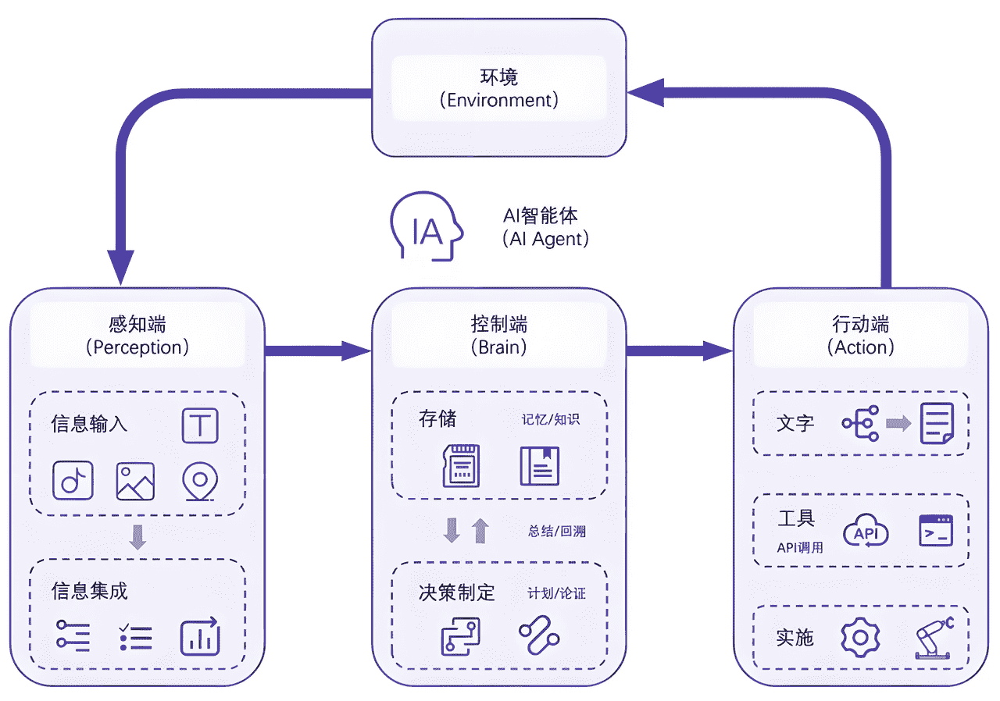
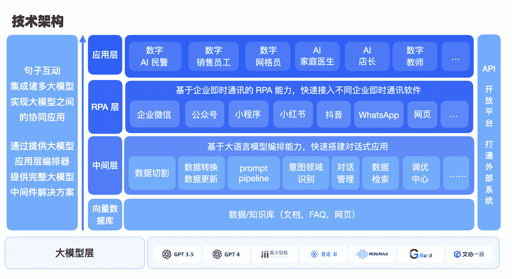

# Agent智能代理开发与部署

> 来源：[https://v11enp9ok1h.feishu.cn/docx/BzBpddSngoHltTxArOFcRQo1njh](https://v11enp9ok1h.feishu.cn/docx/BzBpddSngoHltTxArOFcRQo1njh)

## Agent智能代理基础理论

### 1.1 Agent核心概念与架构

#### 1.1.1 什么是Agent

**Agent（智能代理）** 是一个能够感知环境、制定计划并执行行动的智能实体。与传统程序不同，Agent具备以下特征：

| **特征** | **传统程序** | **Agent智能代理** |
| --- | --- | --- |
| 自主性 | 被动响应用户输入 | 主动感知环境变化，自主决策 |
| 适应性 | 固定的执行逻辑 | 根据情况调整策略和行为 |
| 目标导向 | 执行预定义任务 | 面向目标，动态规划路径 |
| 交互性 | 单向或简单交互 | 与环境、用户、其他Agent协作 |

**Agent的核心组件：**

1.  感知器(Perception): 获取环境信息和用户输入

1.  规划器(Planning): 制定达成目标的行动计划

1.  执行器(Action): 调用工具执行具体操作

1.  记忆系统(Memory): 维护上下文和历史信息

1.  学习模块(Learning): 从经验中优化决策



#### 1.1.2 基础Agent实现

```
**import**** os
im****port** json
fr**om ope****nai **import O**penAI
**f**rom **ty**ping** i**mpo****rt Lis****t, D**ict, Any
i**mport ****async**i**o
from da**teti**me **i**mport da**teti**me
**
**class Ag****entC**ore:
 **   **def __**init**__(sel**f, **model_name=&quot;ernie-4.**5-**turbo-128k-pr**evie**w&quot;):
   **     s**elf.**cli**e**nt = O****penA**I(
   **   ****    **  api_**key**=os.envi**ron.ge**t(&quot;**********************************************&quot;),**
     **   **    base**_url=&quot;**https://aistudio.baidu.com/llm/lmapi/v3&quot;
        )
        self.model_name = model_name
        self.memory = []
        self.tools = {}
        
    def perceive(self, environment_data: Dict[str, Any]) -&gt; Dict[str, Any]:
        &quot;&quot;&quot;感知环境信息&quot;&quot;&quot;
        perception = {
            &quot;timestamp&quot;: datetime.now().isoformat(),
            &quot;environment&quot;: environment_data,
            &quot;context&quot;: self.memory[-5:] if self.memory else []
        }
        return perception
    
    def reason(self, perception: Dict[str, Any], goal: str) -&gt; Dict[str, Any]:
        &quot;&quot;&quot;推理决策过程&quot;&quot;&quot;
        messages = [
            {
                &quot;role&quot;: &quot;system&quot;,
                &quot;content&quot;: f&quot;&quot;&quot;你是一个智能代理，需要根据感知信息和目标进行推理决策。
                可用工具: {list(self.tools.keys())}
                目标: {goal}&quot;&quot;&quot;
            },
            {
                &quot;role&quot;: &quot;user&quot;, 
                &quot;content&quot;: f&quot;当前感知信息: {json.dumps(perception, ensure_ascii=False)}&quot;
            }
        ]
        
        response = self.client.chat.completions.create(
            model=self.model_name,
            messages=messages,
            temperature=0.7
        )
        
        decision = {
            &quot;reasoning&quot;: response.choices[0].message.content,
            &quot;perception&quot;: perception,
            &quot;goal&quot;: goal
        }
        return decision
        
    def act(self, decision: Dict[str, Any]) -&gt; Dict[str, Any]:
        &quot;&quot;&quot;执行行动&quot;&quot;&quot;
        action_result = {
            &quot;decision&quot;: decision,
            &quot;executed&quot;: True,
            &quot;timestamp&quot;: datetime.now().isoformat(),
            &quot;result&quot;: &quot;Action completed successfully&quot;
        }
        
        self.memory.append(action_result)
        return action_result

agent = AgentCore()
print(&quot;智能代理核心组件初始化完成&quot;)
```

### 1.2 Agent与传统程序的区别

#### 1.2.1 决策机制对比

传统程序遵循固定的if-else逻辑或预定义的工作流，而Agent具备动态决策能力。这种差异体现在以下几个方面：

1.  响应模式

+   传统程序: 被动响应，等待明确指令

+   Agent: 主动感知，基于环境变化自主决策

1.  处理不确定性

+   传统程序: 需要明确的输入格式和处理逻辑

+   Agent: 能够处理模糊需求，动态调整策略

1.  学习能力

+   传统程序: 功能固定，需要手动更新

+   Agent: 从经验中学习，持续优化决策

```
**class** **HybridAgent**(AgentCore):**def** **__init__**(self, mode**l_n**a**me=&quot;ernie-4.5-t**urbo-128k-prev**iew&quot;**):super().__**init**__(mod**el_**na**me**)
        se**lf.rea**ctive_la**yer = **{}
 **   **    self.deliberative_layer = {}
        se**lf.coo**rdination_lay**er** = {}
   **   **  
    de**f **proc**ess**_request(**self**, requ**est**: str, context: Dict = None) -&gt; Dict[str, Any]:if self.**_is**_simple_requ**es**t(request):
**  **     **  ****   ret**urn self._reactive_response(request)
        **
     **   r**etu**rn self._delibe**rati**ve_response(**requ**est, c**ont**ext)
    
    def _is_simple_request(self, request: str) -**&gt; **bool:
        simple_patterns = [&quot;你好&quot;, &quot;时间&quot;, &quot;天气&quot;, &quot;计算&quot;]**
     **   return any(pattern in request for pattern in simple_patterns)
    
    def _reactive_response(self, request: str) -&gt; Dict[str, Any]:
        response_map = {
            &quot;你好&quot;: &quot;您好！我是您的智能助手，有什么可以帮助您的吗？&quot;,
            &quot;时间&quot;: f&quot;当前时间是 {datetime.now().strftime(&#x27;%Y-%m-%d %H:%M:%S&#x27;)}&quot;,
        }
        
        for key, value in response_map.items():
            if key in request:
                return {
                    &quot;type&quot;: &quot;reactive&quot;,
                    &quot;response&quot;: value,
                    &quot;processing_time&quot;: &quot;&lt; 1ms&quot;
                }
        
        return self._deliberative_response(request)
    
    def _deliberative_response(self, request: str, context: Dict = None) -&gt; Dict[str, Any]:
        messages = [
            {
                &quot;role&quot;: &quot;system&quot;,
                &quot;content&quot;: &quot;你是一个智能代理，需要仔细分析用户请求并提供详细的解决方案。&quot;
            },
            {
                &quot;role&quot;: &quot;user&quot;,
                &quot;content&quot;: request
            }
        ]
        
        if context:
            messages.insert(1, {
                &quot;role&quot;: &quot;system&quot;, 
                &quot;content&quot;: f&quot;上下文信息: {json.dumps(context, ensure_ascii=False)}&quot;
            })
        
        response = self.client.chat.completions.create(
            model=self.model_name,
            messages=messages,
            temperature=0.3
        )
        
        return {
            &quot;type&quot;: &quot;deliberative&quot;,
            &quot;response&quot;: response.choices[0].message.content,
            &quot;processing_time&quot;: &quot;&gt; 100ms&quot;
        }

hybrid_agent = HybridAgent()

reactive_result = hybrid_agent.process_request(&quot;你好&quot;)
print(&quot;反应式响应:&quot;, reactive_result)

deliberative_result = hybrid_agent.process_request(&quot;如何优化深度学习模型的训练效率？&quot;)
print(&quot;深思式响应:&quot;, deliberative_result)
反应式响应: {&#x27;type&#x27;: &#x27;reactive&#x27;, &#x27;response&#x27;: &#x27;您好！我是您的智能助手，有什么可以帮助您的吗？&#x27;, &#x27;processing_time&#x27;: &#x27;&lt; 1ms&#x27;}
深思式响应: {&#x27;type&#x27;: &#x27;deliberative&#x27;, &#x27;response&#x27;: &#x27;优化深度学习模型的训练效率是一个多方面的任务，涉及数据处理、模型架构、超参数调整和硬件利用等多个方面。以下是一些关键策略和方法：\n\n1. **数据预处理和增强**：\n   - **数据标准化/归一化**：对输入数据进行标准化或归一化处理，使不同特征具有相似的尺度，有助于模型更快收敛。\n   - **数据增强**：通过对训练数据进行旋转、平移、缩放等变换，增加数据的多样性，提高模型的泛化能力。\n   - **高效数据加载**：使用数据加载器（如PyTorch的`DataLoader`）进行多线程/多进程数据加载，减少I/O瓶颈。\n\n2. **模型架构优化**：\n   - **选择合适的模型**：根据任务需求选择合适的模型架构，避免过于复杂的模型。\n   - **模型剪枝**：移除模型中不重要的权重或神经元，减少计算量和参数量。\n   - **知识蒸馏**：使用一个较大的“教师”模型来指导一个较小的“学生”模型的训练，提高小模型的性能。\n   - **量化**：将模型中的浮点数参数转换为低精度的整数，减少内存占用和计算量。\n\n3. **超参数优化**：\n   - **学习率调整**：使用学习率调度器（如`ReduceLROnPlateau`、`CosineAnnealingLR`）动态调整学习率。\n   - **批量大小（Batch Size）**：适当调整批量大小，较大的批量可以加速训练，但可能影响模型泛化能力。\n   - **优化器选择**：选择合适的优化器（如Adam、SGD、RMSprop），并根据任务调整其参数。\n\n4. **正则化和防止过拟合**：\n   - **Dropout**：在训练过程中随机丢弃一部分神经元，防止过拟合。\n   - **L1/L2正则化**：在损失函数中添加权重的L1或L2正则化项，防止模型过拟合。\n   - **早停（Early Stopping）**：在验证集性能不再提升时停止训练，防止过拟合。\n\n5. **分布式训练**：\n   - **数据并行**：将数据分成多个批次，同时在多个设备上训练同一个模型。\n   - **模型并行**：将模型的不同部分分配到不同的设备上，适用于非常大的模型。\n
```

### 1.3 Agent在行业应用中的作用

#### 1.3.1 行业应用场景分析

Agent智能代理在不同行业中发挥着重要作用，能够显著提升工作效率和决策质量：

| **行业** | **应用场景** | **Agent角色** | **价值体现** |
| --- | --- | --- | --- |
| 金融 | 风险评估、投资建议 | 智能投顾Agent | 7×24小时监控，实时风险预警 |
| 医疗 | 诊断辅助、药物研发 | 医疗助手Agent | 大数据分析，精准诊断建议 |
| 制造 | 生产优化、质量控制 | 工业Agent | 预测性维护，智能调度 |
| 教育 | 个性化学习、作业批改 | 教学Agent | 因材施教，学习效果跟踪 |
| 客服 | 智能回答、问题解决 | 客服Agent | 多轮对话，情感理解 |

#### 1.3.2 行业Agent系统实现

```
**class** **TaskAgent**:   ** 
 ** **  def __**init__(self):
        sel**f.c**l**ient = Open**AI(
        **    **api_key=os.env**iron**.get(&quot;********************************&quot;),
            base_url=&quot;https://aistudi**o.b**a**idu.com/llm/**lmapi/v3&quot;
       ** )
 **      ** se**lf.tas**k_pi**peline** = **[]**
 **       self**.bu**s**in**ess_rules = **{}
   **     
    def define_task(self, task_nam**e: **str, s**te**ps: List[str], rules: Dict[str, Any]):
        self.business_rules[task_na**me**]** = **{
            &quot;s**teps&quot;:** steps,
            &quot;rules&quot;: rules,
            &quot;creat**ed_at&quot;**: datetime.now().isoformat()
        }
        
    def execute_task(self, task_name: st**r, **p**arameters: Di**ct[str, Any]) -&gt; Dict[str, Any**]:if** task_**nam**e not in s**elf.**busine**ss_**rules:**
   **      **   **return {&quot;error&quot;: f&quot;未找到任务: {task_name}&quot;}
        
        task_config = self.business_rules[task_name]
        results = []
        
      **  for **step in task_config[&quot;steps&quot;]:
            step_result = self._execute_step(step, paramete**rs, t**as**k_c**o**nfig[&quot;ru**les&quot;])
            resu**lts**.**appe**nd(step_result)
            
     **    **   if **not** step_result.get(&quot;success&quot;, False):
       **      **   return {
                    &quot;task&quot;: task_name,
                    &quot;status&quot;: &quot;faile**d&quot;,**
                   ** &quot;**failed_st**ep&quot;**:** s**tep,
                    &quot;results&quot;**: r**esults
                **}
  ** **    ** 
        return {
            &quot;task&quot;: task_name,
            &quot;status&quot;: &quot;completed&quot;,
  **   **      ** &quot;**results&quot;: re**su**lts,
            &quot;execution_time&quot;: datetime.now().isoformat()
        }
    
    def _execute_step(self, step: str, parameters: D**ict[st**r, A**ny]**, rules: Dict[str, Any]) -&gt; Dict[str, Any]:
        messages = [
            {
                &quot;role&quot;: &quot;system&quot;,
                &quot;content&quot;: f&quot;&quot;&quot;执行任务步骤: {step}
                业务规则: {json.dumps(rules, ensure_ascii=False)}
                请按照规则严格执行，返回结构化结果。&quot;&quot;&quot;
            },
            {
                &quot;role&quot;: &quot;user&quot;,
                &quot;content&quot;: f&quot;执行参数: {json.dumps(parameters, ensure_ascii=False)}&quot;
            }
        ]
        
        response = self.client.chat.completions.create(
            model=&quot;ernie-4.5-turbo-128k-preview&quot;,
            messages=messages,
            temperature=0.1  
        )
        
        return {
            &quot;step&quot;: step,
            &quot;success&quot;: True,
            &quot;result&quot;: response.choices[0].message.content,
            &quot;timestamp&quot;: datetime.now().isoformat()
        }

class ConversationalAgent:def __init__(self):
        self.client = OpenAI(
            api_key=os.environ.get(&quot;AI_STUDIO_API_KEY&quot;),
            base_url=&quot;https://aistudio.baidu.com/llm/lmapi/v3&quot;
        )
        self.conversation_history = []
        self.user_profile = {}
        self.context_window = 10def chat(self, user_input: str, user_id: str = &quot;default&quot;) -&gt; Dict[str, Any]:
        self._update_user_profile(user_input, user_id)
        
        messages = self._build_conversation_context(user_input, user_id)
        
        response = self.client.chat.completions.create(
            model=&quot;ernie-4.5-turbo-128k&quot;,
            messages=messages,
            temperature=0.8,  
            stream=False
        )
        
        assistant_response = response.choices[0].message.content
        
        self._record_conversation(user_input, assistant_response, user_id)
        
        return {
            &quot;response&quot;: assistant_response,
            &quot;user_id&quot;: user_id,
            &quot;conversation_turn&quot;: len(self.conversation_history),
            &quot;timestamp&quot;: datetime.now().isoformat()
        }
    
    def _update_user_profile(self, user_input: str, user_id: str):if user_id not in self.user_profile:
            self.user_profile[user_id] = {
                &quot;conversation_count&quot;: 0,
                &quot;topics&quot;: [],
                &quot;preferences&quot;: {},
                &quot;first_interaction&quot;: datetime.now().isoformat()
            }
        
        self.user_profile[user_id][&quot;conversation_count&quot;] += 1
        self.user_profile[user_id][&quot;last_interaction&quot;] = datetime.now().isoformat()
    
    def _build_conversation_context(self, user_input: str, user_id: str) -&gt; List[Dict[str, str]]:
        messages = [
            {
                &quot;role&quot;: &quot;system&quot;,
                &quot;content&quot;: f&quot;&quot;&quot;你是一个友好、专业的AI助手。
                用户画像: {json.dumps(self.user_profile.get(user_id, {}), ensure_ascii=False)}
                请保持自然、有温度的对话风格。&quot;&quot;&quot;
            }
        ]
        
        # 添加近期对话历史
        recent_history = self.conversation_history[-self.context_window:]
        for turn in recent_history:
            if turn[&quot;user_id&quot;] == user_id:
                messages.append({&quot;role&quot;: &quot;user&quot;, &quot;content&quot;: turn[&quot;user_input&quot;]})
                messages.append({&quot;role&quot;: &quot;assistant&quot;, &quot;content&quot;: turn[&quot;assistant_response&quot;]})
        
        messages.append({&quot;role&quot;: &quot;user&quot;, &quot;content&quot;: user_input})
        
        return messages
    
    def _record_conversation(self, user_input: str, assistant_response: str, user_id: str):
        self.conversation_history.append({
            &quot;user_id&quot;: user_id,
            &quot;user_input&quot;: user_input,
            &quot;assistant_response&quot;: assistant_response,
            &quot;timestamp&quot;: datetime.now().isoformat()
        })

# 实例化两种Agent
task_agent = TaskAgent()
conversational_agent = ConversationalAgent()

# 定义一个业务任务
task_agent.define_task(
    &quot;订单处理&quot;,
    [&quot;验证订单信息&quot;, &quot;检查库存&quot;, &quot;计算价格&quot;, &quot;生成订单号&quot;],
    {&quot;min_amount&quot;: 100, &quot;max_items&quot;: 50, &quot;discount_rate&quot;: 0.1}
)

# 执行任务
task_result = task_agent.execute_task(&quot;订单处理&quot;, {
    &quot;items&quot;: [&quot;商品A&quot;, &quot;商品B&quot;], 
    &quot;quantity&quot;: [2, 1],
    &quot;customer_level&quot;: &quot;VIP&quot;
})
print(&quot;任务执行结果:&quot;, task_result)

# 进行对话
chat_result = conversational_agent.chat(&quot;你好，我想了解一下你们的产品&quot;, &quot;user_001&quot;)
print(&quot;对话结果:&quot;, chat_result)
任务执行结果: {&#x27;task&#x27;: &#x27;订单处理&#x27;, &#x27;status&#x27;: &#x27;completed&#x27;, &#x27;results&#x27;: [{&#x27;step&#x27;: &#x27;验证订单信息&#x27;, &#x27;success&#x27;: True, &#x27;result&#x27;: &#x27;根据提供的业务规则和执行参数，我将验证订单信息并返回结构化结果。\n\n### 业务规则\n- `min_amount`: 100（最小订单金额）\n- `max_items`: 50（最大商品数量）\n- `discount_rate`: 0.1（折扣率）\n\n### 执行参数\n- `items`: [&quot;商品A&quot;, &quot;商品B&quot;]\n- `quantity`: [2, 1]\n- `customer_level`: &quot;VIP&quot;\n\n### 验证步骤\n1. **商品数量验证**：\n   - 商品A数量：2\n   - 商品B数量：1\n   - 总商品数量：2 + 1 = 3\n   - 验证：3 ≤ 50（符合规则）\n\n2. **订单金额验证**：\n   - 假设商品A和商品B的价格未知，无法直接计算订单金额。\n   - 由于缺少价格信息，无法验证是否满足最小订单金额（100）的要求。\n\n3. **客户等级验证**：\n   - 客户等级为&quot;VIP&quot;，但业务规则中未提及与客户等级相关的限制或优惠。\n   - 因此，客户等级不影响当前订单验证。\n\n### 结构化结果\n```json\n{\n  &quot;validation_result&quot;: {\n    &quot;is_valid&quot;: false,\n    &quot;message&quot;: &quot;无法验证订单金额，因为缺少商品价格信息。&quot;,\n    &quot;details&quot;: {\n      &quot;total_items&quot;: 3,\n      &quot;max_items_rule&quot;: 50,\n      &quot;items_validation&quot;: &quot;通过&quot;,\n      &quot;amount_validation&quot;: &quot;无法验证（缺少价格信息）&quot;,\n      &quot;customer_level&quot;: &quot;VIP&quot;,\n      &quot;discount_rate&quot;: 0.1\n    }\n  }\n}\n```\n\n### 说明\n- 由于缺少商品价格信息，无法计算订单总金额，因此无法验证是否满足最小订单金额（100）的要求
对话结果: {&#x27;response&#x27;: &#x27;您好呀！很高兴您对我们的产品感兴趣～😊 您想了解的是哪类方向呢？比如是日常实用工具、学习办公类，还是生活娱乐相关的？或者您更关心功能亮点、使用场景，还是价格区间呢？我可以根据您的需求详细介绍哦！&#x27;, &#x27;user_id&#x27;: &#x27;user_001&#x27;, &#x27;conversation_turn&#x27;: 1, &#x27;timestamp&#x27;: &#x27;2025-06-30T16:17:27.898283&#x27;}
```

#### 1.3.3 单Agent vs 多Agent协作模式

在复杂的企业环境中，往往需要多个Agent协同工作来完成复杂任务。这种协作模式可以有效提升系统的处理能力和专业性。

```
**class** Agen**tCo**o**rdinator**:
  **  &quot;**&quot;**&quot;Agent协调器 - 管理**多Agent协作&quot;&quot;&quot;
    
 **   ****def **__in**it_**_**(sel**f**):
 **      ** se**lf.agents = **{}
****  **      se**lf.**task_queue =** []
  **      se**lf.col**laboration_h**istory** = [**]
 ** **    **  
   ** de**f register_agent(self, agent_id: str, agen**t_i**nstance: An**y,** capabilitie**s:** List[str]**):**
        &quot;&quot;&quot;注册Agent及其能力&quot;&quot;&quot;
        s**elf.ag**ents**[ag**e**nt_i**d**] = **{
    **   **     &quot;i**nsta**n**ce&quot;:** agent**_in**stance,
            &quot;capabilities&quot;: capabilit**ies,
 **        **   &quot;st**atus**&quot;: **&quot;**read**y&quot;,
  **   **      ** &quot;wo**rkload**&quot;: **0
        }
        
    def deco**mpose_**comp**lex**_**task**(**self**, comp**lex****_tas**k: str**) -**&gt; List[D**ict[st**r**, A**ny]**]:**
        &quot;&quot;&quot;**分解复杂任**务为子任务**&quot;&quot;&quot;**
**        ****clien**t = O**pen**A**I(
     ****     ** ** api_key=os.e**nvir**on.**g**et(&quot;AI_S**TUDIO_API_KEY&quot;),
            base_url=&quot;https://aistudio.baidu.com/llm/lmapi/v3&quot;
        )
        
        agent_capabilities = {
            agent_id: info[&quot;capabilities&quot;] 
            for agent_id, info in self.agents.items()
        }
        
        messages = [
            {
                &quot;role&quot;: &quot;system&quot;,
                &quot;content&quot;: f&quot;&quot;&quot;你是任务分解专家，需要将复杂任务分解为可以分配给不同Agent的子任务。
                可用Agent能力: {json.dumps(agent_capabilities, ensure_ascii=False)}
                
                请按照以下格式返回分解结果:
                {{
                    &quot;subtasks&quot;: [
                        {{
                            &quot;task_id&quot;: &quot;子任务ID&quot;,
                            &quot;description&quot;: &quot;任务描述&quot;, 
                            &quot;required_capability&quot;: &quot;所需能力&quot;,
                            &quot;assigned_agent&quot;: &quot;推荐的Agent ID&quot;,
                            &quot;dependencies&quot;: [&quot;依赖的其他子任务ID&quot;],
                            &quot;priority&quot;: 1-5
                        }}
                    ]
                }}&quot;&quot;&quot;
            },
            {
                &quot;role&quot;: &quot;user&quot;,
                &quot;content&quot;: f&quot;需要分解的复杂任务: {complex_task}&quot;
            }
        ]
        
        response = client.chat.completions.create(
            model=&quot;ernie-4.5-turbo-128k-preview&quot;,
            messages=messages,
            temperature=0.2
        )
        
        try:
            result = json.loads(response.choices[0].message.content)
            return result.get(&quot;subtasks&quot;, [])
        except:
            return []
    
    def execute_collaborative_task(self, complex_task: str) -&gt; Dict[str, Any]:
        &quot;&quot;&quot;执行协作任务&quot;&quot;&quot;
        # 分解任务
        subtasks = self.decompose_complex_task(complex_task)
        
        execution_plan = {
            &quot;complex_task&quot;: complex_task,
            &quot;subtasks&quot;: subtasks,
            &quot;execution_order&quot;: self._determine_execution_order(subtasks),
            &quot;start_time&quot;: datetime.now().isoformat()
        }
        
        results = []
        
        # 按执行顺序处理子任务
        for task_info in execution_plan[&quot;execution_order&quot;]:
            agent_id = task_info[&quot;assigned_agent&quot;]
            
            if agent_id in self.agents:
                # 模拟Agent执行子任务
                subtask_result = self._execute_subtask(agent_id, task_info)
                results.append(subtask_result)
        
        # 整合结果
        final_result = self._integrate_results(results, complex_task)
        
        self.collaboration_history.append({
            &quot;task&quot;: complex_task,
            &quot;execution_plan&quot;: execution_plan,
            &quot;results&quot;: results,
            &quot;final_result&quot;: final_result,
            &quot;timestamp&quot;: datetime.now().isoformat()
        })
        
        return final_result
    
    def _determine_execution_order(self, subtasks: List[Dict[str, Any]]) -&gt; List[Dict[str, Any]]:
        &quot;&quot;&quot;确定执行顺序（简化版拓扑排序）&quot;&quot;&quot;
        # 按优先级和依赖关系排序
        sorted_tasks = sorted(subtasks, key=lambda x: (len(x.get(&quot;dependencies&quot;, [])), -x.get(&quot;priority&quot;, 1)))
        return sorted_tasks
    
    def _execute_subtask(self, agent_id: str, task_info: Dict[str, Any]) -&gt; Dict[str, Any]:
        &quot;&quot;&quot;执行子任务&quot;&quot;&quot;
        agent_info = self.agents[agent_id]
        agent_info[&quot;workload&quot;] += 1
        
        # 模拟任务执行
        result = {
            &quot;task_id&quot;: task_info[&quot;task_id&quot;],
            &quot;agent_id&quot;: agent_id,
            &quot;status&quot;: &quot;completed&quot;,
            &quot;result&quot;: f&quot;Agent {agent_id} 成功完成子任务: {task_info[&#x27;description&#x27;]}&quot;,
            &quot;execution_time&quot;: 100 + (agent_info[&quot;workload&quot;] * 10),  # 模拟执行时间
            &quot;timestamp&quot;: datetime.now().isoformat()
        }
        
        agent_info[&quot;workload&quot;] -= 1
        return result
    
    def _integrate_results(self, results: List[Dict[str, Any]], original_task: str) -&gt; Dict[str, Any]:
        &quot;&quot;&quot;整合子任务结果&quot;&quot;&quot;
        client = OpenAI(
            api_key=os.environ.get(&quot;AI_STUDIO_API_KEY&quot;),
            base_url=&quot;https://aistudio.baidu.com/llm/lmapi/v3&quot;
        )
        
        messages = [
            {
                &quot;role&quot;: &quot;system&quot;,
                &quot;content&quot;: &quot;你是结果整合专家，需要将多个子任务的执行结果整合为最终的完整结果。&quot;
            },
            {
                &quot;role&quot;: &quot;user&quot;,
                &quot;content&quot;: f&quot;&quot;&quot;原始任务: {original_task}
                子任务执行结果: {json.dumps(results, ensure_ascii=False)}
                
                请整合这些结果，提供完整的任务完成报告。&quot;&quot;&quot;
            }
        ]
        
        response = client.chat.completions.create(
            model=&quot;ernie-4.5-turbo-128k-preview&quot;,
            messages=messages,
            temperature=0.3
        )
        
        return {
            &quot;original_task&quot;: original_task,
            &quot;status&quot;: &quot;completed&quot;,
            &quot;integrated_result&quot;: response.choices[0].message.content,
            &quot;subtask_count&quot;: len(results),
            &quot;total_execution_time&quot;: sum(r.get(&quot;execution_time&quot;, 0) for r in results),
            &quot;completion_time&quot;: datetime.now().isoformat()
        }

# 创建专业化Agent
class DataAnalysisAgent:
    def __init__(self):
        self.capabilities = [&quot;数据分析&quot;, &quot;统计计算&quot;, &quot;图表生成&quot;]
        
class ReportGenerationAgent:
    def __init__(self):
        self.capabilities = [&quot;报告撰写&quot;, &quot;内容整理&quot;, &quot;格式美化&quot;]
        
class ResearchAgent:
    def __init__(self):
        self.capabilities = [&quot;信息搜索&quot;, &quot;资料整理&quot;, &quot;趋势分析&quot;]

# 实例化协调器和专业Agent
coordinator = AgentCoordinator()
data_agent = DataAnalysisAgent()
report_agent = ReportGenerationAgent()
research_agent = ResearchAgent()

# 注册Agent
coordinator.register_agent(&quot;data_analyst&quot;, data_agent, data_agent.capabilities)
coordinator.register_agent(&quot;report_writer&quot;, report_agent, report_agent.capabilities)
coordinator.register_agent(&quot;researcher&quot;, research_agent, research_agent.capabilities)

# 执行复杂协作任务
complex_task = &quot;生成一份关于2024年AI行业发展趋势的综合分析报告，包含市场数据分析和未来预测&quot;
collaboration_result = coordinator.execute_collaborative_task(complex_task)

print(&quot;多Agent协作结果:&quot;)
print(json.dumps(collaboration_result, ensure_ascii=False, indent=2))
多Agent协作结果:
{
  &quot;original_task&quot;: &quot;生成一份关于2024年AI行业发展趋势的综合分析报告，包含市场数据分析和未来预测&quot;,
  &quot;status&quot;: &quot;completed&quot;,
  &quot;integrated_result&quot;: &quot;### 2024年AI行业发展趋势综合分析报告\n\n#### 一、市场数据分析\n\n1. **市场规模与增长**  \n   - **全球市场**：根据IDC预测，2024年全球AI市场规模预计达到**5000亿美元**，同比增长25%。其中，生成式AI（GenAI）占比将超过30%，成为核心增长引擎。  \n   - **区域分布**：北美（45%）、亚太（30%）和欧洲（20%）主导市场，中国、美国、印度为增速最快的前三大国家。  \n   - **行业应用**：医疗（20%）、金融（18%）、制造（15%）和零售（12%）是AI投入最高的领域，自动驾驶、智能客服、供应链优化为关键场景。\n\n2. **技术投资热点**  \n   - **生成式AI**：大模型训练与推理成本下降50%，推动企业级应用落地，预计2024年生成式AI软件市场规模突破**150亿美元**。  \n   - **边缘AI**：物联网设备与AI芯片结合，推动实时决策需求，边缘计算市场年复合增长率达35%。  \n   - **AI伦理与安全**：全球AI监管政策趋严，企业合规支出占比提升至10%，催生第三方审计与模型解释工具市场。\n\n3. **竞争格局**  \n   - **头部企业**：谷歌、微软、OpenAI占据生成式AI市场70%份额，亚马逊、英伟达在基础设施层（云计算、芯片）保持领先。  \n   - **初创生态**：2024年全球AI初创企业融资额预计达**800亿美元**，医疗AI、机器人流程自动化（RPA）为融资热点。  \n   - **开源生态**：Llama 3、Mistral等开源模型下载量激增，降低中小企业技术门槛，推动行业碎片化竞争。\n\n#### 二、未来趋势预测\n\n1. **技术突破方向**  \n   - **多模态大模型**：文本、图像、视频、3D模型融合处理成为标配，支持跨模态生成与推理（如GPT-5、Gemini Ultra）。  \n   - **自主AI代理**：AI Agent（如AutoGPT、Devin）实现任务自动规划与执行，颠覆传统SaaS软件交互模式。  \n   - **量子AI融合**：量子计算与机器学习结合，解决优化问题（如物流路径、药物分子设计），2024年进
  &quot;subtask_count&quot;: 0,
  &quot;total_execution_time&quot;: 0,
  &quot;completion_time&quot;: &quot;2025-06-30T16:18:30.378429&quot;
```

### 1.4 MCP协议在Agent中的关键作用

#### 1.4.1 MCP协议核心概念

Model Context Protocol（MCP）是Anthropic推出的用于LLM应用和外部数据源（Resources）、工具（Tools）通信的标准协议。在Agent系统中，MCP协议解决了模型与外部工具集成的标准化问题。 MCP协议的核心优势体现在以下几个方面：

| **MCP组件** | **传统方式** | **MCP方式** | **优势** |
| --- | --- | --- | --- |
| 工具集成 | 硬编码调用 | 标准化接口 | 可插拔、可扩展 |
| 数据源访问 | 直接API调用 | 统一资源管理 | 安全、可控 |
| 上下文管理 | 手动维护 | 协议层处理 | 自动、高效 |

```
**import**** json
****impo**rt async**io
fro**m** typ**in**g im**po**rt **Di**ct, List****, An**y, Op**tional****
from** **abc import **ABC,** ab**s**tractmetho**d

class M**CPRe**source**(AB**C):
    **&quot;&quot;&quot;M**CP资源**抽象基类&quot;**&quot;**&quot;
 ** **  
 ****   **@abstrac**tmet****hod
 ** **  def g**et_s**che**m**a(self) -&gt; Dic**t[str, Any**]:
 **      ** &quot;&quot;**&quot;获取资源模式定**义&quot;&quot;&quot;**
   **     **p**ass**
**    
  ****  @a**bstrac**tme**thod
 **   **async de**f re****ad(se**lf, u**ri:** **str) -&gt; **Any:**
  ** **     &quot;&quot;&quot;读取**资源内容&quot;&quot;&quot;
  **    **  pass**

c**lass MCP**Tool(A**BC):**
    **&quot;**&quot;&quot;M**C**P工具抽****象基类**&quot;&quot;&quot;
    **
  **  @abstractm**etho**d**
 ****   def** get_def**initio**n(self) -&gt; **Di**ct[str, Any]**:
    ****    &quot;**&quot;**&quot;获取工具定义&quot;&quot;&quot;
   **    ** pa**s**s
    
    @ab**stractmeth**od
 **   asy**nc **def exec**ute(se**lf, **param**e**ter**s**: Dict[****str,** Any])** -&gt;** Any:
**   **     &quot;&quot;&quot;**执行工**具操作&quot;&quot;&quot;
        pass

cla**ss** FileSy**st**emResource(MCPR**eso**urc**e)****:
    **&quot;&quot;&quot;文件系统资源实现&quot;**&quot;&quot;
 ****   
  **  def __**init__**(self, base**_p**ath: str = &quot;**./&quot;):
****     ** **  self.base_p**ath **= b**a**se_path
      **  
    def** get**_schem**a(s**elf) -&gt; **Dict[s**tr, **Any]:**
**   ** **    ret****urn **{
    **   **     &quot;**typ**e&quot;: &quot;resource&quot;,
            **&quot;na**me&quot;**: **&quot;filesys**tem&quot;,
****     ** **      &quot;de**scri**pti**o**n&quot;: &quot;本地文****件系统访****问&quot;,
**    **   **     **&quot;pr**o**perties&quot;: {
 **    **   ** **       &quot;path&quot;:** {
       **    ** **    **    &quot;t**ype**&quot;: &quot;stri**ng&quot;,
 **            **   ****  **  &quot;d**esc**r**iption&quot;: &quot;**文件路径&quot;
    **    ** **    **   }
 **   **        **}
    **    }
    
 **   **async def re**ad**(sel**f, ur**i**: s**t**r) -&gt; Any:
  **      &quot;&quot;&quot;读取文件内容&quot;&quot;&quot;
 **   **    try:**
 **           file**_pa**t**h **= uri.replac**e(&quot;fil**e://&quot;, &quot;**&quot;)
   ** **     **   w**ith o**p**en(**f**&quot;{self.ba****se_p**ath}/{**fil**e_path**}&quot;,** &#x27;r&#x27;, en**co**ding=&#x27;utf-8**&#x27;) **a**s **f:
         **      ** return **{
    ** **     ****     ** **    &quot;cont**ent&quot;**: f**.**read(),
**    **     ** **   **       &quot;uri**&quot;: u**r**i,
 **      **   **        **  &quot;typ**e&quot;: **&quot;text**&quot;**,
 **           **    ** **   &quot;**size&quot;:** le**n(f.read**())
  **    **     ** **   ** **}
        exc**ept Exception as e:
**   **        ** retur**n** {&quot;er**ror&quot;**: str**(**e),** **&quot;uri&quot;: ur****i}

**class **Cal**culato**rTo**ol(MCPTo**ol):
 ** **  &quot;&quot;&quot;**计算器工具实现&quot;&quot;&quot;
    
    def get_defi**nitio**n**(se**lf) -&gt; Dict[str,** Any]**:
        re**turn **{
  **   **       &quot;ty**pe**&quot;: &quot;**fun**ction&quot;**,
**            **&quot;func****tion&quot;****: {
  ****     **         &quot;name&quot;: &quot;calculator&quot;,
                &quot;description&quot;: &quot;执行数学计算&quot;,
                &quot;parameters&quot;: {
                    &quot;type&quot;: &quot;object&quot;,
                    &quot;properties&quot;: {
                        &quot;expression&quot;: {
                            &quot;type&quot;: &quot;string&quot;,
                            &quot;description&quot;: &quot;数学表达式，如 &#x27;2 + 3 * 4&#x27;&quot;
                        }
                    },
                    &quot;required&quot;: [&quot;expression&quot;]
                }
            }
        }
    
    async def execute(self, parameters: Dict[str, Any]) -&gt; Any:
        &quot;&quot;&quot;执行计算&quot;&quot;&quot;
        try:
            expression = parameters.get(&quot;expression&quot;, &quot;&quot;)
            # 安全的表达式计算（仅支持基本运算）
            allowed_chars = &quot;0123456789+-*/.() &quot;
            if all(c in allowed_chars for c in expression):
                result = eval(expression)
                return {
                    &quot;expression&quot;: expression,
                    &quot;result&quot;: result,
                    &quot;type&quot;: &quot;calculation&quot;
                }
            else:
                return {&quot;error&quot;: &quot;不支持的计算表达式&quot;, &quot;expression&quot;: expression}
        except Exception as e:
            return {&quot;error&quot;: str(e), &quot;expression&quot;: parameters.get(&quot;expression&quot;, &quot;&quot;)}

class WebSearchTool(MCPTool):
    &quot;&quot;&quot;网络搜索工具实现&quot;&quot;&quot;
    
    def get_definition(self) -&gt; Dict[str, Any]:
        return {
            &quot;type&quot;: &quot;function&quot;, 
            &quot;function&quot;: {
                &quot;name&quot;: &quot;web_search&quot;,
                &quot;description&quot;: &quot;搜索网络信息&quot;,
                &quot;parameters&quot;: {
                    &quot;type&quot;: &quot;object&quot;,
                    &quot;properties&quot;: {
                        &quot;query&quot;: {
                            &quot;type&quot;: &quot;string&quot;,
                            &quot;description&quot;: &quot;搜索关键词&quot;
                        },
                        &quot;max_results&quot;: {
                            &quot;type&quot;: &quot;integer&quot;,
                            &quot;description&quot;: &quot;最大结果数量&quot;,
                            &quot;default&quot;: 5
                        }
                    },
                    &quot;required&quot;: [&quot;query&quot;]
                }
            }
        }
    
    async def execute(self, parameters: Dict[str, Any]) -&gt; Any:
        &quot;&quot;&quot;执行网络搜索（模拟实现）&quot;&quot;&quot;
        query = parameters.get(&quot;query&quot;, &quot;&quot;)
        max_results = parameters.get(&quot;max_results&quot;, 5)
        
        # 模拟搜索结果
        mock_results = [
            {
                &quot;title&quot;: f&quot;关于&#x27;{query}&#x27;的搜索结果 {i+1}&quot;,
                &quot;url&quot;: f&quot;https://example.com/result_{i+1}&quot;,
                &quot;snippet&quot;: f&quot;这是关于{query}的详细信息描述...&quot;,
                &quot;relevance_score&quot;: 0.9 - (i * 0.1)
            }
            for i in range(min(max_results, 5))
        ]
        
        return {
            &quot;query&quot;: query,
            &quot;results&quot;: mock_results,
            &quot;total_count&quot;: len(mock_results),
            &quot;search_time&quot;: &quot;0.23s&quot;
        }

class MCPServer:
    &quot;&quot;&quot;MCP服务器实现&quot;&quot;&quot;
    
    def __init__(self):
        self.resources: Dict[str, MCPResource] = {}
        self.tools: Dict[str, MCPTool] = {}
        self.clients = set()
        
    def register_resource(self, name: str, resource: MCPResource):
        &quot;&quot;&quot;注册资源&quot;&quot;&quot;
        self.resources[name] = resource
        
    def register_tool(self, name: str, tool: MCPTool):
        &quot;&quot;&quot;注册工具&quot;&quot;&quot;
        self.tools[name] = tool
        
    def list_resources(self) -&gt; List[Dict[str, Any]]:
        &quot;&quot;&quot;列出所有可用资源&quot;&quot;&quot;
        return [
            {
                &quot;name&quot;: name,
                &quot;schema&quot;: resource.get_schema()
            }
            for name, resource in self.resources.items()
        ]
    
    def list_tools(self) -&gt; List[Dict[str, Any]]:
        &quot;&quot;&quot;列出所有可用工具&quot;&quot;&quot;
        return [
            {
                &quot;name&quot;: name,
                &quot;definition&quot;: tool.get_definition()
            }
            for name, tool in self.tools.items()
        ]
    
    async def read_resource(self, resource_name: str, uri: str) -&gt; Any:
        &quot;&quot;&quot;读取资源&quot;&quot;&quot;
        if resource_name not in self.resources:
            return {&quot;error&quot;: f&quot;资源 {resource_name} 不存在&quot;}
        
        return await self.resources[resource_name].read(uri)
    
    async def call_tool(self, tool_name: str, parameters: Dict[str, Any]) -&gt; Any:
        &quot;&quot;&quot;调用工具&quot;&quot;&quot;
        if tool_name not in self.tools:
            return {&quot;error&quot;: f&quot;工具 {tool_name} 不存在&quot;}
        
        return await self.tools[tool_name].execute(parameters)

class MCPClient:
    &quot;&quot;&quot;MCP客户端实现&quot;&quot;&quot;
    
    def __init__(self, server: MCPServer):
        self.server = server
        self.session_id = f&quot;session_{datetime.now().timestamp()}&quot;
        
    async def get_available_resources(self) -&gt; List[Dict[str, Any]]:
        &quot;&quot;&quot;获取可用资源列表&quot;&quot;&quot;
        return self.server.list_resources()
    
    async def get_available_tools(self) -&gt; List[Dict[str, Any]]:
        &quot;&quot;&quot;获取可用工具列表&quot;&quot;&quot;
        return self.server.list_tools()
    
    async def read_resource(self, resource_name: str, uri: str) -&gt; Any:
        &quot;&quot;&quot;读取资源&quot;&quot;&quot;
        return await self.server.read_resource(resource_name, uri)
    
    async def call_tool(self, tool_name: str, parameters: Dict[str, Any]) -&gt; Any:
        &quot;&quot;&quot;调用工具&quot;&quot;&quot;
        return await self.server.call_tool(tool_name, parameters)

# 创建MCP服务器和客户端
mcp_server = MCPServer()

# 注册资源和工具
mcp_server.register_resource(&quot;filesystem&quot;, FileSystemResource())
mcp_server.register_tool(&quot;calculator&quot;, CalculatorTool())
mcp_server.register_tool(&quot;web_search&quot;, WebSearchTool())

mcp_client = MCPClient(mcp_server)

# 测试MCP功能
async def test_mcp_functionality():
    # 获取可用资源和工具
    resources = await mcp_client.get_available_resources()
    tools = await mcp_client.get_available_tools()
    
    print(&quot;可用资源:&quot;)
    for resource in resources:
        print(f&quot;- {resource[&#x27;name&#x27;]}: {resource[&#x27;schema&#x27;][&#x27;description&#x27;]}&quot;)
    
    print(&quot;\n可用工具:&quot;)
    for tool in tools:
        print(f&quot;- {tool[&#x27;name&#x27;]}: {tool[&#x27;definition&#x27;][&#x27;function&#x27;][&#x27;description&#x27;]}&quot;)
    
    # 测试工具调用
    calc_result = await mcp_client.call_tool(&quot;calculator&quot;, {&quot;expression&quot;: &quot;15 * 3 + 7&quot;})
    print(f&quot;\n计算结果: {calc_result}&quot;)
    
    search_result = await mcp_client.call_tool(&quot;web_search&quot;, {&quot;query&quot;: &quot;人工智能发展趋势&quot;, &quot;max_results&quot;: 3})
    print(f&quot;\n搜索结果: {json.dumps(search_result, ensure_ascii=False, indent=2)}&quot;)

# 在notebook中运行异步函数
import nest_asyncio
nest_asyncio.apply()

await test_mcp_functionality()
```

#### 1.4.2 Agent与MCP的集成模式

在实际应用中，Agent需要与MCP服务器进行深度集成，实现动态的工具发现和调用。这种集成模式使得Agent具备了强大的扩展能力。

```
**class** **MCPEnabledAgent**:
  **  &quot;**&quot;**&quot;支持MCP协议**的Age**nt&quot;&quot;&quot;**
**   ** **
    def __init****__(s**elf, m**cp_**client: MCPClient,** mode**l_name: str = &quot;ernie-4**.5**-turbo-128k-pre**vie****w&quot;):
****     **   self.**mcp_**client =** mcp_c**lien**t
 **       self.cli**ent **=** Ope**nAI(
 **   **        **api**_key=o**s.**environ.**get(&quot;A**I_ST**UDI**O**_API_KEY**&quot;**),
 **      **   **  base_u**rl=**&quot;https://ais**tu**dio.baidu.com**/l**lm/lmapi/v**3&quot;
**     **  ** )
       ** se**lf.mo**de****l_name** = model**_name
**        self**.con**versatio**n_hist**ory **= []
** **   ** **   
**    as**ync** def p**roce**ss_req**ues**t(self, **use****r_req**uest: str) -**&gt; Dict**[str, An**y]:
  **      &quot;&quot;&quot;处理**用户**请求，自动判断是否需要使**用工具&quot;&quot;&quot;**
   **     **
**   **     # 获取可用工具信息
      **  av**ailabl**e_t****ools** = awa**it **self.mcp**_clien****t.get**_**ava**i**lable_tools()
****     ****   to****ols_i****nfo =** self._format_tools_for_llm(available_tools)
        
        # 构建消息
        messages = [
            {
                &quot;role&quot;: &quot;system&quot;,
                &quot;content&quot;: f&quot;&quot;&quot;你是一个智能助手，可以使用以下工具来帮助用户:
                {tools_info}
                
                如果需要使用工具，请按照以下格式返回:
                {{
                    &quot;need_tool&quot;: true,
                    &quot;tool_name&quot;: &quot;工具名称&quot;,
                    &quot;parameters&quot;: {{参数对象}},
                    &quot;reasoning&quot;: &quot;使用工具的原因&quot;
                }}
                
                如果不需要工具，直接回答用户问题。&quot;&quot;&quot;
            }
        ]
        
        messages.extend(self.conversation_history[-6:]) 
        
        messages.append({&quot;role&quot;: &quot;user&quot;, &quot;content&quot;: user_request})
        
        response = self.client.chat.completions.create(
            model=self.model_name,
            messages=messages,
            temperature=0.3
        )
        
        assistant_response = response.choices[0].message.content
        
        tool_decision = self._parse_tool_decision(assistant_response)
        
        if tool_decision and tool_decision.get(&quot;need_tool&quot;):
            tool_result = await self._execute_tool_call(tool_decision)
            
            final_response = await self._generate_final_response(
                user_request, tool_decision, tool_result
            )
            
            result = {
                &quot;user_request&quot;: user_request,
                &quot;tool_used&quot;: tool_decision[&quot;tool_name&quot;],
                &quot;tool_result&quot;: tool_result,
                &quot;response&quot;: final_response,
                &quot;timestamp&quot;: datetime.now().isoformat()
            }
        else:
            result = {
                &quot;user_request&quot;: user_request,
                &quot;tool_used&quot;: None,
                &quot;response&quot;: assistant_response,
                &quot;timestamp&quot;: datetime.now().isoformat()
            }
        
        self.conversation_history.extend([
            {&quot;role&quot;: &quot;user&quot;, &quot;content&quot;: user_request},
            {&quot;role&quot;: &quot;assistant&quot;, &quot;content&quot;: result[&quot;response&quot;]}
        ])
        
        return result
    
    def _format_tools_for_llm(self, tools: List[Dict[str, Any]]) -&gt; str:
        &quot;&quot;&quot;格式化工具信息供LLM理解&quot;&quot;&quot;
        tool_descriptions = []
        for tool in tools:
            definition = tool[&quot;definition&quot;][&quot;function&quot;]
            tool_descriptions.append(
                f&quot;- {definition[&#x27;name&#x27;]}: {definition[&#x27;description&#x27;]}\n&quot;
                f&quot;  参数: {json.dumps(definition[&#x27;parameters&#x27;], ensure_ascii=False)}&quot;
            )
        return &quot;\n&quot;.join(tool_descriptions)
    
    def _parse_tool_decision(self, response: str) -&gt; Optional[Dict[str, Any]]:
        try:
            if &quot;need_tool&quot; in response and &quot;{&quot; in response and &quot;}&quot; in response:
                start_idx = response.find(&quot;{&quot;)
                end_idx = response.rfind(&quot;}&quot;) + 1
                json_str = response[start_idx:end_idx]
                return json.loads(json_str)
        except:
            pass
        return None
    
    async def _execute_tool_call(self, tool_decision: Dict[str, Any]) -&gt; Dict[str, Any]:
        tool_name = tool_decision[&quot;tool_name&quot;]
        parameters = tool_decision[&quot;parameters&quot;]
        
        try:
            result = await self.mcp_client.call_tool(tool_name, parameters)
            return {
                &quot;success&quot;: True,
                &quot;result&quot;: result,
                &quot;tool_name&quot;: tool_name,
                &quot;parameters&quot;: parameters
            }
        except Exception as e:
            return {
                &quot;success&quot;: False,
                &quot;error&quot;: str(e),
                &quot;tool_name&quot;: tool_name,
                &quot;parameters&quot;: parameters
            }
    
    async def _generate_final_response(self, user_request: str, tool_decision: Dict[str, Any], tool_result: Dict[str, Any]) -&gt; str:
        messages = [
            {
                &quot;role&quot;: &quot;system&quot;,
                &quot;content&quot;: &quot;基于工具执行结果，为用户提供清晰、有用的回复。&quot;
            },
            {
                &quot;role&quot;: &quot;user&quot;,
                &quot;content&quot;: f&quot;&quot;&quot;用户请求: {user_request}
                使用工具: {tool_decision[&#x27;tool_name&#x27;]}
                工具执行结果: {json.dumps(tool_result, ensure_ascii=False)}
                
                请基于这些信息为用户提供有帮助的回复。&quot;&quot;&quot;
            }
        ]
        
        response = self.client.chat.completions.create(
            model=self.model_name,
            messages=messages,
            temperature=0.4
        )
        
        return response.choices[0].message.content

mcp_agent = MCPEnabledAgent(mcp_client)

async def test_mcp_agent():
    calc_request = &quot;帮我计算一下，如果我每月投资3000元，年化收益率8%，5年后总共能有多少钱？&quot;
    calc_result = await mcp_agent.process_request(calc_request)
    print(&quot;计算请求结果:&quot;)
    print(json.dumps(calc_result, ensure_ascii=False, indent=2))
    
    print(&quot;\n&quot; + &quot;=&quot;*50 + &quot;\n&quot;)
    
    search_request = &quot;最近人工智能在医疗领域有什么新的应用？&quot;
    search_result = await mcp_agent.process_request(search_request)
    print(&quot;搜索请求结果:&quot;)
    print(json.dumps(search_result, ensure_ascii=False, indent=2))
    
    print(&quot;\n&quot; + &quot;=&quot;*50 + &quot;\n&quot;)
    
    simple_request = &quot;什么是人工智能？&quot;
    simple_result = await mcp_agent.process_request(simple_request)
    print(&quot;简单请求结果:&quot;)
    print(json.dumps(simple_result, ensure_ascii=False, indent=2))

await test_mcp_agent()
```

## Agent开发框架构建

### 2.1 基础Agent架构设计

#### 2.1.1 模块化架构设计

一个完善的Agent系统需要具备良好的模块化设计，确保各组件之间的松耦合和高内聚。我们将构建一个分层的架构：

+   接口层: 处理外部交互和用户界面

+   控制层: Agent的核心控制逻辑

+   服务层: 各种功能服务和工具

+   数据层: 记忆系统和知识存储



#### 2.1.2 Agent框架核心实现

ERNIE（Enhanced Representation through Knowledge Integration）是百度开发的知识增强语义理解模型。在Agent应用中，合理配置和管理ERNIE API连接是确保系统稳定运行的基础。

```
**import**** os
im****port t****ime
**import a**syncio**
**from** t**ypin**g **imp**or**t Dict, ****List, ****Any,** Optional
imp**ort ht****tpx
**from dat**aclass****es imp****ort **datacla**ss
fro****m open****ai import ****OpenA**I**
import thr****eadin**g
fro**m q**u**eue impo**rt Q**ueu**e
import **log**g**ing

@datacl**ass
class ER**NIECo****nf**i**g:
****    &quot;**&quot;&quot;ERNIE模**型配置类&quot;&quot;**&quot;
  **  api**_**key**:** str
    bas**e_url: s**tr **= &quot;https://a**istudi**o.baidu.**com/ll**m/lmapi/v3&quot;**
 **   model_nam**e: str** = &quot;**ern**i**e-4.5-tur**bo-128k-pr**evie**w&quot;
   ** ma**x_tokens**: int ****= 409**6
   ** te**m**perature**: fl**oat =** **0.7**
**    **t**imeo**ut: int =** 30
**    ma**x_r**etries: **int** = 3
    **ra**te_limit: in**t =**** 10 

**class ERNIEC**onnect**ionManager:**
 ****  **** 
   **** def **__in**it__(**s**elf**,** con**f**ig: **ERNIECon**fig**):
        s**elf**.config** =**** c****onfig**
        sel**f.cli**ent = Op**enAI(
**           ** a**pi_key=confi**g.api****_key,**
**   ** **     ****  ** base_url=c**onfi**g.base_url,
 **     **    **  tim**e**out**=config**.t**imeout
 **  **     )
 **    ****   se**lf.request_queue = Queue()
        self.rate_limiter = self._create_rate_limiter()
        self.health_status = {&quot;healthy&quot;: True, &quot;last_check&quot;: time.time()}
        self.request_stats = {&quot;total&quot;: 0, &quot;success&quot;: 0, &quot;failed&quot;: 0}
        
    def _create_rate_limiter(self):
        def rate_limiter():
            while True:
                time.sleep(1.0 / self.config.rate_limit)
                if not self.request_queue.empty():
                    yield self.request_queue.get()
        return rate_limiter()
    
    async def health_check(self) -&gt; bool:
        try:
            test_messages = [{&quot;role&quot;: &quot;user&quot;, &quot;content&quot;: &quot;Hello&quot;}]
            response = self.client.chat.completions.create(
                model=self.config.model_name,
                messages=test_messages,
                max_tokens=10
            )
            
            self.health_status = {
                &quot;healthy&quot;: True,
                &quot;last_check&quot;: time.time(),
                &quot;response_time&quot;: time.time() - self.health_status[&quot;last_check&quot;]
            }
            return True
            
        except Exception as e:
            self.health_status = {
                &quot;healthy&quot;: False,
                &quot;last_check&quot;: time.time(),
                &quot;error&quot;: str(e)
            }
            return False
    
    def get_stats(self) -&gt; Dict[str, Any]:
        success_rate = (self.request_stats[&quot;success&quot;] / max(self.request_stats[&quot;total&quot;], 1)) * 100
        return {
            &quot;health_status&quot;: self.health_status,
            &quot;request_stats&quot;: self.request_stats,
            &quot;success_rate&quot;: f&quot;{success_rate:.2f}%&quot;,
            &quot;config&quot;: {
                &quot;model_name&quot;: self.config.model_name,
                &quot;rate_limit&quot;: self.config.rate_limit,
                &quot;timeout&quot;: self.config.timeout
            }
        }

class ERNIEModelWrapper:
    
    def __init__(self, connection_manager: ERNIEConnectionManager):
        self.connection_manager = connection_manager
        self.client = connection_manager.client
        self.config = connection_manager.config
        self.logger = logging.getLogger(__name__)
        
    async def generate_completion(
        self, 
        messages: List[Dict[str, str]], 
        **kwargs
    ) -&gt; Dict[str, Any]:
        
        params = {
            &quot;model&quot;: self.config.model_name,
            &quot;messages&quot;: messages,
            &quot;temperature&quot;: kwargs.get(&quot;temperature&quot;, self.config.temperature),
            &quot;max_tokens&quot;: kwargs.get(&quot;max_tokens&quot;, self.config.max_tokens),
            **kwargs
        }
        
        for attempt in range(self.config.max_retries):
            try:
                self.connection_manager.request_stats[&quot;total&quot;] += 1
                
                start_time = time.time()
                response = self.client.chat.completions.create(**params)
                end_time = time.time()
                
                self.connection_manager.request_stats[&quot;success&quot;] += 1
                
                result = {
                    &quot;content&quot;: response.choices[0].message.content,
                    &quot;model&quot;: response.model,
                    &quot;usage&quot;: {
                        &quot;prompt_tokens&quot;: response.usage.prompt_tokens,
                        &quot;completion_tokens&quot;: response.usage.completion_tokens,
                        &quot;total_tokens&quot;: response.usage.total_tokens
                    },
                    &quot;response_time&quot;: end_time - start_time,
                    &quot;attempt&quot;: attempt + 1
                }
                
                return result
                
            except Exception as e:
                self.connection_manager.request_stats[&quot;failed&quot;] += 1
                self.logger.warning(f&quot;请求失败 (尝试 {attempt + 1}/{self.config.max_retries}): {str(e)}&quot;)
                
                if attempt == self.config.max_retries - 1:
                    raise Exception(f&quot;所有重试均失败: {str(e)}&quot;)
                
                await asyncio.sleep(2 ** attempt)
    
    async def generate_streaming_completion(
        self,
        messages: List[Dict[str, str]],
        **kwargs
    ):        
        params = {
            &quot;model&quot;: self.config.model_name,
            &quot;messages&quot;: messages,
            &quot;temperature&quot;: kwargs.get(&quot;temperature&quot;, self.config.temperature),
            &quot;max_tokens&quot;: kwargs.get(&quot;max_tokens&quot;, self.config.max_tokens),
            &quot;stream&quot;: True,
            **kwargs
        }
        
        try:
            self.connection_manager.request_stats[&quot;total&quot;] += 1
            
            response = self.client.chat.completions.create(**params)
            
            full_content = &quot;&quot;
            for chunk in response:
                if chunk.choices[0].delta.content:
                    content_delta = chunk.choices[0].delta.content
                    full_content += content_delta
                    yield {
                        &quot;delta&quot;: content_delta,
                        &quot;full_content&quot;: full_content,
                        &quot;finished&quot;: False
                    }
            
            self.connection_manager.request_stats[&quot;success&quot;] += 1
            yield {
                &quot;delta&quot;: &quot;&quot;,
                &quot;full_content&quot;: full_content,
                &quot;finished&quot;: True
            }
            
        except Exception as e:
            self.connection_manager.request_stats[&quot;failed&quot;] += 1
            raise e

ernie_config = ERNIEConfig(
    api_key=os.environ.get(&quot;AI_STUDIO_API_KEY&quot;),
    model_name=&quot;ernie-4.5-turbo-128k-preview&quot;,
    temperature=0.7,
    max_tokens=2048,
    rate_limit=5
)

connection_manager = ERNIEConnectionManager(ernie_config)
ernie_model = ERNIEModelWrapper(connection_manager)

async def test_ernie_functionality():
    health_ok = await connection_manager.health_check()
    print(f&quot;ERNIE健康检查: {&#x27;通过&#x27; if health_ok else &#x27;失败&#x27;}&quot;)
    
    messages = [
        {&quot;role&quot;: &quot;system&quot;, &quot;content&quot;: &quot;你是一个专业的AI助手，擅长分析和解决问题。&quot;},
        {&quot;role&quot;: &quot;user&quot;, &quot;content&quot;: &quot;请分析一下量子计算在未来十年的发展前景。&quot;}
    ]
    
    result = await ernie_model.generate_completion(messages)
    print(f&quot;\n生成结果:&quot;)
    print(f&quot;内容: {result[&#x27;content&#x27;][:200]}...&quot;)
    print(f&quot;Token使用: {result[&#x27;usage&#x27;]}&quot;)
    print(f&quot;响应时间: {result[&#x27;response_time&#x27;]:.2f}秒&quot;)
    
    print(f&quot;\n流式生成测试:&quot;)
    stream_messages = [
        {&quot;role&quot;: &quot;user&quot;, &quot;content&quot;: &quot;用一段话描述人工智能的发展历程。&quot;}
    ]
    
    async for chunk in ernie_model.generate_streaming_completion(stream_messages):
        if chunk[&quot;finished&quot;]:
            print(f&quot;\n流式生成完成，总长度: {len(chunk[&#x27;full_content&#x27;])}&quot;)
        else:
            print(chunk[&quot;delta&quot;], end=&quot;&quot;, flush=True)
    
    stats = connection_manager.get_stats()
    print(f&quot;\n连接统计:&quot;)
    print(json.dumps(stats, ensure_ascii=False, indent=2))

await test_ernie_functionality()
```

#### 2.1.3 模型参数调优与性能优化

在实际应用中，不同的使用场景需要不同的模型参数配置。理解和优化这些参数对Agent性能至关重要。

```
**from** enum **import**** Enu**m
from t**yping ****import**** Name**d**Tuple
im****port **s**tatistics

****class** Task**Typ**e**(Enum):
**    **CRE**ATIVE_WRITI**NG =** &quot;creati**ve_wri**ting**&quot;
   ** **LOG**I**CAL_**R**EASO****NING = &quot;**l**ogic**al_rea**son**ing&quot; 
    FACT**UAL_**QA = &quot;**fac**tual_qa&quot;**
 ****   CO**DE_GENER**ATION **= &quot;c**ode**_**generati****on&quot;
**    CO**NVE**RSATION **= ****&quot;co**nve**rs****at**ion&quot;

cl**ass **ModelPar**am**s**(Na**medTuple):
 **   tem**perature: float
    top_p**: f**loa**t
** **   **max**_t**okens: i**nt**
    pre**sence_**pena**lty: **f**loa**t**
   ** **freq**uency_penalty: float

class ERNIEP**ar**ameterOp**timi**zer:
   ** 
 **   def** _**_init__(self**, e**rnie_mo**de****l: ****ERNIE****Mo****delWra**pper):
    **  ****  sel**f.ernie_**model **= er**nie**_model
        s**elf.**task_c**onf**igs = se**lf**._initialize**_task_**configs(**)
  **      self.p**erform****ance_**h**ist**o**ry = ****[]
  ****     **** 
   ** def _initialize_task_configs(self) -&gt; Dict[TaskType, ModelParams]:
        return {
            TaskType.CREATIVE_WRITING: ModelParams(
                temperature=0.9,
                top_p=0.8,
                max_tokens=2048,
                presence_penalty=0.1,
                frequency_penalty=0.1
            ),
            TaskType.LOGICAL_REASONING: ModelParams(
                temperature=0.1,
                top_p=0.9,
                max_tokens=1024,
                presence_penalty=0.0,
                frequency_penalty=0.0
            ),
            TaskType.FACTUAL_QA: ModelParams(
                temperature=0.2,
                top_p=0.9,
                max_tokens=512,
                presence_penalty=0.0,
                frequency_penalty=0.0
            ),
            TaskType.CODE_GENERATION: ModelParams(
                temperature=0.1,
                top_p=0.95,
                max_tokens=1536,
                presence_penalty=0.0,
                frequency_penalty=0.0
            ),
            TaskType.CONVERSATION: ModelParams(
                temperature=0.7,
                top_p=0.8,
                max_tokens=1024,
                presence_penalty=0.3,
                frequency_penalty=0.3
            )
        }
    
    async def generate_optimized(
        self,
        messages: List[Dict[str, str]],
        task_type: TaskType,
        custom_params: Optional[Dict[str, Any]] = None) -&gt; Dict[str, Any]:
        
        base_params = self.task_configs[task_type]._asdict()
        
        if custom_params:
            base_params.update(custom_params)
        
        start_time = time.time()
        
        result = await self.ernie_model.generate_completion(
            messages=messages,
            **base_params
        )
        
        performance_data = {
            &quot;task_type&quot;: task_type.value,
            &quot;params&quot;: base_params,
            &quot;response_time&quot;: result[&quot;response_time&quot;],
            &quot;token_usage&quot;: result[&quot;usage&quot;],
            &quot;timestamp&quot;: time.time()
        }
        self.performance_history.append(performance_data)
        
        result[&quot;task_type&quot;] = task_type.value
        result[&quot;optimized_params&quot;] = base_params
        
        return result
    
    def analyze_performance(self, task_type: Optional[TaskType] = None) -&gt; Dict[str, Any]:
        
        if task_type:
            filtered_data = [
                d for d in self.performance_history 
                if d[&quot;task_type&quot;] == task_type.value
            ]
        else:
            filtered_data = self.performance_history
        
        if not filtered_data:
            return {&quot;message&quot;: &quot;暂无性能数据&quot;}
        
        response_times = [d[&quot;response_time&quot;] for d in filtered_data]
        token_counts = [d[&quot;token_usage&quot;][&quot;total_tokens&quot;] for d in filtered_data]
        
        analysis = {
            &quot;total_requests&quot;: len(filtered_data),
            &quot;response_time&quot;: {
                &quot;mean&quot;: statistics.mean(response_times),
                &quot;median&quot;: statistics.median(response_times),
                &quot;min&quot;: min(response_times),
                &quot;max&quot;: max(response_times)
            },
            &quot;token_usage&quot;: {
                &quot;mean&quot;: statistics.mean(token_counts),
                &quot;median&quot;: statistics.median(token_counts),
                &quot;total&quot;: sum(token_counts)
            }
        }
        
        if task_type:
            analysis[&quot;task_type&quot;] = task_type.value
            
        return analysis
    
    async def auto_tune_parameters(
        self,
        test_messages: List[Dict[str, str]],
        task_type: TaskType,
        optimization_target: str = &quot;quality&quot;  # &quot;quality&quot; or &quot;speed&quot;) -&gt; ModelParams:
        
        base_params = self.task_configs[task_type]
        best_params = base_params
        best_score = 0
        
        if optimization_target == &quot;quality&quot;:
            temp_range = [0.1, 0.3, 0.5, 0.7, 0.9]
            top_p_range = [0.8, 0.9, 0.95]
        else:  
            temp_range = [0.1, 0.3]
            top_p_range = [0.9]
        
        print(f&quot;开始自动调优 {task_type.value} 任务参数...&quot;)
        
        for temp in temp_range:
            for top_p in top_p_range:
                test_params = base_params._replace(
                    temperature=temp,
                    top_p=top_p
                )
                
                try:
                    result = await self.ernie_model.generate_completion(
                        messages=test_messages,
                        **test_params._asdict()
                    )
                    
                    score = self._calculate_score(result, optimization_target)
                    
                    print(f&quot;测试参数 temp={temp}, top_p={top_p}, 得分={score:.3f}&quot;)
                    
                    if score &gt; best_score:
                        best_score = score
                        best_params = test_params
                        
                except Exception as e:
                    print(f&quot;参数测试失败 temp={temp}, top_p={top_p}: {e}&quot;)
                
                await asyncio.sleep(1)
        
        self.task_configs[task_type] = best_params
        
        print(f&quot;调优完成，最佳参数: {best_params}&quot;)
        return best_params
    
    def _calculate_score(self, result: Dict[str, Any], target: str) -&gt; float:
        &quot;&quot;&quot;计算参数组合得分&quot;&quot;&quot;
        if target == &quot;speed&quot;:
            return 1.0 / (result[&quot;response_time&quot;] + 0.1)
        else:
            content_length = len(result[&quot;content&quot;])
            response_time = result[&quot;response_time&quot;]
            
            quality_score = (content_length / 100) / (response_time + 1)
            return quality_score

optimizer = ERNIEParameterOptimizer(ernie_model)

async def test_parameter_optimization():
    
    creative_messages = [
        {&quot;role&quot;: &quot;user&quot;, &quot;content&quot;: &quot;写一个关于未来城市的科幻短故事，要求富有想象力和创意。&quot;}
    ]
    
    creative_result = await optimizer.generate_optimized(
        creative_messages, 
        TaskType.CREATIVE_WRITING
    )
    print(&quot;创意写作结果:&quot;)
    print(f&quot;内容长度: {len(creative_result[&#x27;content&#x27;])}&quot;)
    print(f&quot;使用参数: {creative_result[&#x27;optimized_params&#x27;]}&quot;)
    print(f&quot;内容预览: {creative_result[&#x27;content&#x27;][:150]}...\n&quot;)
    
    reasoning_messages = [
        {&quot;role&quot;: &quot;user&quot;, &quot;content&quot;: &quot;如果所有的猫都是动物，而加菲猫是一只猫，那么加菲猫是动物吗？请解释推理过程。&quot;}
    ]
    
    reasoning_result = await optimizer.generate_optimized(
        reasoning_messages,
        TaskType.LOGICAL_REASONING
    )
    print(&quot;逻辑推理结果:&quot;)
    print(f&quot;内容: {reasoning_result[&#x27;content&#x27;]}&quot;)
    print(f&quot;使用参数: {reasoning_result[&#x27;optimized_params&#x27;]}\n&quot;)
    
    qa_messages = [
        {&quot;role&quot;: &quot;user&quot;, &quot;content&quot;: &quot;中国的首都是哪里？请给出简洁准确的答案。&quot;}
    ]
    
    qa_result = await optimizer.generate_optimized(
        qa_messages,
        TaskType.FACTUAL_QA
    )
    print(&quot;事实问答结果:&quot;)
    print(f&quot;内容: {qa_result[&#x27;content&#x27;]}&quot;)
    print(f&quot;使用参数: {qa_result[&#x27;optimized_params&#x27;]}\n&quot;)
    
    performance_analysis = optimizer.analyze_performance()
    print(&quot;性能分析:&quot;)
    print(json.dumps(performance_analysis, ensure_ascii=False, indent=2))

await test_parameter_optimization()
```

### 2.2 基于ERNIE的多模态Agent构建

#### 2.2.1 文本与图像的融合处理

ERNIE模型支持多模态输入，可以同时处理文本和图像信息。这为Agent提供了更丰富的感知能力。

```
**import**** base6****4
im**port **reques****ts
fro****m PI**L import** Image**
**impor****t io
**from **typ**i**ng impor**t Un**ion**

class M**ult**imodalERNIEA**gent****:
****    
 **   def _**_init_**_(self, ern**ie**_model: ERNI**EMode**lWra**ppe**r):
     **   **self.ernie_m**od****el = **ernie_model
**      **  self.s**upport**ed_formats **= **[&quot;jpg&quot;, &quot;jpe**g&quot;, &quot;**png&quot;**, &quot;bm**p**&quot;, **&quot;**webp&quot;**]
        self.max_**imag**e_size** = **10 * 102**4 *** 1024
     **  ** 
    def en**code**_image_t**o_ba****se64(**self, im**age_pa**th: **str) **-**&gt; s**t**r:
        try****:
   ****     **    with open(image_path, &quot;**rb&quot;)** as im**age**_file:
 **  **            ** r**eturn base64**.b64**encode(i**mage**_file.re**ad**()).decode(&#x27;**ut**f-8&#x27;)
      **  ex**cept Exc**epti****on as** e:
    **      **  ra**ise E**x**cep**t**ion(f**&quot;图像编码失败: {e}&quot;)
    
    def **down**load_a**nd_****encod**e_image(**self, **imag**e_url**:** st**r**) -&gt; **str:
    **    **try:
 **   ****     **   respo**nse = ****req**uests**.get****(i**mage_url**, time****out=1**0**)
 ** **     ****     ****respo****nse.r****aise_**for_status()
            
            if len(response.content) &gt; self.max_image_size:
                raise Exception(&quot;图像文件过大&quot;)
            
            return base64.b64encode(response.content).decode(&#x27;utf-8&#x27;)
        except Exception as e:
            raise Exception(f&quot;图像下载失败: {e}&quot;)
    
    async def analyze_image_with_text(
        self,
        image_input: Union[str, bytes],
        text_prompt: str,
        image_format: str = &quot;jpeg&quot;) -&gt; Dict[str, Any]:
        
        if isinstance(image_input, str):
            if image_input.startswith(&quot;http&quot;):
                base64_image = self.download_and_encode_image(image_input)
            else:
                base64_image = self.encode_image_to_base64(image_input)
        else:
            base64_image = base64.b64encode(image_input).decode(&#x27;utf-8&#x27;)
        
        messages = [
            {
                &quot;role&quot;: &quot;user&quot;,
                &quot;content&quot;: [
                    {
                        &quot;type&quot;: &quot;text&quot;,
                        &quot;text&quot;: text_prompt
                    },
                    {
                        &quot;type&quot;: &quot;image_url&quot;,
                        &quot;image_url&quot;: {
                            &quot;url&quot;: f&quot;data:image/{image_format};base64,{base64_image}&quot;
                        }
                    }
                ]
            }
        ]
        
        result = await self.ernie_model.generate_completion(
            messages=messages,
            model=&quot;ernie-4.5-turbo-vl-preview&quot;,
            max_tokens=2048
        )
        
        return {
            &quot;analysis&quot;: result[&quot;content&quot;],
            &quot;prompt&quot;: text_prompt,
            &quot;model_used&quot;: &quot;ernie-4.5-turbo-vl-preview&quot;,
            &quot;image_size&quot;: len(base64_image),
            &quot;usage&quot;: result[&quot;usage&quot;],
            &quot;response_time&quot;: result[&quot;response_time&quot;]
        }
    
    async def compare_images(
        self,
        image1_input: Union[str, bytes],
        image2_input: Union[str, bytes],
        comparison_aspect: str = &quot;general&quot;) -&gt; Dict[str, Any]:

        if isinstance(image1_input, str):
            if image1_input.startswith(&quot;http&quot;):
                base64_image1 = self.download_and_encode_image(image1_input)
            else:
                base64_image1 = self.encode_image_to_base64(image1_input)
        else:
            base64_image1 = base64.b64encode(image1_input).decode(&#x27;utf-8&#x27;)
            
        if isinstance(image2_input, str):
            if image2_input.startswith(&quot;http&quot;):
                base64_image2 = self.download_and_encode_image(image2_input)
            else:
                base64_image2 = self.encode_image_to_base64(image2_input)
        else:
            base64_image2 = base64.b64encode(image2_input).decode(&#x27;utf-8&#x27;)
        
        messages = [
            {
                &quot;role&quot;: &quot;user&quot;,
                &quot;content&quot;: [
                    {
                        &quot;type&quot;: &quot;text&quot;,
                        &quot;text&quot;: f&quot;请比较这两张图像的{comparison_aspect}。分析它们的相似点和不同点，提供详细的比较结果。&quot;
                    },
                    {
                        &quot;type&quot;: &quot;image_url&quot;,
                        &quot;image_url&quot;: {
                            &quot;url&quot;: f&quot;data:image/jpeg;base64,{base64_image1}&quot;
                        }
                    },
                    {
                        &quot;type&quot;: &quot;image_url&quot;, 
                        &quot;image_url&quot;: {
                            &quot;url&quot;: f&quot;data:image/jpeg;base64,{base64_image2}&quot;
                        }
                    }
                ]
            }
        ]
        
        result = await self.ernie_model.generate_completion(
            messages=messages,
            model=&quot;ernie-4.5-turbo-vl-preview&quot;,
            max_tokens=2048
        )
        
        return {
            &quot;comparison&quot;: result[&quot;content&quot;],
            &quot;aspect&quot;: comparison_aspect,
            &quot;model_used&quot;: &quot;ernie-4.5-turbo-vl-preview&quot;,
            &quot;usage&quot;: result[&quot;usage&quot;]
        }
    
    async def generate_image_description(
        self,
        image_input: Union[str, bytes],
        description_style: str = &quot;detailed&quot;) -&gt; Dict[str, Any]:
        
        style_prompts = {
            &quot;brief&quot;: &quot;请用简洁的语言描述这张图像的主要内容。&quot;,
            &quot;detailed&quot;: &quot;请详细描述这张图像，包括场景、人物、物体、颜色、构图等各个方面。&quot;,
            &quot;creative&quot;: &quot;请用富有创意和文学性的语言描述这张图像，让读者能够通过文字感受到画面的美感。&quot;
        }
        
        prompt = style_prompts.get(description_style, style_prompts[&quot;detailed&quot;])
        
        result = await self.analyze_image_with_text(
            image_input=image_input,
            text_prompt=prompt
        )
        
        return {
            &quot;description&quot;: result[&quot;analysis&quot;],
            &quot;style&quot;: description_style,
            &quot;model_used&quot;: result[&quot;model_used&quot;],
            &quot;usage&quot;: result[&quot;usage&quot;]
        }
    
    async def extract_text_from_image(
        self,
        image_input: Union[str, bytes]
    ) -&gt; Dict[str, Any]:
        
        result = await self.analyze_image_with_text(
            image_input=image_input,
            text_prompt=&quot;请识别并提取这张图像中的所有文字内容。如果图像中包含表格，请按照表格格式整理文字。&quot;
        )
        
        return {
            &quot;extracted_text&quot;: result[&quot;analysis&quot;],
            &quot;model_used&quot;: result[&quot;model_used&quot;],
            &quot;usage&quot;: result[&quot;usage&quot;]
        }

multimodal_agent = MultimodalERNIEAgent(ernie_model)

def create_test_image():
    with open(&quot;test.jpeg&quot;, &quot;rb&quot;) as image_file:
        return image_file.read()

async def test_multimodal_agent():
    test_image_bytes = create_test_image()
    
    print(&quot;=== 图像描述生成测试 ===&quot;)
    description_result = await multimodal_agent.generate_image_description(
        test_image_bytes,
        description_style=&quot;detailed&quot;
    )
    print(f&quot;详细描述: {description_result[&#x27;description&#x27;]}&quot;)
    print(f&quot;Token使用: {description_result[&#x27;usage&#x27;]}&quot;)
    
    print(&quot;\n=== 简洁描述测试 ===&quot;)
    brief_description = await multimodal_agent.generate_image_description(
        test_image_bytes,
        description_style=&quot;brief&quot;
    )
    print(f&quot;简洁描述: {brief_description[&#x27;description&#x27;]}&quot;)
    
    print(&quot;\n=== 文字提取测试 ===&quot;)
    text_extraction = await multimodal_agent.extract_text_from_image(test_image_bytes)
    print(f&quot;提取的文字: {text_extraction[&#x27;extracted_text&#x27;]}&quot;)
    
    print(&quot;\n=== 自定义分析测试 ===&quot;)
    custom_analysis = await multimodal_agent.analyze_image_with_text(
        test_image_bytes,
        &quot;这张图像中有哪些几何形状？请列出它们的颜色和位置。&quot;
    )
    print(f&quot;几何形状分析: {custom_analysis[&#x27;analysis&#x27;]}&quot;)

await test_multimodal_agent()
```

#### 2.2.2 多模态任务编排与执行

在复杂的多模态应用场景中，Agent需要能够协调处理不同类型的输入，并根据任务需求进行智能编排。

```
**from** enum **import**** Enu**m
from datacl**asses ****impo**rt datac**lass
f**r**om t**yp**ing **im**por**t **List, Di**ct**, Any****, Opti****onal,** **Union
import**** asyncio

****class** **TaskStep****Type**(Enum)**:
 ****   T**EXT_AN**ALY****SIS ****= &quot;te**xt_an**aly**s**is&quot;
    **IMAG**E_A**NALYSIS = &quot;image**_ana**lysi**s&quot; 
 ** **  M**U**LTIM**ODAL_F**USI**ON = &quot;mul**timo**dal_fu**sio**n&quot;
    C**OM**PARISON = &quot;**com**p**ar**ison&quot;
    SY**NTHES**IS = &quot;synthesis&quot;
**
@d**atacla**ss**
class T**ask**Step:
**  ****  ste**p_id: st**r
    **step**_ty**pe: TaskStepTyp**e
  **  input_data: D**ict[**str, Any**]
   ** output_requ**ire**ments:** D****ic**t**[st****r,**** A**ny]
    depe**nde**nci**es****: L**ist[s**tr**] = None
   ** 
**c**las****s Mul**timodalTaskOrchestrator:**
  **  
   ** d**ef __ini**t__(se**lf, **mul**t**imod**al_age**nt:**** Mul**timoda**lER**NIEAgent)**:
  **      **sel**f.agent **= **multimodal_a**gen**t
      **  ****se**lf.task_**re**gistry =** {}
  **    **  sel**f**.ex**e**cution_histor****y = **[]
   **   **  
   ** def** regis**ter**_task_te**mpl**ate(
       ** s****elf,
**        temp**late****_name**: str,
     **   s****teps:** List[TaskSt**ep],****
    **    descript**ion:**** str)**:
        se**lf.t****ask_r**egistry[temp**late_n**ame] = {**
     **       &quot;ste**ps**&quot;: steps,
  **      **    **&quot;desc**r**ipt**i**on&quot;:** descr**ipt**ion,
 **    **      ** &quot;c****reate**d_at&quot;: d**atetim**e.no**w().i**s**ofo**r**mat(**)
    **   ** }
   ** 
  **  asyn**c d****ef ex**ecute_co**mplex_**task**(
   ** **   ** **self**,
    **   ** task_**name**: str,**
  ****     ** input_d**ata: D**ict[**str, **A**ny]**
**    **) -&gt; D**ict**[str, **Any]**:
    **   **** 
 **       if** t****ask_n**ame not **in sel**f.ta**sk_re**g**ist**r**y:
 **      **   **  rais**e Va**lueErr**or(**f&quot;未找到任务模**板: **{task_name}&quot;**)
**        
   **  ****   ****ta****sk****_tem****pl****ate ****= ****self.**task_reg**istry[**task**_na**m**e]
 **      ** st****eps **= task**_te**mplate[&quot;s**teps**&quot;]
   **   **  
     **   ****st**ep_results =** {****}
****  ****    ****  ****exec****ut****ion_****pl****an **= [**]
****  ** **   **  
**  **      ex**ecutio**n_order = **sel**f**._res**o**lve**_dependencies(**steps**)
  **      ****
  ****  ****    p**rint(f&quot;开始执行任务: {task_name}&quot;)
        print(f&quot;执行步骤: {[step.step_id for step in execution_order]}&quot;)
        
        for step in execution_order:
            print(f&quot;执行步骤: {step.step_id} ({step.step_type.value})&quot;)
            
            step_input = self._prepare_step_input(step, input_data, step_results)
            
            step_result = await self._execute_step(step, step_input)
            step_results[step.step_id] = step_result
            
            execution_plan.append({
                &quot;step_id&quot;: step.step_id,
                &quot;step_type&quot;: step.step_type.value,
                &quot;execution_time&quot;: step_result.get(&quot;execution_time&quot;, 0),
                &quot;success&quot;: step_result.get(&quot;success&quot;, True)
            })
        
        final_result = {
            &quot;task_name&quot;: task_name,
            &quot;execution_plan&quot;: execution_plan,
            &quot;step_results&quot;: step_results,
            &quot;final_output&quot;: self._synthesize_final_output(step_results, task_template),
            &quot;timestamp&quot;: datetime.now().isoformat()
        }
        
        self.execution_history.append(final_result)
        return final_result
    
    def _resolve_dependencies(self, steps: List[TaskStep]) -&gt; List[TaskStep]:
        ordered_steps = []
        remaining_steps = steps.copy()
        
        while remaining_steps:
            executable_steps = []
            for step in remaining_steps:
                if not step.dependencies or all(
                    dep in [s.step_id for s in ordered_steps] 
                    for dep in step.dependencies
                ):
                    executable_steps.append(step)
            
            if not executable_steps:
                raise ValueError(&quot;检测到循环依赖，无法执行任务&quot;)
            
            # 添加到执行顺序并从待处理列表移除
            for step in executable_steps:
                ordered_steps.append(step)
                remaining_steps.remove(step)
        
        return ordered_steps
    
    def _prepare_step_input(
        self,
        step: TaskStep,
        original_input: Dict[str, Any],
        previous_results: Dict[str, Any]
    ) -&gt; Dict[str, Any]:
        step_input = original_input.copy()
        
        if step.dependencies:
            for dep_id in step.dependencies:
                if dep_id in previous_results:
                    step_input[f&quot;dep_{dep_id}&quot;] = previous_results[dep_id]
        
        step_input.update(step.input_data)
        
        return step_input
    
    async def _execute_step(self, step: TaskStep, input_data: Dict[str, Any]) -&gt; Dict[str, Any]:
        start_time = time.time()
        
        try:
            if step.step_type == TaskStepType.TEXT_ANALYSIS:
                result = await self._execute_text_analysis(input_data)
            elif step.step_type == TaskStepType.IMAGE_ANALYSIS:
                result = await self._execute_image_analysis(input_data)
            elif step.step_type == TaskStepType.MULTIMODAL_FUSION:
                result = await self._execute_multimodal_fusion(input_data)
            elif step.step_type == TaskStepType.COMPARISON:
                result = await self._execute_comparison(input_data)
            elif step.step_type == TaskStepType.SYNTHESIS:
                result = await self._execute_synthesis(input_data)
            else:
                raise ValueError(f&quot;不支持的步骤类型: {step.step_type}&quot;)
            
            result.update({
                &quot;success&quot;: True,
                &quot;execution_time&quot;: time.time() - start_time,
                &quot;step_id&quot;: step.step_id
            })
            
            return result
            
        except Exception as e:
            return {
                &quot;success&quot;: False,
                &quot;error&quot;: str(e),
                &quot;execution_time&quot;: time.time() - start_time,
                &quot;step_id&quot;: step.step_id
            }
    
    async def _execute_text_analysis(self, input_data: Dict[str, Any]) -&gt; Dict[str, Any]:
        text = input_data.get(&quot;text&quot;, &quot;&quot;)
        analysis_type = input_data.get(&quot;analysis_type&quot;, &quot;general&quot;)
        
        messages = [
            {
                &quot;role&quot;: &quot;user&quot;,
                &quot;content&quot;: f&quot;请对以下文本进行{analysis_type}分析：\n\n{text}&quot;
            }
        ]
        
        result = await self.agent.ernie_model.generate_completion(messages)
        
        return {
            &quot;analysis_result&quot;: result[&quot;content&quot;],
            &quot;analysis_type&quot;: analysis_type,
            &quot;input_text_length&quot;: len(text),
            &quot;usage&quot;: result[&quot;usage&quot;]
        }
    
    async def _execute_image_analysis(self, input_data: Dict[str, Any]) -&gt; Dict[str, Any]:
        image_data = input_data.get(&quot;image_data&quot;)
        analysis_prompt = input_data.get(&quot;prompt&quot;, &quot;请分析这张图像&quot;)
        
        result = await self.agent.analyze_image_with_text(
            image_input=image_data,
            text_prompt=analysis_prompt
        )
        
        return {
            &quot;image_analysis&quot;: result[&quot;analysis&quot;],
            &quot;usage&quot;: result[&quot;usage&quot;]
        }
    
    async def _execute_multimodal_fusion(self, input_data: Dict[str, Any]) -&gt; Dict[str, Any]:
        &quot;&quot;&quot;执行多模态融合分析&quot;&quot;&quot;
        text_analysis = input_data.get(&quot;dep_text_analysis&quot;, {}).get(&quot;analysis_result&quot;, &quot;&quot;)
        image_analysis = input_data.get(&quot;dep_image_analysis&quot;, {}).get(&quot;image_analysis&quot;, &quot;&quot;)
        fusion_goal = input_data.get(&quot;fusion_goal&quot;, &quot;综合分析&quot;)
        
        messages = [
            {
                &quot;role&quot;: &quot;user&quot;,
                &quot;content&quot;: f&quot;&quot;&quot;基于以下信息进行{fusion_goal}：
                
                文本分析结果：
                {text_analysis}
                
                图像分析结果：
                {image_analysis}
                
                请结合这两个分析结果，提供综合性的见解。&quot;&quot;&quot;
            }
        ]
        
        result = await self.agent.ernie_model.generate_completion(messages)
        
        return {
            &quot;fusion_result&quot;: result[&quot;content&quot;],
            &quot;fusion_goal&quot;: fusion_goal,
            &quot;usage&quot;: result[&quot;usage&quot;]
        }
    
    async def _execute_comparison(self, input_data: Dict[str, Any]) -&gt; Dict[str, Any]:
        &quot;&quot;&quot;执行比较分析&quot;&quot;&quot;
        comparison_items = input_data.get(&quot;comparison_items&quot;, [])
        comparison_aspect = input_data.get(&quot;aspect&quot;, &quot;general&quot;)
        
        comparison_text = &quot;\n&quot;.join([
            f&quot;项目{i+1}: {item}&quot; for i, item in enumerate(comparison_items)
        ])
        
        messages = [
            {
                &quot;role&quot;: &quot;user&quot;,
                &quot;content&quot;: f&quot;请从{comparison_aspect}角度比较以下项目：\n\n{comparison_text}&quot;
            }
        ]
        
        result = await self.agent.ernie_model.generate_completion(messages)
        
        return {
            &quot;comparison_result&quot;: result[&quot;content&quot;],
            &quot;comparison_aspect&quot;: comparison_aspect,
            &quot;items_count&quot;: len(comparison_items),
            &quot;usage&quot;: result[&quot;usage&quot;]
        }
    
    async def _execute_synthesis(self, input_data: Dict[str, Any]) -&gt; Dict[str, Any]:
        synthesis_inputs = []
        
        for key, value in input_data.items():
            if key.startswith(&quot;dep_&quot;) and isinstance(value, dict):
                step_name = key.replace(&quot;dep_&quot;, &quot;&quot;)
                if &quot;analysis_result&quot; in value:
                    synthesis_inputs.append(f&quot;{step_name}: {value[&#x27;analysis_result&#x27;]}&quot;)
                elif &quot;image_analysis&quot; in value:
                    synthesis_inputs.append(f&quot;{step_name}: {value[&#x27;image_analysis&#x27;]}&quot;)
                elif &quot;fusion_result&quot; in value:
                    synthesis_inputs.append(f&quot;{step_name}: {value[&#x27;fusion_result&#x27;]}&quot;)
        
        synthesis_goal = input_data.get(&quot;goal&quot;, &quot;综合所有分析结果&quot;)
        
        messages = [
            {
                &quot;role&quot;: &quot;user&quot;,
                &quot;content&quot;: f&quot;&quot;&quot;目标：{synthesis_goal}
                
                需要综合的信息：
                {chr(10).join(synthesis_inputs)}
                
                请提供一个综合性的结论和建议。&quot;&quot;&quot;
            }
        ]
        
        result = await self.agent.ernie_model.generate_completion(messages)
        
        return {
            &quot;synthesis_result&quot;: result[&quot;content&quot;],
            &quot;synthesis_goal&quot;: synthesis_goal,
            &quot;input_count&quot;: len(synthesis_inputs),
            &quot;usage&quot;: result[&quot;usage&quot;]
        }
    
    def _synthesize_final_output(
        self,
        step_results: Dict[str, Any],
        task_template: Dict[str, Any]
    ) -&gt; Dict[str, Any]:
        final_output = {
            &quot;task_description&quot;: task_template[&quot;description&quot;],
            &quot;execution_summary&quot;: {},
            &quot;key_results&quot;: {}
        }
        
        for step_id, result in step_results.items():
            if result.get(&quot;success&quot;):
                if &quot;synthesis_result&quot; in result:
                    final_output[&quot;key_results&quot;][&quot;final_synthesis&quot;] = result[&quot;synthesis_result&quot;]
                elif &quot;fusion_result&quot; in result:
                    final_output[&quot;key_results&quot;][&quot;multimodal_fusion&quot;] = result[&quot;fusion_result&quot;]
                elif &quot;analysis_result&quot; in result:
                    final_output[&quot;key_results&quot;][f&quot;text_analysis_{step_id}&quot;] = result[&quot;analysis_result&quot;]
                elif &quot;image_analysis&quot; in result:
                    final_output[&quot;key_results&quot;][f&quot;image_analysis_{step_id}&quot;] = result[&quot;image_analysis&quot;]
        
        total_steps = len(step_results)
        successful_steps = sum(1 for r in step_results.values() if r.get(&quot;success&quot;))
        total_time = sum(r.get(&quot;execution_time&quot;, 0) for r in step_results.values())
        
        final_output[&quot;execution_summary&quot;] = {
            &quot;total_steps&quot;: total_steps,
            &quot;successful_steps&quot;: successful_steps,
            &quot;success_rate&quot;: f&quot;{(successful_steps/total_steps)*100:.1f}%&quot;,
            &quot;total_execution_time&quot;: f&quot;{total_time:.2f}s&quot;
        }
        
        return final_output

orchestrator = MultimodalTaskOrchestrator(multimodal_agent)

# 定义复杂任务模板
def define_content_analysis_task():
    steps = [
        TaskStep(
            step_id=&quot;text_analysis&quot;,
            step_type=TaskStepType.TEXT_ANALYSIS,
            input_data={&quot;analysis_type&quot;: &quot;sentiment_and_topic&quot;},
            output_requirements={&quot;analysis_result&quot;: &quot;string&quot;}
        ),
        TaskStep(
            step_id=&quot;image_analysis&quot;, 
            step_type=TaskStepType.IMAGE_ANALYSIS,
            input_data={&quot;prompt&quot;: &quot;分析图像的情感倾向和主要主题&quot;},
            output_requirements={&quot;image_analysis&quot;: &quot;string&quot;}
        ),
        TaskStep(
            step_id=&quot;multimodal_fusion&quot;,
            step_type=TaskStepType.MULTIMODAL_FUSION,
            input_data={&quot;fusion_goal&quot;: &quot;综合文本和图像的情感分析&quot;},
            output_requirements={&quot;fusion_result&quot;: &quot;string&quot;},
            dependencies=[&quot;text_analysis&quot;, &quot;image_analysis&quot;]
        ),
        TaskStep(
            step_id=&quot;final_synthesis&quot;,
            step_type=TaskStepType.SYNTHESIS,
            input_data={&quot;goal&quot;: &quot;生成完整的内容分析报告&quot;},
            output_requirements={&quot;synthesis_result&quot;: &quot;string&quot;},
            dependencies=[&quot;multimodal_fusion&quot;]
        )
    ]
    
    orchestrator.register_task_template(
        &quot;content_analysis&quot;,
        steps,
        &quot;综合分析文本和图像内容的情感倾向和主题&quot;
    )

define_content_analysis_task()

async def demo_complex_task():
    test_text = &quot;&quot;&quot;
    今天的天气非常好，阳光明媚，让人心情愉悦。
    我在公园里看到了美丽的花朵和绿树，感受到了大自然的魅力。
    这种美好的时光让我想要分享给更多的人。
    &quot;&quot;&quot;
    
    test_image = create_test_image()
    
    input_data = {
        &quot;text&quot;: test_text,
        &quot;image_data&quot;: test_image
    }
    
    print(&quot;开始执行复杂多模态任务...&quot;)
    
    result = await orchestrator.execute_complex_task(&quot;content_analysis&quot;, input_data)
    
    print(&quot;\n任务执行完成！&quot;)
    print(f&quot;执行摘要: {result[&#x27;final_output&#x27;][&#x27;execution_summary&#x27;]}&quot;)
    print(f&quot;\n最终结果: {result[&#x27;final_output&#x27;][&#x27;key_results&#x27;].get(&#x27;final_synthesis&#x27;, &#x27;无&#x27;)}&quot;)
    
    return result

print(&quot;已注册的任务模板:&quot;)
for name, template in orchestrator.task_registry.items():
    print(f&quot;- {name}: {template[&#x27;description&#x27;]}&quot;)
    print(f&quot;  步骤数量: {len(template[&#x27;steps&#x27;])}&quot;)

await demo_complex_task()
```

## Agent工具调用与扩展机制

### 3.1 动态工具发现与注册

#### 3.1.1 工具注册系统设计

Agent的强大之处在于其能够动态发现和调用各种外部工具。一个完善的工具注册系统是Agent扩展性的基础。

```
**from** abc **import**** ABC**, abstra**ctmeth**o**d
fr**om** typ**in**g i**mp**ort Dict**, **List, An**y,** Cal****lable,**** Optio****nal,** Type
import **inspec****t
im**port a**syncio****
from ****datac**l**asses import**** dataclass****, fie**l**d
from enum ****import E****num
**import jso**n

c****lass **T**oolCateg**ory(**Enu**m**):
    D**ATA_**PRO**C**ESSING = &quot;**data_proce**ssin**g&quot;
   ** WE**B_SERVIC**ES =** &quot;we**b_ser**v**ice**s**&quot;
    F****ILE**_OPERATI**ONS **= &quot;f**ile**_**operations&quot;
  **  CALCULAT**IONS** = &quot;ca**lcu**lations&quot;**
    C****OMMUN**I**CATIONS = &quot;c**ommu**nic**a**tions&quot;
 ****   M****EDIA**_PROCESSING = &quot;**medi****a_p**rocessing&quot;**
 ****   S**YSTEM_**OPER****ATIO**NS = &quot;**syst**e**m_operat**ions**&quot;

**@**dataclass
cla**ss ToolM**et**adata:
    **na**me: str
    **descr**iption: **st**r
    catego**ry: T**oolCateg**ory
  **  ve**rsi**o**n: str = &quot;1.0.0**&quot;
    au**th**or: str = &quot;**Unk**n**ow**n&quot;
    requi**res_au**th: bool** =** False
    r**ate_l**imit: Op**tio**nal[int]** = **None
   ** depen**denc**ies**:** List[st****r] = fie**ld(defau**lt_fac**tory**=li**s**t)
    tag****s: List[****str]** **= fi**eld(de**fau**lt_facto**ry**=list)

**clas**s BaseTo**ol(ABC**):
    
    **def** __ini**t_**_(se**lf,** **metadata: To****olMetada****ta):**
        self.metadata = meta**da**ta
       ** sel**f.usage_**cou**nt = 0
    **  **  self.error**_c**ount = 0
      **  **self.tot**al_exe**cuti**on_ti**m**e =** **0.0
        **
    @abstractme**thod**
    d**ef **get_sche**ma**(self) -&gt; D**ict**[**st**r, Any]:
   **     p**ass
    **
  ****  @ab**stractmethod**
    a**sync def** execu**te(self, ****kw**args) -&gt; Any**:
    **    **pas**s**
    
    de****f get_st**atistics**(s**elf) -&gt;** D**ict[**str**,** Any**]:
       ** avg**_time = **sel**f.tot**al**_execution_t**im**e / m**ax(**s**el**f.usage_**count,** 1)
**   ** **    **return {**
  **          &quot;u**sa**ge_count&quot;: s**el**f.usage_cou**nt**,
      **      **&quot;err**or_**count&quot;: s**elf**.error_cou**nt**,
          **  &quot;**error_rate&quot;:** f&quot;{(s**elf.error_c**ou****nt / **m**ax(self.usage_**coun**t, **1**)) * 100**:.2f**}%&quot;**,**
         **   &quot;averag**e_ex**ecutio**n_t**ime&quot;: f&quot;**{avg_t**ime:**.3f}s**&quot;**,
 ** **       ****   **&quot;total_e**xe**c**uti**on_time**&quot;:** f&quot;{self.total_**exe**cut**io**n_time:.3f}s**&quot;
   **     }

**cla**ss ToolRegis**try:
 **   
    **def __**init__(self**):**
        sel**f.too****ls: D**i**ct[str, BaseTo**ol] **= {**}**
       ** sel**f.c**a**tegories: **Dict[ToolC**ateg**ory, L**ist**[str]] =** {
   **    **     **c**ate**g**ory: []**** fo**r catego**ry **in ToolCateg**ory
**        }
        sel**f.**tool_depende**ncies:** Dict[st**r, Lis**t[str]] = {}**
    **    self**.regis**tered_callb**ac**ks: Dict[str**, Lis****t[Cal**l**able]] = {
  **    **   ** **  &quot;on_re**gister&quot;: [],
  **   ** **      &quot;on_**unregister**&quot;: [**],
   **   **      &quot;o**n_exec**ute&quot;**: []
** **   ** **   }
  ****   **   
    **def r**egister_tool**(se**lf,** t**ool: Bas**eTool)**** -&gt; b**ool:
**   ** **    tool**_name = tool.metadata.name
        **
  ** **     if to**ol_name in** sel**f.tool**s:
**        **    ra**ise **Value**E**rro**r**(f&quot;工具 &#x27;****{to**ol_name}**&#x27; **已**存在&quot;**)
        
 **     **  missin**g_**deps = self._validate_dep**en****denc**ies(tool.metadata.depen**den**cie**s)**
       ** if mi****ssi**n**g_d**e**ps:
           ** rai**se**** Va**lueErr**or****(f&quot;缺少**依**赖工具**: {mi**ssi**ng_deps}&quot;)
**  ****     **** 
   ****     **self**.to**ols[tool_n**am**e] = too**l
** **   **   ** s**elf.**cat**egories[too**l.****metad**ata.category].append(tool_name)
        self.tool_dependencies[tool_name] = tool.metadata.dependencies
        
        self._trigger_callbacks(&quot;on_register&quot;, tool_name, tool)
        
        print(f&quot;✓ 工具 &#x27;{tool_name}&#x27; 注册成功&quot;)
        return True
    
    def unregister_tool(self, tool_name: str) -&gt; bool:
        if tool_name not in self.tools:
            return False
        
        tool = self.tools[tool_name]
        
        dependents = self._find_dependents(tool_name)
        if dependents:
            raise ValueError(f&quot;无法注销工具 &#x27;{tool_name}&#x27;，以下工具依赖它: {dependents}&quot;)
        
        del self.tools[tool_name]
        self.categories[tool.metadata.category].remove(tool_name)
        del self.tool_dependencies[tool_name]
        
        self._trigger_callbacks(&quot;on_unregister&quot;, tool_name, tool)
        
        print(f&quot;✓ 工具 &#x27;{tool_name}&#x27; 注销成功&quot;)
        return True
    
    def get_tool(self, tool_name: str) -&gt; Optional[BaseTool]:
        return self.tools.get(tool_name)
    
    def list_tools(self, category: Optional[ToolCategory] = None) -&gt; List[Dict[str, Any]]:
        if category:
            tool_names = self.categories[category]
        else:
            tool_names = list(self.tools.keys())
        
        return [
            {
                &quot;name&quot;: name,
                &quot;metadata&quot;: self.tools[name].metadata.__dict__,
                &quot;schema&quot;: self.tools[name].get_schema(),
                &quot;statistics&quot;: self.tools[name].get_statistics()
            }
            for name in tool_names
        ]
    
    def search_tools(self, query: str, category: Optional[ToolCategory] = None) -&gt; List[str]:
        results = []
        search_tools = self.categories[category] if category else self.tools.keys()
        
        for tool_name in search_tools:
            tool = self.tools[tool_name]
            searchable_text = f&quot;{tool.metadata.name} {tool.metadata.description} {&#x27; &#x27;.join(tool.metadata.tags)}&quot;
            if query.lower() in searchable_text.lower():
                results.append(tool_name)
        
        return results
    
    async def execute_tool(self, tool_name: str, **kwargs) -&gt; Dict[str, Any]:
        if tool_name not in self.tools:
            return {&quot;error&quot;: f&quot;工具 &#x27;{tool_name}&#x27; 不存在&quot;}
        
        tool = self.tools[tool_name]
        start_time = time.time()
        
        try:
            self._trigger_callbacks(&quot;on_execute&quot;, tool_name, tool, &quot;before&quot;)
            
            result = await tool.execute(**kwargs)
            
            execution_time = time.time() - start_time
            tool.usage_count += 1
            tool.total_execution_time += execution_time
            
            self._trigger_callbacks(&quot;on_execute&quot;, tool_name, tool, &quot;after&quot;)
            
            return {
                &quot;success&quot;: True,
                &quot;result&quot;: result,
                &quot;execution_time&quot;: execution_time,
                &quot;tool_name&quot;: tool_name
            }
            
        except Exception as e:
            tool.error_count += 1
            tool.usage_count += 1
            
            return {
                &quot;success&quot;: False,
                &quot;error&quot;: str(e),
                &quot;execution_time&quot;: time.time() - start_time,
                &quot;tool_name&quot;: tool_name
            }
    
    def add_callback(self, event: str, callback: Callable):
        if event in self.registered_callbacks:
            self.registered_callbacks[event].append(callback)
    
    def _validate_dependencies(self, dependencies: List[str]) -&gt; List[str]:
        missing = []
        for dep in dependencies:
            if dep not in self.tools:
                missing.append(dep)
        return missing
    
    def _find_dependents(self, tool_name: str) -&gt; List[str]:
        dependents = []
        for name, deps in self.tool_dependencies.items():
            if tool_name in deps:
                dependents.append(name)
        return dependents
    
    def _trigger_callbacks(self, event: str, *args):
        for callback in self.registered_callbacks.get(event, []):
            try:
                callback(*args)
            except Exception as e:
                print(f&quot;回调执行失败: {e}&quot;)

class CalculatorTool(BaseTool):
    
    def __init__(self):
        metadata = ToolMetadata(
            name=&quot;calculator&quot;,
            description=&quot;执行基本数学计算&quot;,
            category=ToolCategory.CALCULATIONS,
            tags=[&quot;math&quot;, &quot;arithmetic&quot;, &quot;calculator&quot;]
        )
        super().__init__(metadata)
    
    def get_schema(self) -&gt; Dict[str, Any]:
        return {
            &quot;type&quot;: &quot;function&quot;,
            &quot;function&quot;: {
                &quot;name&quot;: &quot;calculator&quot;,
                &quot;description&quot;: &quot;执行数学计算&quot;,
                &quot;parameters&quot;: {
                    &quot;type&quot;: &quot;object&quot;,
                    &quot;properties&quot;: {
                        &quot;expression&quot;: {
                            &quot;type&quot;: &quot;string&quot;,
                            &quot;description&quot;: &quot;数学表达式，如 &#x27;2 + 3 * 4&#x27;&quot;
                        }
                    },
                    &quot;required&quot;: [&quot;expression&quot;]
                }
            }
        }
    
    async def execute(self, **kwargs) -&gt; Any:
        expression = kwargs.get(&quot;expression&quot;, &quot;&quot;)
        
        allowed_chars = &quot;0123456789+-*/.() &quot;
        if not all(c in allowed_chars for c in expression):
            raise ValueError(&quot;表达式包含不支持的字符&quot;)
        
        try:
            result = eval(expression)
            return {
                &quot;expression&quot;: expression,
                &quot;result&quot;: result,
                &quot;type&quot;: &quot;number&quot;
            }
        except Exception as e:
            raise ValueError(f&quot;计算错误: {e}&quot;)

class FileReaderTool(BaseTool):
    
    def __init__(self):
        metadata = ToolMetadata(
            name=&quot;file_reader&quot;,
            description=&quot;读取文本文件内容&quot;,
            category=ToolCategory.FILE_OPERATIONS,
            tags=[&quot;file&quot;, &quot;read&quot;, &quot;text&quot;]
        )
        super().__init__(metadata)
    
    def get_schema(self) -&gt; Dict[str, Any]:
        return {
            &quot;type&quot;: &quot;function&quot;,
            &quot;function&quot;: {
                &quot;name&quot;: &quot;file_reader&quot;,
                &quot;description&quot;: &quot;读取文件内容&quot;,
                &quot;parameters&quot;: {
                    &quot;type&quot;: &quot;object&quot;,
                    &quot;properties&quot;: {
                        &quot;file_path&quot;: {
                            &quot;type&quot;: &quot;string&quot;,
                            &quot;description&quot;: &quot;文件路径&quot;
                        },
                        &quot;encoding&quot;: {
                            &quot;type&quot;: &quot;string&quot;,
                            &quot;description&quot;: &quot;文件编码&quot;,
                            &quot;default&quot;: &quot;utf-8&quot;
                        }
                    },
                    &quot;required&quot;: [&quot;file_path&quot;]
                }
            }
        }
    
    async def execute(self, **kwargs) -&gt; Any:
        file_path = kwargs.get(&quot;file_path&quot;)
        encoding = kwargs.get(&quot;encoding&quot;, &quot;utf-8&quot;)
        
        try:
            with open(file_path, &#x27;r&#x27;, encoding=encoding) as f:
                content = f.read()
            
            return {
                &quot;file_path&quot;: file_path,
                &quot;content&quot;: content,
                &quot;size&quot;: len(content),
                &quot;encoding&quot;: encoding
            }
        except FileNotFoundError:
            raise ValueError(f&quot;文件不存在: {file_path}&quot;)
        except Exception as e:
            raise ValueError(f&quot;读取文件失败: {e}&quot;)

class WebSearchTool(BaseTool):    
    def __init__(self):
        metadata = ToolMetadata(
            name=&quot;web_search&quot;,
            description=&quot;搜索网络信息&quot;,
            category=ToolCategory.WEB_SERVICES,
            rate_limit=10,  # 每秒最多10次请求
            tags=[&quot;search&quot;, &quot;web&quot;, &quot;internet&quot;]
        )
        super().__init__(metadata)
    
    def get_schema(self) -&gt; Dict[str, Any]:
        return {
            &quot;type&quot;: &quot;function&quot;,
            &quot;function&quot;: {
                &quot;name&quot;: &quot;web_search&quot;,
                &quot;description&quot;: &quot;搜索网络信息&quot;,
                &quot;parameters&quot;: {
                    &quot;type&quot;: &quot;object&quot;,
                    &quot;properties&quot;: {
                        &quot;query&quot;: {
                            &quot;type&quot;: &quot;string&quot;,
                            &quot;description&quot;: &quot;搜索关键词&quot;
                        },
                        &quot;max_results&quot;: {
                            &quot;type&quot;: &quot;integer&quot;,
                            &quot;description&quot;: &quot;最大结果数量&quot;,
                            &quot;default&quot;: 5
                        }
                    },
                    &quot;required&quot;: [&quot;query&quot;]
                }
            }
        }
    
    async def execute(self, **kwargs) -&gt; Any:
        query = kwargs.get(&quot;query&quot;)
        max_results = kwargs.get(&quot;max_results&quot;, 5)
        
        await asyncio.sleep(0.5) 
        
        mock_results = [
            {
                &quot;title&quot;: f&quot;关于&#x27;{query}&#x27;的搜索结果 {i+1}&quot;,
                &quot;url&quot;: f&quot;https://example.com/result_{i+1}&quot;,
                &quot;snippet&quot;: f&quot;这是关于{query}的详细信息...&quot;,
                &quot;relevance&quot;: 0.9 - (i * 0.1)
            }
            for i in range(min(max_results, 5))
        ]
        
        return {
            &quot;query&quot;: query,
            &quot;results&quot;: mock_results,
            &quot;total_found&quot;: len(mock_results),
            &quot;search_time&quot;: &quot;0.5s&quot;
        }

class DataAnalysisTool(BaseTool):    
    def __init__(self):
        metadata = ToolMetadata(
            name=&quot;data_analyzer&quot;,
            description=&quot;分析数值数据并生成统计报告&quot;,
            category=ToolCategory.DATA_PROCESSING,
            dependencies=[&quot;calculator&quot;],  # 依赖计算器工具
            tags=[&quot;data&quot;, &quot;analysis&quot;, &quot;statistics&quot;]
        )
        super().__init__(metadata)
    
    def get_schema(self) -&gt; Dict[str, Any]:
        return {
            &quot;type&quot;: &quot;function&quot;,
            &quot;function&quot;: {
                &quot;name&quot;: &quot;data_analyzer&quot;,
                &quot;description&quot;: &quot;分析数值数据&quot;,
                &quot;parameters&quot;: {
                    &quot;type&quot;: &quot;object&quot;,
                    &quot;properties&quot;: {
                        &quot;data&quot;: {
                            &quot;type&quot;: &quot;array&quot;,
                            &quot;items&quot;: {&quot;type&quot;: &quot;number&quot;},
                            &quot;description&quot;: &quot;数值数据列表&quot;
                        },
                        &quot;analysis_type&quot;: {
                            &quot;type&quot;: &quot;string&quot;,
                            &quot;enum&quot;: [&quot;basic&quot;, &quot;detailed&quot;],
                            &quot;description&quot;: &quot;分析类型&quot;,
                            &quot;default&quot;: &quot;basic&quot;
                        }
                    },
                    &quot;required&quot;: [&quot;data&quot;]
                }
            }
        }
    
    async def execute(self, **kwargs) -&gt; Any:
        data = kwargs.get(&quot;data&quot;, [])
        analysis_type = kwargs.get(&quot;analysis_type&quot;, &quot;basic&quot;)
        
        if not data:
            raise ValueError(&quot;数据不能为空&quot;)
        
        total = sum(data)
        count = len(data)
        mean = total / count
        minimum = min(data)
        maximum = max(data)
        
        result = {
            &quot;data_points&quot;: count,
            &quot;sum&quot;: total,
            &quot;mean&quot;: mean,
            &quot;min&quot;: minimum,
            &quot;max&quot;: maximum,
            &quot;range&quot;: maximum - minimum
        }
        
        if analysis_type == &quot;detailed&quot;:
            sorted_data = sorted(data)
            median_idx = count // 2
            median = sorted_data[median_idx] if count % 2 == 1 else (sorted_data[median_idx-1] + sorted_data[median_idx]) / 2
            
            variance = sum((x - mean) ** 2 for x in data) / count
            std_dev = variance ** 0.5
            
            result.update({
                &quot;median&quot;: median,
                &quot;variance&quot;: variance,
                &quot;standard_deviation&quot;: std_dev,
                &quot;sorted_data&quot;: sorted_data
            })
        
        return result

tool_registry = ToolRegistry()

def on_tool_register(tool_name: str, tool: BaseTool):
    print(f&quot;🔧 工具注册: {tool_name} ({tool.metadata.category.value})&quot;)

def on_tool_execute(tool_name: str, tool: BaseTool, phase: str):
    if phase == &quot;before&quot;:
        print(f&quot;⚡ 执行工具: {tool_name}&quot;)

tool_registry.add_callback(&quot;on_register&quot;, on_tool_register)
tool_registry.add_callback(&quot;on_execute&quot;, on_tool_execute)

tools_to_register = [
    CalculatorTool(),
    FileReaderTool(),
    WebSearchTool(),
    DataAnalysisTool()
]

for tool in tools_to_register:
    tool_registry.register_tool(tool)

print(f&quot;\n已注册 {len(tool_registry.tools)} 个工具&quot;)

async def test_tool_system():
    print(&quot;\n=== 工具系统测试 ===&quot;)
    
    all_tools = tool_registry.list_tools()
    print(f&quot;\n可用工具 ({len(all_tools)} 个):&quot;)
    for tool_info in all_tools:
        print(f&quot;- {tool_info[&#x27;name&#x27;]}: {tool_info[&#x27;metadata&#x27;][&#x27;description&#x27;]}&quot;)
    
    print(f&quot;\n测试计算器工具:&quot;)
    calc_result = await tool_registry.execute_tool(&quot;calculator&quot;, expression=&quot;15 * 3 + 7&quot;)
    print(f&quot;计算结果: {calc_result}&quot;)
    
    print(f&quot;\n测试数据分析工具:&quot;)
    test_data = [1, 2, 3, 4, 5, 6, 7, 8, 9, 10]
    analysis_result = await tool_registry.execute_tool(
        &quot;data_analyzer&quot;, 
        data=test_data, 
        analysis_type=&quot;detailed&quot;
    )
    print(f&quot;分析结果: {json.dumps(analysis_result[&#x27;result&#x27;], ensure_ascii=False, indent=2)}&quot;)
    
    print(f&quot;\n测试网络搜索工具:&quot;)
    search_result = await tool_registry.execute_tool(
        &quot;web_search&quot;, 
        query=&quot;人工智能发展趋势&quot;, 
        max_results=3
    )
    print(f&quot;搜索结果: {len(search_result[&#x27;result&#x27;][&#x27;results&#x27;])} 条&quot;)
    
    print(f&quot;\n按类别列出工具:&quot;)
    for category in ToolCategory:
        category_tools = tool_registry.list_tools(category)
        if category_tools:
            print(f&quot;- {category.value}: {[t[&#x27;name&#x27;] for t in category_tools]}&quot;)
    
    print(f&quot;\n搜索包含&#x27;计算&#x27;的工具:&quot;)
    search_results = tool_registry.search_tools(&quot;计算&quot;)
    print(f&quot;找到工具: {search_results}&quot;)
    
    print(f&quot;\n工具使用统计:&quot;)
    for tool_name in tool_registry.tools:
        stats = tool_registry.tools[tool_name].get_statistics()
        print(f&quot;- {tool_name}: {stats}&quot;)

await test_tool_system()
```

#### 3.1.2 智能工具推荐系统

基于Agent的历史使用模式和当前任务需求，设计智能工具推荐系统能够显著提升工作效率。

```
**from** collections **import**** defau****ltdi**ct, Coun**ter
im**p**ort m**at**h
f****rom **typing imp**ort Tu****ple, **Set
f**rom** **datetime**** imp**o**rt d**atetim**e, ****time****delt**a**

cla****ss T**oolRec**omme**ndat**ion**E**ngine:
 **   
    **de**f __**ini**t**__(self, tool_r****egis**try: ToolRegistry):
 **    ** **  se**lf.too**l_r**egistry = tool_reg**is**try
    **   ** self.usage**_h**istory: List**[D**ict[str, An**y]****] = []
 **       self.**us****er_pre**ferences**: Dict**[str**, f**l**oat]** = def**aul****tdi**ct(**fl****oa**t)
     **  ** **sel**f.tool_simil**aritie****s: **Dic**t[**Tuple[str, str**],** float] = {}
        self.c**ont**ext**_p**a**tte**rns**: **Dict[str, List**[s****tr**]**] =** defaultdict(list)
        
    def rec**or****d_to****ol_**usa**ge**(
        self**,
****  **      tool_name: str**,
  **      **co**ntext: str,
        **succ****ess**: b**oo**l,
     **   exe**c**ut****ion_**t**ime**: float,
   **  **   u**ser**_**sati**sfaction**: Opti**onal**[fl**oat] = No**ne**):
        **us**age_record =** {
   **        ** &quot;**tool_name&quot;: **tool_n**ame,
   **      **   &quot;**con**text&quot;: context,
   **    **     &quot;su**cc**e**ss&quot;**: success,
 **      **     &quot;ex**ecu**tion_time&quot;: ex**ec**ution_ti**me,
  **    **   ** **  &quot;**use**r_****sa**tisfacti**on**&quot;**: u**ser_satisfac**tion,
****   **   **  **    &quot;timestamp**&quot;:** **dat**eti**me**.now()
       ** }****
 ** **   **   
        self.usage_history.append(u**sa****ge_r**ecord)
 **      ** 
  **   ** **  se**lf._up**dat****e_****user**_prefere**nc**es(u**sag**e_record)**
 **    **   **
        **sel**f._update_**co**ntext_patter**ns(**context, t**oo**l_na**me)**
        **
 ** **   **   if l**en**(**sel**f.usage_hist**ory) %**** 1**0** == **0:
     **  **     se**lf**._calcul**ate_**tool_sim**ilarit**ies(**)
 **   
    d**ef **recommen**d_**tools(
     **  ** self,
     **   c**ontext: **st**r**,
 ****  ** **   ** current_too**ls: Li**st[str] **= None**,
  **   **   max_re**co**mmendati**ons:** int = 5**) -&gt;** List[Di**ct**[str, An**y]**]:
        **
 **       r**ecomme****nd**ations = **[]
 ****     ** ** al**l_too**ls **= list(self.tool_registry.too**ls**.keys())**
  ****  ****    c**u**rre**nt_to**ols =** cur**ren**t_tools o**r **[]
     **  ** 
        fo**r t**ool_name** i**n all_to**ols:**
   **   **      if to**ol**_name in current_tool**s:
**     **  ****     **    continue
                
            score = self._calculate_recommendation_score(tool_name, context, current_tools)
            
            if score &gt; 0:
                tool = self.tool_registry.get_tool(tool_name)
                recommendations.append({
                    &quot;tool_name&quot;: tool_name,
                    &quot;score&quot;: score,
                    &quot;reason&quot;: self._generate_recommendation_reason(tool_name, context, score),
                    &quot;category&quot;: tool.metadata.category.value,
                    &quot;description&quot;: tool.metadata.description
                })
        
        recommendations.sort(key=lambda x: x[&quot;score&quot;], reverse=True)
        
        return recommendations[:max_recommendations]
    
    def get_tool_analytics(self, tool_name: str) -&gt; Dict[str, Any]:
        tool_records = [r for r in self.usage_history if r[&quot;tool_name&quot;] == tool_name]
        
        if not tool_records:
            return {&quot;message&quot;: f&quot;工具 {tool_name} 暂无使用记录&quot;}
        
        total_uses = len(tool_records)
        successful_uses = sum(1 for r in tool_records if r[&quot;success&quot;])
        success_rate = successful_uses / total_uses
        
        execution_times = [r[&quot;execution_time&quot;] for r in tool_records]
        avg_execution_time = sum(execution_times) / len(execution_times)
        
        satisfaction_scores = [r[&quot;user_satisfaction&quot;] for r in tool_records if r[&quot;user_satisfaction&quot;] is not None]
        avg_satisfaction = sum(satisfaction_scores) / len(satisfaction_scores) if satisfaction_scores else None
        
        recent_records = [r for r in tool_records if r[&quot;timestamp&quot;] &gt; datetime.now() - timedelta(days=7)]
        usage_trend = &quot;增长&quot; if len(recent_records) &gt; total_uses * 0.3 else &quot;稳定&quot; if len(recent_records) &gt; total_uses * 0.1 else &quot;下降&quot;
        
        contexts = [r[&quot;context&quot;] for r in tool_records]
        common_contexts = Counter(contexts).most_common(3)
        
        return {
            &quot;tool_name&quot;: tool_name,
            &quot;usage_statistics&quot;: {
                &quot;total_uses&quot;: total_uses,
                &quot;success_rate&quot;: f&quot;{success_rate:.2%}&quot;,
                &quot;average_execution_time&quot;: f&quot;{avg_execution_time:.3f}s&quot;,
                &quot;average_satisfaction&quot;: f&quot;{avg_satisfaction:.2f}&quot; if avg_satisfaction else &quot;N/A&quot;
            },
            &quot;trends&quot;: {
                &quot;usage_trend&quot;: usage_trend,
                &quot;recent_usage&quot;: len(recent_records)
            },
            &quot;common_contexts&quot;: [{&quot;context&quot;: ctx, &quot;count&quot;: count} for ctx, count in common_contexts],
            &quot;user_preference_score&quot;: self.user_preferences[tool_name]
        }
    
    def _calculate_recommendation_score(
        self,
        tool_name: str,
        context: str,
        current_tools: List[str]
    ) -&gt; float:
        score = 0.0
        
        context_score = self._calculate_context_score(tool_name, context)
        score += context_score * 0.4
        
        preference_score = self.user_preferences[tool_name]
        score += preference_score * 0.3
        
        similarity_score = self._calculate_similarity_score(tool_name, current_tools)
        score += similarity_score * 0.2
        
        quality_score = self._calculate_quality_score(tool_name)
        score += quality_score * 0.1
        
        return score
    
    def _calculate_context_score(self, tool_name: str, context: str) -&gt; float:
        context_words = set(context.lower().split())
        
        context_usage = self.context_patterns.get(context, [])
        if tool_name in context_usage:
            return context_usage.count(tool_name) / len(context_usage)
        
        tool = self.tool_registry.get_tool(tool_name)
        if tool:
            tool_keywords = set(tool.metadata.description.lower().split() + tool.metadata.tags)
            keyword_match = len(context_words.intersection(tool_keywords)) / max(len(context_words), 1)
            return keyword_match * 0.5
        
        return 0.0
    
    def _calculate_similarity_score(self, tool_name: str, current_tools: List[str]) -&gt; float:
        if not current_tools:
            return 0.0
        
        max_similarity = 0.0
        for current_tool in current_tools:
            similarity = self.tool_similarities.get((tool_name, current_tool), 0.0)
            similarity += self.tool_similarities.get((current_tool, tool_name), 0.0)
            max_similarity = max(max_similarity, similarity)
        
        return max_similarity
    
    def _calculate_quality_score(self, tool_name: str) -&gt; float:
        tool_records = [r for r in self.usage_history if r[&quot;tool_name&quot;] == tool_name]
        
        if not tool_records:
            return 0.5  
        
        success_rate = sum(1 for r in tool_records if r[&quot;success&quot;]) / len(tool_records)
        
        satisfaction_scores = [r[&quot;user_satisfaction&quot;] for r in tool_records if r[&quot;user_satisfaction&quot;] is not None]
        avg_satisfaction = sum(satisfaction_scores) / len(satisfaction_scores) if satisfaction_scores else 0.5
        
        quality_score = (success_rate + avg_satisfaction) / 2
        return quality_score
    
    def _update_user_preferences(self, usage_record: Dict[str, Any]):
        tool_name = usage_record[&quot;tool_name&quot;]
        
        preference_delta = 0.1 if usage_record[&quot;success&quot;] else -0.05
        
        if usage_record[&quot;user_satisfaction&quot;]:
            preference_delta += (usage_record[&quot;user_satisfaction&quot;] - 0.5) * 0.1
        
        self.user_preferences[tool_name] += preference_delta
        
        self.user_preferences[tool_name] = max(0, min(1, self.user_preferences[tool_name]))
    
    def _update_context_patterns(self, context: str, tool_name: str):
        self.context_patterns[context].append(tool_name)
        
        if len(self.context_patterns[context]) &gt; 100:
            self.context_patterns[context] = self.context_patterns[context][-100:]
    
    def _calculate_tool_similarities(self):
        tools = list(self.tool_registry.tools.keys())
        
        for i, tool1 in enumerate(tools):
            for j, tool2 in enumerate(tools[i+1:], i+1):
                similarity = self._compute_tool_similarity(tool1, tool2)
                self.tool_similarities[(tool1, tool2)] = similarity
    
    def _compute_tool_similarity(self, tool1_name: str, tool2_name: str) -&gt; float:
        tool1 = self.tool_registry.get_tool(tool1_name)
        tool2 = self.tool_registry.get_tool(tool2_name)
        
        if not tool1 or not tool2:
            return 0.0
        
        category_similarity = 1.0 if tool1.metadata.category == tool2.metadata.category else 0.0
        
        tags1 = set(tool1.metadata.tags)
        tags2 = set(tool2.metadata.tags)
        
        if tags1 or tags2:
            tag_similarity = len(tags1.intersection(tags2)) / len(tags1.union(tags2))
        else:
            tag_similarity = 0.0
        
        usage_similarity = self._calculate_usage_pattern_similarity(tool1_name, tool2_name)
        
        total_similarity = (category_similarity * 0.4 + tag_similarity * 0.3 + usage_similarity * 0.3)
        
        return total_similarity
    
    def _calculate_usage_pattern_similarity(self, tool1_name: str, tool2_name: str) -&gt; float:
        tool1_contexts = set()
        tool2_contexts = set()
        
        for record in self.usage_history:
            if record[&quot;tool_name&quot;] == tool1_name:
                tool1_contexts.add(record[&quot;context&quot;])
            elif record[&quot;tool_name&quot;] == tool2_name:
                tool2_contexts.add(record[&quot;context&quot;])
        
        if not tool1_contexts or not tool2_contexts:
            return 0.0
        
        return len(tool1_contexts.intersection(tool2_contexts)) / len(tool1_contexts.union(tool2_contexts))
    
    def _generate_recommendation_reason(self, tool_name: str, context: str, score: float) -&gt; str:
        tool = self.tool_registry.get_tool(tool_name)
        
        reasons = []
        
        if score &gt; 0.8:
            reasons.append(&quot;高度匹配当前任务需求&quot;)
        elif score &gt; 0.6:
            reasons.append(&quot;较好匹配当前任务&quot;)
        elif score &gt; 0.4:
            reasons.append(&quot;可能有助于当前任务&quot;)
        
        if self.user_preferences[tool_name] &gt; 0.7:
            reasons.append(&quot;您经常使用此类工具&quot;)
        
        context_usage = self.context_patterns.get(context, [])
        if tool_name in context_usage:
            usage_count = context_usage.count(tool_name)
            reasons.append(f&quot;在类似场景中使用过{usage_count}次&quot;)
        
        return &quot;，&quot;.join(reasons) if reasons else f&quot;推荐使用{tool.metadata.category.value}类工具&quot;

recommendation_engine = ToolRecommendationEngine(tool_registry)

async def simulate_usage_history():
    
    scenarios = [
        (&quot;数据分析任务&quot;, [&quot;calculator&quot;, &quot;data_analyzer&quot;], [True, True], [0.2, 0.8], [0.9, 0.85]),
        (&quot;文件处理任务&quot;, [&quot;file_reader&quot;], [True], [0.3], [0.8]),
        (&quot;研究任务&quot;, [&quot;web_search&quot;, &quot;data_analyzer&quot;], [True, True], [0.5, 0.6], [0.75, 0.8]),
        (&quot;计算任务&quot;, [&quot;calculator&quot;], [True], [0.1], [0.9]),
        (&quot;信息搜集&quot;, [&quot;web_search&quot;, &quot;file_reader&quot;], [True, False], [0.4, 0.2], [0.8, 0.3])
    ]
    
    for context, tools, successes, times, satisfactions in scenarios:
        for tool, success, time, satisfaction in zip(tools, successes, times, satisfactions):
            recommendation_engine.record_tool_usage(
                tool_name=tool,
                context=context,
                success=success,
                execution_time=time,
                user_satisfaction=satisfaction
            )
    
    print(&quot;✓ 使用历史数据模拟完成&quot;)

async def test_recommendation_system():
    print(&quot;\n=== 工具推荐系统测试 ===&quot;)
    
    await simulate_usage_history()
    
    test_contexts = [
        &quot;需要分析销售数据并生成报告&quot;,
        &quot;要搜索最新的技术资料&quot;, 
        &quot;处理大量文本文件&quot;,
        &quot;进行复杂的数学计算&quot;
    ]
    
    for context in test_contexts:
        print(f&quot;\n上下文: {context}&quot;)
        recommendations = recommendation_engine.recommend_tools(context, max_recommendations=3)
        
        if recommendations:
            print(&quot;推荐工具:&quot;)
            for i, rec in enumerate(recommendations, 1):
                print(f&quot;  {i}. {rec[&#x27;tool_name&#x27;]} (评分: {rec[&#x27;score&#x27;]:.3f})&quot;)
                print(f&quot;     理由: {rec[&#x27;reason&#x27;]}&quot;)
        else:
            print(&quot;  暂无推荐工具&quot;)
    
    print(f&quot;\n=== 工具分析报告 ===&quot;)
    for tool_name in [&quot;calculator&quot;, &quot;data_analyzer&quot;, &quot;web_search&quot;]:
        analytics = recommendation_engine.get_tool_analytics(tool_name)
        print(f&quot;\n{tool_name}:&quot;)
        print(f&quot;  使用统计: {analytics.get(&#x27;usage_statistics&#x27;, {})}&quot;)
        print(f&quot;  趋势: {analytics.get(&#x27;trends&#x27;, {})}&quot;)
        print(f&quot;  常用场景: {[ctx[&#x27;context&#x27;] for ctx in analytics.get(&#x27;common_contexts&#x27;, [])]}&quot;)

await test_recommendation_system()
```

### 3.2 基于ERNIE的智能工具选择

#### 3.2.1 语义理解驱动的工具匹配

利用ERNIE的强大语义理解能力，Agent可以更准确地理解用户意图并选择合适的工具。

```
**class** Sema**nti**c**ToolMatc****her:**
    
**    ****def **__init**__(s**elf,** erni**e**_mo**del: ERNI**EMo****de****lWrap**per,** tool**_**reg**i**stry: To****olRe**g**istr**y):
  **   ****   se****lf.er****nie_m**odel = e**rnie_m**odel**
    ** **   **s**elf.tool****_reg**istry **= t**ool_registry
        self.t**oo**l_embeddi**ngs:**** Dict**[str, Li**st[**float]] = {}**
     **   self.**intent**_patterns: D**ict[st**r, L**ist[s**t**r]]** **= {}**
     **   **
    a**sync** def ini**tia****li**ze_tool_embe**dd**ings(sel**f):
  **    **  pri**n**t(&quot;**初**始化工具**语义嵌入...&quot;)**
   ****     **
       ** fo**r tool_name**, **tool in self**.t**ool_registr**y.**tools.items(**):
 **        **   too**l_de**scrip**t**ion** **= se****lf._b**uild_too**l_d**esc**ri**ption(to**ol)
  **    **   **   
          **  em**bedding = await** sel**f._gener**at**e_semantic_e**mbeddi****ng(**tool_d**es****cri**pti**on****)
 **   **  **      se**lf****.t**ool_embeddin**gs[too**l_name] **= embe**ddin**g
 **         **  
****  **      print(**f&quot;**✓ 完成 {len**(s****elf**.tool_embe**dd****ings)}** 个工具的语义嵌**入&quot;)
  **  
 **   **a**sync** def mat**ch_**tools_by_**in**tent(
      **  ****se**lf,
    **    us**er_i**npu**t**: st**r,
     **   **context: Op**ti**onal[str] = **No**ne,
       ** m****ax****_m**atches: **int = **3) -**&gt; L**i**st[D****ict[**str, A**ny]****]:
 ** **    **  &quot;&quot;&quot;基**于用户**意图匹配工具&quot;&quot;**&quot;
 ****  **     
      **  **i**nte****nt_analy****sis = **await se**lf._an**alyz**e_u**ser_inten**t(user**_inp**ut,** context)**
 **       
        candidate_tools = await** self.**_find**_c****an**didate_tools**(int**ent_anal**ysis)
**    **   ** 
       ** seman**tic_**mat**c**hes **= awai**t s****elf.**_calcula**te**_semanti**c_si****mil**arit**ie**s(
       **  **   user_inpu**t,** candida**te**_tools
 **  ****  **   )
   **     
**    **   ** final_ma**tc**hes = self._**ra**nk_tool_**mat**ches(
        **  **  semantic_m**at**ches, in**tent_a****nalys**i**s, **max_m**atche**s
  **   **   )
    **  ****  
  **      re**tu**rn final_mat**che**s
    
   ** a**sync def** _an****alyze**_user_intent(
        self,
        user_input: str,
        context: Optional[str] = None) -&gt; Dict[str, Any]:
        
        context_prompt = f&quot;\n上下文信息: {context}&quot; if context else &quot;&quot;
        
        messages = [
            {
                &quot;role&quot;: &quot;system&quot;,
                &quot;content&quot;: &quot;&quot;&quot;你是一个意图分析专家，需要分析用户的请求并提取关键信息。
                请分析用户的意图、操作类型、数据类型、期望结果等信息。
                
                返回JSON格式：
                {
                    &quot;primary_intent&quot;: &quot;主要意图&quot;,
                    &quot;operation_type&quot;: &quot;操作类型&quot;,
                    &quot;data_types&quot;: [&quot;数据类型列表&quot;],
                    &quot;expected_output&quot;: &quot;期望输出&quot;,
                    &quot;urgency&quot;: &quot;紧急程度(low/medium/high)&quot;,
                    &quot;complexity&quot;: &quot;复杂度(simple/moderate/complex)&quot;,
                    &quot;keywords&quot;: [&quot;关键词列表&quot;]
                }&quot;&quot;&quot;
            },
            {
                &quot;role&quot;: &quot;user&quot;,
                &quot;content&quot;: f&quot;请分析以下用户请求：{user_input}{context_prompt}&quot;
            }
        ]
        
        response = await self.ernie_model.generate_completion(messages, temperature=0.1)
        
        try:
            intent_data = json.loads(response[&quot;content&quot;])
            return intent_data
        except:
            return {
                &quot;primary_intent&quot;: &quot;未知意图&quot;,
                &quot;operation_type&quot;: &quot;general&quot;,
                &quot;data_types&quot;: [&quot;text&quot;],
                &quot;expected_output&quot;: &quot;处理结果&quot;,
                &quot;urgency&quot;: &quot;medium&quot;,
                &quot;complexity&quot;: &quot;moderate&quot;,
                &quot;keywords&quot;: user_input.split()[:5]
            }
    
    async def _find_candidate_tools(self, intent_analysis: Dict[str, Any]) -&gt; List[str]:        
        candidates = []
        keywords = intent_analysis.get(&quot;keywords&quot;, [])
        operation_type = intent_analysis.get(&quot;operation_type&quot;, &quot;&quot;)
        data_types = intent_analysis.get(&quot;data_types&quot;, [])
        
        for tool_name, tool in self.tool_registry.tools.items():
            category_match = self._match_category_to_intent(tool.metadata.category, operation_type)
            keyword_match = self._match_keywords_to_tool(keywords, tool)
            datatype_match = self._match_datatypes_to_tool(data_types, tool)
            total_score = category_match + keyword_match + datatype_match
            
            if total_score &gt; 0.3:  
                candidates.append(tool_name)
        
        return candidates
    
    async def _calculate_semantic_similarities(
        self,
        user_input: str,
        candidate_tools: List[str]
    ) -&gt; Dict[str, float]:
        similarities = {}
        user_embedding = await self._generate_semantic_embedding(user_input)
        for tool_name in candidate_tools:
            if tool_name in self.tool_embeddings:
                tool_embedding = self.tool_embeddings[tool_name]
                similarity = self._cosine_similarity(user_embedding, tool_embedding)
                similarities[tool_name] = similarity
            else:
                similarities[tool_name] = 0.0
        
        return similarities
    
    async def _generate_semantic_embedding(self, text: str) -&gt; List[float]:
        
        messages = [
            {
                &quot;role&quot;: &quot;system&quot;,
                &quot;content&quot;: &quot;&quot;&quot;分析文本的语义特征，提取关键概念和主题。
                请返回10个最重要的语义特征词，用逗号分隔。&quot;&quot;&quot;
            },
            {
                &quot;role&quot;: &quot;user&quot;,
                &quot;content&quot;: f&quot;分析文本: {text}&quot;
            }
        ]
        
        response = await self.ernie_model.generate_completion(messages, temperature=0.1)
        
        semantic_features = response[&quot;content&quot;].split(&quot;,&quot;)[:10]
        
        embedding = []
        for i in range(100): 
            feature_hash = hash(f&quot;{text}_{i}&quot;) % 1000
            embedding.append(feature_hash / 1000.0)
        
        return embedding
    
    def _cosine_similarity(self, vec1: List[float], vec2: List[float]) -&gt; float:
        if len(vec1) != len(vec2):
            return 0.0
        
        dot_product = sum(a * b for a, b in zip(vec1, vec2))
        magnitude1 = sum(a * a for a in vec1) ** 0.5
        magnitude2 = sum(b * b for b in vec2) ** 0.5
        
        if magnitude1 == 0 or magnitude2 == 0:
            return 0.0
        
        return dot_product / (magnitude1 * magnitude2)
    
    def _match_category_to_intent(self, category: ToolCategory, operation_type: str) -&gt; float:
        category_mappings = {
            &quot;calculation&quot;: [ToolCategory.CALCULATIONS],
            &quot;analysis&quot;: [ToolCategory.DATA_PROCESSING, ToolCategory.CALCULATIONS],
            &quot;search&quot;: [ToolCategory.WEB_SERVICES],
            &quot;file&quot;: [ToolCategory.FILE_OPERATIONS],
            &quot;communication&quot;: [ToolCategory.COMMUNICATIONS],
            &quot;media&quot;: [ToolCategory.MEDIA_PROCESSING],
            &quot;system&quot;: [ToolCategory.SYSTEM_OPERATIONS]
        }
        
        for op_type, categories in category_mappings.items():
            if op_type in operation_type.lower() and category in categories:
                return 1.0
        
        return 0.0
    
    def _match_keywords_to_tool(self, keywords: List[str], tool: BaseTool) -&gt; float:
        tool_text = f&quot;{tool.metadata.description} {&#x27; &#x27;.join(tool.metadata.tags)}&quot;.lower()
        
        matches = 0
        for keyword in keywords:
            if keyword.lower() in tool_text:
                matches += 1
        
        return matches / max(len(keywords), 1)
    
    def _match_datatypes_to_tool(self, data_types: List[str], tool: BaseTool) -&gt; float:
        datatype_mappings = {
            &quot;number&quot;: [&quot;calculator&quot;, &quot;data_analyzer&quot;],
            &quot;text&quot;: [&quot;file_reader&quot;, &quot;web_search&quot;],
            &quot;file&quot;: [&quot;file_reader&quot;],
            &quot;web&quot;: [&quot;web_search&quot;]
        }
        
        score = 0.0
        for data_type in data_types:
            if data_type in datatype_mappings:
                if tool.metadata.name in datatype_mappings[data_type]:
                    score += 1.0
        
        return score / max(len(data_types), 1)
    
    def _rank_tool_matches(
        self,
        semantic_matches: Dict[str, float],
        intent_analysis: Dict[str, Any],
        max_matches: int) -&gt; List[Dict[str, Any]]:
        &quot;&quot;&quot;综合评分并排序工具匹配结果&quot;&quot;&quot;
        
        ranked_matches = []
        
        for tool_name, semantic_score in semantic_matches.items():
            tool = self.tool_registry.get_tool(tool_name)
            if not tool:
                continue
            
            base_score = semantic_score * 0.6  
            
            complexity = intent_analysis.get(&quot;complexity&quot;, &quot;moderate&quot;)
            complexity_bonus = self._calculate_complexity_bonus(tool, complexity)
            
            urgency = intent_analysis.get(&quot;urgency&quot;, &quot;medium&quot;)
            urgency_bonus = self._calculate_urgency_bonus(tool, urgency)
            
            quality_score = self._get_tool_quality_score(tool_name)
            
            final_score = base_score + complexity_bonus + urgency_bonus + quality_score
            
            match_info = {
                &quot;tool_name&quot;: tool_name,
                &quot;score&quot;: final_score,
                &quot;semantic_similarity&quot;: semantic_score,
                &quot;category&quot;: tool.metadata.category.value,
                &quot;description&quot;: tool.metadata.description,
                &quot;match_reasons&quot;: self._generate_match_reasons(
                    tool, intent_analysis, semantic_score
                )
            }
            
            ranked_matches.append(match_info)
        
        ranked_matches.sort(key=lambda x: x[&quot;score&quot;], reverse=True)
        
        return ranked_matches[:max_matches]
    
    def _calculate_complexity_bonus(self, tool: BaseTool, complexity: str) -&gt; float:
        complexity_scores = {
            &quot;simple&quot;: {&quot;calculator&quot;: 0.2, &quot;file_reader&quot;: 0.2},
            &quot;moderate&quot;: {&quot;web_search&quot;: 0.1, &quot;data_analyzer&quot;: 0.1},
            &quot;complex&quot;: {&quot;data_analyzer&quot;: 0.2}
        }
        
        return complexity_scores.get(complexity, {}).get(tool.metadata.name, 0.0)
    
    def _calculate_urgency_bonus(self, tool: BaseTool, urgency: str) -&gt; float:
        if urgency == &quot;high&quot;:
            # 高紧急度偏好快速响应的工具
            fast_tools = [&quot;calculator&quot;]
            return 0.1 if tool.metadata.name in fast_tools else 0.0
        
        return 0.0
    
    def _get_tool_quality_score(self, tool_name: str) -&gt; float:
        &quot;&quot;&quot;获取工具质量评分&quot;&quot;&quot;
        tool = self.tool_registry.get_tool(tool_name)
        stats = tool.get_statistics()
        
        error_rate = float(stats[&quot;error_rate&quot;].rstrip(&quot;%&quot;)) / 100
        quality_score = (1 - error_rate) * 0.1
        
        return quality_score
    
    def _generate_match_reasons(
        self,
        tool: BaseTool,
        intent_analysis: Dict[str, Any],
        semantic_score: float) -&gt; List[str]:
        reasons = []
        
        if semantic_score &gt; 0.8:
            reasons.append(&quot;高语义相似度匹配&quot;)
        elif semantic_score &gt; 0.6:
            reasons.append(&quot;语义相关性较高&quot;)
        
        keywords = intent_analysis.get(&quot;keywords&quot;, [])
        tool_text = f&quot;{tool.metadata.description} {&#x27; &#x27;.join(tool.metadata.tags)}&quot;.lower()
        
        matched_keywords = [kw for kw in keywords if kw.lower() in tool_text]
        if matched_keywords:
            reasons.append(f&quot;匹配关键词: {&#x27;, &#x27;.join(matched_keywords[:3])}&quot;)
        
        if tool.metadata.category.value in intent_analysis.get(&quot;operation_type&quot;, &quot;&quot;):
            reasons.append(&quot;工具类别匹配操作需求&quot;)
        
        return reasons

    def _build_tool_description(self, tool: BaseTool) -&gt; str:
        description_parts = [
            tool.metadata.description,
            f&quot;类别: {tool.metadata.category.value}&quot;,
            f&quot;标签: {&#x27;, &#x27;.join(tool.metadata.tags)}&quot;
        ]
        
        schema = tool.get_schema()
        if &quot;function&quot; in schema and &quot;parameters&quot; in schema[&quot;function&quot;]:
            params = schema[&quot;function&quot;][&quot;parameters&quot;].get(&quot;properties&quot;, {})
            param_names = list(params.keys())
            if param_names:
                description_parts.append(f&quot;参数: {&#x27;, &#x27;.join(param_names)}&quot;)
        
        return &quot;. &quot;.join(description_parts)

semantic_matcher = SemanticToolMatcher(ernie_model, tool_registry)

async def test_semantic_tool_matching():
    print(&quot;\n=== 语义工具匹配测试 ===&quot;)
    
    await semantic_matcher.initialize_tool_embeddings()
    
    test_requests = [
        &quot;我需要计算一下投资回报率&quot;,
        &quot;帮我搜索最新的AI技术发展报告&quot;,
        &quot;分析这些销售数据的趋势&quot;,
        &quot;读取这个配置文件的内容&quot;,
        &quot;计算25个数字的平均值和标准差&quot;
    ]
    
    for request in test_requests:
        print(f&quot;\n用户请求: {request}&quot;)
        
        matches = await semantic_matcher.match_tools_by_intent(request)
        
        if matches:
            print(&quot;推荐工具:&quot;)
            for i, match in enumerate(matches, 1):
                print(f&quot;  {i}. {match[&#x27;tool_name&#x27;]} (评分: {match[&#x27;score&#x27;]:.3f})&quot;)
                print(f&quot;     语义相似度: {match[&#x27;semantic_similarity&#x27;]:.3f}&quot;)
                print(f&quot;     匹配理由: {&#x27;, &#x27;.join(match[&#x27;match_reasons&#x27;])}&quot;)
        else:
            print(&quot;  未找到匹配的工具&quot;)

await test_semantic_tool_matching()
```

#### 3.2.2 多轮对话中的工具链编排

在复杂的多轮对话中，Agent需要能够根据对话历史和上下文动态调整工具使用策略。

```
**class** Conv**ers**a**tionalTo****olOr**c**hest**rator:**
  ****  
 ** **  de**f __in**it_****_(
 **      ** se**lf,
**     ** **  e**rnie_model: ERNIEMode**lWra**pper,
**   ****     ****tool_****regis****try: **ToolRegi**stry,
**    **    s**e**man**t**ic_m**atcher**: S****ema**nticTo**ol**Matcher
    ):
      **  **self.ernie_m**ode**l = er**ni****e_m**odel
 **  **     self.to**ol****_regi**stry = t**ool**_registr**y
    **    self**.seman**tic_**match**e**r =** **sema**ntic_m**atc**her
     **   s**elf.co**nve**rsation_**hi**s**tor**y: List[Dict**[str, **Any]] = **[]****
    **    self.tool_execution_chain: **Lis**t[Dict**[s**tr, Any]**] = **[]
        s**el**f.conver**sati**on_context: **Di**ct[str, **An**y] = {}
**    **    
   ** async** def** proc**e**ss_**c**onve**rsatio**nal**_reque**st(
**      **  s**elf,
   **  **   user_mess**age: s**tr,
    **   ** session_id**: **str = &quot;defau**lt&quot;****) -&gt; ****Dict[****st**r**, A****ny]**:
        
       ** self****._**update_conve**rsatio**n_history(u**se**r_messag**e, ses**sion_id)
        
**   **   **  ****co**ntex**t_ana**l**ysi**s** = a**w**ait **self._**ana**lyze_conv**ersa**tion_c**ont****ext(u**ser_mess**age**, session_id**)
    **    
   **     e**xecution_str**ategy **= aw**ait s**e**lf.**_**dete**rmine_**exe****cuti**on_str**ate**gy(conte**xt****_anal**ysis)
      **  
   **     exe**cut**ion_resu**lt** = await sel**f.**_execute_t**oo**l_chain(**exe**cution_strat**egy)****
    **    
   **     c**onve**rsa**tion_resp**on**se =** aw**a**it s**elf._g**ene**rate_con**ve**rsation_response(
        **   ** us**er**_mes**sag**e**, ex**ecutio**n_r**esult,** con**text_ana**ly**sis
        **)
    **    
   **    ** self._updat**e_conv**ersation**_sta**te(conversat**ion_re**sponse, exe**cu**tion_re**sult**)
  **   **   
        ret**urn **{
        **    **&quot;user_**mess**age&quot;: us**er_**message,
**  **        **  &quot;res**pons**e&quot;:** **conv****ers**ation_**re**sponse,
    **  **      &quot;e**xecuti**on_r**esu**lt&quot;: execut**ion_resu**lt,
    **   **     &quot;**co**ntext_analys**is**&quot;**: c****ontext**_analysi**s,
   **    **   ** ** &quot;se**ssion_id**&quot;:** **ses**sion_id,
   **      **   &quot;time**sta****mp**&quot;: datetime.**no****w()**.isoform**at()
 **    **   }
** **   **
**    **async **def**** _analyz**e**_con**versat**ion**_context**(
**        self**,
 ****     ****  curr**ent_message:** str,
****    **    sess**ion_id****: str**)** -&gt;** Dict**[st****r,**** Any]**:
      **  **
        session_history** = **[
 **  ****     **    item for item in self.conversation_history[-10:]  # 最近10轮对话
            if item.get(&quot;session_id&quot;) == session_id
        ]
        
        history_text = &quot;\n&quot;.join([
            f&quot;用户: {item[&#x27;user_message&#x27;]}\n助手: {item.get(&#x27;assistant_response&#x27;, &#x27;&#x27;)}&quot;
            for item in session_history
        ])
        
        previous_tools = [
            item[&quot;tool_name&quot;] for item in self.tool_execution_chain[-5:]
            if item.get(&quot;session_id&quot;) == session_id
        ]
        
        messages = [
            {
                &quot;role&quot;: &quot;system&quot;,
                &quot;content&quot;: &quot;&quot;&quot;你是一个对话上下文分析专家。分析用户的当前请求及对话历史，判断：
                1. 当前请求的意图类型
                2. 是否需要使用工具
                3. 与之前对话的关联性
                4. 需要的工具类型和执行顺序
                
                返回JSON格式：
                {
                    &quot;intent_type&quot;: &quot;新任务/延续任务/修正任务/查询结果&quot;,
                    &quot;needs_tools&quot;: true/false,
                    &quot;continuation_of&quot;: &quot;相关的前序任务ID或null&quot;,
                    &quot;required_tool_types&quot;: [&quot;工具类型列表&quot;],
                    &quot;execution_mode&quot;: &quot;单步/序列/并行&quot;,
                    &quot;context_dependencies&quot;: [&quot;依赖的上下文信息&quot;],
                    &quot;expected_output_type&quot;: &quot;期望输出类型&quot;
                }&quot;&quot;&quot;
            },
            {
                &quot;role&quot;: &quot;user&quot;,
                &quot;content&quot;: f&quot;&quot;&quot;当前用户请求: {current_message}
                
                对话历史:
                {history_text}
                
                最近使用的工具: {previous_tools}
                
                请分析当前请求的上下文。&quot;&quot;&quot;
            }
        ]
        
        response = await self.ernie_model.generate_completion(messages, temperature=0.2)
        
        try:
            context_data = json.loads(response[&quot;content&quot;])
        except:
            context_data = {
                &quot;intent_type&quot;: &quot;新任务&quot;,
                &quot;needs_tools&quot;: True,
                &quot;continuation_of&quot;: None,
                &quot;required_tool_types&quot;: [&quot;general&quot;],
                &quot;execution_mode&quot;: &quot;单步&quot;,
                &quot;context_dependencies&quot;: [],
                &quot;expected_output_type&quot;: &quot;text&quot;
            }
        
        return context_data
    
    async def _determine_execution_strategy(
        self,
        context_analysis: Dict[str, Any]
    ) -&gt; Dict[str, Any]:
        
        strategy = {
            &quot;mode&quot;: context_analysis.get(&quot;execution_mode&quot;, &quot;单步&quot;),
            &quot;tools&quot;: [],
            &quot;dependencies&quot;: {},
            &quot;fallback_plan&quot;: None
        }
        
        if not context_analysis.get(&quot;needs_tools&quot;, False):
            strategy[&quot;mode&quot;] = &quot;direct_response&quot;
            return strategy
        
        intent_type = context_analysis.get(&quot;intent_type&quot;, &quot;新任务&quot;)
        
        if intent_type == &quot;新任务&quot;:
            current_message = self.conversation_history[-1][&quot;user_message&quot;]
            matched_tools = await self.semantic_matcher.match_tools_by_intent(
                current_message, max_matches=3
            )
            strategy[&quot;tools&quot;] = [tool[&quot;tool_name&quot;] for tool in matched_tools]
            
        elif intent_type == &quot;延续任务&quot;:
            continuation_id = context_analysis.get(&quot;continuation_of&quot;)
            if continuation_id:
                related_tools = self._find_related_tools(continuation_id)
                strategy[&quot;tools&quot;] = related_tools
            
        elif intent_type == &quot;修正任务&quot;:
            last_failed_tool = self._find_last_failed_tool()
            if last_failed_tool:
                alternative_tools = self._find_alternative_tools(last_failed_tool)
                strategy[&quot;tools&quot;] = alternative_tools
        
        if strategy[&quot;mode&quot;] == &quot;序列&quot;:
            strategy[&quot;dependencies&quot;] = self._create_sequential_dependencies(strategy[&quot;tools&quot;])
        elif strategy[&quot;mode&quot;] == &quot;并行&quot;:
            strategy[&quot;dependencies&quot;] = {}
        
        return strategy
    
    async def _execute_tool_chain(self, strategy: Dict[str, Any]) -&gt; Dict[str, Any]:
        
        if strategy[&quot;mode&quot;] == &quot;direct_response&quot;:
            return {&quot;mode&quot;: &quot;direct&quot;, &quot;results&quot;: []}
        
        execution_results = []
        execution_order = self._resolve_execution_order(strategy)
        
        for tool_name in execution_order:
            try:
                tool_params = await self._prepare_tool_parameters(
                    tool_name, execution_results
                )
                
                result = await self.tool_registry.execute_tool(tool_name, **tool_params)
                
                execution_record = {
                    &quot;tool_name&quot;: tool_name,
                    &quot;parameters&quot;: tool_params,
                    &quot;result&quot;: result,
                    &quot;timestamp&quot;: datetime.now().isoformat(),
                    &quot;session_id&quot;: self.conversation_history[-1].get(&quot;session_id&quot;)
                }
                
                execution_results.append(execution_record)
                self.tool_execution_chain.append(execution_record)
                
                if not result.get(&quot;success&quot;, True) and strategy.get(&quot;fallback_plan&quot;):
                    fallback_result = await self._execute_fallback_plan(
                        strategy[&quot;fallback_plan&quot;], tool_name
                    )
                    if fallback_result:
                        execution_results.append(fallback_result)
                
            except Exception as e:
                error_record = {
                    &quot;tool_name&quot;: tool_name,
                    &quot;error&quot;: str(e),
                    &quot;timestamp&quot;: datetime.now().isoformat(),
                    &quot;session_id&quot;: self.conversation_history[-1].get(&quot;session_id&quot;)
                }
                execution_results.append(error_record)
        
        return {
            &quot;mode&quot;: strategy[&quot;mode&quot;],
            &quot;results&quot;: execution_results,
            &quot;total_tools&quot;: len(execution_order),
            &quot;successful_tools&quot;: sum(1 for r in execution_results if r.get(&quot;result&quot;, {}).get(&quot;success&quot;, False))
        }
    
    async def _prepare_tool_parameters(
        self,
        tool_name: str,
        previous_results: List[Dict[str, Any]]
    ) -&gt; Dict[str, Any]:
        
        current_message = self.conversation_history[-1][&quot;user_message&quot;]
        
        messages = [
            {
                &quot;role&quot;: &quot;system&quot;,
                &quot;content&quot;: f&quot;&quot;&quot;从用户请求中提取工具 {tool_name} 所需的参数。
                
                工具参数模式:
                {json.dumps(self.tool_registry.get_tool(tool_name).get_schema(), ensure_ascii=False)}
                
                如果之前有工具执行结果，也要考虑利用这些结果。
                
                只返回参数的JSON对象，不要其他文字。&quot;&quot;&quot;
            },
            {
                &quot;role&quot;: &quot;user&quot;,
                &quot;content&quot;: f&quot;&quot;&quot;用户请求: {current_message}
                
                之前的工具执行结果:
                {json.dumps(previous_results, ensure_ascii=False)}
                
                请提取 {tool_name} 工具的参数。&quot;&quot;&quot;
            }
        ]
        
        response = await self.ernie_model.generate_completion(messages, temperature=0.1)
        
        try:
            parameters = json.loads(response[&quot;content&quot;])
            return parameters
        except:
            return {&quot;input&quot;: current_message}
    
    async def _generate_conversation_response(
        self,
        user_message: str,
        execution_result: Dict[str, Any],
        context_analysis: Dict[str, Any]
    ) -&gt; str:
        &quot;&quot;&quot;生成对话响应&quot;&quot;&quot;
        
        if execution_result[&quot;mode&quot;] == &quot;direct&quot;:
            messages = [
                {
                    &quot;role&quot;: &quot;user&quot;,
                    &quot;content&quot;: user_message
                }
            ]
            
            response = await self.ernie_model.generate_completion(messages)
            return response[&quot;content&quot;]
        
        tool_results_summary = []
        for result in execution_result[&quot;results&quot;]:
            if &quot;result&quot; in result and result[&quot;result&quot;].get(&quot;success&quot;):
                tool_results_summary.append({
                    &quot;tool&quot;: result[&quot;tool_name&quot;],
                    &quot;output&quot;: result[&quot;result&quot;][&quot;result&quot;]
                })
            else:
                tool_results_summary.append({
                    &quot;tool&quot;: result[&quot;tool_name&quot;],
                    &quot;error&quot;: result.get(&quot;error&quot;, &quot;执行失败&quot;)
                })
        
        messages = [
            {
                &quot;role&quot;: &quot;system&quot;,
                &quot;content&quot;: &quot;&quot;&quot;基于工具执行结果为用户生成友好、有用的回复。
                回复应该：
                1. 直接回答用户的问题
                2. 总结工具执行的结果
                3. 如果有错误，给出建议
                4. 保持对话的连贯性&quot;&quot;&quot;
            },
            {
                &quot;role&quot;: &quot;user&quot;,
                &quot;content&quot;: f&quot;&quot;&quot;用户问题: {user_message}
                
                工具执行结果:
                {json.dumps(tool_results_summary, ensure_ascii=False, indent=2)}
                
                请生成合适的回复。&quot;&quot;&quot;
            }
        ]
        
        response = await self.ernie_model.generate_completion(messages, temperature=0.6)
        return response[&quot;content&quot;]
    
    def _update_conversation_history(self, user_message: str, session_id: str):
        &quot;&quot;&quot;更新对话历史&quot;&quot;&quot;
        self.conversation_history.append({
            &quot;user_message&quot;: user_message,
            &quot;session_id&quot;: session_id,
            &quot;timestamp&quot;: datetime.now().isoformat()
        })
        if len(self.conversation_history) &gt; 100:
            self.conversation_history = self.conversation_history[-100:]
    
    def _update_conversation_state(
        self,
        response: str,
        execution_result: Dict[str, Any]
    ):
        if self.conversation_history:
            self.conversation_history[-1][&quot;assistant_response&quot;] = response
            self.conversation_history[-1][&quot;execution_summary&quot;] = {
                &quot;tools_used&quot;: [r[&quot;tool_name&quot;] for r in execution_result.get(&quot;results&quot;, [])],
                &quot;success_count&quot;: execution_result.get(&quot;successful_tools&quot;, 0)
            }
    
    def _resolve_execution_order(self, strategy: Dict[str, Any]) -&gt; List[str]:
        tools = strategy[&quot;tools&quot;]
        dependencies = strategy.get(&quot;dependencies&quot;, {})
        
        if strategy[&quot;mode&quot;] == &quot;并行&quot;:
            return tools
        elif strategy[&quot;mode&quot;] == &quot;序列&quot;:
            return tools
        else:
            return tools[:1] if tools else []
    
    def _create_sequential_dependencies(self, tools: List[str]) -&gt; Dict[str, List[str]]:
        dependencies = {}
        for i, tool in enumerate(tools[1:], 1):
            dependencies[tool] = [tools[i-1]]
        return dependencies
    
    def _find_related_tools(self, task_id: str) -&gt; List[str]:
        recent_tools = [
            item[&quot;tool_name&quot;] for item in self.tool_execution_chain[-3:]
            if item.get(&quot;continuation_of&quot;) == task_id
        ]
        return recent_tools[:2]
    
    def _find_last_failed_tool(self) -&gt; Optional[str]:
        for item in reversed(self.tool_execution_chain):
            if not item.get(&quot;result&quot;, {}).get(&quot;success&quot;, True):
                return item[&quot;tool_name&quot;]
        return None
    
    def _find_alternative_tools(self, failed_tool: str) -&gt; List[str]:
        failed_tool_obj = self.tool_registry.get_tool(failed_tool)
        if not failed_tool_obj:
            return []
        
        alternatives = []
        for tool_name, tool in self.tool_registry.tools.items():
            if (tool_name != failed_tool and 
                tool.metadata.category == failed_tool_obj.metadata.category):
                alternatives.append(tool_name)
        
        return alternatives[:2]
    
    async def _execute_fallback_plan(
        self,
        fallback_plan: Dict[str, Any],
        failed_tool: str) -&gt; Optional[Dict[str, Any]]:
        alternative_tools = self._find_alternative_tools(failed_tool)
        if alternative_tools:
            alt_tool = alternative_tools[0]
            try:
                result = await self.tool_registry.execute_tool(alt_tool)
                return {
                    &quot;tool_name&quot;: alt_tool,
                    &quot;result&quot;: result,
                    &quot;is_fallback&quot;: True,
                    &quot;timestamp&quot;: datetime.now().isoformat()
                }
            except:
                pass
        return None

conversational_orchestrator = ConversationalToolOrchestrator(
    ernie_model, tool_registry, semantic_matcher
)

async def test_conversational_orchestration():
    print(&quot;\n=== 多轮对话工具编排测试 ===&quot;)
    
    conversation_scenarios = [
        (&quot;我想分析一些销售数据&quot;, &quot;session_1&quot;),
        (&quot;计算一下这些数字的平均值：10, 20, 30, 40, 50&quot;, &quot;session_1&quot;),
        (&quot;刚才计算的结果能详细分析一下吗？&quot;, &quot;session_1&quot;),
        (&quot;搜索一下最新的市场趋势报告&quot;, &quot;session_2&quot;),
        (&quot;能把刚才搜索的结果总结一下吗？&quot;, &quot;session_2&quot;)
    ]
    
    for message, session in conversation_scenarios:
        print(f&quot;\n会话 {session}&quot;)
        print(f&quot;用户: {message}&quot;)
        
        result = await conversational_orchestrator.process_conversational_request(
            message, session
        )
        
        print(f&quot;助手: {result[&#x27;response&#x27;]}&quot;)
        
        if result[&#x27;execution_result&#x27;][&#x27;results&#x27;]:
            print(f&quot;使用的工具: {[r[&#x27;tool_name&#x27;] for r in result[&#x27;execution_result&#x27;][&#x27;results&#x27;]]}&quot;)
        
        print(f&quot;上下文分析: {result[&#x27;context_analysis&#x27;][&#x27;intent_type&#x27;]}&quot;)

await test_conversational_orchestration()
```

## 总结

本教程完整展示了基于ERNIE大模型和MCP协议的Agent智能代理开发与部署的全流程。从理论基础到实际实现，从工具扩展到生产部署，涵盖了Agent开发的各个关键环节。

1.  核心技术要点

+   Agent架构设计：采用混合式架构，结合反应式和深思式处理模式

+   ERNIE模型集成：多模态能力，参数优化，性能监控

+   MCP协议应用：标准化工具接口，动态工具发现和注册

+   智能工具编排：语义理解驱动的工具选择，多轮对话工具链管理

+   生产级部署：微服务架构，容器化部署，全链路监控

1.  实践应用价值

+   提升开发效率：标准化的工具接口和智能编排机制

+   增强用户体验：多模态交互和上下文感知能力

+   保障系统稳定：完善的监控告警和性能优化机制

+   支持业务扩展：灵活的架构设计和部署方案

通过本教程的学习和实践，开发者可以构建出功能强大、性能优异、部署便捷的企业级Agent应用系统。

---

本智能篇教程涵盖了AI Agent的完整应用，从基础理论到生产实践，为构建企业级AI Agent应用提供了全面的技术指导。继续学习后续的协作篇-A2A多Agent协同与编排章节，将进一步提升您的AI应用开发能力。