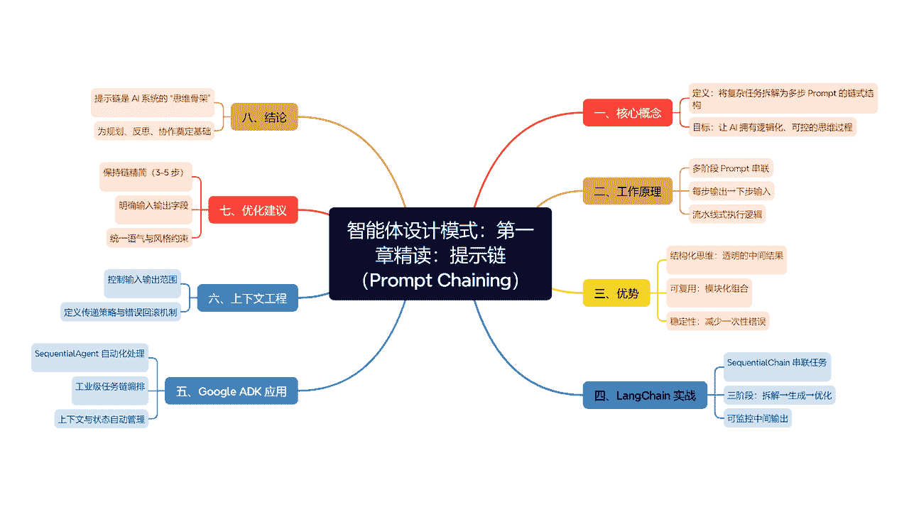
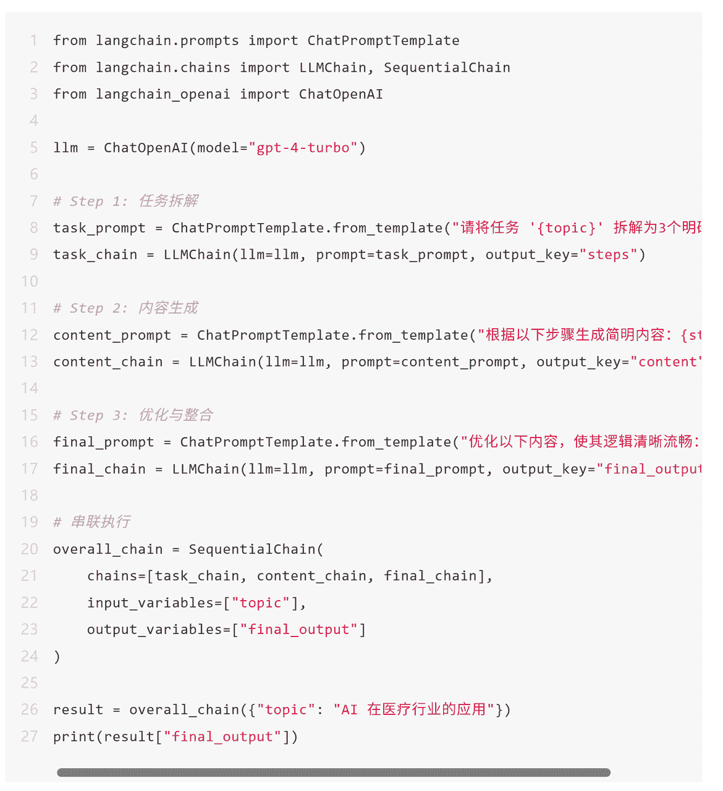

# 第一章 提示链（Prompt Chaining）

> 来源：[https://v11enp9ok1h.feishu.cn/docx/AIuLdlegmo1UkzxZ7YbcDR6FnEe](https://v11enp9ok1h.feishu.cn/docx/AIuLdlegmo1UkzxZ7YbcDR6FnEe)

> “智能的第一步，不是理解世界，而是组织思考。” —— Antonio Gulli，《智能体设计模式》

在大型语言模型（LLM）时代，我们经常感叹AI的能力惊人，却又无奈它“思路混乱”：当问题稍微复杂一些，模型不是漏答、答错，就是输出杂乱无章。

问题不在模型本身，而在于**思考结构的缺失**。

这正是第一章《提示链（Prompt Chaining）》要解决的核心问题——

如何让AI具备清晰、可控、有逻辑的思维流程。

## 🧭 一、为什么需要“提示链”？

在LLM的底层逻辑中，每**一次输出都基于“单次提**示（Prompt）”生成。

而一个复杂任务，往往包含多阶段的推理与决策过程。

比如撰写一份市场分析报告，其实隐含了以下几个环节：

1.  明确任务目标与背景；

1.  收集信息与假设；

1.  结构化分析逻辑；

1.  生成初稿并复盘；

1.  优化语言与表达。

如果我们只用一个Prompt让AI“写一份市场分析报告”，那它就像一个没有项目计划的新人，被要求“一口气交出成果”——混乱几乎是必然的。

提示链（Prom**pt Chaining），**就是将复杂问题拆解成多步Prompt任务，让AI逐步完成，

形成一种类似“思维链”的工作流。

它的核心思想非常简单：

> “复杂问题 = 多个简单Prompt的组合。”

---

## 🧩 二、提示链的工作原理

提示链由多个阶段Prompt组成，每个阶段的输出会成为下一个阶段的输入。

这种结构有点像“流水线”，每一环只解决一个具体问题。

举个例子👇

你希望AI撰写一篇《AI改变商业的三种方式》的博客文章。

在传统单Prompt方式中，你可能输入：

> “请写一篇关于AI如何改变商业的博客。”

AI可能会生成一篇模糊的长文，内容泛而空。

而用提示链的方式，我们可以这样设计：

1️⃣ **任务拆解阶段**

> “列出AI改变商业的3种主要方式，并简要说明原因。”

2️⃣ **内容拓展阶段**

> “针对上述3点，分别撰写简明的100字分析。”

3️⃣ **逻辑组织阶段**

> “将三段内容整理成结构化文章，添加引言与结语。”

4️⃣ **语言优化阶段**

> “润色文章，使其更流畅、有逻辑，保持专业语气。”

每一步都明确、聚焦、可控。

而AI在这种链式结构下，输出质量和一致性将大幅提升。

---

## 🧠 三、提示链的优势：从“生成”到“思考”

书中总结了提示链的三大核心价值：

### 1️⃣ 结构化思维

AI从“黑盒生成”变为“白盒推理”。

开发者可以在每一步中检查中间结果，追踪思路是否正确。

### 2️⃣ 可调试与可复用

每个Prompt节点可单独修改、复用或组合成新的任务流程。

这让AI开发像“搭积木”一样灵活。

### 3️⃣ 稳定性与一致性

多阶段Prompt分担了复杂任务的思考负担，减少模型一次性生成长文时的偏差与遗忘。

**简单来说——提示链**不是让AI更聪明，而是让AI的思考更有秩序。

---

## ⚙️ 四、实战应用：用LangChain实现提示链

书中展示了如何用LangChain实现提示链模式。以下是一个简化示例：

这段代码演示了一个典型的提示链工作流。

每一步输出都成为下一步的输入，AI的逻辑就像被“分层展开”一样。

---

## 🧩 五、Google ADK中的提示链：更工程化的版本

在企业级环境中，Google ADK 提供了更系统的实现方式。

开发者可以通过定义一组“SequentialAgent”，自动处理链式任务。

ADK的特点**是“高层封装、可监控、可复用”**，

特别适合构建标准化的多步骤Agent任务流。

例如一个企业报告生成智能体：

+   第一个Agent负责任务规划；

+   第二个Agent负责信息检索；

+   第三个Agent负责撰写与优化；

+   所有步骤的上下文由ADK自动维护。

这种结构比LangChain更接近“生产级智能体工厂”。

---

## 🔍 六、提示链的延伸：上下文工程（Context Engineering）

**在书中，作**者特别强调了一个概念——上下文工程。

提示链不仅仅是“多步Prompt”，

更重要的是要设计每一步的上下文输入输出逻辑：

哪些内容应该传递？哪些内容应该屏蔽？

例如：

+   步骤A生成的中间结论是否传给步骤B？

+   如果AI在B阶段出错，是否需要返回A重新生成？

+   是否要在Prompt中添加“系统角色”或“规则约束”？

这些都属于“上下文工程”的范畴。

它让提示链从“串联”变成“系统”，也是实现智能体长期记忆和自适应的前提。

---

## 💡 七、常见问题与优化建议

1️⃣ **Q：提示链是不是越多越好？**

不是。链太长会导致延迟增加、错误积累。建议3-5步为宜。

2️⃣ **Q：如何防止上下文丢失？**

为每一步设计明确的输入输出结构，并在代码中显式传递。

3️⃣ Q：如何让AI在多步任务中保持一致语气？

在每个Prompt中增加系统级说明，如：“请保持专业报告语气”。

---

## 🚀 八、总结：提示链是AI工程化的起点

提示链（Prompt Chaining）是智能体架构中最基础、却最关键的设计模式之一。

它让AI从“随机输出”走向“有计划的思考”，

是所有高级模式（如规划、反思、多智能体协作）的前提。

> **一句话总结：**

> 提示链，让AI从“回答问题”，变成“解决问题”。

未来，当我们谈论“AI智能体系统”时，

每一个复杂任务的背后，几乎都隐藏着一个精心设计的“Prompt链”。