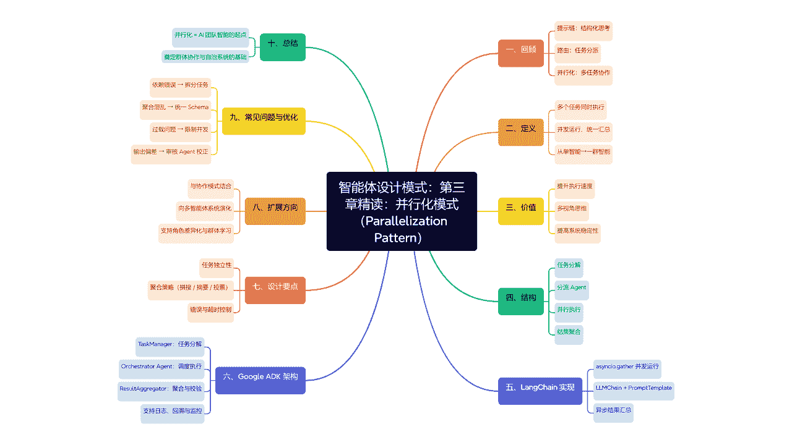
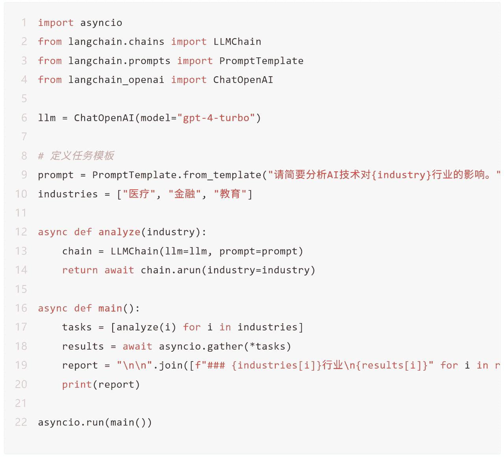

# 第三章 | 并行化模式（Parallelization Pattern）

> 来源：[https://v11enp9ok1h.feishu.cn/docx/MlS3dpwcvoxGEwxC🐧HcdGQvnPh](https://v11enp9ok1h.feishu.cn/docx/MlS3dpwcvoxGEwxC🐧HcdGQvnPh)



> “AI不是一个超人，而是一支团队。

> 真正的智能，不在于速度，而在于协作。”

> ——Antonio Gulli，《智能体设计模式》

---

## 🧭 一、回顾：从“结构思考”到“判断分派”

在前两章中，我们为AI系统建立了“思考的骨架”与“判断的能力”：

+   提示链（Prompt Chaining） 让AI学会分步骤、有逻辑地思考；

+   路由模式（Routing Pattern） 让AI能识别任务类型，自动分配最合适的执行路径。

然而，这两种模式仍然是**线性执行**：

AI必须一步接一步，像流水线那样串行完成任务。

但在真实世界中，很多任务并不是线性的。

比如撰写一份行业研究报告，往往需要同时：

+   查阅不同来源的资料；

+   分析多个数据维度；

+   汇总成统一结论。

人类团队会分工协作，而AI能否也做到？

这就是第三章“并行化模式（Parallelization Pattern）”要回答的问题。

---

## 🚀 二、什么是并行化模式？

**并行化模式**指的是：

在智能体系统中，将任务拆分为多个可以同时执行的子任务，

让多个智能体（或模型实例）并发运行，最后再合并结果。

简单来说，就是让AI系统从“一个人做所有事”，变成“多人协作完成任务”。

### 📦 举个简单例子：

假设我们要让AI生成《AI 改变三大行业的趋势分析》。

我们可以设计一个并行任务结构：

三个智能体同时执行，最后一个主控Agent负责：

> 汇总 → 结构化整合 → 输出完整报告。

与传统串行执行相比，并行化能显著减少响应时间，并避免模型在长流程中“遗忘”部分上下文。

---

## 🧠 三、为什么并行化是AI系统的“分水岭”？

Antonio Gulli 在书中指出，并行化是智能体系统走向“群体智能（Collective Intelligence）”的关键一步。

我们可以从三个维度理解它的重要性：

---

### ① 性能提升：从“顺序”到“并发”

传统LLM执行流程类似于：

+

```
输入 → 思考 → 输出 → 再输入 → 再输出
```

这在简单任务中足够，但在涉及多维度分析、跨主题生成时，就变得低效。

并行化通过异步机制，让多个任务同时运行——

像一支团队分头行动，极大地缩短总体等待时间。

例如，生成一份50页行业白皮书时，

每个章节都可以独立生成并行执行，

从而将任务时间从30分钟缩短到5分钟。

---

### ② 思维多样性：从“单脑”到“群脑”

当多个智能体同时处理任务时，每个Agent可以使用不同Prompt或不同模型策略。

这种“并行异构”的方式带来了更丰富的观点与创造力。

举个例子：

在AI生成战略报告时，我们可以让三个Agent采用不同角色：

+   📊 分**析师Agent：**数据导向，偏逻辑与事实；

+   💡 创**意Agent：**偏趋势预测与创新角度；

+   🎯 策**略Agent：**关注决策层面的可执行建议。

最终由主控Agent整合三者输出，形成内容更全面、更可信的报告。

---

### ③ 系统鲁棒性：从“单点风险”到“分布式容错”

在串行模式下，如果某一步出错，整个任务会崩溃。

而并行化结构允许部分失败：

即使一个子任务出错，系统仍能通过聚合其他结果继续运行。

比如：

> 五个Agent同时执行数据提取，其中一个API失败，

> 聚合模块可以自动跳过该结果或触发重试机制。

这使智能体系统更加稳定可靠，具备“容错”特性。

---

## ⚙️ 四、并行化的基本结构

书中将并行化流程总结为四个核心阶段👇

这与现代分布式计算理念非常相似。

AI系统的并行化，本质上就是把“人脑式的多线程协作”工程化实现。

---

## 🧩 五、LangChain中的并行化实现

LangChain 对并行化支持非常成熟，可以使用 RunnableParallel、AsyncParallelChain 或 asyncio 实现异步执行。

🌟 示例：AI 并行分析不同产业



🔍 说**明：**

+   asyncio.gather() 并行运行多个任务；

+   每个子任务独立生成结果；

+   最后汇总输出完整报告。

📈 效**果：**

在GPT-4环境下，3个任务同时执行能节省约60%的总响应时间。

这在生产环境下尤为重要。

---

## 🧰 六、Google ADK中的企业级并行架构

在企业级系统中，并行化往往与任务**编排、日志监控、资源调**度结合。

Google ADK（Agent Developer Kit）提供了一种可监控的并行智能体架构。

其核心组件包括：

这种结构的优势在于：

+   自动识别哪些任务可以并行；

+   动态分配计算资源；

+   提供失败回滚与重试机制。

💡 实**际应用案例：**

在一家大型咨询公司部署的“AI研究助手”系统中，

每次项目研究会启动 10~20 个并行Agent，

涵盖数据提取、文献综述、竞争分析等子任务，

结果在数分钟内自动汇总成完整研究报告。

过去人工要做两天的工作，如今不到一小时完成。

这正是并行化模式在生产级智能体中的威力。

---

## 🔍 七、设计要点与最佳实践

并行化模式强大，但也容易“失控”。

书中总结了三个关键设计原则👇

---

### ① 任务独立性（Independence）

> “不是所有任务都能并行。”

并行化前，必须判断子任务之间是否存在依赖关系。

如果某个任务需要另一个任务的结果作为输入，就不能同时执行。

可通过“任务依赖图（Task Graph）”分析任务之间的先后关系。

LangGraph 就提供了这种可视化依赖管理工具。

---

### ② 结果整合策略（Aggregation Strategy）

并行任务的输出可能结构不一致，必须设计清晰的整合逻辑。

常见的聚合方法：

+   **拼接汇总**：将结果直接合并（适合文本类任务）；

+   摘要融合（Summary Fusion）：对多个结果进行总结，生成统一报告；

+   **投票机制（Voting）**：在多个输出间选择最合理答案（常见于问答任务）。

例如在生成“行业趋势预测”任务时，可以让3个Agent独立预测，再由主Agent融合结论并生成“共识版本”。

---

### ③ 错误与超时控制（Error & Timeout Handling）

由于并行任务同时运行，单个任务出错不能影响整体。

最佳实践包括：

+   为每个子任务设置 **最大执行时间（timeout）**；

+   超时或出错的任务自动跳过或重试；

+   记录日志，供后续追踪。

在LangChain中，可以直接在 RunnableParallel 中设置 max_concurrency 与 timeout 参数来控制。

---

## 🧬 八、并行化 + 协作：智能体的团队雏形

并行化模式**是“多智能体协作”的技术起点**。

它解决的是如何让多个智能体并行执行任务，

而后续的“协作模式（Collaboration Pattern）”解决的是——

> “如何让这些智能体互相理解、共享上下文、协调目标。”

在Antonio Gulli的模型体系中，这两者共同构成了智能体群体智能的基础层。

你可以将并行化看作“让AI同时行动”，

协作模式则是“让AI团队同心协力”。

两者结合后，AI系统将具备：

+   并发执行能力（Parallelism）

+   通信协调能力（Coordination）

+   自我反思与优化能力（Reflection）

这正是现代智能体系统迈向“数字组织”的关键三步。

---

## ⚡ 九、常见问题与优化建议

---

## 🧩 十、总结：AI的“团队智能”从这里开始

并行化模式（Parallelization Pattern）是智能体系统从“单线程智能”迈向“群体智能”的转折点。

它让AI：

+   不再等待，而是**同时思考**；

+   不再独立，而是**协作共创**；

+   不再被动执行，而是**高效组织**。

如果说：

+   提示链让AI“有条理地思考”，

+   路由让AI“会判断任务”，
那么——

> 并行化让AI真正具备“团队思维”，是通向多智能体系统的第一步。

未来的智能体系**统，不再是一台模型在孤独地回**答，

而是一群AI在协同决策、并行工作、持续优化。