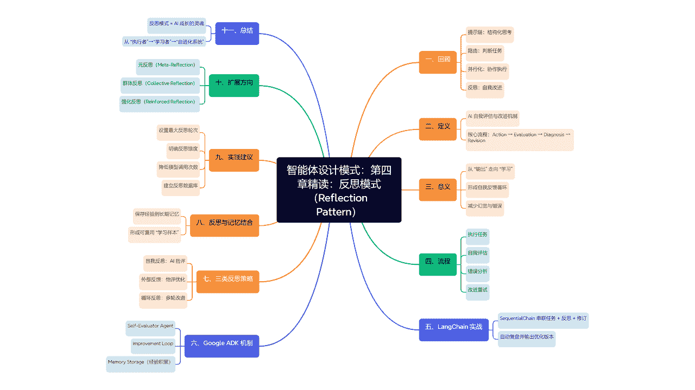
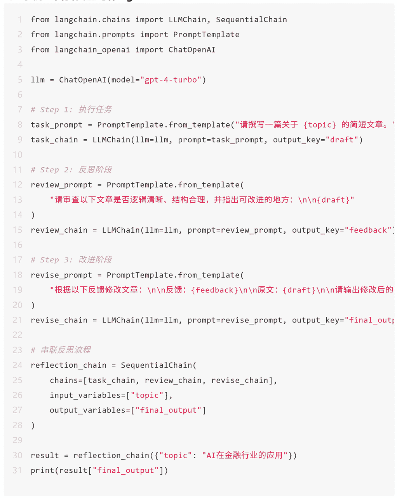

# 第四章｜反思模式（Reflection Pattern）

> 来源：[https://v11enp9ok1h.feishu.cn/docx/KgAmdX7mDo165LxwfgMcEOubnpe](https://v11enp9ok1h.feishu.cn/docx/KgAmdX7mDo165LxwfgMcEOubnpe)

> “智能，不是知道一切，而是知道哪里错了。”

> —— Antonio Gulli，《智能体设计模式》

---

## 🧭 一、回顾：AI的成长三步曲

在前三章中，我们一步步为AI系统搭建了“结构、判断与协作”的基础：

1️⃣ 提示链（Prompt Chaining） —— 让AI按步骤思考；

2️⃣ 路由模式（Routing Pattern） —— 让AI学会任务判断与分派；

3️⃣ 并行化模式（Parallelization Pattern） —— 让AI能像团队一样同时工作。

这三步，让AI具备了“组织执**行”的**能力。

但它仍然缺少一样关键特质——成长性。

再聪明的智能体，如果不会反思错误，就永远停留在“机械执行”阶段。

第四章的主题——反思模式（Reflection Pattern），

就是让AI真正迈入“自我进化”的核心机制。

---

## 🧩 二、什么是反思模式？

反思模式（Reflection Pattern）是让AI具备“自我评估与改进”能力的一种设计思路。

它的核心机制是：

> AI执行任务 → 评估结果 → 分析问题 → 优化下一次输出

这类似于人类的学习循环——

我们完成一件事后，会回顾：

哪里做得好？哪里可以改？下次该怎么更高效？

对于AI而言，反思机制意味着：

+   不再被动接受Prompt；

+   能主动检查自己的输出；

+   能基于反馈调整后续策略。

换句话说，反思模式让AI从“自动机”变成“思考者”。

---

## 🧠 三、为什么反思模式如此重要？

Antonio Gulli 在书中提出一个有趣的观点：

> “大语言模型并不缺知识，它缺的是自我校正的意识。”

**模型输出**错误的根源，往往不是知识不足，而是缺乏复盘。

例如：

+   它可能理解错了题意；

+   忽略了限制条件；

+   或输出结构不符要求。

在人工监督下，我们可以修正它的Prompt；

但如果AI能自己反思、自己调整，就能形成一个闭环学习系统（Self-Improving Loop）。

这正是反思模式存在的意义。

---

## ⚙️ 四、反思模式的核心流程

书中总结了反思模式的通用结构👇

这就是AI的“自我反馈循环（Reflection Loop）”。

---

### 💡 举个例子：

假设你让AI写一篇“AI在金融行业的应用报告”，

你可以设计如下反思流程：

1️⃣ **任务执行阶段：**

> “请写一篇关于AI在金融行业应用的简报。”

2️⃣ **自我评估阶段：**

> “请检查你刚才的回答是否包含了数据分析、风控、投资决策等关键部分。若缺失，请指出并说明原因。”

3️⃣ **改进阶段：**

> “根据你的反思，补充缺失内容，并优化报告结构。”

结果：AI不仅完成了任务，还在第二次输出中显著提升质量。

这就是反思模式的最小闭环。

---

## 🧩 五、LangChain中的反思实现

LangChain 提供了灵活的组件来实现“反思链（Reflection Chain）”。

核心思路是将“执行Agent”与“反思Agent”串联运行。

### 🌟 示例：自我复盘写作Agent

🔍 结**果分析：**

AI先写出初稿 → 再评估逻辑 → 再重写输出。

输出质量通常比单次Prompt提升30%~50%。

---

## 🧰 六、Google ADK中的反思机制

在 Google ADK（Agent Developer Kit）中，反思机制被设计为智能体生命周期的一部分。

它不是附加功能，而是系统默认的“自适应过程”。

ADK 的核心机制包括：

这种架构的最大优势是——**可持续学习**。

系统会自动积累“反思知识”，例如：

+   哪种Prompt结构最有效；

+   哪些错误最常出现；

+   哪种策略能减少幻觉输出。

反思在ADK中不再是一次性操作，而是智能体的“成长引擎”。

---

## 🔍 七、反思模式的关键策略

Antonio Gulli 提炼出三种典型的反思策略，开发者可灵活组合使用👇

---

### 🧠 1️⃣ 自我反思（Self-Reflection）

智能体基于自身输出进行自我评估。

> 优点：无需人工干预，自动闭环。

> 缺点：受限于模型自我认知能力。

📘 应用示例：

+   自动代码审查：AI写代码 → 自评逻辑错误 → 自动修复。

+   内容生成：AI先输出文章，再评估结构与语气。

---

### 🧩 2️⃣ 外部反馈反思（External Feedback）

由外部Agent或人类提供反馈，AI据此改进。

> 优点：纠错精准；

> 缺点：需要额外Agent或人工输入。

📘 应用示例：

+   “审稿Agent”批改“写作Agent”的输出；

+   用户给出满意度打分，AI据此优化风格。

---

### 🔁 3️⃣ 循环反思（Iterative Reflection）

结合多轮评估与修正，让AI持续改进，直到满足目标。

📘 应用示例：

+   产品策划AI反复生成方案，经过多轮反思直到评分达标；

+   自动化论文摘要优化系统，连续反思五次以最大化信息覆盖率。

这三类策略构成了从“自我意识”到“协同学习”的完整反思体系。

---

## ⚡ 八、反思与记忆的融合：让经验沉淀下来

**单次反思**能提升输出质量，但真正的“智能成长”来自经验积累。

书中强调反思模式应与记忆管理（Memory Management）结合：

每次反思结果都应存入长期记忆中，供未来调用。

举个例子：

一个AI编程助手可以记录：

> “在处理并发任务时，上次我用了asyncio方案更高效。”

当下次遇到类似任务，它会自动调用这条经验，从而更快给出优化方案。

这就让AI系统具备了“元认知能力”——

它不只是执行任务，而是记得“自己过去学到了什么”。

---

## 🧩 九、实践建议与常见问题

**黄金法则**：

> “反思要有边界，改进要有目标。”

---

## 🧬 十、反思模式的演化：通向“自我进化智能体”

在更高级的**系统中，**反思模式不再是任务层面的“复盘”，

而是智能体自我优化的机制。

这种机制包括：

+   元反思（Meta-Reflection）：AI反思自己的反思过程；

+   群体反思（Collective Reflection）：多个Agent共享反思结果，形成组织学习；

+   强化反思（Reinforced Reflection）：结合强化学习，根据改进效果调整反思策略。

这些机制让**智能体系统从“执行**工具”变成“成长个体”。

它能持续优化Prompt、模型调用逻辑、任务规划策略，

最终形成“自进化的智能体生态”。

---

## 🧩 十一、总结：从AI到“自我改进系统”

反思模式（Reflection Pattern）

是智能体设计体系中最具“生命力”的模式之一。

它让AI系统具备了：

+   ✅ 自我评估的能力

+   ✅ 主动修正的能力

+   ✅ 持续学习的能力

> 没有反思，就没有成长。

> 有了反思，AI才能从执行者变成学习者。

在智能体的世界里，反思不仅是纠错，更是“觉醒”。

它让AI第一次有了“自省”的灵魂。