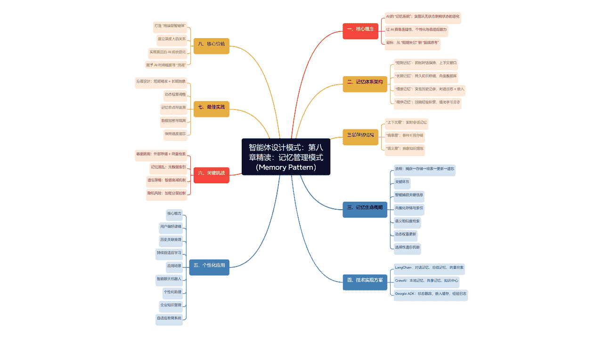
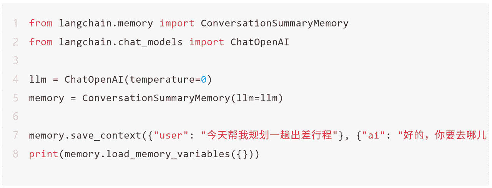

# 第八章：记忆管理模式（Memory Pattern）

> 来源：[https://v11enp9ok1h.feishu.cn/docx/N9GodR755o1OBsxmVI8cPwN6nqz](https://v11enp9ok1h.feishu.cn/docx/N9GodR755o1OBsxmVI8cPwN6nqz)



> “没有记忆的智能体，只能永远从头开始。”

> ——Antonio Gulli，《智能体设计模式》

---

## 一、回顾：从协作到连续智能

在第七章中，我们看到智能体开始“组队工作”——多智能体协作模式（Multi-Agent Collaboration Pattern）。

协作让AI可以并行处理复杂任务，但一个关键问题随之而来：

> 如果AI不能记住之前的对话、结果和环境变化，它的协作将很快失效。

因此，本章的主题正是：

> 如何让AI“拥有记忆”，并在多轮交互与任务生命周期中保持一致的上下文感知。

📘 记忆是智能的基石。没有记忆，就无法建立因果、无法推理、无法进化。

---

## 二、什么是记忆管理模式？

Antonio Gulli 的定义非常简洁：

> **记忆模式（Memory Pattern）是指通过对历史上下文、外**部知识与状态数据的存储与提取，使智能体具备连续性、个性化与自适应能力的设计模式。

换句话说：

> 它让AI从“无状态函数”变成“有生命的智能体”。

---

## 三、为什么智能体需要记忆？

书中列出了记忆系统存在的三个核心理由👇

📘 有记忆的AI，才能“延续思考”；

无记忆的AI，每次都是“短期失忆”。

---

## 四、记忆的类型与层次

书中用“人类大脑”类比智能体的记忆系统👇

📘 LLM 通过「短期上下文」保持即时对话，而真正的个性化来自「长期语义记忆」。

---

## 五、记忆系统的架构

书中提出了**三层记忆架构模型（3-Layer Memory Architecture）**👇

+

```
User Context → Episodic Memory → Semantic Memory
```

📘 智能体在对话时，会动态地从语义层检索最相关的长期记忆并拼接到上下文中。

---

## 六、记忆的生命周期

书中提出了「记忆生命周期（Memory Lifecycle）」模型👇

+

```
Capture → Store → Retrieve → Update → Forget
```

📘 “有选择地遗忘”，也是记忆系统健康运行的关键。

---

## 七、LangChain 的记忆模块

LangChain的记忆系统非常成熟，支持多种类型👇

示例👇



📘 通过这种方式，Agent可以在多轮对话中“记得你是谁”。

---

## 八、CrewAI 的记忆共享系统

**在多智能体环境下，C**rewAI 引入了 Memory Hub 机制。

📘 Memory Hub 让团队协作型AI能像公司一样，既有“个人经验”，又有“组织知识”。

---

## 九、Google ADK 的长期记忆引擎

Google ADK（Agent Developer Kit）中有专用的 Persistent Memory Engine，用于处理长期状态。

📘 ADK的记忆系统不仅能记住“事实”，还能记住“经验”。

---

## 十、记忆与个性化

记忆模式的最大价值之一是**个性化体验生成**。

📘 通过记忆系统，AI可以“认识你”、“理解你”，甚至“预测你”。

---

## 十一、记忆的挑战

📘 “忘得恰到好处”，是设计AI记忆系统的艺术。

---

## 十二、最佳实践

Antonio Gulli 总结了五条设计准则👇

📘 好的记忆系统，应像人脑那样：高效、有限、但精准。

---

## 十三、现实应用场景

📘 所有“会记得你”的AI产品，本质上都基于Memory Pattern。

---

## 十四、总结：让AI拥有“连续的灵魂”

记忆管理模式（Memory Pattern）

是让智能体具备“延续性、个性化与学习能力”的关键。

它让AI不再是一次性的对话工具，

而成为能积累、能反思、能成长的“持续型智能体”。

> “智能的进化，不在算力，而在记忆。”

📘 记忆让AI有了时间维度，也让人机关系变得更深刻。