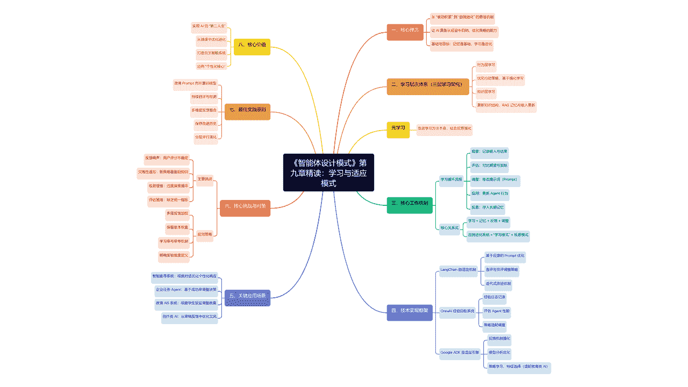
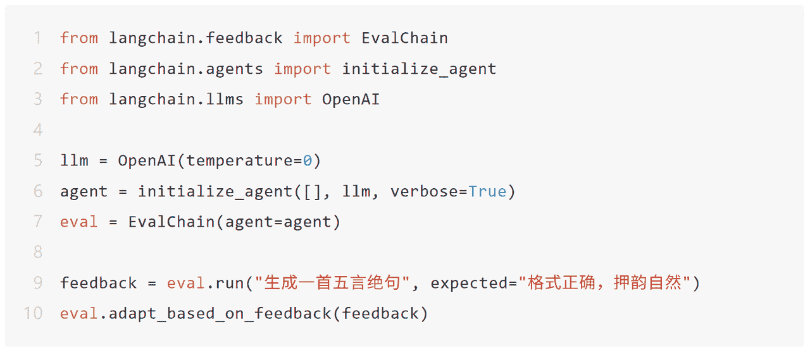

# 第九章｜学习与适应模式

> 来源：[https://v11enp9ok1h.feishu.cn/docx/AfQtdYJMVozbTQxsuPIcnGIfnTe](https://v11enp9ok1h.feishu.cn/docx/AfQtdYJMVozbTQxsuPIcnGIfnTe)



> “真正的智能，不是记得过去，而是从过去中学会改变。”

> ——Antonio Gulli，《智能体设计模式》

---

## 一、回顾：从记忆到进化

在第八章中，我们构建了AI的“记忆系统”——让智能体能够记得用户、任务和上下文。

但仅有记忆并不意味着成长。

> 如果AI只是反复调用旧记忆，它仍然只是“记忆体”，不是“学习体”。

**于是第九章登场：

学习与适应模式（L**earning & Adaptation Pattern）。

它是让AI具备“从经验中归纳规律、优化行为策略、自动演化”的核心机制。

📘 如果说记忆是AI的“海马体”，

那么学习与适应就是它的“前额叶皮层”——会反思、会调整。

---

## 二、学习与适应模式定义

Antonio Gulli 在书中定义：

> **学**习与适应模式，是指智能体通过对自身行为与外部反馈的持续评估，不断调整决策策略与知识模型，以提升性能与泛化能力的设计模式。

简单说：

> 它让AI拥有了“学会更好地做”的能力。

---

## 三、为什么需要学习与适应？

静态模型的局限显而易见：

+   用户需求会变化；

+   环境数据会变化；

+   工具接口会变化。

如果AI不能随时间调整策略**，

它就会像过期**的导航系统——仍在带你走老路。

书中将“学习与适应”的核心价值总结为三点👇

📘 学习让智能体不只是被动更新，而是主动成长。

---

## 四、学习的类型

书中把智能体的“学习行为”分为三层：

📘 这三个层次构成了AI的“自我演化闭环”。

---

## 五、学习与记忆的关系

学习与记忆是智能的两条腿：

+   **记忆**：存储经验。

+   **学习**：从经验中提取规律。

书中用一个公式形象描述两者关系：

+

```
Learning = Memory + Evaluation + Adaptation
```

即：

> 学习 = 记忆 + 反馈 + 调整。

📘 没有记忆就无法学习，没有反馈也无法改进。

---

## 六、学习的工作流程

书中将学习模式抽象为一个五阶段循环👇

+

```
Observe → Evaluate → Adapt → Apply → Reflect
```

📘 这就是智能体的“自监督学习循环”。

---

## 七、LangChain 与学习机制

LangChain并不直接训练模型，但它支持基于反馈的自适应Prompt优化。

例如👇



📘 这种基于反馈的迭代机制，本质上是“Prompt级学习”：

AI根据自评或人评调整策略。

---

## 八、CrewAI 的经验回放机制

CrewAI 框架引入了 Experience Replay Memory（经验回放） 概念，

允许智能体“回顾过去的任务并重新学习”。

📘 类似于强化学习中的“经验池（Replay Buffer）”，

CrewAI 让智能体可以在实践中“越用越聪明”。

---

## 九、Google ADK 的自适应引擎

ADK（Agent Developer Kit）中有一个核心组件：

Adaptive Execution Engine（自适应执行引擎）。

📘 ADK 的“自适应执行”理念，让Agent具备了自调节智能。

---

## 十、学习与反思的结合

在后续章节中（尤其《反思模式》），书中指出学习模式与反思模式的关系：

+   **学习**是调整策略；

+   **反思**是检验认知；

+   两者循环形成“自我进化系统”。

公式可表示为：

+

```
Self-Improving Agent = Learning Pattern + Reflection Pattern
```

📘 即“学习让AI变聪明，反思让它变智慧”。

---

## 十一、学习的算法核心

书中提供了一个通用伪代码结构👇

```
def adaptive_agent(task, feedback_fn):    result = execute(task)    score = feedback_fn(result)    if score &lt; threshold:        strategy = refine_prompt(task, score)        return adaptive_agent(strategy, feedback_fn)    return result
```

📘 这种递归式自改进结构，体现了AI的“内生演化能力”。

---

## 十二、挑战与局限

📘 “学会学习”本身就是智能的终极挑战。

---

## 十三、最佳实践

本章最后总结了五个设计原则👇

📘 最佳实践的目标是“低成本、高收益”的学习循环。

---

## 十四、现实应用

📘 学习模式正在成为“个性化AI”的技术核心。

---

## 十五、总结：让AI学会“学”

学习与适应模式（Learning & Adaptation Pattern）

是AI系统的“第二生命”——

让它能从经验中成长，从错误中优化，从环境中演化。

> “智能不是知道答案，而是能改进提问。”

📘 这是AI迈向自主智能的关键里程碑。