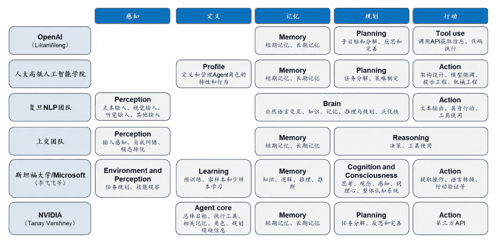
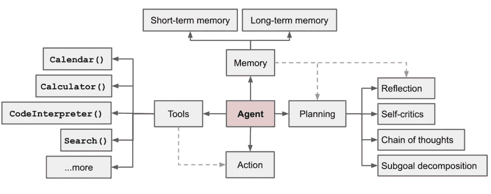
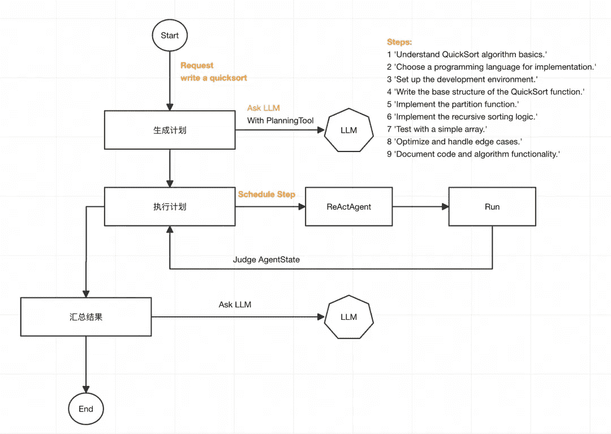
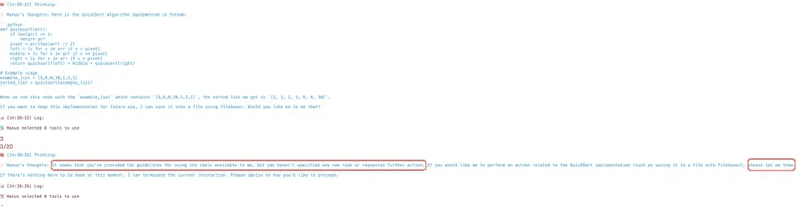
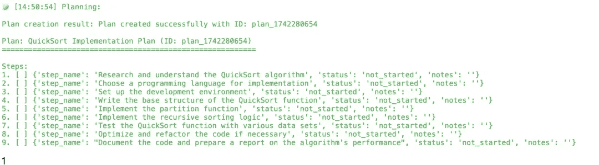
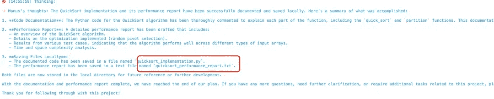
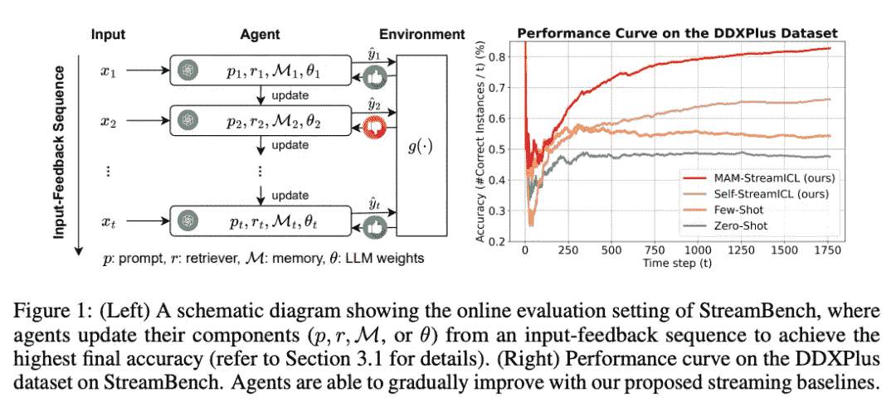
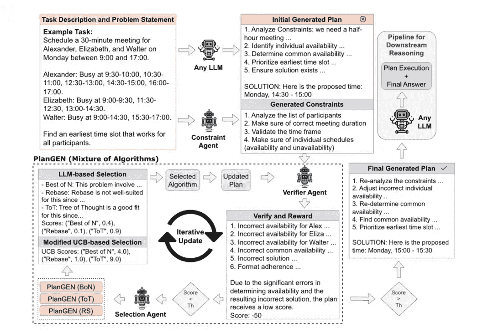
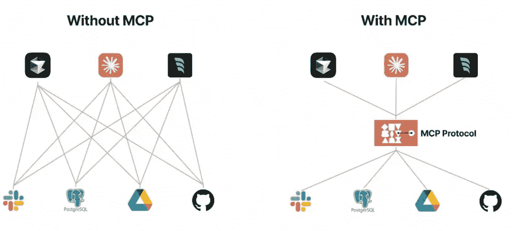

# 深度解析-构建 AI Agent全流程

> 来源：[https://v11enp9ok1h.feishu.cn/docx/XRGld84xFoi563xJ6PccUGEQn9c](https://v11enp9ok1h.feishu.cn/docx/XRGld84xFoi563xJ6PccUGEQn9c)

# 背景

前一阶段Manus大火，被宣传为全球首款“真正意义上的通用AI Agent”，其核心能力就是基于LLM的自主任务分解与执行，根据官方测试数据，Manus 在 GAIA 基准测试中表现超越 OpenAI 同类产品，且完成任务的成本更低。

为了让读者对Agent能够有系统的认识，同时也可以对Agent的认识完成一次祛魅的过程。本篇文章结构为：

1. 认识，对AI Agent相关的一些组成进行原理性解释
2. 设计，基于OpenManus构建自己的MyManus，落地和验证认识中的原理
3. 实验，基于MyManus进行验证，对当前的Agent存在的问题有直观的感受。
4. 改进，结合前面的实验以及Agent当下的问题，探讨未来的方向和改进方案。

# 认识

结合Agent相关的几篇关键文章和论文，梳理下基于LLM的AI Agent的设计模式以及一些原理性的概念。ATA上关于LLM和Agent的原理性的优质文章太多，这里主要涉及Manus或OpenManus用到的部分。

## AI Agent正在重新定义软件服务

AI Agent将使软件架构的范式从面向过程迁移到面向目标，就像传统面向过程的工作流和K8S的声明式设计模式一样，

当然这两种解决的问题是不一样的，K8s通过定义期望状态而非具体步骤来管理集群，降低集群状态管理的复杂度，确保集群的稳定性和容错性。


我们可以从Manus的官方网站看到，Manus宣称可以做如下的事情，并提供了相当丰富的案例。

+ 数据分析：比如分析店铺销售数据，制定改进策略等。

+ 教育：互动课程，学习资源收集，宇宙探索等

+ 生活：保险策略对比，租赁合同分析，旅行计划等

+ 效率：合同审查，简历筛选，网站SEO优化等。

+ 研究：财报分析，政策研究

## 2.2 AI Agent的核心要素

不同的机构或团队，对Agent的架构模块的划分略有差异，但基本上包含了：

**感知**

**记忆**

**规划**

**行动**

此外，部分团队还涉及定义（管理 Agent 角色特性）、学习（预训练、小样本学习）、认知与意识（思考、整体认知）等特色模块



Lilian Weng（翁荔）LLM Powered Autonomous Agents 这篇博客被广泛认为是 “AI Agent领域最权威的结构化综述之一” ，为开发者提供了技术框架参考， 大家应该对文中的图已经很熟悉了

作者将 AI Agent 定义为 “规划 + 记忆 + 工具调用” 的组合，强调LLM作为系统的核心控制器。

+ 规划（Planning）：任务分解、子任务生成及自我反思

+ 记忆（Memory）：长期记忆存储与上下文管理，用于处理复杂任务

+ 工具使用（Tool Usage）：通过API或外部工具增强Agent的能力（如搜索、文件操作，代码执行等）

# 设计

接下来围绕Agent几个核心要素进行设计，会先简单介绍一些基本的原理，然后基于OpenManus做二次设计或者展示其原来的实现。



## LLM

在这之前概括下LLM的一些基本的原理，关于LLM的原理性文章已经很多了，这里只对LLM的推理原理做个简单回顾。

> 当下的LLM的核心依然是基于神经网络，相比传统的神经网络CNN/RNN等，`Transformer`架构通过自注意力机制允许模型直接计算任意两个位置之间的关系，从而更高效捕捉长距离依赖，使得LLM有更强大的多层叠加能力。

> `Transformer`的并行计算能力（如自注意力的矩阵运算）同时加速了训练速度，支持更大的模型规模。

> 另外通过多层非线性激活函数（如 `ReLU`、`GeLU`）可学习更加复杂模式，随着参数规模和训练数据增加，LLM 会突现传统神经网络难以实现的能力（如逻辑推理、代码生成），LLM具备了涌现能力！（也许这就是量变产生了质变吧）

> LLM的推理简单理解为是一个 “模式匹配 + 概率计算” 的过程，通过 `Transformer` 架构和自回归生成，基于海量文本学习到的统计规律，逐步生成符合语言习惯的输出。

> 其效果依赖于训练数据的质量、模型规模以及生成策略的选择。每一步生成都依赖于已生成的上下文，即通过已知的前序词预测下一个词，当前LLM具备上下文学习（In-Context Learning）能力，LLM通过Prompt中提供的示例或指令，无需参数更新即可适应新任务，依然是在于利用模型的模式匹配能力和统计规律，`Transformer` 架构中，Prompt的token位置靠前，权重更高，对后续生成的影响更大。

> LLM的涌现能力使其具备复杂任务处理能力，但同时也因训练数据的噪声和统计生成特性，容易产生幻觉。RAG通过引入外部知识减少幻觉，SFT微调通过高质量数据优化输出，Agent通过工具调用增强交互能力。这些方法可在一定程度上缓解幻觉，增强可解释性，但可解释性仍受限于LLM的黑箱特性。Agent设计中，Prompt是核心组件之一，所有的设计都是围绕构建和管理Prompt，需结合工具调用、记忆管理等模块设计。为适应不同任务，Prompt需精细化设计并管理多个版本。

## Memory

前面了解到，LLM本质上就是一个具有数十亿到千亿级别参数的无状态函数，比如可以这样：


LLM自身不具备主动记忆功能，但可通过外部技术（如提示工程、记忆模块）模拟记忆效果，以增强任务表现和交互连贯性。所以别想着LLM会有人类的情感啦，LLM的“连贯性”是概率驱动的，而非真正的意图或情感。

LLM就像一个失忆的绝世高手一样，虽然没有记忆，但可以武功还在，LLM回复完全基于输入的提示（prompt）和训练数据中的模式，通常我们所说的记忆是指的是用户输入提示，分为短期记忆和长期记忆。

+ LLM的“短期记忆”通常依赖于其上下文窗口（最大`Token`限制），通过在输入中包含当前对话或任务的相关信息来维持连贯性。LLM的一些生产参数比如`Temperature`，`Top-P`可以影响其基于上下文生成文本内容。`Temperature`主要是影响生成的确定性，是通过控制`Temperature`实现生成内容的准确性与创造性二者之间的权衡。`Top-P`主要是发散程度，在聚焦和多样性之间的平衡。

+ 长期记忆依赖于外部组件，虽然LLM的预训练参数“存储”了知识，通常已经过时，特定领域的知识，需外部技术（如RAG）补充长期依赖关系。短期记忆也可以转变为长期记忆，这个对Agent的自主进化很有帮助。

我们设计一个简单的短期记忆模块，记录推理和外部感知的结果信息，每次调用LLM时都会带上（受限于LLM的最大`Token`），这样LLM就会在每次推理时“记住”之前的推理过程，以及外部工具感知的结论。相当于：每次你问问题，都要讲一遍前面的交流内容。定义`Memory`类，记录每次的`Message`内容。

```
class Memory(BaseModel):
    messages: List[Message] = Field(default_factory=list)
    max_messages: int = Field(default=100)
```

以下是Memory内容例子

```
{
  "messages": [
  {
                  "role": "user",
                  "content": "\n        CURRENT PLAN STATUS:\n        Plan: QuickSort Implementation Plan (ID: plan_1742277313)\n==========================================================\n\nSteps:\n1. [→] {'step_name': 'Research and understand the QuickSort algorithm', 'status': 'in_progress', 'notes': ''}\n2. ...",
                  "tool_calls": null,
                  "name": null,
                  "tool_call_id": null
              },
              {
                  "role": "user",
                  "content": "You can interact with the computer using PythonExecute, save important content and information files through FileSaver, open browsers with BrowserUseTool, and retrieve information using GoogleSearch.\n\nPythonExecute: ...",
                  "tool_calls": null,
                  "name": null,
                  "tool_call_id": null
              },
              {
                  "role": "assistant",
                  "content": "",
                  "tool_calls": [
                      {
                          "id": "call_294a4ff7396f4c91813990",
                          "type": "function",
                          "function": {
                              "name": "google_search",
                              "arguments": "{\"query\": \"QuickSort algorithm explained\"}"
                          }
                      }
                  ],
                  "name": null,
                  "tool_call_id": null
              },
              {
                  "role": "tool",
                  "content": "Observed output of cmd `google_search` executed:\n['https://www.w3schools.com/dsa/dsa_algo_quicksort.php']...",
                  "tool_calls": null,
                  "name": "google_search",
                  "tool_call_id": "call_294a4ff7396f4c91813990"
              },
              {
                  "role": "user",
                  "content": "You can interact with the computer using PythonExecute...",
                  "tool_calls": null,
                  "name": null,
                  "tool_call_id": null
              },
              {
                  "role": "assistant",
                  "content": "I have researched the QuickSort algorithm using a Google search. Here are some resources that can help us understand how it works...",
                  "tool_calls": null,
                  "name": null,
                  "tool_call_id": null
              }
  ]
}
```

## Tools

人类创造、修改和利用外部物体来做超出人类身体和认知极限的事情，为LLM配备外部工具可以显著扩展模型功能和应用场景。

Agent的工具调用，实际上是借助LLM的能力，LLM需要先理解工具的功能和参数格式。


上图可以简单概括为：

1. 你有一系列工具，同时有比较详细的说明书，你拿着说明书找LLM问一个LLM自身推理无法（准确）完成的问题，比如：今天几号，天气怎么样，当前数据库内容是什么，这些预训练的LLM是无法感知到的，需要借助外部工具。

1. LLM会从你的工具说明书列表中选工具，准确地告诉你你应该用哪个工具，同时把输入参数也给你（基于说明书描述）

1. 你拿到后调用工具，获取感知信息，然后再把结果信息给到LLM。

1. LLM判断输出结果，并继续回答你之前的问题。

举一个基于`LangChain`的简单例子，加了些HTTP请求埋点，方便跟踪LangChain与LLM的IO交互。


```python
import os
import httpx
from dotenv import load_dotenv
load_dotenv('../.env.production')
os.environ["OPENAI_API_KEY"] = os.getenv("DASHSCOPE_API_KEY")
os.environ["OPENAI_API_BASE"] = os.getenv("DASHSCOPE_API_BASE_URL")
print(os.getenv("DASHSCOPE_API_BASE_URL"))
import json
import logging

from langchain_core.tools import tool
from langgraph.prebuilt import create_react_agent

from langchain_openai import ChatOpenAI
logging.basicConfig(level=logging.INFO)
logger = logging.getLogger("httpx")
logger.setLevel(logging.INFO)

@tool
def string_length(text: str) -> int:
    """Calculate text length"""
    return len(text)

def print_request(request, *args, **kwargs):
    logger.info(f"HTTP Request: {request.method} {request.url}")
    logger.info(f"Request Headers: {request.headers}")
    logger.info(json.dumps(json.loads(request.content), indent=1))

def print_response(response, *args, **kwargs):
    logger.info(f"HTTP Response: {response.status_code} {response.reason_phrase}")
    logger.info(f"Response Headers: {response.headers}")
    response.read()
    logger.info(json.dumps(json.loads(response.text), indent=1))

custom_client = httpx.Client(
    base_url=os.getenv("DASHSCOPE_API_BASE_URL"),
    headers={"X-Custom-Header": "value"},
    event_hooks={
        "request": [print_request],
        "response": [print_response]
    }
)

llm = ChatOpenAI(model_name="qwen-max-latest", verbose=True, http_client=custom_client)

agent = create_react_agent(llm, [string_length],)

response = agent.invoke({"messages": [("human", "How long is 'Hello World'")]}, config={"callbacks": []})

# 打印输出
for message in response["messages"]:
    message.pretty_print()
```

## Step 1 带着工具说明，问LLM

```json
{
  "messages": [
    {
      "content": "How long is 'Hello World'",
      "role": "user"
    }
  ],
  "model": "qwen-max-latest",
  "stream": false,
  "tools": [
    {
      "type": "function",
      "function": {
        "name": "string_length",
        "description": "Calculate text length",
        "parameters": {
          "properties": {
            "text": {
              "type": "string"
            }
          },
          "required": [
            "text"
          ],
          "type": "object"
        }
      }
    }
  ]
}
```

## Step 2 LLM根据用户请求和工具信息给出工具调用指令，包含参数

```json
{
  "choices": [
    {
      "message": {
        "content": "",
        "role": "assistant",
        "tool_calls": [
          {
            "function": {
              "name": "string_length",
              "arguments": "{\"text\": \"Hello World\"}"
            },
            "index": 0,
            "id": "call_816c14bce4124280b61eb3",
            "type": "function"
          }
        ]
      },
      "finish_reason": "tool_calls",
      "index": 0,
      "logprobs": null
    }
  ],
  "object": "chat.completion",
  "usage": {
    "prompt_tokens": 162,
    "completion_tokens": 18,
    "total_tokens": 180
  },
  "created": 1742270364,
  "system_fingerprint": null,
  "model": "qwen-max-latest",
  "id": "chatcmpl-18a82215-d19c-92ff-8bb1-7d0684f4abac"
}
```

## Step 3: Agent本地调用工具，并把结果给LLM

```json
{
  "messages": [
    {
      "content": "How long is 'Hello World'",
      "role": "user"
    },
    {
      "content": null,
      "role": "assistant",
      "tool_calls": [
        {
          "type": "function",
          "id": "call_816c14bce4124280b61eb3",
          "function": {
            "name": "string_length",
            "arguments": "{\"text\": \"Hello World\"}"
          }
        }
      ]
    },
    {
      "content": "11",
      "role": "tool",
      "tool_call_id": "call_816c14bce4124280b61eb3"
    }
  ],
  "model": "qwen-max-latest",
  "stream": false,
  "tools": [
    {
      "type": "function",
      "function": {
        "name": "string_length",
        "description": "Calculate text length",
        "parameters": {
          "properties": {
            "text": {
              "type": "string"
            }
          },
          "required": [
            "text"
          ],
          "type": "object"
        }
      }
    }
  ]
}
```

## Step 4 LLM返回最终结果

```json
{
  "choices": [
    {
      "message": {
        "content": "The length of the text 'Hello World' is 11 characters.",
        "role": "assistant"
      },
      "finish_reason": "stop",
      "index": 0,
      "logprobs": null
    }
  ],
  "object": "chat.completion",
  "usage": {
    "prompt_tokens": 191,
    "completion_tokens": 16,
    "total_tokens": 207
  },
  "created": 1742270365,
  "system_fingerprint": null,
  "model": "qwen-max-latest",
  "id": "chatcmpl-1452e622-cf30-9cf8-9971-4530065952f6"
}
```

## Planning

Lilian Weng 博文里 Planning 包含四个子模块：

- Reflection（反思）
- Self-critics（自我批评）
- Chain of thoughts（思维链）
- Subgoal decomposition

Planning 将任务分解为可执行的步骤，并根据反馈不断优化计划。例如，通过 Subgoal decomposition 将大任务拆解为小任务，通过 Reflection 评估结果并调整策略。

我们可以通过 Reason + Act（ReAct）和 Plan-and-Solve（PS）来初步实现 `Agent` 的 Planning 能力。还有一些其他的模式。

比如 `ToT` 模式（提示词：“生成3种不同预算方案，总预算不超过10万元，并列出每个方案的子任务”），基于角色的多Agent（`MetaGPT`）。

### Reason + Act 推理-行动-反馈

ReAct 通过 LLM 交替执行推理和行动，增强了推理和外界感知（通过行动获得）之间的协同作用：推理帮助模型推断、跟踪和更新行动计划，以及处理异常，而行动则允许它与外部资源（如知识库或环境）交互，以获取额外信息。


设计 `ReActAgent` 流程，如下图，实现重复的 `Thought-Action-Observation`。

- 退出机制有 2 种方式，一种是当超过最大步数，另一是当 LLM 提示要调用一个终止工具时，退出循环。

- 终止工具描述为：When you have finished all the tasks, call this tool to end the work。


设计 `ReAct` 抽象类，由主体的 `Agent` 继承，包含 `llm` 和 `memory`，同时有 `think` 和 `act` 两个阶段的操作，`think` 通过调用 LLM 进行推理，`act` 主要是调用工具获取额外的信息。通过 `step` 串联，`step` 由 `Agent` 重复调用，每次都会通过 LLM 的推理判断是否需要调用工具。


```
class ReActAgent(BaseModel, ABC):
    name: str = Field(..., description="Unique name of the agent")
    description: Optional[str] = Field(None, description="Optional agent description")
    # Prompts
    system_prompt: Optional[str] = Field(
        None, description="System-level instruction prompt"
    )
    next_step_prompt: Optional[str] = Field(
        None, description="Prompt for determining next action"
    )
    # Dependencies
    llm: LLM = Field(default_factory=LLM, description="Language model instance")
    memory: Memory = Field(default_factory=Memory, description="Agent's memory store")

    @abstractmethod
    async def think(self) -> bool:
        """Process current state and decide next action"""

    @abstractmethod
    async def act(self) -> str:
        """Execute decided actions"""

    async def step(self) -> str:
        """Execute a single step: think and act.
            Thought: ...
            Action: ...
            Observation: ...
            ... (Repeated many times)
        """
        should_act = await self.think()
        # 判断是否使用工具
        if not should_act:
            return "Thinking complete - no action needed"
        return await self.act()
```

## Plan-and-Solve

Chain-of-Thought（CoT）使LLMs能够明确地生成推理步骤并提高它们在推理任务中的准确性。比如Zero-short-CoT将目标问题陈述结合"让我们逐步思考"这样的提示词，作为LLM的输入。这是一种隐式生成推理链，具有一定的模糊性，存在语义理解错误，无法生成合理的计划等问题。

Plan-and-Solve是一种改进的CoT提示方法，通过显式分解任务为子目标并分步执行，提升复杂任务的推理能力。

Plan-and-Solve将传统的“黑箱”推理操作转化为结构化流程，使得Agent的可解释性增强，而且还可以动态调整和反思。是Agent实现Planning能力的很好的技术支撑。


参考Plan-and-Solve论文，设计一个Planner



## Agent

我们完成了Agent的`Memory`，`Tools`，`Planning`的核心模块，这里还差一个LLM模型调用，目前各个云厂商或者模型部署工具Ollama，vLLM之类的都兼容OpenAI的API接口，某种程度上算是统一了~。

现在需要把这几个组装起来。文章开头提到了，OpenManus是个好的学习项目，所以整体实现也是基于（抄）OpenManus实现的，暂且命名为MyManus！为了便于加深理解，实验以及后续的扩展，做了如下改动。

+ 简化了`Tools`，`ReActAgent`，`Planning`之间的依赖关系，但完全兼容OpenManus的工具。

+ 进一步简化了`Planning`实现，去掉了多个`Plan`的调度逻辑，暂时去掉了多Agent支持，多Agent后续还会加进来。OpenManus的Agent机制比较简单，就如下图描述，由`Planning`根据每一步计划的类型选择用哪个Agent，当前代码里面目前只有一个主Agent，暂时无用。（最新的OpenManus把`PlanningAgent`去掉了，`Planning`放到了`flow`里面）

+ 新增`EventListenerManager`，用于跟踪几个核心模块之间的协同事件，同时优化了其WebUI的文字展示~

+ 新增两个数据开发相关的工具

+ `DatabaseTool` 可以做数据库相关的执行和查询操作，为了验证Agent的问数效果。

+ Jupyter Notebook Client 可以使得Agent远程执行Python代码和指令（比如安装依赖的Python包），另外后续可以通过Jupyter Notebook管理敏感密钥信息。

以下为整体的设计


## 3.6 Prompt

到这里，你会发现前面的`Memory`，`Tools`，`Planning`每一部分，其实都是在解决最核心的问题：如何在正确阶段构建最佳的Prompt，印证了LLM部分描述提示词的重要性。所以Prompt非常重要，如果你发现Agent效果不好，可以先从优化提示词开始。

系统的提示词，某种程度上决定了LLM对Agent的特质和能力判断。

比如借助LLM生成计划，如果没有设计系统的提示词，LLM根据用户的输入，会生成完全无关的计划，思考的域越大，效果会越差。Openmanus里面的计划系统提示词，就很明确地告知LLM如何执行计划，如何使用工具等。

每一步的提示词，决定LLM如何使用工具。

比如我希望LLM优先使用`RemoteJupyterClient`，可以重点强调其作用，尤其是加了`You Can also use pip install packages when package not found`这一句，LLM可以生成`pip`命令，自动安装包。

### Planning

```
PLANNING_SYSTEM_PROMPT = """
You are an expert Planning Agent tasked with solving problems efficiently through structured plans.
Your job is:
1. Analyze requests to understand the task scope
2. Create a clear, actionable plan that makes meaningful progress with the `planning` tool
3. Execute steps using available tools as needed
4. Track progress and adapt plans when necessary
5. Use `finish` to conclude immediately when the task is complete


Available tools will vary by task but may include:
- `planning`: Create, update, and track plans (commands: create, update, mark_step, etc.)
- `finish`: End the task when complete
Break tasks into logical steps with clear outcomes. Avoid excessive detail or sub-steps.
Think about dependencies and verification methods.
Know when to conclude - don't continue thinking once objectives are met.
"""
```

### ManusAgent

```
SYSTEM_PROMPT = "You are OpenManus, an all-capable AI assistant, aimed at solving any task presented by the user. You have various tools at your disposal that you can call upon to efficiently complete complex requests. Whether it's programming, information retrieval, file processing, or web browsing, you can handle it all."

NEXT_STEP_PROMPT = """You can interact with the computer using PythonExecute, save important content and information files through FileSaver, open browsers with BrowserUseTool, execute python code with RemoteJupyterClient and retrieve information using GoogleSearch.

PythonExecute: Execute Python code to interact with the computer system, when RemoteJupyterClient not work, try use this.

RemoteJupyterClient: Execute Python code on a remote Jupyter Server to data processing, automation tasks, etc. You Can also use pip install packages when package not found.

FileSaver: Save files locally, such as txt, py, html, etc.

BrowserUseTool: Open, browse, and use web browsers.If you open a local HTML file, you must provide the absolute path to the file.

GoogleSearch: Perform web information retrieval

Terminate: End the current interaction when the task is complete or when you can do nothing.

Based on user needs, proactively select the most appropriate tool or combination of tools. For complex tasks, you can break down the problem and use different tools step by step to solve it. After using each tool, clearly explain the execution results and suggest the next steps.

Always maintain a helpful, informative tone throughout the interaction. If you encounter any limitations or need more details, clearly communicate this to the user before terminating.
"""
```

### tools

```
SYSTEM_PROMPT = "You are an agent that can execute tool calls"

NEXT_STEP_PROMPT = (
    "If you want to stop interaction, use `terminate` tool/function call."
)
```

## 实验

好了，终于到实验环节了，为了验证前面的实现，做了以下几个场景的实验。经过我精心雕花，我们可以借助WebUI来观察效果，`Planning`和`ReActAgent`用的LLM都是：qwen-max-latest。

+ 实验一，写一个`QuickSort`（无计划）：生成很快，前面直接给出结果，并希望获得下一步指示，但是我们并没有给Agent其他额外指令（LLM很热情，但是感受不到你需要它）最后LLM只选择`JupyterClient`验证了代码正确性。



+ 实验二，写一个`QuickSort`（有计划）：`Planning`将该任务拆分成9个步骤，用时6分钟，综合运用了`Google Search`，`PythonExecutor`，`JupyterClient`，`FileSave`多个工具，并生成了代码和性能测试报告，可解释性增强许多。





+ 实验三，Which sales agent made the most in sales in 2009 ? Answer based on database data.（无计划）：感到惊讶，LLM自己做了规划，查看表结构，最后的结果也正确。


+ 实验四，最近7天杭州天气怎么样，请画出相关图表（有计划）：这一段最为精彩

+ 1、LLM尝试使用工具爬取结构化的天气数据，但是失败了。调用了`Terminate`工具结束任务。

+ 2、但是`ReActAgent`并没有明确失败是失败，`Planning`继续执行下一步，LLM这时候出现了幻觉，从历史的数据获取数据。

+ 3、拿到假的数据后，LLM充分利用了`JupyterClient`工具，编写代码，远程运行代码，遇到包不存在，使用`pip`安装包！这其实是在创造新工具。


```
# Action
🚀 Manus is about to execute 1 tools: [ChatCompletionMessageToolCall(id='call_6284438a03d74103b16fc7', function=Function(arguments='{"code":"import sys\n!{sys.executable} -m pip install matplotlib"}', name='remote_jupyter'), type='function', index=0)]
# Using Tool
🔧 Activating tool: 'remote_jupyter' args:{'code': 'import sys\n!{sys.executable} -m pip install matplotlib'}
```


```
# Action
🚀 Manus is about to execute 1 tools: [ChatCompletionMessageToolCall(id=&#x27;call_6284438a03d74103b16fc7&#x27;, function=Function(arguments=&#x27;{&quot;code&quot;:&quot;import sys\\n!{sys.executable} -m pip install matplotlib&quot;}&#x27;, name=&#x27;remote_jupyter&#x27;), type=&#x27;function&#x27;, index=0)]
# Using Tool
🔧 Activating tool: &#x27;remote_jupyter&#x27; args:{&#x27;code&#x27;: &#x27;import sys\n!{sys.executable} -m pip install matplotlib&#x27;}
```

单纯的ReAct模式的Agent对LLM的依赖较高，执行效率也高，产生的结果没有过多修饰。

+ 使用Plan and Solve模式下，可解释性提高，但有时生成的计划赶不上变化和实际不符合，导致ReAct会在一个计划步骤内完成所有事情。

+ 天气的实验，Agent对工具的能力依赖较高，需要考虑"兜底的逻辑"，防止LLM出现幻觉。

+ 复杂的任务会上下文输入会超过LLM的限制，导致任务无法进行下去。

+ 并不能稳定地产生正确的结果，有时生成的代码或者SQL能正确执行，但结论是错误的。

# 改进

## 自主化演进

+ **自我批判：**实验中可以看到，通过LLM的规划能力，能够使得Agent更好的完成复杂的任务，在任务规划方面从基于规则、参数的规划能力逐步向基于环境的感知，实践的反思、迭代进化。

+ `ReActAgent`具备一定的感知，反思，迭代能力，但是无法完成复杂的任务，可解释性比PS要低。当前我们`Planning`有两个问题，1是依据较少，LLM容易出现幻觉，导致步骤较多，执行计划前需要更多信息。2是计划执行过程中，无法动态调整，需要能够动态改进计划。

+ **代码即为工具：**在工具使用与选择方面，向多种工具的选择规划进化，甚至更进一步地创造适用于 LLM 的工具。

+ LLM创造工具，依赖于其编码能力，比如Manus团队在描述是否使用MCP时，提到受到`CodeAct`启发，将代码执行视为解决问题的工具而非目标，正所谓“太极生两仪。两仪生四象，四象生八卦”。


+ **自我成长：**如何让Agent根据之前的经验（记忆）改进行为呢？

+ **上下文长度限制和注意力问题：**`ReAct Agent`依靠周而复始的Thought- Action-Observation不断迭代，得到最终的结果，Agent会记录每次的结果，按时间序列组织记忆，随着步数的增多，每次给LLM的上下文会变得很长，比如Qwen-Max 有32K的上下文长度，多轮对话或者复杂的问题处理，很容易超出LLM的上下文长度限制。而且如果每次给LLM的上下文都很大，LLM推理的性能相应的也会变慢。除了慢以外，也会影响LLM的注意力，LLM并不能稳定的利用长输入上下文信息，LLM比较容易“记住”开头和结尾的上下文，中间的部分有时会被忽略，就和你开一个漫长的会议一样，没有结论的会议等于白开了。


> 对记忆进行概括和抽象：实际中如果让Agent每次进行下一次行为之前都要回忆一生，听起来都觉得不靠谱。所以Agent的记忆管理很重要。

+ Agent记忆，可以结合RAG技术，实现将知识库转变为长期记忆。实现时需要区分短期工作（交互的上下文）和长期记忆，同时能够根据用户行为习惯和反馈保存和修改记忆，对后续的Agent的体验可能会有帮助。

+ 实现上可以参考`MemGPT`和`Mem0`的设计思路。针对记忆的存储，整理和读取三个阶段，进行干预。比如`Mem0`是依靠LLM来实现记忆分层和自适应能力。


+ **Agent自我学习能力评测：**`Anthropic`官方关于构建AI Agent的建议中，提到的最重要的一点就是：`Make sure that you have a way to measure your results`。最近不小心看到了`StreamBench`这个项目，可能会有帮助。



## 多Agent


吴恩达提到的Agent设计模式有四个（Reflection，Tool Use， Planning，Multi-Agent Collaboration），我们验证了前三个。

`Multi-Agent Collaboration`可以提高任务执行效率，多个智能体分工协作，同时具备复杂问题分解能力。

每个Agent各司其职，其上下文记忆对LLM也友好，不容易偏差，可以更好的利用LLM。凡事都有两面性，多个Agent也会带来新的问题，就如同微服务相对于单体应用一样，增加了系统的复杂度。这就引入了Agent之间协作，信息共享，隐私安全，多智能体学习问题。下图是《Why Do Multi-Agent LLM Systems Fail?》 这篇Paper描述的三种常见的失败类别。


前文提到的`Planning`的问题，对于复杂问题的规划，往往会遇到困难或者因为LLM的幻觉，生成不合理的步骤。虽然`ReActAgent`有时可以通过推理，行动，观察来为`Planning`的不合理计划兜底，但是会降低Agent的效率。

归因为没有对`Planning`生成的计划进行验证。针对这个问题，Google提出了新的框架`PLanGEN`，包含三个关键的组件：约束，验证和选择智能体。在`PlanGEN`框架中，智能体根据实例复杂性优化算法选择，确保更好地适应复杂的规划问题，约束引导的迭代验证可以提升推理时算法的性能，而适应性的选择则进一步提高了在复杂规划和推理问题上的表现。



另[外《Scaling Large-Language-Model-based Multi-Agent Collaboration》](https://arxiv.org/abs/2406.07155?spm=5176.8068049.0.0.27366d192fmcKD&file=2406.07155)这篇Paper提到了协作涌现。受到神经网络规模法则的启发，增加神经元会导致新能力的涌现，在多智能体协作中，增加智能体是否遵循类似的原理，挺有趣的。

## 5.3 MCP



`MCP`（Model Context Protocol）是由`Anthropic`公司提出的一种协议，其核心动机在于显著提升AI模型（如`Claude`）与外部系统之间的交互能力。通过开源的方式，`MCP`不仅鼓励社区共同参与和完善这一协议，还旨在推动AI Agent生态的发展。从技术角度来看，`MCP`的设计并不复杂，但其真正的力量来自于共识——这种共识使得不同系统间的协作成为可能，并为开发者提供了一种标准化的解决方案。

借助`MCP`，Agent只需一次接入即可无缝适配多种工具和服务，从而大幅减少碎片化开发的重复劳动。`MCP`让一个Agent能够连接整个世界，实现跨系统的无缝集成能力。如果想追踪`MCP`当前的发展动态及其生态状况，可以关注`awesome-mcp-servers`项目，这里汇聚了全球开发者对这一领域的最新探索与贡献。


在架构设计上，`MCP`将`Host`（`Client`）与`Server`分离，工具由`Server`端调用，而`Server`端则负责统一管控这些工具的使用，并对外提供服务。这种设计模式提高了系统的灵活性和可扩展性，对于云服务提供商来说或者`Dify`这种`LLMOps`中间价产品，是利好的，个人觉得可能有如下几个方面：

1. **服务复用：**

`MCP`通过标准化工具集成流程，云厂商无需再为每个客户或场景单独开发接口，客户也不需要定制开发，而是可以直接复用现有的成熟服务模块。在保证功能完整性的同时，也降低了维护成本。

1. **一站式平台构建：**

依托`MCP`的标准化协议，云厂商能够快速搭建起“一站式”AI服务平台。例如，通过可视化管理界面和低代码工作流配置工具，用户无需深入理解底层技术细节，便可轻松完成复杂的任务部署。

1. **工具生态整合：**

在`MCP`的支持下，客户不仅可以享受云厂商提供的专属工具，还能自由利用开源生态中的丰富资源，如数据库、浏览器自动化工具等。这些工具通过Agent进行统一调用，形成了一套协同的工作体系。云厂商因此得以借助开源社区的力量，避免从零开始开发，从而帮助用户加速AI应用的落地进程，这是一种共生关系。

1. **合规与安全性保障：**

通过在`MCP Server`端实施权限管理、审计机制以及沙箱环境的构建，能有效减少敏感数据暴露的风险。例如，在`MyManus`中引入`JupyterClient`时，就是希望为代码执行其设计了一个受控的沙箱环境，允许单租户拥有专属的环境变量设置。

也有反对使用`MCP`的，比如`LangChain`发起了讨论，并对`MCP`是否是昙花一现发起了投票，有40%的人认为是个未来的标准，20%的认为是昙花一现。具体讨论可以看 [`MCP: Flash in the Pan or Future Standard?`](https://blog.langchain.dev/mcp-fad-or-fixture/?spm=5176.8068049.0.0.27366d192fmcKD)。

当下不能过于神化任何AI相关东西，`MCP`解决不了LLM很多时候无法正确地使用工具问题，但还是值得投入研究的，“人们总是高估一项科技所带来的短期效益，却又低估它的长期影响”。AI最大的机会可能在于改变现有的业务流程和产品，专注特定的小规模的业务场景，深入解决具体问题，而不是追求建立大型平台。
