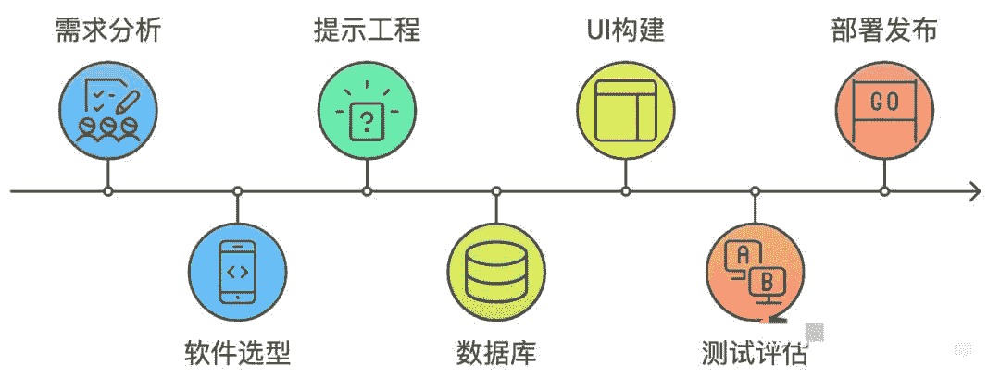
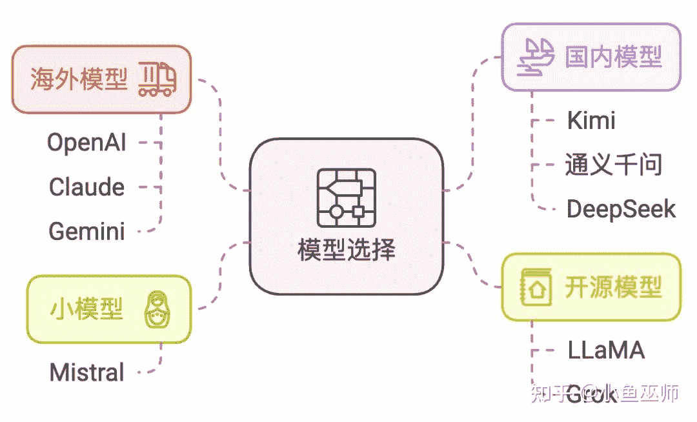

# 从0-1打造商用 AI Agent（智能体）

> 来源：[https://v11enp9ok1h.feishu.cn/docx/PQOHdSDiqoL9lExPBc2crkmGnEg](https://v11enp9ok1h.feishu.cn/docx/PQOHdSDiqoL9lExPBc2crkmGnEg)

# 一、什么是智能体？

智能体是[一种能够感知](https://zhida.zhihu.com/search?content_id=254820407&content_type=Article&match_order=1&q=%E5%8F%8D%E5%BA%94%E5%BC%8F%E6%99%BA%E8%83%BD%E4%BD%93&zhida_source=entity)其所处环境、做出决策并采取行动以实现特定目标的自主实体。智能体的复杂程度各不相同，从简单的对刺激做出反应的反应式智能体，到能够随着时间推移进行学习和适应的更高级的智能体。

**常见的智能体类型包括：**

+   **反应式智能体**：直接对环境变化做出反应，没有内部记忆。

+   [**基于模型的智能体**](https://zhida.zhihu.com/search?content_id=254820407&content_type=Article&match_order=1&q=%E5%9F%BA%E4%BA%8E%E6%A8%A1%E5%9E%8B%E7%9A%84%E6%99%BA%E8%83%BD%E4%BD%93&zhida_source=entity)：利用对世界的内部模型来做出决策。

+   [**基于目标的智能体**](https://zhida.zhihu.com/search?content_id=254820407&content_type=Article&match_order=1&q=%E5%9F%BA%E4%BA%8E%E7%9B%AE%E6%A0%87%E7%9A%84%E6%99%BA%E8%83%BD%E4%BD%93&zhida_source=entity)：根据要实现的特定目标来规划行动。

+   [**基于效用的智能体**](https://zhida.zhihu.com/search?content_id=254820407&content_type=Article&match_order=1&q=%E5%9F%BA%E4%BA%8E%E6%95%88%E7%94%A8%E7%9A%84%E6%99%BA%E8%83%BD%E4%BD%93&zhida_source=entity)：基于效用函数评估潜在行动，以实现结果的最大化。

聊天机器人、推荐系统和自动驾驶汽车都是智能体的实际应用例子，它们各自利用不同类型的智能体来高效且智能地执行任务。

我们构建的智能体核心组件包括：

+   **模型**：智能体的 “大脑”，负责处理输入并生成响应。

+   **工具**：根据用户请求，智能体可以执行的预定义函数。

+   **工具箱**：智能体可使用的工具集合。

+   [**系统提示**](https://zhida.zhihu.com/search?content_id=254820407&content_type=Article&match_order=1&q=%E7%B3%BB%E7%BB%9F%E6%8F%90%E7%A4%BA&zhida_source=entity)：指导智能体如何处理用户输入并选择正确工具的指令集。

# 二、实现过程

现在，让我们挽起袖子，开始动手构建吧！



## 2.1 准备工作

本教程的完整代码可在AI智能体的GitHub仓库中获取。你可以在 “Build an Agent from Scratch” 这里找到具体实现。在运行代码之前，请确保你的系统满足以下先决条件：

#### Python环境设置

运行AI智能体需要安装Python。按照以下步骤来设置你的环境：

+   安装Python（如果尚未安装）：从http://python.org下载并安装Python（推荐3.8及以上版本）。

+   **验证安装**：在命令行中输入python --version，查看是否正确安装。

+   **创建虚拟环境（推荐）**：使用虚拟环境来管理依赖项是个不错的选择。在命令行中输入python -m venv ai_agents_env创建虚拟环境，然后通过source ai_agents_env/bin/activate激活它。

+   **安装所需依赖项**：导航到代码仓库目录，然后在命令行中输入pip install -r requirements.txt来安装所需的依赖库。

#### 本地设置Ollama

Ollama用于高效地运行和管理本地语言模型。按照以下步骤安装和配置它：

+   **下载并安装Ollama**：访问Ollama的官方网站，下载适合你操作系统的安装程序，并按照平台对应的说明进行安装。

+   **验证Ollama安装**：在命令行中运行ollama --version，检查Ollama是否正确安装。

+   **拉取模型（如有需要）**：有些智能体实现可能需要特定的模型。你可以使用ollama pull mistral命令拉取模型。

### AI Agent 选型

第二步，我们需要根据场景选择 AI Agent 开发平台，选择合适的大模型，并选用不同的工具来执行不同系统的操作。

### 选择哪个 AI Agent 平台

先说说 AI Agent 开发平台，Dify、Coze、FastGPT 等这么多无代码 Agent 开发平台，我们该选择哪个比较合适呢？

+   **Coze **只能使用云端，不能在本地部署。

+   **Dify**是完全开源的，没有限制，但在知识问答方面的能力较弱。

+   **FastGPT** 的使用有一定限制，但在知识回答方面的能力相对较强。

> 更高级的开发平台，如 LangGraph、CrewAI 等，可以让 AI 自我规划并执行任务，但是需要编写代码。

> 是否选择这些平台，取决于我们的具体需求，当然也可以混合使用。

> 这就要求我们深入了解每个开发平台的特点，它擅长什么、不擅长什么，存在哪些明显的缺陷。只有掌握了这些信息，才能根据我们的场景做出合适的选型。

### 选择哪个 LLM

[再说说大模型](https://zhida.zhihu.com/search?content_id=253679336&content_type=Article&match_order=1&q=OpenAI&zhida_source=entity)的[选择，现在有](https://zhida.zhihu.com/search?content_id=253679336&content_type=Article&match_order=1&q=Claude&zhida_source=entity)[海外的 Open](https://zhida.zhihu.com/search?content_id=253679336&content_type=Article&match_order=1&q=DeepSeek&zhida_source=entity)AI、Claude、G[emini](https://zhida.zhihu.com/search?content_id=253679336&content_type=Article&match_order=1&q=LLaMA&zhida_source=entity)，[也有国内](https://zhida.zhihu.com/search?content_id=253679336&content_type=Article&match_order=1&q=Grok&zhida_source=entity)的 Kim[i、通义千问和](https://zhida.zhihu.com/search?content_id=253679336&content_type=Article&match_order=1&q=Mistral&zhida_source=entity)近期爆火的 DeepSeek，还有一些开源模型如 LLaMA、Grok，也有像 Mistral 这样的小模型。



### 2.2 实现步骤

#### 步骤1：设置环境

除了Python，我们还需要安装一些必要的库。在本教程中，我们将使用requests、json和termcolor库。另外，我们会使用dotenv来管理环境变量。在命令行中输入pip install requests termcolor python-dotenv进行安装。

#### 步骤2：定义模型类

我们首先需要一个能够处理用户输入的模型。我们将创建一个OllamaModel类，它通过与本地API进行交互来生成响应。以下是基本实现代码：

```
from termcolor import colored
import os
from dotenv import load_dotenv
load_dotenv()
import requests
import json
import operator

class OllamaModel:
    def __init__(self, model, system_prompt, temperature=0, stop=None):
        &quot;&quot;&quot;
        用给定的参数初始化OllamaModel。
        参数:
        model (str): 要使用的模型名称。
        system_prompt (str): 要使用的系统提示。
        temperature (float): 模型的温度设置。
        stop (str): 模型的停止标记。
        &quot;&quot;&quot;
        self.model_endpoint = &quot;http://localhost:11434/api/generate&quot;
        self.temperature = temperature
        self.model = model
        self.system_prompt = system_prompt
        self.headers = {&quot;Content-Type&quot;: &quot;application/json&quot;}
        self.stop = stop

    def generate_text(self, prompt):
        &quot;&quot;&quot;
        根据提供的提示从Ollama模型生成响应。
        参数:
        prompt (str): 用于生成响应的用户查询。
        返回:
        dict: 模型的响应，以字典形式返回。
        &quot;&quot;&quot;
        payload = {
            &quot;model&quot;: self.model,
            &quot;format&quot;: &quot;json&quot;,
            &quot;prompt&quot;: prompt,
            &quot;system&quot;: self.system_prompt,
            &quot;stream&quot;: False,
            &quot;temperature&quot;: self.temperature,
            &quot;stop&quot;: self.stop
        }
        try:
            request_response = requests.post(
                self.model_endpoint,
                headers=self.headers,
                data=json.dumps(payload)
            )
            print(&quot;REQUEST RESPONSE&quot;, request_response)
            request_response_json = request_response.json()
            response = request_response_json[&#x27;response&#x27;]
            response_dict = json.loads(response)
            print(f&quot;\n\nResponse from Ollama model: {response_dict}&quot;)
            return response_dict
        except requests.RequestException as e:
            response = {&quot;error&quot;: f&quot;Error in invoking model! {str(e)}&quot;}
            return response
```

这个类使用模型名称、系统提示、温度和停止标记进行初始化。generate_text方法向模型API发送请求并返回响应。

#### 步骤3：为智能体创建工具

接下来是为我们的智能体创建可用的工具。这些工具是执行特定任务的简单Python函数。以下是一个基本计算器和字符串反转器的示例：

```
def basic_calculator(input_str):
    &quot;&quot;&quot;
    根据输入字符串或字典对两个数字执行数值运算。
    参数:
    input_str (str或dict): 要么是表示包含&#x27;num1&#x27;、&#x27;num2&#x27;和&#x27;operation&#x27;键的字典的JSON字符串，
    要么是直接的字典。例如: &#x27;{&quot;num1&quot;: 5, &quot;num2&quot;: 3, &quot;operation&quot;: &quot;add&quot;}&#x27;
    或{&quot;num1&quot;: 67869, &quot;num2&quot;: 9030393, &quot;operation&quot;: &quot;divide&quot;}
    返回:
    str: 运算的格式化结果。
    抛出:
    Exception: 如果在运算过程中发生错误（例如，除以零）。
    ValueError: 如果请求了不支持的运算或输入无效。
    &quot;&quot;&quot;
    try:
        if isinstance(input_str, dict):
            input_dict = input_str
        else:
            input_str_clean = input_str.replace(&quot;&#x27;&quot;, &quot;\&quot;&quot;)
            input_str_clean = input_str_clean.strip().strip(&quot;\&quot;&quot;)
            input_dict = json.loads(input_str_clean)
        if not all(key in input_dict for key in [&#x27;num1&#x27;, &#x27;num2&#x27;, &#x27;operation&#x27;]):
            return &quot;Error: Input must contain &#x27;num1&#x27;, &#x27;num2&#x27;, and &#x27;operation&#x27;&quot;
        num1 = float(input_dict[&#x27;num1&#x27;])
        num2 = float(input_dict[&#x27;num2&#x27;])
        operation = input_dict[&#x27;operation&#x27;].lower()
    except (json.JSONDecodeError, KeyError) as e:
        return &quot;Invalid input format. Please provide valid numbers and operation.&quot;
    except ValueError as e:
        return &quot;Error: Please provide valid numerical values.&quot;
    operations = {
        &#x27;add&#x27;: operator.add,
        &#x27;plus&#x27;: operator.add,
      &#x27;subtract&#x27;: operator.sub,
      &#x27;minus&#x27;: operator.sub,
      &#x27;multiply&#x27;: operator.mul,
        &#x27;times&#x27;: operator.mul,
        &#x27;divide&#x27;: operator.truediv,
        &#x27;floor_divide&#x27;: operator.floordiv,
      &#x27;modulus&#x27;: operator.mod,
        &#x27;power&#x27;: operator.pow,
        &#x27;lt&#x27;: operator.lt,
        &#x27;le&#x27;: operator.le,
        &#x27;eq&#x27;: operator.eq,
        &#x27;ne&#x27;: operator.ne,
        &#x27;ge&#x27;: operator.ge,
        &#x27;gt&#x27;: operator.gt
    }
    if operation not in operations:
        return f&quot;Unsupported operation: &#x27;{operation}&#x27;. Supported operations are: {&#x27;, &#x27;.join(operations.keys())}&quot;
    try:
        if (operation in [&#x27;divide&#x27;, &#x27;floor_divide&#x27;,&#x27;modulus&#x27;]) and num2 == 0:
            return &quot;Error: Division by zero is not allowed&quot;
        result = operations[operation](num1, num2)
        if isinstance(result, bool):
            result_str = &quot;True&quot; if result else &quot;False&quot;
        elif isinstance(result, float):
            result_str = f&quot;{result:.6f}&quot;.rstrip(&#x27;0&#x27;).rstrip(&#x27;.&#x27;)
        else:
            result_str = str(result)
        return f&quot;The answer is: {result_str}&quot;
    except Exception as e:
        return f&quot;Error during calculation: {str(e)}&quot;


def reverse_string(input_string):
    &quot;&quot;&quot;
    反转给定的字符串。
    参数:
    input_string (str): 要反转的字符串。
    返回:
    str: 反转后的字符串。
    &quot;&quot;&quot;
    if not isinstance(input_string, str):
        return &quot;Error: Input must be a string&quot;
    reversed_string = input_string[::-1]
    result = f&quot;The reversed string is: {reversed_string}&quot;
    return result
```

这些函数根据提供的输入执行特定任务。basic_calculator处理算术运算，而reverse_string则反转给定的字符串。

#### 步骤4：构建工具箱

[ToolBox](https://zhida.zhihu.com/search?content_id=254820407&content_type=Article&match_order=1&q=ToolBox&zhida_source=entity)类用于存储智能体可以使用的所有工具，并为每个工具提供描述：

```
class ToolBox:
    def __init__(self):
        self.tools_dict = {}

    def store(self, functions_list):
        &quot;&quot;&quot;
        存储列表中每个函数的名称和文档字符串。
        参数:
        functions_list (list): 要存储的函数对象列表。
        返回:
        dict: 以函数名称为键，其文档字符串为值的字典。
        &quot;&quot;&quot;
        for func in functions_list:
            self.tools_dict[func.__name__] = func.__doc__
        return self.tools_dict

    def tools(self):
        &quot;&quot;&quot;
        将store方法中创建的字典转换为文本字符串返回。
        返回:
        str: 存储的函数及其文档字符串的字典，以文本字符串形式返回。
        &quot;&quot;&quot;
        tools_str = &quot;&quot;
        for name, doc in self.tools_dict.items():
            tools_str += f&quot;{name}: \&quot;{doc}\&quot;\n&quot;
        return tools_str.strip()
```

这个类将帮助智能体了解哪些工具可用以及每个工具的用途。

#### 步骤5：创建智能体类

智能体需要进行思考、决定使用哪个工具并执行它。以下是Agent类的代码：

```
agent_system_prompt_template = &quot;&quot;&quot;
你是一个智能AI助手，可以使用特定的工具。你的回复必须始终采用以下JSON格式：
{
    &quot;tool_choice&quot;: &quot;name_of_the_tool&quot;,
    &quot;tool_input&quot;: &quot;inputs_to_the_tool&quot;
}
工具及使用场景：
1. basic_calculator：用于任何数学计算
    - 输入格式: {{&quot;num1&quot;: number, &quot;num2&quot;: number, &quot;operation&quot;: &quot;add/subtract/multiply/divide&quot;}}
    - 支持的运算: add/plus, subtract/minus, multiply/times, divide
    - 示例输入和输出:
        - 输入: &quot;Calculate 15 plus 7&quot;
        - 输出: {{&quot;tool_choice&quot;: &quot;basic_calculator&quot;, &quot;tool_input&quot;: {{&quot;num1&quot;: 15, &quot;num2&quot;: 7, &quot;operation&quot;: &quot;add&quot;}}}}
        - 输入: &quot;What is 100 divided by 5?&quot;
        - 输出: {{&quot;tool_choice&quot;: &quot;basic_calculator&quot;, &quot;tool_input&quot;: {{&quot;num1&quot;: 100, &quot;num2&quot;: 5, &quot;operation&quot;: &quot;divide&quot;}}}}
2. reverse_string：用于任何涉及反转文本的请求
    - 输入格式: 仅需反转的文本字符串
    - 当用户提到“reverse”、“backwards”或要求反转文本时，始终使用此工具
    - 示例输入和输出:
        - 输入: &quot;Reverse of &#x27;Howwwww&#x27;?&quot;
        - 输出: {{&quot;tool_choice&quot;: &quot;reverse_string&quot;, &quot;tool_input&quot;: &quot;Howwwww&quot;}}
        - 输入: &quot;What is the reverse of Python?&quot;
        - 输出: {{&quot;tool_choice&quot;: &quot;reverse_string&quot;, &quot;tool_input&quot;: &quot;Python&quot;}}
3. no tool：用于一般对话和问题
    - 示例输入和输出:
        - 输入: &quot;Who are you?&quot;
        - 输出: {{&quot;tool_choice&quot;: &quot;no tool&quot;, &quot;tool_input&quot;: &quot;I am an AI assistant that can help you with calculations, reverse text, and answer questions. I can perform mathematical operations and reverse strings. How can I help you today?&quot;}}
        - 输入: &quot;How are you?&quot;
        - 输出: {{&quot;tool_choice&quot;: &quot;no tool&quot;, &quot;tool_input&quot;: &quot;I&#x27;m functioning well, thank you for asking! I&#x27;m here to help you with calculations, text reversal, or answer any questions you might have.&quot;}}
严格规则：
1. 对于关于身份、能力或感受的问题：
    - 始终使用“no tool”
    - 提供完整、友好的回复
    - 提及你的能力
2. 对于任何文本反转请求：
    - 始终使用“reverse_string”
    - 仅提取要反转的文本
    - 去除引号、“reverse of”和其他多余文本
3. 对于任何数学运算：
    - 始终使用“basic_calculator”
    - 提取数字和运算
    - 将文本形式的数字转换为数字
以下是你的工具列表及其描述：
{tool_descriptions}
记住：你的回复必须始终是包含“tool_choice”和“tool_input”字段的有效JSON。
&quot;&quot;&quot;


class Agent:
    def __init__(self, tools, model_service, model_name, stop=None):
        &quot;&quot;&quot;
        用工具列表和模型初始化智能体。
        参数:
        tools (list): 工具函数列表。
        model_service (class): 具有generate_text方法的模型服务类。
        model_name (str): 要使用的模型名称。
        &quot;&quot;&quot;
        self.tools = tools
        self.model_service = model_service
        self.model_name = model_name
        self.stop = stop

    def prepare_tools(self):
        &quot;&quot;&quot;
        将工具存储在工具箱中并返回其描述。
        返回:
        str: 存储在工具箱中的工具的描述。
        &quot;&quot;&quot;
        toolbox = ToolBox()
        toolbox.store(self.tools)
        tool_descriptions = toolbox.tools()
        return tool_descriptions

    def think(self, prompt):
        &quot;&quot;&quot;
        使用系统提示模板和工具描述在模型上运行generate_text方法。
        参数:
        prompt (str): 用于生成响应的用户查询。
        返回:
        dict: 模型的响应，以字典形式返回。
        &quot;&quot;&quot;
        tool_descriptions = self.prepare_tools()
        agent_system_prompt = agent_system_prompt_template.format(tool_descriptions=tool_descriptions)
        if self.model_service == OllamaModel:
            model_instance = self.model_service(
                model=self.model_name,
                system_prompt=agent_system_prompt,
                temperature=0,
                stop=self.stop
            )
        else:
            model_instance = self.model_service(
                model=self.model_name,
                system_prompt=agent_system_prompt,
                temperature=0
            )
        agent_response_dict = model_instance.generate_text(prompt)
        return agent_response_dict

    def work(self, prompt):
        &quot;&quot;&quot;
        解析think方法返回的字典并执行相应的工具。
        参数:
        prompt (str): 用于生成响应的用户查询。
        返回:
        执行相应工具的响应，如果未找到匹配的工具，则返回tool_input。
        &quot;&quot;&quot;
        agent_response_dict = self.think(prompt)
        tool_choice = agent_response_dict.get(&quot;tool_choice&quot;)
        tool_input = agent_response_dict.get(&quot;tool_input&quot;)
        for tool in self.tools:
            if tool.__name__ == tool_choice:
                response = tool(tool_input)
                print(colored(response, &#x27;cyan&#x27;))
                return
        print(colored(tool_input, &#x27;cyan&#x27;))
        return
```

这个类有三个主要方法：

+   prepare_tools：存储并返回工具的描述。

+   think：根据用户提示决定使用哪个工具。

+   work：执行选择的工具并返回结果。

#### 步骤6：运行智能体

最后，让我们把所有内容整合起来，运行我们的智能体。在脚本的主程序部分，初始化智能体并开始接受用户输入：

```
if __name__ == &quot;__main__&quot;:
    &quot;&quot;&quot;
    使用此智能体的说明：
    你可以尝试的示例查询：
    1. 计算器运算:
        - &quot;Calculate 15 plus 7&quot;
        - &quot;What is 100 divided by 5?&quot;
        - &quot;Multiply 23 and 4&quot;
    2. 字符串反转:
        - &quot;Reverse the word &#x27;hello world&#x27;&quot;
        - &quot;Can you reverse &#x27;Python Programming&#x27;?&quot;
    3. 一般问题（将得到直接回复）:
        - &quot;Who are you?&quot;
        - &quot;What can you help me with?&quot;
    Ollama命令（在终端中运行这些命令）:
        - 查看可用模型:    &#x27;ollama list&#x27;
        - 查看正在运行的模型:      &#x27;ps aux | grep ollama&#x27;
        - 列出模型标签:          &#x27;curl http://localhost:11434/api/tags&#x27;
        - 拉取新模型:         &#x27;ollama pull mistral&#x27;
        - 运行模型服务器:         &#x27;ollama serve&#x27;
    &quot;&quot;&quot;
    tools = [basic_calculator, reverse_string]
    model_service = OllamaModel
    model_name = &quot;llama2&quot;
    stop = &quot;&lt;|eot_id|&gt;&quot;
    agent = Agent(tools=tools, model_service=model_service, model_name=model_name, stop=stop)
    print(&quot;\nWelcome to the AI Agent! Type &#x27;exit&#x27; to quit.&quot;)
    print(&quot;You can ask me to:&quot;)
    print(&quot;1. Perform calculations (e.g., &#x27;Calculate 15 plus 7&#x27;)&quot;)
    print(&quot;2. Reverse strings (e.g., &#x27;Reverse hello world&#x27;)&quot;)
    print(&quot;3. Answer general questions\n&quot;)
    while True:
        prompt = input(&quot;Ask me anything: &quot;)
        if prompt.lower() == &quot;exit&quot;:
            break
        agent.work(prompt)
```

## 结论

在这篇博文中，我们从理解智能体是什么开始，逐步实现了一个智能体。我们设置了环境，定义了模型，创建了必要的工具，并构建了一个结构化的工具箱来支持智能体的功能。最后，我们通过运行智能体，将所有内容整合到了一起。