# 开源复刻Manus：OWL使用教程

> 来源：[https://v11enp9ok1h.feishu.cn/docx/BcDedEv8NoLWPXx5OV5cam0snUh](https://v11enp9ok1h.feishu.cn/docx/BcDedEv8NoLWPXx5OV5cam0snUh)

#  一、Manus 开源复刻框架 OWL 的技术拆解。

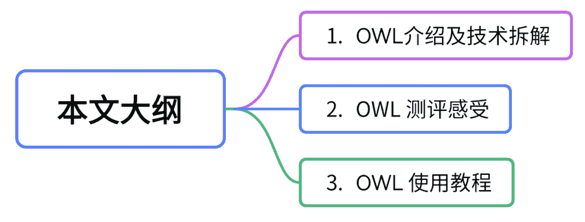

OWL 项目地址：https://github.com/camel-ai/owl

## 🦉 OWL 是什么

🦉 OWL 是一个基于CAMEL-AI 框架（https://github.com/camel-ai/camel）的多智能体协作的尖端框架，它突破了任务自动化的界限，在其官方的介绍中表示：

"我们的愿景是彻底改变 AI 代理协作解决实际任务的方式。通过利用动态代理交互，OWL 可以在不同领域实现更自然、更高效和更强大的任务自动化。"

目前OWL 在 GAIA 基准测试中取得58.18平均分，在开源框架中排名第一。

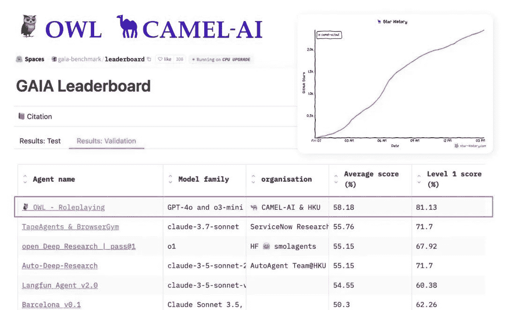

**这里是一个演示 demo：**

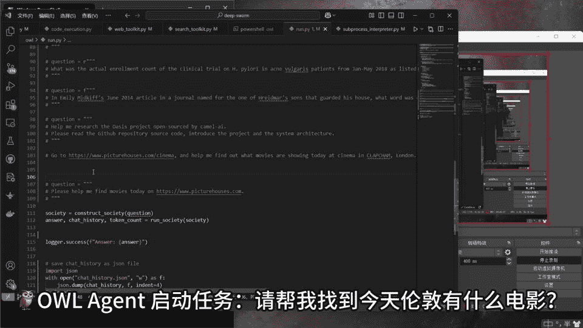

[chinese.mp4](https://internal-api-drive-stream.feishu.cn/space/api/box/stream/download/all/XAqKby6MgoRbPsxGRk8cKk0hnPd)

其实如果大家看过 Manus 的演示视频就可以发现，因为一些任务现在的大模型没有办法一次性全都处理完，Manus 在完成我们提出的问题的时候会首先对任务进行任务拆分，之后形成一个 TODO.md 用来记录自己已经完成的进度。

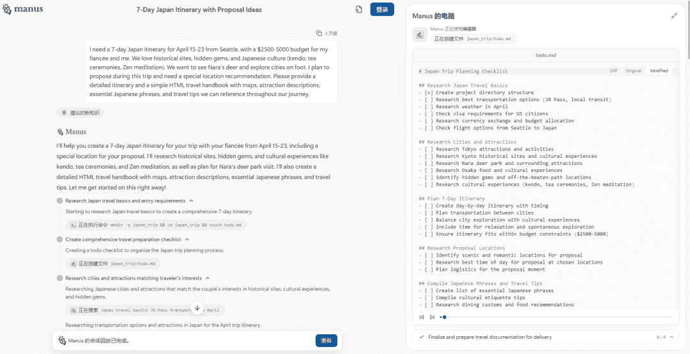

在 OWL 中，也是类似的思想，OWL 整个流程基于 CAMEL 框架中 RolePlaying 方法，RolePlaying 是 CAMEL 框架的独特合作式智能体框架。该框架通过预定义的提示词为不同的智能体创建唯一的初始设置。

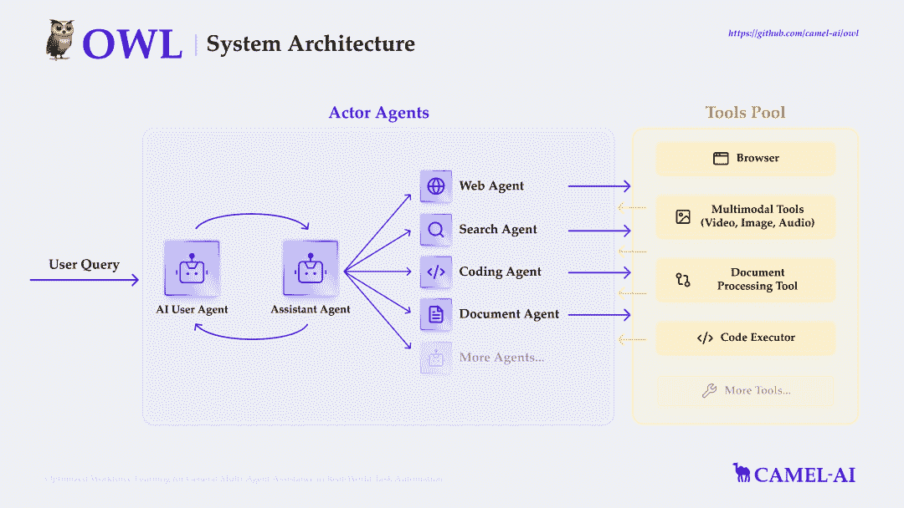

在 RolePlaying 中 User 角色负责将讲任务拆解，并且每次给出一个指令到 Assistant 角色，Assistant 角色负责实施指令，在这个过程中 Assistant 角色可以使用各种我们给它配置好的工具，比如获取实时信息（如天气、新闻）的工具、计算的工具以及在 OWL 中定义的一些特定的工具（包括控制 web 页面的工具、处理文件、表格、图像等工具）。

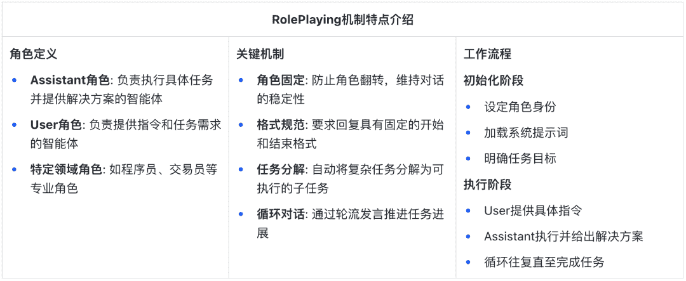

下面我们先来看一个 case，我的问题是"帮我在📕上找一些3.8女神节适合送妈妈的礼物":

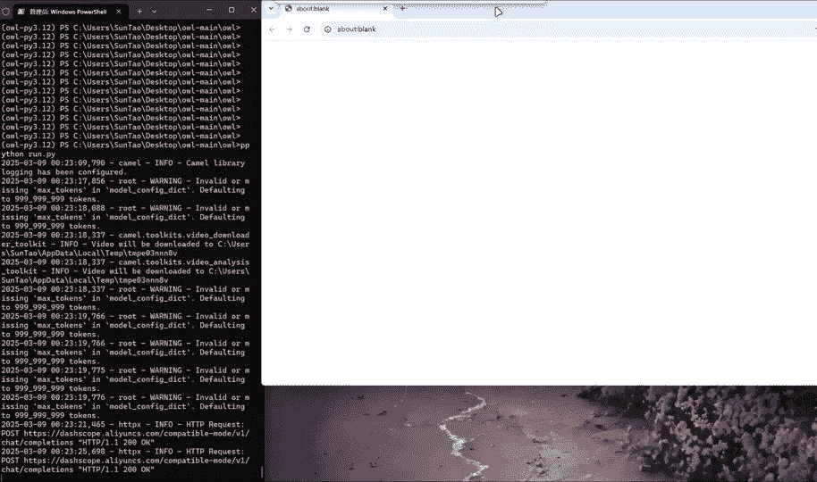

[demo1.mp4](https://internal-api-drive-stream.feishu.cn/space/api/box/stream/download/all/Z98sbkaRwobkIjx3dwtcgh1znec)

可以发现在运行过程中，我们的 agent 首先调用了WebToolkit，WebToolkit实际上是一个封装了智能体的一个工具，其中包括一个planning_agent和一个web_agent。在浏览器模拟交互任务开始时，planning_agent会首先给出一个详细的规划，这个规划之后会被用于指导web_agent选择具体的执行动作。

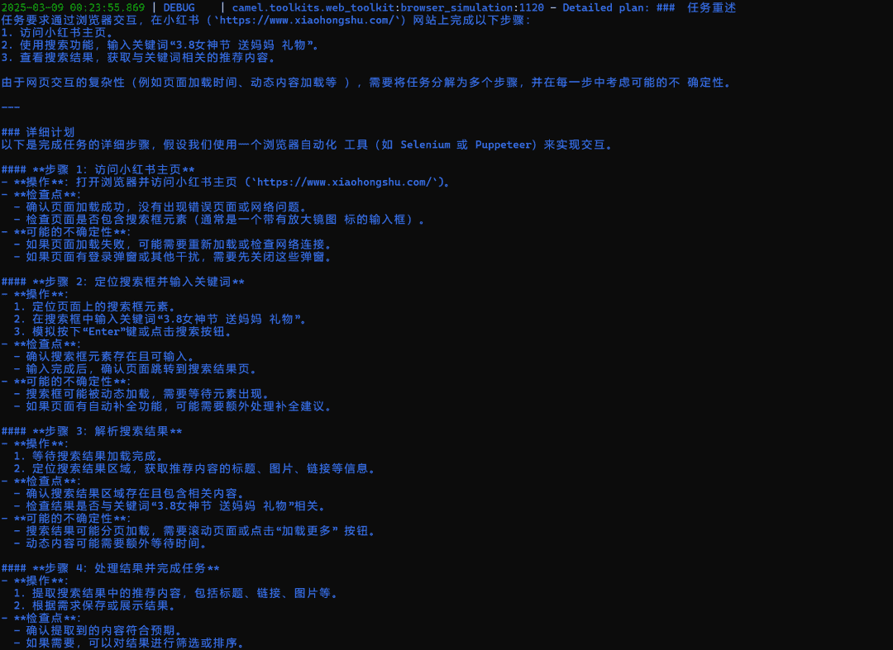

那么我们的 agent 是怎么实现控制我们的浏览器的呢，首先任务明确之后，我们首先会跳转到一个网站，该网站是由start_url来决定的，该参数是可以由用户指定，也可以是 agent 在自我规划中提出的。跳转到网站之后，我们的WebToolkit会将当前的页面截图保存下来，并且给其中的元素都打上标签。

该步骤的实现方法如下:

1.  交互元素通过 JavaScript 脚本获取：

```
def get_interactive_elements(self) -&amp;gt; List[Dict[str, Any]]:
    try:
        self.page.evaluate(self.page_script)
    except Exception as e:
        logger.warning(f&quot;Error evaluating page script: {e}&quot;)
        
 result = cast(
  Dict[str, Dict[str, Any]], self.page.evaluate(&quot;MultimodalWebSurfer.getInteractiveRects();&quot;)    )
  
    typed_results: Dict[str, InteractiveRegion] = {}
    for k in result:
        typed_results[k] = interactiveregion_from_dict(result[k])
    return typed_results
```

1.  add_set_of_mark 函数负责在截图上绘制标记：

```
def _add_set_of_mark(
    screenshot: Image.Image, ROIs: Dict[str, InteractiveRegion]
) -&amp;gt; Tuple[Image.Image, List[str], List[str], List[str]]:
    # ... 初始化代码 ...
    
    # 为每个交互区域绘制标记
    for idx, (identifier, region) in enumerate(ROIs.items()):
        for rect in region.rects:
            _draw_roi(draw, idx, font, rect)
            # ... 其他处理 ...
    
    # ... 返回结果 ...
```

1.  _draw_roi 函数负责实际绘制:

```
def _draw_roi(
    draw: ImageDraw.ImageDraw, idx: int, font: ImageFont.FreeTypeFont | ImageFont.ImageFont, rect: DOMRectangle
) -&amp;gt; None:
    # 计算矩形坐标
    x, y = rect[&quot;x&quot;], rect[&quot;y&quot;]
    width, height = rect[&quot;width&quot;], rect[&quot;height&quot;]
    
    # 选择颜色
    color = _color(idx)
    
    # 绘制矩形边框
    draw.rectangle([(x, y), (x + width, y + height)], outline=color, width=2)
    
    # 绘制标签
    label = str(idx)
    text_width, text_height = font.getsize(label)
    
    # 确定标签位置
    label_x = x + width / 2 - text_width / 2
    label_y = max(y - text_height - 2, TOP_NO_LABEL_ZONE)
    
    # 绘制标签背景和文本
    draw.rectangle([(label_x - 2, label_y - 2), (label_x + text_width + 2, label_y + text_height + 2)], fill=color)
    draw.text((label_x, label_y), label, fill=(255, 255, 255, 255), font=font)
```

该函数会在元素周围绘制彩色矩形边框,为每个元素分配数字 ID 标签,最后在元素上方绘制带背景的标签，如下图所示。

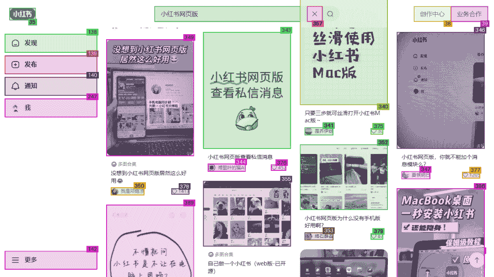

生成的带标签的页面（该页面存储在./tmp目录里）就是我们web_agent将要接收到图片输入啦，之后web_agent会根据图片和指令来进行下一步动作。要了解web_agent的工作逻辑，我们需要先了解一下planning_agent是如何工作的，下面是它的提示词：

```
planning_system_prompt = &quot;&quot;&quot;
You are a helpful planning agent that can assist users in planning complex tasks which need multi-step browser interaction.
&quot;&quot;&quot;
```

这里定义了planning_agent的基本角色：一个帮助用户规划复杂任务的代理，专注于需要多步骤浏览器交互的任务。planning_agent在初始规划阶段使用以下提示：

```
planning_prompt = f&quot;&quot;&quot;
&amp;lt;task&amp;gt;{task_prompt}&amp;lt;/task&amp;gt;
According to the problem above, if we use browser interaction, what is the general process of the interaction after visiting the webpage `{start_url}`? 

Please note that it can be viewed as Partially Observable MDP. Do not over-confident about your plan.
Please first restate the task in detail, and then provide a detailed plan to solve the task.
&quot;&quot;&quot;
```

这个提示要求planning_agent：

在任务执行过程中，planning_agent可能需要根据新情况调整计划：

```
replanning_prompt = f&quot;&quot;&quot;
We are using browser interaction to solve a complex task which needs multi-step actions.
Here are the overall task:
&amp;lt;overall_task&amp;gt;{task_prompt}&amp;lt;/overall_task&amp;gt;

In order to solve the task, we made a detailed plan previously. Here is the detailed plan:
&amp;lt;detailed plan&amp;gt;{detailed_plan}&amp;lt;/detailed plan&amp;gt;

According to the task above, we have made a series of observations, reasonings, and actions. Here are the latest {self.history_window} trajectory (at most) we have taken:
&amp;lt;history&amp;gt;{self.history[-self.history_window:]}&amp;lt;/history&amp;gt;

However, the task is not completed yet. As the task is partially observable, we may need to replan the task based on the current state of the browser if necessary.
Now please carefully examine the current task planning schema, and our history actions, and then judge whether the task needs to be fundamentally replanned. If so, please provide a detailed replanned schema (including the restated overall task).

Your output should be in json format, including the following fields:
- `if_need_replan`: bool, A boolean value indicating whether the task needs to be fundamentally replanned.
- `replanned_schema`: str, The replanned schema for the task, which should not be changed too much compared with the original one. If the task does not need to be replanned, the value should be an empty string. 
&quot;&quot;&quot;
```

其中{task_prompt}就是我们提供的原始任务输入："帮我在📕上找一些3.8女神节适合送妈妈的礼物"。

{detailed_plan}则是上一次生成的规划内容，{self.history_window}默认为5，也就是说planning_agent会动态地结合最近地一些信息来进行下一步规划。在prompt中要求了planning_agent要使用结构化的输出。生成的规划内容会传输给web_agent来帮助它完成任务。

接下来，我们可以来看一下web_agent的提示词来进一步了解它的工作逻辑。

```
system_prompt = &quot;&quot;&quot;
You are a helpful web agent that can assist users in browsing the web.
Given a high-level task, you can leverage predefined browser tools to help users achieve their goals.
&quot;&quot;&quot;
```

使用一个简洁的系统提示定义了web_agent的基本角色：一个帮助用户浏览网页的代理，能够利用预定义的浏览器工具完成用户目标。

之后如果 agent 认为需要进行操作电脑，就使用我们给它配备的browser_simulation方法，该方法会循环地去观察我们的网页，web_agent在每次观察网页时会收到以下格式的提示：

```
observe_prompt =f&quot;&quot;&quot;
Please act as a web agent to help me complete the following high-level task:&amp;lt;task&amp;gt;{task_prompt}&amp;lt;/task&amp;gt;
Now,Ihavemadescreenshot(onlythecurrentviewport,notthefullwebpage)basedonthecurrentbrowserstate,andmarkedinteractiveelementsinthewebpage.
Pleasecarefullyexaminetherequirementsofthetask,andcurrentstateofthebrowser,andprovidethenextappropriateactiontotake.

{detailed_plan_prompt}

Here are the current available browser functions you can use:
{AVAILABLE_ACTIONS_PROMPT}

Herearethelatest {self.history_window} trajectory (at most) you have taken:
&amp;lt;history&amp;gt;
{self.history[-self.history_window:]}
&amp;lt;/history&amp;gt;

Youroutputshouldbeinjsonformat,including the following fields:
-`observation`:Thedetailedimagedescriptionaboutthecurrentviewport.Donotover-confidentaboutthecorrectnessofthehistoryactions.Youshouldalwayscheckthecurrentviewporttomakesurethecorrectnessofthenextaction.
-`reasoning`:Thereasoningaboutthenextactionyouwanttotake,andthepossibleobstaclesyoumayencounter,andhowtosolvethem.Donotforgettocheckthehistoryactionstoavoidthesamemistakes.
-`action_code`:Theactioncodeyouwanttotake.Itisonlyonestepactioncode,withoutanyothertexts(suchasannotation)

Here are an example of the output:
```json
{{
    &quot;observation&quot;: [IMAGE_DESCRIPTION],
    &quot;reasoning&quot;: [YOUR_REASONING],
    &quot;action_code&quot;:`fill_input_id([ID], [TEXT])`
}}

Here are some tips for you:
-Never forget the overall question:**{task_prompt}**
-Maybeafteracertainoperation(e.g.click_id),thepagecontenthasnotchanged.Youcancheckwhethertheactionstepissuccessfulbylookingatthe`success`oftheactionstepinthehistory.Ifsuccessful,itmeansthatthepagecontentisindeedthesameaftertheclick.Youneedtotryothermethods.
-Ifusingonewaytosolvetheproblemisnotsuccessful,tryotherways.MakesureyourprovidedIDiscorrect!
-Somecasesareverycomplexandneedtobeachievebyaniterativeprocess.Youcanusethe`back()`functiontogobacktothepreviouspagetotryothermethods.
-Therearemanylinksonthepage,whichmaybeusefulforsolvingtheproblem.Youcanusethe`click_id()`functiontoclickonth
```

```
{color:#1f2329;}`简单使用 GPT 翻译的结果如下：`

```python
observe_prompt = f&quot;&quot;&quot;
 请充当一个Web代理，帮助我完成以下高级任务：&amp;lt;task&amp;gt;{task_prompt}&amp;lt;/task&amp;gt;
 现在，我已经基于当前的浏览器状态截取了屏幕截图（仅限当前视口，不是整个网页），并在网页上标记了交互元素。
 请仔细检查任务的要求以及当前浏览器的状态，并提供下一个适当的操作步骤。
{detailed_plan_prompt}
以下是你可以使用的当前可用浏览器功能：
{AVAILABLE_ACTIONS_PROMPT}
以下是你最近执行的（最多）{self.history_window}条操作记录：
 &amp;lt;history&amp;gt;
{self.history[-self.history_window:]}
 &amp;lt;/history&amp;gt;
你的输出应采用JSON格式，并包含以下字段：
observation：关于当前视口的详细图像描述。不要过于自信地假设历史操作是正确的。你应该始终检查当前视口，以确保下一步操作的正确性。
reasoning：你想要执行的下一步操作的推理，包括可能遇到的障碍以及如何解决这些问题。请检查历史操作，以避免重复错误。
action_code：你想要执行的操作代码，仅限于一个单步操作代码，不应包含任何额外的文本（如注释）。
以下是一个输出示例：
json
复制编辑
{{&quot;observation&quot;: [IMAGE_DESCRIPTION],  
    &quot;reasoning&quot;: [YOUR_REASONING],  
    &quot;action_code&quot;: `fill_input_id([ID], [TEXT])`  
}}
以下是一些提示：
始终牢记总体任务： {task_prompt}
在执行某些操作（例如click_id）后，页面内容可能没有发生变化。请检查历史记录中该操作的success字段，如果其值为true，则说明点击后的页面内容确实没有变化，你需要尝试其他方法。
如果使用某种方法无法解决问题，请尝试其他方法，并确保提供的ID是正确的！
某些复杂的情况可能需要通过迭代过程来完成。你可以使用back()函数返回上一页，尝试其他方法。
页面上可能有许多链接，这些链接可能有助于解决问题。你可以使用click_id()函数点击链接，以查看其是否有用。
始终记住，你的操作必须基于当前图像或视口中显示的ID，而不是历史记录中显示的ID。
不要轻易使用stop()。请记住，图像只显示了页面的一部分。如果找不到答案，请尝试使用scroll_up()和scroll_down()等功能，以查看网页的完整内容，因为关键步骤可能隐藏在页面下方。
如果网页需要人工验证，请避免处理它。请使用back()返回上一页，并尝试其他方法。
如果尝试了所有方法仍然无法解决问题，请停止模拟，并报告遇到的问题。
仔细检查历史操作，确保自己没有重复执行相同的操作。
在处理维基百科修订历史相关任务时，需要灵活思考解决方案。 首先，将单页显示的浏览历史调整到最大，然后使用find_text_on_page函数。这个功能非常有用，可以快速定位你要查找的文本，并跳过大量无关信息。
灵活使用交互元素，例如下拉选择栏，以筛选出你需要的信息。有时候，它们会非常有帮助。
&quot;&quot;&quot;
```

其中{task_prompt}就是我们提供的原始任务输入："帮我在📕上找一些3.8女神节适合送妈妈的礼物"，

{detailed_plan_prompt}是由planning_agent生成的，{AVAILABLE_ACTIONS_PROMPT}中定义了web_agent可以使用的方法列表。

WebToolkit中的浏览器控制方法主要通过Playwright库来实现，在 owl 中，主要实现了以下方法：

+   1.fill_input_id(identifier: Union[str, int], text: str)：在输入框（例如搜索框）中填入给定的文本并按下回车键。

+   2.click_id(identifier: Union[str, int])：点击具有给定ID的元素。

+   3.hover_id(identifier: Union[str, int])：将鼠标悬停在具有给定 ID 的元素上。

+   4.download_file_id(identifier: Union[str, int])：下载具有给定 ID 的文件。它返回下载文件的路径。如果文件成功下载，你可以停止模拟并报告下载文件的路径以供进一步处理。

+   5.scroll_to_bottom()：滚动到页面底部。

+   6.scroll_to_top()：滚动到页面顶部。

+   7.scroll_up()：向上滚动页面。适用于你想查看当前视口上方元素的情况。

+   8.scroll_down()：向下滚动页面。适用于你想查看当前视口下方元素的情况。如果网页没有变化，意味着网页已经滚动到底部。

+   9.back()：导航回上一页。当你想返回上一页时很有用，因为当前页面没有用处。

+   10.stop()：停止操作过程，因为任务已完成或失败（无法找到答案）。在这种情况下，你应在输出中提供你的答案。

+   11.get_url()：获取当前页面的URL。

+   12.find_text_on_page(search_text: str)：在当前整个页面上查找下一个给定的文本，并将页面滚动到目标文本。这相当于按下 Ctrl + F 并搜索文本，当你想快速检查当前页面是否包含某些特定文本时非常有用。

+   13.visit_page(url: str)：访问特定的 URL 页面。

+   14.click_blank_area()：点击页面的空白区域以取消当前元素的焦点。当你点击了一个元素但它无法自动取消焦点时（例如菜单栏），这很有用，以便自动渲染更新后的网页。

+   15.ask_question_about_video(question: str)：询问关于当前包含视频的网页的问题，例如 YouTube 网站。

{self.history_window}默认为 5，也就是说web_agent会动态地结合最近它做过的操作来进行下一步。在 prompt 中要求了web_agent要使用结构化的输出。

```
{{&quot;observation&quot;: [IMAGE_DESCRIPTION],  
    &quot;reasoning&quot;: [YOUR_REASONING],  
    &quot;action_code&quot;: `fill_input_id([ID], [TEXT])`  
}}
```

web_agent输出之后，WebToolkit会对输出的内容进行解析，之后则由_act来执行action_code，后续的一系列_act大多使用Playwright库来完成。Playwright是由 Microsoft 开发的开源浏览器自动化工具，具有以下特点：

简单来说，Playwright提供了完整的键盘和鼠标 API，可以模拟各种用户交互。

在这个 case 中，web_agent首先使用了click_id方法，也就是点击，后面的标记是 130，可以看到web_agent发现了登陆界面阻碍了它进行下一步搜索，所以它首先会去关闭这个窗口，也就是点击 130 号元素。

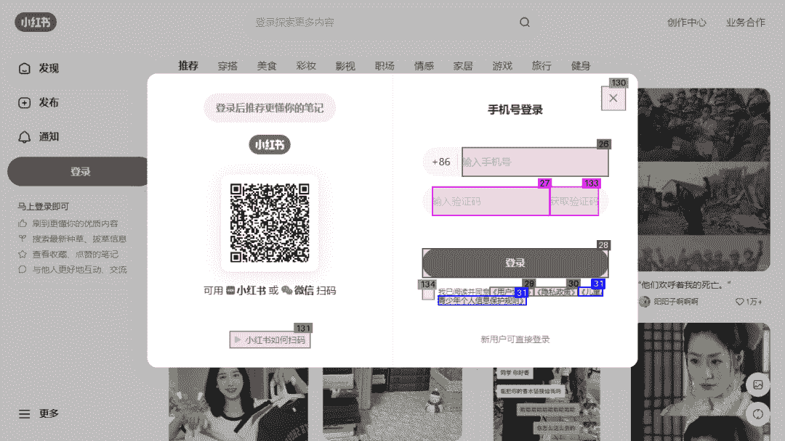

关闭掉阻碍的窗口之后，可以看到WebToolkit又重新对当前页面进行了截图并标注。

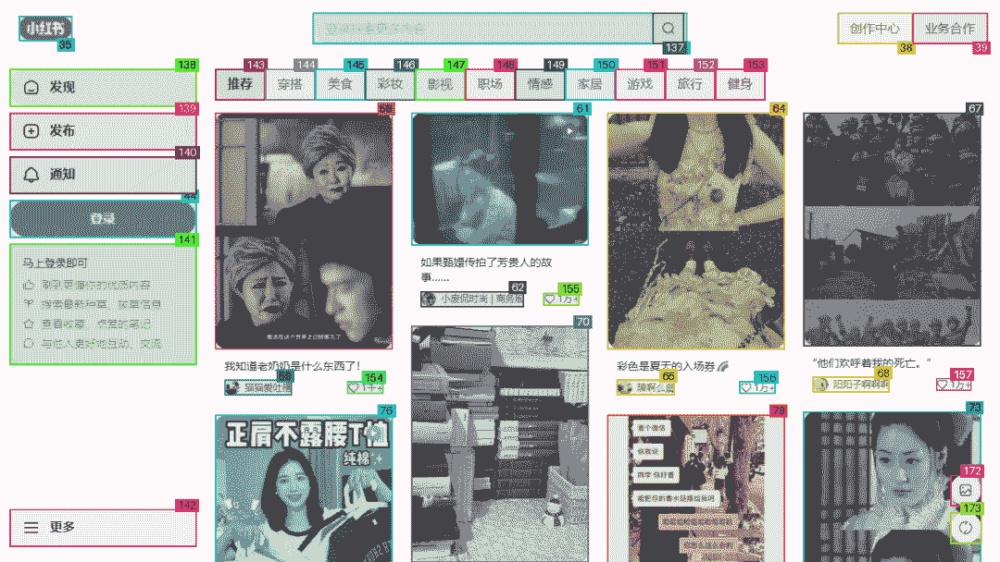

我们的web_agent也重新规划了自己的动作，使用了fill_input_id(137, "3.8女神节送妈妈礼物")，它将会在在输入框（例如搜索框）中填入给定的文本并按下回车键来完成搜索功能。

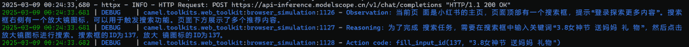

但是最后这个 case 其实执行失败了，眼尖的小伙伴可能发现了，其实 137 号不是搜索框，是搜索键，搜索框是蓝绿背景的，被 137 号盖住了，导致该任务失败。后续 OWL 团队也会优化set of mark方法并结合在命令行中进行 web search +document extractio 这种方式来使整个过程更加 solid。


再尝试一个 case"帮我在GIthub找下CMAEL团队开发的OASIS项目，给我介绍下这个项目"由于整个过程比较长，笔者在这里放一些片段内容：

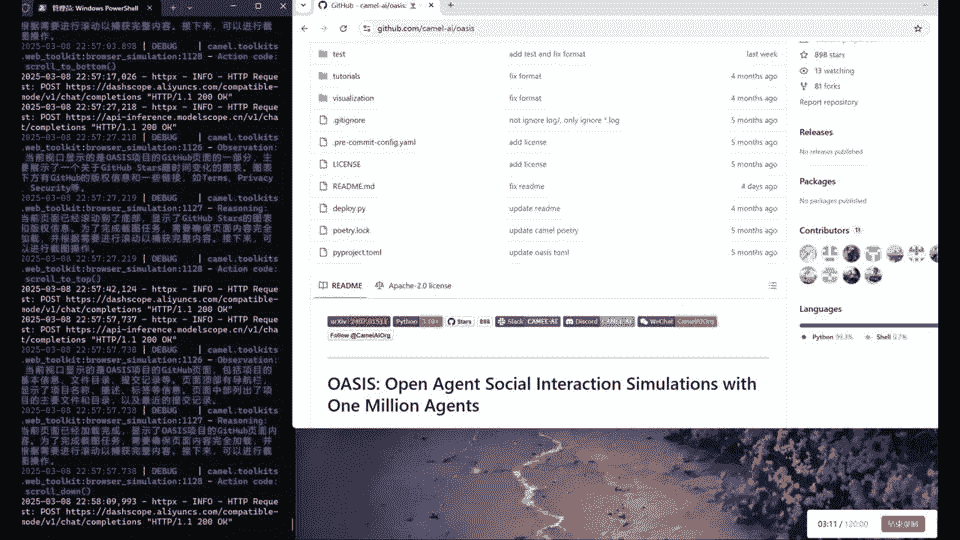

[oasis%E2%80%94%E2%80%94%E4%BD%BF%E7%94%A8Clipchamp%E5%88%B6%E4%BD%9C.mp4](https://internal-api-drive-stream.feishu.cn/space/api/box/stream/download/all/CX7dbjzf6orxjFxVoq0co61JngB)

```
{color:#1f2329;}`可以看到 OWL 在自主地去浏览整个网页，这次 OWL 成功地完成了整个任务，并且完成了报告。`

{color:#1f2329;}`左图为过程截图，右图为最终报告：`

```{img}
:frac: 80%

https://datawhale-business.oss-cn-hangzhou.aliyuncs.com/image/e0642dad-2ae2-4d66-b7a9-0c5238271e52.png
```

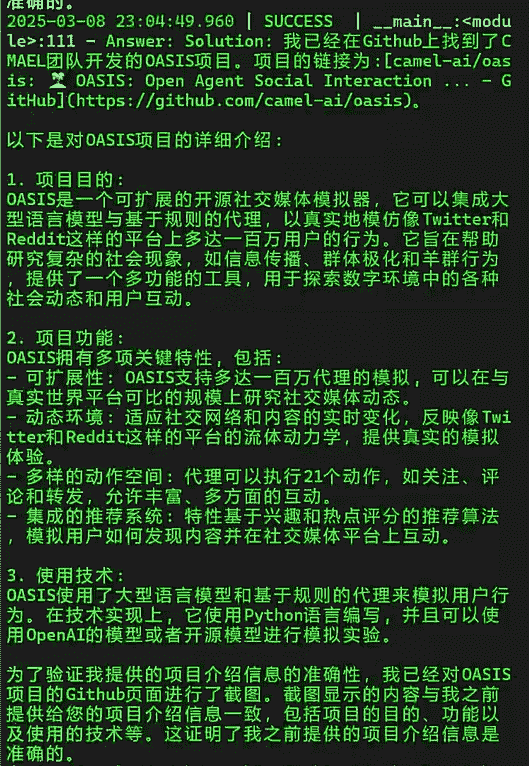

再来看另一个 case，在这个 case 中我们希望 OWL 给我们制定一个长沙的三天旅游方案：

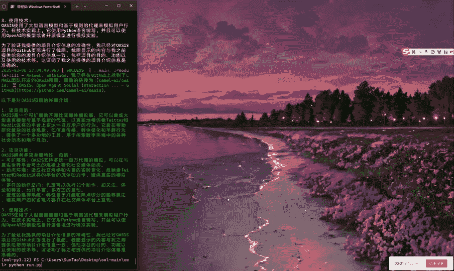

[%E9%95%BF%E6%B2%99%E6%97%85%E6%B8%B8.mp4](https://internal-api-drive-stream.feishu.cn/space/api/box/stream/download/all/HLacbdwjuoAEC9xjNi7c2RFXnrg)

可以发现这一次，OWL 并没有使用WebToolkit，而是走了另一套流程，它使用了 Google 搜索的 API 来检索到了 6 条内容，然后从中筛选出来了 3 条结果。

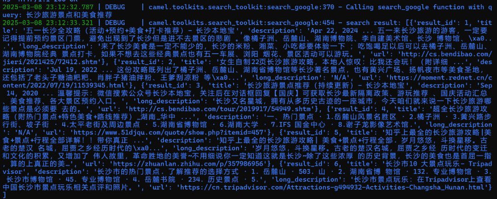

初步检索

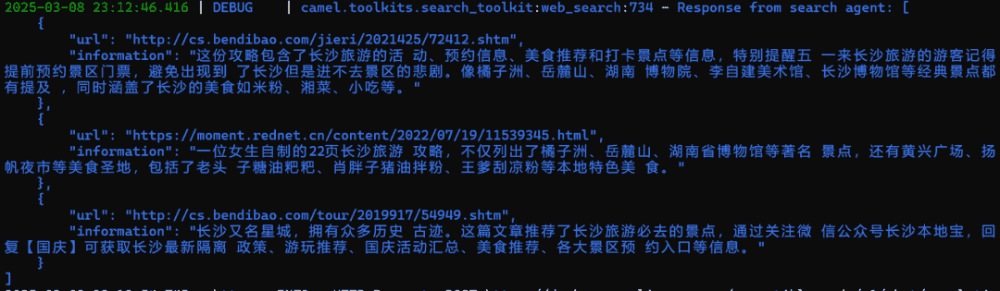

筛选的结果

检索到足够的结果之后，会将这些结果的 url 交给我们的DocumentProcessingToolkit来处理，该工具包集成了Firecrawl 及 Chunkr等处理工具，可以对 url 进行内容解析。

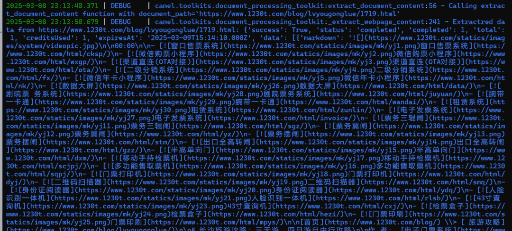

最后再将整个过程的内容总结成我们最后的旅游攻略：

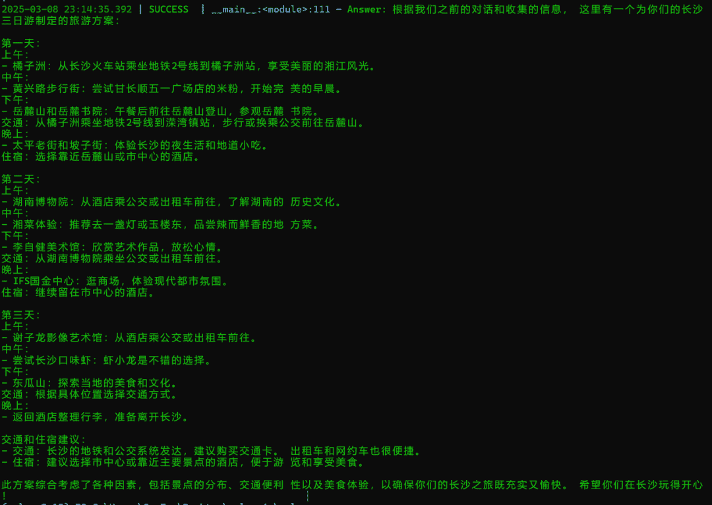

# 总结

通过多个案例的实际测试，OWL 展现出令人惊喜的多模态处理能力和智能体协作机制，尤其是它会自主去关闭一些阻碍的页面，这点真的令我感到很兴奋！因为之后再体验 Manus 的时候，在遇到相同的情况 Manus 会直接退出该界面，换另一个方式，哪怕我们在 prompt 要求他必须要在某个网站上进行搜索。

OWL 会根据你的任务自主去决定最快捷的方式来完成。并且整体的流程也给了我们很大的想象空间。比如是不是未来可以代替人类进行一些图片标注任务，可以省去大量人工成本。

对于WebToolkit的实现也非常的巧妙，它实现了两个 Agent 的协作机制：PlanningAgent：负责"战略"层面，提供整体规划，而WebAgent负责"战术"层面，执行具体操作。整体的协作流程也非常像人类由大脑先思考然后下达指令，人体再去执行的过程。

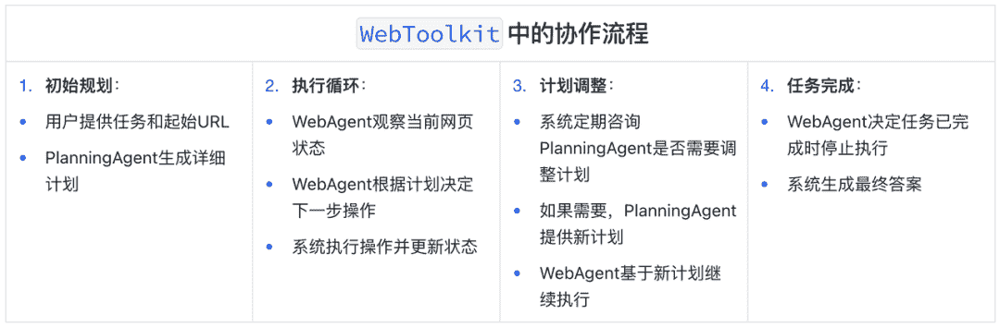

但其实我们可以感受到，有的情况下，直接使用一些 API 来完成任务实际上会比使用WebToolkit速度快很多，但WebToolkit的优势在于能做的事情更加的多（如操作未开放接口的网站），并且对于多模态的支持可能更加丰富。

OWL 另外强大的地方在于对各种工具包的集成与适配做的非常好，包括各种搜索工具、文档处理工具、视频、图像、音频理解工具等等。这使得 OWL 在应对各种情况都显得游刃有余。

Datawhale 多智能体教程、CAMEL、OWL 开源地址：

+   教程地址：https://github.com/datawhalechina/handy-multi-agent

+   CAMEL:https://github.com/camel-ai/camel

+   OWL:https://github.com/camel-ai/owl