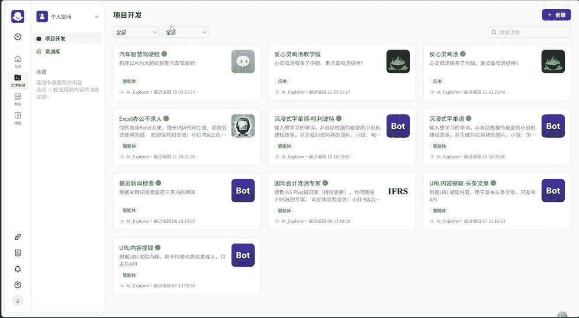
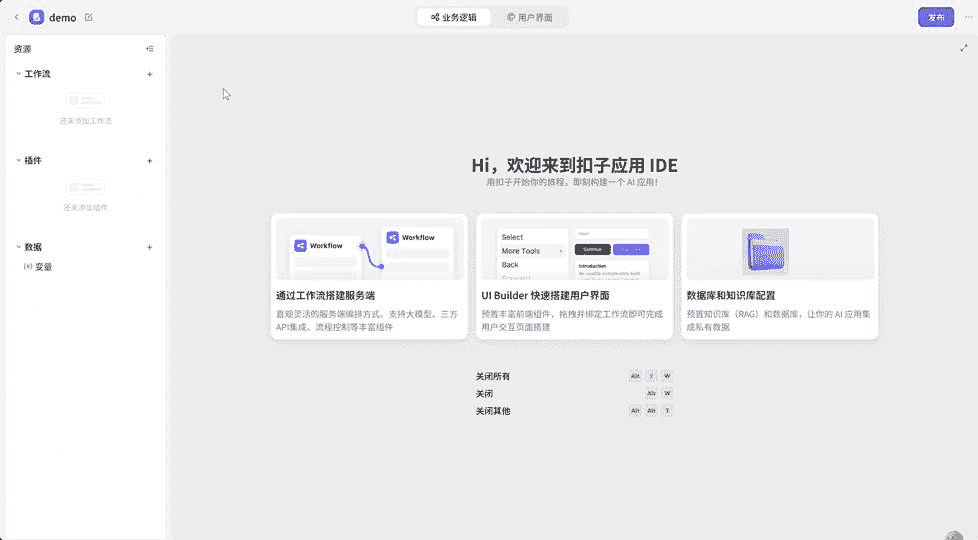
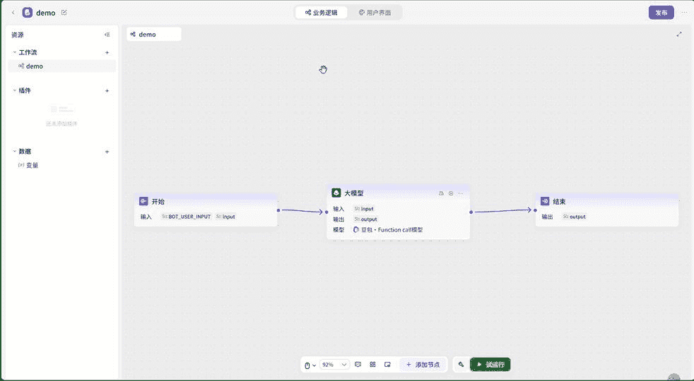
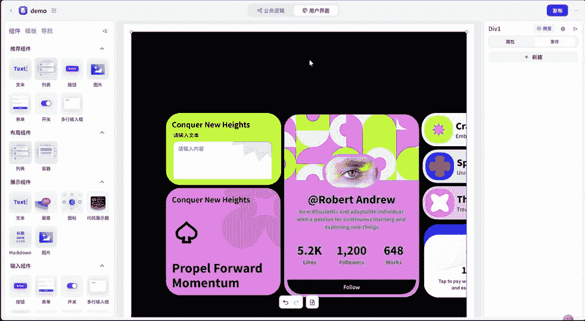
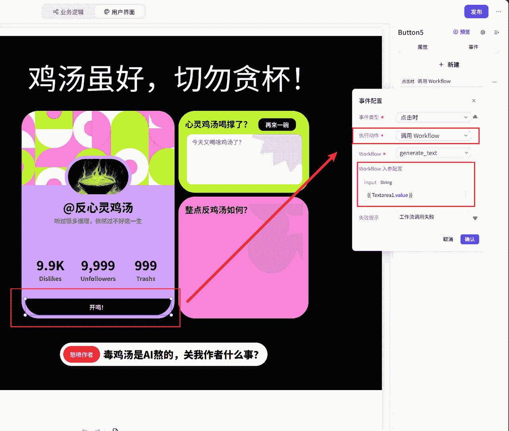
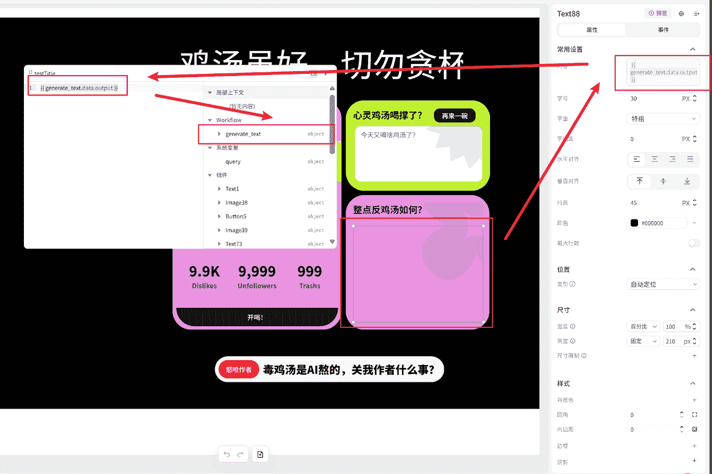
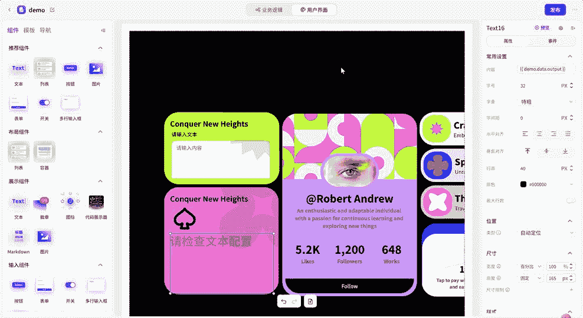

# Coze应用实战指南

> 来源：[https://v11enp9ok1h.feishu.cn/docx/SJFBdnxj6oMFz9xYhVfcYjz8n5e](https://v11enp9ok1h.feishu.cn/docx/SJFBdnxj6oMFz9xYhVfcYjz8n5e)

# 一、背景

+   背景：Coze新功能Coze IDE，可以无代码快速开发一个ai应用

+   目标群体：对Coze感兴趣，有ai相关idea的纯小白

+   应用场景：有一个和ai有关的idea，苦于不懂编程，无法实现

+   Coze解决方案：前端界面（无代码）+业务逻辑（工作流）+事件&绑定（前端与业务交互）

## Coze应用搭建的核心逻辑

不理解上述逻辑？没关系，通过实战案例进行拆解，帮助你理解Coze应用搭建的核心逻辑。

# 二、案例展示与拆解

## 前端与业务交互拆解

在Coze IDE中，前端界面通过事件、绑定和业务逻辑进行交互。

> 案例中的绑定

+   工作流的输入绑定前端界面的元素A，当用户在元素A输入内容后，工作流运行时会读取绑定的元素A的内容，并传递至工作流内的大模型

# 三、案例复刻

应用的搭建逻辑拆解完，下面进行实战演练，开始复刻案例应用

## 1、创建Coze应用

点击Coze创建，选择应用，选择空白，即可进入Coze IDE

[创建coze应用视频.mp4](https://internal-api-drive-stream.feishu.cn/space/api/box/stream/download/all/GiHxb7pqgoZiivxkYBbcM86FnFc)

## 2、搭建业务逻辑

进入Coze IDE后，默认显示业务逻辑编辑界面，基于业务逻辑搭建一个工作流

[搭建业务逻辑.mp4](https://internal-api-drive-stream.feishu.cn/space/api/box/stream/download/all/GpvwbQEuDoihJZxTBp4c3JgXnng)

业务逻辑的实现依靠工作流来实现，Coze IDE内编写工作流与捏bot编写工作流的逻辑完全一致，只是入口不同

> 大模型节点系统提示词如下：

> 你是一个致力于创作反心灵鸡汤的灵魂段子手

> #根据{{input}}创作对应的反心灵鸡汤

> #采用具有强烈讽刺意味的表达

> #风格应当毒舌、辛辣、讽刺

> #内容应当深刻、直击灵魂

> #内容应当精简，不超过50字

> #当{{input}}为空时，吐槽用户这个行为

> #当{{input}}涉及政治、党派、种族歧视等敏感内容时，拒绝创作，并吐槽用户的钓鱼行为

> #请尽情挥洒你的创造力

## 3、搭建用户界面

业务逻辑对应的工作流搭建完成后，进行用户交互页面的搭建，初学阶段推荐在官方模板基础上进行改动，本案例使用官方【极简主义-色彩碰撞】模板

[使用模板创建界面.mp4](https://internal-api-drive-stream.feishu.cn/space/api/box/stream/download/all/NePPbPSowolFjbxsdDPcfZGrnDg)

> 用户界面功能区的左侧，提供组件、模板、导航等功能

+   【组件】搭建前端应用界面的基础，Coze提供了丰富的组件类型，可以慢慢探索

本次案例会用到的组件主要是：输入组件的多行输入框、输入组件的按钮、展示组件的文本，即对应前文的核心前端设计拆解所需的元素

+   【模板】官方搭建好的前端界面案例，应用搭建人员可以直接套用，非常便捷

+   【导航】使用网页结构语言（html）的相关概念展示页面结构，例如Div（容器）

> 用户界面功能区的右侧，提供属性、事件查看功能

+   【属性】展示组件的大小、内容、位置、样式等等外观信息

+   【事件】展示组件关联的一些动作，例如点击组件可以跳转到新的页面或是点击组件可以触发功能流等等场景，事件是实现用户界面与业务逻辑交互的核心

## 4、搭建页面交互

当业务逻辑和用户界面都搭建完成后，需要实现用户界面与业务逻辑的交互

[交互逻辑绑定.mp4](https://internal-api-drive-stream.feishu.cn/space/api/box/stream/download/all/E3fcbDaBqoXvb7xDcpWcNgUlnNc)

> 按钮绑定工作流调用

按钮组件配置调用工作流事件，重点要注意的是，工作流的入参（工作流的输入）需要绑定到用户输入框，即把用户在页面输入的内容传递到工作流

> 展示组件绑定工作流

展示组件用于展示工作流最终生成的内容，因此需要将工作流的运行结果绑定展示组件

## 5、应用预览调试

[效果预览.mp4](https://internal-api-drive-stream.feishu.cn/space/api/box/stream/download/all/YeCSbefB9ob1bSxIpRtcHZdMn7b)

点击预览按钮，测试核心功能是否有效。核心功能验证通过后，剩下的工作只需要对应用进行美化，去除不需要的组件和组件排版即可。

# 四、总结

恭喜你，到这一步，你已经完成了一个Coze应用的开发！

现在，让我们再回顾一下Coze IDE的核心逻辑，有没有理解的更清晰更深入呢？