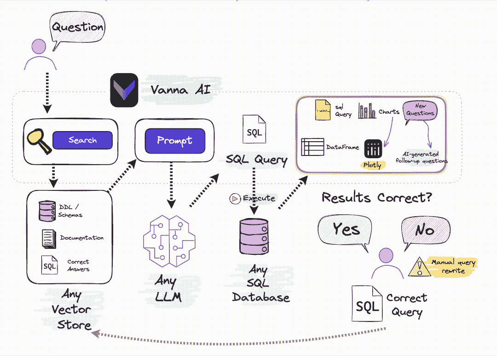
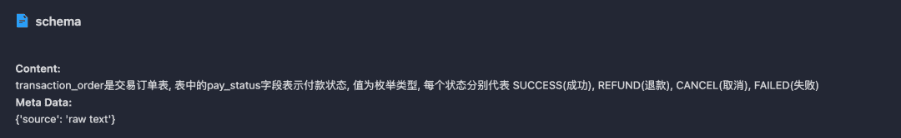
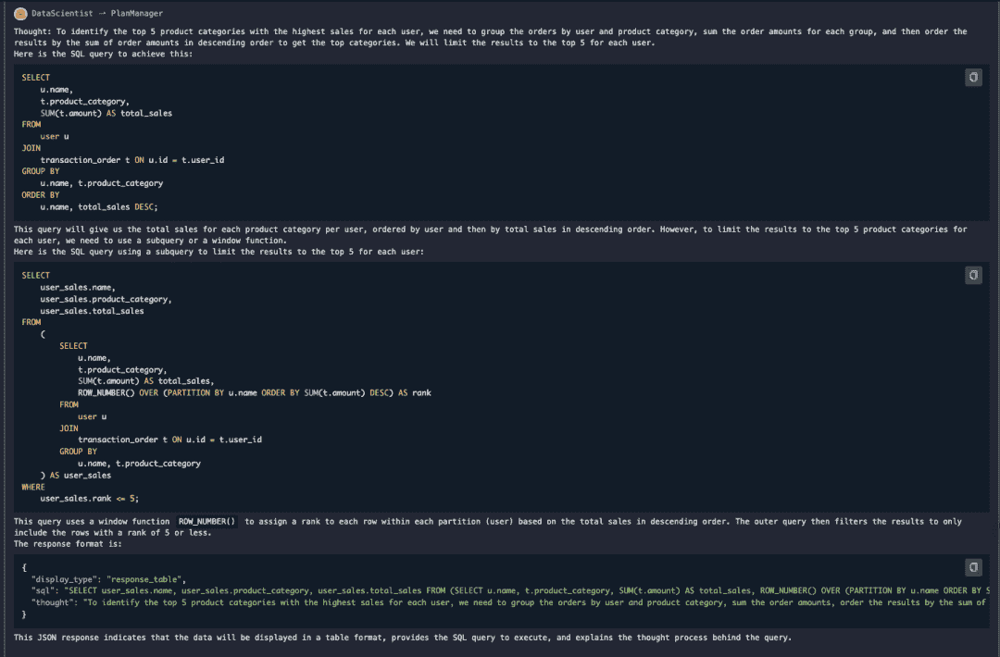

# SQL-Agent：实现SQL生成、翻译

> 来源：[https://v11enp9ok1h.feishu.cn/docx/F2FQdEkuRo51uMxz8DrclG9bneb](https://v11enp9ok1h.feishu.cn/docx/F2FQdEkuRo51uMxz8DrclG9bneb)

### **实现案例**



### 实现数据SQL-Agent

这里我们实现了一个简单的SQL助手，由于我们的目的主要是SQL生成、翻译、优化，所以我们制定的Action是一个空Action。

```
&quot;&quot;&quot;SQL Assistant Agent.
Use RAG and Schema-Linking, which can generate,translate,
and correct SQL based on user questions.
&quot;&quot;&quot;

import asyncio
from dbgpt.agent import BlankAction, ConversableAgent, DynConfig, ProfileConfig

class SQLAssistantAgent(ConversableAgent):
&quot;&quot;&quot;SQL Agent Use RAG and Schema-Linking.&quot;&quot;&quot;

profile: ProfileConfig = ProfileConfig(
name=DynConfig(
&quot;kevin&quot;,
category=&quot;agent&quot;,
key=&quot;dbgpt_agent_expand_sql_expert_name&quot;,),
),
role=DynConfig(
&quot;SQLExpert&quot;, category=&quot;agent&quot;, key=&quot;dbgpt_agent_expand_sql_expert_name_role&quot;
),
goal=DynConfig(
&quot;SQL generation, SQL translate, SQL diagnostics&quot;,
category=&quot;agent&quot;,
key=&quot;dbgpt_agent_expand_sql_expert_name_goal&quot;,
),constraints=DynConfig(
[
&quot;&quot;&quot;You are a SQL expert who can generate, translate,and correct SQL based on user questions.If the user&#x27;s input is not related to SQL,you need to prompt the user to output SQL-related content.&quot;&quot;&quot;],category=&quot;agent&quot;,key=&quot;dbgpt_agent_expand_sql_expert_profile_constraints&quot;,),desc=DynConfig(&quot;&quot;&quot;You are a SQL expert who can generate, translate,and correct SQL based on user questions.&quot;&quot;&quot;,category=&quot;agent&quot;,key=&quot;dbgpt_agent_expand_sql_expert_profile_desc&quot;,),)
def __init__(self, **kwargs):&quot;&quot;&quot;Create a new SQLAssistantAgent.&quot;&quot;&quot;super().__init__(**kwargs)self._init_actions([BlankAction])
```

SQL Agent 还需要一个数据库连接作为依赖的资源，这里我们创建一个SQLite表：

```
def _create_temporary_connector():
    &quot;&quot;&quot;Create a temporary database connector for testing.&quot;&quot;&quot;
    from dbgpt.datasource.rdbms.conn_sqlite import SQLiteTempConnector

    connector = SQLiteTempConnector.create_temporary_db()
    connector.create_temp_tables(
        {
            &quot;user&quot;: {
                &quot;columns&quot;: {
                    &quot;id&quot;: &quot;INTEGER PRIMARY KEY&quot;,
                    &quot;name&quot;: &quot;TEXT&quot;,
                    &quot;age&quot;: &quot;INTEGER&quot;,
                },
                &quot;data&quot;: [
                    (1, &quot;Tom&quot;, 10),
                    (2, &quot;Jerry&quot;, 16),
                    (3, &quot;Jack&quot;, 18),
                    (4, &quot;Alice&quot;, 20),
                    (5, &quot;Bob&quot;, 22),
                ],
            }
        }
    )
    return connector
```

构建Agent，绑定资源并做初始化。

```
import asyncio
from dbgpt.agent import AgentContext, AgentMemory, UserProxyAgent, LLMConfig
from dbgpt.agent.resource import RDBMSConnectorResource
from dbgpt.model.proxy import OpenAILLMClient
# 假设 _create_temporary_connector 函数在同一作用域或已正确导入，这里补充下函数定义（如果之前没完整提供）
def _create_temporary_connector():
    &quot;&quot;&quot;Create a temporary database connector for testing.&quot;&quot;&quot;
    from dbgpt.datasource.rdbms.conn_sqlite import SQLiteTempConnector

    connector = SQLiteTempConnector.create_temporary_db()
    connector.create_temp_tables(
        {
            &quot;user&quot;: {
                &quot;columns&quot;: {
                    &quot;id&quot;: &quot;INTEGER PRIMARY KEY&quot;,
                    &quot;name&quot;: &quot;TEXT&quot;,
                    &quot;age&quot;: &quot;INTEGER&quot;,
                },
                &quot;data&quot;: [
                    (1, &quot;Tom&quot;, 10),
                    (2, &quot;Jerry&quot;, 16),
                    (3, &quot;Jack&quot;, 18),
                    (4, &quot;Alice&quot;, 20),
                    (5, &quot;Bob&quot;, 22),
                ],
            }
        }
    )
    return connector
async def main():
    from dbgpt.agent import SQLAssistantAgent  # 补充导入，原代码里用了但没显示导入
    agent_memory = AgentMemory()

    llm_client = OpenAILLMClient(model_alias=&quot;gpt-3.5-turbo&quot;)
    context: AgentContext = AgentContext(conv_id=&quot;sql_agent&quot;)

    connector = _create_temporary_connector()
    sqlite_resource = RDBMSConnectorResource(&quot;SQLite Database&quot;, connector=connector)
    user_proxy = await UserProxyAgent().bind(agent_memory).bind(context).build()
    sql_agent = (
        await SQLAssistantAgent()
       .bind(context)
       .bind(LLMConfig(llm_client=llm_client))
       .bind(sqlite_resource)
       .bind(agent_memory)
       .build()
    )

    await user_proxy.initiate_chat(
        recipient=sql_agent,
        reviewer=user_proxy,
        message=&quot;What is the name and age of the user with age less than 18&quot;,
    )

    print(await agent_memory.gpts_memory.one_chat_completions(&quot;sql_agent&quot;))

if __name__ == &quot;__main__&quot;:
    asyncio.run(main())
```

本Agent中，我们准备了两类资源。1. 知识库  2. 数据库。知识库里面主要对一些字段与上下文进行描述。



