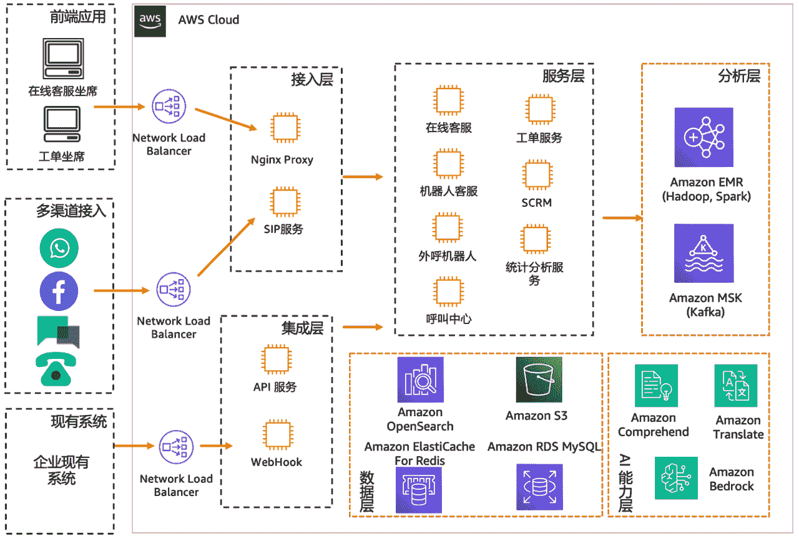
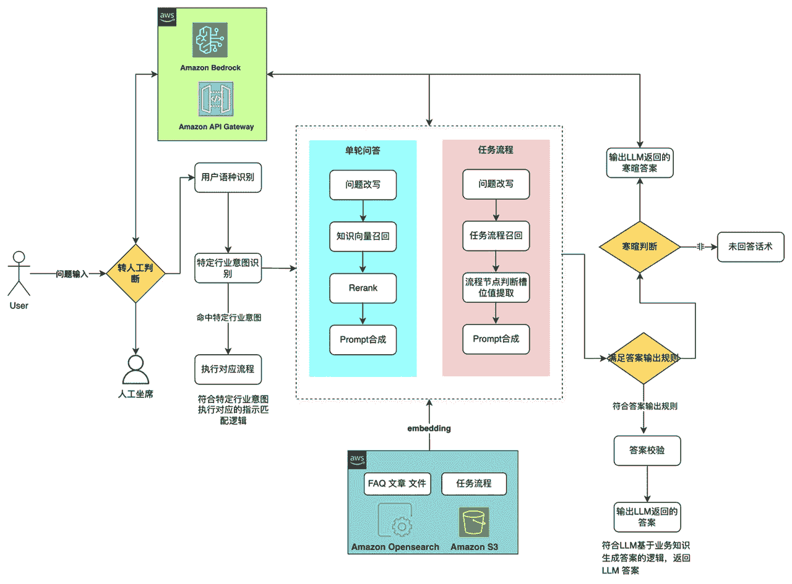

# Agent智能客服，人工介入降低 42%

> 来源：[https://v11enp9ok1h.feishu.cn/docx/G8PsdTOTSocR5MxrPlHcg0PGnlt](https://v11enp9ok1h.feishu.cn/docx/G8PsdTOTSocR5MxrPlHcg0PGnlt)

## 解决方案

+   **引入 RAG （Retrieval-augmented Genera**tion，检索增强生成）技术，有效减少大模型的“幻觉”，提高了问题回复的精准度。

> **RAG检索增强生成：**当大模型需要生成文本或者回答问题时，用户首先通过检索预先维护的基于私域数据的文档集合获得指导信息，然后智齿科技  AI Agent 基于这些信息通过大模型来生成文本，将大语言模型回复的内容限定在提前预设的范围内，从而减少“幻觉”的产生，提高了回复的精准度。

> **自定义召回阈值：**采用系统默认的召回阈值，大模型生成的文本可能会较为局限，为避免生成的文本过于呆板，支持企业自定义 召回阈值，灵活可控地生成所期望的内容，以更加灵活地适应不同业务场景。

### 个性化引导完成特定任务

不同场景下，客服的问询顺序及信息收集可能存在一定的差异，例如退换货场景，大致可分为：

> **初步沟通核实原因****→****评估商品状况**→**判断是否符合条件**→**决策处理方案**等环节，而每个环节中用户回答不同，相应的处理也各不相同，问答处理交互复杂，以致大部分企业倾向直接让人工来应对。

+   **智能发问：**用户进线后，机器人主动询问，基于当前语境提出问题，如果用户重复询问，机器人还可以使用不同话术应答，使询问变得不再呆板；

+   **智能收集：**机器人可从客户回复中根据语义提取关键词，如果客户的表达中缺失了部分信息，机器人会主动触发追问；

+   **智能转人工：**若需触发转人工处理时，机器人会主动发起转人工应答，无需客户操作；转人工的路由规则也支持自定义。