# 万字详解：AI Agent 系统架构设计

> 来源：[https://v11enp9ok1h.feishu.cn/docx/G9EydD0LloWpUQxcGVRc4sH3nqg](https://v11enp9ok1h.feishu.cn/docx/G9EydD0LloWpUQxcGVRc4sH3nqg)

## 设计主动智能系统（一）：智能体架构

### 架构概览

> **主动智**能**系统在**三**个逻辑**层面上运作：工具层、推理层和行动层。

+   每一层在使智能体能够有效检索、处理和行动信息方面都扮演着特定角色。

+   理解这些层之间的交互对于设计功能性和可扩展的系统至关重要。

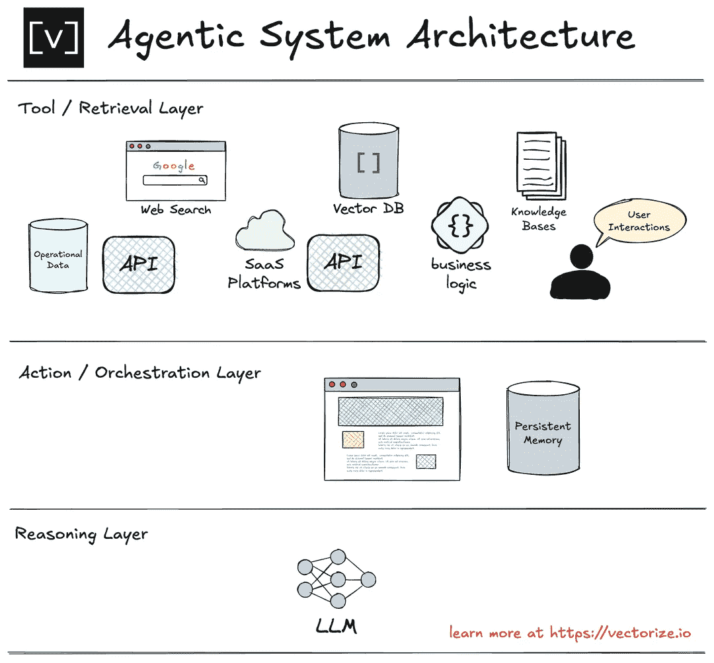

1.  **工具层** ：系统的基础。此层与外部数据源和服务交互，包括 API、向量数据库、操作数据、知识库和用户交互。它负责获取系统所依赖的原始信息。设计良好的工具确保智能体高效检索相关且高质量的数据。

1.  **行动层** ：有时也称作编排层。此层负责协调大型语言模型（LLM）与外部世界（工具）之间的交互。在适用情况下，它还处理与用户的交互。它接收来自 LLM 的关于下一步行动的指令，执行该行动，然后将结果提供给推理层的 LLM。

1.  **推理层** ：系统智能的核心。此层使用大型语言模型（LLM）处理检索到的信息。它根据上下文、逻辑和预设目标确定智能体接下来需要做什么。推理不充分会导致错误，例如重复查询或行动不一致。

+   为了准确起见，主动智能系统中的推理并不总是由 LLM 执行

> **例如**，Roomba 吸尘器是一种不使用 LLM 的主动智能系统。本文仅聚焦于基于 LLM 的主动智能系统。

### 主动智能工作流程

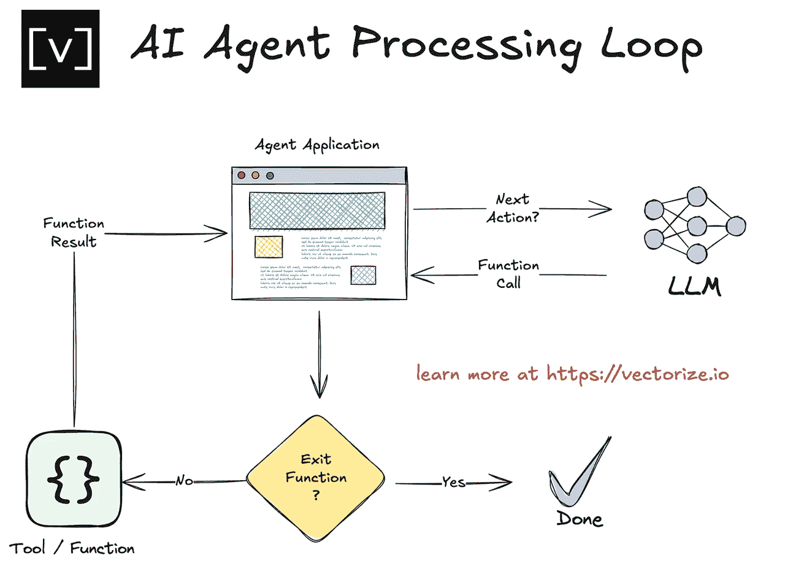

+   智能体应用与 LLM 的首次交互定义了系统试图完成的总体目标。

> 这可以是从生成房地产列表到撰写博客文章，再到处理用户在客户服务应用程序中的开放式请求等各种任务。

>

> 与这些指令一起的还有一个 LLM 可调用的函数列表。

+   每个函数都有名称、描述以及它所接受参数的 JSON 模式。以下是 OpenAI 文档中的一个简单函数示例：

```
{
  &quot;model&quot;: &quot;gpt-4o&quot;,
  &quot;messages&quot;: [
    {
      &quot;role&quot;: &quot;user&quot;,
      &quot;content&quot;: &quot;波士顿今天天气如何？&quot;
    }
  ],
  &quot;tools&quot;: [
    {
      &quot;type&quot;: &quot;function&quot;,
      &quot;function&quot;: {
        &quot;name&quot;: &quot;get_current_weather&quot;,
        &quot;description&quot;: &quot;获取特定地点的当前天气&quot;,
        &quot;parameters&quot;: {
          &quot;type&quot;: &quot;object&quot;,
          &quot;properties&quot;: {
            &quot;location&quot;: {
              &quot;type&quot;: &quot;string&quot;,
              &quot;description&quot;: &quot;城市和州，例如旧金山，加州&quot;
            },
            &quot;unit&quot;: {
              &quot;type&quot;: &quot;string&quot;,
              &quot;enum&quot;: [&quot;摄氏度&quot;, &quot;华氏度&quot;]
            }
          },
          &quot;required&quot;: [&quot;location&quot;]
        }
      }
    }
  ],
  &quot;tool_choice&quot;: &quot;auto&quot;
}
```

> 推理层的 LLM 决定下一步应调用哪个函数以更接近指定目标。

> 当 LLM 响应时，它将指示应调用哪个函数以及应提供给该函数的参数。

> 根据用例和所使用的 LLM 在推理层的能力，LLM 可能能够在下一次循环前指定要调用的一组函数（理想情况下是并行调用）。

> 最好提供一个退出函数，以便推理层可以指示何时已完成处理，行动层应成功退出。

### 设计原则

+   表面上看，这些似乎都很简单。然而，随着任务复杂性的增加，函数列表也会增加。随着需要覆盖的范围扩大，推理层出错的可能性也随之增加。

+   一旦你开始添加新的 API、专用子智能体和多个数据源，你会发现要管理的内容远不止于插入一个提示词然后点击 "开始" 那么简单。

## 设计主动智能系统（二）：模块化

在第二部分，我们将深入探讨模块化的概念。

> 我们将讨论为什么将主动智能系统分解为更小、更专注的子智能体有助于避免单体设计的陷阱。


+   **每个子智能体可以处理**其自身的专用领域 ------ 退货、订单、产品信息 ------ 这种分离使父智能体能够自由地分派任务，而不必在一个庞大的提示词中同时处理所有可能的函数。

### 模块化

实现复杂主动智能系统稳定性能的最佳方法之一

> 是将问题领域分解为更小的子智能体。这通过智能体之间的父子关系来实现。顶层的父智能体作为进入主动智能处理的入口。推理层提供的大多数函数都是交接任务，将处理工作分配给其中一个子智能体。

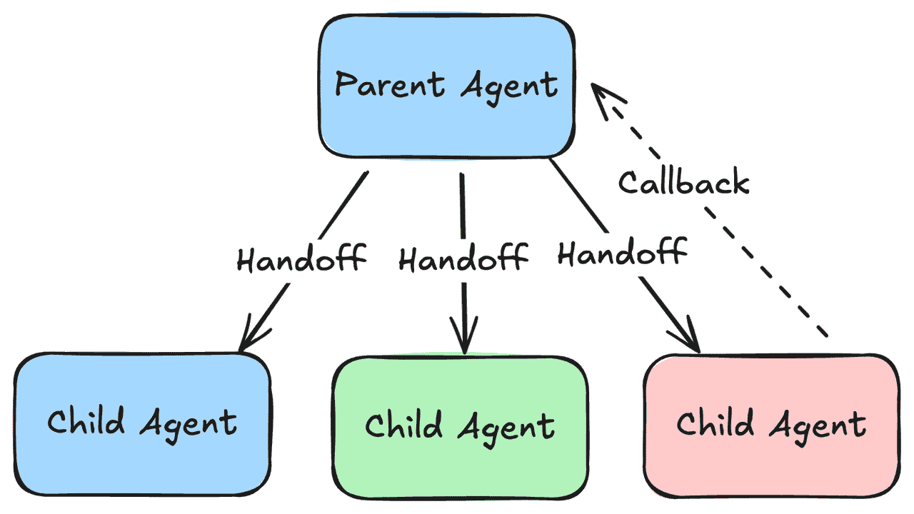

> 每个子智能体处理问题领域的一个特定部分，实际上，这将微服务架构中常用的有界上下文概念应用于人工智能智能体领域。

### 模块化的优势

+   假设你正在为一家在线零售商构建一个客户服务智能体

> 该智能体将处理诸如退货、订单状态、产品咨询等事务。

> 如果你从单体架构开始，很快就会发现发送到推理层的提示变得又长又复杂，函数列表也会变得过长。

> 随着这两种情况的发生，你的主动智能系统的准确性和性能将受到影响。

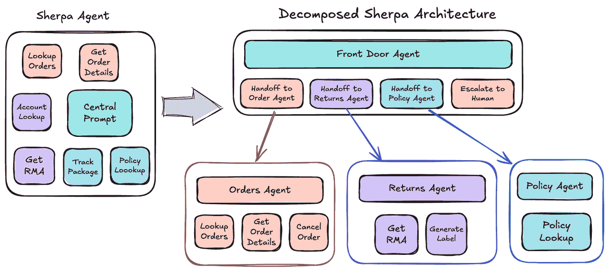

采用更**模块化**的方法可以简化整体架构的许多方面。有一种方法是通过功能领域来分离系统的关注点。结果可能如下图所示：

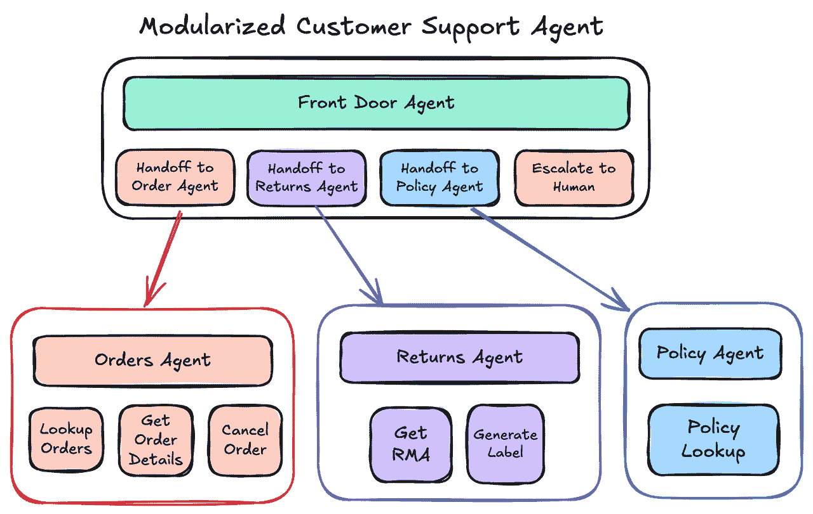

#### 更可预测的决策流程

+   通过将系统分解为专门的子智能体，每个智能体承担一组明确定义的职责。

+   随着父智能体编排工作流程，更容易看到正在发生的事情以及原因。

+   请求可以交给最适合处理它的特定智能体，而不是试图在一个庞大的流程中同时处理多项任务。

+   这使得交互更加透明，数据路径更加清晰，并且任务按照逻辑逐步推进。

+   在单体方法中，责任界限变得模糊，这使得很难确定问题出在哪里。

+   模块化设计通过为每个智能体的领域建立明确的界限消除了这种混乱。

#### 关注点分离

> **模块化允许每个智能体专注于**系统的特定方面。如**果你有一个专门处理退货的** ReturnsAgent 和一个仅负责订单的 OrdersAgent，你就避免了无关数据或旁枝末节的问题。

> 这种分离使得领域知识在每个智能体中高度集中，可以大大提高准确性，不再有随机的旁支问题引入不相关信息。

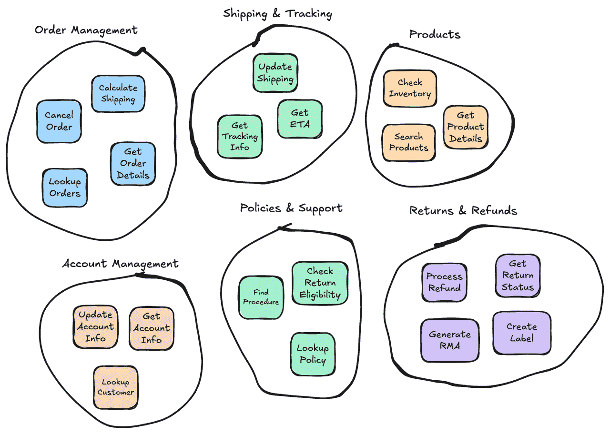

+   在实践中，这种方法类似于微服务和领域驱动设计中使用的微服务技术，每个组件都有"有界上下文"。通过限制每个子智能体的范围，你减少了指令和依赖项的数量，使每次交互更加精确。

+   因此，子智能体和父智能体都受益于更高的清晰度、更简单的提示和更少的离题响应。

#### 降低复杂性

+   当一个系统必须处理多项任务或大量数据时，复杂性会迅速膨胀。

> 通过将责任分配给多个子智能体，你缩小了每个智能体的问题领域。这种分散化使得每个智能体能够更有效地推理自己的任务，而不会被不相关的事务淹没。

>

+   降低复杂性也意味着更少的程序错误或逻辑错误的机会。

> 由于每个子智能体都是独立的，一个领域的变化不会意外地影响到另一个领域。

## 设计主动智能系统（三）：智能体之间的交互

> 在第三部分，我们将深入探讨智能体之间的交互。

> 即使有了良好的模块化，构建统一接口以使子智能体能够以一致的方式交互仍然是一个真正的挑战。

> 我们将探索如何**定义清晰、标准化的交接**，以便每个智能体都能完成其工作，而不会创建一个令人困惑的调用和回调网络。

> 你将看到为什么拥有一个一致的接口很重要，以及这如何帮助你在出现问题时进行故障排除或升级处理。

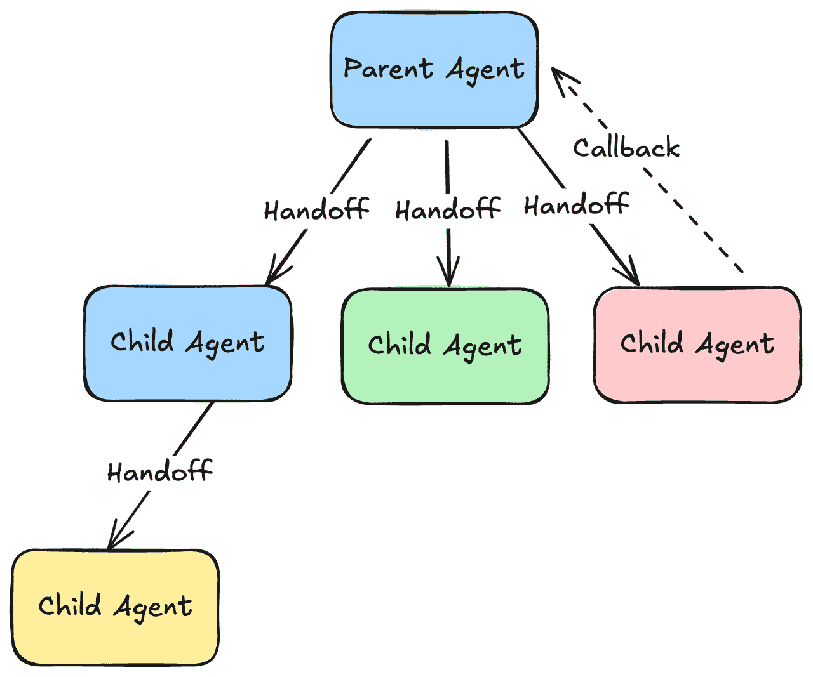

#### 统一分发 / 回调机制

通过标准化每个智能体如何调用（或分发到）其他智能体以及这些智能体如何响应，可以减少混乱、错误和维护开销。

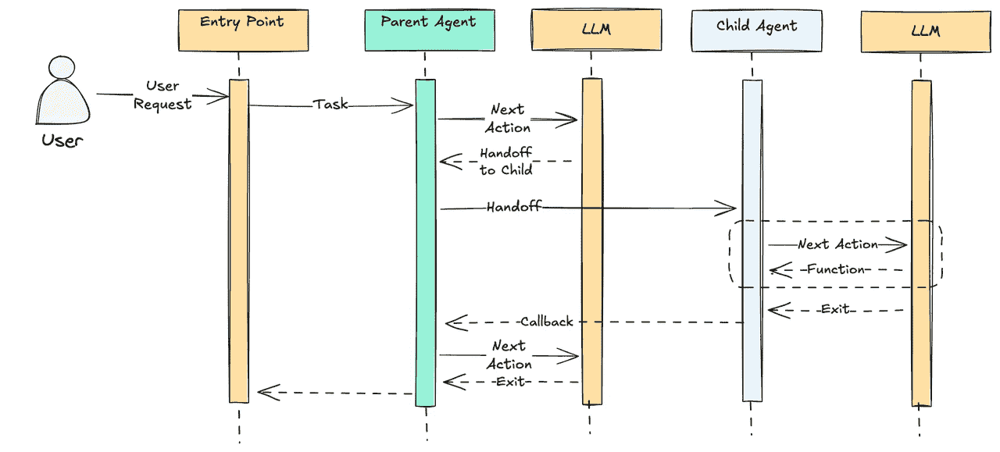

##### Python 中的示例

父智能体需要知道如何将任务正确地委托给每个子智能体。你可以通过公开负责特定领域的函数（从大型语言模型的角度来看，像是函数调用）来实现这一点。例如：

```
tools = [
    {
        &quot;type&quot;: &quot;function&quot;,
        &quot;function&quot;: {
            &quot;name&quot;: &quot;handoff_to_OrdersAgent&quot;,
            &quot;description&quot;: &quot;处理与订单相关的问题，如跟踪或管理订单。&quot;,
            &quot;parameters&quot;: {
                &quot;type&quot;: &quot;object&quot;,
                &quot;properties&quot;: {
                    &quot;user_id&quot;: {&quot;type&quot;: &quot;string&quot;, &quot;description&quot;: &quot;用户的唯一 ID。&quot;},
                    &quot;message&quot;: {&quot;type&quot;: &quot;string&quot;, &quot;description&quot;: &quot;用户的查询。&quot;}
                },
                &quot;required&quot;: [&quot;user_id&quot;, &quot;message&quot;]
            }
        }
    },
    {
        &quot;type&quot;: &quot;function&quot;,
        &quot;function&quot;: {
            &quot;name&quot;: &quot;handoff_to_ReturnsAgent&quot;,
            &quot;description&quot;: &quot;处理与退货相关的任务，如授权或跟踪退货。&quot;,
            &quot;parameters&quot;: {
                &quot;type&quot;: &quot;object&quot;,
                &quot;properties&quot;: {
                    &quot;user_id&quot;: {&quot;type&quot;: &quot;string&quot;, &quot;description&quot;: &quot;用户的唯一 ID。&quot;},
                    &quot;message&quot;: {&quot;type&quot;: &quot;string&quot;, &quot;description&quot;: &quot;用户的查询。&quot;}
                },
                &quot;required&quot;: [&quot;user_id&quot;, &quot;message&quot;]
            }
        }
    }
]
```

当大型语言模型（LLM）决定需要处理与订单相关的问题时，它可以调用 "handoff_to_OrdersAgent" 并附上必要的参数。然后父智能体相应地分发请求：

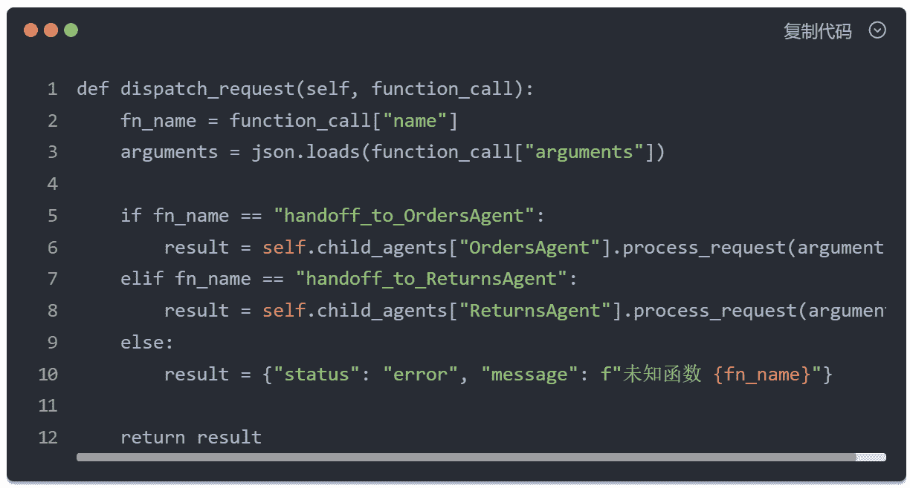

这种方法使父智能体能够专注于路由，而每个子智能体则专注于其特定领域（订单、退货、产品问题等）。

在子智能体内部，你可以定义与其特定任务相关的函数。

> 例如，OrdersAgent 可能会公开 "**lookupOrder**" 或 **"searchOrders**" 函数。子智能体自身的推理循环被限制在该领域内，这有助于避免混淆和巨大的提示上下文。

```
class OrdersAgent:
    def__init__(self):
        self.functions = [
            {
                &quot;type&quot;: &quot;function&quot;,
                &quot;function&quot;: {
                    &quot;name&quot;: &quot;lookupOrder&quot;,
                    &quot;parameters&quot;: {
                        &quot;type&quot;: &quot;object&quot;,
                        &quot;properties&quot;: {
                            &quot;order_id&quot;: {&quot;type&quot;: &quot;string&quot;, &quot;description&quot;: &quot;订单 ID。&quot;}
                        },
                        &quot;required&quot;: [&quot;order_id&quot;]
                    }
                }
            },
            {
                &quot;type&quot;: &quot;function&quot;,
                &quot;function&quot;: {
                    &quot;name&quot;: &quot;searchOrders&quot;,
                    &quot;parameters&quot;: {
                        &quot;type&quot;: &quot;object&quot;,
                        &quot;properties&quot;: {
                            &quot;customer_id&quot;: {&quot;type&quot;: &quot;string&quot;, &quot;description&quot;: &quot;客户 ID。&quot;}
                        },
                        &quot;required&quot;: [&quot;customer_id&quot;]
                    }
                }
            }
        ]

    defprocess_request(self, payload):
        self.message_history.append({&quot;role&quot;: &quot;user&quot;, &quot;content&quot;: payload[&quot;message&quot;]})

        for _ inrange(3):  # 限制递归调用次数
            response = self.run_llm_cycle(self.functions)

            if&quot;function_call&quot;in response:
                function_call = response[&quot;function_call&quot;]
                result = self.handle_function_call(function_call)
                if result[&quot;status&quot;] == &quot;success&quot;:
                    return result
                elif result[&quot;status&quot;] == &quot;escalate&quot;:
                    return {&quot;status&quot;: &quot;escalate&quot;, &quot;message&quot;: result[&quot;message&quot;]}
            else:
                return {&quot;status&quot;: &quot;success&quot;, &quot;data&quot;: response[&quot;content&quot;]}

        return {&quot;status&quot;: &quot;error&quot;, &quot;message&quot;: &quot;超出推理步骤&quot;}

    defhandle_function_call(self, function_call):
        if function_call[&quot;name&quot;] == &quot;lookupOrder&quot;:
            return {&quot;status&quot;: &quot;success&quot;, &quot;data&quot;: &quot;找到订单详情...&quot;}
        elif function_call[&quot;name&quot;] == &quot;searchOrders&quot;:
            return {&quot;status&quot;: &quot;success&quot;, &quot;data&quot;: &quot;正在搜索订单...&quot;}
        else:
            return {&quot;status&quot;: &quot;escalate&quot;, &quot;message&quot;: f&quot;{function_call[&#x27;name&#x27;]} 不支持的函数&quot;}
```

一旦子智能体完成任务，它会以一致的格式将结果反馈给父智能体。这就是回调。父智能体可以：

+   如果一切顺利，将响应传递回给用户。

+   用另一个子智能体重试请求。

+    如果系统无法自动处理，则将问题升级给人工处理。例如：

```
response = orders_agent.handle_request(payload)
if response[&quot;status&quot;] == &quot;success&quot;:
parent_agent.add_message(role=&quot;assistant&quot;, content=response[&quot;data&quot;])
elif response[&quot;status&quot;] == &quot;escalate&quot;:
parent_agent.add_message(role=&quot;system&quot;, content=&quot;OrdersAgent 无法完成请求。&quot;)
```

在任何现实系统中，某些查询都会因不可预见的原因失败 ------ API 故障、数据缺失，或者子智能体不支持的功能。

当这种情况发生时，子智能体会返回一个 "升级" 状态：

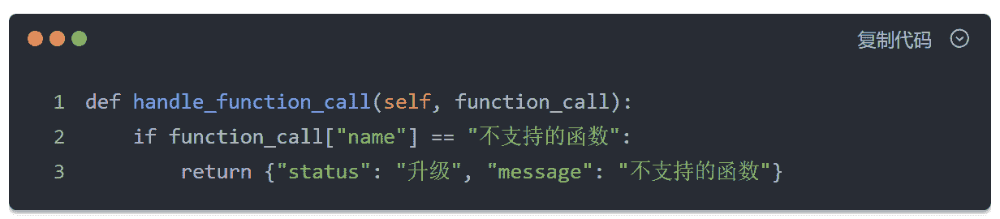

父智能体可以捕获此状态，并决定是否重试、升级到另一个智能体，或者最终向用户返回错误消息。

## 设计主动智能系统（四）：数据检索和智能体 RAG

> 在第四部分，我们将研究数据检索和检索增强生成（RAG）。

+   如果没有新鲜、相关的数据，你的语言模型能做的毕竟有限，因此我们将讨论如何连接数据库、API 和向量存储，为你的智能体提供所需的上下文。

+   我们将涵盖从拉取现有系统中的结构化数据到对 PDF 等非结构化内容进行索引的所有内容，以便你的系统在扩展时保持快速和准确。

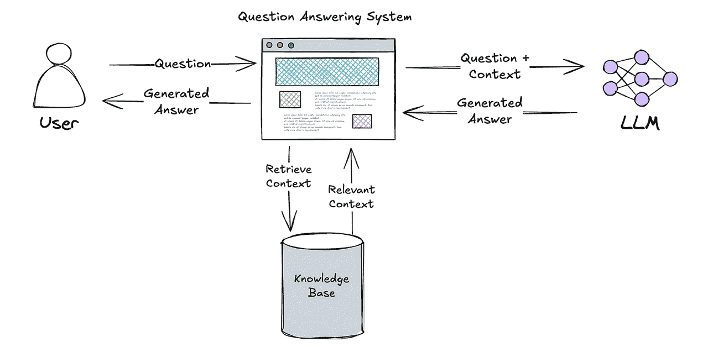

#### 数据检索和智能体 RAG

> 有可能创建不需要数据检索的智能体系统。这是因为有些任务可以仅使用语言模型所训练的知识来完成。

+   **例如**

+   你可能能够创建一个有效的智能体来撰写关于历史事件（如罗马帝国或美国内战）的书籍。

+   对于大多数智能体系统而言，提供数据访问是系统设计的一个关键方面。因此，围绕这个功能领域，我们需要考虑几个设计原则。

+   检索增强生成（RAG）已 emergence 为连接大型语言模型（LLM）与其所需数据以生成响应的 facto 标准技术。

顾名思义，实施 RAG 的一般模式包括三个步骤：

+   **检索** -- 从外部知识库中检索额外的上下文。在此上下文中，我使用知识库是一个 loosely 定义的术语，可以包括 API 调用、SQL 查询、向量搜索查询，或任何其他用于查找相关上下文的机制，以提供给大型语言模型（LLM）。

+   **增强** -- 使用在检索步骤中获得的相关上下文来增强用户的输入。

+   **生成** -- 大型语言模型（LLM）使用其预训练知识以及这种增强的上下文来生成更准确的响应，甚至关于它从未接受过训练的主题和内容。

因此，在问答系统中使用 RAG 将看起来像这样：


智能体系统几乎总是需要某种 RAG 实现来履行其职责。然而，在设计智能体系统时，考虑不同类型的数据如何影响整个系统的需求是很重要的。

##### 结构化数据和 API

+   拥有成熟 API 计划的公司会发现他们的价值路径比那些没有的公司更容易导航。这是因为为智能体系统提供动力所需的大部分数据与今天用于非智能体系统的数据相同。

+   一个构建了生成保险报价 API 的保险公司可以比仍然处于客户 / 服务器时代的公司更容易地将该 API 接入智能体。

+   事实上，智能体系统有可能颠覆保险业务的几乎每一个方面。从报价、承保，到精算科学（保险业务中的赔率制定者），再到理赔管理，智能体 AI 很可能在接下来的 2-3 年内完全接管这些角色。但前提是智能体系统能够访问正确的数据和功能。

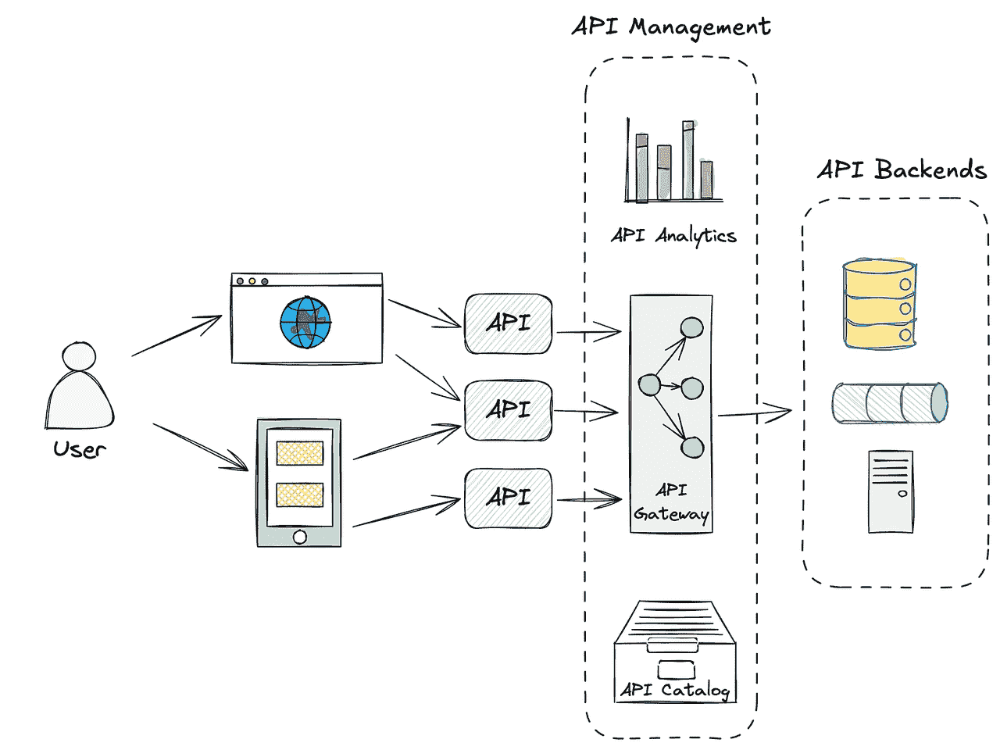

###### AI 优先的 API 管理

许多公司将 API 管理等同于拥有 API 网关。然而，在智能体系统的世界中，OpenAPI（Swagger）成为智能体系统使用现有 API 的关键推动因素。这是因为 OpenAPI 中使用的 JSON 模式可以轻松转换为许多大型语言模型（LLM）提供商使用的函数定义结构。

此外，允许智能体系统查找和发现 API 的服务发现机制为智能体系统自行创造涌现能力提供了有趣的机会。根据你的观点，这要么是一个令人兴奋的前景，要么是一个令人恐惧的前景。

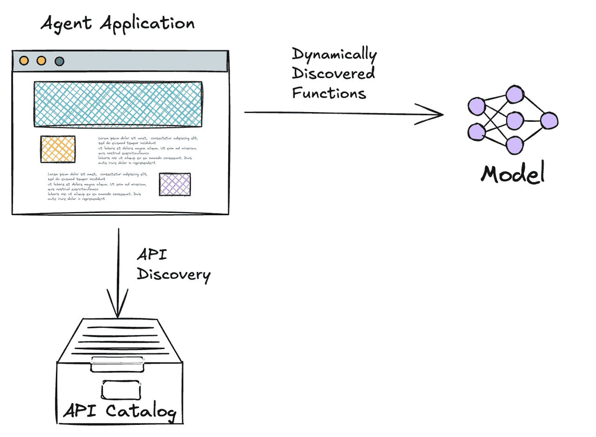

在适当的安全措施下，甚至可以将 API 目录搜索公开为大型语言模型（LLM）可用的函数，以允许它查找可用于解决当前任务的额外功能。

##### 非结构化数据和 RAG

虽然大多数公司都有成熟的实践来管理运营、分析和其他类型的结构化数据，但非结构化数据管理通常远远落后。

文档、电子邮件、PDF、图像、客户服务记录和其他自由形式的文本来源对于智能体系统来说可能非常有价值 ------ 但前提是如果你能够在正确的时间以正确的格式检索正确的信息。这就是检索增强生成（RAG）特别强大的地方。

###### 为什么非结构化数据具有挑战性

非结构化数据在范围上往往更大，格式也更加异构（PDF、图像、纯文本、HTML 等）。这种变异性可能会使 naive 的数据检索方法不堪重负。

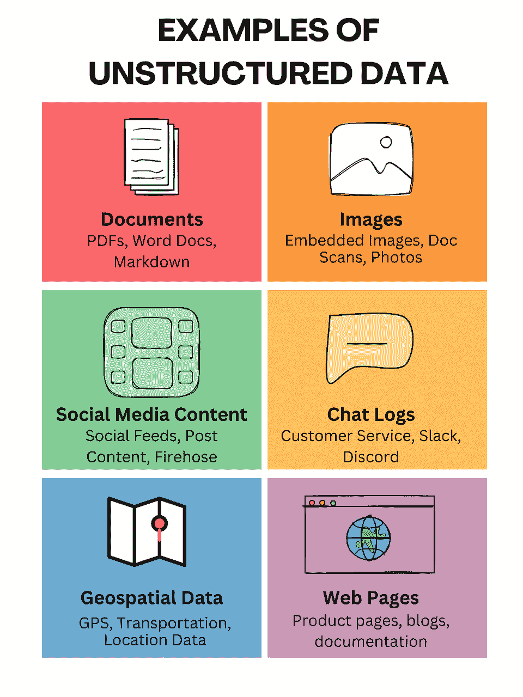

与存储在关系表中的结构化数据不同，非结构化数据没有强制的模式。你不能简单地对 PDF 运行 SQL 查询，或在电子表格中进行直接的 "查找"。

这导致了新技术的快速采用以解决这些挑战。

##### 向量数据库和语义搜索

+   这些系统将文本转换为高维向量嵌入，从而允许基于相似性的查找。

+   大型文档被分成较小的 "块"，每个块分别编制索引。这

+   许多向量数据库允许你将元数据（例如作者、日期、文档类型）附加到每个块。

> **此元数据可以指导下游逻辑 ------ 例如，只检索与**用户问题相关的最新产品手册或知识库文章。

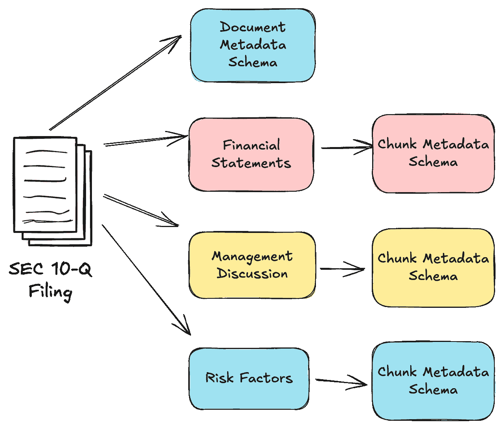

+   在高流量场景或数据质量至关重要的情况下（例如法律或医疗用例）

> 你可以在语义搜索后应用额外的过滤器和排名标准，以确保只返回最高质量或领域批准的内容。

##### 用于非结构化数据处理的 RAG 管道

> RAG 管道充当非结构化数据源和向量数据库之间的连接组织。通常包括几个步骤

**提取**

**分块**

**嵌入**

> **将杂乱或自由形式的文档转换为优化的搜索索引，以便**为大型语言模型（LLM）提供相关上下文。

在下图中，你可以看到数据如**何从各**种非结构化数据**源流**动**。这**些**可能包括知识库**、文件系统中的文档、网页、SaaS 平台中的内容等。

在 RAG 管道内，非结构化数据经历一系列转换。这些包括提取、分块、元数据处理和嵌入（向量）生成，然后写入向量索引。

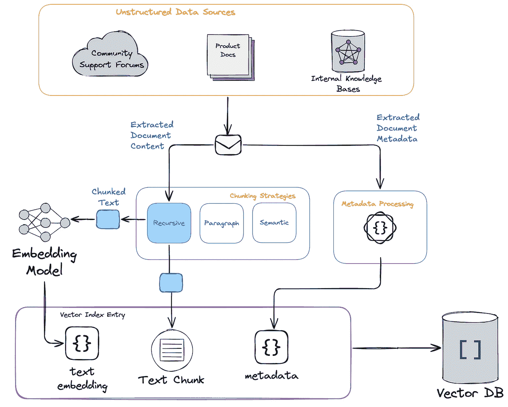

###### 优化 RAG 性能

+   熟悉构建数据管道的数据工程实践的开发人员往往对向量数据的非确定性感到措手不及。

+   在传统的数据管道中，我们对源系统和目标系统的数据表示有很好的了解。

> **例如**

> PostgreSQL 中的一组关系表可能需要转换为 BigQuery 中的单个平面结构。我们可以编写测试来告诉我们源系统中的数据是否正确转换为我们目标系统中我们想要的表示。