# 从API到Agent：洞悉LangChain工程化设计

> 来源：[https://v11enp9ok1h.feishu.cn/docx/KDB5d3dGroiH8Ux7qM9c3i12ndf](https://v11enp9ok1h.feishu.cn/docx/KDB5d3dGroiH8Ux7qM9c3i12ndf)

## 1.1 什么是LangChain？

哈佛大学的Harrison Chase发起的基于开源大语言模型的AI工程开发框架：

> 顾名思义，LangChain中的“Lang”自然是指大语言模型，“Chain”即“链”，也就是将大模型与其他组件连接成链，借此构建AI工程应用。那么LangChain该如何（How）做到这一点的呢？解答这个问题之前，需要先回答什么是工程？什么是AI工程？

## 1.2 什么是AI工程？

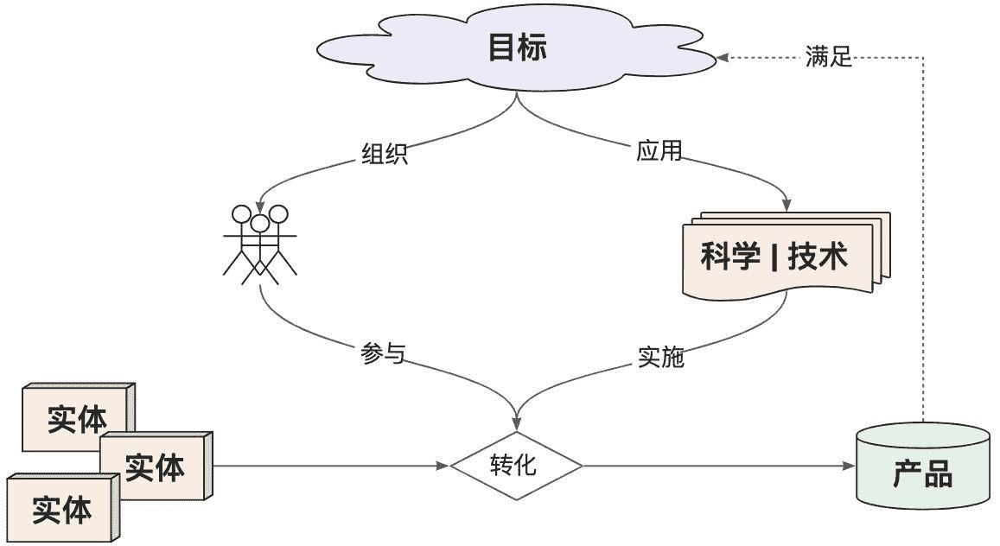

+   **目标**：待解决的特定AI用户需求。如内容创作、智能问答、文档摘要、图像识别等等。

+   **人**：实施AI工程的具体角色。可以是程序员，或者AI应用的研发团队、创业公司。

+   **科学 | 技术**：显然是大模型与相关工具服务，以及其后的计算科学理论。

+   **实体**：已有的文档、知识库、业务数据等生产材料。

+   **产品**：能满足目标需求的具体产品。如聊天机器人、内容生成工具等。

## 1.3 如何设计LangChain？

> 因此，如果我们是LangChain的设计者，希望构建通用的AI工程框架。需要回答如下问题：

1.  **【目标 | 产品】**LangChain的设计目标是什么，能解决哪些AI工程问题？

1.  **【人】**LangChain的编程接口如何定义，才能提升AI工程师的研发效率？

1.  **【实体 | 科学 | 技术】**LangChain的核心组件如何抽象，以提升框架的扩展能力？

## 环境准备

+   **Python环境**：建议3.8版本以上。

+   **OpenAI SK**：自备。

+   环境变量：`export OPENAI_API_KEY="<Your-OpenAI-SK>"`

+   **安装LangChain**：

+   执行命令：`pip install langchain langchain-openai`

## 设计推演

架构设计领域有个比较流行的术语——乐高架构，当然也可以叫可插拔架构。说白就是通过对系统基本组件的合理抽象，找到构造复杂系统的统一规律和可达路径，从而实现在降低系统实现复杂度的同时，提升系统整体的扩展性。（非官方表达，大家能Get到我的意思就好……）

### 造梦基础——API

文本生成模型服务是OpenAI提供的最核心的API服务，自ChatGPT发布后经历过几次版本迭代。

#### Chat Completion API

代码示例参考：

```
import os
import requests

# API Key
api_key = os.getenv('OPENAI_API_KEY')

# 头部信息
headers = {
    'Content-Type': 'application/json',
    'Authorization': f'Bearer {api_key}'
}

# 准备数据
data = {
    'model': 'gpt-4',
    'messages': [{'role': 'user', 'content': '什么是图计算？'}],
    'temperature': 0.7
}

# 调用API
url = 'https://api.openai.com/v1/chat/completions'
```

### 智能开端——Chat

代码示例参考：

```
# 对话历史
messages = []

def chat_with_ai(message):
    # 记录历史
    messages.append({'role': 'user', 'content': message})
    print(f'me: {message}')

    # 对话请求
    data = {
        'model': 'gpt-4',
        'messages': messages,
        'temperature': 0.7
    }
    url = 'https://api.openai.com/v1/chat/completions'
    response = requests.post(url, json=data, headers=headers)

    # 解析回答
    if response.status_code == 200:
        answer = response.json()['choices'][0]['message']['content']
        messages.append({'role': 'assistant', 'content': answer})
        print(f"ai: {answer}")
    else:
        print(f'Error: {response.status_code}', response.json())

# 多轮对话
chat_with_ai('什么是图计算？')
chat_with_ai('刚才我问了什么问题？')
```

### 初步封装——SDK

```
from langchain_openai import ChatOpenAI

# 调用Chat Completion API
llm = ChatOpenAI(model_name='gpt-4')
response = llm.invoke('什么是图计算？')
print(response)
```

### 数据抽象——IO

> 对于文本生成模型服务来说，实际的输入和输出本质上都是字符串，因此直接裸调用LLM服务带来的问题是要在输入格式化和输出结果解析上做大量的重复的文本处理工作。

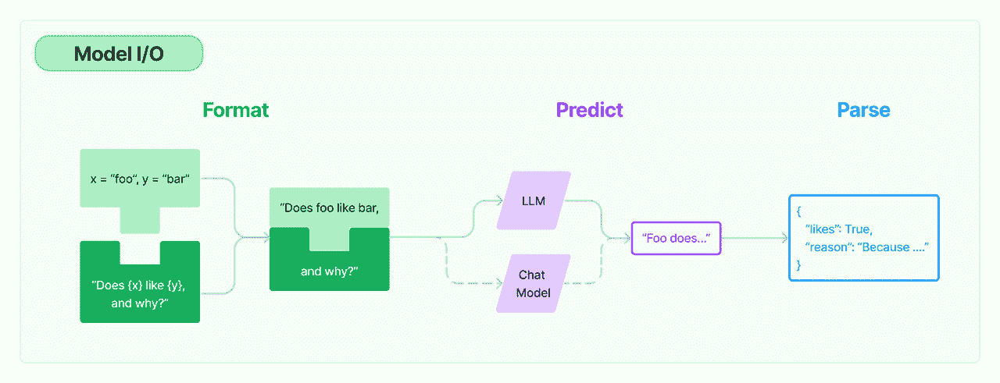

代码示例参考：

```
from langchain_core.output_parsers import StrOutputParser
from langchain_core.prompts import ChatPromptTemplate
from langchain_openai import ChatOpenAI

# 创建LLM
llm = ChatOpenAI(model_name='gpt-4')

# 创建Prompt
prompt = ChatPromptTemplate.from_template('{question}')

# 创建输出解析器
output_parser = StrOutputParser()

# 调用LLM
message = prompt.invoke({'question': '什么是图计算？'})
response = llm.invoke(message)
answer = output_parser.invoke(response)
print(answer)
```

### 组装成链——Chain

> 模型的IO组件确实可以减少重复的文本处理工作，但形式上依然不够清晰，这里就引入了LangChain中的关键概念：链（Chain）。

#### HelloWorld

+   LangChain的表达式语言（LCEL）通过重载or运算符的思路，构建了类似Unix管道运算符的设计，实现更简洁的LLM调用形式。

#### RunnablePassthrough

+   为了简化`Chain`的参数调用格式，也可以借助`RunnablePassthrough`透传上游参数输入。

#### DAG

+   `Chain`也可以分叉、合并，组合出更复杂的DAG计算图结构。

> 通过调用`chain.get_graph().print_ascii()`可以查看`Chain`的计算图结构。当然，使用LangSmith能更清晰的跟踪每一步的计算结果。

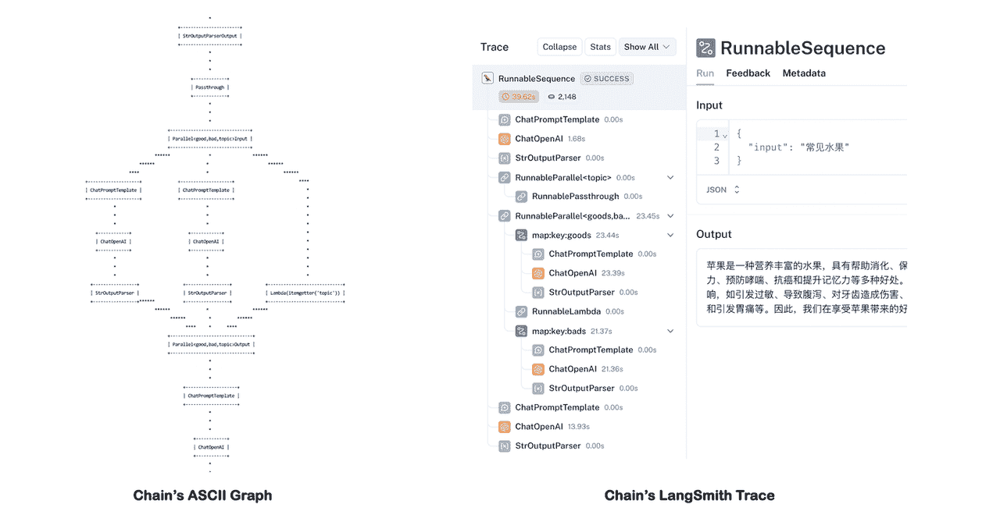

**Tips：**[开启](https://smith.langchain.com/settings)LangSmith需要申请LangChain的AK，并配置环境变量：

> `export LANGCHAIN_TRACING_V2="true"`

> `export LANGCHAIN_API_KEY="<Your-LangChain-"`

#### LangGraph

+   基于LCEL确实能描述比较复杂的LangChain计算图结构，但依然有DAG天然的设计限制，即不能支持“循环”。

### 开启记忆——Memory

**通过`Chain`：**

LangChain相当于以“工作流”的形式，将LLM与IO组件进行了有秩序的连接，从而具备构建复杂AI工程流程的能力。而我们都知道LLM提供的文本生成服务本身不提供记忆功能，需要用户自己管理对话历史。因此引入`Memory`组件，可以很好地扩展AI工程的能力边界。

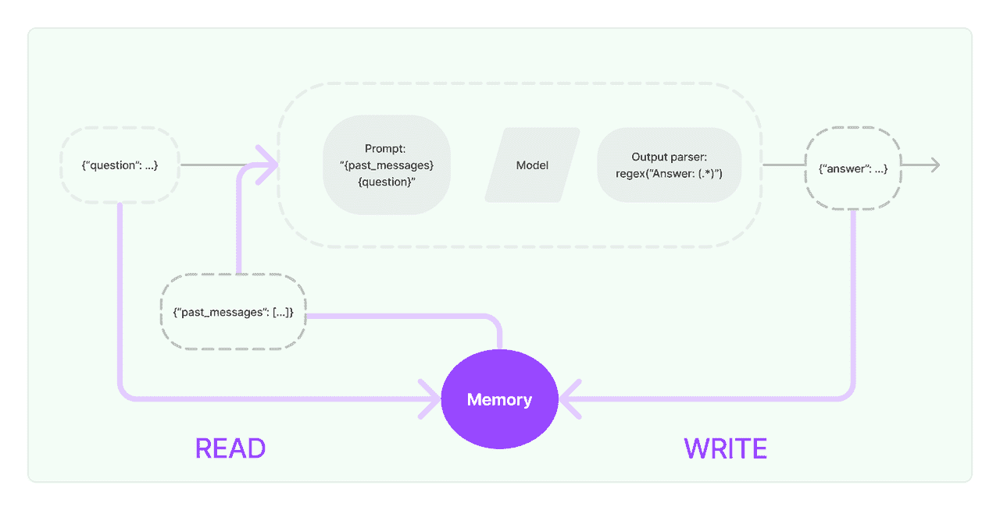

#### Memory接口

+   LangChain的`BaseMemory`接口提供了`Memory`的统一抽象，提供了多种类型的`Memory`组件的实现，我们选用最简单的`ConversationBufferMemory`实现类型。

+   需要注意的是，要将`Memory`组件应用到`Chain`上，需要使用子类`LLMChain`进行创建`Chain`。

#### History接口

`SessionHistory`必须是`History`接口类型`BaseChatMessageHistory`，用户可以根据需要选择不同的存储实现。这里为了简化，全局只用了一份内存类型的`ChatMessageHistory`。

```
from langchain_community.chat_message_histories import ChatMessageHistory
from langchain_core.output_parsers import StrOutputParser
from langchain_core.prompts import ChatPromptTemplate, MessagesPlaceholder, \
    HumanMessagePromptTemplate
from langchain_core.runnables import RunnablePassthrough
from langchain_core.runnables.history import RunnableWithMessageHistory
from langchain_openai import ChatOpenAI

# 创建LLM
llm = ChatOpenAI(model_name='gpt-4')

# 创建输出解析器
output_parser = StrOutputParser()

# 创建Prompt
prompt = ChatPromptTemplate.from_messages([
    MessagesPlaceholder(variable_name='chat_history'),
    HumanMessagePromptTemplate.from_template('{question}')
])

# 创建Chain
```

### 消除幻觉——RAG

+   拥有记忆后，确实扩展了AI工程的应用场景。但是在专有领域，LLM无法学习到所有的专业知识细节，因此在面向专业领域知识的提问时，无法给出可靠准确的回答，甚至会“胡言乱语”，这种现象称之为LLM的“幻觉”。

+   检索增强生成（RAG）把信息检索技术和大模型结合起来，将检索出来的文档和提示词一起提供给大模型服务，从而生成更可靠的答案，有效的缓解大模型推理的“幻觉”问题。

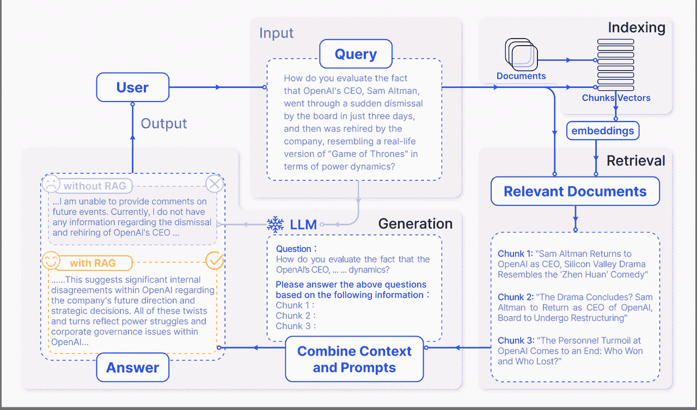

+   相比提示词工程：RAG有更丰富的上下文和数据样本，可以不需要用户提供过多的背景描述，即能生成比较符合用户预期的答案。

+   相比于模型微调：RAG可以提升问答内容的时效性和可靠性，同时在一定程度上保护了业务数据的隐私性。

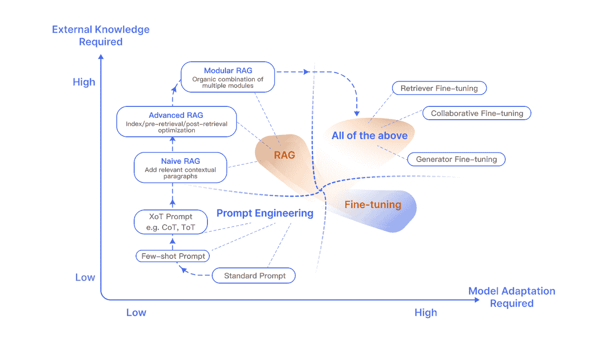

> 借助`LCEL`提供的`RunnableParallel`可以清晰描述RAG的计算图结构，其中最关键的部分是通过`context`键注入向量存储（Vector Store）的查询器（Retriever）。

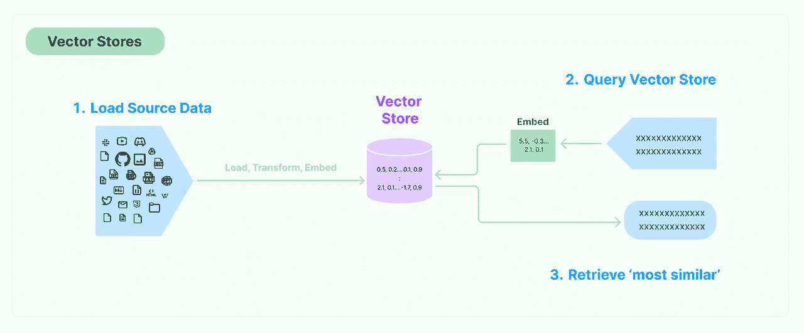

**RAG中关键组件：**

+   `DocumentLoader`：从外部系统检索文档数据。简单起见，示例中直接构造了测试文档对象。实际上LangChain提供了文档加载器`BaseLoader`的接口抽象和大量实现，具体可根据自身需要选择使用。

+   `TextSplitter`：将文档分割成块，以适应大模型上下文窗口。常用`RecursiveCharacterTextSplitter`，其他参考LangChain的`TextSplitter`接口和实现。

+   `EmbeddingsModel`：[文本嵌入模型](https://platform.openai.com/docs/guides/embeddings)，提供将文本编码为向量的能力。文档写入和查询匹配前都会先执行文本嵌入编码。示例采用了OpenAI的文本嵌入模型服务，其他参考LangChain的`Embeddings`接口和实现。

+   `VectorStore`：向量存储，提供向量存储和相似性检索（ANN算法）能力。LangChain支持的向量存储参考[Faiss](https://github.com/facebookresearch/faiss)和[TuGraph](https://github.com/TuGraph-family/tugraph-db)等`VectorStore`接口和实现。示例采用了Meta的Faiss向量数据库，本地安装方式：`pip install faiss-cpu`。需要额外提及的是，对于图数据库，可以将相似性搜索问题转化为图遍历问题，并具备更强的知识可解释性。蚂蚁开源的TuGraph数据库目前正在做类似的技术探索。

+   `Retriever`：向量存储的查询器。一般和`VectorStore`配套实现，通过`as_retriever`方法获取，LangChain提供的`Retriever`抽象接口是`BaseRetriever`。

### 使用工具——Tool

+   注意这里不是[Assistant的函数调用](https://platform.openai.com/docs/assistants/tools/function-calling)，通过在对话请求内附加`tools`参数描述工具的定义格式（原先的`functions`参数已过期），LLM会根据提示词推断出需要调用哪些工具，并提供具体的调用参数信息。用户需要根据返回的工具调用信息，自行触发相关工具的回调。

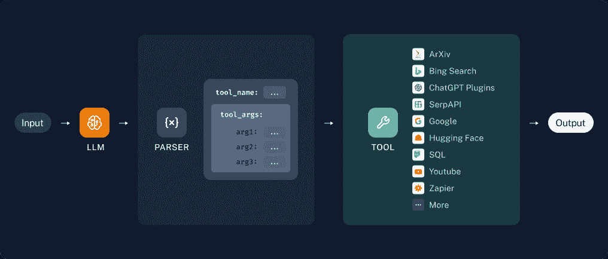

### 走向智能——Agent

什么是AI Agent？

代理（Agent）这个词来源于拉丁语“agere”，意为“行动”。现在可以表示在各个领域能够独立思考和行动的人或事物的概念。它强调自主性和主动性。智能代理/智能体是以智能方式行事的代理；Agent感知环境，自主采取行动以实现目标，并可以通过学习或获取知识来提高其性能。

> 可以把单个Agent看成是某个方面的专家。

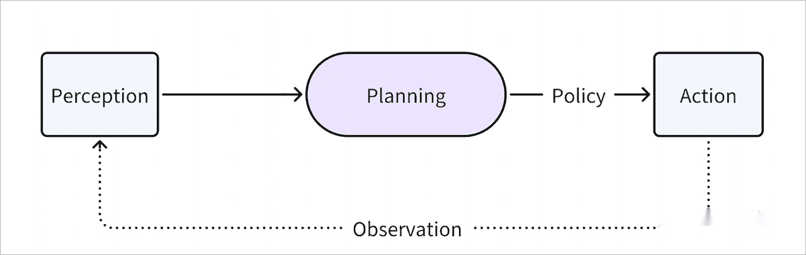

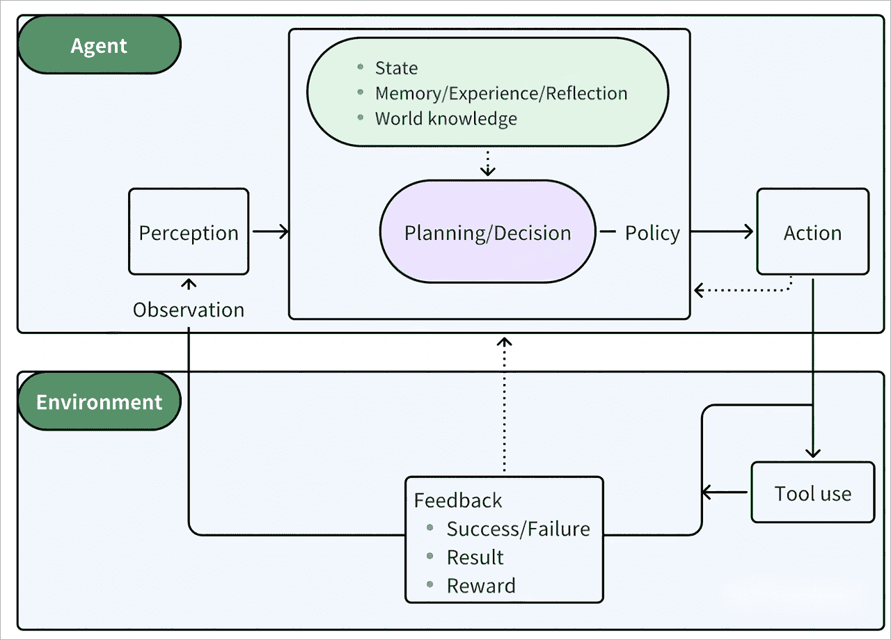

### 一个精简的Agent决策流程：

#### Agent：P（感知）→ P（规划）→ A（行动）

感知（Perception）是指Agent从环境中收集信息并从中提取相关知识的能力。

规划（Planning）是指Agent为了某一目标而作出的决策过程。

行动（Action）是指基于环境和规划做出的动作。


> 其中，`Policy`是`Agent`做出`Action`的核心决策，而行动又通过观察（`Observation`）成为进一步`Perception`的前提和基础，形成自主地闭环学习过程。

## 类 `LangChain` 中的各种概念

+ `Models`，也就是我们熟悉的调用大模型API。

+ `Prompt Templates`，在提示词中引入变量以适应用户输入的提示模版。

+ `Chains`，对模型的链式调用，以上一个输出为下一个输入的一部分。

+ `Agent`，能自主执行链式调用，以及访问外部工具。

+ `Multi-Agent`，多个`Agent`共享一部分记忆，自主分工相互协作。

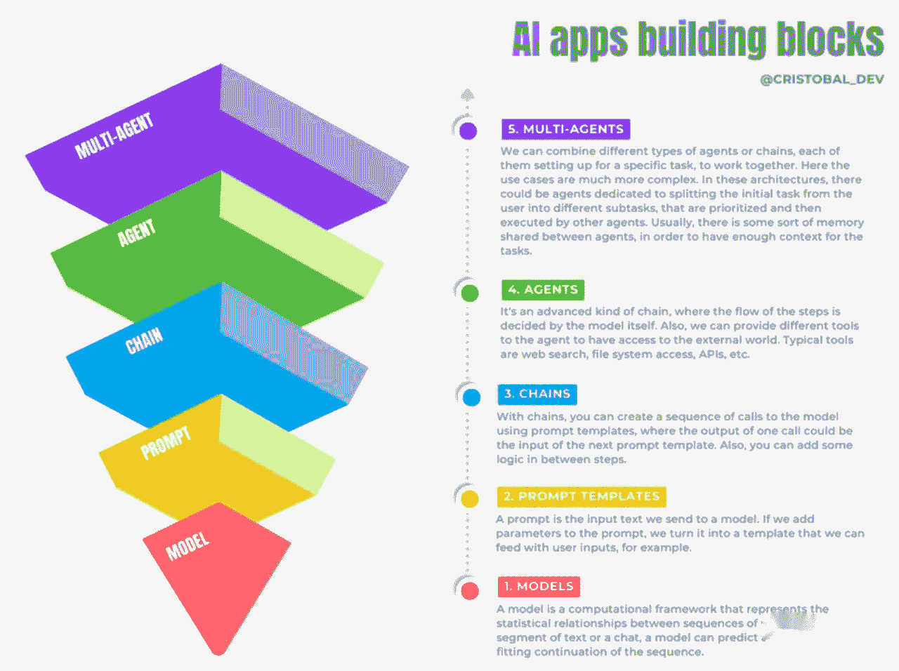

### LangChain 中 `Agent` 和 `Chain` 的区别

> The core idea of agents is to use an LLM to choose a sequence of actions to take. In chains, a sequence of actions is hardcoded (in code). In agents, a language model is used as a reasoning engine to determine which actions to take and in which order.

## 背景知识

做决策的过程中，一个很重要的信息来源是 `Memory`（记忆）。作为重要的背景知识，下面简单介绍下都有哪些种类的记忆

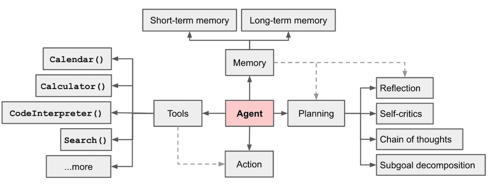

### 记忆（`Memory`）

`记忆`可以被定义为获取、储存、保留以及后来检索信息的过程。人脑中有几种类型的记忆。

+ 感觉记忆（`Sensory Memory`）：这是记忆的最早阶段，提供在原始刺激结束后保留感官信息（视觉、听觉等）的印象的能力。感觉记忆通常只持续几秒钟。子类别包括视觉记忆（`iconic memory`）、回声记忆（`echoicmemory`）和触觉记忆（`haptic memory`）。

+ 短期记忆（`Short-Term Memory`，`STM`）或工作记忆（`Working Memory`）：它储存我们当前意识到的信息，以执行复杂的认知任务，如学习和推理。短期记忆被认为有大约7个项目的容量（Miller 1956）并持续20-30秒。

+ 长期记忆（`Long-Term Memory`，`LTM`）：长期记忆可以储存信息很长一段时间，从几天到几十年，其储存容量基本上是无限的。`LTM`有两个子类型：

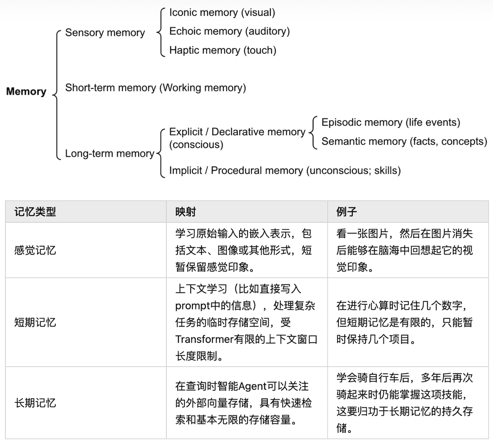

可以大致考虑以下对应关系：

+ 将感觉记忆视为学习原始输入（包括文本、图像或其他模式）的嵌入表示；

+ 将短期记忆视为在上下文中（`prompt`）学习。它是短暂且有限的，因为它受到`Transformer`的上下文窗口长度的限制。

+ 将长期记忆视为代理在查询时可以注意到的外部向量存储，可以通过快速检索访问。

### 怎么写好`Prompt`：`ReAct`

+ Home:

+ LangChain中的`ReAct`：

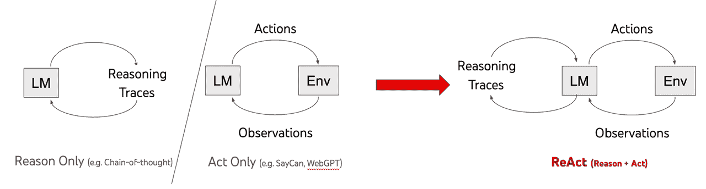

`ReAct` 指：Reason and Act 。

特色：

+ `CoT` 只是在`prompt`加入了静态的 “Let’s think step by step”。`ReAct` 的`prompt`是动态变化的。

+ `CoT` 只调用`LLM`一次即可，`ReAct`是多次迭代调用`LLM`。

> `ReAct`可能是当前`Agent`中使用最多的`prompt`结构：少样本+`Thought`，`Action`，`Observation`。

> 也是调用工具、推理和规划时常用的`prompt`结构。🔥🔥🔥

`ReAct`中迭代使用3个元素：`Thought`，`Action`，`Observation`。其中 `Thought`，`Action` 由 `LLM` 生成，`Observation` 是执行 `Action` 后获得的返回结果。

+ `Step 1` 中，`LLM`基于 `Question` 先 `think`（reasoning），然后再决定采取什么行动。这样 `LLM` 就会生成 `Thought 1` 和 `Action 1`。执行 `Action 1` 获得 `Observation 1`。

+ `Step 2` 中，`LLM`基于 `Question`，`Thought 1`，`Action 1` 和 `Observation 1`，汇总所有信息先 `think`（reasoning），然后再决定采取什么行动。这样 `LLM` 就会生成 `Thought 2` 和 `Action 2`。执行 `Action 2` 获得 `Observation 2`。

+ `Step 3` 中，`LLM`基于 `Question`，`Thought 1`，`Action 1`，`Observation 1`，`Thought 2`，`Action 2` 和 `Observation 2`，汇总所有信息先 `think`（reasoning），然后再决定采取什么行动。这样 `LLM` 就会生成 `Thought 3` 和 `Action 3`。执行 `Action 3` 获得 `Observation 3`。

+ 以此类推直到 `Action` 表示结束。

具体代码可以参考以下：

```
def webthink(idx=None, prompt=webthink_prompt, to_print=True):
    question = env.reset(idx=idx)
    if to_print:
        print(idx, question)
    prompt += question + &quot;\n&quot;
    n_calls, n_badcalls = 0, 0
    for i in range(1, 8):
        n_calls += 1
        thought_action = llm(prompt + f&quot;Thought {i}:&quot;, stop=[f&quot;\nObservation {i}:&quot;])
        try:
            thought, action = thought_action.strip().split(f&quot;\nAction {i}: &quot;)
        except:
            print(&#x27;ohh...&#x27;, thought_action)
            n_badcalls += 1
            n_calls += 1
            thought = thought_action.strip().split(&#x27;\n&#x27;)[0]
            action = llm(prompt + f&quot;Thought {i}: {thought}\nAction {i}:&quot;, stop=[f&quot;\n&quot;]).strip()
        obs, r, done, info = step(env, action[0].lower() + action[1:])
        obs = obs.replace(&#x27;\\n&#x27;, &#x27;&#x27;)
        step_str = f&quot;Thought {i}: {thought}\nAction {i}: {action}\nObservation {i}: {obs}\n&quot;
        prompt += step_str  # 之前的 Thought, Action, Observation 都加进来了
        if to_print:
            print(step_str)
        if done:
            break
    if not done:
        obs, r, done, info = step(env, &quot;finish[]&quot;)
    if to_print:
        print(info, &#x27;\n&#x27;)
    info.update({&#x27;n_calls&#x27;: n_calls, &#x27;n_badcalls&#x27;: n_badcalls, &#x27;traj&#x27;: prompt})
    return r, in
```

上面函数输入的参数 `webthink_prompt` ，长如下样子：

```
Solve a question answering task with interleaving Thought, Action, Observation steps. Thought can reason about the current situation, and Action can be three types: 
(1) Search[entity], which searches the exact entity on Wikipedia and returns the first paragraph if it exists. If not, it will return some similar entities to search.
(2) Lookup[keyword], which returns the next sentence containing keyword in the current passage.
(3) Finish[answer], which returns the answer and finishes the task.
Here are some examples.

Question: What is the elevation range for the area that the eastern sector of the Colorado orogeny extends into?
Thought 1: I need to search Colorado orogeny, find the area that the eastern sector of the Colorado orogeny extends into, then find the elevation range of the area.
Action 1: Search[Colorado orogeny]
Observation 1: The Colorado orogeny was an episode of mountain building (an orogeny) in Colorado and surrounding areas.
Thought 2: It does not mention the eastern sector. So I need to look up eastern sector.
Action 2: Lookup[eastern sector]
Observation 2: (Result 1 / 1) The eastern sector extends into the High Plains and is called the Central Plains orogeny.
Thought 3: The eastern sector of Colorado orogeny extends into the High Plains. So I need to search High Plains and find its elevation range.
Action 3: Search[High Plains]
Observation 3: High Plains refers to one of two distinct land regions:
Thought 4: I need to instead search High Plains (United States).
Action 4: Search[High Plains (United States)]
Observation 4: The High Plains are a subregion of the Great Plains. From east to west, the High Plains rise in elevation from around 1,800 to 7,000 ft (550 to 2,130 m).[3]
Thought 5: High Plains rise in elevation from around 1,800 to 7,000 ft, so the answer is 1,800 to 7,000 ft.
Action 5: Finish[1,800 to 7,000 ft]

[More Examples]...
```

有了上面的基本知识后，我接下来会介绍几篇`Agent`的代表性工作。本文（Part 1）介绍来自斯坦福的工作，其中主要文字都是原论文直译。

## 来自斯坦福的虚拟小镇

+   [G](https://arxiv.org/abs/2304.03442)enerative Agents: Interactive Simulacra of Human Behavior, 2023.04, Stanford

+   代码已开源

`虚拟小镇`，一个`agent`就是一个虚拟人物，25个`agents`之间的故事。

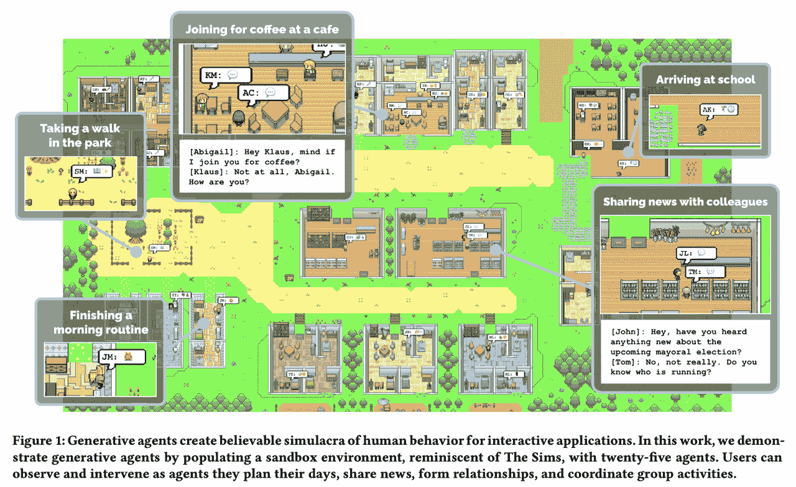

### 架构

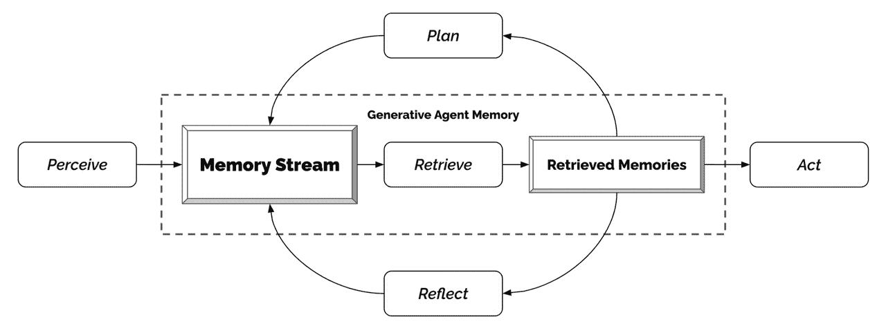

> `代理`（`Agents`）感知他们的环境，当前代理所有的感知（完整的经历记录）都被保存在一个名为"记忆流"（`memory stream`）中。基于代理的感知，系统检索相关的记忆，然后使用这些检索到的行为来决定下一个行为。这些检索到的记忆也被用来形成长期计划，并创造出更高级的反思，这些都被输入到记忆流中以供未来使用。

### `记忆流`与检索

`记忆流`（`Memory Stream`）记录了代理（`Agent`）的所有经历。它是一个内存对象列表，其中每个对象包含自然语言描述，创建时间戳和最近访问时间戳。记忆流的最基本元素是观察（`Observation`）。常见的观察包括代理自己执行的行为，或者代理感知到的其他代理或非代理对象执行的行为（每个`Agent`都有自己独立的`记忆流`）。

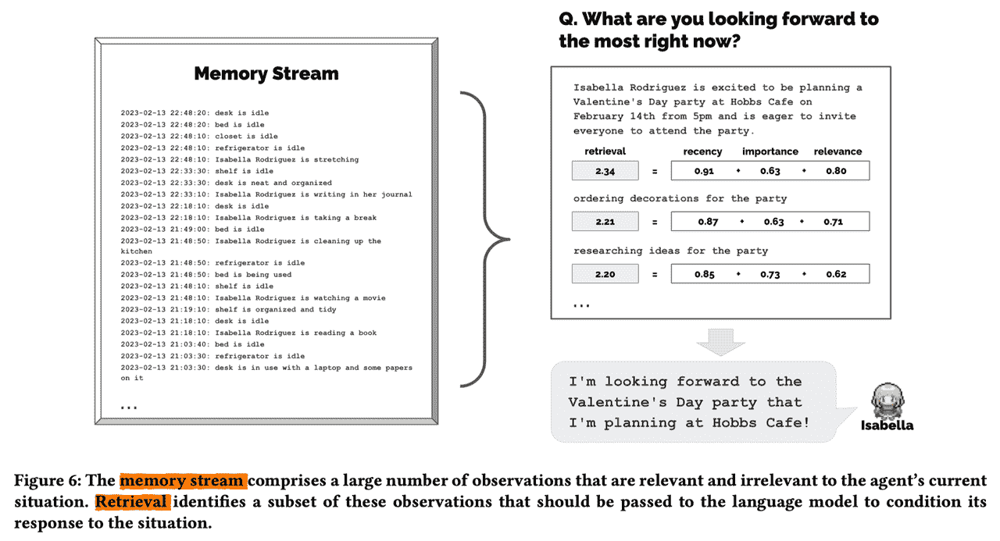

`检索`功能以代理的当前情况作为输入，检索出一部分记忆流，以传递给语言模型。

排序打分包括三个部分：

+ `近期性`（`Recency`）为最近访问的记忆对象分配更高的分数，因此刚刚发生的事件或今天早上的事件可能会保留在代理的注意力范围内。在作者的实现中，将近期性视为一个指数衰减函数，衰减的对象是自上次检索记忆以来的沙盒游戏小时数。衰减因子是0.99。

+ `重要性`（`Importance`）通过为代理认为重要的记忆对象分配更高的分数，区分了平凡记忆和核心记忆。例如，一个平凡的事件，如在房间里吃早餐，会产生一个低重要性分数，而与重要的他人分手则会产生一个高分。重要性分数的实现方式有很多种；作者直接使用`LLM`打分，输出一个整数分数。

`prompt`：

```
On the scale of 1 to 10, where 1 is purely mundane (e.g., brushing teeth, making bed) and 10 is extremely poignant (e.g., a break up, college acceptance), rate the likely poignancy of the following piece of memory.
Memory: buying groceries at The Willows Market and Pharmacy Rating: &lt;fill in&gt;
```

+ `相关性`（`Relevance`）为与当前情况相关的记忆对象分配更高的分数。使用常见的向量检索引擎即可。

最终的检索分数是上面三项的加权平均：

### 反思（`Reflection`）

挑战：仅配备原始观察记忆的代理，往往难以进行概括或推理。

示例：用户问 Klaus Mueller：“If you had to choose one person of those you know to spend an hour with, who would it be?” 仅通过观察记忆，代理简单地选择 Klaus 交互最频繁的人：Wolfgang，他的大学宿舍邻居。但是，Wolfgang 和 Klaus 只是偶尔见面，没有深入的互动。一个更理想的回答需要代理从 Klaus 花费数小时在研究项目上的记忆中概括出 Klaus 对研究的热情，并同样认识到 Maria 也在她自己的研究中付出努力使用下面的方法，当问 Klaus 要与谁共度时间时，Klaus 会选择 Maria 而不是 Wolfgang。


## 反思（`Reflection`）

作者引入了第二种类型的记忆，称之为反思（`Reflection`）。反思是由代理生成的更高级别、更抽象的思考。因为反思也是一种记忆，所以在检索时，它们会与其他观察结果一起被包含在内。反思是周期性生成的；在作者的实现中，当代理感知到的最新事件的重要性评分之和超过一定阈值时，就会生成反思。在实践中，代理大约每天反思两到三次（一日三省吾身）。

反思的第一步是让代理确定要反思什么，通过确定代理最近的经历可以提出哪些问题。作者用代理记忆流中最近的100条记录（例如，`Klaus Mueller is reading a book on gentrification`，`Klaus Mueller is conversing with a librarian about his research project`，`desk at the library is currently unoccupied`）查询`LLM`，使用`prompt`：`Given only the information above, what are 3 most salient high-level questions we can answer about the subjects in the statements?`，生成候选问题：例如，`What topic is Klaus Mueller passionate about?` 和 `What is the relationship between Klaus Mueller and Maria Lopez?`

第二步，将这些生成的问题作为检索的查询，收集每个问题的相关记忆（包括其他反思）。然后使用`LLM`从中提取洞见（`insight`），并引用生成洞见对应的特定记录。下面是完整的提示：

这个过程生成了一些洞见，比如`Klaus Mueller is dedicated to his research on gentrification (because of 1, 2, 8, 15).`。解析并将这个洞见存储为记忆流中的一个反思，包括指向被引用的内存对象的指针。

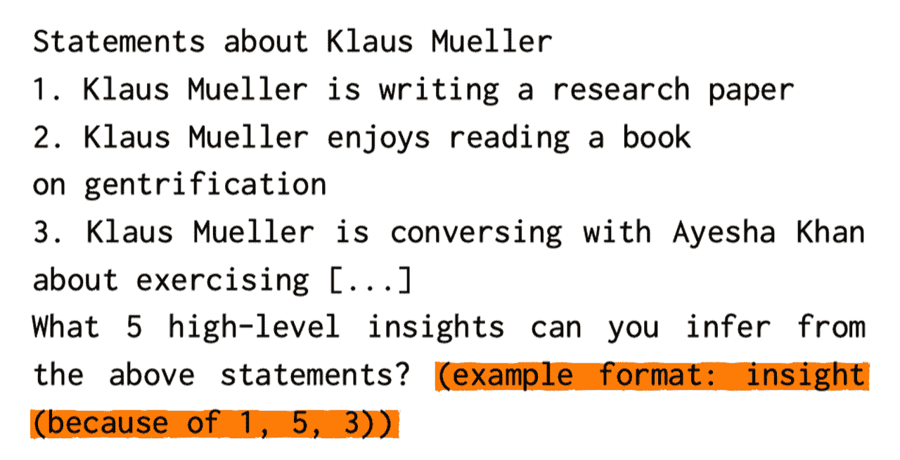

反思（`Reflection`）明确允许代理不仅反思他们的观察结果，还可以反思其他的反思：例如，上面关于Klaus Mueller的第二个陈述是Klaus之前的反思，而不是他从环境中得到的观察。因此，代理生成了反思树：树的叶节点代表基础观察，非叶节点代表的思考越往树上越抽象和高级。

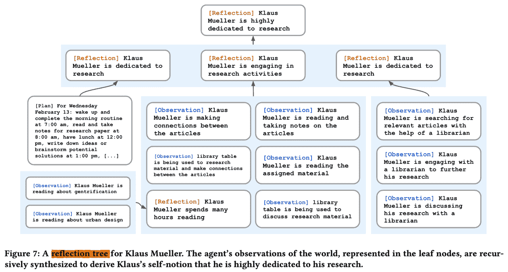

## 计划与响应

计划（`Plan`）是为了做更长时间的规划。

像反思一样，计划也被储存在记忆流中（第三种记忆），并被包含在检索过程中。这使得代理能够在决定如何行动时，同时考虑观察、反思和计划。如果需要，代理可能在中途改变他们的计划（即响应，`reacting`）。

为了创建这样的计划，作者的方法是从上到下，递归地生成更多的细节。

第一步是创建一个大致概述一天行程的计划。为了创建初始计划，使用代理的摘要描述（例如，名字，特征，和他们最近经历的总结）和他们前一天的总结来提示语言模型。下面是一个完整的示例提示，底部未完成，由`LLM`完成：

```
Name: Eddy Lin (age: 19) 
Innate traits: friendly, outgoing, hospitable Eddy Lin is a student at Oak Hill College studying music theory and composition. He loves to explore different musical styles and is always looking for ways to expand his knowledge. Eddy Lin is working on a composition project for his college class. He is also taking classes to learn more about music theory. Eddy Lin is excited about the new composition he is working on but he wants to dedicate more hours in the day to work on it in the coming days. 
On Tuesday February 12, Eddy 1) woke up and completed the morning routine at 7:00 am, [. . . ] 6) got ready to sleep around 10 pm.

Today is Wednesday February 13. Here is Eddy’s plan today in broad strokes: 1)
```

这会生成代理一天计划的大致草图，分为五到八个部分：

```
1) wake up and complete the morning routine at 8:00 am, 
2) go to Oak Hill College to take classes starting 10:00 am, 
[. . . ] 
5) work on his new music composition from 1:00 pm to 5:00 pm, 
6) have dinner at 5:30 pm, 
7) finish school assignments and go to bed by 11:00 pm.
```

代理将此计划保存在记忆流中，然后递归分解它以创建更细粒度的动作，首先是一小时长的动作块——例如，Eddy从下午1点到5点的工作计划 `work on his new music composition` 变成：`1:00 pm: start by brainstorming some ideas for his music composition [...] 4:00 pm: take a quick break and recharge his creative energy before reviewing and polishing his composition`。然后我们再次递归分解这个计划，变成5-15分钟的动作块：例如，`4:00 pm: grab a light snack, such as a piece of fruit, a granola bar, or some nuts. 4:05 pm: take a short walk around his workspace [...] 4:50 pm: take a few minutes to clean up his workspace.`。这个过程可以根据需要的粒度进行调整。

### 3.1 响应和更新计划（`Reacting and Updating Plans`）

代理执行动作循环中的动作，每个时间步骤，它们感知周围的世界，这些感知到的观察结果被存储在它们的记忆流中。这些观察结果输入到`LLM`，让`LLM`决定代理是否应该继续他们现有的计划，或者做出响应（`reacting`）。例如，站在画架前画画可能会触发对画架的观察，不太可能引发响应。然而，如果艾迪的父亲约翰记录下他看见艾迪在房子的花园里短暂散步，结果就不同了。下面是`prompt`，其中 `[Agent’s Summary Description]` 代表了一个动态生成的、长达一段落的对代理总体目标和性情的总结：

```
[Agent’s Summary Description] 

It is February 13, 2023, 4:56 pm.

John Lin’s status: John is back home early from work.

Observation: John saw Eddy taking a short walk around his workplace.

Summary of relevant context from John’s memory: Eddy Lin is John’s Lin’s son. Eddy Lin has been working on a music composition for his class. Eddy Lin likes to walk around the garden when he is thinking about or listening to music.

Should John react to the observation, and if so, what would be an appropriate reaction?
```

通过两个`prompts` `What is [observer]’s relationship with the [observed entity]?`和`[Observed entity] is [action status of the observed entity]`来生成上下文摘要，并将它们的答案一起总结。输出建议 `John could consider asking Eddy about his music composition project`。然后，从响应发生的时间开始，重新生成代理的现有计划。最后，如果行动指示了代理之间需要互动，使用以下方式生成他们的对话。

### 3.2 对话

代理在互动时进行对话。根据它们对彼此的记忆来生成代理的对话。例如，当John开始和Eddy对话时，通过使用他对Eddy的总结记忆以及他决定询问Eddy关于他的`composition project`时的预期响应来生成John的第一句话。

```
[Agent’s Summary Description]

It is February 13, 2023, 4:56 pm.

John Lin’s status: John is back home early from work.

Observation: John saw Eddy taking a short walk around his workplace.

Summary of relevant context from John’s memory: Eddy Lin is John’s Lin’s son. Eddy Lin has been working on a music composition for his class. Eddy Lin likes to walk around the garden when he is thinking about or listening to music.

John is asking Eddy about his music composition project. What would he say to Eddy?
```

结果：`Hey Eddy, how’s the music composition project for your class coming along?`

从Eddy的角度看，John发起的对话被视为一个他可能想要回应的事件。因此，就像John做的那样，Eddy检索并总结了他与John的关系记忆，以及可能与John在对话中的最后一句话相关的记忆。如果他决定回应，我们会使用他的总结记忆和当前的对话历史来生成Eddy的话语：

```
[Agent’s Summary Description] 

It is February 13, 2023, 4:56 pm.

Eddy Lin’s status: Eddy is taking a short walk around his workplace.

Observation: John is initiating a conversation with Eddy.

Summary of relevant context from Eddy’s memory: Jonn Lin is Eddy Lin’s father. John Lin is caring and is interested to learn more about Eddy Lin’s school work. John Lin knows that Eddy Lin is working on a music composition.

Here is the dialogue history:

John: Hey Eddy, how’s the music composition project for your class coming along?

How would Eddy respond to John?
```

这生成了Eddy的回应：`Hey Dad, it’s going well. I’ve been taking walks around the garden to clear my head and get some inspiration.`

这个对话的延续是使用同样的机制生成的，直到两个代理中的一个决定结束对话。

本次分享结束。下次接着分享最近比较火的 `Agent` 框架。
