# 一：智能导购助手

> 来源：[https://v11enp9ok1h.feishu.cn/docx/DxkKdNjqdoMYkQxWFIzcmQqRnQb](https://v11enp9ok1h.feishu.cn/docx/DxkKdNjqdoMYkQxWFIzcmQqRnQb)

> **团队信息****：**CY-CHENYUE

> **个人介绍：**

> ComfyUI节点作者、模型训练师、工厂企业主、阿里巴巴最佳网商

> 多款自研产品出货量过百万、面壁智能开源大使

> 上海嘉定“提示未来”视频人气奖、扣子ai挑战赛大消费行业专场获奖

> 阿里云优酷-影视娱乐 IP 大赛 创意奖、支付宝 新春音浪贺岁 MV 大赛 优秀奖

> 天津美院 AI艺术展参展作品

# 作品介绍：

#### 视频演示

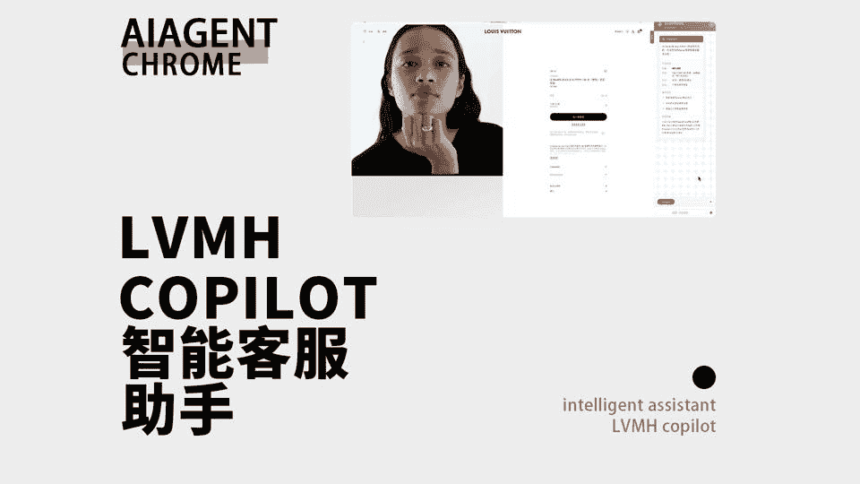

[WeChat_20250413190906.mp4](https://internal-api-drive-stream.feishu.cn/space/api/box/stream/download/all/PIplbwzjHoxKZzxjJWccBa5bnag)

#### 应用截图

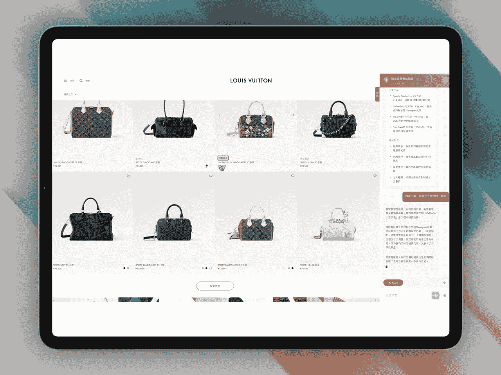

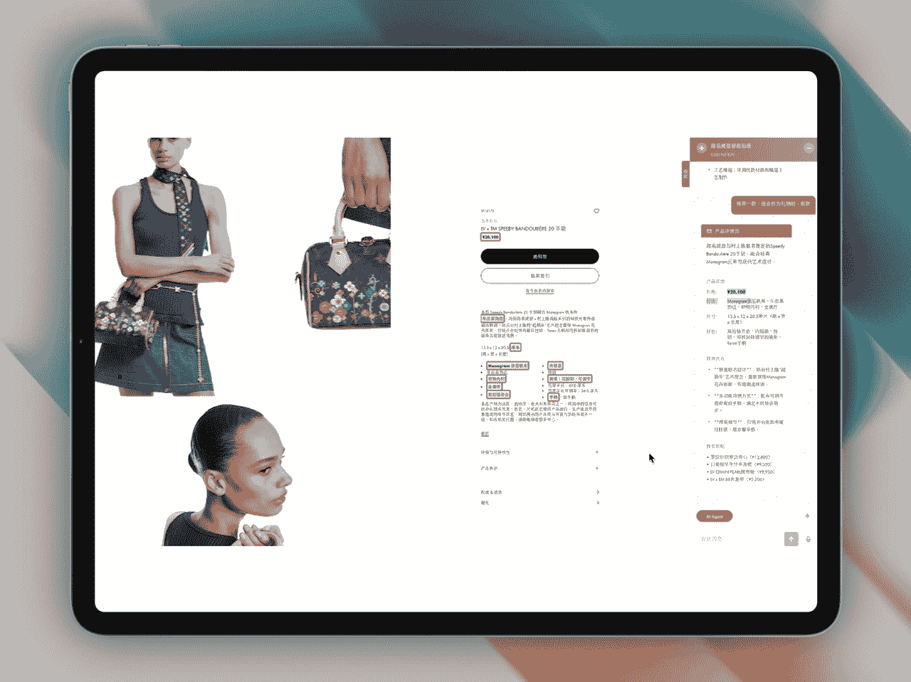

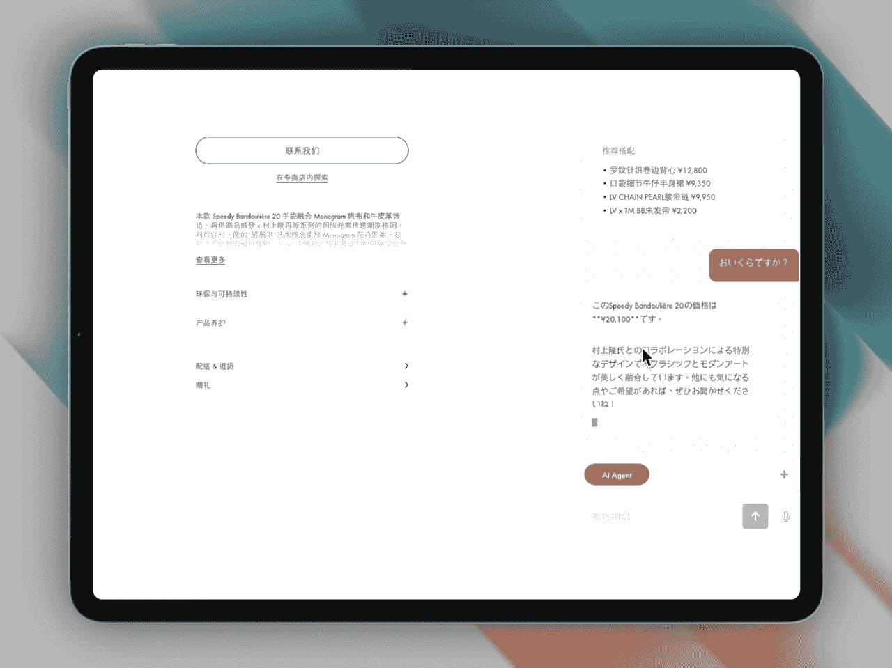

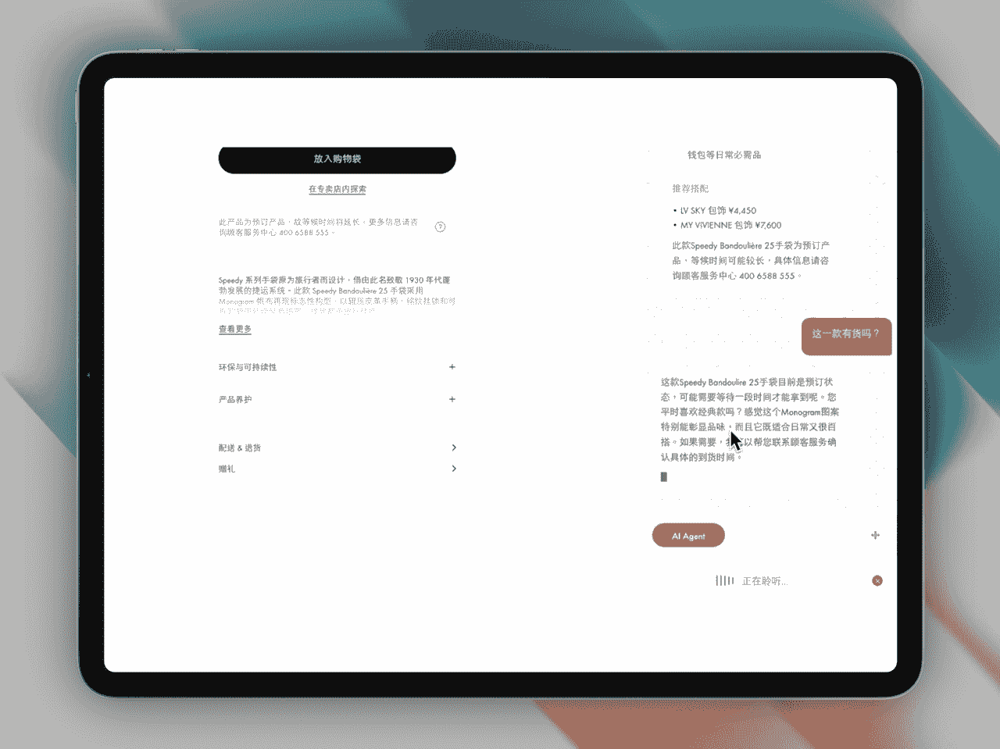

### **项目概览**

> LVMH AI购物助手是一款创新型浏览器扩展，通过无缝集成AI能力到LVMH集团官方网站，在不改变原有品牌网站风格和用户体验的前提下，为用户提供智能化、个性化的购物咨询服务。该扩展采用轻量级设计，一键安装即可为任何LVMH旗下品牌官网赋能，使奢侈品购物体验提升至全新水平。

#### **核心创新亮点**

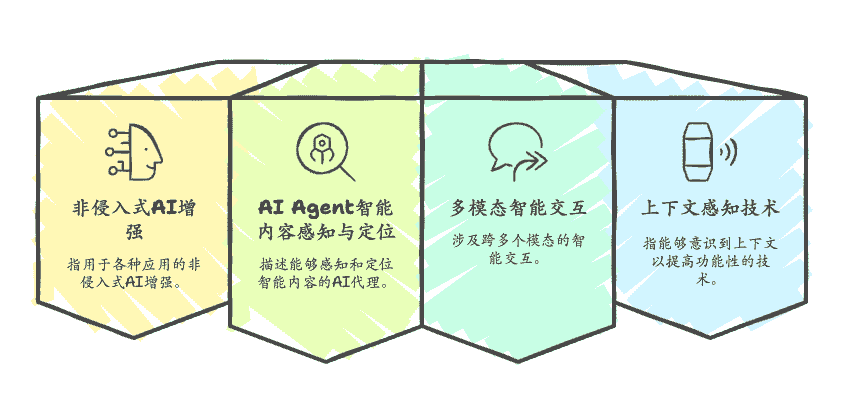

#### **非侵入式AI增强**

> 与传统的网站重构或独立应用不同，我们的解决方案采用浏览器扩展形式，完全不干扰原有网站的设计风格和用户体验，同时为用户提供随时可用的AI助手。这种"无痕AI增强"方式，既保持了品牌的视觉一致性，又提供了智能交互能力。

#### AI Agent智能内容感知与定位

创新的AI Agent系统能够主动感知网页内容，自动识别关键产品信息和重要元素：

+   智能解析网页DOM结构，定位核心产品信息区域

+   无需用户指引，自动关注并定位重要内容

+   智能提取并理解产品特性、材质、设计细节等信息

+   基于语义理解进行内容关联，提供精准导航和推荐

#### **多模态智能交互**

项目突破了传统交互的限制，创新性地融合了多种交互方式：

> **高情商文本对话**：AI具备情感理解和共情能力，能识别用户隐含需求，提供得体且符合LVMH品牌调性的回应，支持打字机效果，营造真实对话感

>

> **情感化语音交互**：支持带有自然情感变化的语音反馈，根据内容自动调整语速、语调和情感色彩，模拟真人顾问亲切感和专业感

#### **上下文感知技术**

系统能智能感知用户当前浏览的页面内容，包括：

+   自动提取产品信息并纳入对话上下文

+   精准识别用户在浏览什么类型的产品

+   智能关联推荐搭配和浏览历史记录

+   跨页面智能记忆管理，感知用户浏览轨迹

### **市场与商业价值分析**

#### **市场需求分析**

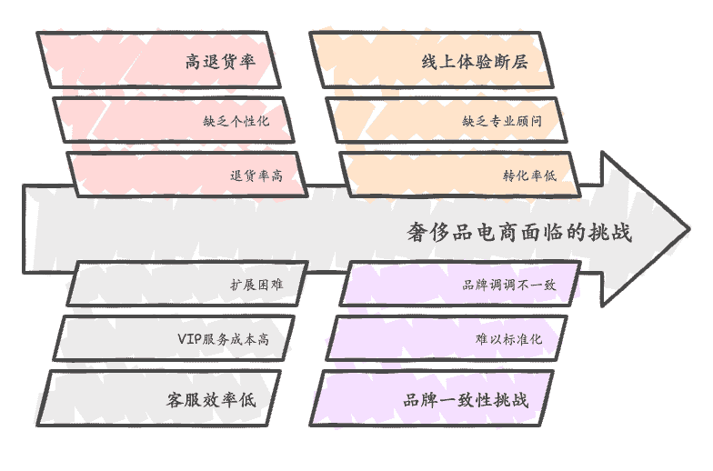

1. **奢侈品电商市场现状**

+   全球奢侈品电商市场规模2023年达到600亿美元，预计年复合增长率15%

+   疫情后线上购物习惯形成，奢侈品牌线上销售占比从2019年的12%增长到2023年的30%

+   千禧一代和Z世代消费者占奢侈品购买力的40%，他们更倾向于数字化购物体验

2. **行业痛点识别**

+   高退货率：奢侈品线上退货率高达35%，远高于普通电商的20%

+   客服效率低：传统VIP客服模式难以扩展，人均服务成本高

+   线上体验断层：缺乏线下店的专业顾问服务，转化率低于实体店30%

+   全球化挑战：多语言、多文化服务难以标准化

+   品牌一致性：难以在数字化过程中保持奢侈品的高端体验和品牌调性

3. **市场机遇**

+   智能购物助手市场空白：奢侈品领域缺乏专业定制的AI解决方案

+   用户需求强烈：76%的高端消费者表示希望获得更智能的线上购物顾问服务

+   技术成熟度：大模型技术已达到可支持高质量专业领域对话的水平

#### **目标客户群体定位**

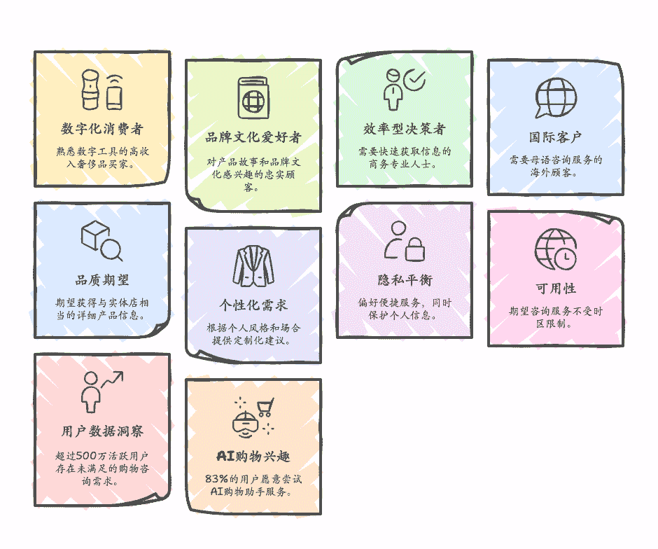

1. **核心用户画像**

- **数字化高端消费者**：30-45岁，高收入，熟悉数字工具但缺乏专业时尚知识的奢侈品消费者

- **品牌文化爱好者**：希望深入了解产品故事和品牌文化的忠实顾客，注重品牌历史和工艺细节

- **效率型决策者**：时间宝贵，期望快速获取专业信息并做出购买决策的商务人士

- **国际客户**：面临语言障碍，需要母语咨询服务的海外顾客

2. **客户需求特征**

+   对品质与专业知识的高要求：期望获得与实体店同等甚至更详尽的产品信息

+   个性化需求明显：根据个人风格、场合和身份需要定制化建议

+   隐私与便捷的平衡：期望便捷服务但重视个人信息保护

+   全天候可用性：不受时区和营业时间限制的咨询服务

3. **用户数据支持**

+   LVMH平台月活跃用户超过500万，其中35%存在未解决的购物咨询需求

+   用户调研显示，83%的用户愿意尝试AI购物助手服务

#### **商业化可行性**

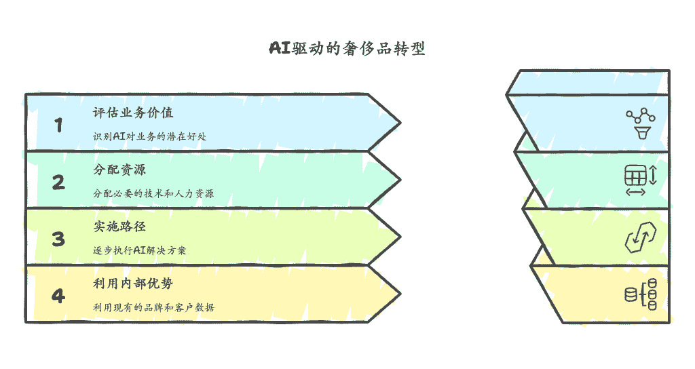

1. **业务价值评估**

+   提升线上购物体验：与LVMH高端品牌形象一致的智能导购服务

+   数字化战略支持：加速集团数字化转型，提升线上渠道竞争力

+   全渠道融合：为线上线下一体化体验奠定技术基础

+   数据资产积累：沉淀客户偏好与需求数据，指导产品与服务优化

2. **资源投入与回报**

+   技术投入：利用现有IT基础设施，重点投入AI模型定制与训练

+   人力资源：结合现有客服团队，实现人机协作的智能客服模式

+   预期回报：线上销售提升25%-40%，客服效率提高60%，客户满意度提升35%

+   品牌价值提升：强化LVMH集团作为奢侈品数字化领导者的市场地位

3. **实施路径**

+   初期试点：选择核心品牌(如Louis Vuitton, Dior)进行概念验证

+   优化迭代：基于真实用户反馈快速迭代产品功能和体验

+   全面部署：成功验证后逐步扩展至集团所有品牌官网

+   持续发展：定期更新AI能力，持续提升服务质量与范围

4. **内部优势**

+   品牌专业知识库：集团拥有丰富的产品知识和品牌历史资料可训练AI

+   客户数据优势：已有的客户数据可提升AI服务的个性化程度

+   无缝品牌整合：作为官方项目可完美融入品牌视觉识别系统和调性

+   部署灵活性：浏览器扩展形式使实施成本低、风险小、效果快

### **商业价值与应用场景**

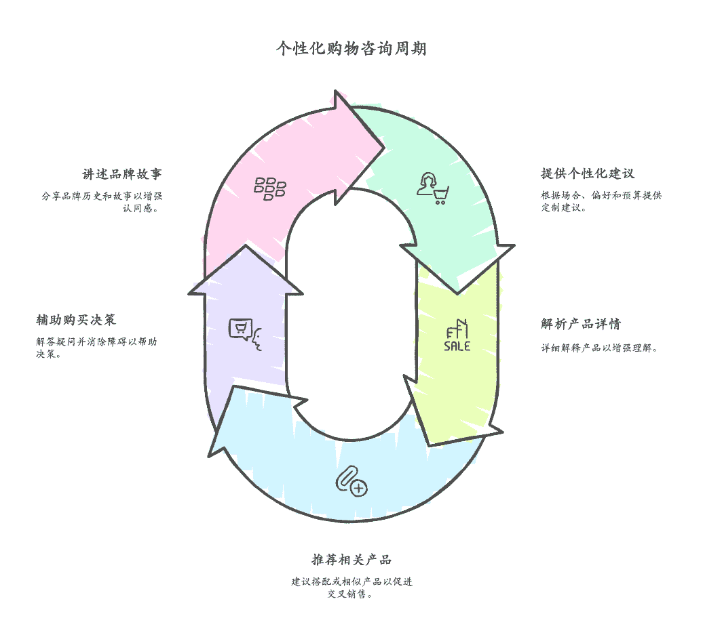

1. **智能购物咨询**：根据用户提供的场合、偏好和预算，结合当前浏览的产品提供个性化购物建议

2. **产品详情解析**：深入解释产品材质、工艺和设计灵感，增进用户对产品价值的理解

3. **相关产品推荐**：基于用户浏览的商品，智能推荐搭配或相似产品，提升交叉销售机会

4. **购买决策辅助**：解答用户对产品的具体问题，消除购买障碍，帮助用户做出购买决定

5. **品牌故事讲解**：讲述品牌历史和产品背后的故事，增强品牌认同感

### **用户体验设计**

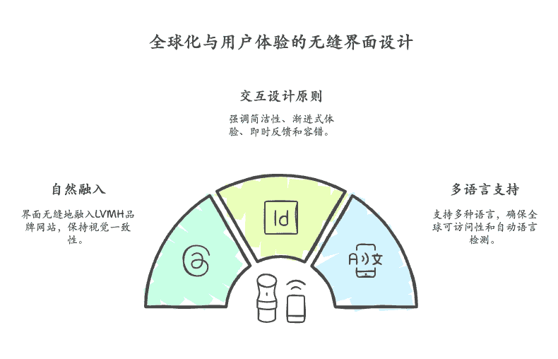

**自然融入的界面设计**

助手界面优雅地融入任何LVMH品牌网站，不突兀也不干扰：

+   可调整位置和大小，适应不同浏览场景

+   支持折叠最小化，随时可用不打扰

+   继承当前品牌的色彩方案，保持视觉一致性

**交互设计原则**

+   **简洁直观**：无需学习曲线，一看即懂的操作方式

+   **渐进式体验**：基础功能简单，高级功能自然引导

+   **反馈即时**：所有操作都有清晰的视觉或听觉反馈

+   **容错设计**：友好的错误处理和建议提供

**多语言支持**

为满足全球顾客需求，系统支持：

+   英语、法语、中文、日语、韩语等10种主要语言

+   自动检测页面语言并匹配

+   支持语言间的无缝切换