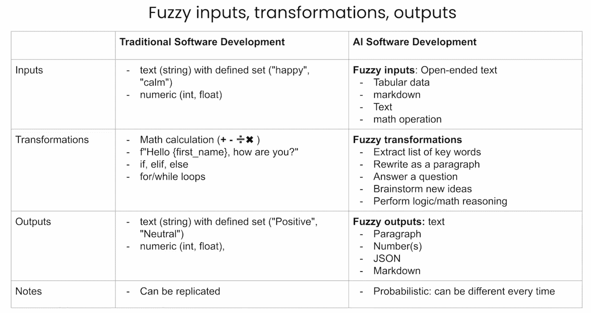

# 3. 进阶知识篇: AI Agents深入浅出

> 来源：[https://v11enp9ok1h.feishu.cn/docx/HlVudwEqOoKdKNxIIxgcPbNonYc](https://v11enp9ok1h.feishu.cn/docx/HlVudwEqOoKdKNxIIxgcPbNonYc)

<https://v11enp9ok1h.feishu.cn/sync/PaIIdslbxsIJUIbkTfPcsMCFnph>

### 传统软件工程 VS. 智能体软件工程

+   模糊 (Fuzzy) 更贴近真实世界

+   变化 = 惊喜 = 不可控

