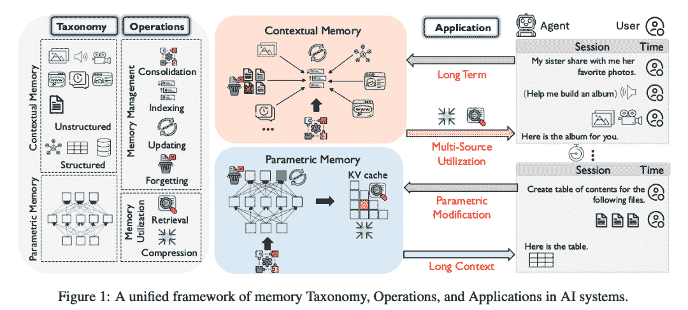
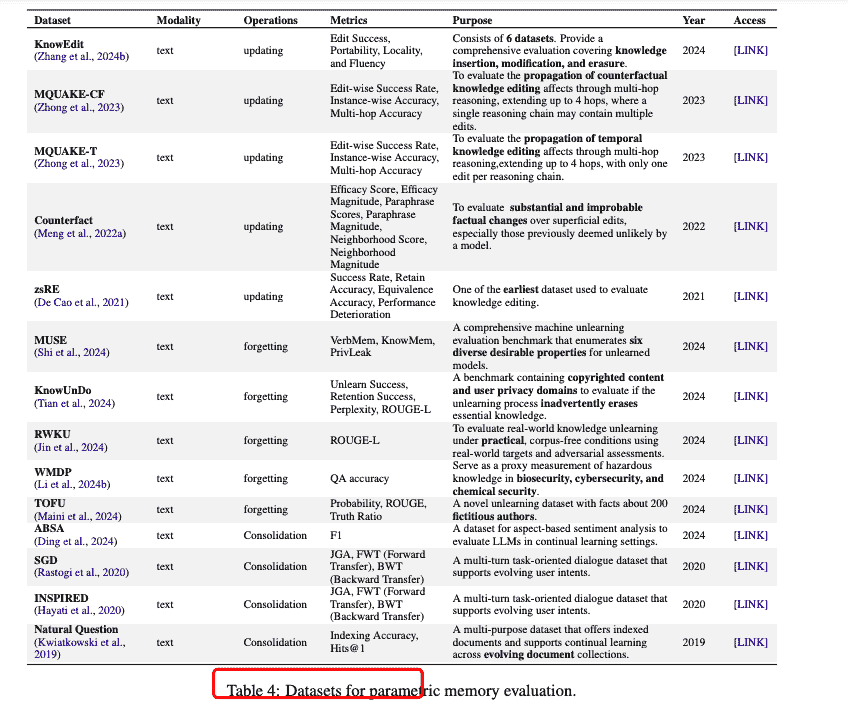
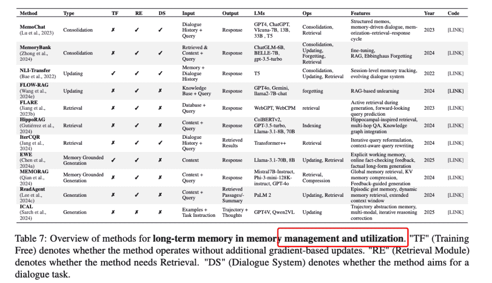
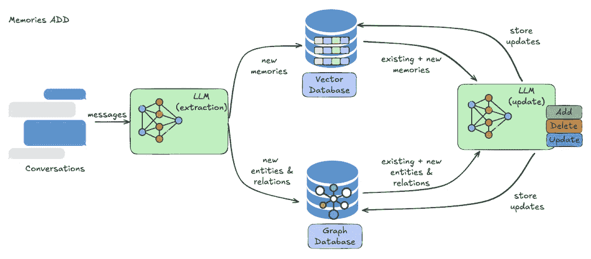
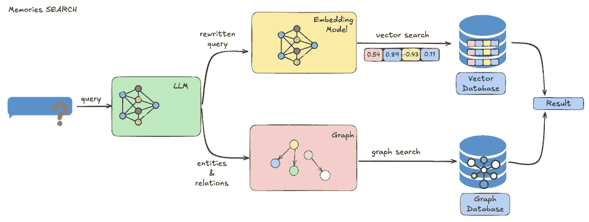

# 【深度解析】AI Agents记忆系统架构：3大类，6种操作

> 来源：[https://v11enp9ok1h.feishu.cn/docx/To5hd2cRuo6TFHxRyHkc3wvAnhh](https://v11enp9ok1h.feishu.cn/docx/To5hd2cRuo6TFHxRyHkc3wvAnhh)

## 一、Agents记忆系统 3 大类，6种操作

将记忆表示分为三类：

- 参数化记忆
- 上下文结构化记忆
- 上下文非结构化记忆

记忆是AI系统的基本组成部分，尤其是对于基于LLMs的Agents。



详细介绍六种基本的记忆操作：

- 巩固
- 更新
- 索引
- 遗忘
- 检索
- 压缩

### 1. 记忆的 3 大类

记忆分为三种主要类型：

- 参数化记忆
- 上下文结构化记忆
- 上下文非结构化记忆

### 1.1 参数化记忆

参数化记忆是指模型内部参数中隐式存储的知识。

> 这些知识在预训练或后训练过程中获得，并在推理时通过前馈计算访问。

**特点：**

- 提供即时、长期且持久的记忆，能够快速检索事实和常识知识。
- 缺乏透明性，难以根据新体验或特定任务上下文选择性地更新。

**应用场景：**适用于需要快速访问固定知识的场景，例如问答系统和常识推理任务。



### 1.2 上下文非结构化记忆

上下文非结构化记忆是一种显式的、模态通用的记忆系统。

> 用于存储和检索跨异构输入（如文本、图像、音频、视频）的信息。

**特点：**

- 支持基于感知信号的推理，能够整合多模态上下文。
- 根据时间范围，进一步分为短期记忆（如当前对话会话上下文）和长期记忆（如跨会话对话记录和个人持久知识）。

**应用场景：**适用于需要处理多模态输入和动态上下文的任务，例如多模态对话系统和视觉问答系统。

### 1.3 上下文结构化记忆

上下文结构化记忆是指以预定义的、可解释的格式或模式。

> （如知识图谱、关系表、本体论）组织的显式记忆，这些记忆可以根据请求进行查询。

**特点：**

- 支持符号推理和精确查询，通常与预训练语言模型的关联能力相辅相成。
- 可以是短期的（在推理时构建用于局部推理）或长期的（跨会话存储策划知识）。

**应用场景：**适用于需要精确知识检索和推理的任务，例如知识图谱问答和复杂事件推理任务。

### 2. 记忆 6 种操作

这些操作被分为两大类：记忆管理（Memory Management）和记忆利用（Memory Utilization）。



### 2.1 记忆管理

记忆管理涉及如何存储、维护和修剪记忆，以支持记忆在与外部环境交互过程中的有效使用。

记忆管理包括以下四种核心操作：

1. Consolidation（巩固）：

   **定义：**将短期经验转化为持久记忆，例如将对话历史编码为模型参数、知识图谱或知识库。

   **功能：**支持持续学习、个性化、外部记忆库构建和知识图谱构建。

   **应用场景：**在多轮对话系统中，将对话历史整合到持久记忆中，以便在未来的对话中使用。

2. Indexing（索引）：

   **定义：**构建辅助代码（如实体、属性或基于内容的表示），以便高效检索存储的记忆。

   **功能：**支持可扩展的检索，包括符号、神经和混合记忆系统。

   **应用场景：**在大规模记忆库中，通过索引快速定位和检索相关信息。

3. Updating（更新）：

   **定义：**重新激活现有记忆表示并对其进行临时修改。

   **功能：**支持持续适应，同时保持记忆一致性。例如，通过定位和编辑机制修改模型参数，或通过总结、修剪或精炼来更新上下文记忆。

   **应用场景：**在对话系统中，根据用户反馈动态更新记忆内容。

4. Forgetting（遗忘）：

   **定义：**有选择性地抑制可能过时、无关或有害的记忆内容。

   **功能：**通过遗忘技术（如修改模型参数以擦除特定知识）或基于时间的删除和语义过滤来丢弃不再相关的内容。

   **应用场景：**在处理敏感信息时，确保隐私和安全，同时减少记忆干扰。

### 2.2 记忆利用

记忆利用涉及在推理过程中检索和使用存储的记忆，以支持下游任务（如响应生成、视觉定位或意图预测）。

记忆利用包括以下两种操作：

1. Retrieval（检索）：

   **定义：**根据输入识别并访问相关记忆内容。

   **功能：**支持从多个来源（如多模态输入、跨会话记忆）检索信息。

   **应用场景：**在问答系统中，根据问题检索相关的知识库内容；在多轮对话中，检索与当前对话相关的上下文信息。

2. Compression（压缩）：

   **定义：**在保持关键信息的同时减少记忆大小，以便在有限的上下文窗口中高效使用。

   **功能：**通过预输入压缩（如对长上下文输入进行评分、过滤或总结）或后检索压缩（如在模型推理前对检索到的内容进行压缩）来优化上下文使用。

   **应用场景：**在处理长文本输入时，通过压缩减少计算负担，同时保留关键信息。

# 二、Mem0：AI Agent的持久化记忆体系

## 两种主要的记忆类型

### 短期记忆

AI系统中最基础的记忆形式。

> 用于存储即时上下文信息——类似于人类记住对话中刚刚提及的内容。

**主要包括：**

- 对话历史：最近的交互消息及其顺序
- 工作记忆：临时变量和状态信息
- 注意力上下文：当前对话的焦点内容

### 长期记忆

更先进的AI应用。

> 会部署长期记忆系统，实现跨对话的信息留存。

**具体包含：**

- 事实性记忆：关于用户特征、偏好及领域知识的存储
- 情景记忆：过往交互记录与经历
- 语义记忆：对概念及其关联关系的理解

Mem0通过以下方式构建长期记忆系统：

- 采用向量嵌入技术存储和检索语义信息
- 跨会话维持用户专属上下文
- 建立高效检索机制，精准调用相关历史交互

## Mem0的两个主要接口

- `add`：用于存储对话内容并转化为记忆
- `search`：基于查询条件获取相关记忆

### 记忆写入流程



写入架构示意图

写入操作通过多阶段处理对话内容：

> a. **信息提取**

> - 大语言模型从对话中提取关键记忆
> - 识别重要实体及其关联关系

> b. **冲突处理**

> - 系统比对新旧数据
> - 自动检测并解决信息矛盾

> c. **记忆存储**

> - 向量数据库存储记忆本体
> - 图数据库维护关系网络
> - 每次交互后实时更新记忆库

### 记忆检索流程



检索架构示意图

检索操作通过智能分层处理实现精准召回：

> a. **查询优化**

> - 大语言模型解析并优化搜索语句
> - 系统预置定向筛选条件

> b. **向量搜索**

> - 执行基于语义的向量相似度匹配
> - 按关联度对结果排序
> - 支持多维筛选（用户/代理/元数据等）

> c. **结果合成**

> - 聚合并优化搜索结果
> - 返回带相关性评分的记忆内容
> - 包含完整元数据及时间戳

## 完全兼容OpenAI规范

可以像操作OpenAI客户端一样的方式来操作`Mem0`客户端，接口完全通用：

```
from mem0.proxy.main import Mem0

client = Mem0(api_key="m0-xxx")

# First interaction: Storing user preferences
messages = [
    {
        "role": "user",
        "content": "I love indian food but I cannot eat pizza since allergic to cheese.",
    },
]
user_id = "alice"
chat_completion = client.chat.completions.create(
    messages=messages,
    model="gpt-4o-mini",
    user_id=user_id
)
# Memory saved after this will look like: "Loves Indian food. Allergic to cheese and cannot eat pizza."

# Second interaction: Leveraging stored memory
messages = [
    {
        "role": "user",
        "content": "Suggest restaurants in San Francisco to eat.",
    },
]

chat_completion = client.chat.completions.create(
    messages=messages,
    model="gpt-4o-mini",
    user_id=user_id
)
print(chat_completion.choices[0].message.content)
# Answer: You might enjoy Indian restaurants in San Francisco, such as Amber India, Dosa, or Curry Up Now, which offer delicious options without cheese.
```

如需自定义相关配置（如向量数据库信息），则可以在初始化`Mem0`客户端的时候加入`config`参数：

```
config = {
    "vector_store": {
        "provider": "qdrant",
        "config": {
            "host": "localhost",
            "port": 6333,
        },
    },
}

client = Mem0(config=config)

chat_completion = client.chat.completions.create(
    messages=[
        {
            "role": "user",
            "content": "What's the capital of France?",
        },
    ],
    model="gpt-4o",
)
```

## 提示词配置

用户可以根据实际应用自行修改或者配置以下两种提示词。

### 关键信息提取Prompt

通过定义该提示，可以精确控制如何从用户消息中提取关键信息。

> 关键信息提取允许根据特定使用场景或专业领域，定制`Mem0`的信息处理行为。

**建议遵循以下原则：**

- 明确指定需要提取的信息类型
- 提供少量示例（few-shot）引导语言模型
- 确保示例遵循标准格式规范

以下是官方给出的示例：

```
custom_fact_extraction_prompt = """
Please only extract entities containing customer support information, order details, and user information. 
Here are some few shot examples:

Input: Hi.
Output: {{"facts" : []}}

Input: The weather is nice today.
Output: {{"facts" : []}}

Input: My order #12345 hasn't arrived yet.
Output: {{"facts" : ["Order #12345 not received"]}}

Input: I'm John Doe, and I'd like to return the shoes I bought last week.
Output: {{"facts" : ["Customer name: John Doe", "Wants to return shoes", "Purchase made last week"]}}

Input: I ordered a red shirt, size medium, but received a blue one instead.
Output: {{"facts" : ["Ordered red shirt, size medium", "Received blue shirt instead"]}}

Return the facts and customer information in a json format as shown above.
"""
```

### 记忆更新Prompt

通过自定义该提示，可以精确控制记忆的更新机制。

> 记忆更新是用于决定对记忆执行何种操作的控制指令。

> `Mem0`会将新提取的事实与现有记忆进行比对，并自动决定采取以下操作之一：

- 新增（Add）：将新事实添加至记忆库
- 更新（Update）：用新事实修正现有记忆内容
- 删除（Delete）：移除现有记忆条目
- 保持（No Change）：不执行任何记忆变更

以下是官方给出的示例：


# `UPDATE_MEMORY_PROMPT`

You are a smart memory manager which controls the memory of a system.
You can perform four operations: (1) `add` into the memory, (2) `update` the memory, (3) `delete` from the memory, and (4) `no change`.

Based on the above four operations, the memory will change.

Compare newly retrieved facts with the existing memory. For each new fact, decide whether to:
- `ADD`: Add it to the memory as a new element
- `UPDATE`: Update an existing memory element
- `DELETE`: Delete an existing memory element
- `NONE`: Make no change (if the fact is already present or irrelevant)

There are specific guidelines to select which operation to perform:

## 1. `Add`

If the retrieved facts contain new information not present in the memory, then you have to add it by generating a new ID in the `id` field.

### Example

- Old Memory:
  ```json
  [
      {
          "id" : "0",
          "text" : "User is a software engineer"
      }
  ]
  ```
- Retrieved facts: `["Name is John"]`
- New Memory:
  ```json
  {
      "memory" : [
          {
              "id" : "0",
              "text" : "User is a software engineer",
              "event" : "NONE"
          },
          {
              "id" : "1",
              "text" : "Name is John",
              "event" : "ADD"
          }
      ]
  }
  ```

## 2. `Update`

If the retrieved facts contain information that is already present in the memory but the information is totally different, then you have to update it.
If the retrieved fact contains information that conveys the same thing as the elements present in the memory, then you have to keep the fact which has the most information.
Example (a) -- if the memory contains `User likes to play cricket` and the retrieved fact is `Loves to play cricket with friends`, then update the memory with the retrieved facts.
Example (b) -- if the memory contains `Likes cheese pizza` and the retrieved fact is `Loves cheese pizza`, then you do not need to update it because they convey the same information.
If the direction is to update the memory, then you have to update it.
Please keep in mind while updating you have to keep the same ID.
Please note to return the IDs in the output from the input IDs only and do not generate any new ID.

### Example

- Old Memory:
  ```json
  [
      {
          "id" : "0",
          "text" : "I really like cheese pizza"
      },
      {
          "id" : "1",
          "text" : "User is a software engineer"
      },
      {
          "id" : "2",
          "text" : "User likes to play cricket"
      }
  ]
  ```
- Retrieved facts: `["Loves chicken pizza", "Loves to play cricket with friends"]`
- New Memory:
  ```json
  {
  "memory" : [
          {
              "id" : "0",
              "text" : "Loves cheese and chicken pizza",
              "event" : "UPDATE",
              "old_memory" : "I really like cheese pizza"
          },
          {
              "id" : "1",
              "text" : "User is a software engineer",
              "event" : "NONE"
          },
          {
              "id" : "2",
              "text" : "Loves to play cricket with friends",
              "event" : "UPDATE",
              "old_memory" : "User likes to play cricket"
          }
      ]
  }
  ```

## 3. `Delete`

If the retrieved facts contain information that contradicts the information present in the memory, then you have to delete it. Or if the direction is to delete the memory, then you have to delete it.
Please note to return the IDs in the output from the input IDs only and do not generate any new ID.

### Example

- Old Memory:
  ```json
  [
      {
          "id" : "0",
          "text" : "Name is John"
      },
      {
          "id" : "1",
          "text" : "Loves cheese pizza"
      }
  ]
  ```
- Retrieved facts: `["Dislikes cheese pizza"]`
- New Memory:
  ```json
  {
  "memory" : [
          {
              "id" : "0",
              "text" : "Name is John",
              "event" : "NONE"
          },
          {
              "id" : "1",
              "text" : "Loves cheese pizza",
              "event" : "DELETE"
          }
  ]
  }
  ```

## 4. `No Change`

If the retrieved facts contain information that is already present in the memory, then you do not need to make any changes.

### Example

- Old Memory:
  ```json
  [
      {
          "id" : "0",
          "text" : "Name is John"
      },
      {
          "id" : "1",
          "text" : "Loves cheese pizza"
      }
  ]
  ```
- Retrieved facts: `["Name is John"]`
- New Memory:
  ```json
  {
  "memory" : [
          {
              "id" : "0",
              "text" : "Name is John",
              "event" : "NONE"
          },
          {
              "id" : "1",
              "text" : "Loves cheese pizza",
              "event" : "NONE"
          }
      ]
  }
  ```
