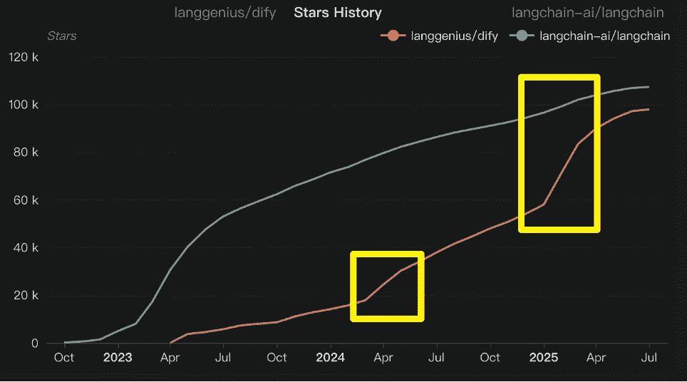
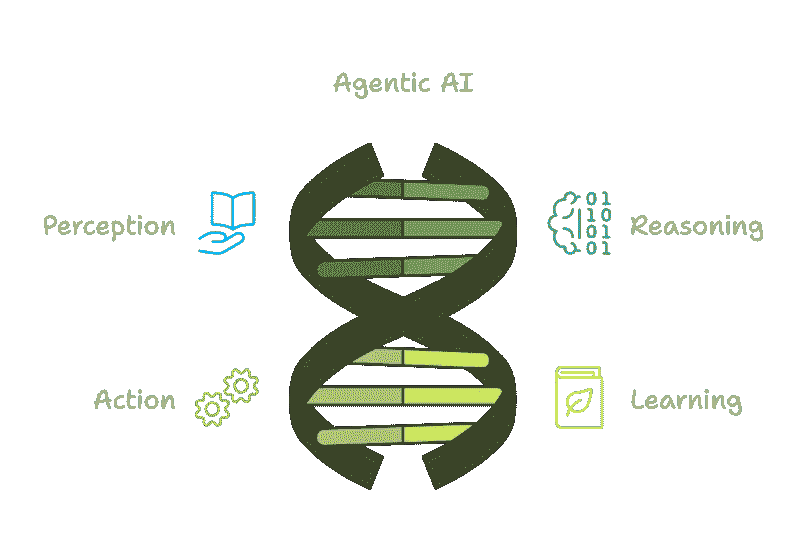
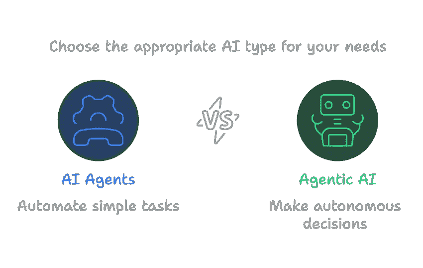
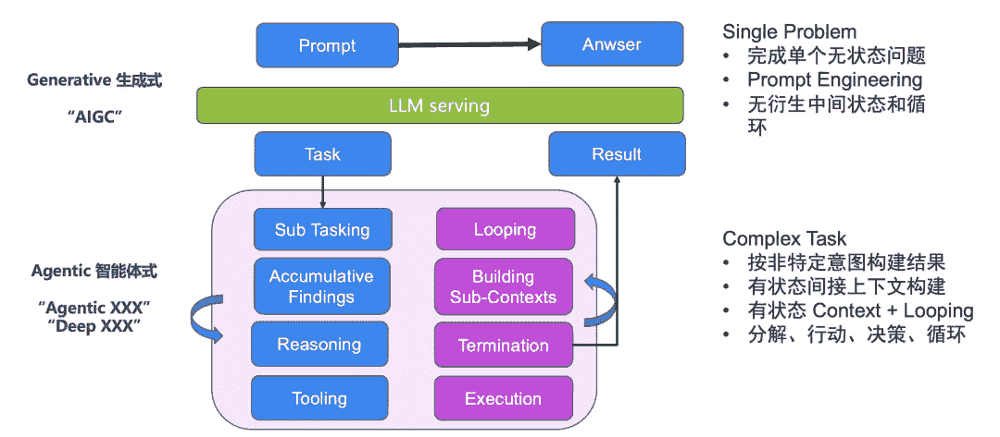
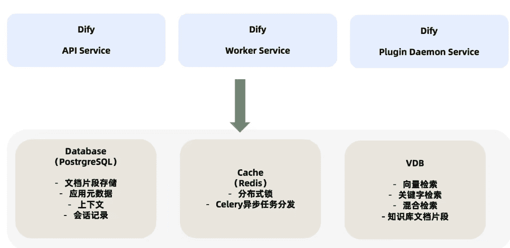
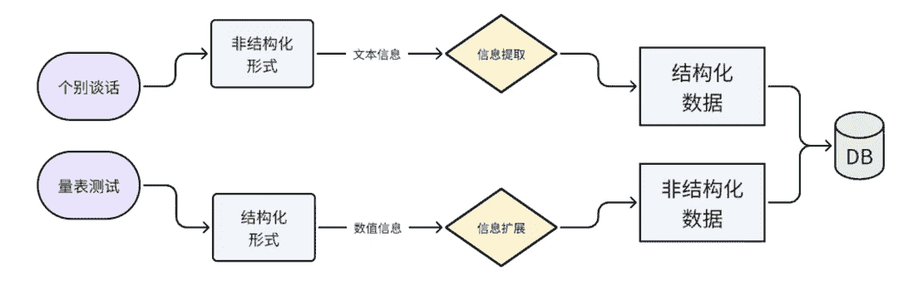
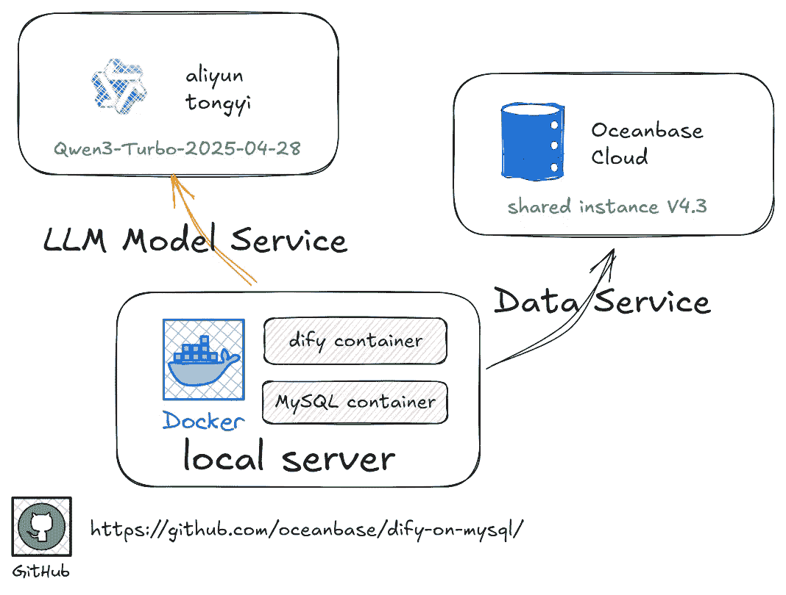
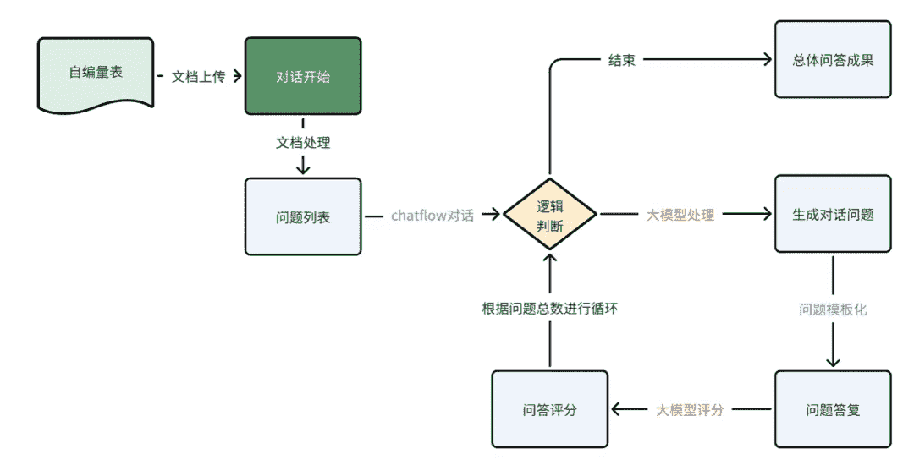
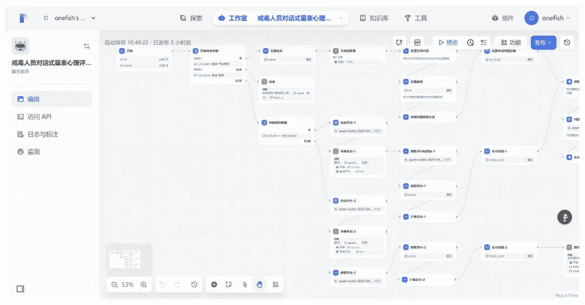
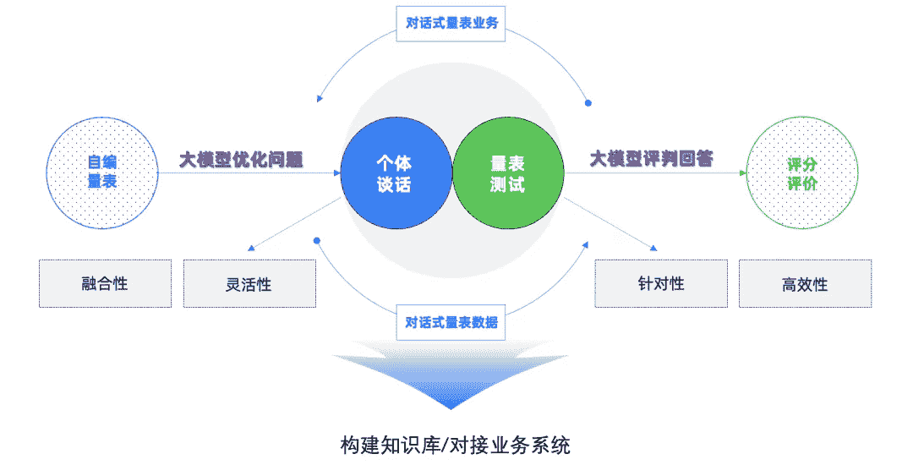

# 基于dify实践Agentic AI

> 来源：[https://v11enp9ok1h.feishu.cn/docx/FcA6dHRipoDXJDx3DyPcwBC9n4g](https://v11enp9ok1h.feishu.cn/docx/FcA6dHRipoDXJDx3DyPcwBC9n4g)

## Dify 之于 Agentic AI

### **Agent 构建模式：低代码（Low-co**de）还是高代码（High-code）？

在探讨 AI Agent 应用时，存在持续大量的相关讨论，例如 #Agent 与 #Agentic 的关系、工作流 #Workflow 的构建方式、Agent 构建模式应该是低代码还是高代码等。那么到底什么才是构建 AI Agent 应用的关键点呢？从 AI Agent 的发展趋势可以略知一二。

最大的区别就是从原来单个无状态的问题变成了一个更有符合上下文的、有状态的、间接的、直接性复杂问题上下文，然后进行循环，分解、行动、决策、循环。

构建 Agent 的关键因素是如何将相关能力转化为可交付、可扩展的产品，以满足不断增长的市场需求。通过产品化，Dify 能够更有效地将 AI 技术转化为实际应用，这也是其在全球范围内获得更广泛用户基础和更高市场接受度的真正原因。

## 2.Agent 转变 - AI Agents vs Agentic AI

从 Generative 到 Agentic 的转变，有四个关键方向：上下文感知（Contextual Cognition）、自适应学习系统（Adaptive Learning Systems）、分层目标执行（Hierarchical Goal Execution）、协作交互框架（Collaborative Interaction Framework）。在过去两年间，我们已经构建了相当多的 Agent 应用，当前阶段我们需要的不是研究如何构建一个 Agent，而是构建一种智能范式，从实体形态向方法渗透传递，因此需要更重视价值交付与场景上下游需要，更多让渡局部的决策权力和上下文，最终形成一种方法向应用体系渗透。因此 Agentic AI 可以更有梯次地运用发现（Findings），从上下文感知（Context Awarness）中决策，并采取行动。

### 从 Generative 生成式到 Agentic 智能体式

从上文可以得出从 Generative 生成式到 Agentic 智能体式，最大的区别就是从原来单个无状态的问题变成了一个更有符合上下文的、有状态的、间接的、直接性复杂问题上下文，然后进行循环，分解、行动、决策、循环。因此我们不再仅仅关注提示（Prompt）与回答（Answer）之间的一一对应关系及 Prompt Engineering 能力，而是能够以一个更开放、更有预期的形态，更深度的构建上下文进行行为与决策。

基于对平台需求的总结，我们确定了以下几个关键方向，这些方向是平台必须支持的：

1.  **Looping**
平台需要将复杂问题和子问题进行拆分（Sub-tasking），以实现对整体问题和各个子问题的高效处理。因此对于局部和整体问题，平台应提供一个循环机制，即 Dify 的新式循环 Looping。

1.  Building Sub-Contexts
随着子任务下不断出现新发现和新进展，我们要把它补充到 Sub-Contexts 中。

1.  **Termination**
有了新发现以后，我们需要对单一问题、子问题和总问题进行推理和决策，基于一些条件确定 Termination，最终完成整个循环。

1.  **Execution**
在归因后结束循环时，需要进一步用工具加强行为跟逻辑，因此也需要 Execution 的支持。

**从图中可以看出，左侧红蓝色的部分描述了 Agents** 的形态，右侧展示了平台需要支持的能力。

## 3.Dify 对 Agentic AI 的新能力支持

总结来说，Dify 对 Agentic AI 的新能力支持响应体现在以下几个方面：

1.  **插件市场的扩展：**Dify 将增强其插件市场，以纳入第一方和第三方的能力，从而补充和完善平台的功能。

1.  **Loop 新式循环：**构建一个能够进行任务分解、决策和执行的局部循环机制。每个环节都将利用更丰富的上下文信息，以实现分布式感知和提示驱动的决策。

1.  **Agent 智能体嵌入：**Dify 将集成 Agent、Tooling、Function Calling、MCP 等多种能力，以在局部和全局层面提供更灵活的调度和行为增强。

**通过**这些措施，Dify 旨在打造一个更加健壮和灵活的 Agentic AI 平台，该平台将能够适应不断变化的业务需求和技术进步，同时为用户提供一个全面、开放且可扩展的解决方案。

## 4.Dify 与中间件组件的基本架构

面对企业级应用需求，Dify 在中间件基本架构层承担的角色主要有以下三个：

+   **API Service**：全能型后端，Agent 运行载体，承载所有同步请求，需要高并发、低延迟的数据库连接；

+   **Worker Service**：知识库处理，包括异步任务（如文档解析、Embedding 生成）的调度和执行，依赖分布式锁、任务队列以及大容量存储，以保证任务可靠分发与重试

+   Plugin Daemon Service：插件市场解耦后，该服务承担了大量外部系统（数据库、向量库、第三方 API）的连接与编排工作，进一步放大了对存储和缓存的访问压力。

因此，Dify 在以上三个层面对中间件能力都有强烈诉求，整体可归纳为以下三部分：

+   **Database****：**文档片段存储、应用元数据、丰富的上下文、会话记录等，依赖一体化的 Database 具体提供支持;

+   **Cache****：**分布式锁、Celery 异步任务分发；

+   **VDB**：向量检索、关键字检索、混合检索、知识库文档片段等多模态检索能力。

如果对 Dify 进行压测，可以发现，面对海量的知识检索和会话消息数，大模型的服务负载没有预期中大，更多负载集中在 API 及 Plugin Daemon 对  Database 的连接上，大量的上下文、读写操作、并发数，影响了能够服务的范围与并发数，因此选择一款合适的向量数据库变得尤为关键。

就 Vector DB 来说，Dify 对每一种向量数据库的支持力度都比较规范，能够统一关键字检索、全文检索、向量检索、混合检索、文档过滤等多种能力，并且当前支持的向量数据库多达26种。其中，Dify CI 自动化测试覆盖的 VDB 包括：OceanBase（AK、向量、全文检索）、某 DB （AK、Official SaaS、向量）等。

## 5.业务数据处理流程

### 系统架构

对话式量表实现的系统架构一共包含三层：

+   据层（Data Service）：OceanBase 分布式数据库（结构化数值 + 非结构化文本统一存储）

+   服务层（Local Server）：Dify 框架 + Docker 容器化部署

+   模型层（LLM Model Service）：
– 主对话引擎：阿里云通义千问大语言模型
– 多 Agent 协同（规划中）
▸ Agent-1：负责对话生成与追问；
▸ Agent-2：负责个人信息调用与数据规整；
▸ Agent-3：负责评分、摘要与知识库回写。

## 6.数据处理流程

对话式量表整体的数据处理流程从上传文档到最终生成总体问答成果一共分为四个步骤：

Step 1：上传自编量表 → 文档处理 → 问题列表标准化；

Step 2：多轮 Chatflow 对话施测 → 大模型动态细化处理问题 → 受测者自然语言回答 → 生成对话问题；

Step 3：问题模板化 → 大模型评分 → 生成结构化得分 + 非结构化访谈纪要；

Step 4：结果写入 OceanBase → 同步至个体知识库矫治方案 → 对接教育矫治核心业务系统。

## 7.ChatFlow 编排设计

#ChatFlow 的编排设计共分为文档解析、对话、评分、存储四个节点，每个节点都有独立的功能实现：

+   文档解析节点：PDF / DOCX → 结构化题库

+   对话节点：LLM 追问、澄清、情感识别

+   评分节点：维度得分 + 风险预警

+   存储节点：结果落库 + 知识库更新

## 8.应用效果及后续规划

对话式量表融合了个体谈话和量表测试两者优点，

