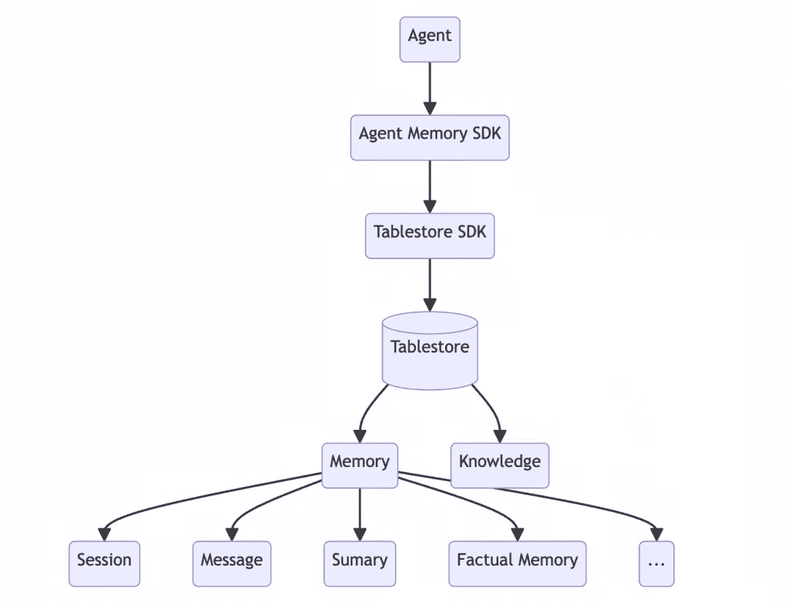
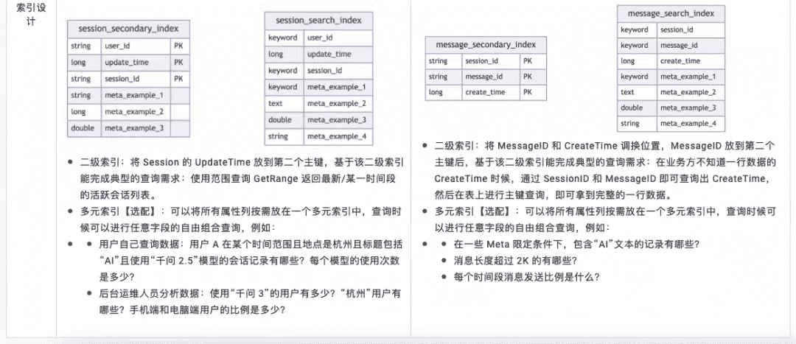
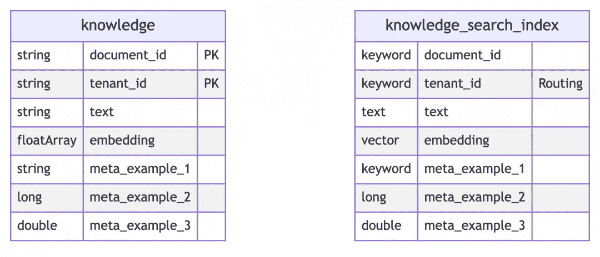
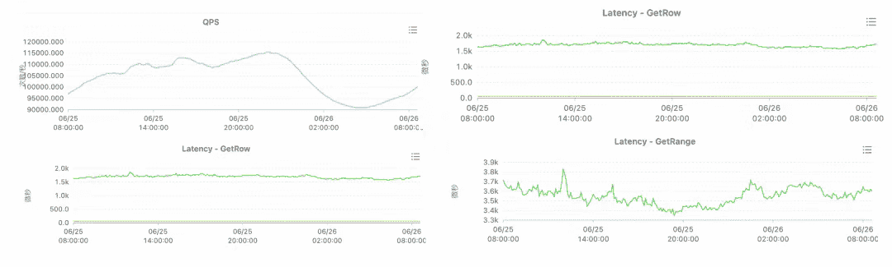
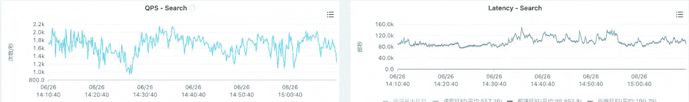

# 0-1基于`Tablestore`的`Agent Memory`框架搭建

> 来源：[https://v11enp9ok1h.feishu.cn/docx/Nm6xd9EUTo7yNoxJoMicmCNLnre](https://v11enp9ok1h.feishu.cn/docx/Nm6xd9EUTo7yNoxJoMicmCNLnre)

## 一、框架核心架构

> 该框架中，引入 `Agent Memory SDK`，专注于提升 AI 场景下的使用体验。

> 基于表格存储 `Tablestore`，实现了记忆 `Memory` 和知识 `Knowledge`，在记忆 `Memory` 中，我们会不断扩充新的场景。



### Memory记忆设计

> `Memory` 记忆最常见的场景是情景记忆，即会话管理和历史消息存储。

> 以该场景进行 `Tablestore` 的表设计介绍。场景包括 2 个核心表：`Session` 表和 `Message` 表。

> 如果有特殊化的业务场景，可以参考这些表设计重新。



### Knowledge知识设计

`Knowledge` 主要依赖向量检索和全文检索，具体如下：

+ `DocumentID` 作为表的分区键将所有的文档能离散到各个分区

> 全文+向量会导致单行较大，因此把 `DocumentID` 放在第一个主键当做分区键，这样能让每个分区的读写压力均衡。

+ `DocumentID` 和 `TenantID` 这 2 个主键组合起来作为唯一主键

> 如果用户不是多租户场景，`TenantID` 填默认值即可。

+ 多租户特性：

> 当用户选择开启多租户特性后，会把 `TenantID` 设置为多元索引的路由键，这样同一个租户的数据可以落到指定的分区上，这样查询时候不需要访问所有分区，然后降低查询消耗并减少毛刺。

+ 全文检索：

> `text` 文本字段在多元索引里会自动创建最大语义分词，如果需要其它分词，可以随时进行修改。

+ 向量检索：

> `embedding` 向量字段会自动创建向量索引，内部自动选择合适的索引结构进行索引，用户无需进行调优和优化。



## 二、场景化能力实现

### 大模型聊天场景

以目前最火的大模型应用为例，用户和大模型应用进行聊天，将这个过程中的 `Session` 会话和 `Message` 聊天消息记录起来进行使用。

> 在该场景下，理论的写入和查询的 `QPS` 很容易支持到几百万甚至千万级别。

> 受限于业务真实情况，目前 `Memory` 场景最大的线上真实业务查询和写入大概在 十几万 `QPS` 的量级，单行较大情况下写入延时 1~8ms，查询延时 1~4ms，单 `Memory` 表最大规模到 PB 级别。

> 成本方面，按实际用量进行计费，对于存储型业务。

> 除了这些性能和成本指标，默认提供 3AZ（同城 3 可用区部署）的容灾能力，将可用性做到最高。



```
memory_store = MemoryStore()
# 创建一个session
session = Session(user_id="1", session_id="session_id_1")
session.update_time = microseconds_timestamp()
session.metadata["model_name"] = "qwen 2.5"
memory_store.put_session(session)
# 用户提问：你好，帮我讲个笑话
message = Message(session_id="session_id_1", message_id="message_id_1", create_time=microseconds_timestamp())
message.content = "你好，帮我讲个笑话"
message.metadata["message_type"] = "用户"
memory_store.put_message(message)  # 记录用户消息
session.update_time = microseconds_timestamp()
memory_store.update_session(session)  # 记录用户消息时候，需要同时更新session信息，这里仅以更新update_time为例。
# 大模型返回：小白＋小白=? 小白兔(two)
message = Message(session_id="session_id_1", message_id="message_id_2", create_time=microseconds_timestamp())  # 消息id改变
message.content = "小白＋小白=? 小白兔(two)"
message.metadata["message_type"] = "大模型"
memory_store.put_message(message)  # 记录大模型消息
```

### RAG 场景

将用户的文档存到 `KnowledgeStore` 里，然后通过向量检索和全文检索进行查询。

> 查出结果后，将这些资料传输给大模型，即可完成 RAG 场景的典型应用。

在该场景下，单向量表理论规模最大可以到千亿级别。

> 目前线上最大向量单表在百亿级别，查询 `QPS` 峰值在 2K+，向量检索的延时在 10ms~120ms。

> 除了规模和性能的优势外，我们在成本方面按量付费，在可用性方面默认提供 3AZ（同城 3 可用区部署）的容灾能力。



## 三、`Agent Memory` 框架

设计目标：

> 轻量化：API 简洁，降低开发门槛，让开发者专注于业务逻辑。

> 场景驱动：明确针对 `Memory` 和 `Knowledge` 两大核心场景提供解决方案。

> 价值验证：将头部客户（如通义、1688）的最佳实践固化到框架中，让中小开发者能快速复用成熟方案。

## 四、核心架构

框架的底层依托于 `Tablestore`，其针对两大场景的表设计是核心：

`Memory` (记忆) 设计 - 以会话场景为例：

> 模型：采用经典的双表模型。

> `Session` 表: 存储会话的元信息。主键是 `user_id` 和 `session_id`，用于快速定位一个用户的某次对话。

> `Message` 表: 存储具体的每一条消息。主键是 `session_id` 和 `message_id`，保证消息的唯一性和顺序。

> 优势：这种设计利用了 `Tablestore` 的宽表模型，可以轻松地为会话和消息附加各种元数据（如模型名称、消息类型等），扩展性极强。

`Knowledge` (知识) 设计 - RAG 场景：

模型：单表存储，但利用了 `Tablestore` 强大的多元索引 (`Search Index`) 能力。

核心能力：

> 向量检索：`embedding` 字段自动创建向量索引，用于语义搜索。

> 全文检索：`text` 字段自动创建全文索引，用于关键词搜索。

> 标量筛选：其他元数据字段（如 `meta_string`, `meta_long`）可用于精确过滤。

可扩展性设计：

> 分区键 (Partition Key): `DocumentID`作为分区键，将数据打散到不同分区，保证读写压力均衡。

> 多租户 (Multi-tenancy): 通过 `TenantID` 字段，可以将不同租户的数据路由到指定分区，查询时无需扫描全局，极大提升了隔离性和查询效率。

## 五、核心场景？

### 场景一：大模型聊天 (`Memory`)

记录用户和 AI 之间的多轮对话，并在后续请求中加载最近的历史消息，从而让 LLM 理解“再来一个”这样的上下文。

```
# 伪代码逻辑
# 1. 创建/更新 Session
memory_store.put_session(session)

# 2. 记录用户消息
memory_store.put_message(user_message)

# 3. 记录大模型消息
memory_store.put_message(ai_message)

# 4. 在新一轮对话前，加载历史消息作为上下文
related_messages = memory_store.list_messages_paginated(session_id, page_size=3)
# 将 related_messages 传给 LLM
```

#### 初始化

```
import tablestore
from tablestore_for_agent_memory.base.common import MetaType
from tablestore_for_agent_memory.memory.memory_store import MemoryStore
import os

endpoint = os.getenv("tablestore_end_point")
instance_name = os.getenv("tablestore_instance_name")
access_key_id = os.getenv("tablestore_access_key_id")
access_key_secret = os.getenv("tablestore_access_key_secret")

# 创建 tablestore 的 sdk client
tablestore_client = tablestore.OTSClient(
    endpoint,
    access_key_id,
    access_key_secret,
    instance_name,
    retry_policy=tablestore.WriteRetryPolicy(),
)

# 根据 Session 的更新时间 进行 list_recent_sessions 时候，需要返回哪些字段?
session_secondary_index_meta = {
    "meta_string": MetaType.STRING,
    "meta_long": MetaType.INTEGER,
    "meta_double": MetaType.DOUBLE,
    "meta_boolean": MetaType.BOOLEAN,
    "meta_bytes": MetaType.BINARY,
}

# session 表的 多元索引的meta信息，能进行meta的多字段自由组合查询。例如搜索session的title
# 如果无需该功能，不需要传该参数
session_search_index_schema = [
    tablestore.FieldSchema(
        "title",
        tablestore.FieldType.TEXT,
        analyzer=tablestore.AnalyzerType.FUZZY,
        analyzer_parameter=tablestore.FuzzyAnalyzerParameter(1, 4),
    ),
    tablestore.FieldSchema("meta_string", tablestore.FieldType.KEYWORD),
    tablestore.FieldSchema("meta_long", tablestore.FieldType.LONG),
    tablestore.FieldSchema("meta_double", tablestore.FieldType.DOUBLE),
    tablestore.FieldSchema("meta_boolean", tablestore.FieldType.BOOLEAN),
]

# message 表的 多元索引的 meta 信息，能进行 meta 的多字段自由组合查询。例如搜索 message 的 content 中包含“你好”的消息记录
# content 字段默认会创建索引，这里仅需设置meta字段即可。
# 如果无需该功能，不需要传该参数
message_search_index_schema = [
    tablestore.FieldSchema("meta_string", tablestore.FieldType.KEYWORD),
    tablestore.FieldSchema("meta_long", tablestore.FieldType.LONG),
    tablestore.FieldSchema("meta_double", tablestore.FieldType.DOUBLE),
    tablestore.FieldSchema("meta_boolean", tablestore.FieldType.BOOLEAN),
]

memory_store = MemoryStore(
    tablestore_client=tablestore_client,
    session_secondary_index_meta=session_secondary_index_meta,
    session_search_index_schema=session_search_index_schema,
    message_search_index_schema=message_search_index_schema,
)
```

```
# 创建表(包括二级索引)，能完成 Memory 场景的核心能力
# 仅需执行一次
memory_store.init_table()

# 创建多元索引，能进行meta的多字段自由组合查询，需要在上面声明一些meta字段。后续索引结构可以在控制台上修改。
memory_store.init_search_index()
```

#### Session 会话管理

一个`Session`属于一个`User`，一个`User`有n个`Session`，每个`Session`有n个聊天消息`Message`，本章节主要介绍Session的管理

#### 声明 Session

```
from tablestore_for_agent_memory.base.common import microseconds_timestamp
from tablestore_for_agent_memory.base.base_memory_store import Session

# 声明一个Session（user_id和session_id联合起来确认唯一一个session）,推荐使用uuid当做session_id
session = Session(user_id="1", session_id="2")
# 指定Session的更新时间(可以不写，默认是微妙时间戳)
session.update_time = microseconds_timestamp()
# 给这个Session附加一些meta信息,支持的类型包括以下:
session.metadata["meta_string"] = "4"
session.metadata["meta_long"] = 5
session.metadata["meta_double"] = 6.6
session.metadata["meta_boolean"] = True
session.metadata["meta_bytes"] = bytearray("China", encoding="utf8")
```

#### 创建、更新、查询、删除 Session

```
# 覆盖写
memory_store.put_session(session)
# 查询
session = memory_store.get_session(user_id="1", session_id="2")
print(session)
```

#### 展示最近活跃的Session

根据 session 更新时间`session.update_time` 展示最近活跃列表。

#### 写入样例数据


```
from faker import Faker
import random

fk_data = Faker(locale="zh_CN")


def random_session(user_id=fk_data.user_name()) -> Session:
    session = Session(user_id=user_id, session_id=fk_data.uuid4())
    session.metadata["title"] = random.choice(["abc", "def", "ghi", "abcd", "abcdef", "abcgh"])
    session.metadata["meta_string"] = fk_data.name()
    session.metadata["meta_long"] = random.randint(0, 9999999999999)
    session.metadata["meta_double"] = random.uniform(0.0, 1.0)
    session.metadata["meta_boolean"] = random.choice([True, False])
    session.metadata["meta_bytes"] = bytearray(fk_data.name(), encoding="utf8")
    return session


total_count = 100
for i in range(total_count):
    user_id = random.choice(["1", "2"])
    session = random_session(user_id=user_id)
    session.update_time = random.randint(1, 100)
    memory_store.put_session(session)
```

## 展示某一个用户最近的活跃会话列表

```
# 方式1：接口返回 iterator 迭代器
iterator = memory_store.list_recent_sessions(user_id="1")
for session in iterator:
    print(session)
```

## 根据 metadata 进行 filter

```
from tablestore_for_agent_memory.base.filter import Filters

# 使用 单个 Filter 进行过滤
sessions = list(memory_store.list_recent_sessions(user_id="1", metadata_filter=Filters.eq("meta_boolean", True)))
print(len(sessions))
```

```
from tablestore_for_agent_memory.base.filter import Filters

# 使用 多个 Filter 进行过滤
sessions = list(
    memory_store.list_recent_sessions(
        user_id="1",
        metadata_filter=Filters.logical_and([Filters.gt("meta_double", 0.5), Filters.eq("meta_boolean", True)]),
    )
)
print(len(sessions))
```

## 设置查询`Session`的截止时间

```
sessions = list(
    memory_store.list_recent_sessions(
        user_id="1",
        inclusive_end_update_time=50,
        metadata_filter=Filters.eq("meta_boolean", True),
    )
)
print(len(sessions))
print([item.update_time for item in sessions])
```

## Search 搜索 Meta 字段

```
all_sessions = []
# 查询 user_id=1的所有记录，使用 next_token 进行翻页
response = memory_store.search_sessions(metadata_filter=Filters.eq("user_id", "1"), limit=3)
sessions, next_token = (response.hits, response.next_token)
all_sessions.extend(sessions)
print(len(sessions))
print(next_token)
# 连续翻页示例
next_token = None
while True:
    response = memory_store.search_sessions(metadata_filter=Filters.eq("user_id", "1"), limit=3, next_token=next_token)
    sessions, next_token = (response.hits, response.next_token)
    all_sessions.extend(sessions)
    # 当 next_token 为 None 时候，表示翻页结束
    if next_token is None:
        break
print("all_sessions:", len(all_sessions))
```

## Message 聊天消息

一个`Session`有n个聊天消息`Message`，本章节主要介绍`Message`的使用。

### 声明 Message

```
from faker import Faker

fk_data = Faker(locale="zh_CN")

from tablestore_for_agent_memory.base.base_memory_store import Message
import random

# 创建一条message（session_id 和 message_id 联合起来确认唯一一行数据）
message = Message(
    session_id="推荐uuid当做session_id",
    message_id="可以使用uuid或其他业务string当做message_id",
    create_time=random.randint(
        0, 999999999
    ),  # create_time 不可变，用来确认这条消息在一个会话(session)里的位置信息(或者叫排序信息)
)

message.content = fk_data.text(20)
message.metadata["meta_string"] = fk_data.name_male()
message.metadata["meta_long"] = random.randint(0, 999999999)
message.metadata["meta_double"] = random.uniform(1.0, 2.0)
message.metadata["meta_boolean"] = random.choice([True, False])
message.metadata["meta_bytes"] = bytearray(fk_data.city_name(), encoding="utf8")
```

### 写入、查询、更新、删除一条聊天记录

```
# 写入
memory_store.put_message(message)

# 查询 (不指定create_time)
message_read = memory_store.get_message(session_id=message.session_id, message_id=message.message_id)
print(message_read)

# 查询 (指定create_time，性能更好，查单条message场景的QPS较高的用户可以传。因该领域大多数业务查询单条聊天消息的场景或qps很少，所以不带也没关系，大多数用户的场景是list出来一批最近的聊天消息，而不是查询单条)
message_read = memory_store.get_message(
    session_id=message.session_id, message_id=message.message_id, create_time=message.create_time
)
print(message_read)

# 更新
message.content = "update to: 123"
memory_store.update_message(message)
message_read_after_update = memory_store.get_message(
    session_id=message.session_id, message_id=message.message_id, create_time=message.create_time
)
print(message_read_after_update)

# 删除 (不指定create_time)
memory_store.delete_message(session_id=message.session_id, message_id=message.message_id)
# 删除（(指定create_time，性能更好，原因参考上述查询接口描述）
memory_store.delete_message(
    session_id=message.session_id, message_id=message.message_id, create_time=message.create_time
)
# 删除后查询不到
print(memory_store.get_message(session_id=message.session_id, message_id=message.message_id))
```

### 获取某一个session会话的聊天消息

#### 写入样例数据

```
from faker import Faker
import random

fk_data = Faker(locale="zh_CN")


def random_message(session_id=fk_data.user_name()) -> Message:
    message = Message(session_id=session_id, message_id=fk_data.uuid4())
    message.create_time = random.randint(0, 999999999)
    message.content = " ".join(
        random.choices(
            ["abc", "def", "ghi", "abcd", "adef", "abcgh", "apple", "banana", "cherry"], k=random.randint(1, 10)
        )
    )
    message.metadata["meta_string"] = fk_data.name_male()
    message.metadata["meta_long"] = random.randint(0, 999999999)
    message.metadata["meta_double"] = random.uniform(1.0, 2.0)
    message.metadata["meta_boolean"] = random.choice([True, False])
    message.metadata["meta_bytes"] = bytearray(fk_data.city_name(), encoding="utf8")
    return message


total_count = 50
for i in range(total_count):
    session_id = random.choice(["1", "2"])
    message = random_message(session_id=session_id)
    message.create_time = random.randint(1, 100)
    memory_store.put_message(message)
```

#### 获取所有消息

根据业务方的经验，在大模型聊天场景下，越早的消息其实不太需要的，仅需要最近的个别几条即可，因此更推荐下一小章节的“获取最近的部分消息”。

```
# 方式1：获取迭代器
# 获取某一个session_id的全部聊天消息（默认根据 create_time 从最新到旧排序，接口返回 iterator 迭代器）
iterator = memory_store.list_messages(session_id="1")
# 将 iterator 迭代器 转为list使用
messages = list(iterator)
print(len(messages))

# 方式2：token分页返回数据（该token可以传递给前端，方便进行按批次分页查询）
response = memory_store.list_messages_paginated(session_id="1", page_size=5, next_token=None)
print(len(response.hits))
print(response.next_token)
# 翻页查询（使用上一次结果里返回的token，传递给下次使用）
response = memory_store.list_messages_paginated(session_id="1", page_size=5, next_token=response.next_token)
print(len(response.hits))
print(response.next_token)
# 后续循环此方式，直到token为None表示查询结束。
```

### 获取最近的部分消息

#### 获取最近的 3 条消息

```
iterator = memory_store.list_messages(session_id="1", max_count=3)
messages = list(iterator)
print(len(messages))

# 根据 metadata 过滤，返回最近的3条消息
messages = list(
    memory_store.list_messages(session_id="1", metadata_filter=Filters.eq("meta_boolean", True), max_count=3)
)
print(len(messages))
```

#### 按照时间获取


```
from tablestore_for_agent_memory.base.common import Order

# 获取 session_id="1" 且创建时间在10~50范围内的数据，排序方式为正序(create_time 从最旧到新)
messages = list(
    memory_store.list_messages(
        session_id="1",
        inclusive_start_create_time=10,
        inclusive_end_create_time=50,
        order=Order.ASC,
    )
)
print(len(messages))

# 获取 session_id="1" 且创建时间在10~80范围内的数据，排序方式为逆序(create_time 从最新到旧)，因此起始时间是80，结束时间是10.
messages = list(
    memory_store.list_messages(
        session_id="1",
        inclusive_start_create_time=80,
        inclusive_end_create_time=10,
        order=Order.DESC,
    )
)
print(len(messages))

# 获取 session_id="1" 且创建时间在10~80范围内的数据，排序方式为逆序(create_time 从最新到旧),同时指定 metadata filter
messages = list(
    memory_store.list_messages(
        session_id="1",
        inclusive_start_create_time=80,
        inclusive_end_create_time=10,
        order=Order.DESC,
        metadata_filter=Filters.logical_and([Filters.gt("meta_double", 0.5), Filters.eq("meta_boolean", True)]),
    )
)
print(len(messages))
```

## 新用户进来

```
# 创建一个session
session = Session(user_id="1", session_id="session_id_1")
session.update_time = microseconds_timestamp()
session.metadata["meta_model_name"] = "qwen.5"
memory_store.put_session(session)

# 用户提问：你好，帮我讲个笑话
message = Message(session_id="session_id_1", message_id="message_id_1", create_time=microseconds_timestamp())
message.content = "你好，帮我讲个笑话"
message.metadata["meta_access_source"] = "web"
message.metadata["meta_message_type"] = "用户"
memory_store.put_message(message)  # 记录用户消息
session.update_time = microseconds_timestamp()
memory_store.update_session(session)  # 记录用户消息时候，需要同时更新session信息，这里仅以更新update_time为例。

# 大模型返回：小白＋小白=? 小白兔(two)
message = Message(
    session_id="session_id_1", message_id="message_id_2", create_time=microseconds_timestamp()  # 消息id改变
)
message.content = "小白＋小白=? 小白兔(two)"
message.metadata["meta_message_type"] = "大模型"
memory_store.put_message(message)  # 记录大模型消息

# 用户提问：再来一个
message = Message(
    session_id="session_id_1", message_id="message_id_3", create_time=microseconds_timestamp()  # 消息id改变
)
message.content = "再来一个"
message.metadata["meta_access_source"] = "web"
message.metadata["meta_message_type"] = "用户"
memory_store.put_message(message)
session.update_time = microseconds_timestamp()
memory_store.update_session(session)  # 记录用户消息时候，需要同时更新session信息，这里仅以更新update_time为例。
# 查出来上下文消息，也告诉大模型，这样大模型才知道“”
related_messages = list(memory_store.list_messages(session_id="session_id_1", max_count=3))

# 大模型返回：有一个躲猫猫社团，他们团长现在还没找到。
message = Message(
    session_id="session_id_1", message_id="message_id_4", create_time=microseconds_timestamp()  # 消息id改变
)
message.content = "小白＋小白=? 小白兔(two)"
message.metadata["meta_message_type"] = "大模型"
memory_store.put_message(message)  # 记录大模型消息
```

## 老用户继续使用历史会话

```
# 展示出有哪些历史会话
sessions = list(memory_store.list_recent_sessions(user_id="1", max_count=5))

# 用户点击某一个会话session，这时候可以查询这个session详细信息(因为list最近会话session，有可能meta不全,如有必要刻意考虑再拿一次完整信息)
session = memory_store.get_session(user_id="1", session_id="session_id_1")

# 查出来当前session所有消息进行展示
all_messages = memory_store.list_messages(session_id="session_id_1")

# 后续继续与大模型提问交互即可
```

## 场景二：RAG (Knowledge)

存储带有向量和元数据的文档，并进行混合查询。

```
# 伪代码逻辑
# 1. 存储文档（文本 + 向量 + 元数据）
knowledge_store.put_document(document)

# 2. 向量搜索 (语义相似)
response = knowledge_store.vector_search(query_vector, top_k=20, metadata_filter=...)

# 3. 全文检索 (关键词匹配)
response = knowledge_store.full_text_search(query="abc hi", limit=50, metadata_filter=...)
```

### 声明 Document

```
from tablestore_for_agent_memory.base.base_knowledge_store import Document

# 声明一个Document
# document_id和tenant_id(租户id)唯一确认一行数据。 如果创建 KnowledgeStore 时候没开启多租户能力，tenant_id 参数不填即可。
document = Document(document_id="1", tenant_id="user_id_1")
# 文档的文本内容
document.text = "123"
# 文档的向量内容，格式为 list[float], 此处我们调用embedding模型将文档的文本内容转成向量
document.embedding = embedding_model.embedding(document.text)
# 声明一些额外的meta信息
document.metadata["meta_string"] = "123"
document.metadata["meta_bool"] = True
document.metadata["meta_double"] = 123.456
document.metadata["meta_long"] = 123456
document.metadata["meta_bytes"] = bytearray("China", encoding="utf8")
```

### 创建、更新、查询、删除 Document

```
# 创建(不管是否存在，都会进行覆盖写入)
knowledge_store.put_document(document)
# 查询 （如果创建 KnowledgeStore 时候没开启多租户能力，tenant_id 参数不填即可。）
document = knowledge_store.get_document(document_id="1", tenant_id="user_id_1")
print(document)
print(document.metadata["meta_string"])
```

### 搜索文档

#### 写入样例数据

```
from faker import Faker
import random

fk_data = Faker(locale="zh_CN")


def random_document() -> Document:
    tenant_id = random.choice(["1", "2"])
    document = Document(document_id=fk_data.uuid4(), tenant_id=tenant_id)
    # 文档的文本内容
    document.text = " ".join(
        random.choices(
            ["abc", "def", "ghi", "abcd", "adef", "abcgh", "apple", "banana", "cherry"], k=random.randint(1, 10)
        )
    )
    # 文档的向量内容，格式为 list[float], 此处我们调用embedding模型将文档的文本内容转成向量
    document.embedding = embedding_model.embedding(document.text)
    # 声明一些额外的meta信息
    document.metadata["meta_string"] = fk_data.name_female()
    document.metadata["meta_long"] = random.randint(0, 88888888)
    document.metadata["meta_double"] = random.uniform(1.0, 2.0)
    document.metadata["meta_boolean"] = random.choice([False, True])
    document.metadata["meta_bytes"] = bytearray(fk_data.city_name(), encoding="utf8")
    return document


total_count = 100
for i in range(total_count):
    document = random_document()
    knowledge_store.put_document(document)
```

#### 向量检索

```
from tablestore_for_agent_memory.base.filter import Filters

# 查询和“abc”相似的文档
query_vector = embedding_model.embedding("abc")

response = knowledge_store.vector_search(
    query_vector=query_vector,
    top_k=20,
    tenant_id="1",  # 租户id。(如果创建 KnowledgeStore 时候没开启多租户能力，tenant_id 参数不填即可)
    metadata_filter=Filters.logical_and(
        [Filters.eq("meta_boolean", True), Filters.gt("meta_long", 1)]
    ),  # 添加过滤条件：meta_boolean=true 且 meta_long>1
)
print(len(response.hits))

# 展示前2个文档
for hit in response.hits[:2]:
    print("文档内容:", hit.document)
    print("文档分数:", hit.score)
```

#### 全文检索

```
# 全文检索“abc”相关的文档

# next_token 可以进行连续翻页
response = knowledge_store.full_text_search(
   query="abc",
    tenant_id="1",  # 租户id。(如果创建 KnowledgeStore 时候没开启多租户能力，tenant_id 参数不填即可)
    limit=20,
    metadata_filter=Filters.logical_and(
        [Filters.eq("meta_boolean", True), Filters.gt("meta_long", 1)]
    ),  # 添加过滤条件：meta_boolean=true 且 meta_long>1
)

print(len(response.hits))
print("next_token", response.next_token)

# 展示前2个文档
for hit in response.hits[:2]:
    print("文档内容:", hit.document)
    print("文档分数:", hit.score)
```

#### 通用检索


```
response = knowledge_store.search_documents(
    tenant_id="1",  # 租户id。（如果创建 KnowledgeStore 时候没开启多租户能力，tenant_id 参数不填即可）
    limit=20,
    metadata_filter=Filters.logical_and(
        [Filters.eq("meta_boolean", True), Filters.gt("meta_long", 1)]
    ),  # 添加过滤条件：meta_boolean=true 且 meta_long > 1
    meta_data_to_get=["text", "meta_string", "meta_boolean"],  # 只返回这三个字段,不填则默认返回索引里有的字段
)

print(len(response.hits))
print("next_token", response.next_token)

# 展示前2个文档
for hit in response.hits[:2]:
    print("文档内容:", hit.document)
    print("文档分数:", hit.score)
```
