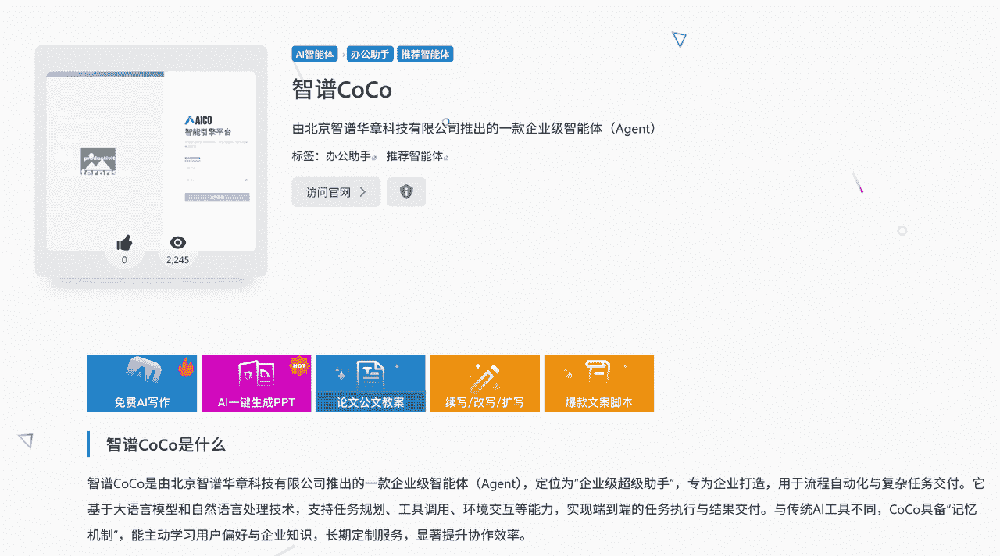
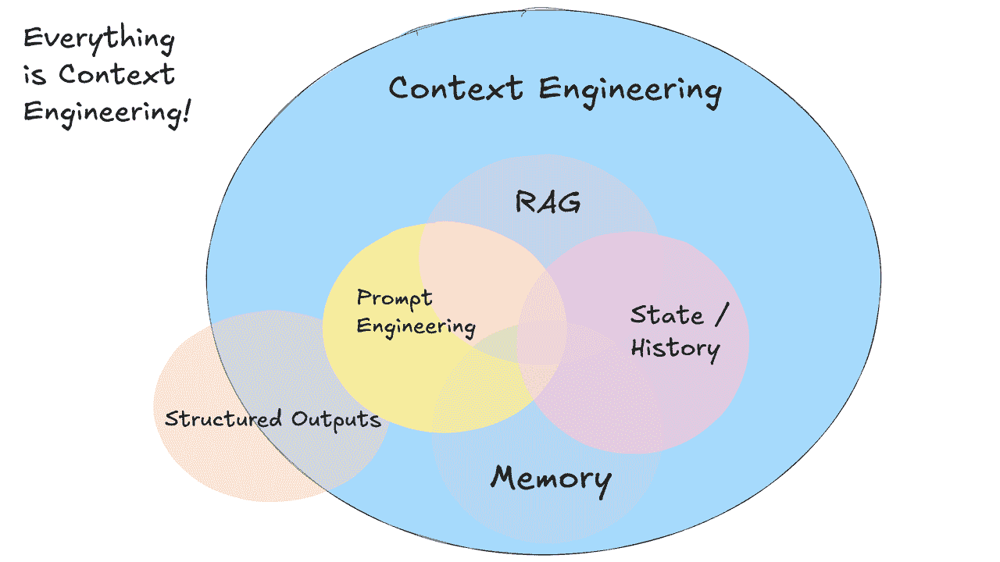
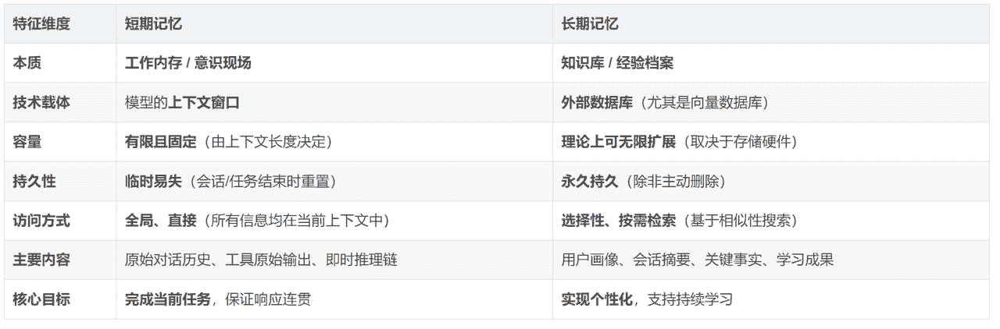
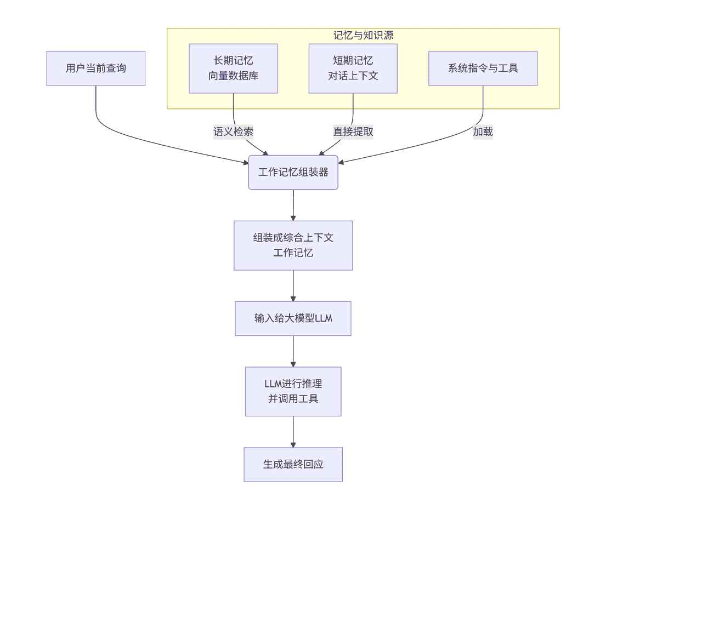
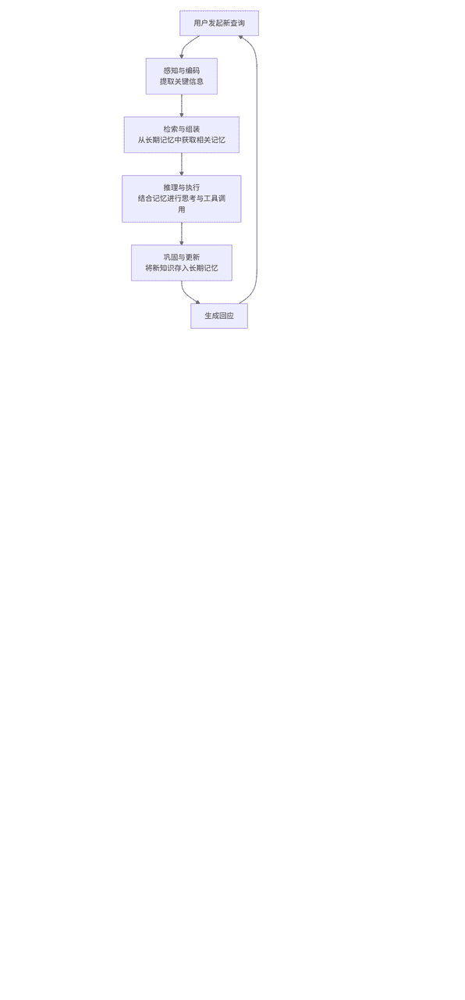
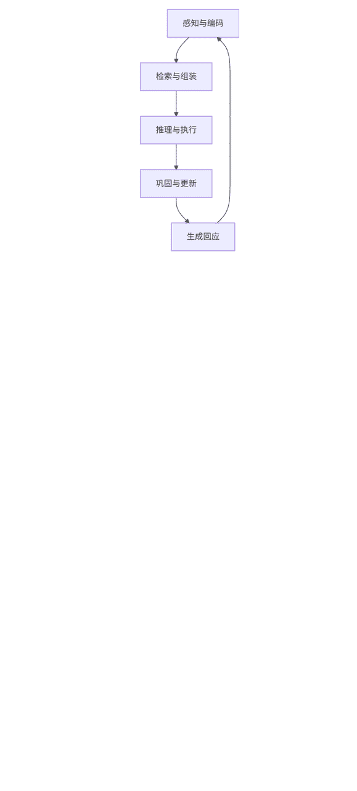

# 基于Agent智能问答系统的“记忆机制”

> 来源：[https://v11enp9ok1h.feishu.cn/docx/QKYddiRNMoGZW8xqZEQcryfQnMH](https://v11enp9ok1h.feishu.cn/docx/QKYddiRNMoGZW8xqZEQcryfQnMH)

> “记忆机制”是其能否在复杂、长期的企业任务中表现出色的核心

> 它解决了大模型本身“金鱼记忆”（上下文窗口有限）和“无状态”（每次对话相互独立）的根本性痛点。

CoCo的记忆机制可以看作一个分层、结构化、可动态更新和调用的智能记忆体系。

## 记忆的组成：三种核心记忆类型

### a. 短期记忆

+   **对应概念：** 等同于大模型的上下文窗口。

+   **功能：** 存储当前对话轮次中的信息，包括用户的当前查询、CoCo的思考过程、执行工具的结果等。

+   **特点：**

+   容量有限： 受限于模型的最大上下文长度（例如，128K tokens）。

+   高度相关： 包含了处理当前任务最直接需要的所有信息。

+   易失性： 当对话超过上下文窗口时，最早的信息会被“遗忘”（挤出窗口）。

#### 技术实现与工作机制

##### **上下文窗口：**

这是短期记忆的物理载体。

例如，一个拥有128K上下文窗口的模型，可以一次性处理长达12.8万个英文字符（约6万汉字）的文本。所有在这个窗口内的信息，模型都可以“看到”并利用。

##### **注意力机制：**

短期记忆的有效性依赖于Transformer架构的核心——注意力机制。

> 该机制允许模型在处理当前词句时，动态地关注上下文窗口中所有相关的历史信息，无论其位置远近，从而实现对长距离依赖关系的理解。

##### **内容填充：**

短期记忆的内容由每次交互的输入动态构成。

> **通常遵循以下结构：**

> 系统指令：定义Agent的角色、能力和行为准则。

> 对话历史：当前会话中所有交替出现的用户查询和Agent回复。

> 工具返回结果：当Agent调用外部API或数据库时，返回的数据会被插入到上下文中。

> 当前查询：用户最新提出的问题或指令。

### b. 长期记忆

这是CoCo记忆机制中最具价值的部分，它像一个不断成长的企业专属知识库。

+   **功能： **存储在多次对话和任务中积累的有价值的信息，供未来检索和使用。

+   **存储内容：**

+   用户偏好： 例如，某位分析师喜欢用图表来呈现数据，某位经理需要报告用英文撰写。

+   对话历史摘要： 将重要的长对话总结成简洁的核心要点，存入长期记忆。

+   任务结果： 例如，上次生成的某个销售数据分析报告的关键结论。

+   实体信息： 在与用户交互中提取出的关键实体及其关系，如“客户A的联系人是李经理，他偏好每周五开会”。

+   **实现方式： **通常使用向量数据库 来存储这些记忆的嵌入向量，从而实现基于语义相似度的快速检索。

#### 技术实现与工作机制

长期记忆的实现不依赖于模型的上下文窗口，而是通过外部系统构建。

##### **存储**

**存储什么：**并非所有短期记忆中的信息都值得长期保存。通常由特定策略决定，例如：

> **用户指令：**如“请记住我的生日是X月X日”。

> **Agent自动摘要：**Agent在会话结束时，自动生成本次会话的摘要（例如，“用户计划了去巴黎的旅行，对印象派艺术感兴趣”），并将摘要存入长期记忆。

> **关键事实提取：**从对话中提取出实体（人名、地点）和关系。

> **如何存储：**信息通常被存储在向量数据库或其他类型的数据库中。现代Agent系统普遍采用向量化存储：将文本信息通过嵌入模型转换为高维向量（一组数字），这个向量捕捉了文本的语义含义。

##### **检索**

当新的会话开始时，Agent不会加载整个长期记忆库（那样会瞬间爆满短期记忆）。

> 相反，它会根据当前的用户查询和短期记忆的上下文，去长期记忆库中寻找最相关的信息。

> 这个过程通过向量相似性搜索实现：

> 将当前查询也转换为向量，然后在向量数据库中计算其与所有存储向量的相似度（如余弦相似度），返回最相似的几条记忆。

##### **整合**

**检索到的相关记忆片段会被动态地、有选择**地插入到当前的短期记忆（上下文窗口）中。

> 通常以“以下是关于用户的一些背景信息：…”的形式呈现。这样，Agent在生成回答时，就能同时利用当前对话的上下文和过去的相关知识。

#### 短期记忆与长期记忆的核心区别与协同效应

##### 核心区别对比表

##### 协同工作：一个完整的智能体交互循环

一个高效的智能体依赖于两种记忆的无缝协作，其工作流程如下：

触发：用户发起一个新查询。

> **检索长期记忆：**

> 系统将当前查询与短期记忆的上下文结合，作为“检索键”，在长期记忆库中进行向量相似性搜索，找出相关记忆。

>

> **构建增强的短期记忆：**

> 将检索到的长期记忆片段与当前的对话历史、系统指令等组合，形成一个增强的上下文窗口。

>

> **推理与执行：**

> LLM基于这个增强的上下文进行推理，可能需要调用工具，工具的结果也会被加入短期记忆。

**响应生成：**LLM生成最终回答，返回给用户。

**更新长期记忆（可选）：**在会话的关键节点或结束时，系统根据预定策略（如用户反馈、自动摘要）决定是否将本次交互中的重要信息提炼并存入长期记忆。

##### **示例：**

> **用户问：**“推荐一本我可能会喜欢的书。”

> **长期记忆检索：**系统检索到过去记忆中“用户曾多次询问存在主义哲学书籍”和“用户讨厌言情小说”的信息。

> **短期记忆构建：**将这些信息与当前问题组合成提示：“用户问：‘推荐一本我可能会喜欢的书。’已知背景：用户喜欢存在主义哲学，讨厌言情小说。”

> **推理与响应：**LLM基于此上下文，推荐了加缪的《局外人》，而不是一本爱情小说。

### c. 工作记忆

工作记忆是CoCo记忆机制中最活跃、最动态的部分，它是CoCo在执行当前具体任务时的“大脑工作台”或“思考草稿纸”。

#### **组成：**

核心指令与当前查询：用户当前提出的问题或指令。这是触发整个过程的起点。

**从长期记忆中检索出的相关片段：**

+   过程： 系统将当前查询转换为向量，并在向量数据库中进行语义搜索，找出最相关的“记忆片段”。

+   **内容： 这些片段可能是：**

+   用户偏好： “该用户喜欢接收Markdown格式的总结。”

+   历史事实： “上周与用户确认过，项目‘北极星’的KPI是用户增长率。”

+   过往结论： “上月销售数据分析显示，华东地区销量下滑了15%。”

+   实体关系： “客户A的首席技术官是王博士。”

> **短期记忆中的近期对话上下文：**

+   当前对话轮次中已发生的信息，例如用户刚刚说“不对，我需要的是2023年的数据”，那么CoCo的下一步推理就需要包含这个修正指令。

>

> **系统指令与工具定义：**

+   CoCo的角色设定（“你是一个数据分析助手”）。

+   可供调用的工具列表及其使用说明（如Python解释器、SQL查询工具等）。

#### CoCo自身的思考过程与工具执行结果：

+   **推理链：** CoCo在解决问题时的内部推理步骤（例如：“要回答这个问题，我需要先查询数据库A，再用工具B进行可视化”）。

+   **工具调用结果：** 执行代码、查询API等返回的具体数据（例如，从数据库查询得到的一张数据表，或执行df.describe()后得到的统计摘要）。

+   功能： 在执行一个具体任务时，从长期记忆中检索出的、与当前任务最相关的记忆片段，与短期记忆结合，共同构成当前的“思考空间”。

+   特点：

+   动态组装： 对于每个新问题，CoCo会实时地从长期记忆中检索相关片段。

+   精准聚焦： 确保输入给大模型的上下文是高度相关且精简的，避免信息过载。

场景： 一位市场总监想要一份“对比我们上个季度和‘启航’项目同期的主要社交媒体渠道表现报告”。

#### **触发与检索：**

+   当前查询： “对比我们上个季度和‘启航’项目同期的主要社交媒体渠道表现报告。”

+   工作记忆组装：

+   **从长期记忆中检索：**

+   片段1： “ ‘启航’项目的时间范围是去年Q2（4月-6月）。”

+   片段2： “该用户定义的‘主要社交媒体渠道’包括：微博、微信视频号、小红书。”

+   片段3： “用户偏好报告包含‘互动率’和‘转化率’两个核心指标。”

+   从系统加载： CoCo作为数据分析Agent的角色指令和可用工具（Python， 数据库连接器）。

#### **推理与执行：**

+   工作记忆内容（即输入给LLM的上下文）大致如下：

+   【系统角色】你是一个数据分析助手...
【长期记忆-用户偏好】用户需要报告包含互动率和转化率。
【长期记忆-事实】“启航”项目期为去年Q4。
【长期记忆-事实】“主要渠道”指微博、微信视频号、小红书。
【当前查询】[用户的原话]
【思考】用户需要对比本年度Q3和去年Q4的数据。我需要先从市场数据库查询这两个时间段、这三个渠道的互动率和转化率数据。

+   CoCo在工作记忆的支持下，生成SQL查询代码并执行。

+   查询结果（数据表）被添加到工作记忆中。

#### **生成与巩固：**

+   CoCo基于得到的数据，在工作记忆的上下文内（包含了查询结果、用户偏好、历史事实）生成最终的报告。

+   任务结束后，系统可能会将“本次生成了Q3与‘启航’项目期社交媒体对比报告”这一事实摘要后存入长期记忆，以备后续查询。

## 记忆的生命周期：如何运作？

CoCo的记忆机制是一个动态循环的过程，可以用下图清晰地展示其工作流程：

### 步骤解析：

#### 感知与编码：

当用户与CoCo交互时，系统会实时分析对话内容，提取关键信息、实体和意图。

##### **原始信息摄入：**

+   输入源： 用户的自然语言查询、上传的文件、结构化数据、工具（如数据库、API）返回的执行结果。

+   形式： 非结构化的文本、数据、代码等。

##### **理解与解析：**

+   CoCo运用大模型的能力对输入进行深度理解：

+   意图识别： 用户是想查询、创作、分析还是执行任务？

+   实体识别： 提取关键实体，如人名（“张总”）、项目名（“北极星”）、产品名、时间（“上季度”）。

+   关系提取： 识别实体间的关系，如“张总是‘北极星’项目的负责人”。

+   情感与偏好分析： 识别用户表达出的倾向，如“我不喜欢太长的报告” -> 偏好“简洁”。

##### **价值评估与编码：**

+   并非所有对话都需要记住。CoCo会根据预设规则和模型判断，评估信息的“记忆价值”：

+   高价值信息： 用户明确指令（“记住我的偏好”）、关键业务事实（项目决策、数据结论）、新建立的实体关系、用户反馈的问题解决方案。

+   低价值信息： 寒暄、一次性确认、过渡性语句。

##### **编码为记忆单元：**

+   将高价值信息转化为结构化的“记忆片段”。

+   核心内容： 记忆片段的文本摘要。

+   元数据： 打上标签，如 类型:用户偏好、实体:张总,北极星项目、时间戳、来源会话ID。

+   向量化： 将记忆片段的文本内容通过嵌入模型转换为数学向量（一组数字）。这是实现后续智能检索的基石。

#### 检索与组装：

对于用户的新问题，CoCo会从长期记忆（向量数据库） 中检索语义上相关的记忆片段，并将其与当前的短期记忆（对话上下文） 组装成工作记忆。

##### **检索触发：**

+   用户提出一个新的查询或指令。

##### **生成检索查询：**

+   将当前查询（有时会结合短期记忆中的最近几句话）同样进行向量化，得到“查询向量”。

##### **向量相似度搜索：**

+   在长期记忆的向量数据库中，进行相似度计算（如余弦相似度）。

+   找出与“查询向量”最相似的Top K个“记忆向量”所对应的记忆片段。

+   优势： 这是语义搜索，即使关键字不匹配，只要意思相关就能被召回。例如，查询“我们之前说的那个市场推广项目”，即使没有提项目名，也能找到关于“北极星项目启动会”的记忆。

##### **结果重排与过滤：**

+   对检索出的记忆片段进行二次加工，确保最相关：

+   时间加权： 近期记忆可能获得更高权重。

+   权限过滤： 在企业场景中，确保用户只能检索到自己有权访问的记忆。

+   去重： 合并内容高度相似的记忆片段。

##### **组装工作记忆：**

+   将检索到的长期记忆片段、当前的用户查询、短期记忆中的对话上下文、系统指令和工具定义等，按特定模板拼接成一个完整的提示上下文。

+   这个组装好的、为当前任务定制的上下文，就是工作记忆。它被送入大模型，作为其推理和回答的依据。

#### 推理与执行：

大模型基于组装好的工作记忆进行推理、规划，并调用相应的工具（如代码解释器、搜索引擎、内部API）来执行任务。

##### **规划与推理：**

+   大模型基于工作记忆中的丰富上下文，进行逻辑推理和任务规划。

+   例如： “工作记忆中显示用户需要对比销售数据，并且包含了历史的数据查询方法。那么我第一步应该调用销售数据库API，第二步对结果进行可视化。”

##### **工具调用：**

+   根据规划，CoCo会调用外部工具（函数）来执行具体任务。

+   例如： 生成并执行一段SQL查询代码，调用Python进行数据分析，或调用企业内部某个API。

##### **结果处理：**

+   工具执行后返回的结果（如数据表格、图表、状态码）会被追加到工作记忆中。

+   此时，工作记忆得到了更新，包含了解决问题所需的最新信息。

#### 巩固与更新：

任务执行完成后，系统会判断本次交互中是否有值得长期保留的信息。

+   摘要生成： 将长对话总结成要点。

+   关键提取： 提取新的用户偏好、任务成果等。

+   向量化存储： 将这些新信息转换为向量，存入长期记忆中，完成记忆的更新。

## 在企业级场景中的应用

CoCo的记忆机制使其从一个“一次性问答工具”进化成了一个“持续学习的智能同事”。

#### 实现连续、个性化的服务：

+   场景： 用户本周说：“帮我分析一下上季度的销售数据。” 下周又说：“把分析结果做成PPT，并用我们上周讨论的那个模板。” CoCo能记住“上季度的销售数据分析”和“上周讨论的模板”这些上下文，无需用户重复说明。

#### 积累和传承组织知识：

+   场景： 新员工询问某个项目的背景，CoCo可以根据与老员工的历史对话摘要，快速提供一份结构化的项目背景介绍，成为企业的“活知识库”。

#### 提升复杂任务处理能力：

+   场景： 一个复杂的市场调研报告可能需要分多天、多次交互来完成。CoCo能记住之前的进度、已分析的数据和已得出的结论，并在后续交互中无缝衔接，而不是每次都从头开始。降低沟通成本： 用户无需在每次对话中重复介绍背景信息和自己的偏好，交互效率大幅提升。

### 典型场景

#### 场景一：销售与客户关系管理 - “永不掉线的智能销售助理”

+   场景描述：
销售总监张总正在准备与重要客户“环球科技”的续约谈判。他可以向CoCo询问客户情况、并要求准备谈判材料。

+   工作记忆在行动：

1.  **查询1： “CoCo，帮我总结一下**‘环球科技’去年的合作情况和主要痛点。”

+   工作记忆组装：

+   从长期记忆中检索出：所有与“环球科技”相关的项目报告、服务工单、会议纪要摘要。

+   从CRM系统中实时拉取：去年的订单金额、产品使用数据、支持请求记录。

+   工作记忆内容： 成为一个包含该客户历史合作全景的临时知识库。

+   输出： CoCo生成一份简洁的客户概览，指出“对方对我们的响应速度有多次抱怨，但非常认可产品稳定性”。

>

1.  **查询2： “基于这些信息，为我们后天的谈判起草**一份谈判要点，重点解决他们关心的问题。”

+   工作记忆组装：

+   保留： 上一个查询的输出结果（客户概览）保留在短期记忆中。

+   检索： 从长期记忆中检索出“公司标准的续约合同模板”、“成功的续约谈判案例策略”。

+   新增： 张总刚刚提供的新指令。

+   输出： CoCo起草的谈判要点会主动提及响应速度问题，并给出解决方案（如承诺部署专属支持团队），同时强调产品稳定性带来的价值。这份文件是高度情境化和个性化的。

+   **带来的企业价值：**

+   缩短销售周期： 新销售接手客户时，能瞬间获得该客户的“前世今生”。

+   提升客户满意度： 每次交互都体现出了解和关怀，而非重复询问。

+   提高赢单率： 谈判策略基于历史数据，更具针对性。

#### 场景二：IT与技术支持 - “有经验的超级客服”

+   场景描述：
财务部小王报告：“系统导出的报表又出错了，和上周的问题一样。”

+   工作记忆在行动：

1.  查询： “小王报告报表导出错误。”

+   工作记忆组装：

+   检索： 从长期记忆中检索：

+   “上周”为同一用户（或不同用户）处理类似问题的工单记录、解决方案（例如：“是数据库缓存未更新导致”）。

+   小王所在“财务部”的常用报表清单及系统权限。

+   调用工具： 实时查询系统错误日志，寻找与“报表导出”相关的近期报错。

+   工作记忆内容： 包含了历史解决方案、当前用户背景和实时系统状态。

+   输出： CoCo不是从零开始分析，而是可以直接给出假设：“这很可能与上周的缓存问题有关。我已执行缓存刷新脚本，请小王再试一次。如果问题依旧，我将深入排查数据库连接。”

+   带来的企业价值：

+   极大提升支持效率： 平均解决时间大幅下降。

+   知识沉淀与复用： 每个解决方案都通过工作记忆被验证和强化，并沉淀到长期记忆中，成为组织资产。

+   提升用户体验： 用户感觉系统“记住”了之前的问题，非常智能。

#### 场景三：运营与数据分析 - “会追问的分析师同事”

+   场景描述：
运营经理小李要求分析本季度用户活跃度下降的原因。

+   工作记忆在行动：

1.  查询1： “分析一下本季度DAU下降的原因。”

+   工作记忆组装： 检索历史分析报告、相关业务指标定义。调用数据分析工具执行查询。

+   输出： “本季度DAU下降10%，主要发生在新用户群体，尤其是来自‘渠道B’的用户。”

>

1.  查询2： “为什么‘渠道B’的新用户留存这么差？”

+   工作记忆组装：

+   保留： 上一个结论（渠道B新用户留存差）成为当前短期记忆的核心。

+   检索： 从长期记忆中检索出“渠道B的用户画像”、“过往针对该渠道的运营活动”。

+   新增： 当前的查询指令。

+   输出： CoCo会自动聚焦于渠道B，进一步分析该渠道的用户行为路径，并可能发现：“渠道B的用户在注册后第三步‘完善个人信息’的流失率异常高，该步骤在上季度末进行过UI改版。”

>

1.  查询3： “把从这个发现到最终结论的过程，做成三页PPT简报。”

+   工作记忆组装： 此时的工作记忆包含了整个分析过程的逻辑链（DAU下降 -> 渠道B新用户 -> 注册第三步流失 -> UI改版）。

+   **带来的企业价值：**

+   深化数据分析洞察： 分析过程是连续和深入的，而非孤立的问答。

+   降低分析门槛： 业务人员可以通过自然语言进行复杂的数据探查。

+   自动生成数据叙事： 将分析过程自动转化为易于理解的报告。

#### 场景四：研发与项目管理 - “永不遗忘的项目管家”

+   场景描述：
一个跨职能团队在进行一个敏捷开发项目。新成员小赵加入，想了解某个功能模块的决策背景。

+   工作记忆在行动：

1.  **查询： “为什么我们当初决定为‘用户**画像’模块选择技术方案A而不是方案B？”

+   工作记忆组装：

+   检索： 从长期记忆中检索出：

+   相关的技术讨论会议纪要。

+   当时对方案A和B的POC测试结果摘要。

+   核心决策人当时的评论和最终拍板记录。

+   整合： 将这些分散在不同文档、邮件、聊天记录中的信息片段，组装成一个完整的故事线。

+   输出： CoCo生成一份总结：“在3月1日的架构评审会上，团队认为方案A虽然在性能上略逊于B，但其开发成本低30%，且与现有系统兼容性更好。CTO最终基于‘快速上线’的原则采纳了方案A。”

+   **带来的企业价值：**

+   加速新员工融入： 快速获取项目上下文，减少信息差。

+   保存组织决策脉络： 避免因人员变动导致“组织失忆”。

+   提高协作效率： 减少为追溯历史决策而进行的重复沟通。