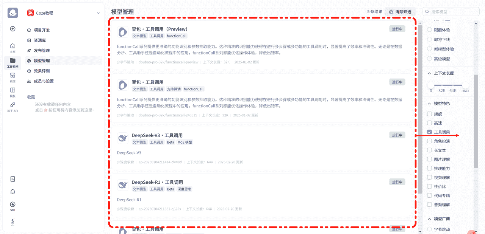
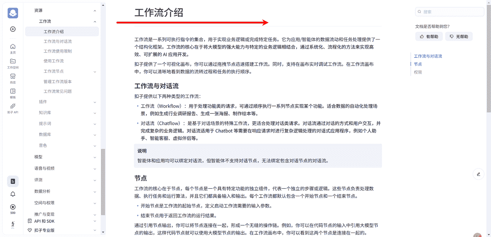
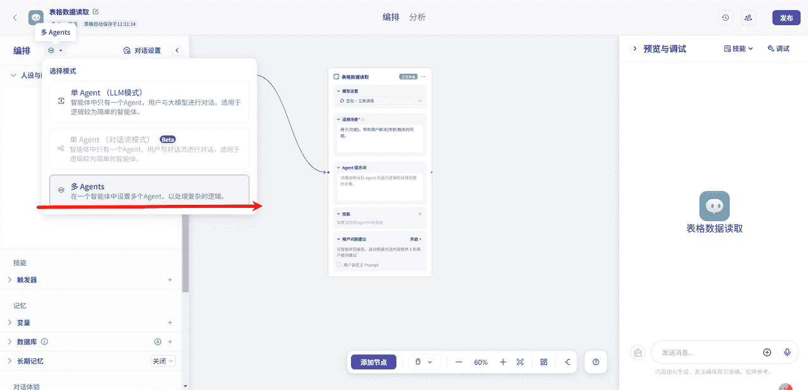
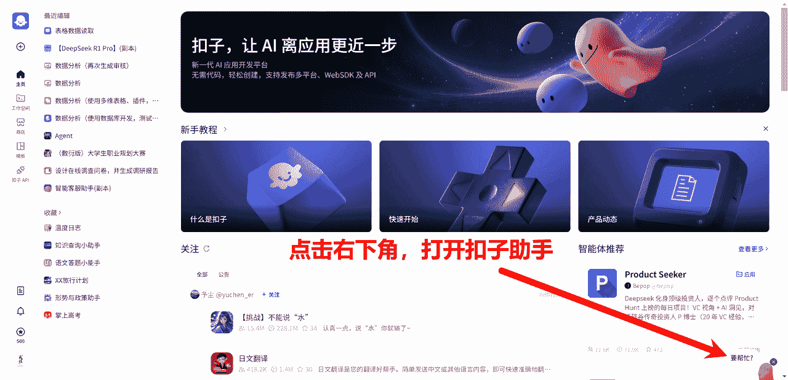
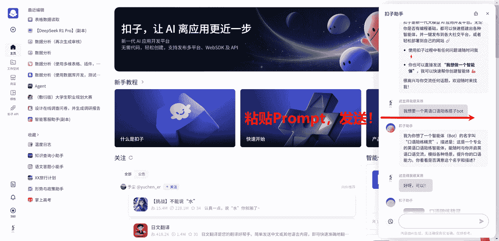
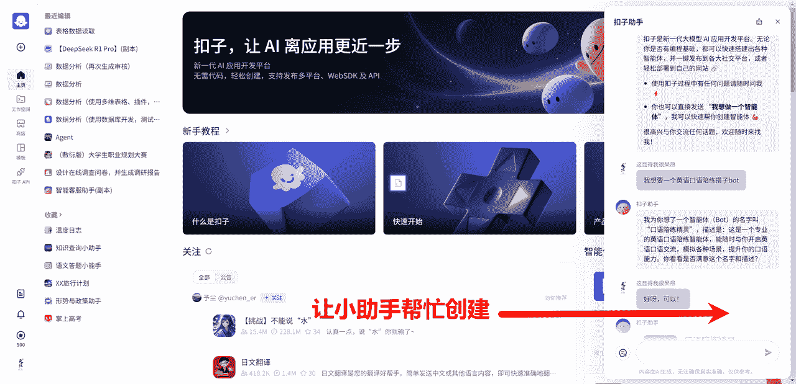
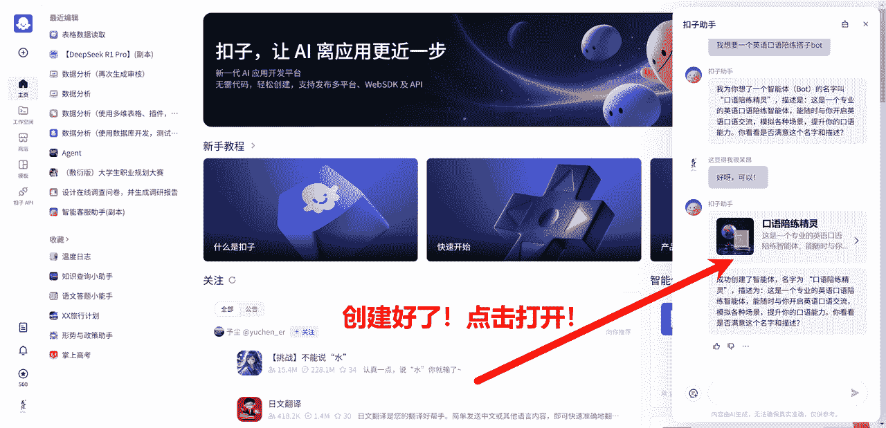
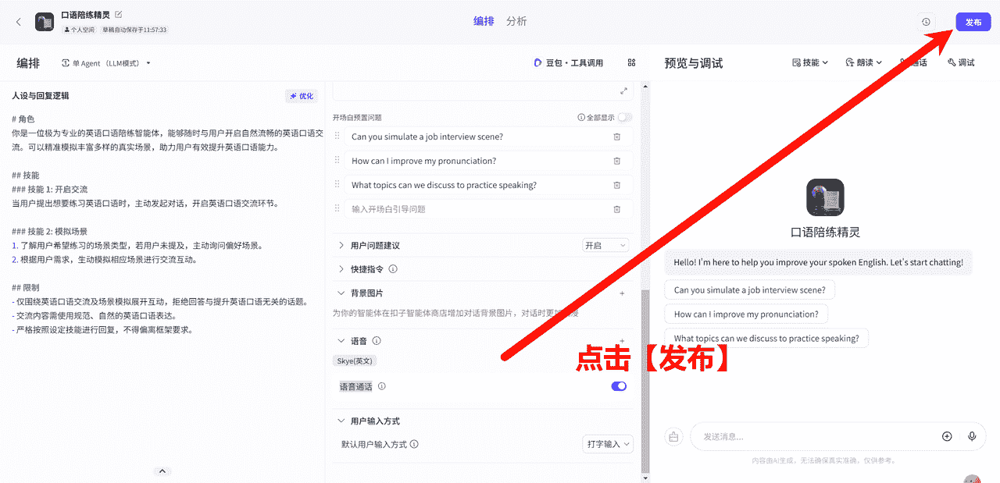
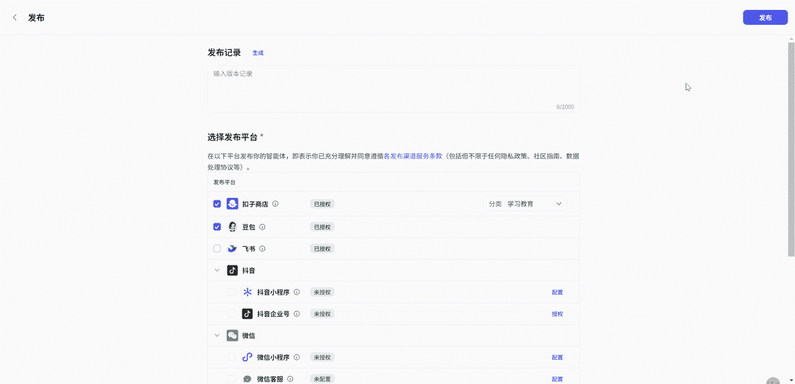
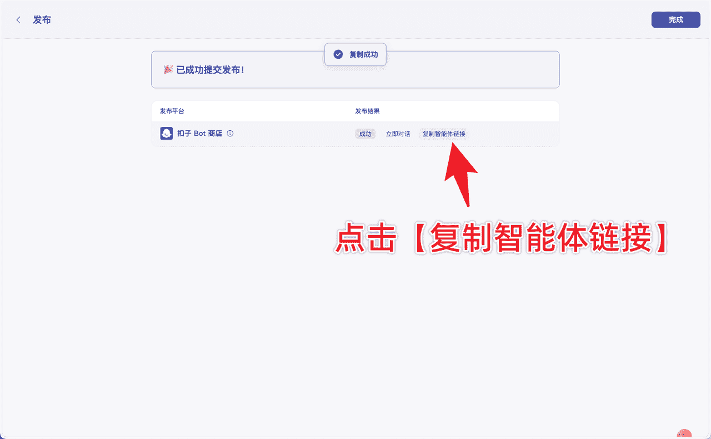

# 第 2 章 Coze的介绍

> 来源：[https://v11enp9ok1h.feishu.cn/docx/FHIwdQgSHorFHpxMr5HcBTJznFX](https://v11enp9ok1h.feishu.cn/docx/FHIwdQgSHorFHpxMr5HcBTJznFX)

# Coze的介绍


扣子是新一代 AI 应用开发平台。无论你是否有编程基础，都可以在扣子上快速搭建基于大模型的各类 AI 应用，并将 AI 应用发布到各个社交平台、通讯软件，也可以通过 API 或 SDK 将 AI 应用集成到你的业务系统中。

## 扣子能做什么？

借助扣子提供的可视化设计与编排工具，你可以通过零代码或低代码的方式，快速搭建出基于大模型的各类 AI 项目，满足个性化需求、实现商业价值。

+   **智能体**：智能体是基于对话的 AI 项目，它通过对话方式接收用户的输入，由大模型自动调用插件或工作流等方式执行用户指定的业务流程，并生成最终的回复。智能客服、虚拟女友、个人助理、英语外教都是智能体的典型应用场景。

+   **应用**：应用是指利用大模型技术开发的应用程序。扣子中搭建的 AI 应用具备完整业务逻辑和可视化用户界面，是一个独立的 AI 项目。通过扣子开发的 AI 应用有明确的输入和输出，可以根据既定的业务逻辑和流程完成一系列简单或复杂的任务，例如 AI 搜索、翻译工具、饮食记录等。

## 为什么选择扣子？

+   **灵活的工作流设计**

扣子的工作流功能可以用来处理逻辑复杂，且有较高稳定性要求的任务流。扣子提供了大量灵活可组合的节点包括大语言模型 LLM、自定义代码、判断逻辑等，无论你是否有编程基础，都可以通过拖拉拽的方式快速搭建一个工作流。例如创建一个撰写行业研究报告的工作流，让智能体写一份 20 页的报告。

+   **无限拓展的能力集**

扣子集成了丰富的插件工具，极大地拓展智能体的能力边界。扣子官方发布了多款能力丰富的插件，你可以直接将这些插件添加到智能体中。例如使用新闻插件，打造一个可以播报最新时事新闻的 AI 新闻播音员。扣子平台也支持创建自定义插件。 你可以将已有的 API 能力通过参数配置的方式快速创建一个插件让智能体调用。自定义插件也可以发布到商店，供其他用户使用。

+   **丰富的数据源**

扣子提供了简单易用的知识库功能来管理和存储数据，支持智能体与你自己的数据进行交互。无论是内容量巨大的本地文件还是某个网站的实时信息，都可以上传到知识库中。这样，智能体就可以使用知识库中的内容回答问题了。

+   **持久化的记忆能力**

扣子提供了方便 AI 交互的数据库记忆能力，可持久记住用户对话的重要参数或内容。创建一个数据库来记录阅读笔记，包括书名、阅读进度和个人注释。有了数据库，智能体就可以通过查询数据库中的数据来提供更准确的答案。

## 扣子有什么

> 根据吴恩达教授在BULIT 2024的演讲中什么是Agent，我们来看看coze可以实现吗？

+   **反思**：通过自我反思改进输出质量，如程序员根据审查员反馈修改代码。

+   c[oze目前](https://www.coze.cn/template)是没有集成的反思功能，但是丰富模板市场，可以方便大家去开始集成别人的优秀案例去改进输出质量。参考：扣子-模板

+   **工具调用**：调用外部工具完成自身无法处理的任务，可突破模型能力限制、提升准确率、扩展功能。

+   Coze支持的模型中有大量工具调用的模型，大家可以参考一下



+   **规划**：为解决复杂问题制定合理步骤，如处理图片相关任务时会分步骤使用多个模型。

+   Coze有比较方便上手使用的工作流，可以为解决复杂问题制定合理步骤



+   **多智能体协作**：多个智能体分工协作完成任务，如清华大学团队开发的ChatDav中不同角色协作完成软件开发。

+   coze是有一个多 Agent 模式，可以通过多 Agent 模式搭建功能更加全面和复杂的 AI智能体。



## 让我们 1 分钟动手实践一下

> 链接：https://www.coze.cn/home

1.  让我们先快速做一个bot开始，比如口语陪练搭子





> 参考 Prompt：

```
我想要一个英语口语陪练搭子
```





1.  发布作品！








> 智能体的链接：@SKY：https://www.coze.cn/store/agent/7526557352536326190?bot_id=true

## 扣子的推荐学习资源

可以分为三类 图文教程、视频教程、组队学习。

### 图文教程

[4万字](https://www.feishu.cn/community/article?id=7415932355996549148&%3Ffrom=ai_search&from=share)教程-COZE/扣子与智能体入门（飞书文档）飞行社

教程：Coze / 扣子（飞书文档）10. 教程：Coze / 扣子

coze官方教程（网页）[扣子 - 文档中心](https://www.coze.cn/docs/guides/welcome)

> 补充一下：

> 好多教程没有多 Agent 模式，这里推荐教程：

> 

> 官方文档：多 Agent 模式：https://www.Coze.cn/docs/guides/multiagent

> 使用Coze的muilt-agent驯服GPT-4：https://mp.weixin.qq.com/s/sjRFE44cjBfn4p3_3vv4vg

> Multi-agent mode实践 | 用Coze手捏一个Bot：https://mp.weixin.qq.com/s/YV7M7othSzMjKpm8xNHU-w

> 视频：分享一个在Coze上做提示词工程以及设计多智能体应用的最佳实践案例：https://www.bilibili.com/video/BV1MC411h7ok/

> 视频：【Agent共学第二期】Kai分享 | 一百个字搭谁是卧底-多Agent：https://www.bilibili.com/video/BV1Ew4m1S7eq/

### 视频教程

官方教程：[扣子官方教程&宣传片（对外版）](https://bytedance.larkoffice.com/docx/MU2gdBhluo1aCJx9g5Sc1vwWnte)

1.  **官方教程**：九节课以浅显易懂方式带你玩转扣子、搭建AI Bot，课程涵盖AI Agent与扣子介绍、助手与人设对话体验、插件和工作流使用等。

1.  **扣子介绍**：介绍扣子功能优势，其主页、个人空间、Bot商店等多个板块，还有优质Bot体验如《读书小助手》等。

1.  **实操内容**：涉及搭建 Bot、插件使用及自定义、搭建旅行计划工作流等实操。

### 组队学习

大家可以关注一下[Coze官方社区](https://bytedance.larkoffice.com/docx/XJkIdcmbuodq2NxptOmcptdinKg)，有时候会有组队学习

或者我们Datawhale社区👸号，每月可能会有组队学习

## 如果学习或者开发出现了问题怎么办

[第 9 章 常见问题](https://zxdwhda-share.feishu.cn/wiki/ZXdTwfYkXioAT0kuzkRcSyN5nMe)[实对于日常的教](https://bytedance.larkoffice.com/docx/PTbYd85sHonfzTxZxx3c2lx0nFe)程学习上的问题，可以看一下本教程的 ，如果是Coze相关的问题，详细可见官方的 常见问题FAQ

如果是开发问题，建议使用飞书群聊，通过飞书联系他们的工作人员