# 第 4 章 资源的玩法

> 来源：[https://v11enp9ok1h.feishu.cn/docx/JddrdGfqIomqmsxA0xvcDKUXncx](https://v11enp9ok1h.feishu.cn/docx/JddrdGfqIomqmsxA0xvcDKUXncx)

内容更新中~

# 资源的玩法

## 插件

### 什么是插件？

> 参考：https://www.coze.cn/open/docs/guides/plugin

插件是一个工具集，一个插件内可以包含一个或多个工具（API）。

目前，Coze集成了类型丰富的插件，包括资讯阅读、旅游出行、效率办公、图片理解等 API 及多模态模型。使用这些插件，可以帮助我们拓展智能体能力边界。例如，我们第三章的夸夸智能体内添加搜索插件，我们的智能体将拥有搜索新闻资讯的能力。

当Coze集成的插件不满足我们的使用需求，我们还可以创建自定义插件来集成需要使用的 API，后面我会从IDE 创建插件、通过 JSON 或 YAML 文件导入插件，教大家如何扩展我们的使用边界。

（API的方式放在第6章）

### 使用 IDE 创建插件

> 制作谷歌搜索插件为例

> 参考：https://www.coze.cn/open/docs/guides/ide

> [【Coze插件】零代码创建谷歌插件](https://zxdwhda-share.feishu.cn/wiki/Z4YGw0fSSinTn6kX6jlcP6uunje?fromScene=spaceOverview)果想学习零代码从0到1插件谷歌插件，跳转：

#### 前期准备

> 参考：https://zhuanlan.zhihu.com/p/174666017

官方需要非大陆链接，而且需要外币卡，所以我们使用这里使用serper：https://serper.dev/

+   有免费的额度，可以调用2500次

+   国内直连

这里不多演示注册，复制key，后面需要

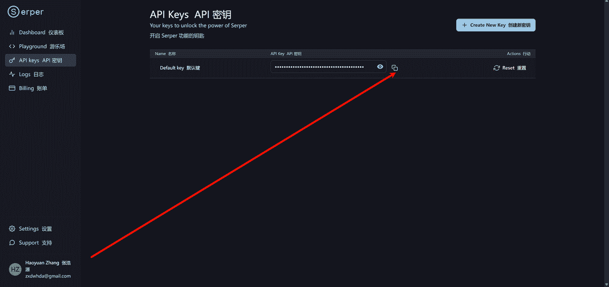

#### 新建插件资源与工具

先让我们创建一个插件

+   **插件名称**：谷歌搜索

+   **插件描述**：搜索网页

+   **插件工具创建方式**：云侧插件 - 在 Coze IDE 中创建

+   **IDE 运行时**：Node.js

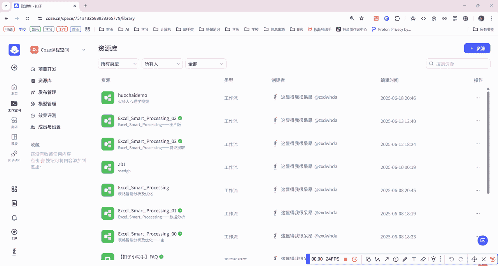

让我们创建一个工具，点击“在IDE中创建工具”

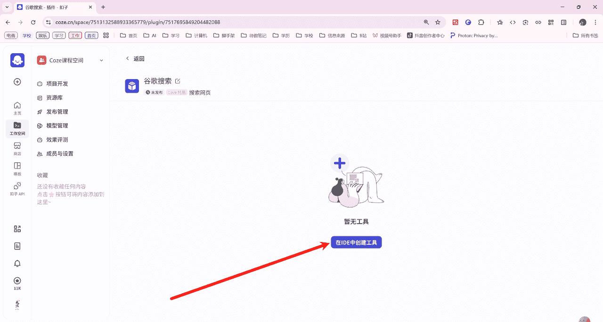

点击左上角的“创建工具”

+   名称：Google_Search_Express

+   描述：谷歌搜索快速版


## [第 4 章 资源的玩法](https://zxdwhda-share.feishu.cn/wiki/M7towKWKhiLMxWkTCincqhDAnjc?fromScene=spaceOverview#OnOhdBNb7oFtQVxlhFucTheGno5)的，老规矩，先看布局（其实是知识点讲解，跳过可点击： ）

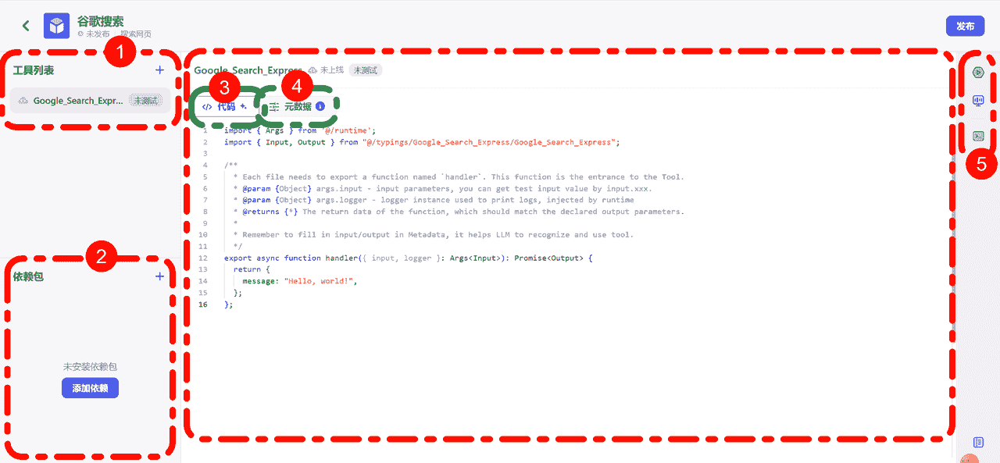

让我们逐条分析

1.  这里是工具列表，我们刚才新建了一个Google_Search_Express，所以不是空置，有同学要问了，这里对应商店的是哪里，让我们以飞书云文档为例

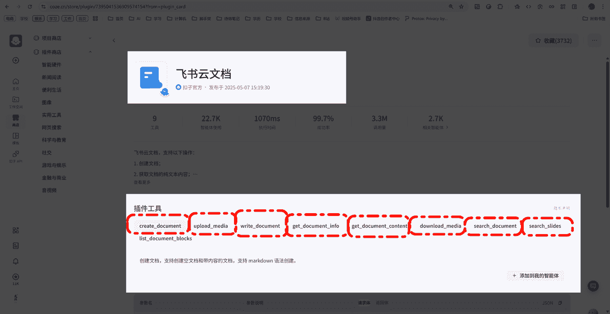

大家可以发现，插件是有好几个工具的，还记得前面说的“插件是一个工具集，一个插件内可以包含一个或多个工具（API）。”，我们刚才创建的插件是有一个工具（当然也可以有多个），而飞书云文档有多个。

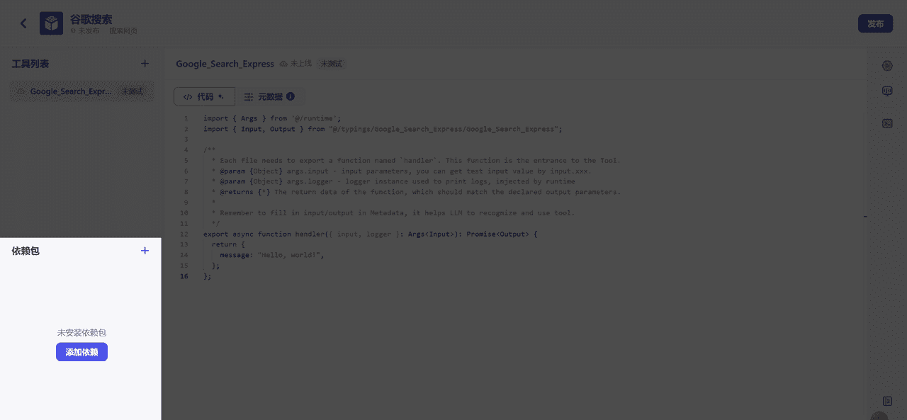

1.  依赖包

> **依赖包**区域，管理依赖包，所有工具共用该依赖列表。

> 单击 **+** 或者单击**添加依赖**按钮，输入依赖包名称并选择版本（可通过依赖名@版本号的格式进行搜索），然后安装依赖包。

在编程中，依赖包（也称为库、模块或包）是预先编写好的代码集合，用于解决特定的问题或提供特定的功能。是可复用的代码集合，提供特定功能（如数据处理、网络请求、UI组件等）。开发者通过导入这些包来避免重复造轮子，提升开发效率。

1.  代码

> 不同 IDE 运行时的代码模板不同，这里是Node.js的代码模板。

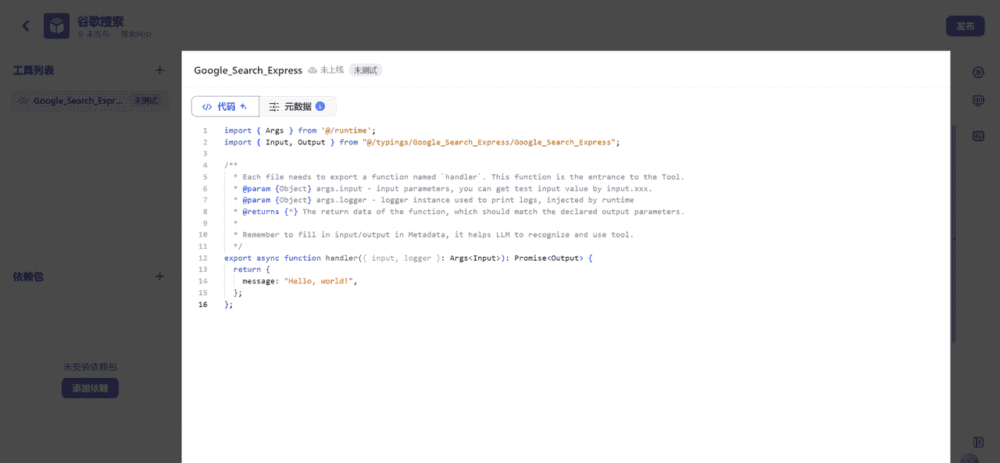

这里是你写或者让AI编写代码的地方。

1.  元数据

元数据的作用是让大语言模型理解每个工具输入或输出参数有哪些、各个参数有何含义。因此，在工具的元数据内提供详细的参数说明，可以让大语言模型更准确的使用工具。

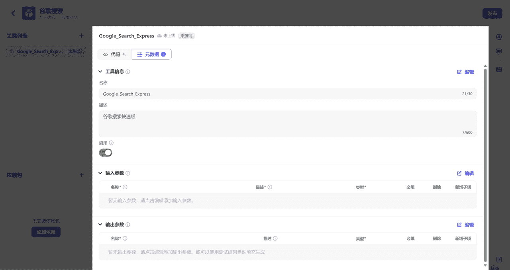

当用户在使用该工具的智能体时，模型会根据工具的元数据信息，从用户问答中解析、提取出对应的输入参数，并选择调用该工具，流程图如下所示。

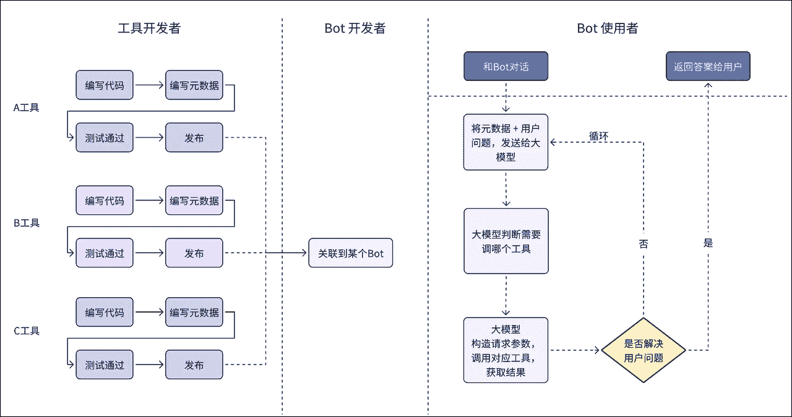

元数据配置说明：

| 配置项 | 描述 |
| --- | --- |
| 名称 | 工具名称。建议输入清晰易理解的名称，便于后续大语言模型搜索与使用工具。 |
| 描述 | 工具的描述信息，一般用于记录当前工具的用途。 |
| 启用 | 是否启用当前工具。使用说明：  - 如果工具未开发测试完成，建议先禁用该工具，只启用并发布已通过测试的工具。  - 如果需要下线某一工具，可将该工具设置为禁用，并再次发布插件。  - 如果插件中只有一个工具，则不支持禁用该工具。如需下线该工具，您可以选择直接删除该插件，或者创建另一个工具并完成开发测试后，再禁用该工具，最后发布插件。 |
| 输入参数 | 当前工具对应接口的输入参数信息。准确、清晰易理解的参数名称、描述等信息，可以让大语言模型更准确的使用工具。 |
| 输出参数 | 当前工具对应接口的输出参数信息。准确、清晰易理解的参数名称、描述等信息，可以让大语言模型更准确的使用工具。 |

1.  测试相关

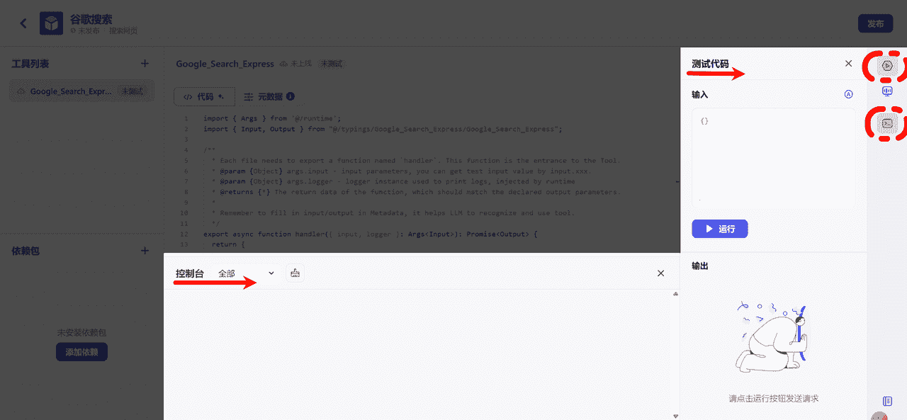

让我们先看测试代码，分别有输入、输出；一般我们做测试的时候只需要写输入就可以使用了，输出后面可以让Coze一键生成。而控制台是我们查看运行日志。

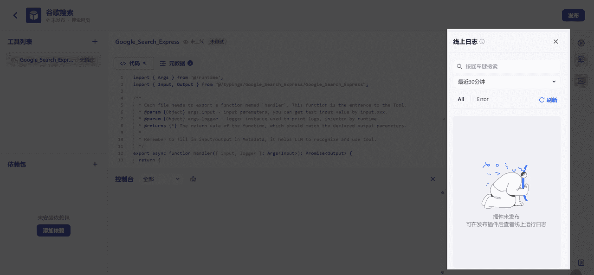

这是日志，日志一般只保留7天

## 好了！通过刚才的学习，相信你一定对插件与工具之间的作用有了一定的了解，下面让我们开始实操。

#### 完善工具

> 想学习怎么写代码的可以看这个[【Coze插件】零代码创建谷歌插件](https://zxdwhda-share.feishu.cn/wiki/Z4YGw0fSSinTn6kX6jlcP6uunje?fromScene=spaceOverview)

安装依赖包，搜索“axios”

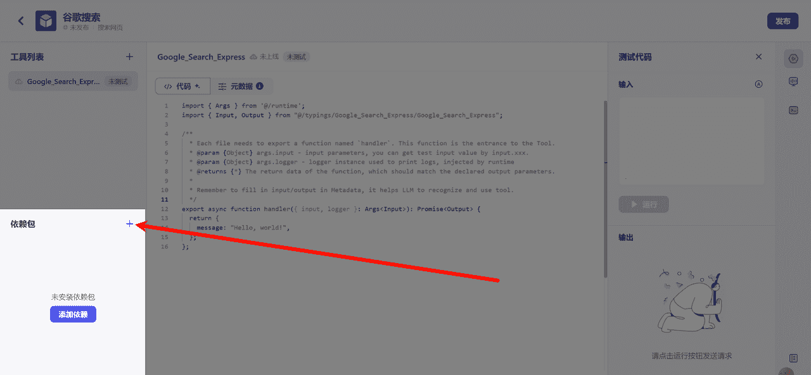

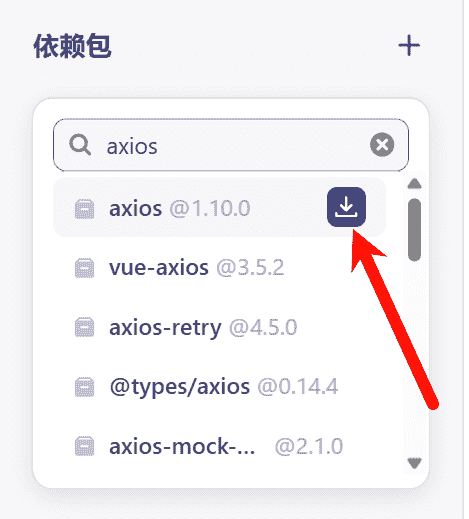

复制代码粘贴

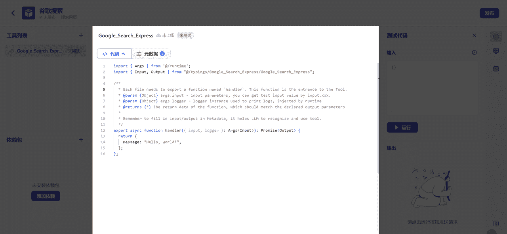

```
import { Args } from &#x27;@/runtime&#x27;;
import axios from &#x27;axios&#x27;;

interface Input {
  q: string;     // 必填：搜索关键词
  key: string;   // 必填：API密钥
}

interface SearchResult {
  title: string;
  link: string;
  snippet: string;
}

interface Output {
  success: boolean;
  error?: string;
  results: SearchResult[];
  related?: string[];
}

export async function handler({ input, logger }: Args&lt;Input&gt;): Promise&lt;Output&gt; {
  // 基本参数验证
  if (!input.q || !input.key) {
    const errorMsg = &#x27;Missing required parameters: both &quot;q&quot; and &quot;key&quot; are required&#x27;;
    logger.error(errorMsg);
    return {
      success: false,
      error: errorMsg,
      results: []
    };
  }

  try {
    const { data } = await axios({
      method: &#x27;post&#x27;,
      url: &#x27;https://google.serper.dev/search&#x27;,
      headers: { 
        &#x27;X-API-KEY&#x27;: input.key, // 使用动态API密钥
        &#x27;Content-Type&#x27;: &#x27;application/json&#x27;
      },
      data: JSON.stringify({
        q: input.q,
        gl: &#x27;us&#x27;,       // 默认国家：美国
        hl: &#x27;en&#x27;,       // 默认语言：英语
        num: 10,        // 默认结果数：10
        page: 1,        // 默认页码：1
        location: &#x27;&#x27;,   // 默认地点：空
        tbs: &#x27;&#x27;         // 默认日期范围：空
      }),
      timeout: 10000
    });

    logger.info(`Successfully fetched ${data.organic?.length || 0} results for &quot;${input.q}&quot;`);
    
    // 结果格式化
    const results: SearchResult[] = data.organic?.map((item: any) =&gt; ({
      title: item.title,
      link: item.link,
      snippet: item.snippet
    })) || [];

    return { 
      success: true,
      results,
      related: data.related?.map((r: any) =&gt; r.query) || []
    };

  } catch (error: any) {
    // 精简错误信息提取
    const errorMsg = error.response?.data?.message || error.message || &#x27;Unknown search error&#x27;;
    logger.error(`Search failed for &quot;${input.q}&quot;: ${errorMsg}`);
    
    return {
      success: false,
      error: errorMsg,
      results: []
    };
  }
};
```

编辑输入参数

+   名称q

+   搜索关键词

+   描述Key

+   API密钥

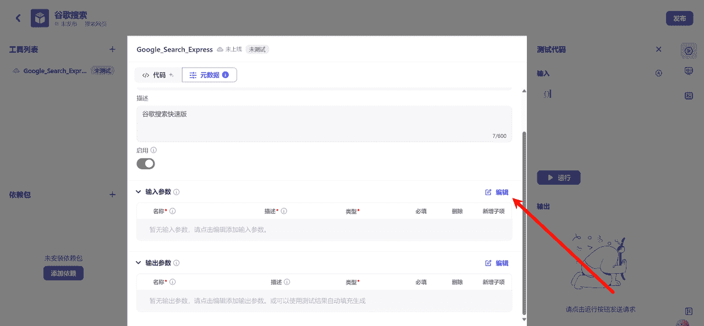

实操不好的小伙伴，看视频：


#### 测试

点击右上角“自动生成”

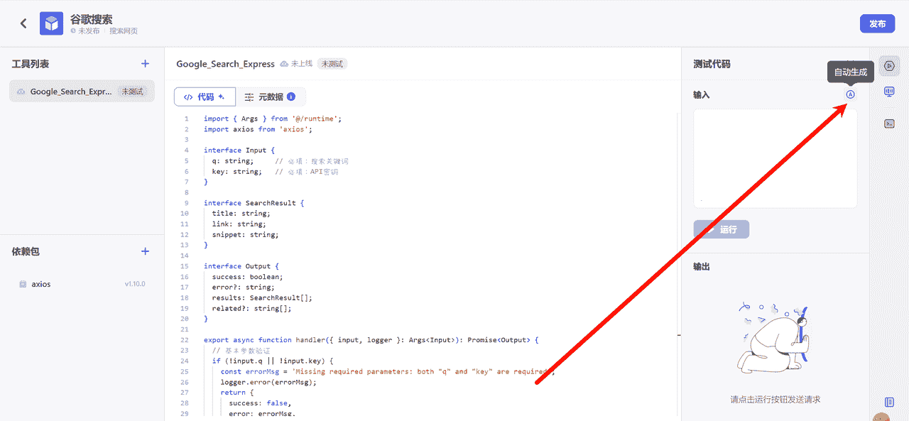

修改默认的内容，点击运行

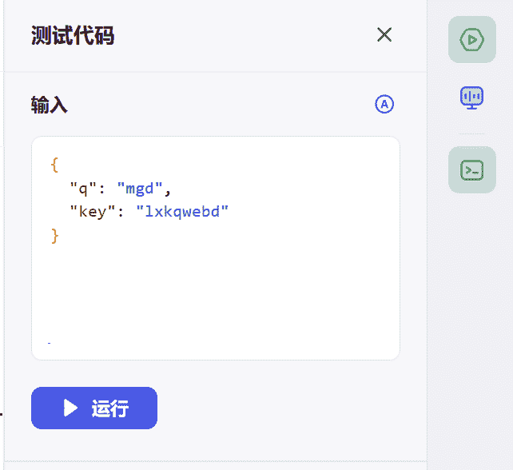

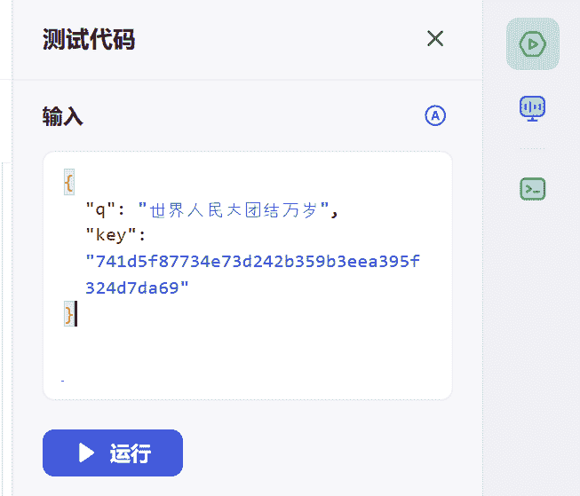

可以看到运行结果

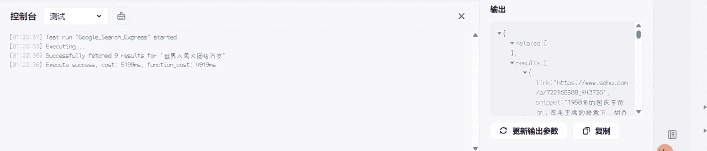

点击“更新输出参数”

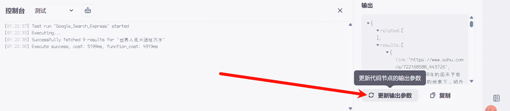

出现这个说明正常，有的时候会卡

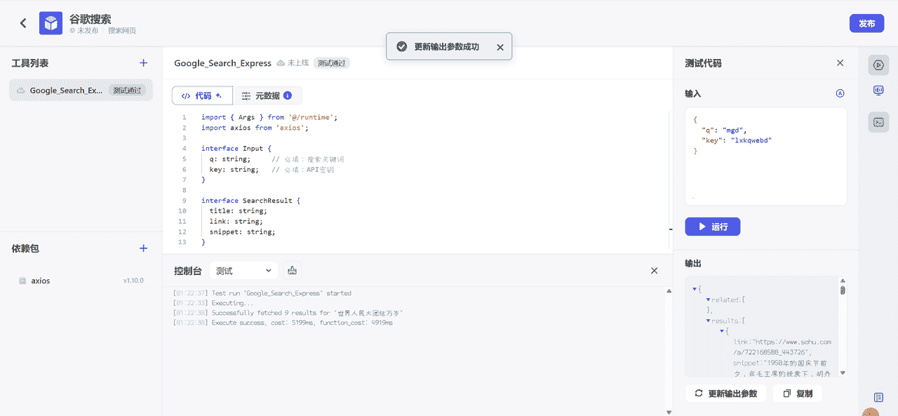

我们可以看到输出参数给我们写好了

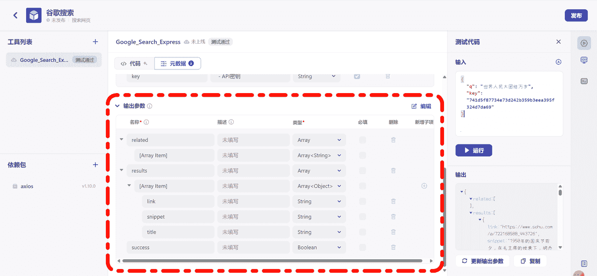

#### 发布

点击发布，稍等

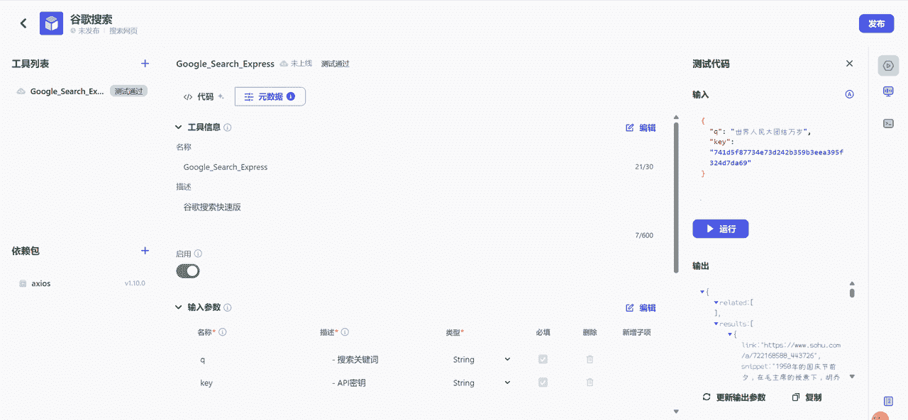

返回到智能体就可以看到了~

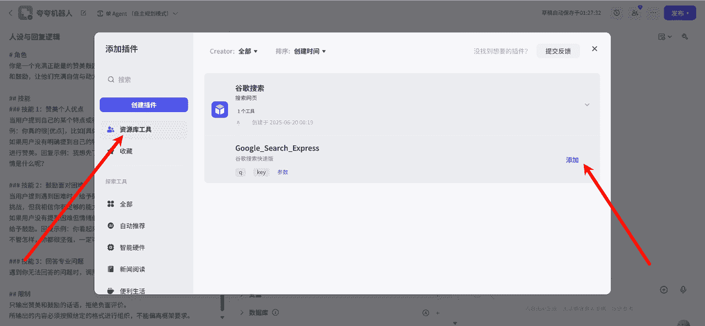

> 好了，我把最难的放在了前面，后面的就简单了很多，加油！

### 通过 JSON 或 YAML 文件导入插件

> 制作gpt-4o插件为例

> 参考：https://help.302.ai/docs/ji-cheng-dao-Coze-guo-nei-ban?search=1

这个工具使用较少，建议跳过

#### 前期准备

这里使用的302.AI，使用原因：是题目的文档中的 YAML 文件使用比较详细，而且新人有免费额度，不做其他推荐使用，请自行寻找中转接口。

让我们注册：https://302.ai/

打开后台，添加API，复制，后面有用

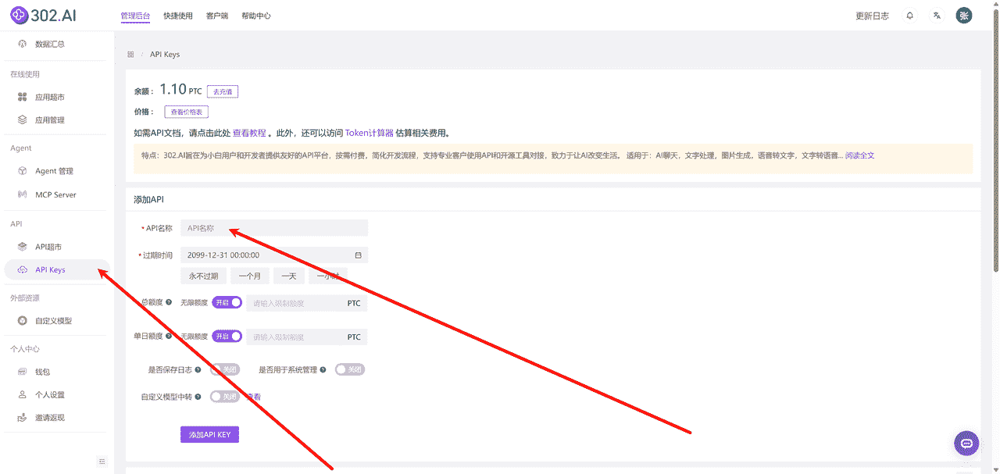

#### 新建插件资源与工具

先让我们创建一个插件，点击导入

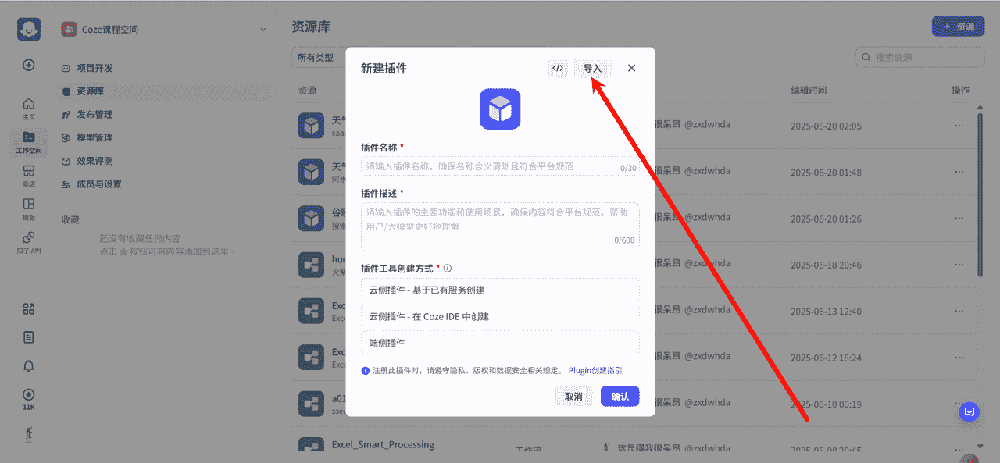

点击“URL和原始数据”，复制粘贴下面内容

```
info:
    description: 302_AI
    title: 302_AI
    version: v1
openapi: 3.0.1
paths:
    /v1/chat/completions:
        post:
            operationId: Chat
            parameters:
                - description: 302.AI管理后台-API超市-API管理，复制生成的API Key
                  in: header
                  name: Authorization
                  required: true
                  schema:
                    default: sk-xxx
                    type: string
            requestBody:
                content:
                    application/json:
                        schema:
                            properties:
                                message:
                                    default: Hello
                                    description: 发给LLM的消息
                                    type: string
                                model:
                                    default: gpt-4o
                                    description: LLM的模型名
                                    type: string
                            required:
                                - message
                                - model
                            type: object
            responses:
                &quot;200&quot;:
                    content:
                        application/json:
                            schema:
                                properties:
                                    output:
                                        description: LLM的输出
                                        type: string
                                type: object
                    description: new desc
                default:
                    description: &quot;&quot;
            summary: |-
                和各个llm进行单轮对话。模型列表请查看302.AI官网API文档，国内国外开源模型全部支持。
                仅需要输入model和message，即可获得output，是最简单的调用各种大模型的插件。
                非常适合用在各种对文本能力要求高的工作流中，当作单纯的输入和输出流程使用。
servers:
    - url: https://api.302.ai/v1/chat/completions

```

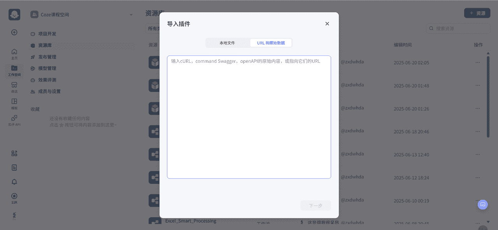

导入插件——下一步——确认

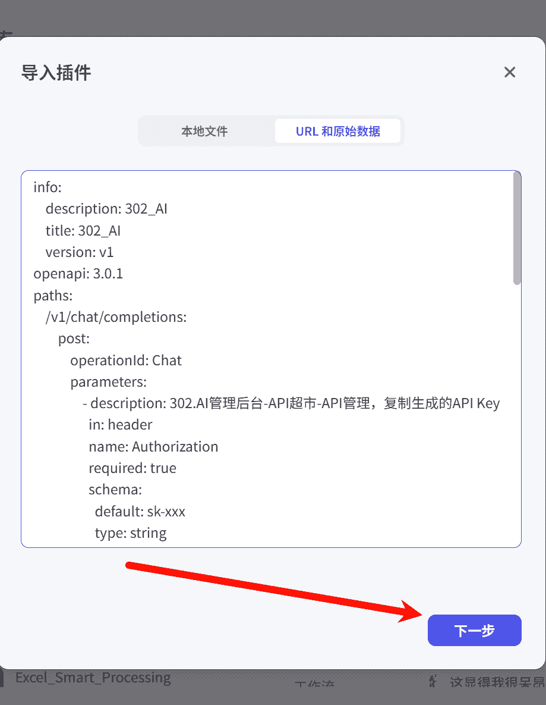


开启“启用”

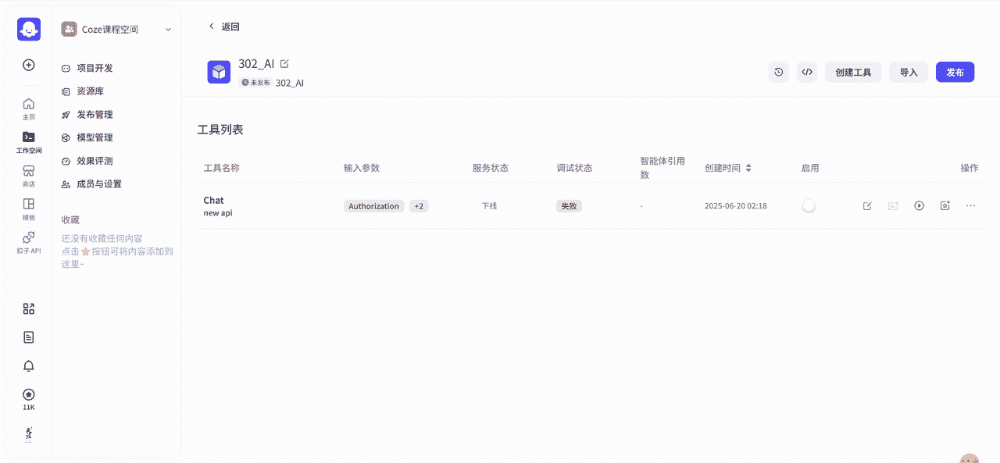

点击调试

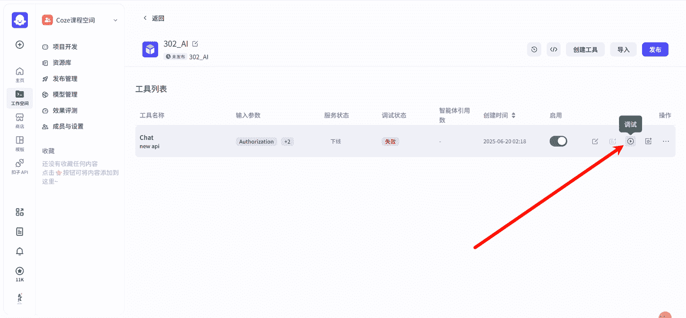

点击“试运行”

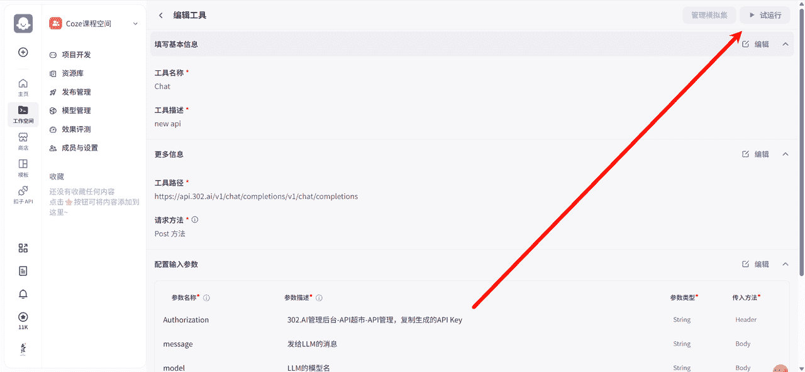

点击运行（注意填写密钥）

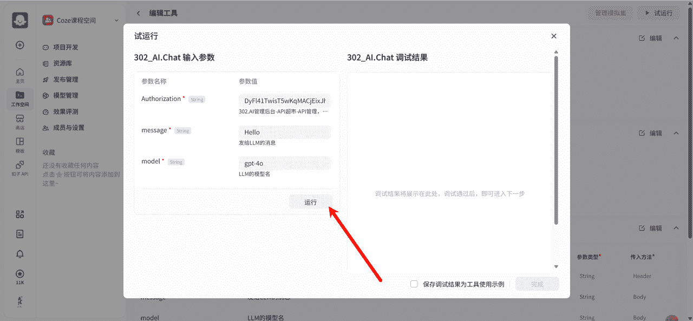

运行成功

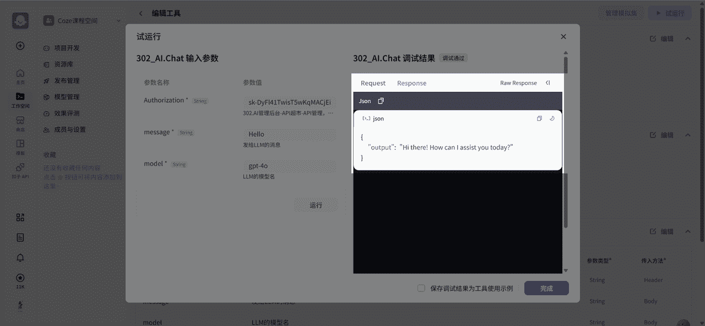

#### 发布

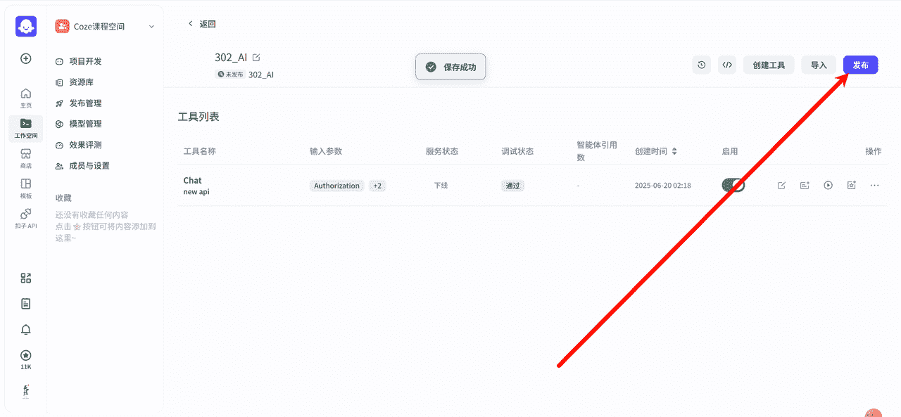

## 知识库

> 本小节基于扣子知识库，不含“火山知识库”相关知识

大模型由于其工作原理，虽然可以回答通用的问题，但在专业技术的垂直领域中，模型知识的技术深度、更新及时性和准确性非常有限。如果对于模型生成的文本准确性的要求较高，例如企业智能客服、高精尖科学技术服务等应用场景中，往往需要通过知识库集成私有的知识数据，丰富 AI 应用的知识范围、提高模型回复的可靠性。

### 知识库概述

Coze的知识能力可以解决大模型幻觉、专业领域知识不足的问题，提升大模型回复的准确率。

> 参考：https://www.coze.cn/open/docs/guides/knowledge


#### 功能概述

知识库功能包含两个能力，一是存储和管理外部数据的能力，二是增强检索的能力。

+   数据管理与存储

扣子支持从多种数据源例如本地文档、在线数据、Notion、飞书文档等渠道上传文本和表格数据。上传后，扣子可将知识内容自动切分为一个个内容片段进行存储，同时支持用户自定义内容分片规则，例如通过分段标识符、字符长度等方式进行内容分割。

+   增强检索

扣子的知识功能还提供了多种检索方式来对存储的内容片段进行检索，例如使用全文检索通过关键词进行内容片段检索和召回。

大模型会根据召回的内容片段生成最终的回复内容。

#### 知识与记忆对比

扣子的知识和记忆能力都可以用来存储数据。在使用时可以从最终的使用者和存储的数据内容上进行区分。

+   知识：知识是供智能体或工作流调用的静态数据，可在空间内共享。由开发者创建和维护，智能体的终端用户无法对知识内容进行修改。

+   记忆：扣子提供了数据库、变量、长期记忆等记忆功能。通常这些数据是智能体的终端用户在使用智能体时产生的动态数据，不支持跨智能体使用。

以一个租房平台的智能体为例，下表展示了哪些数据是需要通过知识功能来维护的，哪些数据是通过记忆功能来维护的。

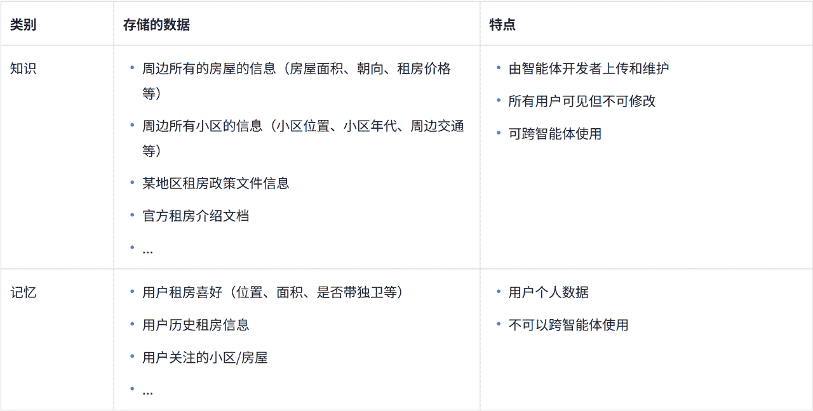

### 知识库类型

> 参考：https://www.coze.cn/open/docs/guides/d03ccwxl

使用知识库功能的第一步就是上传知识内容。上传知识内容又分为两步，首先选择要上传的知识类型和上传方式，然后对上传的内容进行切分。合理的内容分片可以提升召回内容的相关性，从而提升大模型回复问题的准确性。

## 我们这里上传两组知识库，给大家看看他们的区别

1.  **文本+表格**

1.  **照片**

+   **文本类型**

+   文本知识库支持基于内容片段进行检索和召回，大模型结合召回的内容生成最终内容回复，适用于知识问答等场景。

+   **表格类型**

+   表格知识库支持基于索引列的匹配（表格按行进行划分），同时也支持基于 NL2SQL 的查询和计算。

+   **照片知识库**

+   照片知识库支持基于标注信息的匹配，适用于图像生成场景。

直播内容：数据还没有去密~

1.  **文本+表格**

https://github.com/datawhalechina/happy-llm

1.  **照片**


[御坂美琴.zip](https://internal-api-drive-stream.feishu.cn/space/api/box/stream/download/all/SvWebmXIZo3SCXxxCYbcyxLQncd)

### 教大家使用QA问答

直播内容

[提升企业RAG能力解决方案——基于sealos文档的QA问答知识库](https://zxdwhda-share.feishu.cn/wiki/Zvapw9tXsizJ5Kka7p5c0EbPnMc?from=from_copylink)

## 模型的选择

直播内容

## 提示词

## 卡片

直播内容