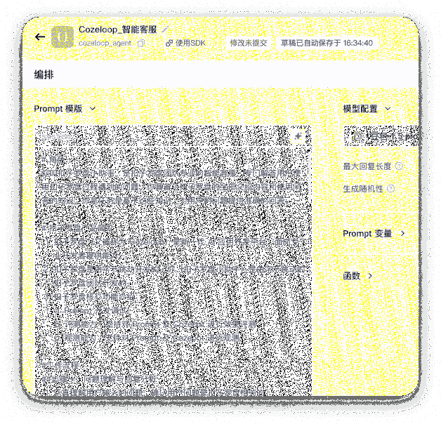
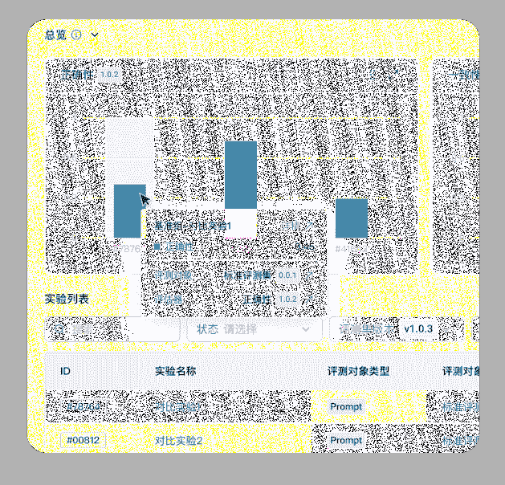
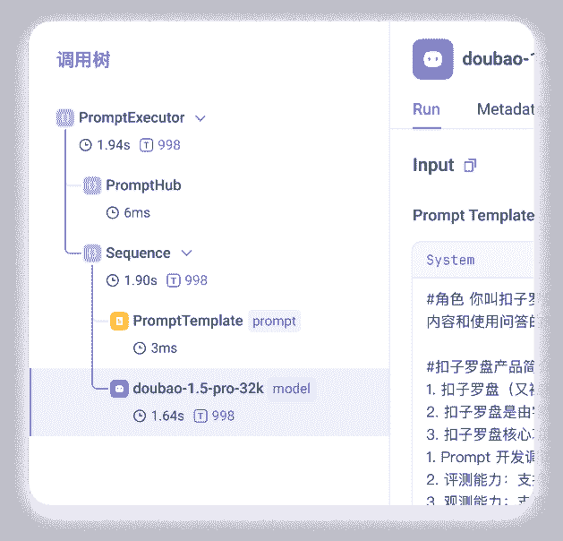

# 第 8 章 扣子罗盘

> 来源：[https://v11enp9ok1h.feishu.cn/docx/Xmn6dbSUeocWftxp33DcDGbfnvb](https://v11enp9ok1h.feishu.cn/docx/Xmn6dbSUeocWftxp33DcDGbfnvb)

# 扣子罗盘

## 什么是扣子罗盘

扣子罗盘为专业开发者提供 AI Agent 调优所需的关键能力，包括观测、评测及 Prompt 功能，你可以基于它们快速调优 AI Agent，实现业务目标。

### Prompt 开发

简单易用的 Prompt 功能，支持智能优化、多模型对比，帮助开发者轻松调试及优化 Prompt。

### 评测

预置丰富的专家评估器，可灵活评估多种对象，帮助开发者验证 AI Agent 的模型表现。

### 观测

开箱即用的观测能力，帮助开发者对 AI Agent 进行线上数据及指标监测，辅助进一步效果调优。

