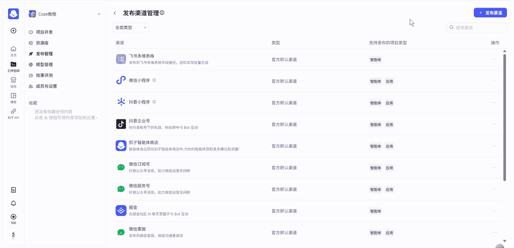
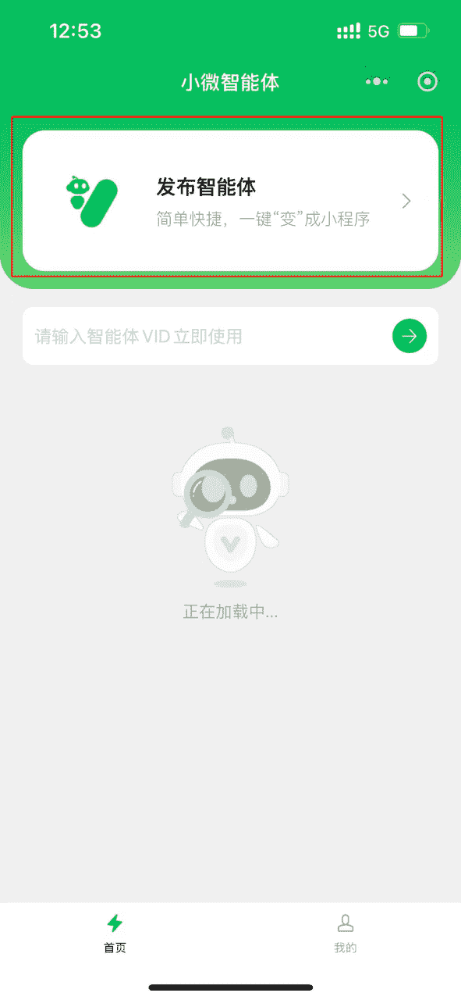
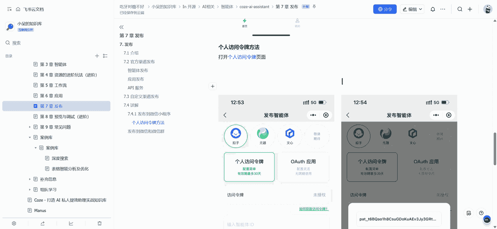
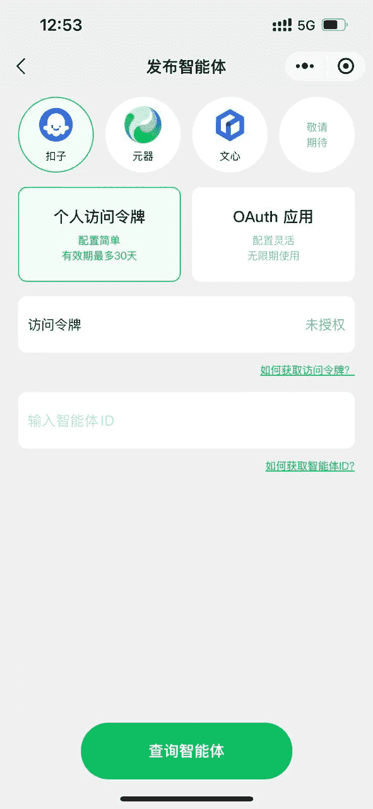
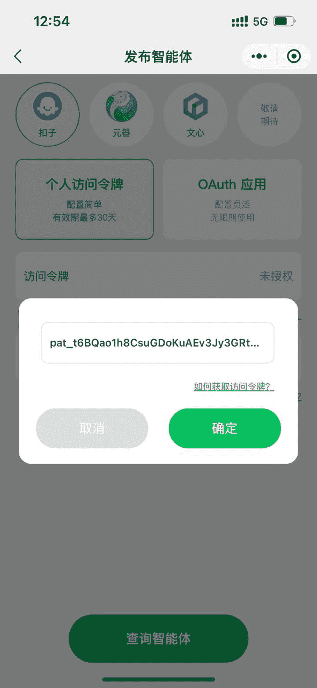
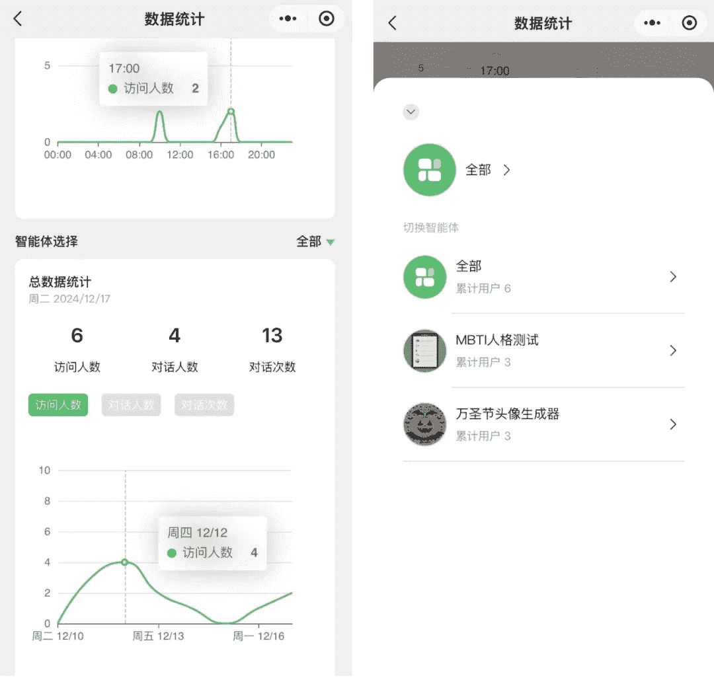

# 第 9 章 教程补充

> 来源：[https://v11enp9ok1h.feishu.cn/docx/BkYYdOfNhoOzV6xiquhcDPMMnyh](https://v11enp9ok1h.feishu.cn/docx/BkYYdOfNhoOzV6xiquhcDPMMnyh)

# 教程补充

## 什么是模板

模板是扣子平台中预先搭建的智能体、工作流、图像流等资源，模板类型包括智能体模板、工作流模板和图像流模板。模板涵盖了多种业务场景，是扣子平台在各个领域的最佳实践。这些资源公开发布到模板库中供其他开发者体验、使用，开发者可以复制感兴趣的模板，并将其改造为更适合自己的应用。例如虚拟伴侣人设的智能体模板，开发者如果需要搭建类似场景的应用，可以复制这个智能体并修改模型提示词，将其改造为其他性格的虚拟伴侣，发布到飞书等渠道中与其对话。

## 发布

### 介绍

coze的发布有比较多方式，但可分为三类，一是官方渠道发布、二是自定义渠道发布、三是API 服务，后面两个可玩性较高。

### 官方渠道发布

抖音、🛰️小程序、飞书、🛰️客服、服务号、订阅号、企业号等等，其实都可以归为官方渠道发布。

#### **智能体发布**

内容详见：

[发布智能体到豆包](https://www.coze.cn/open/docs/guides/publish_to_doubao)

[发布到飞书](https://www.coze.cn/open/docs/guides/publish_to_feishu)

[发布到抖音小程序](https://www.coze.cn/open/docs/guides/publish_to_douyin_app)

[发布到抖音企业号](https://www.coze.cn/open/docs/guides/douyin_business_account)

[发布到🛰️小程序](https://www.coze.cn/open/docs/guides/publish_to_wechat_app)

[发布到🛰️客服](https://www.coze.cn/open/docs/guides/wecom)

[发布到🛰️服务号](https://www.coze.cn/open/docs/guides/wechat_service_account)

[发布到🛰️订阅号](https://www.coze.cn/open/docs/guides/wechat_subscription)

[发布到掘金](https://www.coze.cn/open/docs/guides/juejin)

[发布到飞书多维表格](https://www.coze.cn/open/docs/guides/shortcut)

#### 应用**发布**

[发布应用到抖音小程序](https://www.coze.cn/open/docs/guides/publish_app_to_douyin_microapp)

[发布应用到🛰️小程序](https://www.coze.cn/open/docs/guides/publish_app_to_wechat_mini_program)

[发布应用到飞书](https://www.coze.cn/open/docs/guides/publish_app_to_lark)

[发布应用到🛰️客服](https://www.coze.cn/open/docs/guides/publish_app_to_wechat_customerService)

[发布应用到🛰️服务号](https://www.coze.cn/open/docs/guides/publish_app_to_wechat_serviceAccount)

[发布应用到🛰️订阅号](https://www.coze.cn/open/docs/guides/publish_app_to_wechat_subscriptionAccount)

[发布应用到抖音企业号](https://www.coze.cn/open/docs/guides/publish_app_to_douyin_businessAccount)

[发布应用到商店](https://www.coze.cn/open/docs/guides/publish_to_store)

[发布应用为模板](https://www.coze.cn/open/docs/guides/publish_to_template)

#### API 服务

[发布智能体为 API 服务](https://www.coze.cn/open/docs/guides/publish_agent_api)

[发布智能体到 Chat SDK](https://www.coze.cn/open/docs/guides/publish_agent_to_chat_sdk)

[发布应用为 API 服务](https://www.coze.cn/open/docs/guides/publish_api)

[通过 API 运行应用工作流](https://www.coze.cn/open/docs/guides/run_app_as_api)

[发布应用为 Chat SDK](https://www.coze.cn/open/docs/guides/publish_app_to_web_sdk)

### 自定义渠道发布

内容详见：[扣子-管理发布渠道](https://www.coze.cn/open/docs/guides/manage_channels)

### 详解

#### 发布到🛰️小程序

> 参考文章：https://mp.weixin.qq.com/s/2yKPNXqDOxbTFdK9FcvcbA

首先打开我们编辑好的coze智能体，点击发布选择API，然后再发布一下

进入「[小微智能体](https://mp.weixin.qq.com/s/2yKPNXqDOxbTFdK9FcvcbA)」小程序（请搜索），选择发布智能体。

##### 个人访问令牌方法

打开[个人访问令牌](https://www.coze.cn/open/oauth/pats)页面，添加新令牌复制好

打开刚才的小微智能体页面

当配置完成后，可点击「查询Bot」查到对应的智能体，你可以点击「预览」进行对话调试，没有问题即可「发布」。

分享形式支持4种

+   发送给朋友：以小程序卡片形式分享到好友聊天/🛰️群中

+   复制链接：以链接形式分享，当用户点击链接可以跳转到智能体详情页

+   👸号传播：复制路径支持嵌入到👸号文章以及👸号菜单中

+   复制VID：适用在🛰️生态外分享，在首页输入VID即可跳转智能体详情

当你分享后，可以在「我的」菜单页的「数据统计」中看到具体数据。

##### OAuth 应用

#### 发布到🛰️和🛰️群

[【智能体】让Coze智能体机器人连上🛰️和🛰️群详细配置文档](https://waytoagi.feishu.cn/wiki/ExHMwCDZ7i6NA7knCWucFvFvnvJ)