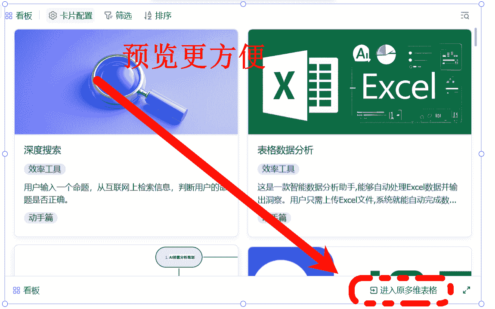

# 案例库

> 来源：[https://v11enp9ok1h.feishu.cn/docx/EPJ4dk9vXoFBekxD01JcLGq0nlc](https://v11enp9ok1h.feishu.cn/docx/EPJ4dk9vXoFBekxD01JcLGq0nlc)

本文基于官方商店的九个分类，案例分为思路篇、动手篇（手把手教练），本页面只是方向案例，请注意版权和付费课程内容~

<https://zxdwhda-share.feishu.cn/share/base/view/shrcnRmybZShQYY4KdvQty1jqPc?iframeFrom=docx&ccm_open=iframe>

点击**“进入原多维表格”，预览更方便**

