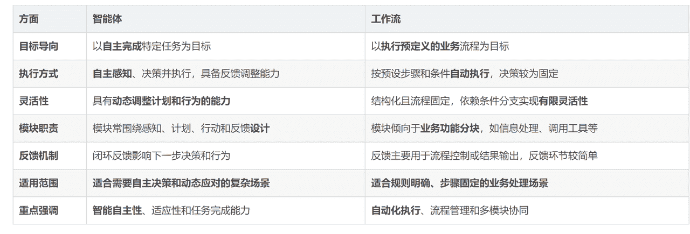
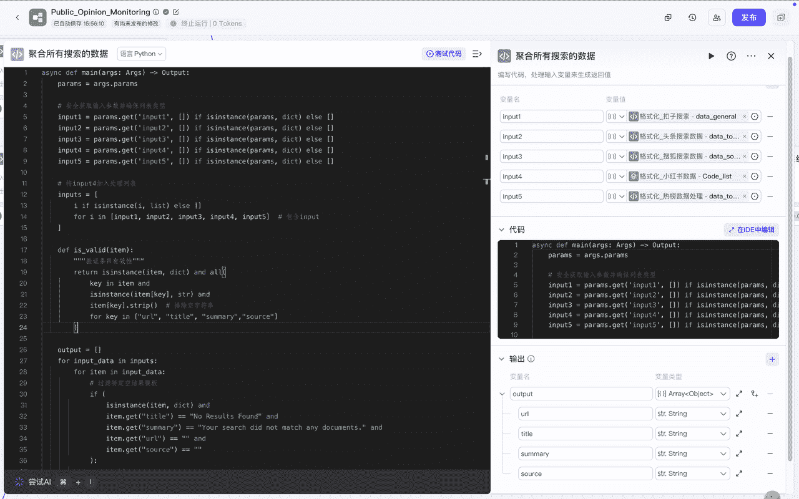
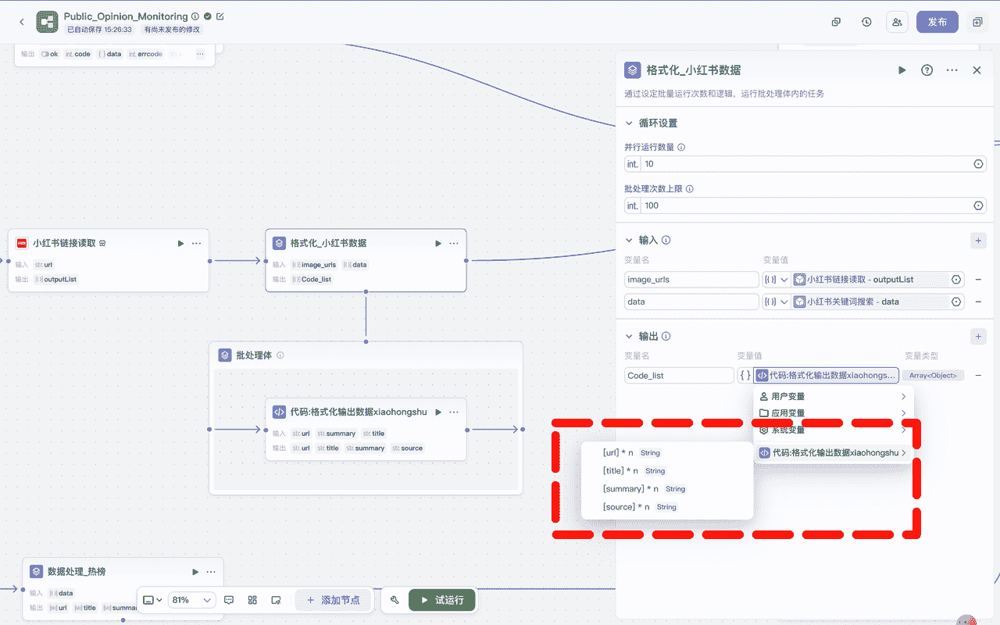
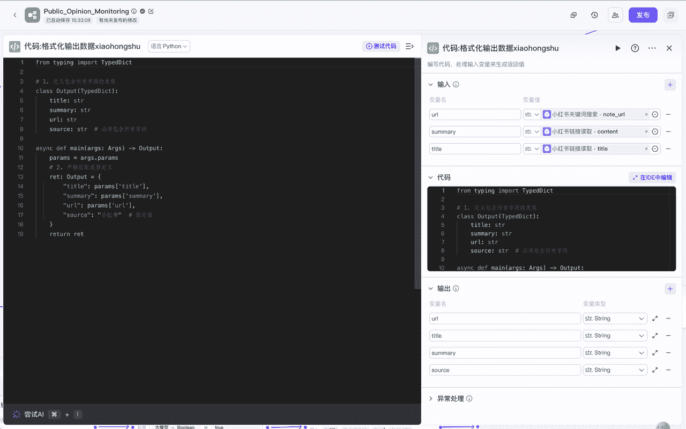
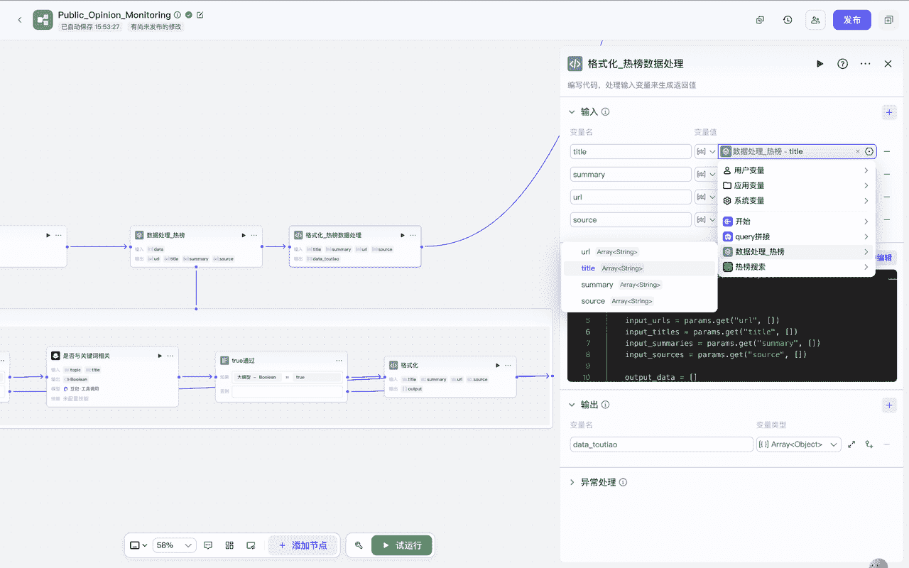
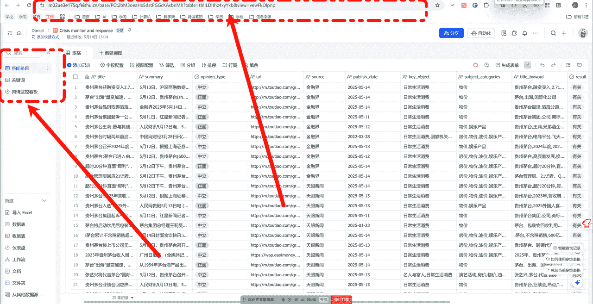
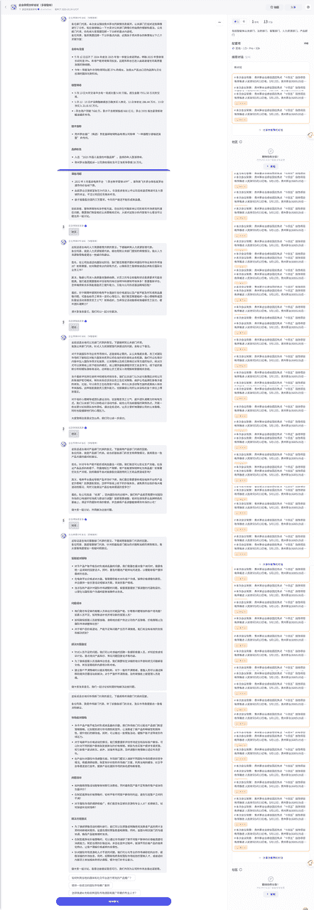

# 企业舆情分析

> 来源：[https://v11enp9ok1h.feishu.cn/docx/Crj1d6FW9oFcplxh02rcnbCtnef](https://v11enp9ok1h.feishu.cn/docx/Crj1d6FW9oFcplxh02rcnbCtnef)



# 前言

感谢星环科技提供的舆情分析模板，本项目[基于该模板做了优化和多维表](https://www.coze.cn/template/project/7468212330137124915?from=store_search_suggestion)格扩展，模板：扣子-AI 智能体开发平台

关于本工作流的相关配置，可以在学习群@助教或者添加作者飞书

## 效果

> 建议“进入原多维表格”

<https://zxdwhda-share.feishu.cn/share/base/dashboard/shrcnHcgxaz0kj7G8iLrY0Zpj0c?iframeFrom=docx&ccm_open=iframe>

## 产品设计思路

> 为什么要有这些功能

# coze设计

## 整体分析

### 输入节点

topic-搜索词

cnt-搜索数量

### query拼接

给 topic-搜索词加上最新新闻

### 搜索选择器

> 因为📕 cookie 限制的问题，和调试阶段需要快速调试，这里加上了“搜索选择器”

### 🔎 搜索模块

聚合了搜狐热闻、联网问答、头条搜索📕搜索、12+热榜内容

更多内容参考：第3部分[企业舆情分析](https://zxdwhda-share.feishu.cn/wiki/An82w6wc4iwoYik2iqVcwbPunBb#ZWctdnU0hovzXDxx5ENc0IkSnJg)

### 聚合节点

聚合所有来源的数据

```
async def main(args: Args) -&gt; Output:
    params = args.params

    # 安全获取输入参数并确保列表类型
    input1 = params.get(&#x27;input1&#x27;, []) if isinstance(params, dict) else []
    input2 = params.get(&#x27;input2&#x27;, []) if isinstance(params, dict) else []
    input3 = params.get(&#x27;input3&#x27;, []) if isinstance(params, dict) else []
    input4 = params.get(&#x27;input4&#x27;, []) if isinstance(params, dict) else [] 
    input5 = params.get(&#x27;input5&#x27;, []) if isinstance(params, dict) else []
    
    # 将input4加入处理列表
    inputs = [
        i if isinstance(i, list) else []
        for i in [input1, input2, input3, input4, input5]  # 包含input
    ]

    def is_valid(item):
        &quot;&quot;&quot;验证条目有效性&quot;&quot;&quot;
        return isinstance(item, dict) and all(
            key in item and 
            isinstance(item[key], str) and 
            item[key].strip()  # 排除空字符串
            for key in [&quot;url&quot;, &quot;title&quot;, &quot;summary&quot;,&quot;source&quot;]
        )

    output = []
    for input_data in inputs:
        for item in input_data:
            # 过滤特定空结果模板
            if (
                isinstance(item, dict) and
                item.get(&quot;title&quot;) == &quot;No Results Found&quot; and
                item.get(&quot;summary&quot;) == &quot;Your search did not match any documents.&quot; and
                item.get(&quot;url&quot;) == &quot;&quot; and
                item.get(&quot;source&quot;) == &quot;&quot;
            ):
                continue
            
            if is_valid(item):
                output.append({
                    &quot;url&quot;: item[&quot;url&quot;].strip(),
                    &quot;title&quot;: item[&quot;title&quot;].strip(),
                    &quot;summary&quot;: item[&quot;summary&quot;].strip(),
                    &quot;source&quot;: item[&quot;source&quot;].strip()
                })

    return {&quot;output&quot;: output}
```



### 其他节点


统计数据总量

```
async def main(args: Args) -&gt; Output:
    params = args.params
    input_array = params[&#x27;input&#x27;]
    
    # 统计数组长度
    count = len(input_array)
    
    # 构建输出对象
    ret: Output = {
        &quot;count&quot;: count
    }
    return ret
```

获取当前系统时间

```
async function main({ params }: Args): Promise&lt;Output&gt; {
    const now = new Date();

    const year = now.getFullYear();
    const month = String(now.getMonth() + 1).padStart(2, &#x27;0&#x27;); // 月份从0开始, 需加1，并保证两位数格式
    const day = String(now.getDate()).padStart(2, &#x27;0&#x27;); // 保证两位数格式

    const dateString = `${year}-${month}-${day}`;

    const ret = {
        time: dateString
    };

    return ret;
}
```

### ⭐️ 内容关键词模块

更多内容参考：第4部分[企业舆情分析](https://zxdwhda-share.feishu.cn/wiki/An82w6wc4iwoYik2iqVcwbPunBb#Kd5PdYEGOoLaYgxJCsVc3GElndg)

### 📈 舆情分析模块

更多内容参考：第5部分[企业舆情分析](https://zxdwhda-share.feishu.cn/wiki/An82w6wc4iwoYik2iqVcwbPunBb#E6cDdUoPHod5zLxOEc4cyBnvn3c)

### 🛠处理模块

更多内容参考：第6部分[企业舆情分析](https://zxdwhda-share.feishu.cn/wiki/An82w6wc4iwoYik2iqVcwbPunBb#Tt7cdy6rPops5TxZMygcJGPVnQc)

## 🔎 搜索模块详解

### 普通搜索

搜狐热闻：https://www.coze.cn/store/plugin/7343894357063385100


```
async def main(args: Args) -&gt; Output:
    # 安全获取参数，处理可能的缺失或类型错误
    params = getattr(args, &#x27;params&#x27;, {})
    input_array = params.get(&#x27;input&#x27;, []) if isinstance(params, dict) else []
    if not isinstance(input_array, list):
        input_array = []
    
    output_data = []
    
    def escape_single_quote(text: str) -&gt; str:
        return text.replace(&quot;&#x27;&quot;, &quot;\\&#x27;&quot;)
    
    for item in input_array:
        # 跳过无效条目
        if not isinstance(item, dict):
            continue
        
        # 提取字段并验证类型
        url = item.get(&quot;url&quot;)
        title = item.get(&quot;title&quot;)
        brief = item.get(&quot;brief&quot;)
        
        # 检查必要字段是否存在且为非空字符串
        if not all([
            isinstance(url, str) and url.strip(),
            isinstance(title, str),
            isinstance(brief, str)
        ]):
            continue
        
        # 转义字段并构建结果
        transformed_item = {
            &quot;url&quot;: escape_single_quote(url),
            &quot;title&quot;: escape_single_quote(title),
            &quot;summary&quot;: escape_single_quote(brief),
            &quot;source&quot;: &quot;搜狐新闻&quot;
        }
        output_data.append(transformed_item)
    
    # 处理空结果情况
    if not output_data:
        output_data = [{
            &quot;url&quot;: &quot;&quot;,
            &quot;title&quot;: &quot;No Results Found&quot;,
            &quot;summary&quot;: &quot;Your search did not match any documents.&quot;,
            &quot;source&quot;: &quot;搜狐新闻&quot;
        }]
    
    return {&quot;data_sohu&quot;: output_data}
```

联网问答（扣子搜索）：https://www.coze.cn/store/plugin/7380276977141465088


```
async def main(args: Args) -&gt; Output:
    params = args.params
    input_array = params[&#x27;input&#x27;]
    
    output_data = []
    
    def escape_single_quote(text: str) -&gt; str:
        return text.replace(&quot;&#x27;&quot;, &quot;\\&#x27;&quot;)
    
    for item in input_array:
        if item is None:
            continue
        if not isinstance(item, dict):
            continue
        # 添加对sitename字段的检查
        if &quot;url&quot; not in item or &quot;title&quot; not in item or &quot;summary&quot; not in item or &quot;sitename&quot; not in item:
            continue
        if not item[&quot;url&quot;]:
            continue

        transformed_item = {
            &quot;url&quot;: escape_single_quote(item[&quot;url&quot;]),
            &quot;title&quot;: escape_single_quote(item[&quot;title&quot;]),
            &quot;summary&quot;: escape_single_quote(item[&quot;summary&quot;]),
            &quot;source&quot;: escape_single_quote(item[&quot;sitename&quot;])
        }
        output_data.append(transformed_item)
    
    ret: Output = {
        &quot;data_general&quot;: output_data
    }
    return ret
```

头条搜索：https://www.coze.cn/store/plugin/7328315124756807717


```
async def main(args: Args) -&gt; Output:
    params = args.params
    input_array = params[&#x27;input&#x27;]
    
    # 按后续环节要求赋值data
    output_data = []
    
    def escape_single_quote(text: str) -&gt; str:
        return text.replace(&quot;&#x27;&quot;, &quot;\\&#x27;&quot;)
    
    for item in input_array:
        if item is None:
            continue
        if not isinstance(item, dict):
            continue
        if &quot;url&quot; not in item or &quot;title&quot; not in item or &quot;summary&quot; not in item:
            continue
        if not item[&quot;url&quot;]:
            continue
            
        transformed_item = {
            # 将代表网页链接的字段输出为url
            &quot;url&quot;: escape_single_quote(item[&quot;url&quot;]),
            # 将代表网页标题的字段输出为title
            &quot;title&quot;: escape_single_quote(item[&quot;title&quot;]),
            # 将代表网页总结的字段输出为summary
            &quot;summary&quot;: escape_single_quote(item[&quot;summary&quot;]),
            # source字段，取sitename的值并转义
            &quot;source&quot;: escape_single_quote(item[&quot;sitename&quot;])
        }
        output_data.append(transformed_item)
    
    # 构建输出对象
    ret: Output = {
        &quot;data_toutiao&quot;: output_data
    }
    return ret
```

### 📕搜索


📕插件——xhs_search_note工具：https://www.coze.cn/store/plugin/7413263498387423242

> 根据【关键词】搜索【📕笔记】


📕笔记提取：https://www.coze.cn/store/plugin/7426236806493995062

> 获取📕笔记信息添加到我的智能体


批处理：



批处理体：

```
from typing import TypedDict

# 1. 定义包含所有字段的类型
class Output(TypedDict):
    title: str
    summary: str
    url: str
    source: str  # 必须包含所有字段

async def main(args: Args) -&gt; Output:
    params = args.params
    # 2. 严格匹配类型定义
    ret: Output = {
        &quot;title&quot;: params[&#x27;title&#x27;],
        &quot;summary&quot;: params[&#x27;summary&#x27;],
        &quot;url&quot;: params[&#x27;url&#x27;],
        &quot;source&quot;: &quot;小红书&quot;  # 固定值
    }
    return ret
```



### 热榜检索


热搜榜聚合：https://www.coze.cn/store/plugin/7351343435422433280


筛选知乎链接


是否与关键词相关

> 大模型节点


```
# 角色
你是一个舆情监控专家，擅长分析各类信息与总结内容之间的相关性，能够精准判断关键词和新闻标题是否相关，并给出合理的判断依据。

## 技能
### 技能 1: 判断相关性
1. 当用户提供关键词和新闻标题时，仔细分析两者的内容、主题、关键信息等方面。
2. 通过对内容语义、逻辑关系的理解，判断关键词和新闻标题是否相关。
3. 给出明确的判断结果（相关或不相关），并详细阐述判断依据。

## 限制:
- 只围绕判断关键词和新闻标题是否相关回答，拒绝回答无关话题。
- 输出内容需清晰呈现判断结果和依据，不能偏离框架要求。

## 输出
{Boolean}}：&lt;false/true&gt;  ，false代表无关，true代表有关
```

```
用户提供关键词：{{topic}}
新闻标题：{{title}}
```

判断是否相关输出


格式化


```
async def main(args: Args) -&gt; Output:
    params = args.params
    ret: Output = {
        &quot;output&quot;:{
            &quot;title&quot;: params[&#x27;title&#x27;],
            &quot;summary&quot;: params[&#x27;summary&#x27;],
            &quot;url&quot;: params[&#x27;url&#x27;],
            &quot;source&quot;: params[&#x27;source&#x27;]
        }
    }
    return ret
```

格式化_热榜数据处理



```
async def main(args: Args) -&gt; Output:
    params = args.params
    
    # 提取输入的三维数据结构
    input_urls = params.get(&quot;url&quot;, [])
    input_titles = params.get(&quot;title&quot;, [])
    input_summaries = params.get(&quot;summary&quot;, [])
    input_sources = params.get(&quot;source&quot;, [])
    
    output_data = []
    
    def escape_single_quote(text: str) -&gt; str:
        return text.replace(&quot;&#x27;&quot;, &quot;\\&#x27;&quot;) if text else &quot;&quot;
    
    # 确保数组长度一致
    max_length = max(len(input_urls), len(input_titles), len(input_summaries))
    
    for i in range(max_length):
        # 防御性提取字段
        url = str(input_urls[i]) if i &lt; len(input_urls) else &quot;&quot;
        title = str(input_titles[i]) if i &lt; len(input_titles) else &quot;&quot;
        summary = str(input_summaries[i]) if i &lt; len(input_summaries) else &quot;&quot;
        source = str(input_sources[i]) if i &lt; len(input_sources) else &quot;&quot;
        
        # 过滤空URL条目
        if not url.strip():
            continue
            
        # 构建符合要求的输出对象
        transformed_item = {
            &quot;url&quot;: escape_single_quote(url),
            &quot;title&quot;: escape_single_quote(title),
            &quot;summary&quot;: escape_single_quote(summary),
            &quot;source&quot;: escape_single_quote(source)
        }
        output_data.append(transformed_item)
    
    # 空结果兜底逻辑
    if not output_data:
        output_data.append({
            &quot;url&quot;: &quot;&quot;,
            &quot;title&quot;: &quot;No Valid Data Found&quot;,
            &quot;summary&quot;: &quot;No processed items meet the criteria&quot;,
            &quot;source&quot;: &quot;&quot;
        })
    
    return {&quot;data_toutiao&quot;: output_data}
```

## ⭐️ 话题模块详解

## 📈 舆情分析模块详解

## 🛠处理模块详解

大家再添加链接的时候，从地址中复制，不要选择分享



# 多维表格设计

[Crisis monitor and response 副本](https://zxdwhda-share.feishu.cn/wiki/VS8jwixqgivHjLkPvGEcVRKVnv8)

大家可以直接复制

# 多智能体设计

https://www.coze.cn/store/agent/7502710927675523109?bot_id=true



# 提醒

大家不要忘了打卡 Task2