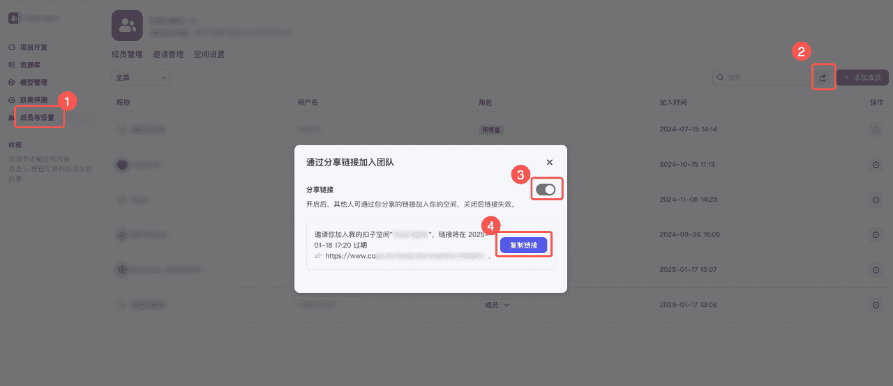

# 如何邀请别人加入自己的团队空间，以及个人空间迁出

> 来源：[https://v11enp9ok1h.feishu.cn/docx/B9MYdRADloBiZ8xlA5ecI4ETnHc](https://v11enp9ok1h.feishu.cn/docx/B9MYdRADloBiZ8xlA5ecI4ETnHc)

我建议大家在设计智能体、工作流、应用等的时候，使用团队空间，方便别人来调试自己搭建的模型，也方便去协调搭建。

## 创建空间

首先是创建空间

1.  在左侧导航栏中选择**工作空间**，展开空间下拉列表，并单击➕**创建新团队**。

1.  在**创建新团队****对话**框，配置团队名称、描述和团队头像，并单击确认。

成功创建空间后，你可以在空间中构建智能体、插件等资源。

## 邀请用户加入空间

### 通过链接邀请用户

空间管理员和空间所有者可以开启空间的邀请链接，其他扣子用户访问邀请链接来加入空间。此方式适用于不了解用户昵称或用户名、用户数量较多的情况，例如培训授课时邀请学员加入空间。

+   空间邀请链接的有限期为 7 天，超期后需要重新复制链接。空间所有者或管理员也可以手动关闭分享链接，关闭后其他用户将无法通过链接加入空间。重新开启邀请链接后，之前的访问链接会失效。

+   空间**的邀请链接**是完全**公开的，**所有**用户均可以通过邀请链接加入空**间，空间中产生的所有费用均由空间所有者对应的主账号支付。为保障信息安全和数据安全，需要注意邀请链接的传播范围，或者在成员与设置 > 空间设置页面关闭禁止外部用户加入当前空间。

1.  登录[扣子平台](https://www.coze.cn/)。

1.  在左侧导航栏中选择**工作空间**，并在页面顶部空间列表中选择团队空间。

1.  在**团队设置**页面，在页面右上角单击分享图标。

1.  开启邀请链接。

1.  单击**复制链接**。

1.  将链接转发给其他扣子用户，用户访问链接时可以选择是否加入空间。

### 定向邀请用户

#### 步骤一：发起邀请

空间管理员和空间所有者需要先向指定用户发送空间邀请。具体操作如下：

1.  在**成员与设置** > **成员管理**页面右上角单击 **+ 添加新成员**。

1.  输入扣子用户的用户名或昵称，并设置用户角色。

用户名和昵称的获取方式可参考[设置个人资料](https://www.coze.cn/open/docs/guides/setting_up_your_profile)；用户角色的差异可参考[设置空间成员角色](https://www.coze.cn/open/docs/guides/set_role)。

**在专业版空间中**，你还可以在右上角单击创建火山子用户，根据页面提示创建一个子用户。

#### 步骤二：接受邀请

被邀请加入空间的用户，会收到一条来自扣子社区的系统提示，并选择是否加入这个空间。

在系统提示中单击链接，选择加入空间。

## 了解更多

推荐阅读官方文档：

[工作空间概述](https://www.coze.cn/open/docs/guides/teams)