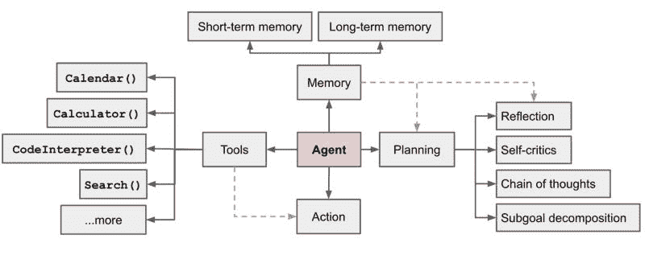

# Dify 和 Coze 有什么异同

> 来源：[https://v11enp9ok1h.feishu.cn/docx/Goe7dsw8OoCnV5xeVHhcdqOKnwe](https://v11enp9ok1h.feishu.cn/docx/Goe7dsw8OoCnV5xeVHhcdqOKnwe)

Dify和Coze都是大模型中间层产品，它们提供了将大型语言模型（LLM）集成到各种应用中的能力。以下是Dify和Coze的一些主要异同点：

## 平台概述

+   **Dify**

+   苏州语灵人工智能科技公司推出的开源大语言模型（LLM）应用开发平台。融合了后端即服务（Backend as Service）和LLMOps的理念，使开发者能高效构建生产级的生成式AI应用。它的优势在于低门槛的开发体验，不仅适合技术开发者，也让非技术人员能够轻松参与到 AI 应用的定义和数据运营中，并且支持多用户、多模型选择，接入全球大型语言模型更为便利，适合国际化场景。

+   **Coze**

+   字节跳动旗下的AI聊天机器人开发平台，专注于为用户提供快速、低门槛的聊天机器人搭建解决方案。插件能力和易用性表现出色，更偏向C端用户。

## 开源

+   **Dify**

+   是开源的，允许开发者自由访问和修改代码，以便进行定制。Dify由专业团队和社区共同打造，促进了产品的灵活性和安全性。

+   **Coze**

+   由字节跳动推出，目前没有明确信息表明它是否开源。Coze可能更侧重于提供商业化服务和产品。

## 功能和定制能力

+   **Dify**

+   发布应用

+   统计数据全面，在用户满意度和token输出速度监控上有独特优势，也支持多平台，集成难度同样为中等。

+   工作流

+   通过新建空白应用进行工作流编排，节点类型丰富度中等，支持LLM的AI对话配置，允许检索知识库，有代码执行和模板转换等工具调用方式以及http请求的外部调用，用户友好度高，技术需求中等，在工作流创建和问题理解上表现良好。

+   知识库

+   Dify 支持父子文档检索模式，但文档分块仍会导致上下文信息截断，对于多文档知识库的文档检索质量不宜期望过高。

+   多Agent模式系统

+   不支持

+   **Coze**

+   发布应用

+   对字节平台友好，但在 API 调用和跨平台集成方面存在不足，统计数据主要关注日活用户、留存率等简化统计，更注重优化字节跳动平台内的用户体验。

+   工作流

+   点击添加工作流创建，节点类型丰富度高，AI 对话配置、大模型调用（对话流）、知识库召回、代码编写以及工作流/图像流/数据库的外部调用，用户友好度高，技术需求低，操作简便，适合初级用户或需要快速上手的场景。

+   知识库

+   不支持父子检索

+   多Agent模式系统

+   [支持，想客服系统，这里百度的这个演示不错：千帆成就“金牌](https://www.bilibili.com/video/BV1WuUAY5EZz/?vd_source=ca2ce21e38126c95307ca5285ead924e)销售”，“硬控”车险续保。千帆是解决复杂业务问题的企业级平台，打开企业应用的天花板

## 社区和支持、生态

+   **Dify**

+

+   Dify虽然主要面向海外市场，但其开源性和丰富的模型支持为其构建了一定的生态基础。Dify还提供了云服务和本地部署两种方式，满足了不同用户的需求。然而，在国内市场，Dify的知名度相对较低，生态能力有待提升。

+   生态

+   **Coze**

+

+   Coze在生态能力方面表现突出。其平台不仅提供了插件商店、工作流商店、Bot商店、模型广场等丰富的资源，还持续开发、更新官方插件，同时支持第三方开发者插件的接入。此外，Coze还积极与用户互动，建立了良好的社区氛围，为用户提供了更多的学习和交流机会。

+   coze的社群氛围真的很好，非常推荐大家通过学习coze，理解智能体、Workflow的概念。

+   生态

# 总结

+   **Dify**

+   Dify操作便捷，支持多种大模型接入，适合国际化需求和高效开发的开发者；

+   **Coze**

+   Coze则用户体验友好，插件丰富，易用性强，适合C端用户和对话体验要求较高的场景。

---

## AI Agent结构（LLWeng）

这个图是前年OpenAI的LLWeng提出来的关于AI Agent架构的设计，可以帮大家理解为什么coze和dify等平台为什么会设计成这样

# 参考

## 文章

Coze，Dify，FastGPT，哪个更强？全方位对比分析来了！

问：Dify 和 Coze 有什么异同

## 视频

[Coze与Dify知识库问答对比 |](https://youtu.be/yThgq4OdTdw?si=utSCppPJ5r3-cT4k) 国产AI应用开发平台扣子能遥遥领先吗？