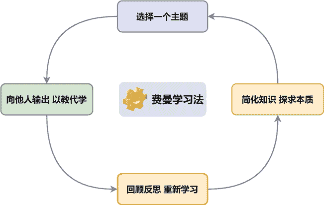

# 费曼学习法

> 来源：[https://v11enp9ok1h.feishu.cn/docx/LNyodRnVjox6H8xrKxDcoYC1nBh](https://v11enp9ok1h.feishu.cn/docx/LNyodRnVjox6H8xrKxDcoYC1nBh)

> 本文互联网可编辑，欢迎提出的想法，请不要删除别人的内容哈~有更多想法，欢迎交流wx：zxdwhda_01

### 一、**方法介绍**

费曼学习法是一种以美国物理学家理查德·费曼命名的学习方法。它的核心思想是“教学是最好的学习方式”。这种方法包括以下几个步骤：

**1.选择一个概念**：首先，选择一个你想要学习的概念。

**2.教授这个概念**：尝试向别人解释这个概念，就像你在教授他们一样。这可以是一个实际的人，也可以是想象中的听众。

**3.回顾和简化**：在讲解的过程中，当你遇到解释不清楚的地方，就回到原始的学习材料中，重新学习这一部分。

**4.组织并复述**：最后，重新整理笔记和知识点，用更简单、更清晰的方式表述出来。

通过这个过程，人们可以更深入地理解概念，并能够发现和填补知识中的漏洞。这种方法强调的是理解和能够清晰地解释概念，而不仅仅是记忆信息。

### 二、理论基础

费曼学习法背后的理论基础主要包括以下几个方面：

**1.元认知：**元认知是指对自身认知过程的认识和监控。费曼学习法要求学习者反思自己的理解，并识别出知识中的差距和不足之处。这种自我评估和反思的过程有助于提高学习效率。

**2.建构主义理论：**建构主义认为，知识是通过个体与环境的互动构建的。费曼学习法鼓励学习者主动构建知识，通过教授他人的过程来巩固和深化自己的理解。

**3.信息加工理论**：学习涉及信息的输入、处理和输出。费曼学习法通过教授他人的方式，促使学习者对信息进行深加工，从而更好地理解和记忆信息。

### 三、实操案例：

构建一个面向地理高考复习场景的费曼学习法小助手。