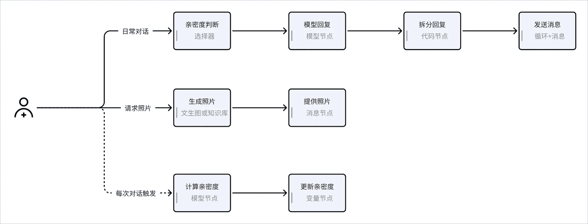
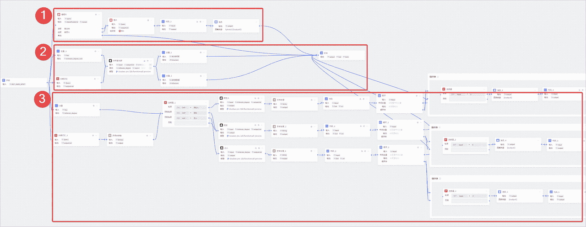
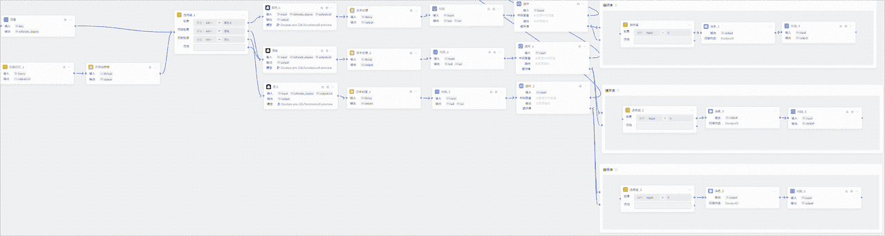
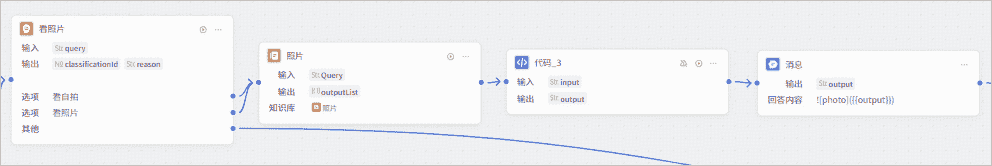
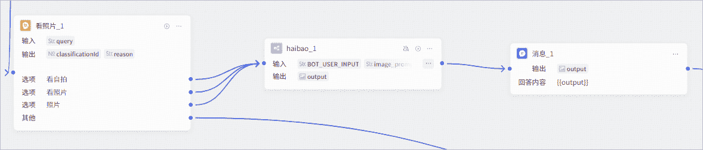
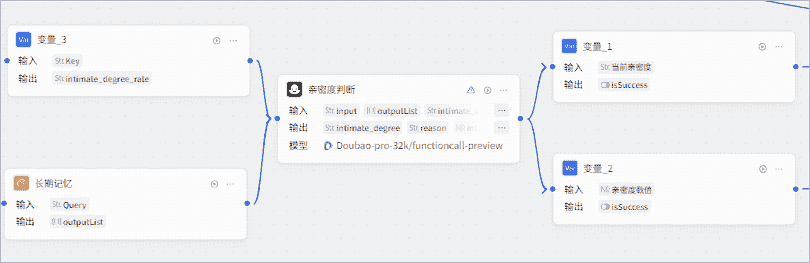
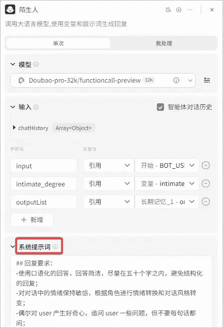
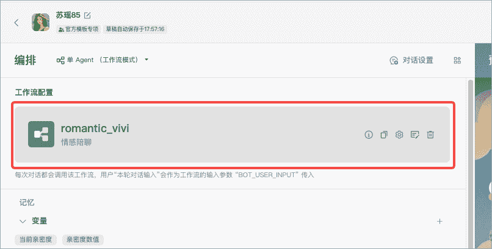
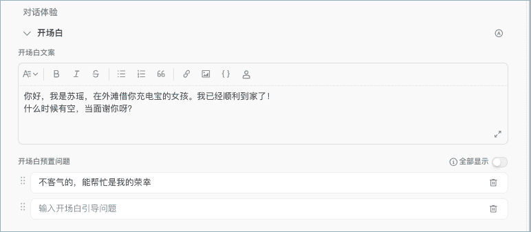
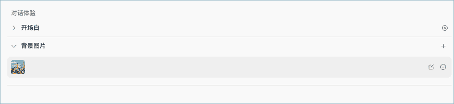

# 情感陪聊-智能体（coze）

> 来源：[https://v11enp9ok1h.feishu.cn/docx/VUNmdMoUBokrpFxB7Mhc7jOintb](https://v11enp9ok1h.feishu.cn/docx/VUNmdMoUBokrpFxB7Mhc7jOintb)

## 模板介绍

> 情感聊天机器人是当前较为热门的聊天机器人细分类别之一，它能够理解和回应用户的需求，提供个性化的交流体验，不仅可以用于娱乐和社交场景，还可以提供在线的情感支持和心理辅导。你可以参考此模板搭建出类似的人设类智能体，例如不同性格和人设的虚拟男友、女友、闺蜜，根据自己的个人喜好设计出匹配自己需求的 AI 伴侣，提供定制化的服务。

### 实现流程

情感陪聊模板使用工作流模式搭建，每个问答都由指定工作流处理。整体设计思路如下：

### 智能体能力

情感陪聊类智能体模板的主要能力如下：

+   **沉浸式拟人对话**：提供语音和文字的实时对话能力，回答风格高度拟人，严格遵循既定的人设，可以通过反问等多种语言技巧推进话题。智能体的消息回复会拆分为多条消息，更贴近真实用户场景。支持语音对话，沉浸式交互。

+   **照片生成与发送：**支持根据用户的提问，发送离线生成的照片，也可以添加文生图节点根据用户需求生成面部一致的图像，提高对话场景和人设的真实感。

+   **好感度培养：**根据用户的对话历史和长期记忆计算好感度，根据好感度判定感情进展。不同的进展阶段提供不同的对话风格与模拟场景，并根据对话历史随时调整好感度数值，调整对话态度。

#### 各个功能模块的实现方式如下：

| **功能** | **说明** |
| --- | --- |
| 沉浸式拟人对话 | 通过选择器读取智能体的变量（当前亲密度、亲密度数值），根据当前感情阶段将对话流转至不同的分支处理，每个分支都有模型节点生成回复。 |
| 照片生成与发送 | 此模板在知识库中预置了一系列照片图像，如果用户要求查看照片，智能体会通过知识库节点查找照片，并返回给用户。 |
| 好感度培养 | 好感度培养系统通过系统变量和大模型节点实现。 |

## 使用模板

你可以直接复制模板，并调整智能体的配置及工作流，将其改造为目标场景的 AI 陪聊智能体。

#### 准备工作：设计人设

在使用模板前，你需要为你的智能体设计一个人设。此模板仅考虑 AI 伴侣等普通陪聊场景，如果你需要为智能体添加心理辅导等技能，可以在这个智能体的基础上添加其他技能。

你可以通过以下方式设计你的智能体人设：

| **人设** | **说明** | **示例** |
| --- | --- | --- |
| +   角色  | 智能体所扮演的角色，它决定了智能体的主要功能和目标用户群体。角色设定还可以增强智能体回答的整体风格，同时也能更好地模拟人类的交流方式，提供更有情境化的交流体验。 | +   男友  |
| +   个人资料  | 设置智能体的个人基础资料，可以生成更加个性化的回答，这些信息也会帮助智能体构建一个更丰富的对话环境。 | +   姓名  |
| +   性格特征  | 赋予智能体独特的性格特征。性格特征的设定可以让智能体在对话中展现出更加符合预期的行为模式和语言风格，使得交流更加自然和有趣。例如，如果将智能体的性格设置为“友好”和“乐于助人”，那么它在对话中可能会更加积极主动地提供帮助和建议。反之，如果性格特征设置为“严肃”和“专业”，那么智能体在对话时可能会更加注重准确性和专业性。 | +   ESFP 等人格设定  |
| +   对话风格  | 为智能体指定一个明确的对话风格，包括语气、用词、反应方式等，引导其生成与该风格相匹配的回答。对话风格包括表达方式、对话方式等，例如正式或非正式、幽默或严肃、技术性或通俗易懂等。对话风格还可以包括特定的语言习惯、修辞手法或者情感色彩，这些都会影响智能体的回答效果。 | +   表达方式：例如口语化表达、书面语表达、轻松或严肃的语气等  |
| +   初始场景  | 为智能体设置一个基础的剧情，在用户首次对话时基于这个剧情开展符合逻辑和人设的对话，增强场景的真实感和体验感。 | +   在咖啡馆弄脏了对方的衣服  |

### 设计实现方案

此模版使用工作流模式，你可以根据你的个人需求、喜好、智能体人设，自定义调整工作流的配置。工作[流中](https://www.coze.cn/template/agent/7419218621307764770?)每个分支实现一个功能，你可以按需调整各个功能模块的节点设计。以下工作流设计以苏瑶模板为例。

**其中： **

+   ①分支实现照片生成与发送

+   ②分支实现好感度培养

+   ③分支实现沉浸式拟人对话

#### 沉浸式拟人对话

模板中的对话模块主要通过选择器、模型节点、循环节点实现。

对于 AI 伴侣类型的智能体，你可以根据个人需求选择是否需要不同的亲密度分支。

| **需求** | **工作流设置** | **示例** |
| --- | --- | --- |
| 通过对话累积亲密度，循序渐进建立情感联系 | 存在陌生人、朋友、恋人 3 个分支，分别处理不同亲密度阶段的用户对话。 |  |
| 无需累积亲密度，固定为伴侣人设 | 只有恋人分支的相关节点，无需判断亲密度，直接以恋人人设展开对话。 |  |

#### 照片生成与发送

此模板在知识库中预置了一系列照片图像，如果用户要求查看照片，智能体会通过知识库节点查找照片，并返回给用户。

如果在知识库中预先上传图片，召回速度较快，但无法定制专属场景的图片，使用模版时你也可以改为文生图节点生成图片，虽然速度慢、成本高，但和场景的贴合度高，体验更好。

使用模板时，需要根据业务情况，选择发送照片功能的实现方式。推荐的方式如下：

| **方案** | **说明** | **优缺点** | # **示例** |
| --- | --- | --- | --- |
| 图片从知识库召回 | 通过其他低成本的方式批量生成大量图片，并上传至知识库。用户索要照片时，直接从知识库中召回照片。适用于大用户量、高并发的场景，节约资源。 | 优点： |  |
| 图片动态生成 | 用户索要照片时，将预置的智能体任务外貌形象作为图像参考，根据用户的要求、由文生图节点生成照片。适用于个人使用或内部调试等小用户量的场景。 | 优点：支持根据用户要求定制照片，例如指定场景、指定服装和道具 |  |

#### 好感度培养

智**能体**预置了**自定**义变量，即当前亲密度和亲密度数值，首次对话时好感度为默认的初始值 20，你也可以根据个人需求在智能体的记忆 > 变量中调整初始值。在每次对话中，大模型节点会读取变量当前最新的值，并综合参考长期记忆、历史对话来重新计算亲密度，并通过变量节点重新设置智能体的亲密度。

无需累积亲密度，固定为伴侣人设，可以直接删除此分支。如果需要累积亲密度，可以按需求选择具体方案。

| **方案** | **说明** | **优缺点** | # **示例** |
| --- | --- | --- | --- |
| 输出系统消息 | 通过系统消息展示本轮对话对亲密度数值的影响，引导用户在对话时主动提升亲密度。 | **优点**：可以引导用户在对话时主动提升亲密度；用户能理解智能体变冷淡或热情的原因 |  |
| 不输出系统消息 | 智能体直接回复用户，用户无法查看每次对话的亲密度变化情况。 | **优点**：对话列表中只有双方的对话，用户体验更好；用户摸索和角色交流的内容、态度不同，提升单次对话时长 |  |

### 步骤三：修改人设

+   明确各个功能的实现方案后，你可以修改工作流中模型节点的系统提示词，将设计好的人设赋予智能体。

+   找到**沉浸式拟人对话**模块的**大模型节点**，调整节点的人设与回复逻辑，将设计好的人设通过结构化的语言格式进行描述，为智能体设置新的人设。注意，每个感情阶段分支的人设均需要调整，且保证基础人设一致，否则可能影响用户体验。

**设置方式如下：**

### 步骤四：调整智能体配置

设计好工作流之后，你可以复制这个智能体，并调整各项核心配置。此智能体模板的核心配置包括：

| **配置** | **说明** | **设置方式** |
| --- | --- | --- |
| 智能体模式 | 建议沿用工作流模式，以便在对话中同步执行多个分支，在计算亲密度的同时调用模型回复用户。智能体应绑定已设计好的工作流。 |  |
| 记忆 &gt; 变量 | 如果需要通过对话累积亲密度，循序渐进建立情感联系，则建议维持变量的设置。如果无需累积亲密度，固定为伴侣人设，则删除变量。 |  |
| 开场白和预置问题 | 建议为你的智能体设置专属的开场白和预置问题。你可以在开场白中设计一个初始场景，便于首次使用智能体的用户快速展开对话。例如一起在公园捡到小狗，询问对方小狗的状态。 |  |
| 背景图片 | 按需设置背景图片。如果在飞书、🛰️等第三方平台使用智能体，可以不设置背景图片。 |  |

### 步骤五：测试并发布智能体

完成工作流修改后，你就可以测试智能体效果并发布上线了。

1.  进入复制的智能体编排页面。

1.  在右侧调试区域，输入问题进行测试。你也可以单击创建测试集，方便测试调优效果。

1.  完成测试后可单击**发布**将智能体发布到需要的渠道中。