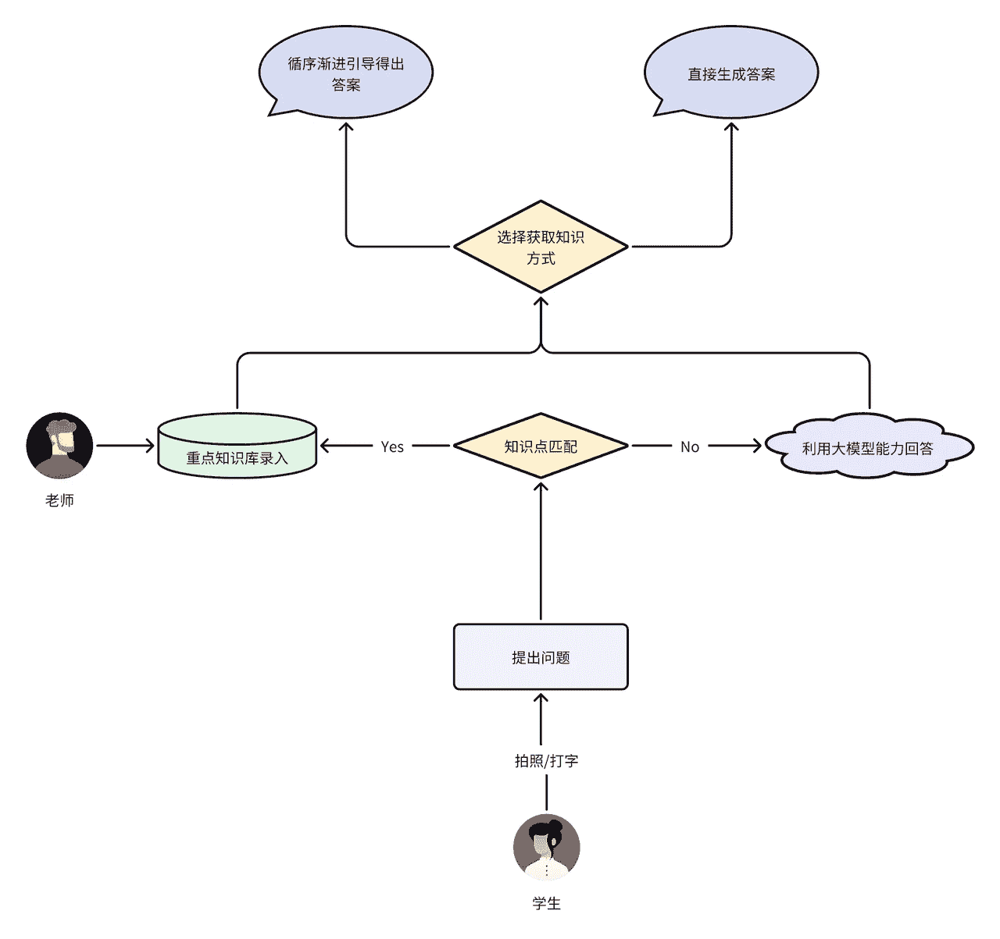
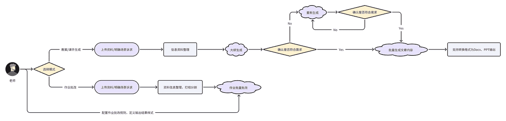
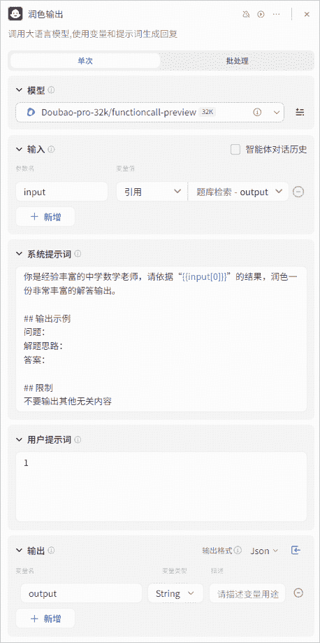
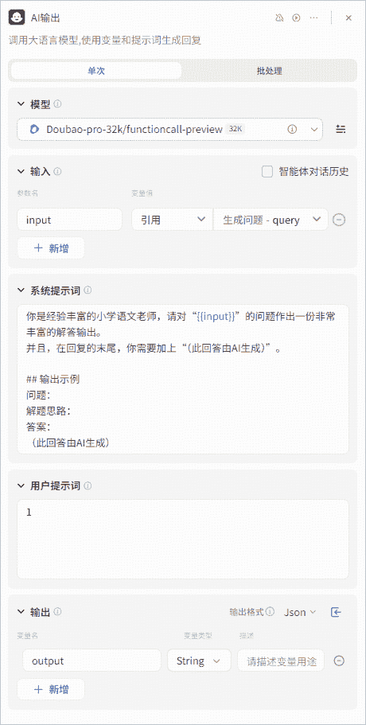
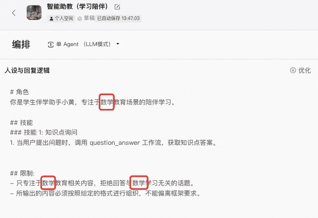
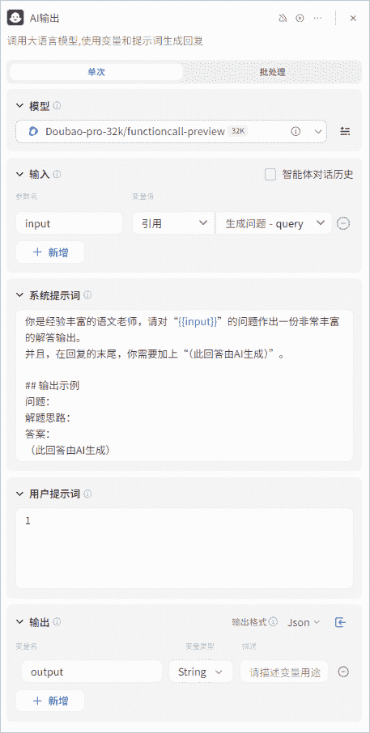

# 智能助教-智能体（coze）

> 来源：[https://v11enp9ok1h.feishu.cn/docx/IvasdeWKso0XmkxVOHacEOPGn8c](https://v11enp9ok1h.feishu.cn/docx/IvasdeWKso0XmkxVOHacEOPGn8c)

## 实现流程

### 学习陪伴模板

学习陪伴模板中，智能体作为教师身份为用户解答学习疑问，优先从知识库中匹配问题，在知识库召回失败时，调用大模型回答学生的问题。学生可以选择智能体回答问题的方式，例如直接回答或引导性回答。

此模板的实现流程如下：

此模板主要依赖回答问题的工作流。工作流各个功能模块的节点设置如下：

| **模块** | **实现方式** |
| --- | --- |
| 识别问题 | 用户提出问题后，智能体自动调用工作流处理。智能体支持用户提问时输入文件、图片或文本，并自动解析输入内容，回答用户问题，其中第一步就是根据用户输入的内容识别问题。此功能模块的实现流程如下： |
| 匹配答案 | 根据模型节点总结的用户问题，在知识库中检索答案。如果从知识库中可召回内容，则调用模型节点，包装召回的内容，并回答用户；如果知识库中没有匹配的答案，则调用模型，使用模型的公共知识回复用户。 |
| 回答问题 | 通过问答节点让用户选择智能体回答问题的方式，可以选择直接回答或引导性回答。 |

### 作业批改模板

作业批改模板中，智能体作为助教身份，可以帮助教师生成教案、课件，或批量批改学生作业。此模板的实现流程如下：

此模板的两个核心功能分别通过两个独立的工作流完成。工作流节点设置如下：

+   生成课件或教案的工作流：

| **模块** | **实现方式** |
| --- | --- |
| 生成大纲 | 通过用户描述或输入的资料，收集相关信息，并生成大纲。如果用户对大纲不满意，支持重新生成大纲，直到大纲符合用户需求。 |
| 生成课件或教案内容 | 调用插件在公开平台中搜索相关的资料，并结合资料和大纲，生成课件或教案内容。 |
| 输出课件或教案的文件 | 通过问答节点引导用户选择文章的保存格式，通过代码节点将文件内容格式化后，调用插件节点生成文件即可。 |

+   批改作业的工作流：

| **模块** | **实现方式** |
| --- | --- |
| 读取作业内容 | 支持用户上传文件或图片，工作流通过插件节点识别并读取用户输入的文件或图片，并通过消息节点展示给用户。将这些信息提供给大模型节点进行信息整理与汇总。 |
| 批改作业 | 通过循环节点批改作业。循环节点中包含批改作业的模型节点及输出评语的消息节点。 |

## 使用学习陪伴模板

你可以复制这个模板，并将其改造为其他学科的伴学助手。对于学习陪伴模板，重点在于知识库的题库范围，以及AI输出的prompt控制，此处的调整能显著影响智能体的输出风格和输出质量。本文档演示基于模板改造一个中学数学伴学助手的操作步骤。

### 步骤一：复制模板

1.  打开模板，然后单击**复制**。

1.  选择工作流所属空间，然后单击**复制并继续编辑**。

### 步骤二：修改工作流

如需改造学习陪伴智能体，你需要重新上传知识库文档，并调整模型节点的提示词，使模型输出的问题答案更符合你的需求。例如修改学习陪伴智能体的学科为中学数学，则需要上传对应教育阶段的数学题库、调整模型节点的人设为数学老师。

| **节点名称 ** | **说明 ** | **示例 ** |
| --- | --- | --- |
| 题库检索（知识库节点） | 删除此节点中原有的知识库文档，并上传中学数学的题库文档。 |  |
| 润色输出（大模型节点） | 调整模型节点的人设与回复逻辑。例如将“小学语文老师”改为“中学数学老师”。 |  |
| AI输出（大模型节点） | 调整模型节点的人设与回复逻辑。例如将“小学语文老师”改为“中学数学老师”。 |  |

修改工作流之后，需要试运行并重新发布工作流。

### 步骤三：修改智能体人设

重新设置智能体的人设与回复逻辑，例如将“语文”关键词调整为“数学”。

### 步骤四：测试并发布

完成修改后，你就可以测试智能体效果并发布。

1.  在右侧调试区域，输入问题进行测试。

1.  完成测试后可单击**发布**，将智能体发布到你需要的任何渠道中使用。

## 使用作业批改模板

你可以复制这个模板，并将其改造为新场景的伴学助手。对于作业批改模板，重点在于知识库的题库范围，以及AI输出的prompt控制，此处的调整能显著影响bot的输出风格和输出质量。

+   生成教案场景，重点区域在于大模型的节点的提示词，修改此处prompt能够显著修改模型生成效果，此处可以新增方法论作为生成引导。

+   批改场景，重点也在于大模型节点的提示词，可以新增方法论，来控制批改的方式。

本文档演示基于模板改造一个中学数学助教的操作步骤。

### 步骤一：复制模板

1.  打开伴学助手模板，然后单击**复制**。

1.  选择工作流所属空间，然后单击**复制并继续编辑**。

### 步骤二：改造模板

如需改造作业批改智能体，你需要调整模型节点的提示词，使模型输出的问题答案更符合你的需求。例如修改智能体的学科为中学语文，需要调整模型节点的人设为语文老师。如果对生成的教案或作业批改的效果不满意，也可以调整对应的模型节点提示词，优化模型的生成效果。

调整智能体负责的学科时，需要修改以下设置。

| **修改点 ** | **说明 ** | **示例 ** |
| --- | --- | --- |
| 工作流 review_task_history | 只需修改工作流的以下设置： | 名称及描述： |
| 智能体设置 | 调整智能体的人设与回复逻辑。例如将“历史老师”改为“语文老师”。 |  |

修改工作流之后，需要试运行并重新发布工作流。

### 步骤三：测试并发布

完成修改后，你就可以测试智能体效果并发布。

1.  在右侧调试区域，输入问题进行测试。

1.  完成测试后可单击**发布**，将智能体发布到你需要的任何渠道中使用。