# 生成卡通版海报-智能体（coze）

> 来源：[https://v11enp9ok1h.feishu.cn/docx/HvjpdKZqjo9Tx4xuxlZckFKlnWd](https://v11enp9ok1h.feishu.cn/docx/HvjpdKZqjo9Tx4xuxlZckFKlnWd)

## 智能体效果

你只需输入你期望生成海报的主副标题、背景、前景元素、卖点等信息，运营海报智能体即可快速生成对应风格和类型的海报，满足个性化的海报设计需求。

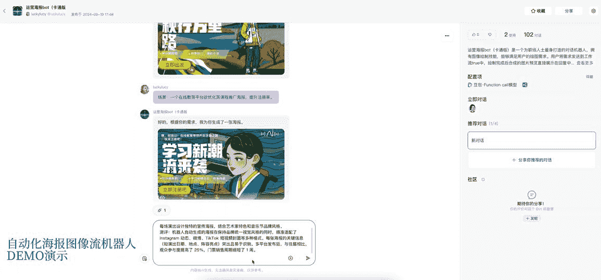

[81f0a5c8be4e4df4bc5daaa9b859f55f.mov](https://internal-api-drive-stream.feishu.cn/space/api/box/stream/download/all/Xi3mbo8XuoGogFxs0lTczLLmnQd)

## 智能体设计

运营海报智能体主要通过扣子的图像节点实现，开始节点设定输入参数用于捕获用户海报设计需求，图像生成、画质提升、智能抠图节点绘制海报的主体图像、前景元素以及背景图像，画板节点集成各海报设计元素并通过结束节点输出海报。

**设计如下：**

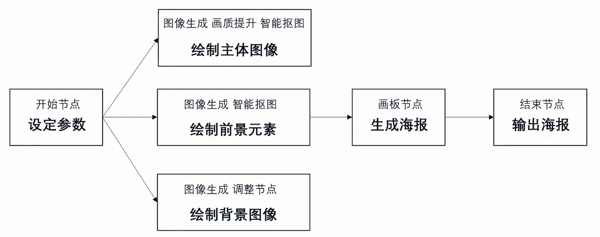

**编排如下：**

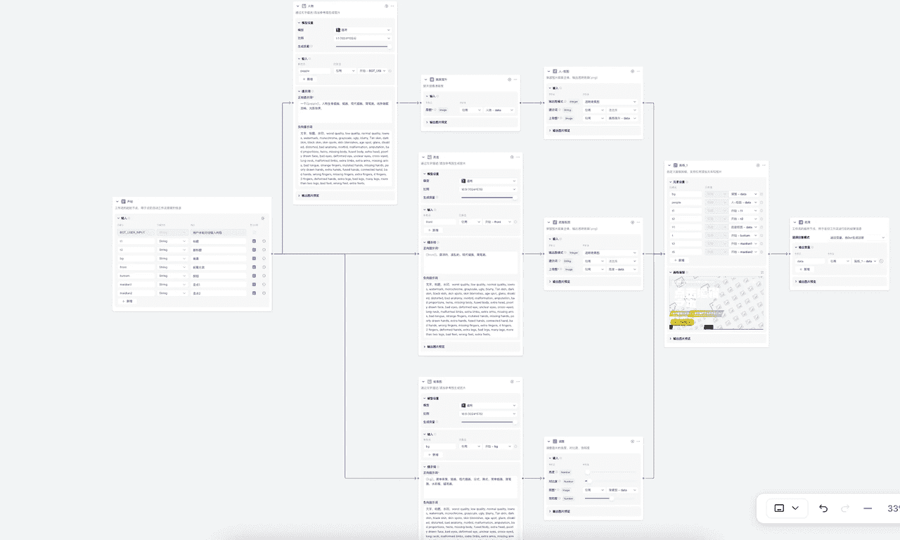

## 功能实现

### 设定参数

第一个节点是开始节点，在该节点设定输入参数用于捕获用户需求并进行初步解析，理解用户所期望的海报风格、内容主题等基本信息。开始节点参数设置如下：

+   t1：标题

+   t2：副标题

+   bg：背景

+   front：前景元素

+   bottom：按钮

+   maidian1：卖点1

+   maidian2：卖点2

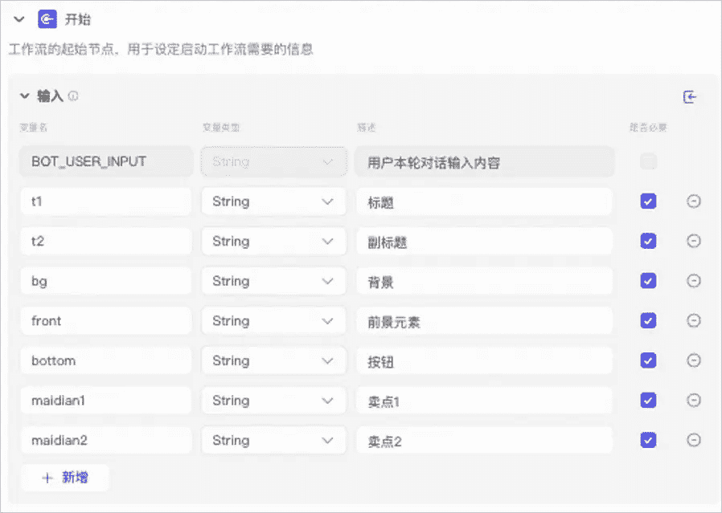

### 绘制主体图像

海报包含了主体图像、前景元素和背景图像，其中绘制主体图像可以通过图像生成、画质提升、智能抠图节点完成。

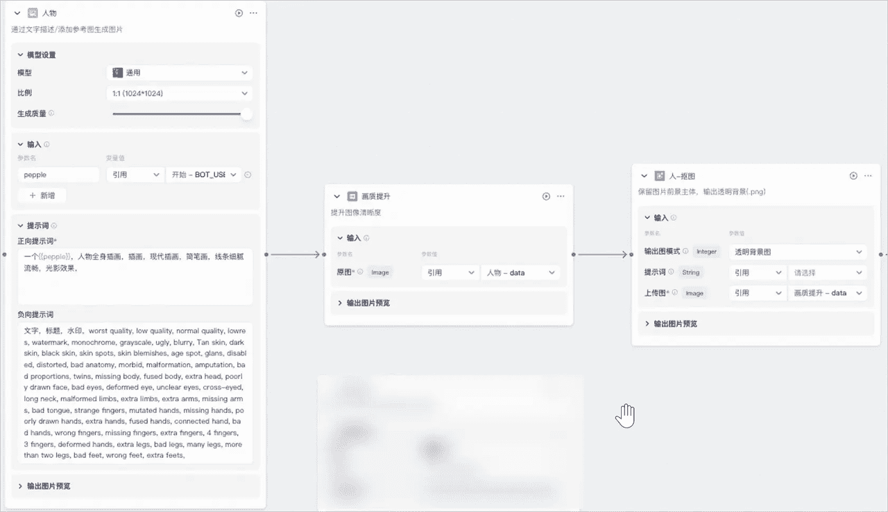

# 其中：

+   **图像生成：**图像生成根据开始节点的参数输入，自动生成主体（人物）图像。

+   **画质提升：**对图像生成输出的主体（人物）图像进行画质提升，确保卡通形象主体清晰。

+   **智能抠图：**对画质提升后的主体（人物）图像进行抠图处理，确保卡通形象的边界清晰，无背景图。

### 绘制前景图像

绘制前景元素可通过图像生成和智能抠图节点完成。

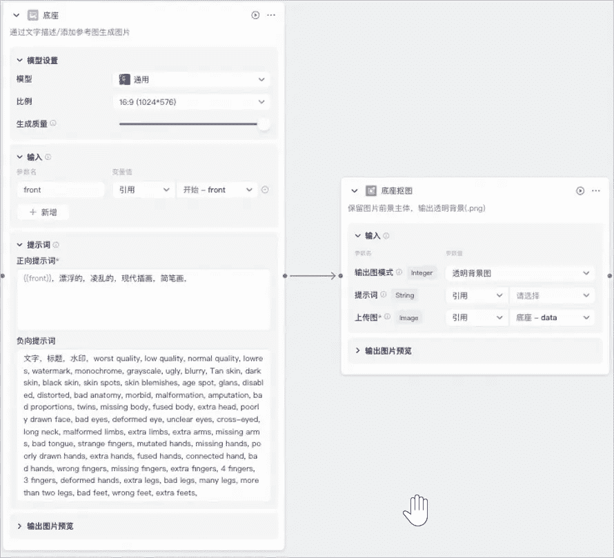

# 其中：

+   **图像生成**：图像生成根据开始节点的参数输入，自动生成前景元素图像。

+   **智能抠图：**对生成后的前景元素图像进行抠图处理，确保卡通形象的边界清晰，无背景图。

### 绘制背景图像

绘制背景图像可通过图像生成和调整节点完成。

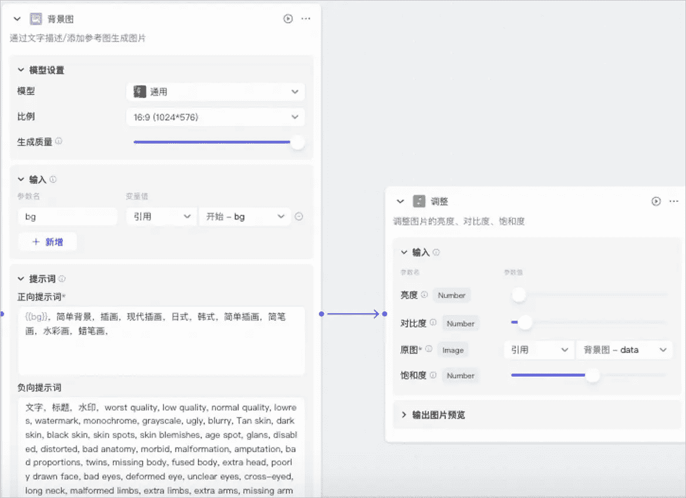

# 其中：

+   **图像生成：**图像生成根据开始节点的参数输入，自动生成前景元素。

+   **调整：**对生成后的背景图像进行饱和度、对比度、亮度等调整。

### 生成海报

通过画板功能，引用上游节点的输出，并设置元素的图层、尺寸、颜色、透明度，使海报整体设计达到个性化水平。

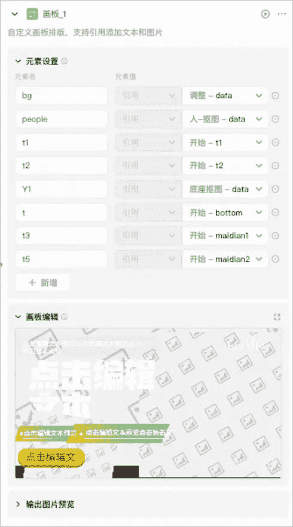

| **画板配置** | **说明** | **示例** |
| --- | --- | --- |
| **设计元素的即时预览与调整** | 输入简要指令后，画板立即响应，根据解析出的变量（如卡通主体、背景、前景等），快速生成初步的海报布局。 | 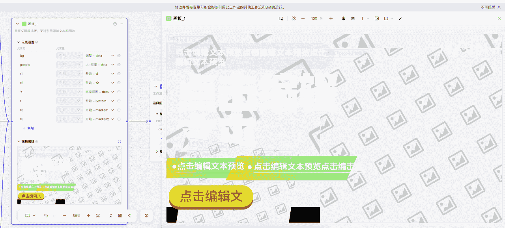 |
| **调整布局** | 将被选中的元素置于画板上，并充分考虑其大小、位置以及层次关系等因素。 |  |
| **编辑元素** | 对每个元素进行适当的调整和编辑，可以改变元素的颜色、大小、透明度等属性，以达到更好的视觉效果。例如调整卡通主体的颜色使其更加鲜明，或者调整主标题的字体和大小以增强可读性。 | 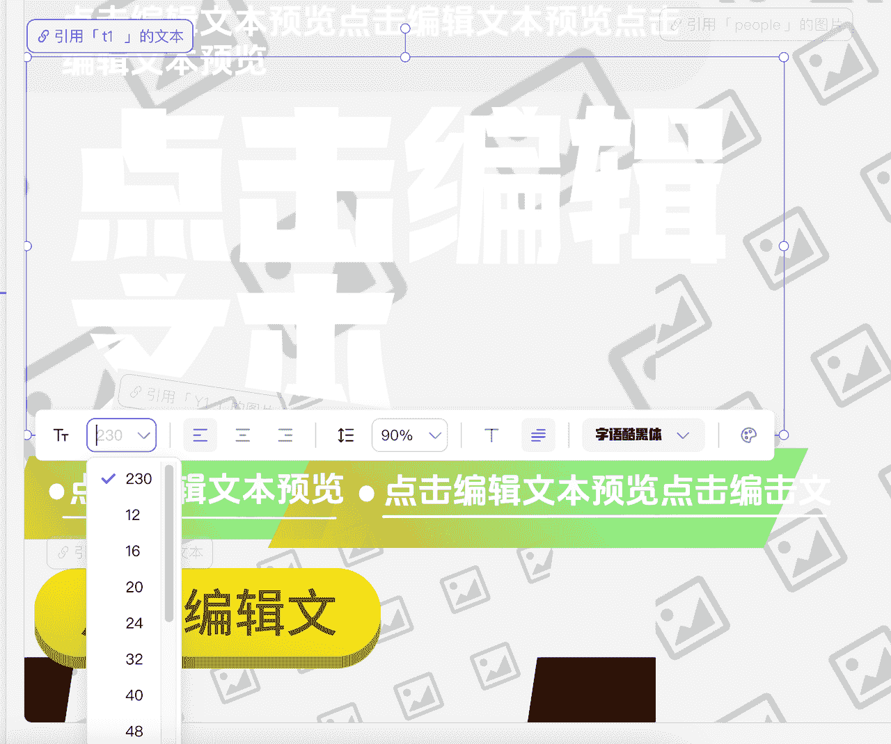 |
| **组合与协调** | 确保各个元素之间相互协调，形成一个统一的整体。颜色搭配要和谐，风格要一致，元素之间的比例要恰当。可以通过调整元素的位置和大小来实现平衡和对称。 | 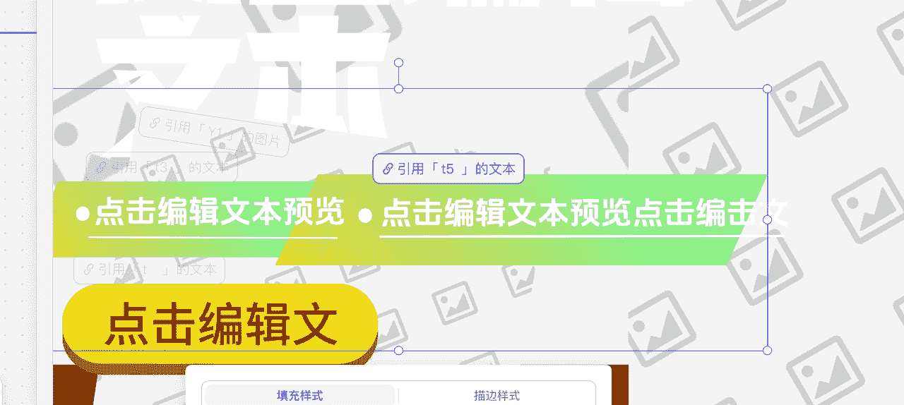 |

### 输出海报

结束节点引用画板节点的输出即可。

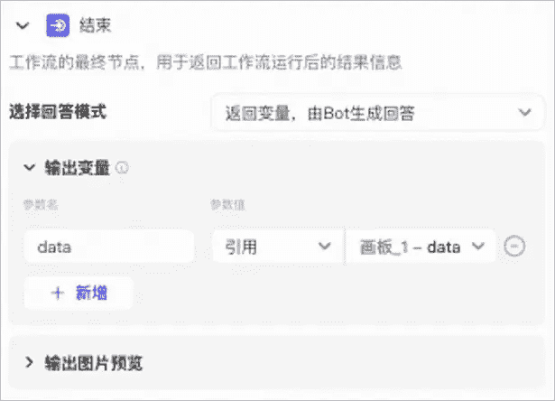

## 评测

| **案例** | **场景与测评说明** | **示例** |
| --- | --- | --- |
| 节日促销活动快速响应 | 场景：节日临近，某电商运营团队需要在短时间内设计出一系列促销海报，覆盖不同商品类别。 |  |
| 目标市场个性化海报 | 场景：一款新上市的健身 APP 需要针对不同地区的用户推出宣传海报，要求设计贴合当地文化。 |  |
| 多渠道适应性设计 | 场景：一家旅游公司计划在多个社交媒体平台推广其秋季旅行线路。 | 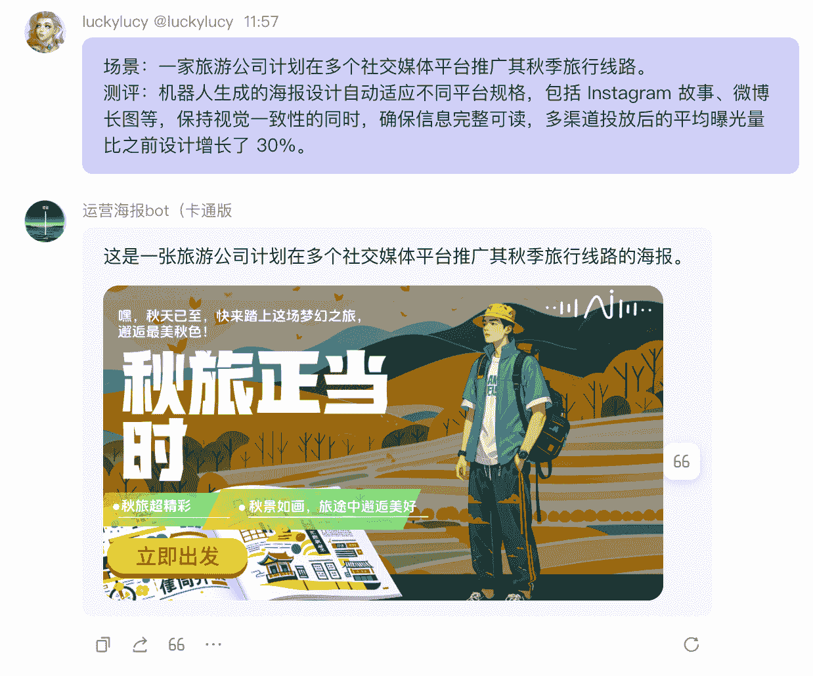 |
| A/B 测试驱动设计优化 | 场景：一个在线教育平台欲优化其课程推广海报，提升注册率。 | 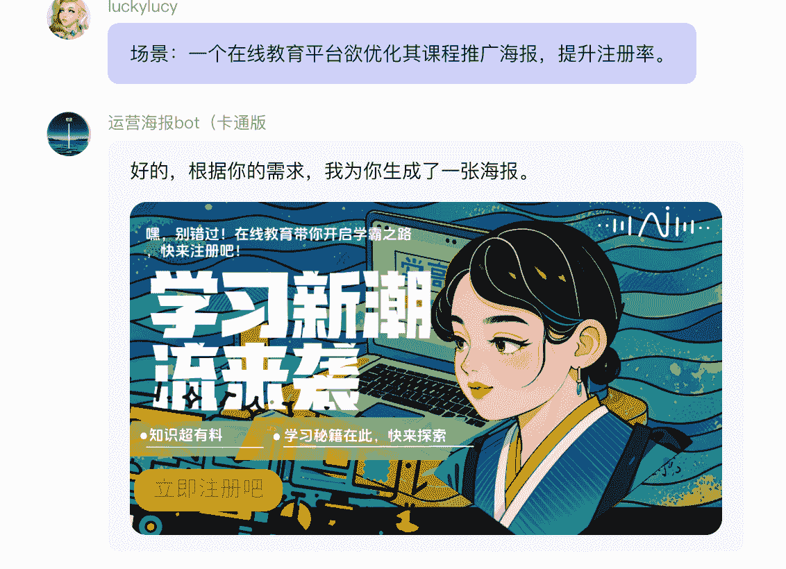 |
| 实时热点事件响应 | 场景：体育赛事期间，体育用品零售商希望快速推出与赛事相关的限时促销海报。 |  |
| 品牌一致性维护 | 场景：一家连锁咖啡店要在全国范围内推出新品，需要保持品牌形象的一致性。 |  |
| 定制化用户互动海报 | 场景：音乐节活动策划，希望在社交媒体上发布用户可个性化编辑并分享的海报。 | 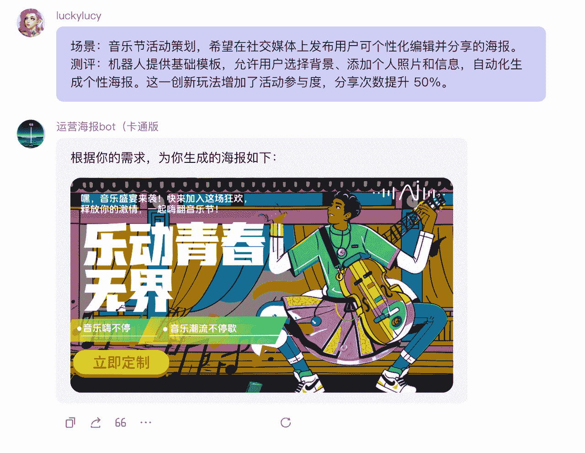 |