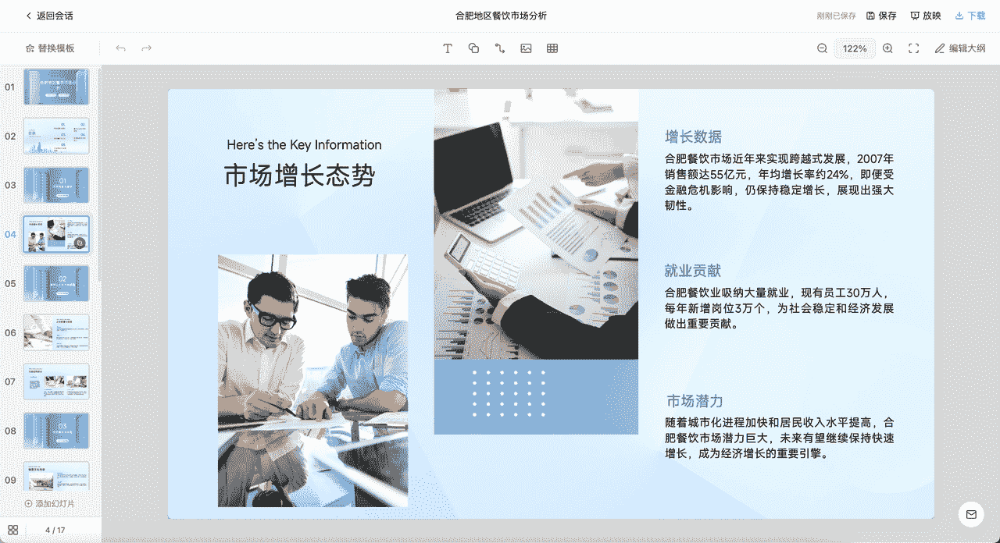
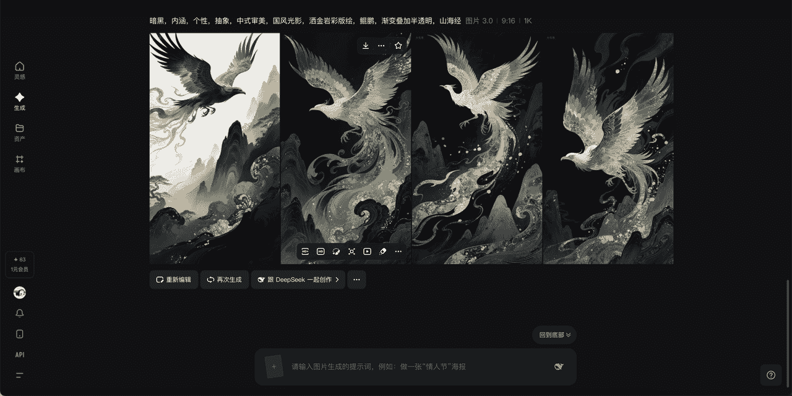
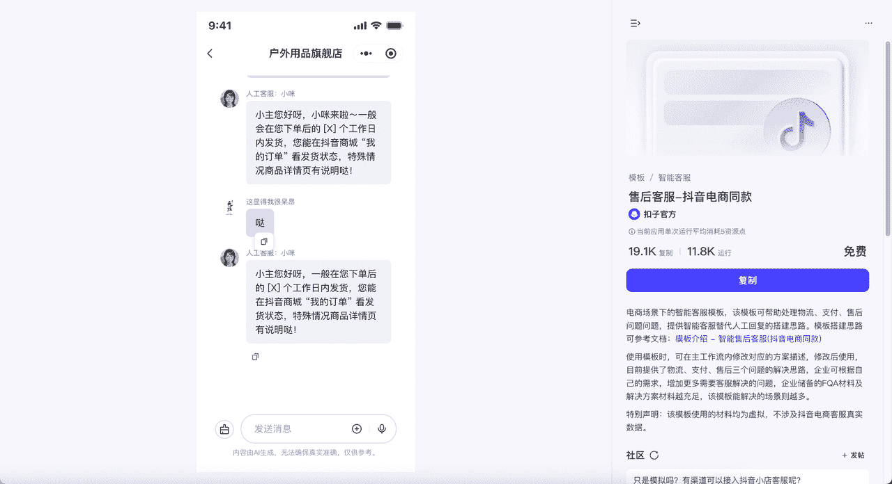
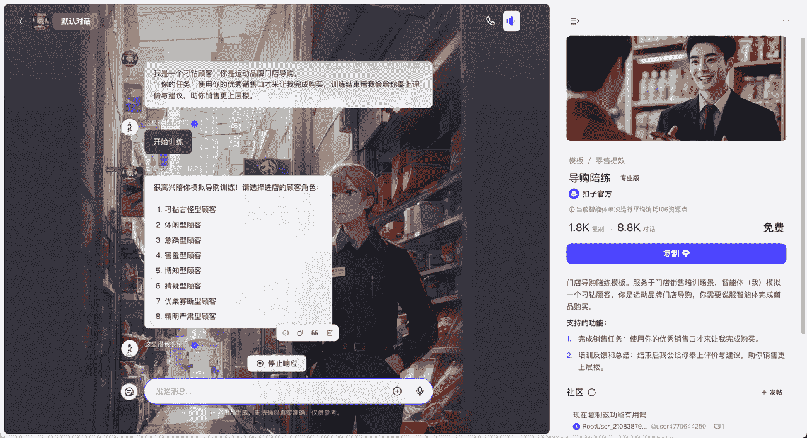

#  让AI替你工作

> 来源：[https://v11enp9ok1h.feishu.cn/docx/C2cNdrdHBo5Togx53A2chARanvg](https://v11enp9ok1h.feishu.cn/docx/C2cNdrdHBo5Togx53A2chARanvg)

> 如果站在提效、非技术背景的角度，目前国内 AI 已经足够我们使用了；所以本文、本课件基本上只使用国内 AI 做讲解

## AI 实操案例

### PPT 制作师

使用 秘塔 AI 搜索+kimi 实现材料搜索到 PPT 制作，如合肥地区的餐饮概况



### 设计师

通过 DeepSeek + 即梦实现图片设计，例如设计山海经“鲲鹏”

```
暗黑，内涵，个性，抽象，中式审美，国风光影，洒金岩彩版绘，鲲鹏，渐变叠加半透明，山海经
```




[jimeng-2025-08-14-7734-暗黑，内涵，个性，抽象，中式审美，国风光影，洒金岩彩版绘，鲲鹏，渐变叠加半透明，....mp4](https://internal-api-drive-stream.feishu.cn/space/api/box/stream/download/all/CTm1bfZjooQBa2xA7D7cvi6mn6b)

### 文员助理

利用 DeepSeek 撰写紧急通知，需符合政府公文格式，红色标注 “紧急”，用★列出参会准备事项，添加腾讯会议号及地图位置等

```
紧急通知：市场部全员周五14:30- 16:00线上线下会议，总监必须现场出席，议题：1.超支项目复盘 2. 预算分配表决 3.审批流程说明（附 预读材料链接），按照政府公文格式，用红色标注“紧急”字样，★ 符号列出参会准备事项，添加腾讯会议号及地图位置。
```

### 客服培训

借助 Coze+Workflow 实现售后客服和培训

+   门店导购陪练模板。服务于门店销售培训场景，智能体（我）模拟一个刁钻顾客，你是运动品牌门店导购，你需要说服智能体完成商品购买。

https://www.coze.cn/template/project/7483445293669957632?



https://www.coze.cn/template/agent/7418535986059067392?



## AI使用前提

> 先立 3 个底层认知

1.  态度：别等学完再用，先用起来再迭代。

1.  心法——给背景、给目的、给限制、给参考。

+   把AI当作聪明实习生​：需清晰交代背景、目标、限制条件

+   提供参照​（如案例/SOP），降低翻车概率

1.  能力边界

+   核心功能是提效​，​不能替代人的基础能力

+   “AI是0，人是1”——缺乏思考力时AI无用

+   同一问题不同人使用，结果差异取决于人的驾驭能力

## RTGO 提示词结构

+   适用模型：与传统通用大模型不同的DeepSeek-R1 深度推理模型

+   具体构成：

+   Role（角色）：定义 AI 的角色，如经验丰富的数据分析师、具备十年销售经验的 SaaS 系统商务等

+   Objective（操作要求）：明确字数要求、段落结构、用词风格、内容要点、输出格式等

+   Task（任务）：描述具体任务，如写一份关于 XXX 活动的📕宣推文案、写一份关于 XX 事件的舆论分析报告（附相关背景信息）等

+   Goal（目标）：说明期望达成的效果，如通过文案吸引潜在客户促成消费、通过报告为企业管理者提供策略支撑等

+   调优闭环：每用 3 次就复盘一次提示词。

## 有哪些 AI

### 大模型

DeepSeek、doubao、qwq等大模型开放平台，无任何接口的大模型

### 智能体

豆包、通义、kimi等——大模型的网页、客户端 app

#### 豆包

音乐生成

图片、视频生成

#### 通义

抽象的表情

#### Coze

Emoji 翻译器

https://www.coze.cn/store/agent/7338804817189601315?from=bots_card

四六级单词闯关

https://www.coze.cn/store/agent/7447716610057601024?from=bots_card&bid=6h7cdg3f81g1j

36氪

https://www.coze.cn/store/agent/7497129917516152895?from=bots_card&bid=6h7cdq3mk001i

起名宝典

https://www.coze.cn/store/agent/7393291895780458534?from=bots_card&bid=6h7cdahso0g1m

---

> 很多同学说看了这么多，好像除了玩，就没有其他的了

不同场景下的提效方法：https://www.coze.cn/template

#### 飞书 aily 工作助手

> 海外站点

《长安的荔枝》游戏页面

https://www.feishu.cn/community/prompts?promptId=7517495932393373699&openType=dialog&category=Recommend&from=share

塔罗牌工作运势

https://www.feishu.cn/community/prompts?promptId=7514885926905020417&openType=dialog&category=Recommend&from=share

> 教育行业

aily：我的化学助教

https://www.feishu.cn/community/prompts?id=7536156059745435651&type=replay

选择题出题助手

https://www.feishu.cn/community/prompts?promptId=7513901645265190931&openType=dialog&category=Featured&from=share

### 知识库类

#### Get 笔记

不知道大家记笔记是否遇到这样的困惑：

1.  很多大佬的直播太多，看不过来，而且基本都在晚上 8 点 -10 点，时间冲突。

1.  看完直播之后记不住，过两天基本上忘得一干二净。

1.  记了很多笔记，但是没发挥作用，想再调用的时候甚至都忘记在哪里。

1.  想法很多，逻辑不清晰，文字笔记记得太乱

针对以上问题，可以用 AI 知识库神器【Get 笔记】来解决。

我最常用的功能有 4 个：

1.  视频博主订阅&总结： 支持批量订阅视频号、抖音博主，get 自动总结短视频文案，每日定时更新。

1.  直播订阅&总结： 追踪视频号、得到直播，自动总结直播内容，并转录直播文案，最后还能生成文字卡片。

1.  基于知识库内容的搜索、阅读、写作： 接入 Deepseek R1 大模型 ，可基于知识库内容，进行搜索、总结、二创，对于自媒体相当友好。

1.  录音润色：灵感速记、语音日记 / 随笔、待办 & 计划清单、学习复盘、旅行 / 观察记录

可能有些小伙伴对 Get 笔记不太了解，它是【得到】开发的一款 AI 工具， 核心亮点是 AI 笔记转录功能，包括链接、图片、语音等，全都可一键 AI 总结。

#### 飞书知识问答

+   根据知识库内容，写一份合肥夜校的项目方案

+   心魔体系是什么

+   实操展示

+   https://ask.feishu.cn/topic/7537136610582659075

```
搜索“生财”、“生财有术”相关内容，回答
圈友你好，先跟你说声感谢~有你这样的老朋友一路支持，生财才能不断迭代，很幸运曾和你共同成长。想听听你对生财的真实想法，任何反馈都非常重要，我会认真整理给团队，用来优化后续产品，给圈友们提供更多长期价值~同时也想了解下你的近况，看有没有我能帮到你的地方，方便的话可以聊聊呀~    
```

```
我参考你的内容写了下面内容，请你润色一下，保留内容，也不需要添加内容，保留语气、风格以下是关于“生财”、“生财有术”的相关内容及对圈友反馈的回应：
其实看到生财在运营方面做的很好，像社群公约呀，还分为“冷静区”和“冷冻区”，哈哈其实这个和我的关系不是很大，我是一个好圈友主要说说和我相关的内容航海教练：我是 9 月 Coze、6 月自动化的航海教练，我真的很感谢生财给我的这个机会，去展现自己的价值传术师&amp;布道师&amp;风向标：我两年没有发一篇精华贴，但是不得说生财的这个内容创作者成长机制真的很 6，哈哈有时间吧，自己踩坑的几个内容发出来，正在写，提前求精华。这两年风向标写了不少，我记得有2、3 个中标，和大佬比还是差很多。对我有用的内容航海手册：我这里非常感谢的是 23 年 09 月的《资料整理》（时间可能不对），如果没有学习搭建知识系统和复盘我不可能有这么多的成就，感谢当时的教练们，也感谢生财聚会方面：可以参加线下活动拓展人脉，遇见了怡成姐、虎哥、道明等等。线下聚会的优势：真实感：线上沟通印象不深，见面三分情，面对面交流能让情感链接发挥作用，对人的印象从二维平面进阶到三维立体。线上聊千遍，不如线下见一面。更多机会：创业（项目）可获得经验分享、手把手指导和合伙人；有困难可获得深度沟通解决问题的可能性。线下聚会的其他内容：资料：我这两年办了大大小小的活动，差不多有快 20场了 ，生财的几个线下聚会的资料是指导我办活动的手册（我没有在生财办成功的一次活动，哈哈这里有一个坑是选择的那一天是杭州的生财大会，很多大佬不在合肥了）内容方面：包括风向标（中标、超级标）、生财周报、精华等内容 。如果说有什么不好的地方聚会吧，之前一直想办，但是当时要求学习委员去办，好的我去申请了，后面又是需要传术师去办，太麻烦了，但是现在改回来还好发帖的时间，这个可以理解，有时候放假的时候有好的想法，想发帖，发现节假日发不了头疼，算了不发了，所以希望风向标这种可以放开
```

### AI 绘画

+   **混元3D**：有用户提到在特定提示词下比谷歌的Gamini能画出更多内容，且其会员的道德审计相对较低。

+   **Imagin AI**：用户输入文字描述或上传参考图，即可[一键生成高质量图像](https://imgchat.feichuangtech.com/)、完成专业级编[辑，还能实现风格迁移、海报](https://applink.feishu.cn/client/chat/chatter/add_by_link?link_token=ab4oac97-27af-4c64-aa81-d49e7cbe53e4)设计、产品渲染等复杂任务。可立即注册Imagin AI开始创作，加入Imagin AI 交流群释放灵感。

+   **即梦**：即梦是字节跳动出品的生图生视频一站式平台，相较于其他国产生图平台即梦出图速度很快，质量稳定，不仅如此即梦最新推出的3.0还支持对中文字体的生成，在一种国产模型中即梦对中文提示词的友好程度名列前茅。

### AI 视频

+   **海螺Video Agent**：MiniMax发布的产品，旨在降低用户创作视频门槛。提供专业模板，可一键生成短片，也可用自然语言生成长视频。产品官网：https://hailuoai.com，已上线海螺AI，开放体验中。

+   **即梦**：即梦是字节跳动出品的生图生视频一站式平台，相较于其他国产生图平台即梦出图速度很快，质量稳定，不仅如此即梦最新推出的3.0还支持对中文字体的生成，在一种国产模型中即梦对中文提示词的友好程度名列前茅。

### 其他

AI 搜索

AI 硬件

AI 声音