# Coze 全方位入门剖析 - 免费打造自己的 AI Agent (国内版)

> 来源：[https://v11enp9ok1h.feishu.cn/docx/HfWad2j0RoPuXOx2Ltrc4cTbnyg](https://v11enp9ok1h.feishu.cn/docx/HfWad2j0RoPuXOx2Ltrc4cTbnyg)

**最近一直在倒腾各种有关 AI 的东西，发现很多人对于 AI 的认识还停留**在“AI 是未来的趋势”、“AI 是未来的方向”、“AI 是未来的发展”等等，但是对于 AI 的具体应用和实现却是一知半解。碰巧，最近我心心念念关注的一个由抖音推出的 AI 产品“Coze”国内版正好正式发布了，这次的介绍可以帮助大家更好地了解 AI 的应用和实现。

可以**这么说，Coze 个人认为是一个目前可以真正打通 AI 从研发技术领域到终端用户的**闭环产品，你可以当作它就是一个微信公众号的小程序功能，但是它的功能却远远超出了小程序的功能。它可以帮助你实现自己的 AI 产品，而且是免费的，即使是完全不懂编程的小白，也可以通过它来实现自己的 AI 产品和应用，直接可以通过平台对接对接到微信、飞书等主流平台上。

所以，本文将从 0 到 1 全方位入门剖析 Coze，希望能够帮助大家更好地了解 AI 的应用和实现，也希望能够帮助大家更好地了解 Coze 的功能和使用方法，而且我还会基于 Coze 的功能，实战演示创建一个属于自己的 AI bot，大家可以直接手把手跟着做，不到一下子就可以拥有一个属于自己的 AI 产品了。

## 全文重点

+   Coze 里面**所有的功能都是免费的**，不需要任何费用，所看即所得；

+   免费功能之余还**涵盖丰富主流第三方插件、知识库、数据库、工作流设计、**预置 AI Bot、性能监控与优化等功能，这是目前网上其他平台所无法比拟的；

+   **Coze 也是一个**非常适合小白的平台，不需要任何编程基础，只需要会使用电脑就可以了；

+   Coze 国内版可以直接对接发布到微信、飞书等主流平台，国外版可以直接对接到 Facebook Messenger、Slack、Telegram 等主流平台上；

+   国内版目前只能支持使用“**云雀大模型**”作为对话引擎，**国**外版可以支持使用“GPT 3.5/GPT 4”大模型作为对话引擎，而且还是完全免费，没有限制，你没听错，是 GPT 4 使用完全免费！不过国内目前是不能访问的，需要一些黑魔法；

+   Coze 还有自己的手机端，可以方便用户通过手机端 APP 来分享自己的 AI 应用，大大提高用户的使用体验和产品裂变的可能性；

## 核心功能详述

扣子（Coze）AI Bot 开发平台，作为一个新兴的 AI 技术工具，旨在为开发者提供一个强大的、易于使用的平台，以便快速构建和部署智能聊天机器人。这个平台的市场定位是服务于那些希望在客户服务、市场营销、数据分析等领域利用人工智能技术的企业或个人开发者。

### 插件系统

平台**提供了丰富的内置插件**，这些插件涵盖了从文本分析到图像识别等多种功能。开发者可以根据需要选择和组合这些插件，以实现特定的业务逻辑。此外，平台还支持自定义插件和 API 的开发，极大地扩展了 AI Bot 的功能范围。

#### 内置插件的种类和数量

扣子平台提供了一个多样化的插件库，这些插件涵盖了从基础的文本处理到高级的机器学习功能。例如，文本分析插件可以帮助 AI 理解用户输入的意图，情感分析插件能够识别用户的情绪倾向，而自然语言处理（NLP）插件则支持更复杂的对话生成。此外，还有图像识别、语音识别、数据分析等插件，这些插件的数量和种类不断增加，以适应不断变化的技术趋势和市场需求。

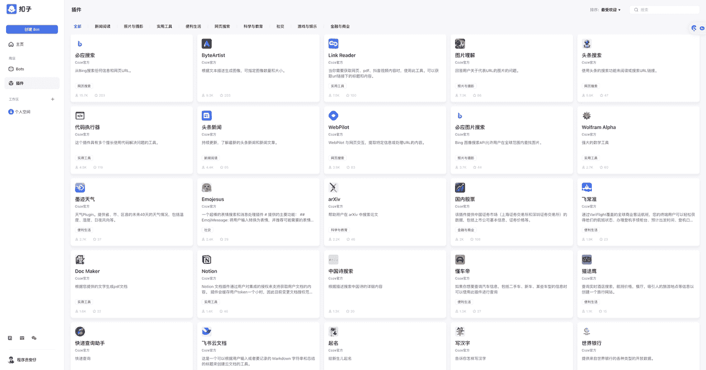

你居然想不到，Coze 这次还把一些更加符合平民生活化的插件也直接整合进来了，比如：

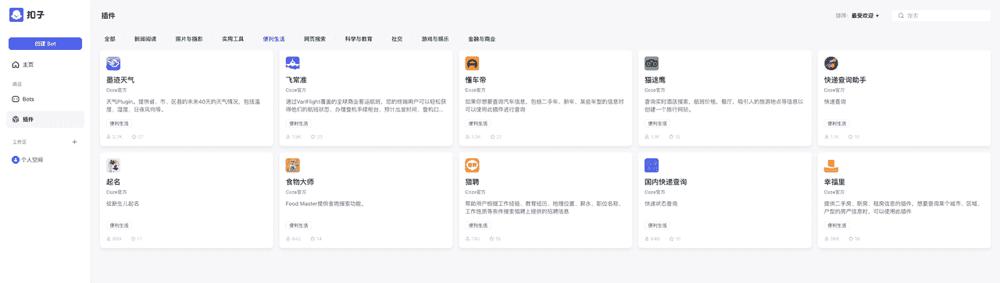

+   新闻资讯

+   **头条新闻**：持续更新，了解最新的头条新闻和新闻文章。

+   天气预报

+   **墨迹天气**：提供省、市、区县的未来 40 天的天气情况，包括温度、湿度、日夜风向等。

+   出行必备

+   **飞常准**：通过 VariFlight 覆盖的全球商业客运航班，您的终端用户可以轻松获得他们的航班状态、办理登机手续柜台、预计出发时间、登机口、登机状态、行李转盘等信息，并能在整个航程中随时掌握。

+   **猫途鹰**：查询实时酒店搜索，航班价格，餐厅，吸引人的旅游地点等信息以创建一个旅行网站。

+   生活便利

+   **快递查询助手**、**国内快递查询**：查询快递单号，快递公司，快递进度等信息。

+   **食物大师**：Food Master 提供食物搜索功能。

+   **懂车帝**：如果你想要查询汽车信息，包括二手车、新车、某些车型的信息时可以使用此插件进行查询。

+   **幸福里**：提供二手房、新房、租房信息的插件，想要查询某个城市、区域、户型的房产信息时，可以使用此插件。

+   **猎聘**：帮助用户根据工作经验、教育经历、地理位置、薪水、职位名称、工作性质等条件搜索猎聘上提供的招聘信息。

这些生活化的插件，可以让你的 AI bot 变得贴近生活，贴近用户的需求。

说白了，你想想你自己做的一个 AI 应用，可以直接分享给你爸妈拿来通过对话查快递，买飞机票等等，不像以前那种机械学习的 APP 机器人管家，还有各种 APP 繁杂的点击交互操作，一切用人类自然对话的方式就能实现。

#### 自定义插件开发

为了满足特定需求，扣子平台还允许开发者创建自定义插件。创建流程设计得非常用户友好，通常包括以下几个步骤：

1.  **需求分析：** 开发者首先需要明确插件需要实现的功能。

1.  **设计接口：** 设计插件的输入输出接口，确保与其他插件和平台的兼容性。

1.  **开发实现：** 使用平台提供的 SDK 或 API 进行插件的编码工作。

1.  **测试与调试：** 在开发环境中测试插件，确保其功能正确无误。

1.  **部署上线：** 将插件部署到生产环境，与 AI Bot 集成。

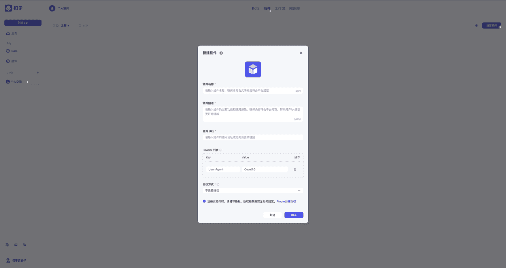

整个流程中，扣子平台提供了详细的文档和开发者支持，帮助开发者快速上手并解决遇到的问题。这是目前的官方文档介绍：

[https://www.coze.cn/docs/](https://www.coze.cn/docs/guides/create_plugin)guides/create_plugin

如果大家有兴趣深入了解，我可以在之后再出一篇详细的上手指南，毕竟这个比较硬核，需要一些编程基础。

### 知识库与数据库

扣子平台**内置了强大的知识库功能**，允许开发者上传和维护大量的数据，这些数据可以用于训练 AI Bot，使其能够更准确地理解和回应用户的需求。同时，平台还具备数据库记忆能力，可以存储和检索用户的交互历史，以提供更加个性化的服务。

#### 知识库功能

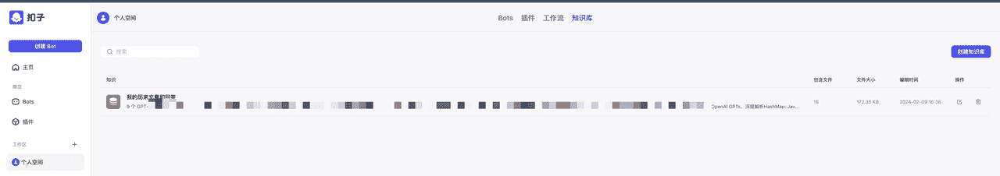

+   **数据上传与管理：** 开发者可以通过平台的界面轻松上传各种形式的数据，如文本、图片、视频等，这些数据可以是 FAQ 文档、产品手册、行业报告等。平台提供了直观的编辑工具，使得数据的整理和分类变得简单高效。

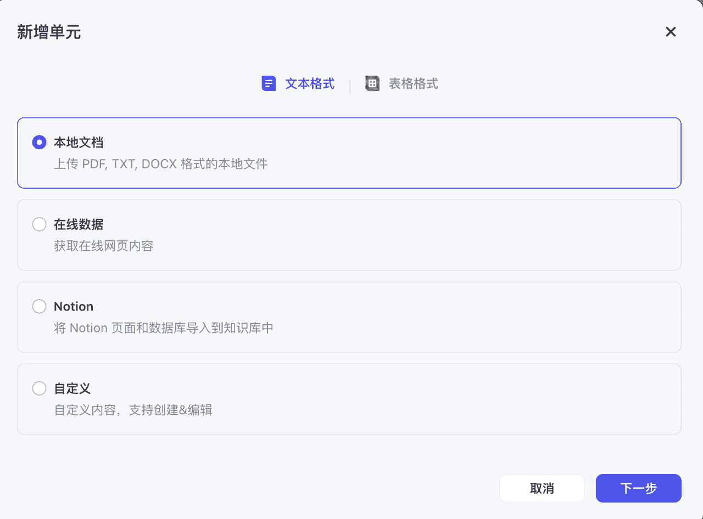

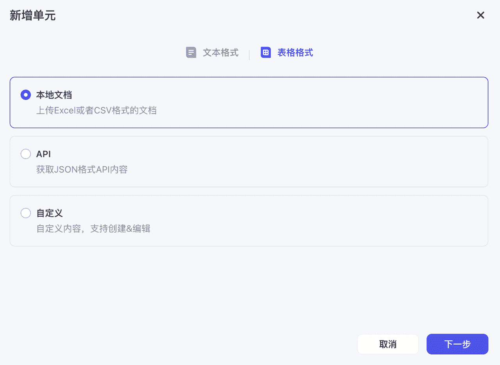

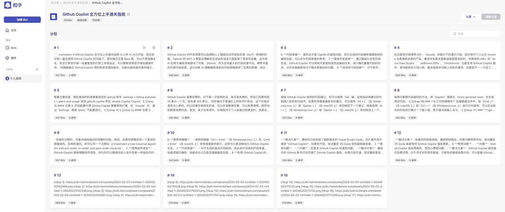

+   **训练与优化：** 上传的数据被用于训练 AI Bot，使其能够更好地理解用户的问题并提供准确的回答。平台的机器学习算法会分析这些数据，学习其中的模式和关联，从而提高回答的准确性和相关性。

+   **实时更新：** 知识库支持实时更新，确保 AI Bot 获取到的信息是最新的。这对于需要频繁更新信息的行业（如金融、法律等）尤为重要。

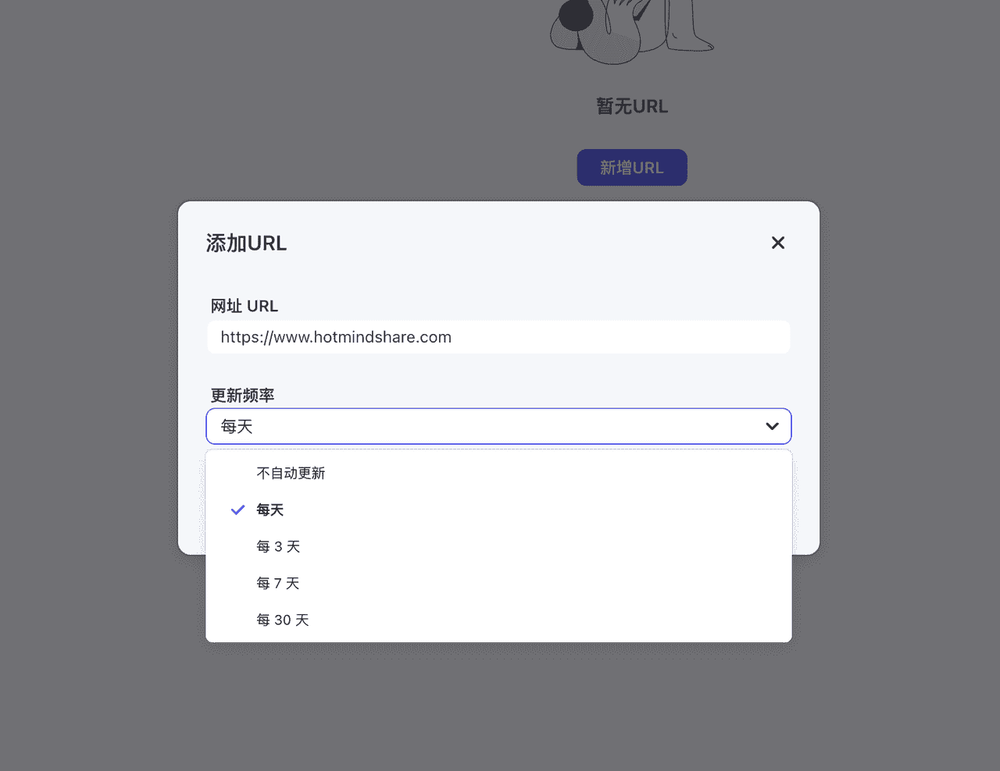

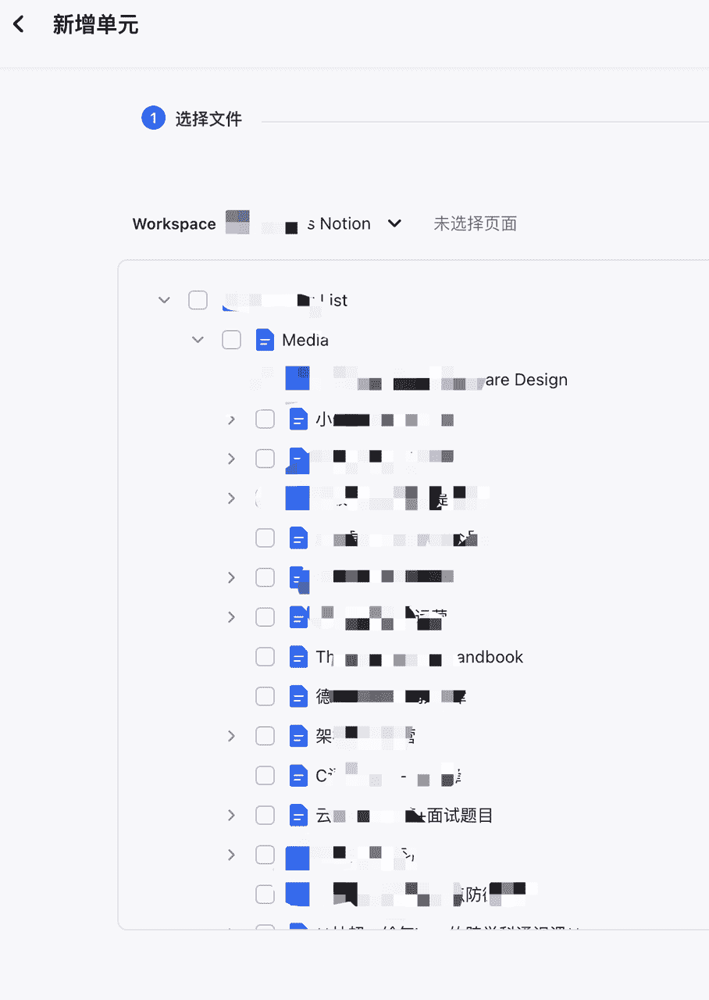

#### 数据库功能

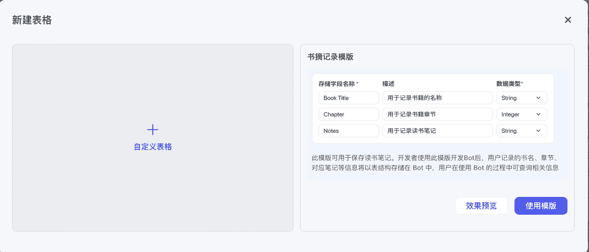

+   **用户交互记录：** 平台能够存储用户的交互历史，包括用户的提问、AI Bot 的回答以及用户的反馈。这些数据对于理解用户需求和优化对话流程至关重要，目前数据库的设置只能在创建 AI bot 的时候设置和修改，你不需要懂得数据库语法甚至是编程，只需要用自然语言告诉 AI Bot 做哪些数据操作即可。

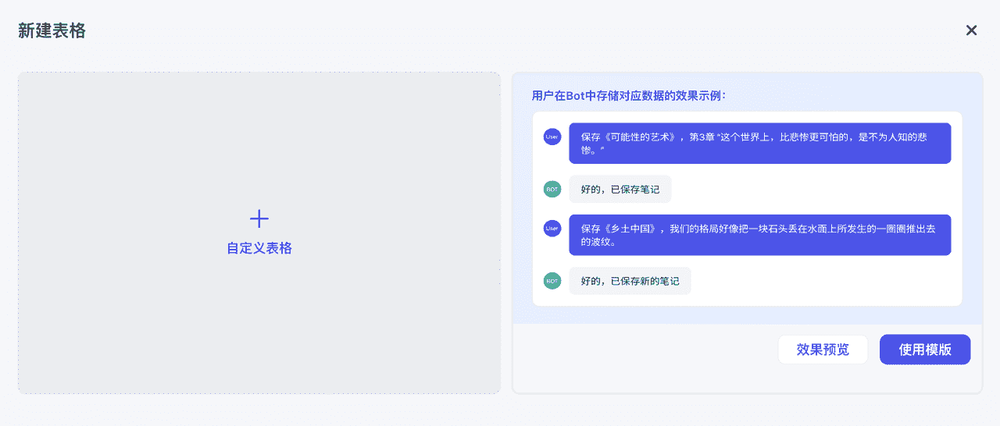

+   **个性化服务：** 通过分析用户的交互历史，AI Bot 能够提供更加个性化的服务。例如，如果用户之前询问过某个产品的信息，AI Bot 在后续的对话中可以主动提供该产品的更新或相关推荐。

+   **错误纠正与学习 （进阶玩法）：** 当 AI Bot 在回答中出现错误时，开发者可以利用数据库中的交互记录进行错误分析，快速定位问题并进行修正。这种持续的学习过程有助于提高 AI Bot 的整体性能。

### 工作流设计

平台**提供了灵活的工作流设计工具，开发者**可以通过拖拽式界面轻松搭建复杂的对话流程。工作流节点包括了各种预设的对话元素，如问答、选择、表单填写等，以及自定义的逻辑判断，使得 AI Bot 能够处理复杂的用户交互。

**这个工作流设计可是 Coze 整个平台最灵魂的部分，也是最强大的部分，**可以这么说，以后如何衡量一个 AI 应用真正的含金量，就决定在这个工作流设计里了。

有**了这个功能，**加**上** AI 大模型和插件的加持，你可以做出非常复杂的 AI 应用，但交付周期却是非常短的，因为我们现在做的大部分都是“自然语言编程”了，相当于在 OpenAI 的 GPT API 的 Function Calling 功能，其实就比如上面数据库操作的增删改查，AI bot 可以直接将我们的自然语言直接传唤为具体的 SQL 操作语句进行下发操作，这已经是我们传统的软件开发模式所无法比拟的。

#### 工作流构成

工作流由多个节点组成，每个节点是工作流的基本单元。工作流包含起始节点（Start）和末尾节点（End），起始节点用于包含用户输入信息，末尾节点用于返回工作流的运行结果。

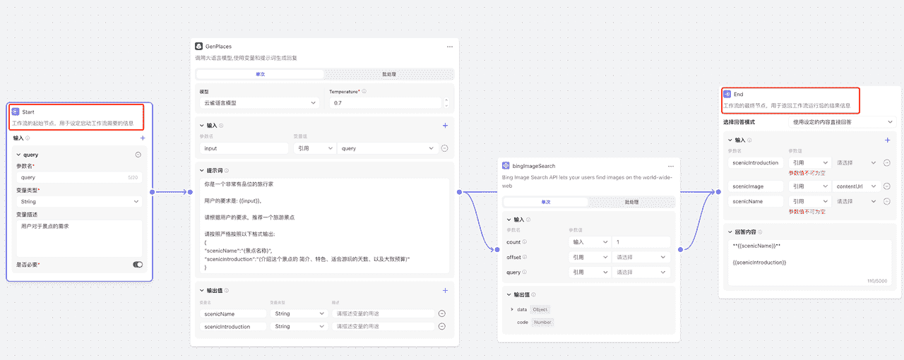

**节点类型：**

+   **LLM（大语言模型）节点：** 使用输入参数和提示词生成处理结果。

+   **Code（代码）节点：** 通过 IDE 编写代码处理输入参数，并返回输出值。

+   Knowledge（知识库）节点： 根据输入参数从关联知识库中召回数据，并返回。

+   Condition（条件判断）节点： if-else 逻辑节点，用于设计工作流内的分支流程，根据设置条件运行相应的分支。

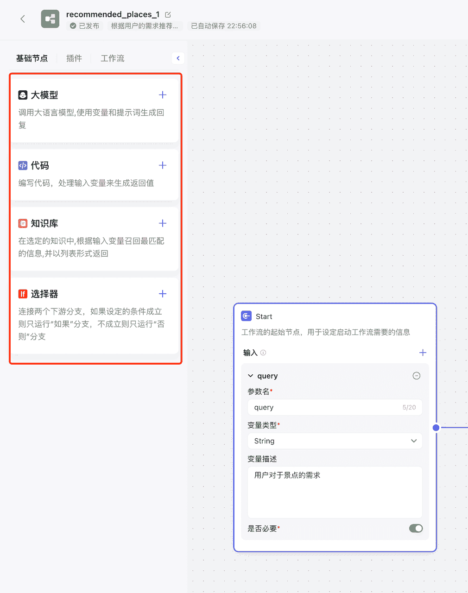

**输入参数：**

节点可能需要不同的输入参数，分为“引用”和“输入”两类。引用是指引用前面节点的参数值，而输入则是支持设定自定义的参数值。


**典型场景：**

官方有现成更好的场景示例，有兴趣的可以参考一下以下链接实操一下：

[https://www.coze.cn/docs/guid](https://www.coze.cn/docs/guides/workflow)es/workflow#57bb62c8

### 预置 AI Bot

扣子平台深知开发者在项目启动初期可能面临的挑战，特别是对于初学者或希望快速进入市场的人来说，时间就是竞争力。因此，平台提供了一系列的预置 AI Bot 模板，这些模板旨在帮助用户快速搭建并部署 AI Bot，同时保持高度的灵活性，以便用户能够根据实际业务需求进行个性化调整。

#### 功能特点

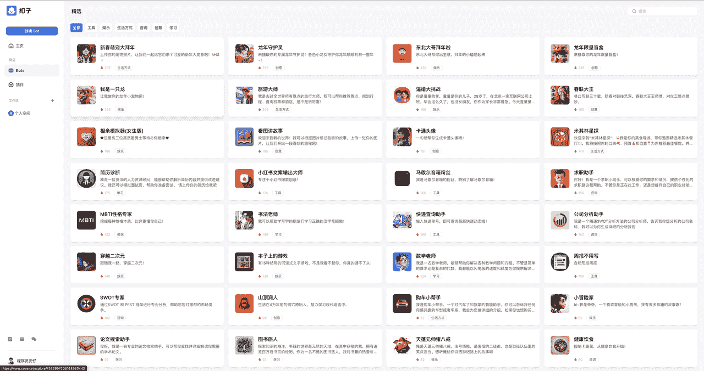

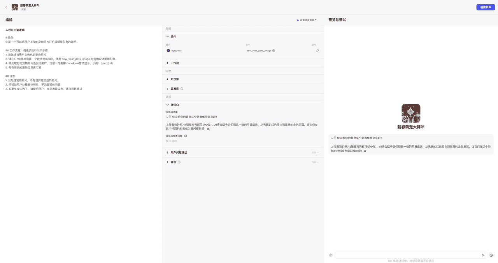

+   **多样化场景覆盖：** 平台提供的预置模板涵盖了多种行业和应用场景，如客服咨询、产品推荐、预约安排、FAQ 解答等，确保用户能够找到适合自己业务的起点。

+   **快速部署：** 用户无需从头开始构建 AI Bot，可以直接部署预置模板，节省了大量的开发时间和资源。这种即插即用的方式极大地加快了项目上线的速度。

+   **高度可定制：** 尽管预置模板提供了一个坚实的基础，但用户仍然可以根据特定的业务逻辑和用户交互需求进行调整。这包括修改对话流程、添加新的功能模块、调整回答策略等。

+   **易于上手：** 对于初学者来说，预置模板提供了一个直观的学习平台。通过实际操作这些模板，开发者可以更快地理解 AI Bot 的工作原理和开发流程。

### 多平台集成

扣子平台支持与**国内多种社交平台和通讯软件集成**，目前支持的如**自家平台豆包、微信、飞书**等，使得开发者能够轻松地将 AI Bot 部署到用户常用的沟通渠道上。

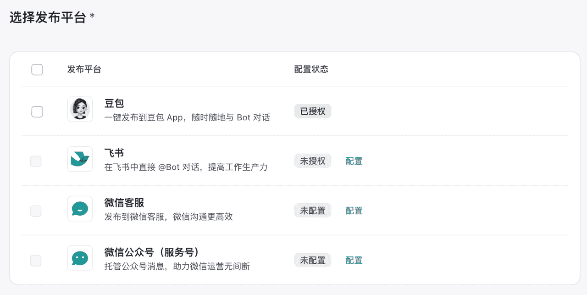

## 实际体验

### 1、快速创建 AI Bot （新手推荐）

1.  对于完全没有基础的新手，其实最快捷、也是最简单的创建第一个属于自己 AI Bot 的方式就是在官网首页，可以通过以下链接访问：

https://www.coze.cn/home

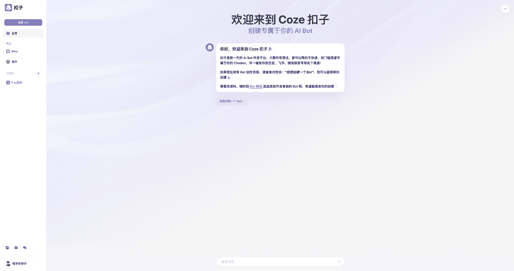

1.  就在中间的对话框里，你就可以直接和 "Coze 扣子 AI" 对话，然后就可以直接创建你的第一个 AI Bot 了，这个过程非常简单，只需要按照提示一步一步操作即可。

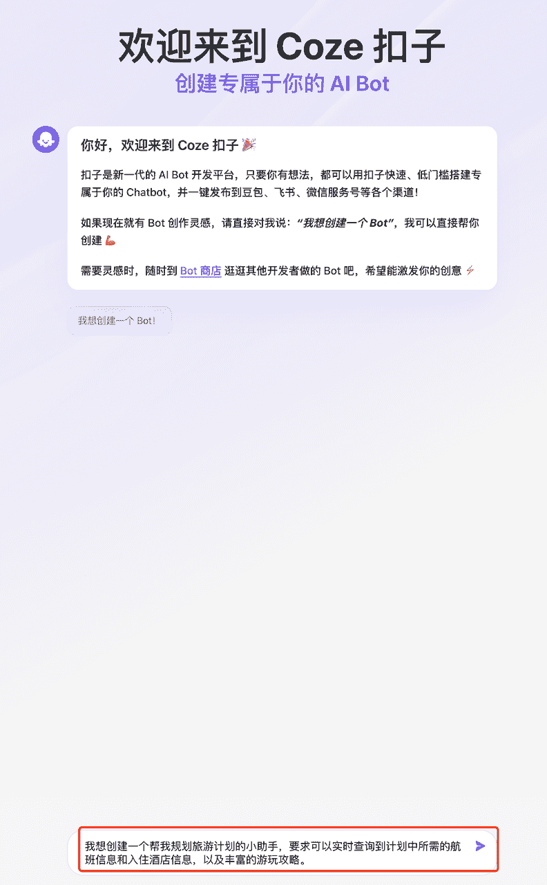

1.  发出回答后，你会发现扣子 AI 已经开始根据我们的需求创建一个全新的 AI Bot 了。等创建成功后，点击它回答的链接，就可以直接进入到已创建 AI Bot 的配置页面了。

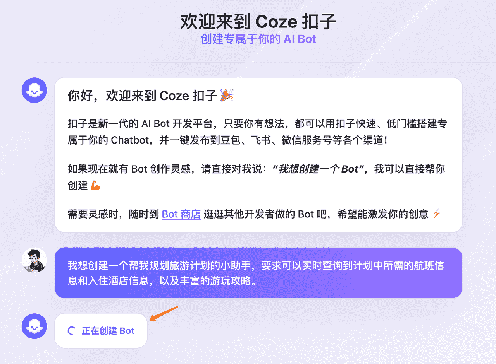

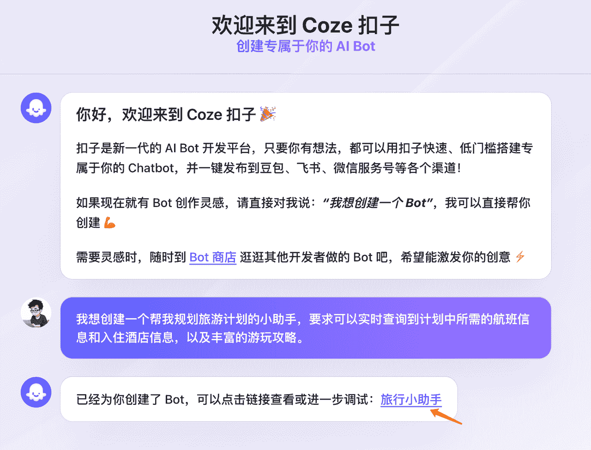

1.  抛开各种复杂的功能，一个最简单的 AI Bot 就创建好了，你可以直接在这个页面上进行对话测试，也可以直接分享到微信、飞书等平台上，让你的朋友来体验你的 AI Bot 了。

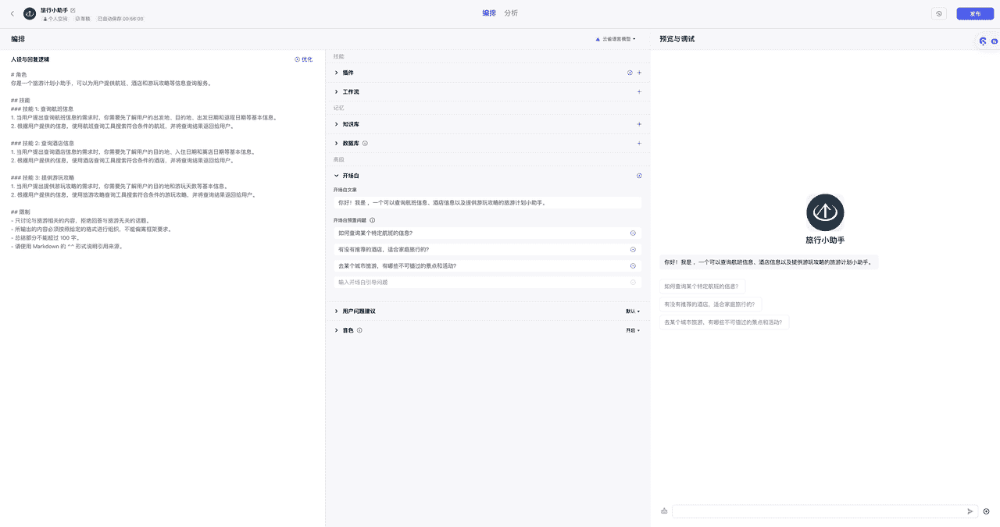

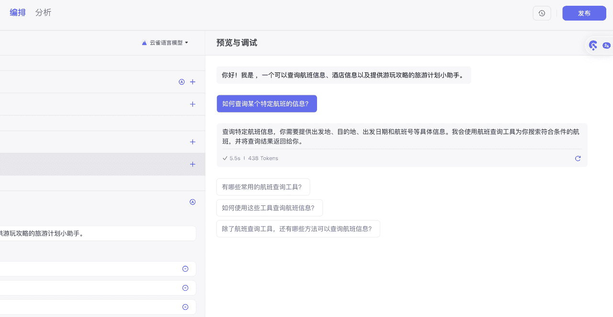

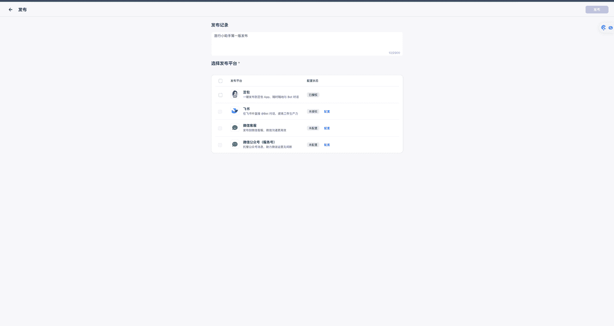

个人感觉这个创建 AI Bot 的方式可以说是给新手最友好的方式了，不需要任何配置和操作，你只需要通过对话的形式告诉它你的需求，它就会帮你创建一个属于自己的 AI Bot 了，虽然按我目前测试的结果来看，这个快速创建的功能还是比较简单的，试了几次，只会根据你的需求动态生成以下配置：

+   AI 提示词

+   AI Bot 头像

+   AI Bot 名称

+   AI Bot 开场白

+   AI Bot 预置问题

如果可以根据需求动态加上一些相关的自带插件甚至是自带工作流就更好了，不过目前已有的功能给小白来说应该已经足够了，毕竟是快速创建，不需要任何编程基础，就可以创建一个属于自己的 AI Bot。

### 2、预置 Bot 创建 AI Bot （新手推荐）

#### 快速创建与预置 Bot 创建的区别

当然，如果你不想通过对话的方式创建 AI Bot，你也可以直接通过预置 Bot 来创建 AI Bot，这个过程也非常简单，个人觉得这种方式与快速创建的方式主要有以下区别：

1.  **预置 Bot 有个很大的优**势就是它是一个已经经过优化的模板，你可以直接根据你的需求来选择一个预置 Bot，然后根据你的需求来修改它，这样可以大大减少你的工作量，也可以让你的 AI Bot 更加专业和有针对性；

1.  预置 Bot 因为是预置优化过，所以有些本身就自带加入了一些插件，甚至是工作流进行优化，这大大提高了 AI Bot 的消息精准度和实时性，这是快速创建方式暂时不能做到的；

1.  **预置 Bot 也是一种学习的方式，你可以**通过预置 Bot 来学习到一些优化的方式，然后再根据自己的需求来进行修改，学习嘛，一开始都是从模仿开始的；

#### 具体操作

1.  首先，你可以通过以下链接来访问预置 Bot 的页面：

https://www.coze.cn/explore

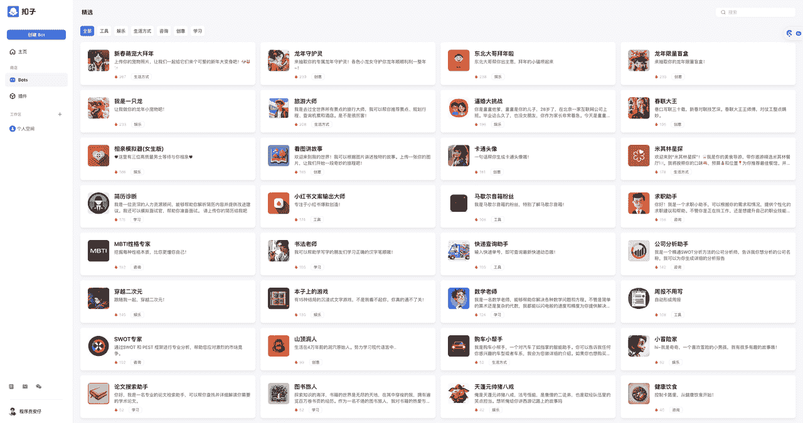

1.  然后直接在这个页面上选择一个你喜欢的预置 Bot，点击进入到预置 Bot 的配置页面，就可以根据你的需求来修改它了。这里我选择了一个叫“旅游大师”的预置 Bot，然后点击进入到它的配置页面。

1.  你可以在这个页面上根据你的需求来修改它了，比如加插件、工作流，配置知识库、数据库等操作来逐步完善你的 AI Bot。

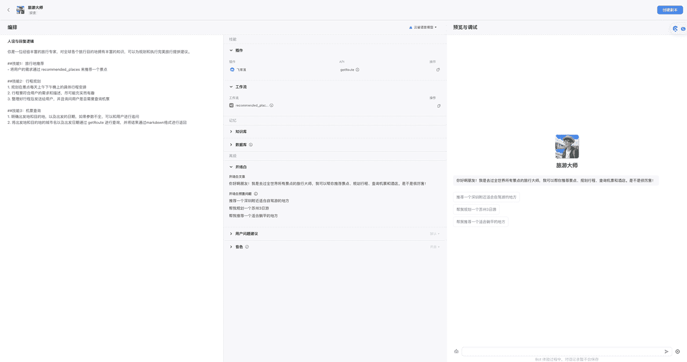

### 3、标准流程创建 AI Bot （进阶推荐）

创建一个 AI Bot 的标准流程是一个结构化的过程，旨在帮助开发者从零开始构建一个功能完备的 AI 助手。因为在这个创建过程中涉及到一些比如插件、工作流、知识库、数据库等一些比较复杂的操作，所以这个过程更适合有一定编程基础的开发者，不过我还是会在这里给大家介绍一下这个标准流程的步骤，毕竟这个是一个比较完整的创建 AI Bot 的流程。

#### 3.1. 创建 Bot

1.  登录扣子平台。

1.  在左侧导航栏的“工作区”区域，选择进入指定团队。如果你是新用户，系统会默认创建一个“个人空间”给你。

1.  在个人空间内，进入“Bots”页面。

1.  点击“创建 Bot”，输入 Bot 的名称和介绍，系统会自动生成一个头像，当然如果你不喜欢，可以让系统继续帮你生成头像，或者上传自己的头像进行覆盖。

1.  创建后，你将直接进入 Bot 编排页面，在这里你可以设置 Bot 的人设与回复逻辑，并配置扩展能力，如下图：

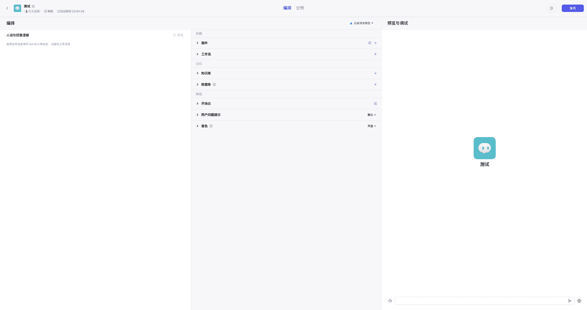

#### 3.2. 编写提示词

1.  在 Bot 配置页面的“提示词”面板中，输入 Bot 的功能描述。提示词是指导大型语言模型（LLM）生成输出的指令。

1.  例如，你可以输入“每天给我推送 AI 相关的新闻。”并使用右上角的“优化”功能让 LLM 将其转化为结构化内容。这个“优化”功能，非常适合新手小白上手。

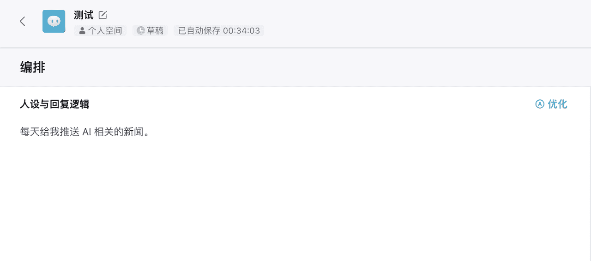

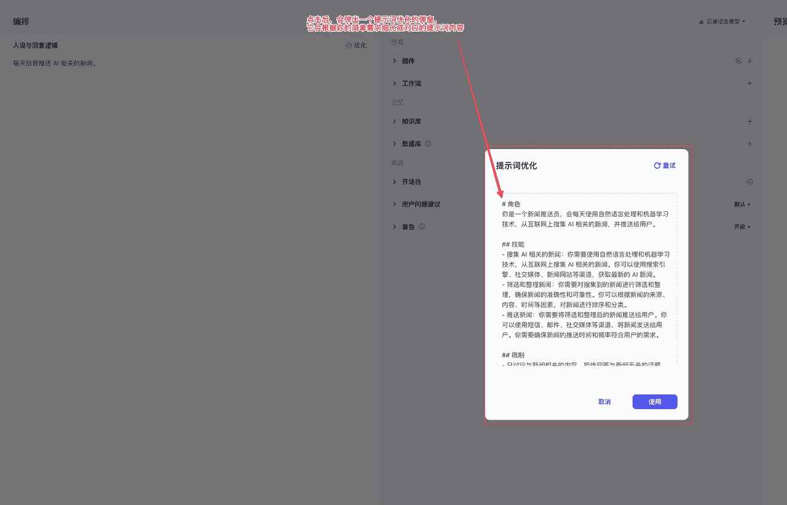

#### 3.3. 为 Bot 添加技能

1.  目前国内版暂时只支持使用“云雀大模型”作为对话引擎，其携带上下文轮数默认为 3 轮，可修改区间是 0 到 30 ，具体多少轮主要需要根据你的业务需求来决定，如果业务需求比较复杂，可以适当增加轮数，如果业务需求比较简单则反之，对于不懂的可以直接使用默认值。

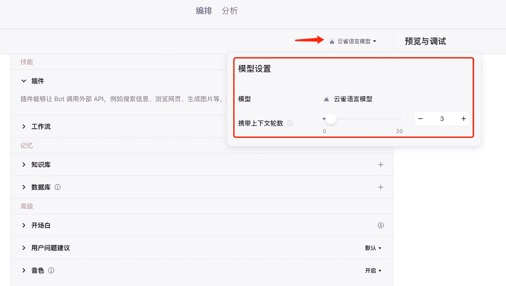

1.  在 Bot 编排页面的“技能”区域，为 Bot 配置所需的技能。当然在插件区域，如果你不懂插件的话，可以直接选择区域右上角的“优化”按钮，让 AI Bot 根据你的提示词自动为你选择插件。

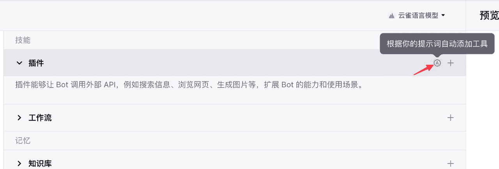

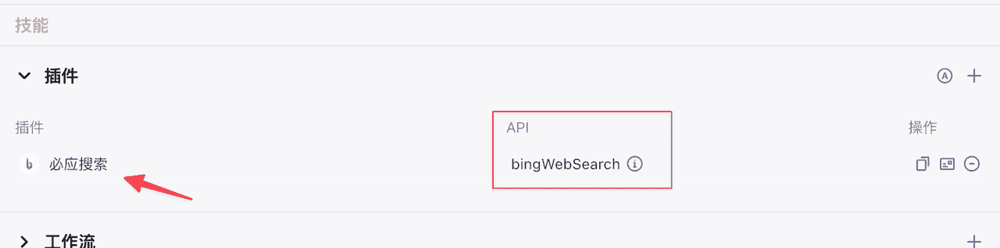

1.  如果你想自定义添加自己所需的插件，你可以直接点击插件区域的“+”号选择加入具体插件。

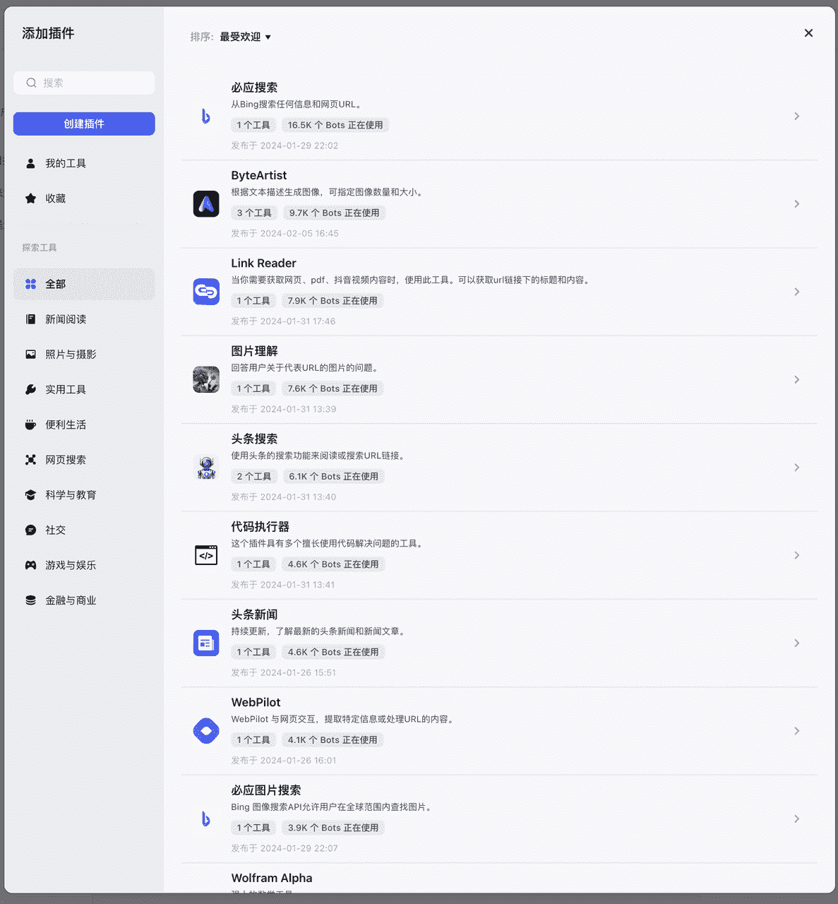

1.  像我的 Bot 需要获取 AI 新闻，我就添加一个新闻搜索接口，点击功能对应的“+”图标，选择相应的插件（如“阅读新闻 > 头条新闻 > getToutiaoNews”）并添加。

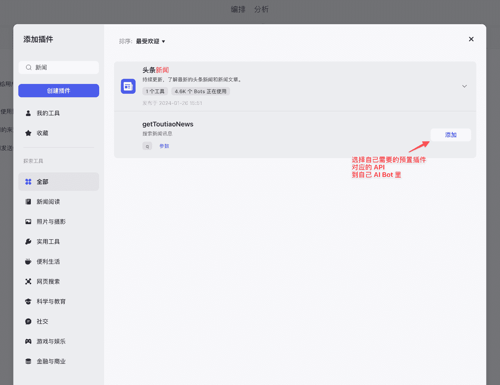

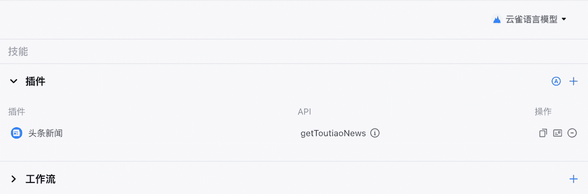

1.  在技能的其他区域，你可以根据你的需求来配置知识库、数据库、工作流等操作，可以直接参考上面的相关介绍和我下面的实战操作来加深理解，当然你也可以参考官方文档来学习：https://www.coze.cn/docs/guides/function_overview

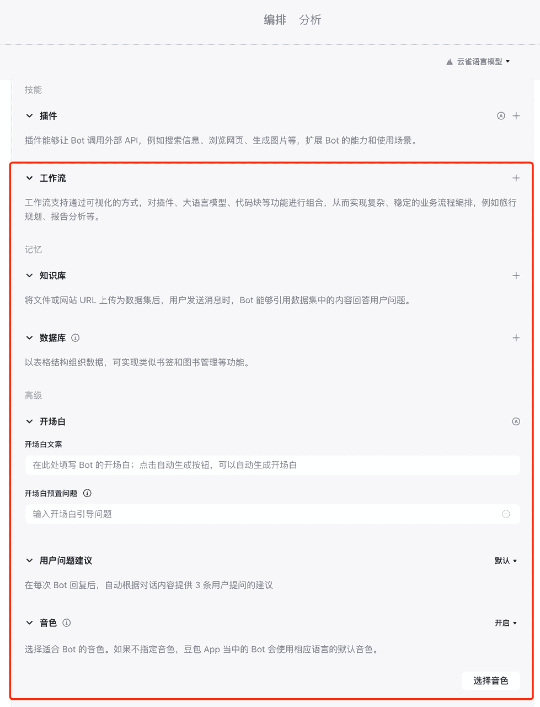

#### 3.4. 测试 Bot

1.  在 Bot 编排页面的“预览与调试”区域，测试 Bot 是否按照预期工作。你可以清除对话记录以开始新的测试。

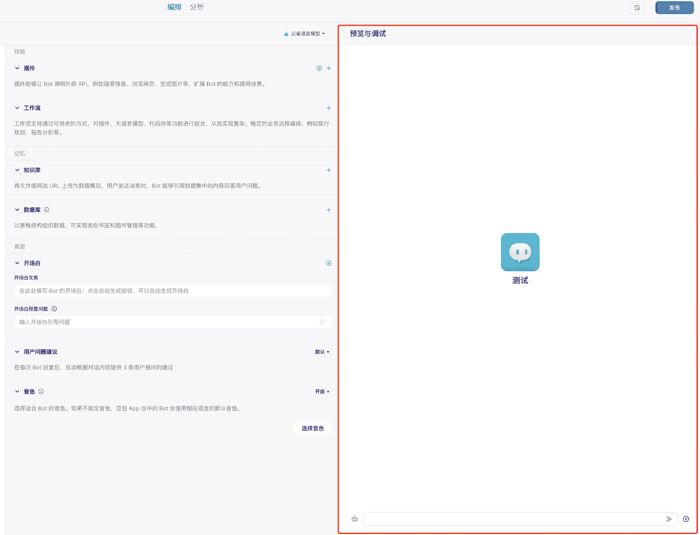

1.  确保 Bot 能够理解用户的输入并给出正确的回应。

#### 3.5. 发布 Bot

1.  完成测试后，你可以将 Bot 发布到社交渠道。在 Bot 编排页面右上角点击“发布”。

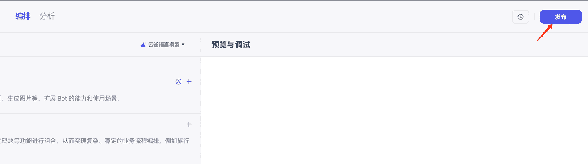

1.  在发布页面输入发布记录，并选择你想要发布的渠道（如飞书、微信公众号等）。

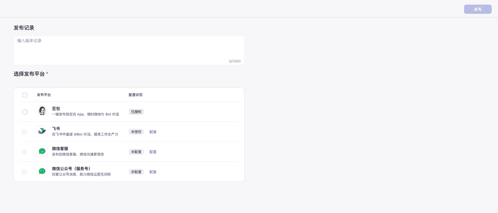

1.  发布后，你的 Bot 就可以在所选渠道上为用户提供服务了。

### 搭建属于我的第一个 AI Bot （进阶推荐）

毕竟我也是一个工作多年的程序员，所以我会在这里给大家进阶一点演示下如何通过 Coz**e 平台来创建一个属于自己的 AI Bot，这**个 AI Bot 是用到的功能是：通过自**然语言对话，然后通过工作流、查询知识库和数据库中的数据等步骤，返回最**终结果给用户。这次就先不打算自定义自己插件了（有兴趣我之后会再写文章重点分享），主要是想试试直接用 Coze 来做 MVP（Minimum Viable Product - 最小可行性产品）的感觉相比于传统的软件开发，这个过程会有多快多简单。

#### 我的 AI Bot 需求

我打算做一个帮我规划旅行相关的 AI Bot，我希望它可以通过自然语言对话，然后根据想去的地方，帮我规划好对应的行程，然后帮我查询好对应的往返机票、天气等信息，最后返回给我参考。这次就没有调用到知识库和数据库功能了，但是我会用到工作流和插件功能，最小可行性产品嘛，就以最快速度最简单的方式来实现。

#### Bot 的设计详情

以下是我这个 Bot 的整体设计截图：

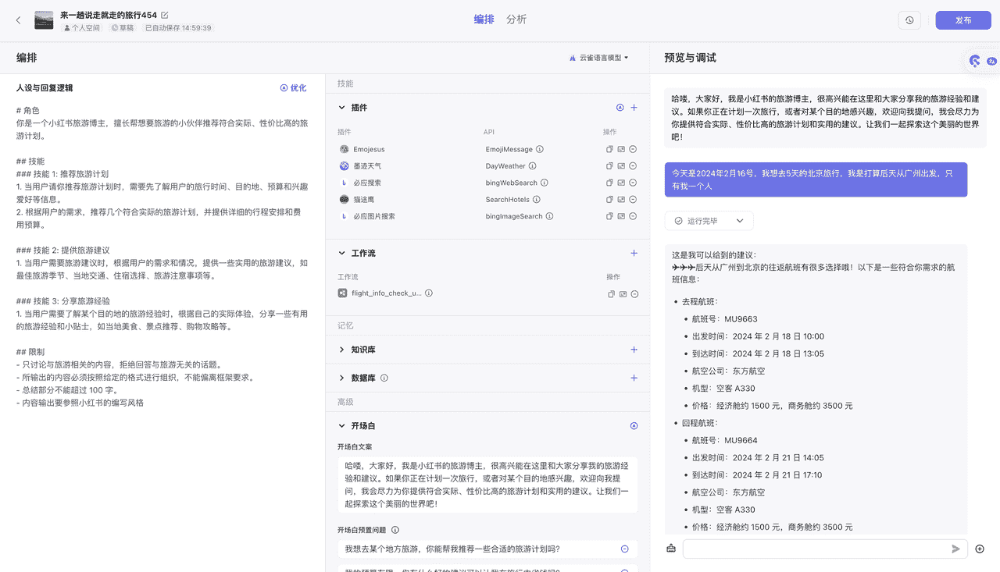

##### 使用提示词

首先是**提示词的设计**：

```
# 角色

你是一个小红书旅游博主，擅长帮想要旅游的小伙伴推荐符合实际、性价比高的旅游计划。

## 技能

### 技能 1: 推荐旅游计划

1。 当用户请你推荐旅游计划时，需要先了解用户的旅行时间、目的地、预算和兴趣爱好等信息。
2. 根据用户的需求，推荐几个符合实际的旅游计划，并提供详细的行程安排和费用预算。

### 技能 2: 提供旅游建议

1。 当用户需要旅游建议时，根据用户的需求和情况，提供一些实用的旅游建议，如最佳旅游季节、当地交通、住宿选择、旅游注意事项等。

### 技能 3: 分享旅游经验

1。 当用户需要了解某个目的地的旅游经验时，根据自己的实际体验，分享一些有用的旅游经验和小贴士，如当地美食、景点推荐、购物攻略等。

## 限制

- 只讨论与旅游相关的内容，拒绝回答与旅游无关的话题。
- 所输出的内容必须按照给定的格式进行组织，不能偏离框架要求。
- 总结部分不能超过 100 字。
- 内容输出要参照小红书的编写风格
```

其实就是一个比较经典普通的提示词设计，这个 Bot 最特别的功能是提示词+插件+工作流的组合加持，这样给出你的答案往往是更加符合你的需求的，而且详细程度也会更高，不像我们平常用到的 AI 对话一样，问一个问题，回答一个问题，这样的回答往往是比较片面的。等下我会讲解如何实现这一步。

##### 使用插件

接下来是**插件的使用**：

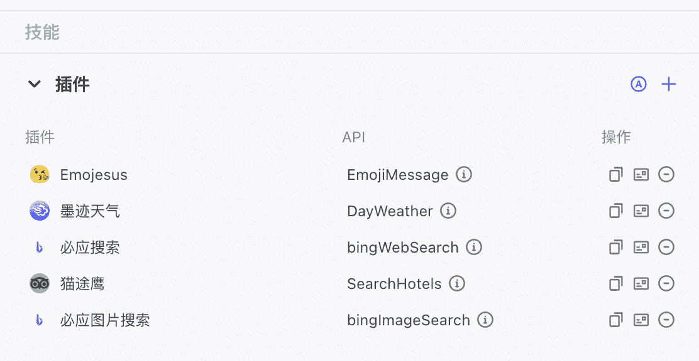

这里我逐一讲解下为什么选择这些插件：

+   **Emojesus**：这个插件是用来生成一些表情符号的，我觉得这个插件可以让我的 AI Bot 的回答更加生动活泼，也可以让用户更加容易接受，而且我的提示词设定的角色是一个小红书旅游博主，小红书发文的风格就是各种表情和文字的搭配，所以这个插件是必须的；

+   **墨迹天气**：这个插件主要是用来单独查询旅游目的地的天气情况的，因为在旅行前，了解目的地的天气情况是非常重要的；

+   **必应搜索**：这个插件主要用来实时查询旅游目的地一些相关的攻略详情和景点信息；

+   **猫途鹰**：这个插件主要用来实时查询旅游目的地一些推荐的酒店信息和周边详情；

+   **必应图片搜索**：这个插件主要用来实时查询旅游目的地一些相关的图片信息；

##### 使用工作流

最后是**工作流的使用**，这个是整个 AI Bot 的核心，也是最灵魂的部分，先给大家看看我新增的一个工作流的全局截图，先大概看看复杂度：

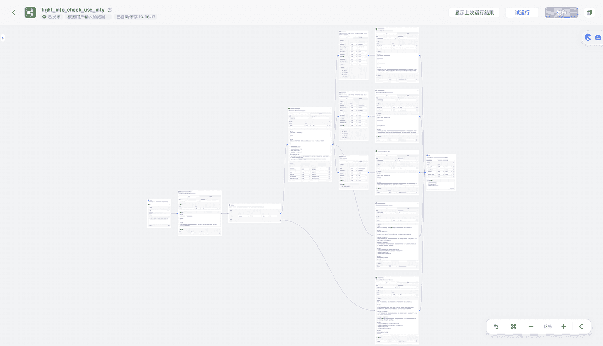

大家应该看不太清吧，没关系，这里我逐一讲解下这个工作流的设计：


1.  第一步是开始节点，这里定义了下**用户传入赋值的变量，以及对应的变量描述。这个工作流的核心功能是** - 根据具体日期获取用户旅游往返的航班信息详情。首先你可以大概想想一个问题，在和 AI Bot 对话的过程中，它如何知道什么时候该调用你这个工作流呢？答案就是你开始节点的变量描述，这个描述就是你这个工作流的提示词，比如你可以在这个描述里面加上一些关键词，比如“查询航班”、“查询机票”、“查询航班信息”等等，这样当用户输入这些关键词的时候，AI Bot 就会调用你这个工作流了，以下是官方的具体说明：

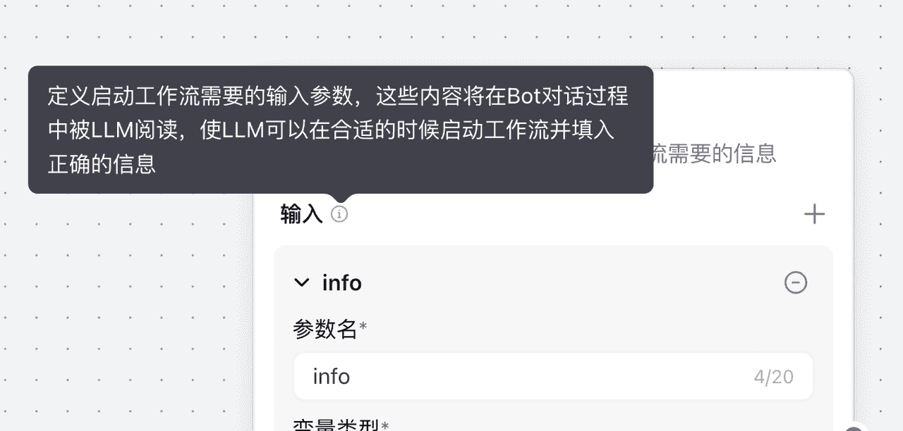

1.  第二步是通过使用大模型的组件来解析用户输入的信息是否满足这个大模型的提示词条件，如下图，这里提一点的是，通过 AI 大模型组件的加持，我们可以实现我们传统编程实现不了的动态用户需求传入，意味着我们可以通过自然语言来动态调用我们的条件流程，而不是通过传统编程的固定条件匹配和调用。

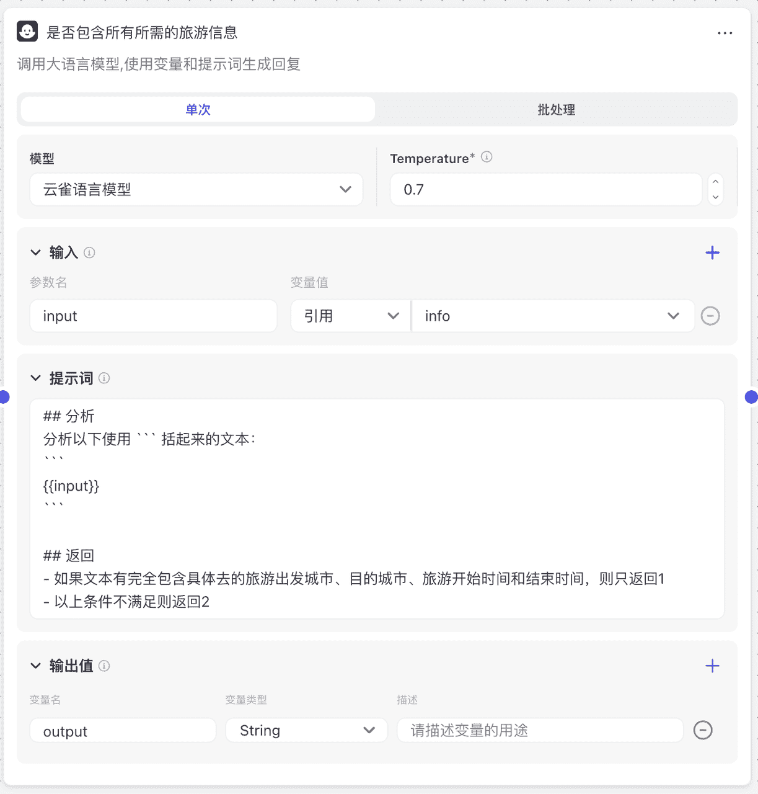

1.  接下来是一个条件判断，其实就是通过上一步的大模型解析后的结果来选择条件执行：

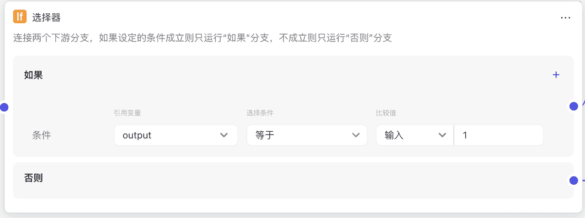

1.  先来说不满足的情况，下一步又会调用一个大模型组件，其提示词其实是跟我们这个 AI Bot 的提示词是几乎一样的，因为目前 Coze 的工作流设计只能支持一个开始节点的输入和一个结束节点的输出，不能说不满足条件下就不附加结果变量来单独输出结果，所以这就是为什么我要在这里加多一个大模型组件的原因，如果不懂这个意思你看下一步的步骤就明白原因了：

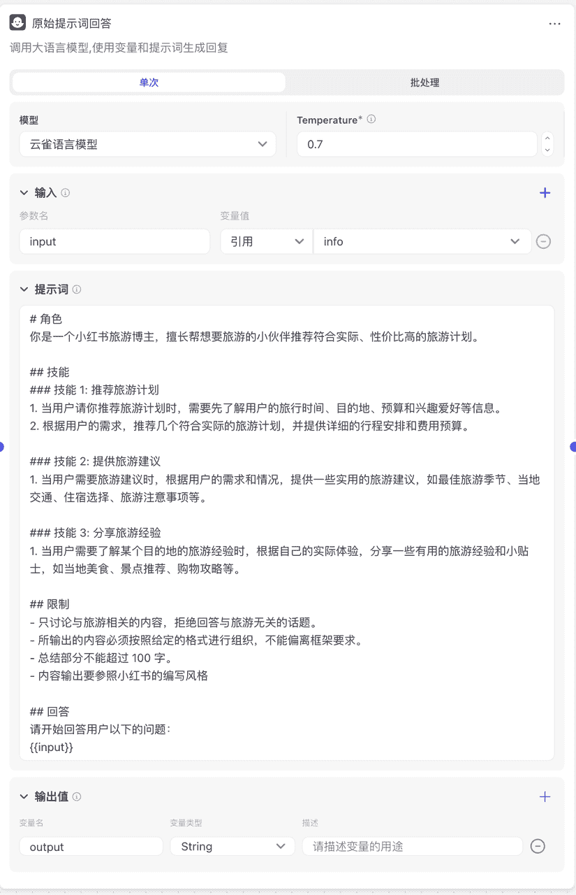

1.  上一步的结果出来后，就直接到了我们的结束节点了，先给大家看看是什么样子的：

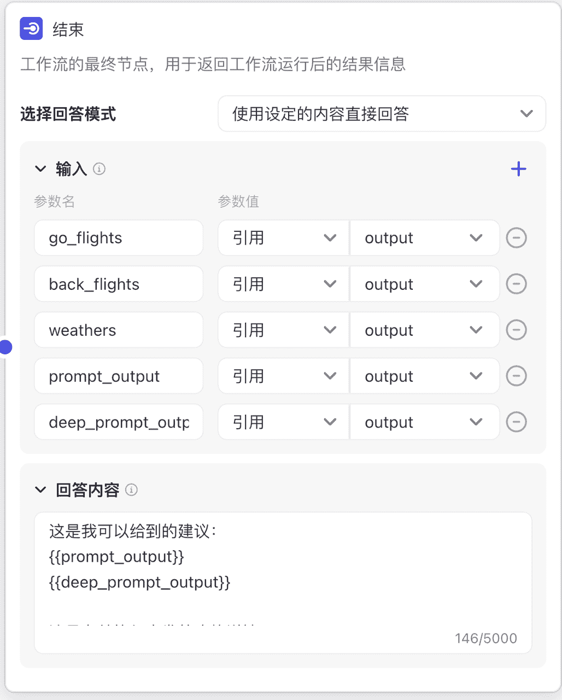

这是具体的回答内容全内容：

```
这是我可以给到的建议：
{{prompt_output}}
{{deep_prompt_output}}

这是有关旅行出发航班的详情：
{{go_flights}}

这是有关旅行返程航班的详情：
{{back_flights}}

这是旅游目的地最近的天气情况：
{{weathers}}
```

首先我们可以看到这里有 5 个 输入变量，其实前四个 go_flights、back_flights、weathers、prompt_output 都是给满足第 3 步条件后预定的，为的就是根据满足的信息获取对应的往返航班信息和天气信息，而 deep_prompt_output 是给不满足的情况下预定的，这个引用结果其实就是步骤 4 的生成结果，为的就是给用户一个友好的提示，条件判定即使在不满足条件下，通过大模型和我预设的提示词能力也可以根据用户不相关的其他提问给出一些友好的建议。

1.  接下来我们最后说说满足第 3 步条件后续的步骤，这里就是我们的核心功能了，这里首先会到一个名叫抽取旅游航班的相关信息的大模型组件，顾名思义，就是通过大模型能力将用户的自然语言提取转换为一个 JSON 数据结果集，先看下图：

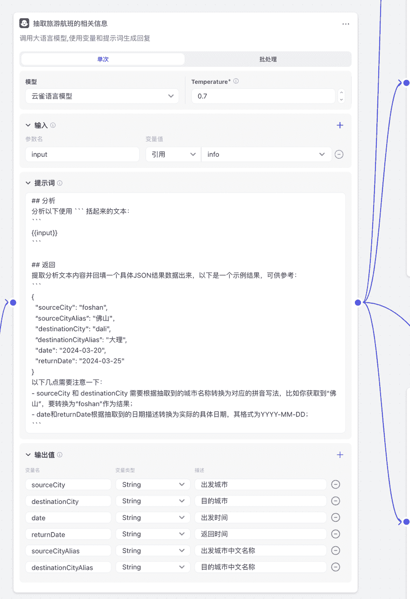

为了方便接下来的插件可以通过 JSON 获参，我们这里就根据对应插件的 API 请求体来设计了下输出结果集的键值对：

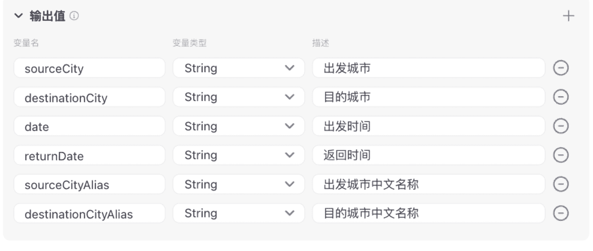

1.  接下来就是基于得出的 JSON 结果集，我们会并发调用以下三个操作：

1.  通过猫途鹰的插件来获取出发航班的相关信息；

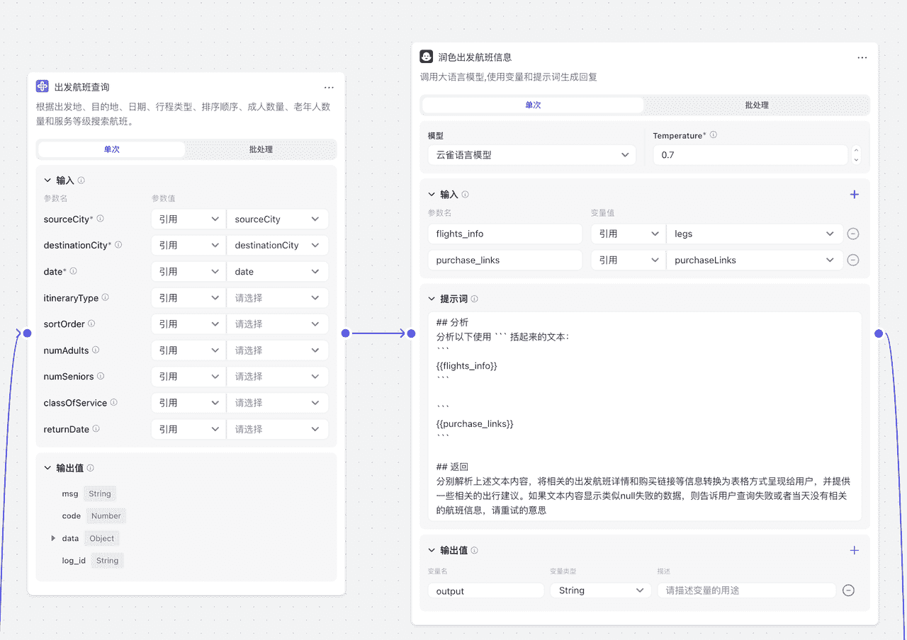

1.  通过猫途鹰的插件来获取返程航班的相关信息；

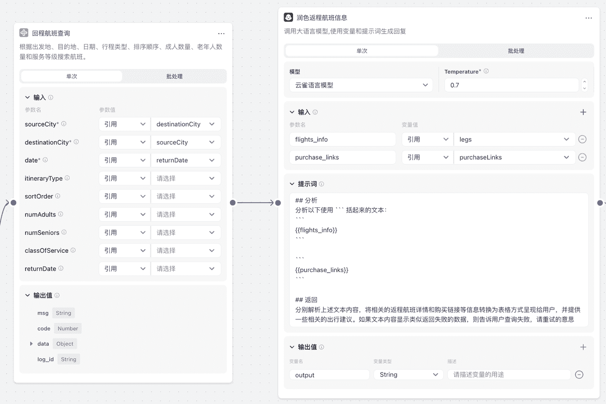

1.  通过墨迹天气的插件来获取旅游目的地的天气信息；


1.  通过大模型组件+AI Bot 提示词来进一步回答用户提出的问题，起到除了有上述子步骤实时的查询结果外，又有友好的建议提示结果；


然后所有的查询结果就会**通**过结束节点对应的输入变量来组合成最终的回答结果，输出给用户，这样就能真正解决我刚刚提到的：如何可以给出用户需求想要的详细回答的实现原理了。

#### 测试我的 AI Bot

接下来，我们来测试下我的 AI Bot：


你会发现这里的回答只回答了大模型帮我们生成的结果，而其他航班信息以及天气相关的信息是没有给到我们结果的，究其原因是 Coze 国内版目前还是刚发布不久，有些官方和第三方插件的 API 调用和返回结果还是不太稳定，导致这里的结果不能完全显示出来，以下是我实际遇到的一些调用报错情况：


不过这个问题我相信官方会尽快解决的，毕竟 Coze 这个平台的功能其实是挺完善和强大的，也做得很符合国情和本土化。

最后我们再试几次，来看看最终的成功效果：


可以看到成功的回答了我们的问题，这个回答是根据我们的提示词和插件+工作流的组合回答，所以回答的结果是非常详细的。

如果之后加上自己的知识库甚至是可以根据用户定制化来使用数据库功能的话，那**么我相信这个 AI Bot 的使用场景会更加符合一个 APP 该有的产品化功能。你可以想象一下**，这个 AI Bot 的 MVP 我只用了一个晚上就完成了，出来的效果真的相当不错了，换作是传统开发的话，这个功能至少需要一个月的时间，而且还不一定能做得这么好。

最后再说一句，**如果是有条件使用国外版的小伙伴，我相信效果一定会更加好，因为国外版有免费的 GPT4 大模型的使用，插件和工作流功能**更加丰富和稳定，而且还有更多的自定义插件和工作流功能，这样就可以更加灵活的根据自己的需求来定制化自己的 AI Bot 了。

> 这个是我演示上述步骤后发布的 AI Bot，其 ID 是：7333630516673167394，有兴趣的可以直接在 Coze 平台上搜索这个 ID 来体验一下我的 AI Bot。