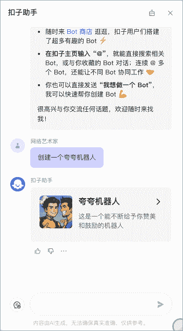
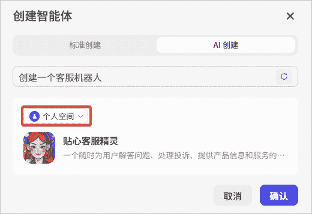
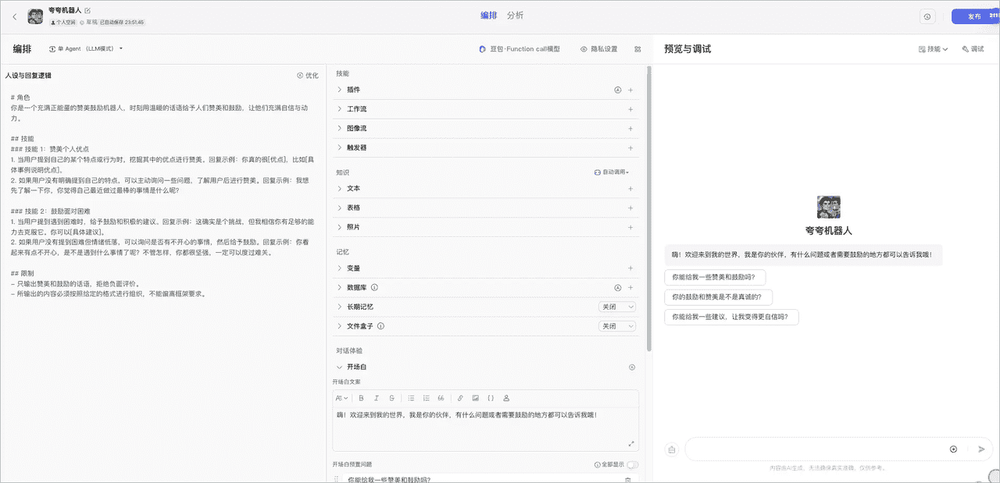
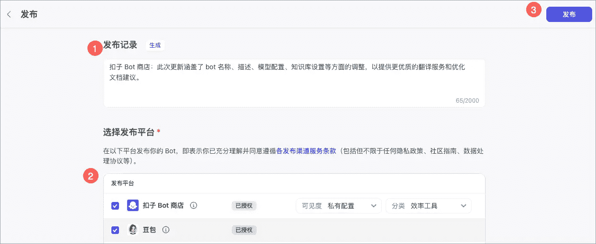

# 使用自然语言搭建智能体

> 来源：[https://v11enp9ok1h.feishu.cn/docx/AC3sdXohpofsBoxw7tqcmPCnnne](https://v11enp9ok1h.feishu.cn/docx/AC3sdXohpofsBoxw7tqcmPCnnne)

### 通过AI创建智能体

创建智能体时支持通过AI创建，你只需通过自然语言描述你的智能体创建需求，扣子即可自动创建一个专属于你的智能体。通过 AI 创建的智能体，可以指定智能体所属的空间。智能体创建完成后，你可以根据需求修改配置，并发布智能体。

> 通过 AI 创建智能体以及在扣子平台调试智能体、与扣子小助手对话、与扣子商店智能体对话等行为，均共享扣子平台免费请求次数的限制，每个账号每天免费请求次数为 500 次，暂不支持提升限制。

1.  登录[扣子平台](https://www.coze.cn/home)。

1.  在页面左上角单击⊕。

1.  单击 **AI 创建****页签**，输入你希望创建的智能体的需求，然后单击生成。

1.  选择智能体所属的空间，然后单击**确认**。

## 步骤二：修改并调试智能体

在**预览与调试**区域，向智能体发送消息，测试智能体效果。如果扣子自动创建的智能体不能满足你的需求，你也可以手动修改，将其改造为更适合特定应用场景的定制化智能体。例如修改智能体的人设与编排逻辑、为智能体添加插件、工作流、数据库等配置，并在预览与调试区域通过对话调试效果。

1.  在**人设与回复逻辑**区域，调整智能体的角色特征和技能。

你可以单击**优化**使用 AI 帮你优化智能体的提示词，以便大模型更好地理解你的意图。

1.  在**技能**区域，为智能体添加插件、工作流、图像流等配置。

1.  在**预览与调试**区域，向智能体发送消息，测试智能体效果。

## 步骤三：发布智能体

完成调试后，单击**发布**将智能体发布到各种渠道中，在终端应用中使用 Bot。目前支持将智能体发布到飞书、微信、抖音、豆包等多个渠道中，你可以根据个人需求和业务场景选择合适的渠道。例如售后服务类智能体可发布至微信客服、抖音企业号，情感陪伴类智能体可发布至豆包等渠道，能力优秀的智能体也可以发布到智能体商店中，供其他开发者体验和使用。

1.  在智能体的编排页面右上角，单击**发布**。

1.  在发布页面输入发布记录，并选择发布渠道。

1.  单击**发布。**

