# 这可能是讲 Coze 的数据库最通俗易懂的文章了

> 来源：[https://v11enp9ok1h.feishu.cn/docx/NBWQd3ei3o1bnNxExOpcZbcKnAc](https://v11enp9ok1h.feishu.cn/docx/NBWQd3ei3o1bnNxExOpcZbcKnAc)

---

在学习 AI Agent 的过程中，有一个非常经典的公式

**A**I Agent = LLM（大模型） + Planning（规划） + Memory（记忆） + Tools（工具）

其中**记忆**这一块离不开一个重要的组件，那就是数据库。

这篇文章旨在从非编程人士的角度讲清楚数据库的概念和基本使用。

本文不会陷入传统教学文章中的上来就讲 SQL 语法，而是通过和 Excel 对比希望你能了解数据库的本质概念

从而可以更好的利用 ChatGPT 等工具辅助你在学习数据库的路上走的更远

请允许我自卖自夸：**我这篇文章可以说是数据库文章中 Coze 讲的最好的**，讲 Coze 的文章中数据库讲的最好的。

另外做个预告，我正在规划一个关于 AI 时代你应该具备的编程基础系列，大纲如下：

+   数据库｜让 Coze 拥有了记忆的组件 1

+   知识库｜让 Coze 拥有了记忆的组件 2

+   变量｜让 Coze 拥有了记忆的组件 3

+   JSON｜让你更好的使用 Coze 插件

+   API｜外部应用程序该如何接入 Coze

+   操作系统与服务器｜那些接入了 Coze 的微机器人都是运行在哪里的

+   Docker｜让你用最简单的方式部署🛰️机器人

OK，废话不多说，我们直接开始！

# 数据库是什么

数据库就是用来存储数据的工具。

例如我们在访问任何一个网站时，我们基本都需要注册登录，我们填写的账号密码手机号这些信息都是存储在数据库中。

你可能会问了，Excel 也是存储数据的工具呀，为什么这些信息不存储在 Excel 中呢？这其中有两个原因：

+   数据库是对代码友好的存储工具，我们的网站都是代码编写的，所以访问数据库会更加方便。而 Excel 是对人友好的工具

+   数据库有其独特的设计，使得他可以存储上千万的数据。比如淘宝有 1 亿的用户，这些信息只能存储在数据库中，没有办法存储在 Excel 中

# 从 Excel 来理解数据库的概念

在了解任何一个新概念时，我都希望可以找到大家熟悉的工具进行类比，这里我们就选择 Excel 进行比较。

下面我们通过一个具体的例子来演示，当我们分别用 Excel 存储和数据库存储时会有怎样的相似和不同。

## 需求分析

你是一个客服人员，你的职责是每天回答客户的问题，而且你被老板要求将每天的问答记录以及发生的时间记录下来。

当拿到这个需求的时候，我们第一时间需要思考，有哪些字段需要记录：

+   客户问题

+   客服的回答

+   发生的时间

这是一个非常简单的需求，让我们分别来看用 Excel 和数据库该如何实现

## 通过 Excel 存储数据

1.  首先我创建了一个 Excel 的文件，命名为用户问答记录


1.  这个文件我们会建立表头

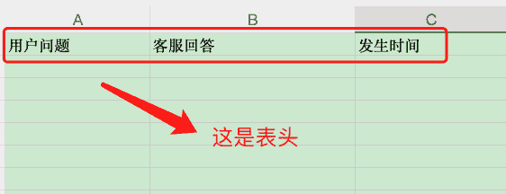

1.  当建立了表头之后，我们就开始存储数据了

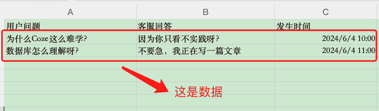

你可能会说了，这个创建 Excel 的过程有必要讲么？这不是每个人都会的事情么。

是的，我讲 Excel 的过程是希望你能理解，大多数的数据存储工具设计理念都是相通的，他们只是换了一层皮而已。

我们要透过现象看本质，理解了 Excel 的设计理念以及对应的概念，接下来你理解数据库的时候就非常轻松了。

## 通过数据库存储数据

由于本文是服务于 AI Agent 的学习的，所以我们以 Coze 平台的数据库创建为例来进行说明。

在使用 Coze 的数据库能力的时候，我们需要首先创建一张表（这里可以类比你创建了一个 Excel 文件）：

1.  创建一张数据库表，并且为他起个有含义的名字

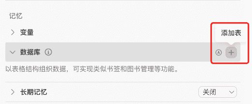


PS：为什么数据库表名只能用英文，因为数据库的发明者是外国人，就跟编程语言为什么是英文一样的。

1.  为这张表设置字段，并且设置每个字段的类型

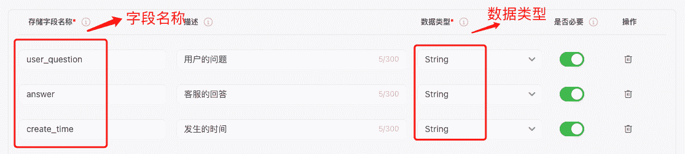

表就是数据库的核心概念之一了，这里我们展开讲下：

+   **存储字段名称**也就是数据库的表字段，**类比 Excel 中的表头**。不一样的点在于表字段不能用中文，而 Excel 可以

+   描述没什么讲的，因为字段只能用英文，描述用来更好的理解字段含义

+   **数据类型**是个很重要的概念，一会我们掰开揉碎了讲讲

+   **是否必要**：如果是必要的话，那么在存储的时候如果没有该字段的信息，那么数据库会报错，这样可以防止脏数据的产生

这里我们着重讲数据类型，你可能会问了，Excel 中也没有这个概念呀，这你可就错了，Excel 中也有，只是可能你用的不多。

看到下面这个界面，熟悉吧，这不就是代表 Excel 中字段格式的设置么。

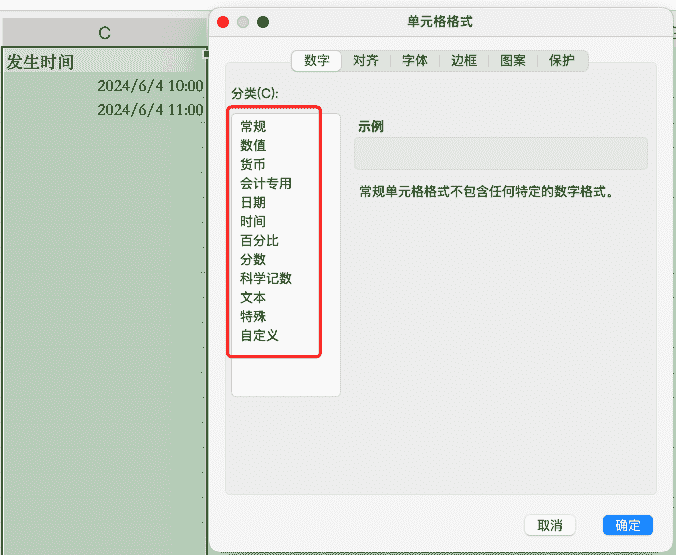

唯一不同的是 Excel 是在你填写完数据后可以随意设置，但是数据库必须在创建表的时候就要规定后字段的类型

为什么会这样呢？：因为数据库是面向程序的，提前设定好数据类型具有更好的约束性，而且合适的格式可以提升数据库的性能

让我们看下 Coze 平台中的数据库都有哪几种类型：

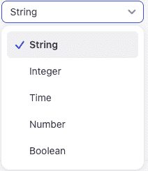

+   String （字符串类型，最常用的类型）

+   Integer（整数类型，例如 1，2，3，4）

+   Time（时间类型，Coze 中基本不用，后面我会将如何使用 String 设置时间）

+   Number（数值类型，应该是存放小数我没有用过，不确定，但是可以用 String 类型代替）

+   Boolean（布尔类型，说人话就是它只会有两个值：true 和 false）

看了这么多类型，你大概率只记住了一句话：String 最通用。

OK，到这里，我们就建立好数据库表了，接下来我们来看数据的操作

# 对数据的基本操作

还是老样子，我们通过 Excel 和数据库的对比来让大家更好的理解数据库。

不管是 Excel 还是数据库，对数据的最基本也是最核心的操作就四个：

+   增加

+   删除

+   修改

+   查询

这里关于 Excel 的例子我想就不用再说了，我们直接来看数据库是怎么操作的。

这里需要引出另一个概念，**SQL 语句**

**SQL 就是数据库对外暴露的语言，**你如果想要和数据库沟通，请学会他的语法。

举个通俗的例子：如果你想和外国人沟通，请你先学会英语。

下面我们来看针对增、删、改、查的 SQL 语句分别怎么写。这里 ChatGPT 就要登场啦

为了对新人友好，我使用的 Kimi Chat（https://kimi.moonshot.cn）

大家可以通过下面的例子看下我为什么一直强调 AI 时代的学习成本真的是大大降低了。

1.  我会这么向 Kimi 提问

```
我有一张数据库表，表名是user_qa_record

表的字段有三个，分别是

user_question代表用户输入的问题

answer代表客服的回答

create_time代表问答发生的时间

3个字段都是String的类型，请帮我生成四个SQL语句来演示增删改查
```

1.  Kimi 的回答

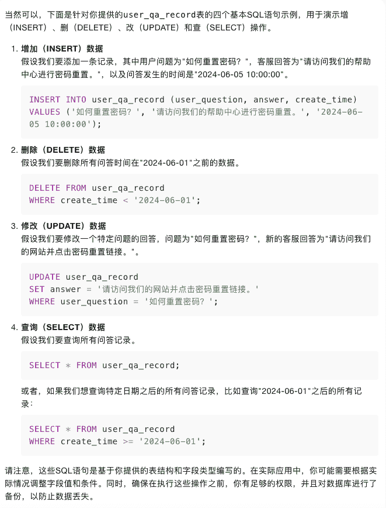

我相信如果你日常是一直使用 AI 的，这个时候你完全可以通过深挖的方式帮你继续了解增删改查的语法。

由于我们这里是教程，我还是要将核心语法展开讲一下的

## 增加数据

**增加（INSERT）数据**

假设我们要添加一条记录，其中用户问题为"如何重置密码？"，客服回答为"请访问我们的帮助中心进行密码重置。"，以及问答发生的时间是"2024-06-05 10:00:00"。

```
INSERT INTO user_qa_record (user_question, answer, create_time)
VALUES (&#x27;如何重置密码？&#x27;, &#x27;请访问我们的帮助中心进行密码重置。&#x27;, &#x27;2024-06-05 10:00:00&#x27;);
```

我抽象成一个模版就是：

```
INSERT INTO ${数据库表名} (${字段名1}，${字段名2}，${字段名3})
VALUES
(&#x27;${字段1的值}&#x27;，&#x27;${字段2的值}&#x27;，&#x27;${字段3的值}&#x27;)
```

+   里面的括号、逗号等符号务必使用英文

+   其中${}是一个占位符，代表你要按照你数据库中的定义填入

+   在 VALUES 后面的每一个字段的值都有单引号包裹，这是数据库的规范：String 类型必须用单引号或者双引号包裹

+   字段名称的数量和字段值的数量要能对上（类比你在 Excel 中输入数据，你也不会将大圣填写到学生年龄这一栏）

好了，讲到这里，我相信，只要你认真一些，一个简单的插入 SQL 语句你已经可以依葫芦画瓢搞定啦！

## 删除数据

**删除（DELETE）数据**

假设我们要删除所有问答时间在"2024-06-01"之前的数据。

```
DELETE FROM user_qa_record
WHERE create_time &lt; &#x27;2024-06-01&#x27;;
```

我抽象成一个模版就是：

```
DELETE FROM ${数据库表名}
WHERE 
${字段名称} ${操作符号} ${对比值}
```

这里涉及到了一个新的概念，Where 语句，首先他的作用就是用来筛选的，后面会跟着一系列的筛选条件。让我们继续用 Kimi 为我们答疑解惑

我是这么问题 Kim 的

```
我对Where的用法不是很清楚，你能依赖这张表的字段帮我列举一些Where语句的用法么？

要求给出场景以及对应的SQL语句
```

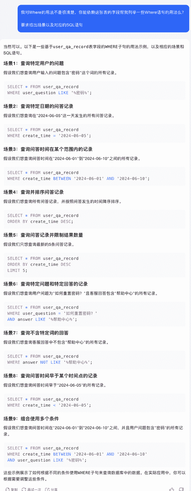

这里我就不一一展开了，我相信你已经能够依葫芦画瓢写出一些简单的 Where 语句 SQL 了

## 修改数据

**修改（UPDATE）数据**

假设我们要修改一个特定问题的回答，问题为"如何重置密码？"，新的客服回答为"请访问我们的网站并点击密码重置链接。".

```
UPDATE user_qa_record
SET answer = &#x27;请访问我们的网站并点击密码重置链接。&#x27;
WHERE user_question = &#x27;如何重置密码？&#x27;;
```

这里我们继续抽象为模版：

```
UPDATE ${数据库表名}

SET ${字段名} = &#x27;${要修改的值}&#x27;

WHERE语句的筛选条件
```

**到**这里我想你应该发现了，无论是删除还是更新，都有固定的语法，而唯一灵活的其实就是 Where 语句，也就是你想要删除或者更新什么范围的数据

如果你能想到这点，那么恭喜你，你已经看到一些本质了，最后的查询也是这样的模式

## 查询数据

**查询（SELECT）数据**

假设我们要查询所有问答记录。

```
SELECT * FROM user_qa_record;
```

或者，如果我们想查询特定日期之后的所有问答记录，比如查询"2024-06-01"之后的用户问答：

```
SELECT user_question , answer FROM user_qa_record
WHERE create_time = &#x27;2024-06-01&#x27;;
```

这里我就不抽象模版了，我相信你自己都可以搞出来了，这里面我要讲的是

+   * 代表查询表中所有的字段

+   如果要查询某一个字段，请直接指明具体字段名称，中间用逗号分隔

好啦，到这里关于数据库的增删改查就讲完啦，说实话，我都觉得自己有点啰嗦了！

但是为了让大家更好的来理解，我们还是要对比 Excel 的例子！

1.  增加数据，就是你在 Excel 中的每一个表格中添加数据

1.  删除数据：我们会将需要删除的数据先筛选出来，然后集中删除

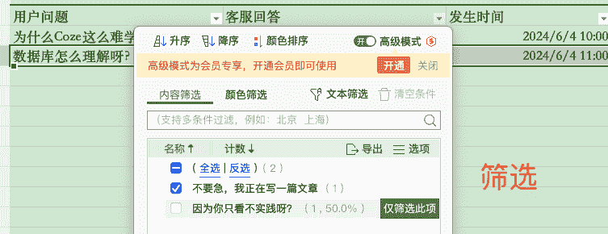

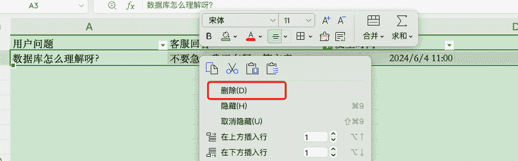

1.  修改数据：就是找到对应的那条数据，然后将数据进行更新

1.  查询数据：说白了就是制定一些筛选条件，展示我们想要看的数据，不想看的字段我们也可以隐藏。

这么一讲，是不是非常清晰啦！来来来，让我们总结一下：

**所谓**的数据库的增删改查，除了增加数据，其余的都是通过 Where 的语法框定一些数据的范围，然后进行删改查的操作。而每个操作都有其固定的语法，我们只要理解了表、字段、字段类型和数据的概念，剩下的就是套用语法啦！

这里我想再次强调下我的理念：

这篇文章没有办法带你精通数据库和 SQL，我想要做的是让你了解其本质，然后知道可以如何的向大模型提问。

如果你能做到这一步，你已经走向了正确的道路，剩下的就是看你的实操程度了！

# 向大模型提问的万能公式

你可能会问，虽然上面你讲的我都听懂了，但是遇到文章中没有的例子我还是不会怎么办？

这里我来教你向大模型提问的万能公式

```
我有一张数据库表，表名是user_qa_record

表的字段有三个，分别是

user_question代表用户输入的问题，字段类型是String

answer代表客服的回答，字段类型是String

create_time代表问答发生的时间，字段类型是String

-- 上面这一段话是告诉大模型你的表结构，接下来是你的需求

例如：
1. 请帮我生成插入5条数据的SQL
2. 请帮我按照create_time进行倒序排列
3. 请帮我查询出create_time在5月份的数据
4.....
```

这下你总该不能说不会了吧...

# Coze 中的数据库

最后，我们回归本质，这篇文章还是为了 Coze 中如何使用数据库，这里我们将流程梳理一遍

1.  创建数据库表


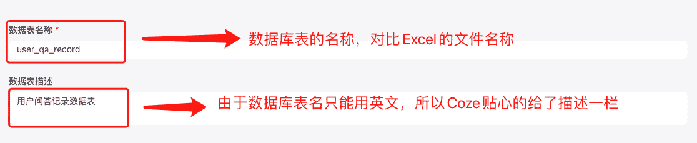


1.  在工作流中引入数据库节点

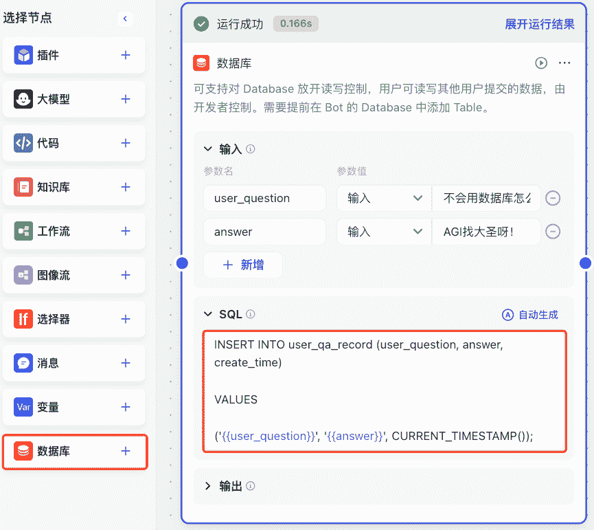

引入数据库节点，然后根据你的变量编写对应的 SQL 语句。

这里有两个注意的点

+   CURRENT_TIMESTAMP（） 这个是 Coze 内置的函数，代表可以获取当前的时间。

+   {{}} 这个是 Coze 规定的用来代表比变量值的符号。例如 {{user_question}} 等同于 不会用数据库怎么办

+   '' 单引号包裹 '{{user_question}}' 是因为数据库规范规定，字符串类型的数据必须用单引号或者双引号包裹

明白了这个之后，上面这条 SQL 本质等同于：

```
INSERT INTO user_qa_record (user_question, answer, create_time)
 
VALUES 
 
(&#x27;不会用数据库怎么办&#x27;, &#x27;AGI找大圣呀！&#x27;, &#x27;2024-06-05 10:00:00&#x27;);
```

# 写在最后

分享我的三个理念给大家：

+   读十遍不如实操一遍，实操十遍不如分享一遍

+   不要沉迷于碎片化的内容，要聚焦于体系化的知识

+   AI 时代学习一个新知识，**先了解其本质**，然后剩下的交给 AI 即可，因为了解了本质，你就会提各种问题了