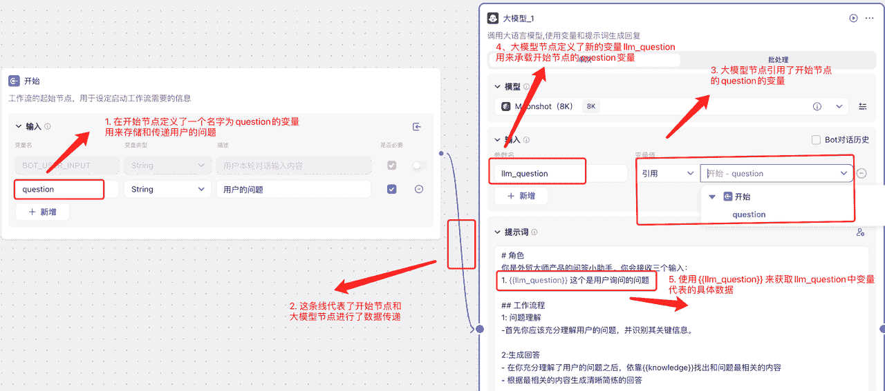
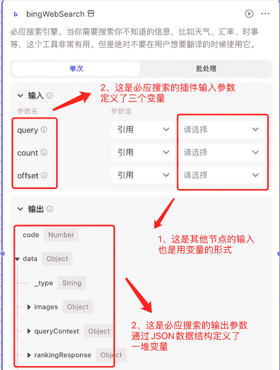
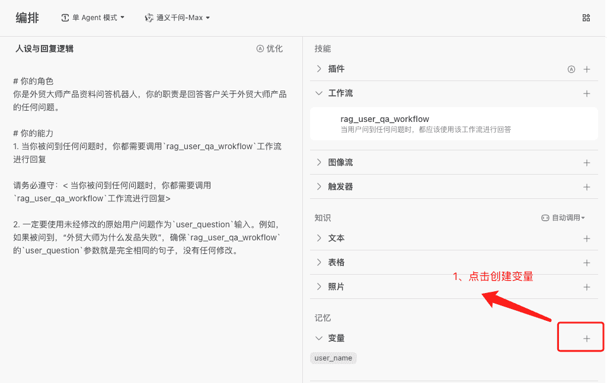
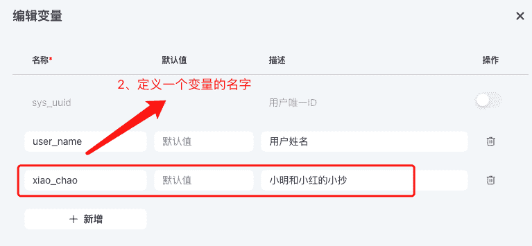
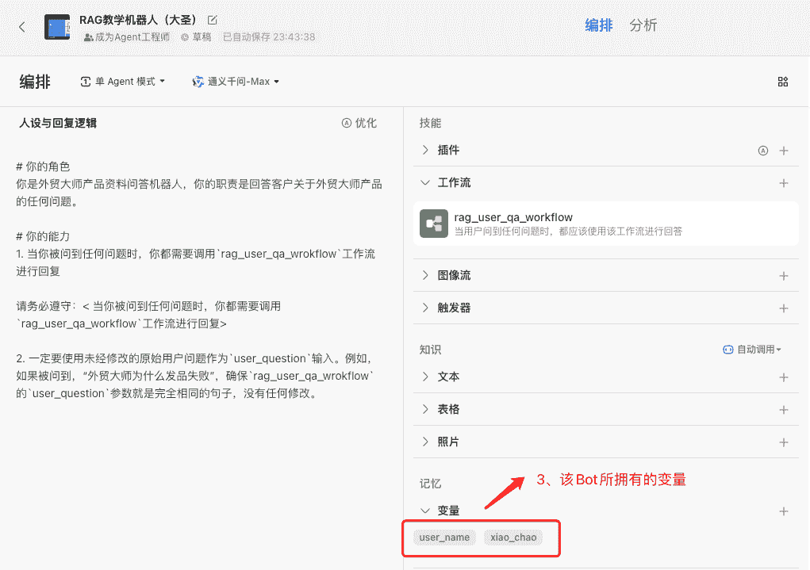
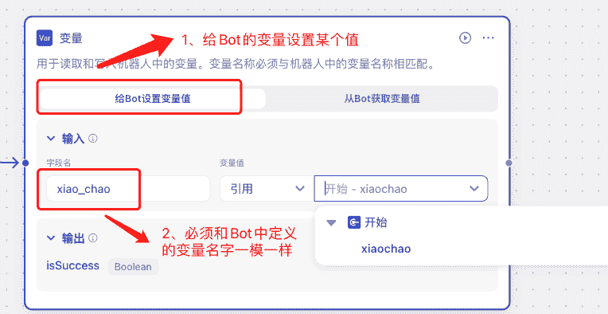
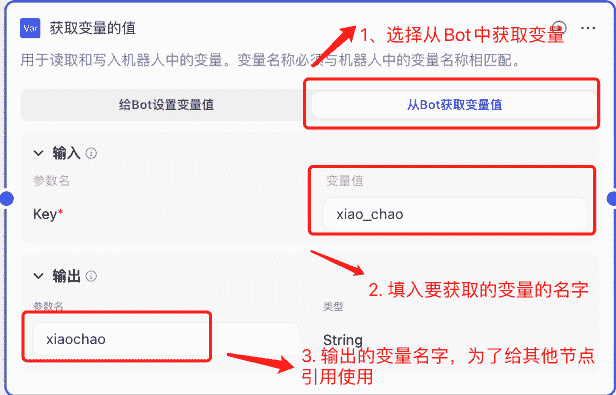
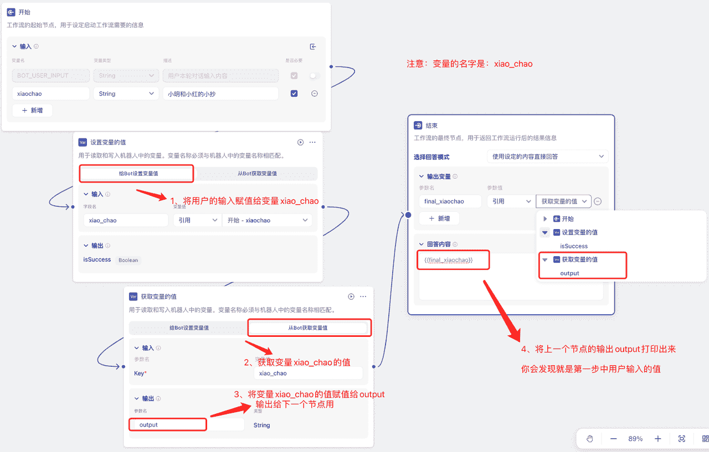
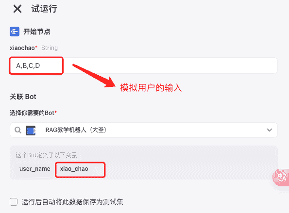
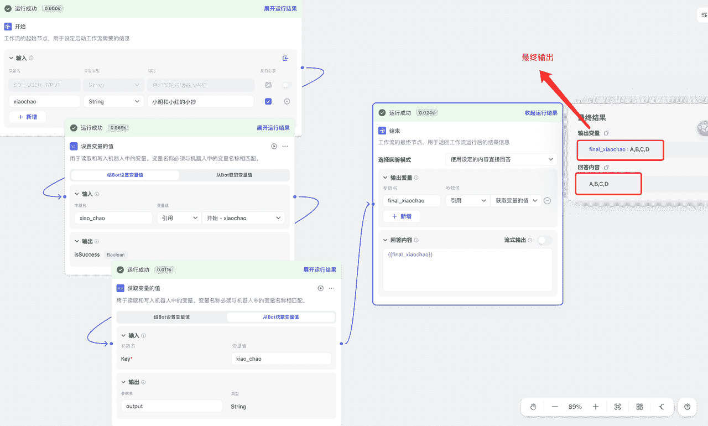

# 这可能是讲 Coze 的变量最通俗易懂的文章了

> 来源：[https://v11enp9ok1h.feishu.cn/docx/BLCNdd8KLoJ9iNxqtbfcedlen4d](https://v11enp9ok1h.feishu.cn/docx/BLCNdd8KLoJ9iNxqtbfcedlen4d)

# 引言

+   数据库（[这可能是讲 Coze 的数据库最通俗易懂的文章了](https://v11enp9ok1h.feishu.cn/wiki/TneTw5jBOiFhZXk1AdIcSpWqnHd)）

+   知识库（[这可能是讲 Coze 的知识库最通俗易懂的文章了](https://v11enp9ok1h.feishu.cn/wiki/BkpawsgpcibnAKkArpacIL6qnDh)）

+   变量

本篇则是**通俗易懂系列**的最后一篇：**变量篇**

这篇文章旨在帮助非编程人士来理解编程概念中的变量，读完本文你会收获

1.  在编程的概念中变量到底是什么

1.  Coze 中的变量节点到底该如何使用

1.  Coze 中的数据库节点和变量节点的区别

1.  多个工作流和多 Agent 之间是怎么通信的

如果看完这篇文章，你还是没有懂变量的话，你直接来杭州打我好了.....

也请允许我自卖自夸：**我这篇文章可以说是讲变量文章中 Coze 讲的最好**的，讲 Coze 的文章中变量讲的最好的。

另外做个预告，我正在规划一个关于 AI 时代你应该具备的编程基础系列，大纲如下：

+   数据库｜让 Coze 拥有了记忆的组件 1

+   知识库｜让 Coze 拥有了记忆的组件 2

+   变量｜让 Coze 拥有了记忆的组件 3

+   JSON｜让你更好的使用 Coze 插件

+   API｜外部应用程序该如何接入 Coze

+   操作系统与服务器｜那些接入了 Coze 的微机器人都是运行在哪里的

+   Docker｜让你用最简单的方式部署微信机器人

# 变量是什么

很多学 Coze 的小伙伴会问我，变量是不是一个编程中的概念。

确实，变量是编程中的一个基本概念，而 Coze 中的变量节点也和编程中的变量概念基本是一个意思。

但是变量并不是编程独有，生活中的很多领域都会有变量这个概念。

下面我就从数学和编程两个领域来回答变量是什么

## 数学中的变量

我们先来看数学中变量的概念，我们用数学方程式来说明

上面是一个数学方程式，这里面 x 和 y 都是变量。

**在数学中，变量****是**用来表示未知数或可以改变的数值。

## 编程中的变量

变量在编程中充当数据传递的媒介。具体来说，变量的主要作用可以分为两个阶段：

1.  **存储数据**：将数据存储在变量中，使数据有一个名字标识，可以随时访问和修改。

1.  **引用数据**：通过变量名来引用或使用存储的数据，从而在不同的地方或不同的时间点进行数据传递和操作。

编程其实就是现实世界的映射，因此我们先来举一个生活中的例子让大家理解变量的作用。

生活中的例子：

在一场考试前，小明和小红两个人相约要一起作弊（对答案）

考试过程中，小明需要把选择题的答案给到小红，于是他会做如下事情：

+   小明找到了一张白纸用来写选择题答案（小明定义了一个变量，变量的名字叫做《小抄》）

+   **小明选择题的答案写**到了白纸上（小明**将选**择题答案（数据）存储到了名字为《小抄》的变量中）

+   小明将写有答案的小抄递给了小红

+   **小红**拿到小抄之后，阅读了上面的答案（小红引用了《小抄》这个变量中的数据）

上面的这个例子我相信你肯定读的懂，下面我把他转换成代码。

这段代码非常容易读懂，大家不用发怵

```
# 小明制造**答案的函数
def **xiaoming_makes_answers():
    # 小明定义了一个变量，变量的名字叫做《小抄》
    xiaochao = &quot;A, B, C, D&quot;  # 小明将选择题答案（数据）存储到了名字为《小抄》的变量中
    return xiaochao

# 小红阅读答案的函数
def xiaohong_reads_answers(xiaochao):
    # 小红引用了《小抄》这个变量中的数据
    # {xiaochao} 代表了要获取xiaochao这个变量背后的值，也就是&quot;A, B, C, D&quot;
    print(f&quot;小红拿到小抄后，阅读了上面的答案：{xiaochao}&quot;)

# 主程序
def main():
    # 小明制造答案
    xiaochao = xiaoming_makes_answers()
    # 小红阅读答案
    xiaohong_reads_answers(xiaochao)

# 调用主程序
main()
```

说人话解释下：

+   **xiaochao** 就是程序中定义的一个变量

+   "A， B， C， D" 就是小明这个函数赋值给 xiaochao 的值

+   **xiaohong_r**eads_answers 这个函数引用了 xiaochao 这个变量

+   **{xiaochao}** 代表了要获取 xiaochao 这个变量背后的值，也就是"A， B， C， D"

**上面这两**个例子充分说明了变量在编程中的作用：传递数据

还有一个形象的比喻：

**变****量**就像一个可以用名字标识的盒子，我们可以把不同的数据放进这个盒子里面，之后可以通过盒子的名字获取到盛放在里面的数据。

# Coze 中的变量

讲完了变量的概念后，我们再来看 Coze 中对于变量的使用。

在 Coze 中变量是无处不在的，而不仅仅只是变量这个节点，下面我们从三个方面来说明变量在 Coze 中的使用

## 工作流节点的数据传递

这一张图是精华，一张图告诉你工作流中的数据到底是如何传递的



+   {{llm_question}} 为什么使用{{}}就可以获取 llm_question 中的数据了？因为这是 Coze 的规定，不用纠结。

+   为什么大模型节点中还要再定义一个 llm_question 中的变量？ 这是为了节点间进行解耦

## 插件的输入输出

插件的输入输出就是一堆变量。

输出中的 JSON 结构不理解也没有关系，后面我再出教程



## 变量节点的使用

这里我们来讲 Coze 中的变量节点的使用。在使用变量节点的时候，我们一般是如下步骤

1.  第一步，在 Bot 的页面创建一个变量的名字







1.  第二步：在工作流中设置变量的值

变量一般都是在工作流中使用的，首先你要创建一个工作流，这里不展开。

工作流中的变量节点有两个作用：

+   给变量设置值（类似小明将选择题答案写在小抄上）

+   从变量中获取值（类似小红获取选择题的答案）

这里我们演示的是将开始节点中的 xiaochao 的值设置给 xiao_chao 这个变量



注意：如果选择的是给 Bot 设置变量值，那么这个节点的输出就是一个布尔值，也就是是否设置成功。这个输出值我们基本用不到

1.  第三步：在工作流中获取变量的值

当给变量设置值之后，我们的目的肯定是在某一个地方引用变量的值，通俗的讲就是将变量中的数据给取出来使用。



上面就是 Coze 工作流设置变量和使用变量的流程，相比于数据库和知识库使用起来要简单很多

最后，我再将两个节点串起来给出一个例子：

1.  搭建一个教学的例子，先设置变量，再获取变量



1.  进行试运行，观察输出





# 深入聊聊变量节点

讲完了变量的使用方式，我们再深入聊两个大家会困惑的话题

## 数据库和变量的区别

如果你不了解数据库，请阅读：[这可能是讲 Coze 的数据库最通俗易懂的文章了](https://v11enp9ok1h.feishu.cn/wiki/TneTw5jBOiFhZXk1AdIcSpWqnHd)

数据库和变量都能存储数据，那该如何选择呢？他们之间的区别 you

+   **生命周期不同**：

+   变量的生命周期只是在一次的对话窗口中，例如你跟一个使用了变量的 Bot 聊天，当你关闭聊天界面后，这个变量所代表的值也就消失了。下次你再重新和这个 Bot 聊天时，上次聊天时设置的变量值就没了

+   数据库则不一样，只要你存储了数据到数据库中，只要你不删除，每次聊天都可以读取到这些数据

**所以如果你想做一个记录每日花销的 Bot，那么你的数据一**定是存放在数据库中，这样数据才能持久存在

+   **存储的数据量：**

+   一个变量同一时间只能有一个值。比如一个变量 xiaochao，你第一次设置 A，第二次设置 B，那么变量的值就是 B，A 会永远的消失

+   数据库表理论上则可以存储无数的数据

+   **使用难易程度**：

+   使用数据库得写 SQL，这对普通人来说有一定难度

+   使用变量则就是一个设置和获取，界面化配置，非常简单

总结来说：

+   从功能层面上讲：数据库完全可以替代变量，但是使用的方式比较重，而且需要写 SQL 语句。

+   如果要永久存储数据，就要使用数据库

+   **如果能使用变量解决问题**，就不要使用数据库，因为变量更简单，更稳定

## 变量节点的经典用途

看到上面的使用，你可能会产生一个疑问：

“大圣，看完你的教程，我知道了变量如何使用了，但是我在什么时候用呢？在一个工作流中设置和读取，感觉没必要呀？”

你的疑惑是对的，在单个工作流中进行变量的设置和读取确实会有点没必要。

**但**是变量在多工作流和多 Agent 模式中有大用，因为变量的值可以在多个工作流和多个 Agent 中共享。

假设你一个 Bot 中使用两个工作流 xiao_ming 和 xiao_hong，如果你想要在 xiao_ming 和 xiao_hong 之间传递数据。

你可以做如下三步

1.  定义一个变量命名为：**xiao_chao**

1.  在** xiao_ming **的工作流中将答案“A B C”设置在 xiao_chao 中，

1.  **xiao_hong **这个工作流将答案从 xiao_chao 中取出来

是不是有内味儿了...

在艾木的《谁是卧底》中就运用了大量的变量来进行多 Agent 之间的通信。

# 写在最后

分享我的三个理念给大家：

+   读十遍不如实操一遍，实操十遍不如分享一遍

+   不要沉迷于碎片化的内容，要聚焦于体系化的知识

+   AI 时代学习一个新知识，**先了解其本质**，然后剩下的交给 AI 即可，因为了解了本质，你就会提各种问题了